## Digitaler Drehstrom-Asynchronmotor-Regler

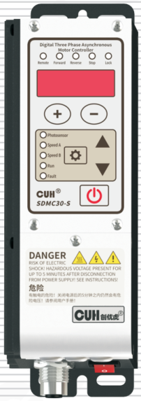

## SDMC30-S

## Benutzerhandbuch

---

## Urheberrechtshinweis

Nanjing CUH Science & Technology CO., Ltd. behält sich alle Rechte vor.

Alle in diesem Benutzerhandbuch enthaltenen Informationen sind Wissen unseres Unternehmens und durch das Urheberrecht sowie andere einschlägige Gesetze geschützt. CUH genießt und behält sich sämtliche durch das Urheberrecht und andere Gesetze verliehenen Rechte vor. Ohne schriftliche Zustimmung von CUH darf dieses Benutzerhandbuch weder ganz noch teilweise kopiert, übersetzt, nachgeahmt oder anderweitig genutzt werden.

## Haftungsausschluss

Sämtliche Inhalte dieses Benutzerhandbuchs beschreiben lediglich die Verwendung der von unserem Unternehmen hergestellten Produkte; sie werden nach dem Stand der Technik und dem Zustand zum Zeitpunkt der Überlassung beschrieben. Sie tragen die entsprechenden Risiken bei der Nutzung dieses Produkts. Soweit gesetzlich vorgeschrieben, übernimmt das Unternehmen keine ausdrückliche oder stillschweigende Haftung für das Produkt aufgrund dieses Benutzerhandbuchs, einschließlich, aber nicht beschränkt auf Personenschäden, Sachschäden, entgangene Gelegenheiten usw.

Sie verstehen die oben genannten Risiken ausdrücklich und stimmen zu, dass das Unternehmen – soweit gesetzlich vorgeschrieben – für keine direkten oder indirekten Schäden oder Verluste Ihnen gegenüber haftet (einschließlich, aber nicht beschränkt auf konkrete Verluste von Personen, Sachwerten, Daten usw. sowie immaterielle Verluste wie Reputation und entgangene Gelegenheiten).

Das Unternehmen behält sich vor, die in diesem Benutzerhandbuch beschriebenen Produkte ohne vorherige oder nachträgliche Ankündigung zu ändern.

---

# Vorwort

Vielen Dank, dass Sie sich für den digitalen Drehstrom-Asynchronmotor-Regler der CUH-SDMC30-Serie entschieden haben (im Folgenden kurz „der Regler“). Diese Reglerserie verwendet hochwertige Komponenten, integriert die neueste Elektroniktechnik und wurde mit leistungsstarken digitalen Signalprozessoren sorgfältig konzipiert.

Dieses Handbuch stellt die grundlegende Bedienung, die funktionale technische Beschreibung sowie typische Anwendungsbeispiele dieses Produkts vor. Es bietet Anwendern relevante Informationen zu Installation und Inbetriebnahme, Parametereinstellung, Fehlerdiagnose, Störungsbeseitigung und routinemäßiger Wartung des Reglers. Um die korrekte Installation und Verwendung dieses Reglers sicherzustellen, lesen Sie dieses Benutzerhandbuch bitte vor der Installation sorgfältig durch und bewahren Sie es ordnungsgemäß auf.

Lesen Sie unbedingt die folgenden Symbole, die Sie auf Vorsichtsmaßnahmen gegen Personenschäden und Produktschäden hinweisen.

|  |  |
|---|---|
| ⚠ GEFAHR | Die Nichtbeachtung dieses Punktes führt zu Personenschaden oder Tod. |
| ⚠ WARNUNG | Die Nichtbeachtung dieses Punktes kann zu Personenschaden oder Tod führen. |
| ⚠ VORSICHT | Die Nichtbeachtung dieses Punktes kann zu mittleren oder leichten Personenschäden führen. |
| HINWEIS | Die Nichtbeachtung dieses Punktes führt zu Schäden am Produkt und zu Sachschäden. |
| ❗ ZWINGEND | Kennzeichnet Vorsichtsmaßnahmen und Einsatzbeschränkungen, die während der Nutzung unbedingt zu beachten sind. |

**Dieses Handbuch ist für folgende Reglermodelle geeignet:**

- Digitaler Drehstrom-Asynchronmotor-Regler SDMC30-S

  (Eingang einphasig 85~250 VAC, Ausgang dreiphasig 0~220 Vrmn / 0,2 kW)

---

# Betriebs- und Lagerumgebung

## Prüfung vor der Verwendung

Jeder Regler durchläuft vor der Auslieferung eine strenge Qualitätsprüfung und wird mit stoßsicherer Verpackung versandt. Prüfen Sie nach dem Auspacken folgende Punkte:

1. Ob der Regler während des Transports beschädigt wurde.
2. Ob das Modell des Reglers dem bestellten entspricht.

## Betriebsbedingungen

Beachten Sie bitte die folgenden Hinweise, um eine optimale Leistung und eine lange Lebensdauer des Reglers sicherzustellen:

- ⚠ Gut belüftete Umgebung
- ⚠ Von Wasser, Dampf, Staub und insbesondere öligem Staub fernhalten
- ⚠ Von korrosiven oder brennbaren Gasen und Flüssigkeiten fernhalten
- ⚠ Von schwebendem Staub und Metallpartikeln fernhalten
- ⚠ Fest montieren, um Eigenschwingungen zu vermeiden
- ⚠ Von elektromagnetischen Störungen fernhalten
- ⚠ Umgebungstemperatur von 0~40 ℃ sicherstellen
- ⚠ Nur in Höhenlagen bis 2000 m verwenden

---

# Inhaltsverzeichnis

**Kapitel Ⅰ Vor der Inbetriebnahme — 1**

- 1.1 Prüfen des Lieferumfangs — 1
- 1.2 Beschreibung der Anzeigen und Tasten — 2
- 1.3 Beschreibung der äußeren Bauteile — 3
- 1.4 Beschreibung der Signalanschlüsse — 3
- 1.5 Beschreibung des Typenschilds — 4

**Kapitel Ⅱ Produktvorstellung — 5**

- 2.1 Produktvorstellung — 5

**Kapitel Ⅲ Installationsanleitung — 6**

- 3.1 Betriebsbedingungen des Reglers — 6
- 3.2 Bedienung der Tasten — 6
- 3.3 Installation und Inbetriebnahme — 7

**Kapitel Ⅳ Beschreibung der Grundfunktionen — 11**

- 4.1 Sollfrequenz einstellen — 11
- 4.2 Vorwärts- und Rückwärtslauf — 12
- 4.3 Not-Halt — 13
- 4.4 Sanftanlaufzeit — 14
- 4.5 Sanftauslaufzeit/Gleichstrombremsung — 14
- 4.6 Tastensperre — 15
- 4.7 Wiederherstellen der Werkseinstellungen — 16

**Kapitel Ⅴ Beschreibung der erweiterten Funktionen — 17**

- 5.1 Start/Stopp und Drehrichtungssteuerung des Motors — 17
- 5.2 Drehrichtungswechsel und Untersagung des Rückwärtslaufs — 18
- 5.3 Not-Halt des Motors — 19
- 5.4 Einstellung der Motor-V/F-Kennlinie — 21
- 5.5 Leistungsschutz des Motors — 22

---

# Kapitel Ⅰ Vor der Inbetriebnahme

Dieses Kapitel stellt den Inhalt der Produktverpackung, die Beschreibung der äußeren Bauteile des Reglers sowie die Typenschildinformationen des Reglers vor.

## 1.1 Prüfen des Lieferumfangs

Prüfen Sie vor der Verwendung die Vollständigkeit des Reglers und des Zubehörs. Stellen Sie fest, dass das Produkt defekt oder beschädigt ist oder Zubehör fehlt usw., wenden Sie sich bitte an unser Unternehmen.

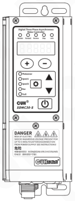

Regler ×1

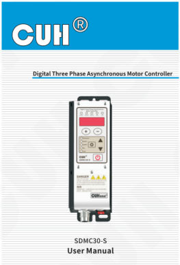

Benutzerhandbuch ×1

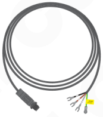

Ausgangskabel ×1

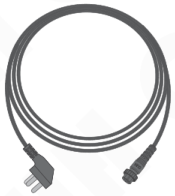

Netzanschlussleitung ×1

---

## 1.2 Beschreibung der Anzeigen und Tasten

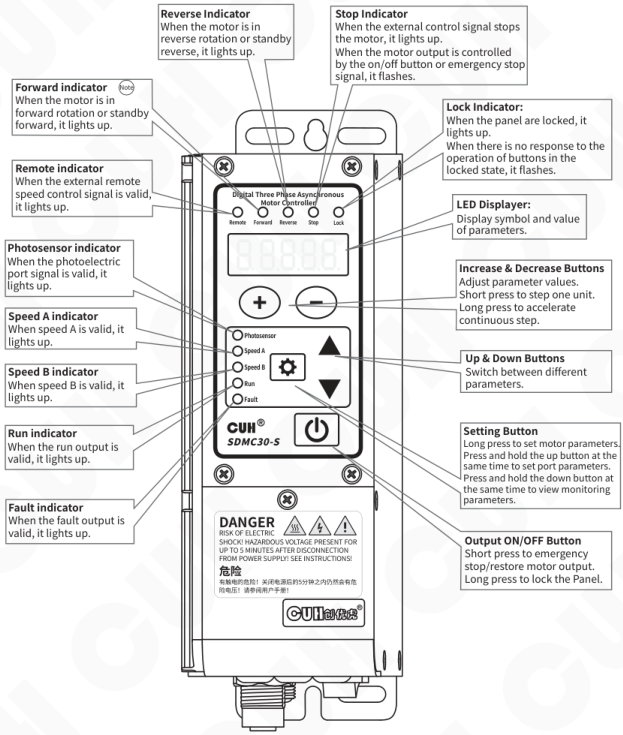

### Anzeigen

- **Rückwärtsanzeige**  
  Leuchtet, wenn der Motor im Rückwärtslauf oder im Rückwärts-Standby ist.
- **Vorwärtsanzeige** (Hinweis)  
  Leuchtet, wenn der Motor im Vorwärtslauf oder im Vorwärts-Standby ist.
- **Fernsteueranzeige**  
  Leuchtet, wenn das externe Fernsteuersignal für die Drehzahl gültig ist.
- **Fotosensoranzeige**  
  Leuchtet, wenn das Signal am fotoelektrischen Anschluss gültig ist.
- **Drehzahl-A-Anzeige**  
  Leuchtet, wenn Drehzahl A gültig ist.
- **Drehzahl-B-Anzeige**  
  Leuchtet, wenn Drehzahl B gültig ist.
- **Laufanzeige**  
  Leuchtet, wenn der Laufausgang gültig ist.
- **Störungsanzeige**  
  Leuchtet, wenn der Störungsausgang gültig ist.
- **Stopp-Anzeige**  
  Leuchtet, wenn das externe Steuersignal den Motor stoppt.  
  Blinkt, wenn der Motorausgang über die Ein-/Aus-Taste oder das Not-Halt-Signal gesteuert wird.
- **Sperranzeige**  
  Leuchtet, wenn das Bedienfeld gesperrt ist.  
  Blinkt, wenn im gesperrten Zustand auf eine Tastenbetätigung nicht reagiert wird.

### Display und Tasten

- **LED-Anzeige**  
  Zeigt Symbol und Wert der Parameter an.
- **Tasten ⊕/⊖ (Erhöhen/Erniedrigen)**  
  Stellen Parameterwerte ein.  
  Kurzes Drücken: Schritt um eine Einheit.  
  Langes Drücken: beschleunigtes kontinuierliches Verstellen.
- **Tasten ▲/▼ (Auf/Ab)**  
  Wechseln zwischen verschiedenen Parametern.
- **Einstelltaste ⚙**  
  Langes Drücken: Motoreinstellungen vornehmen.  
  Zusammen mit ▲ gedrückt halten: Anschlussparameter einstellen.  
  Zusammen mit ▼ gedrückt halten: Überwachungsparameter anzeigen.
- **Ausgangs-Ein-/Aus-Taste ⏻**  
  Kurzes Drücken: Not-Halt/Wiederherstellung des Motorausgangs.  
  Langes Drücken: Bedienfeld sperren.

### Warnung am Bedienfeld

**GEFAHR**  
GEFAHRLICHE SPANNUNG! BIS ZU 5 MINUTEN NACH DEM TRENNEN VON DER STROMVERSORGUNG LIEGT GEFAHRLICHE SPANNUNG AN! SIEHE BEDIENUNGSANLEITUNG!

### Hinweis

1. Definition: Drehrichtung Vorwärts bezeichnet die Drehrichtung, die sich beim Betrachten der Welle von der Seite der Klemmenleitung aus gemäß dem Motorantrieb ergibt. IEC60034-8 legt die Drehrichtung des Motors fest.
2. Werden zwei Außenleiter vertauscht, dreht der Motor gegen den Uhrzeigersinn, d. h. Vorwärts- und Rückwärtsrichtung werden getauscht.

---

## 1.3 Beschreibung der äußeren Bauteile

> ⚠️ **GEFAHR**
>
> Beim Anschließen des Ausgangskabels die Ausrichtung des PE-Kontakts ausrichten und den Stecker einstecken; niemals ohne Bestätigung der Richtung gewaltsam einstecken.
>
> Wird der Stecker in falscher Richtung eingesteckt, verbleibt hohe Spannung am Motorgehäuse, **was zum Tod oder schweren Verletzungen führen kann.**

> ⚠️ **GEFAHR**
>
> 1. Dieses Produkt gehört zur Schutzklasse I; der dreipolige Stecker der Netzleitung dient dem Schutzerdungsanschluss. Stellen Sie sicher, dass die angeschlossene Steckdose zuverlässig geerdet ist.
> 2. Fehlt die Schutzerdung oder liegt eine fehlerhafte Verbindung vor, verbleibt hohe Spannung auf dem Reglergehäuse; die Berührung des Reglers **kann zum Tod oder zu schweren Verletzungen führen.**

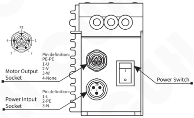

**Motor-Ausgangsbuchse**

Kontaktdefinition:
- PE-PE
- 1-U
- 2-V
- 3-W
- 4-nicht belegt

**Netz-Eingangsbuchse**

Kontaktdefinition:
- 1-L
- 2-PE
- 3-N

**Netzschalter**

## 1.4 Beschreibung der Signalanschlüsse

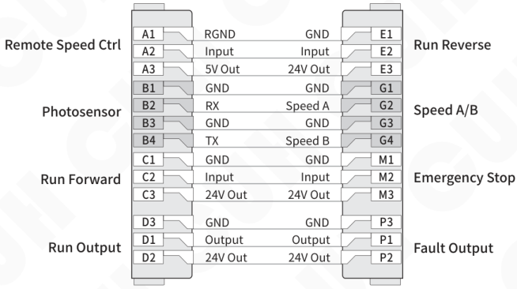

| Funktion | Kontakt | Definition | Definition | Kontakt | Funktion |
|---|---|---|---|---|---|
| Fernsteuerung Drehzahl | A1 | RGND | GND | E1 | Rückwärtslauf |
| | A2 | Input | Input | E2 | |
| | A3 | 5V Out | 24V Out | E3 | |
| Fotosensor | B1 | GND | GND | G1 | Drehzahl A/B |
| | B2 | RX | Speed A | G2 | |
| | B3 | GND | GND | G3 | |
| | B4 | TX | Speed B | G4 | |
| Vorwärtslauf | C1 | GND | GND | M1 | Not-Halt |
| | C2 | Input | Input | M2 | |
| | C3 | 24V Out | 24V Out | M3 | |
| Laufausgang | D3 | GND | GND | P3 | Störungsausgang |
| | D1 | Output | Output | P1 | |
| | D2 | 24V Out | 24V Out | P2 | |

---

## 1.5 Beschreibung des Typenschilds

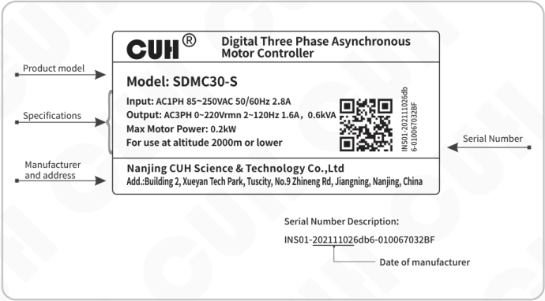

**CUH® — Digitaler Drehstrom-Asynchronmotor-Regler**

- **Produktmodell**
  - Modell: SDMC30-S
- **Technische Daten**
  - Eingang: AC1PH 85~250 VAC 50/60 Hz 2,8 A
  - Ausgang: AC3PH 0~220 Vrmn 2~120 Hz 1,6 A, 0,6 kVA
  - Maximale Motorleistung: 0,2 kW
  - Nur in Höhenlagen bis 2000 m verwenden
- **Hersteller und Adresse**
  - Nanjing CUH Science & Technology Co., Ltd
  - Adresse: Building 2, Xueyan Tech Park, Tuscity, No.9 Zhineng Rd, Jiangning, Nanjing, China
- **Seriennummer**
  - INS01-202111026db6-010067032BF

**Beschreibung der Seriennummer:**

INS01-202111026db6-010067032BF

- 20211102 → Herstellungsdatum

---

## Kapitel Ⅱ Produktvorstellung

Der Hauptinhalt dieses Kapitels umfasst eine kurze Vorstellung sowie die wesentlichen Merkmale dieses Produkts.

### 2.1 Produktvorstellung

Die SDMC30-Serie digitaler Drehstrom-Asynchronmotor-Regler ist eine kompakte, geräuscharme, vollständig halbleiterbasierte, lüfterlose Umrichtersteuerung, die durch den Einsatz neuester Elektroniktechnik und sorgfältige Auslegung einzigartige Leistung bietet. Ideal für industrielle Anwendungen. Zu den Merkmalen zählen:

- Der Raumzeiger-Pulsweitenmodulations-(SVPWM-)Dreiphasen-Reinsinus-Ausgangsmodus realisiert einen hocheffizienten und leisen Motorbetrieb.
- Die V/F-Kennlinie kann angepasst werden, um unterschiedlichen Lastanwendungen des Motors gerecht zu werden.
- Der fotoelektrische Anschluss unterstützt fotoelektrische Sensoren sowie NPN- und PNP-Schaltsensoren.
- Laufausgang und Störungsausgang dienen zur Anzeige des Betriebs- und Störungszustands des Reglers.
- Der Ausgangsanschluss unterstützt NPN-, PNP- und Push-Pull-Modi.
- Die Antistall-Funktion verhindert, dass der Motor durch Überlast bei Beschleunigung, Verzögerung und Betrieb blockiert.
- Die Gleichstrombremsfunktion kann den Motor beim Herunterfahren oder bei einem Not-Halt schnell zum Stillstand bremsen.
- Umfassende Motorschutzfunktionen wie Überlast/Überstrom/Blockierung/Phasenausfall werden unterstützt.
- Die Helligkeitseinstellung des Bedienfelds unterstützt 32 Helligkeitsstufen.
- Die Rücklaufsperre kann den Motor gegen Rückwärtslauf verriegeln.
- Not-Halt-Funktion mit wählbarem sicheren Momentabschalten (Safe Torque Off), sicherer Bremssteuerung und Sicherheitsstopp der Kategorie 1.
- Bereitschaftssignalfunktion: Gibt über den intelligenten optoelektronischen Übertragungsanschluss B4 ein moduliertes oder gültiges Signal aus, um anzuzeigen, dass sich der Regler im Bereitschaftszustand befindet. Tritt beim Regler ein Fehler auf, wird das Bereitschaftssignal ungültig.
- Die Fernsteuerfunktion unterstützt die Auswahl von 1~5 V, 0~5 V, 0~10 V und 4~20 mA.
- Mit dem Fernsteuerkoeffizienten lässt sich die Wirkung der Fernsteuerspannung um den Faktor 1 verstärken oder abschwächen.
- Die Drehzahl-AB-Funktion unterstützt zwei Schaltsignale zur Steuerung von bis zu vier Motordrehzahlen.
- Vielfältige Steuersignalquellen, logische Verknüpfungen, Schaltverzögerungen und Ausgangsmodi ermöglichen komplexe Anwendungen.
- Umfassende Überwachungsfunktionen können Temperatur, Ausgangsfrequenz, Ausgangsleistung und Signalanschlussspannung überwachen.
- Vollständige Schutzfunktionen: Kurzschlussschutz des Motorausgangs, Überlastschutz des Reglers, Überhitzungs- und Unterkühlungsschutz, Unterspannungs-/Überspannungsschutz der Stromversorgung, Kurzschlussschutz von Laufausgang und Störungsausgang, Kurzschlussschutz des 24-V-Ausgangs sowie Kurzschlussschutz des 5-V-Ausgangs der Drehzahlstellung.

---

# Kapitel Ⅲ Installationsanleitung

Dieses Kapitel beschreibt die notwendigen Bedingungen für den Einsatz des Reglers sowie dessen korrekte Installation und Verdrahtung.

## 3.1 Betriebsbedingungen des Reglers

Der Regler wird mit AC 220 V gespeist; die Schutzerdung erfolgt über den Stecker der Netzleitung. Stellen Sie bitte eine normgerechte 220-V-Netzversorgung mit 50 Hz/60 Hz sowie entsprechende Verteilerinfrastruktur bereit und stellen Sie sicher, dass der Schutzerdungsleiter korrekt angeschlossen ist.

**⚠ WARNUNG** Schließen Sie den Regler niemals an 380 V AC an. Dies verursacht irreversible schwerste Schäden am Regler und kann zu Explosion, Brand und weiteren Sicherheitsvorfällen führen.

**⚠ WARNUNG** Stellen Sie sicher, dass die Netzseite zuverlässig geerdet ist. Das Metallgehäuse des Reglers ist direkt mit dem Schutzerdungsleiter verbunden. Eine mangelhafte Erdung kann dazu führen, dass das Reglergehäuse unter Spannung steht und einen Stromschlagunfall verursacht.

**HINWEIS** Der Langzeitbetrieb erzeugt Wärme und erhöht die Gehäusetemperatur. Installieren Sie den Regler in einer gut belüfteten Umgebung, befestigen Sie ihn ordnungsgemäß und halten Sie ihn von Vibrationsquellen fern.

**HINWEIS** Der Motorausgang dieses Produkts entsteht durch Gleichrichtung und Wechselrichtung des Netzes; eine galvanische Trennstufe ist nicht vorhanden. Daher darf der Ausgangspol nicht mit der Schutzerdung verbunden werden. Stellen Sie beim Anschluss des Motors sicher, dass zwischen der Motorwicklung und dem Gehäuse eine Grundisolation besteht. Andernfalls kommt es zu Ableitströmen, die einen Stromschlag sowie Schäden am Regler verursachen können.

## 3.2 Bedienung der Tasten

Dieser Regler verwendet ein 5-stelliges Digitaldisplay zur Anzeige der Parametersymbole sowie 10 rote Anzeigen, die den Zustand des Reglers bzw. der Signalanschlüsse anzeigen.

Dieser Regler wird mit 6 Tasten bedient; die Bedienung erfolgt wie folgt:

 a. Die Tastenbetätigung wird entsprechend der Druckdauer in kurzes und langes Drücken (Beschleunigung Stufe 1 bzw. Stufe 2) unterteilt.

 b. Kurzes Drücken ist als Druckdauer von mehr als 0,1 s und weniger als 2 s definiert; langes Drücken als Druckdauer von mehr als 2 s.

 c. ⊕ und ⊖ dienen zum Einstellen der Parameterwerte; ▼ und ▲ zur Auswahl verschiedener Parameter.

 d. ⏻ kurz drücken: Not-Halt des Motorausgangs; lange drücken: Bedienfeld sperren/entsperren.

 e. ⚙ lange drücken: Motoreinstellungs-Interface aufrufen/verlassen.

 f. ⚙ und ▲ lange drücken: Anschlussparameter-Interface aufrufen/verlassen.

 g. ⚙ und ▼ lange drücken: Überwachungsparameter-Interface aufrufen/verlassen. In diesem Interface kann mit ⊕ und ⊖ die Sollfrequenz vorübergehend verstellt werden.

---

## 3.3 Installation und Inbetriebnahme

### Schritt Eins:

Öffnen Sie den Umkarton und prüfen Sie den Regler und sämtliches Zubehör.

### Schritt Zwei:

Entnehmen Sie das Ausgangskabel, verbinden Sie die Klemmenleiste des Ausgangskabels mit den Anschlussklemmen des Motors und wählen Sie je nach Typenschild des Motors die Dreieck- oder Sternschaltung. Bestätigen Sie, dass der gelb-grüne Erdungsleiter zuverlässig mit dem Metallgehäuse des Motors verbunden ist.

### Dreieckschaltung

Wird der Regler mit einem Motor △230 V/Y 400 V verbunden, ist die Dreieckschaltung zu verwenden.

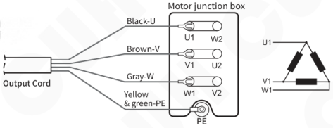

### Sternschaltung

Wird der Regler mit einem Motor △120 V/Y 230 V verbunden, ist die Sternschaltung zu verwenden.

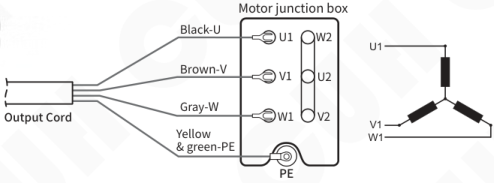

### Hinweis

- Gemäß den Festlegungen der IEC60446:
  1. Für die Außenleiter des Wechselstroms werden vorzugsweise Schwarz L1, Braun L2 und Grau L3 verwendet.
  2. Der Schutzleiter PE ist mit der zweifarbigen Kombination Gelb-Grün zu kennzeichnen.
- Dieser Regler gibt dreiphasige 220-V-Leiterspannung aus und ist für 220~240-V-Motoren in Dreieckschaltung oder 220~240-V-Motoren in Sternschaltung geeignet. Wird ein 380-V-Motor angeschlossen, kommt es zu einem starken Drehmomentabfall.

### ⚠ GEFAHR

Stellen Sie unbedingt sicher, dass das Motorgehäuse zuverlässig mit dem PE-Leiter verbunden ist. Andernfalls steht das Gehäuse unter Spannung, was den Tod oder schwere Verletzungen zur Folge haben kann.

### ⚠ WARNUNG

Schließen Sie die Motorklemmen in der Reihenfolge UVW an. Bei falscher Reihenfolge kann der Motor in umgekehrter Richtung laufen und mechanische Gefahren verursachen.

---

## Schritt Drei:

Verbinden Sie den Ausgangsstecker mit der Motor-Ausgangsbuchse des Reglers und ziehen Sie die Übermutter fest.

Entnehmen Sie anschließend die Netzleitung, stecken Sie den Rundstecker der Netzleitung in die Netz-Eingangsbuchse des Reglers und ziehen Sie die Übermutter des Steckers fest.

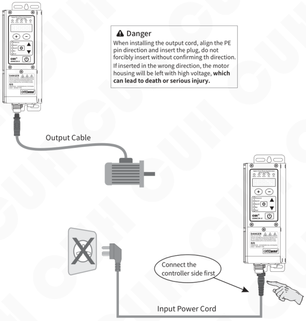

> ⚠ **GEFAHR**
>
> Beim Anschließen des Ausgangskabels die Ausrichtung des PE-Kontakts ausrichten und den Stecker einstecken; niemals ohne Bestätigung der Richtung gewaltsam einstecken.
>
> Wird der Stecker in falscher Richtung eingesteckt, verbleibt hohe Spannung am Motorgehäuse, **was zum Tod oder zu schweren Verletzungen führen kann.**

> ⚠ **GEFAHR**
>
> Zur Vermeidung elektrischer Schläge darf keine Verdrahtung unter Spannung vorgenommen werden. Schalten Sie die Stromversorgung der Anlage unbedingt ab und führen Sie die Verdrahtungsarbeiten erst 5 Minuten nach Erlöschen der Digitalanzeige durch. Bei unsachgemäßer Ausführung **besteht die Gefahr von Tod oder schweren Verletzungen.**

---

### Schritt Vier:

Nachdem Sie bestätigt haben, dass sich der Schalter in der Position AUS befindet, verbinden Sie den Stecker der Netzanschlussleitung mit der Netzsteckdose.

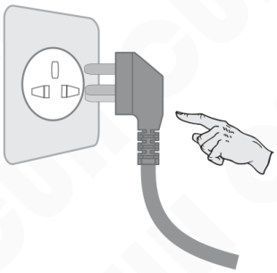

### Schritt Fünf:

Schalten Sie den Netzschalter ein. Jetzt sollte die Sollfrequenz „F 50.0“ angezeigt werden und die Vorwärts- und Stopp-Anzeigen leuchten. Der Motor dreht sich zu diesem Zeitpunkt nicht.

F bedeutet Sollfrequenz

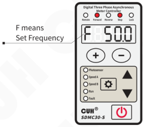

---

## Schritt Sechs:

Verbinden Sie das Vorwärts-Steuersignal oder das Rückwärts-Steuersignal mit dem Regler. Dabei erlischt die Stopp-Anzeige des Reglers, die Laufanzeige leuchtet auf und der Motor beschleunigt allmählich auf 50 Hz.

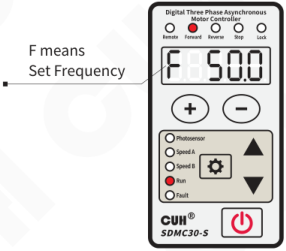

## Schritt Sieben:

Stellen Sie mit ⊕ und ⊖ die Frequenz auf die optimale Motordrehzahl ein.

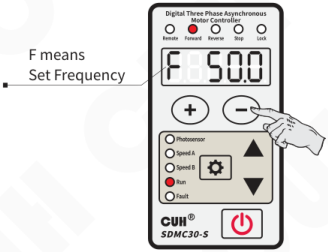

---

## Kapitel Ⅳ Beschreibung der Grundfunktionen

Dieses Kapitel beschreibt die Verwendung der Grundfunktionen dieses Produkts.

### 4.1 Sollfrequenz einstellen

Dieser Regler ermöglicht die digitale Einstellung der Ausgangsfrequenz direkt am Bedienfeld. Da er die direkte digitale Frequenzsynthese (DDS) verwendet, besitzt er eine sehr hohe Frequenzgenauigkeit und Stabilität, die sich mit Zeit und Temperatur nicht ändert.

- Netzschalter des Reglers einschalten.
- Der Regler wechselt in den Bereitschaftszustand mit dem Parameter Sollfrequenz F; die Vorwärts- und Stopp-Anzeigen am Regler leuchten und das LED-Display zeigt den Parameter F und dessen Wert an.
- ⊕ oder ⊖ drücken, um den Parameterwert einzustellen.

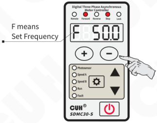

Der Einstellbereich der Sollfrequenz beträgt 2,0~120,0 Hz.

> - Der Bereich, in dem die Sollfrequenz F eingestellt werden kann, ist durch die Minimalfrequenz „r“ und die Maximalfrequenz „y“ begrenzt.

---

## 4.2 Vorwärts- und Rückwärtslauf

Dieser Regler verfügt über einen Vorwärtslaufanschluss C und einen Rückwärtslaufanschluss E. Ist das Anschlusssignal ungültig, läuft der Motor nicht und die Stopp-Anzeige leuchtet.

Ist das Signal am Vorwärtslaufanschluss C gültig, läuft der Motor vorwärts; die Stopp-Anzeige ist aus, die Vorwärtsanzeige und die Laufanzeige leuchten.

- ⚙ 2 Sekunden gedrückt halten, um das Motoreinstellungs-Interface aufzurufen.
- Mit ▲ und ▼ in den Einstellzustand der Vorwärts-Start/Stopp-Steuerquelle 1 „P1“ wechseln.
- ⊕ oder ⊖ drücken, um den Parameterwert einzustellen. Die Werkseinstellung dieses Parameters ist C.

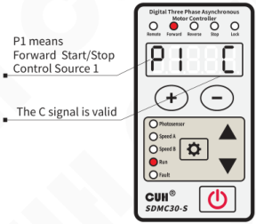

Ist das Signal am Rückwärtslaufanschluss E gültig, läuft der Motor rückwärts; die Stopp-Anzeige ist aus, die Rückwärtsanzeige und die Laufanzeige leuchten.

- ⚙ 2 Sekunden gedrückt halten, um das Motoreinstellungs-Interface aufzurufen.
- Mit ▲ und ▼ in den Einstellzustand der Rückwärts-Steuerquelle 1 „Π1“ wechseln.
- ⊕ oder ⊖ drücken, um den Parameterwert einzustellen. Die Werkseinstellung dieses Parameters ist E.

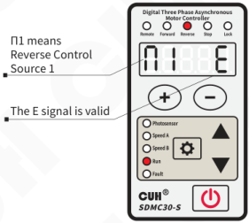

Hinweis:

1. Sind die Signale an den Vorwärts- und Rückwärtslaufanschlüssen gleichzeitig gültig, meldet der Regler den Fehler Er15 (Vorwärts-/Rückwärtskonflikt) und der Motor läuft nicht.
2. Erfolgt die Verdrahtung gemäß den Motoranschlussanweisungen, so bezeichnet gemäß IEC60034-8 die Vorwärtsdrehrichtung die im Uhrzeigersinn verlaufende Drehung, von der Antriebsseite des Motors aus betrachtet.

---

## 4.3 Not-Halt

Im Notfall kann der Regler in den Not-Halt-Zustand übergehen, um den Motorbetrieb schnell zu stoppen. Der Not-Halt-Zustand kann durch Drücken der Ein-/Aus-Taste am Bedienfeld oder durch ein gültiges Signal am Not-Haltanschluss ausgelöst werden. Dabei blinkt die Stopp-Anzeige und Ar02 (Not-Halt) wird angezeigt.

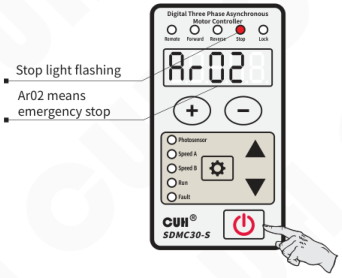

- Der durch Drücken der Ein-/Aus-Taste am Bedienfeld ausgelöste Not-Halt-Zustand kann durch erneutes Drücken der Ein-/Aus-Taste aufgehoben werden.
- Der durch ein gültiges Signal am Not-Haltanschluss ausgelöste Not-Halt-Zustand erfordert neben dem Entfernen des Not-Halt-Anschlusssignals zusätzlich das Drücken der Ein-/Aus-Taste am Bedienfeld, um den Zustand aufzuheben.

> Der Not-Halt-Modus kann über den Parameter Sq gewählt werden: sicheres Momentabschalten (Safe Torque Off), sichere Bremssteuerung und Sicherheitsstopp der Kategorie 1. Detaillierte Funktionen siehe Beschreibung der erweiterten Funktionen.

---

## 4.4 Sanftanlaufzeit

Startet dieser Regler aus dem Stopp-Zustand, kann die Motorausgangsfrequenz sanft auf die Sollfrequenz erhöht werden, um Stöße auf den Motor und die Anlage zu vermeiden.

Sanftanlaufzeit (t): Die Zeit, die die Ausgangsfrequenz des Reglers beim Start aus dem Stopp-Zustand für das sanfte Ansteigen von der Minimalfrequenz bis zur Sollfrequenz benötigt, wird als Sanftanlaufzeit bezeichnet.

- ⚙ 2 Sekunden gedrückt halten, um das Motoreinstellungs-Interface aufzurufen.
- Mit ▲ und ▼ in den Einstellzustand der Sanftanlaufzeit „t“ wechseln.
- ⊕ oder ⊖ drücken, um den Parameterwert einzustellen.

Der Bereich der Sanftanlaufzeit beträgt 0,0~99,9 Sekunden.

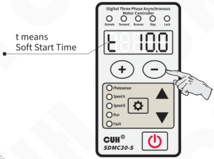

## 4.5 Sanftauslaufzeit/Gleichstrombremsung

Stoppt dieser Regler aus dem Laufzustand, kann die Motorausgangsfrequenz sanft auf die Minimalfrequenz abgesenkt werden, um Stöße auf den Motor und die Anlage zu vermeiden.

Sanftauslaufzeit (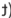): Die Zeit, die die Ausgangsfrequenz des Reglers beim Stopp aus dem Laufzustand für das sanfte Absenken von der Sollfrequenz bis zur Minimalfrequenz benötigt, wird als Sanftauslaufzeit bezeichnet.

- ⚙ 2 Sekunden gedrückt halten, um das Motoreinstellungs-Interface aufzurufen.
- Mit ▲ und ▼ in den Einstellzustand der Sanftauslaufzeit „[[vcrop:22:2]]“ wechseln.
- ⊕ oder ⊖ drücken, um den Parameterwert einzustellen.

Der Bereich der Sanftauslaufzeit beträgt 0,0~99,9 Sekunden.  
Der Bereich der Gleichstrombremszeit beträgt -0,0~-99,9 Sekunden.

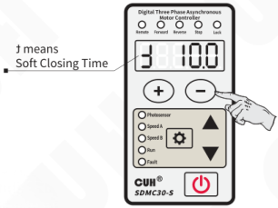

---

## 4.6 Tastensperre

Sind die Parameter des Reglers eingestellt, kann die Tastensperre alle Tasten am Bedienfeld verriegeln, um Fehlbedienungen zu vermeiden.

Auch nach dem Ausschalten und erneuten Einschalten bleibt der Zustand der Tastensperre so erhalten, wie er beim letzten Ausschalten war.

- ⏻ 2 Sekunden gedrückt halten, um alle Tasten am Bedienfeld zu sperren. Die Sperranzeige leuchtet auf.
- ⏻ erneut 2 Sekunden gedrückt halten, um die Sperre aufzuheben.

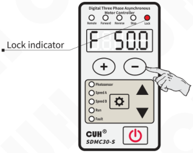

> Bei gesperrtem Regler reagieren die Tasten nicht, und die Sperranzeige blinkt.

---

## 4.7 Wiederherstellen der Werkseinstellungen

Der Anwender kann den Regler schnell in den werkseitigen Standardzustand zurückversetzen.

Aufgrund der umfangreichen Funktionalität des Reglers sind viele Parameter einstellbar. Für Einsteiger kann es nach mehreren Einstellungen und Änderungen schwierig sein, den normalen Arbeitszustand des Reglers wiederherzustellen. Mit dieser Funktion lässt sich der durcheinandergeratene Parameterzustand schnell auf die Werkseinstellungen zurücksetzen.

- ⚙ und ▲ gleichzeitig lange drücken, um das Anschlussparameter-Interface aufzurufen.

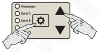

- ▲ kurz drücken, um zum vollständig blinkenden LED-Display zu wechseln; dies ist der Parameter „Wiederherstellen der Werkseinstellungen“. Anschließend ⊕ drücken und halten, bis der Regler „-----“ anzeigt; dies zeigt an, dass der Regler zurückgesetzt wurde.

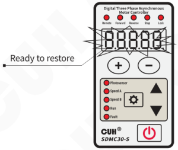

- ⊕ loslassen; nachdem der Regler „CUH“ angezeigt hat, wechselt er in das normale Bereitschafts-Interface. Damit sind alle Parameter auf die Werkseinstellungen zurückgesetzt.

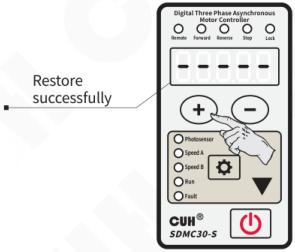

> Bevor der Anwender einen Werksreset durchführt, muss er ⏻ drücken, um den Regler in den Not-Halt-Zustand zu versetzen; dabei blinkt die Stopp-Anzeige.

---

## Kapitel Ⅴ Beschreibung der erweiterten Funktionen

Dieses Kapitel beschreibt vor allem die Verwendung der erweiterten Funktionen dieses Produkts.

### 5.1 Start/Stopp und Drehrichtungssteuerung des Motors

Dieser Regler ist mit einem Vorwärts- und einem Rückwärts-Start/Stopp-Signal zur Steuerung von Start/Stopp und Drehrichtung des Motors ausgestattet. Das Vorwärts-Start/Stopp-Signal verfügt über 2 Signalquellen und eine Logik-Berechnungseinheit; dasselbe gilt für das Rückwärtssignal. Mit diesen beiden Signalen können Start/Stopp sowie Vorwärts/Rückwärts des Motors gesteuert werden. Die konkreten logischen Zusammenhänge sind der folgenden Abbildung zu entnehmen.

Vorwärts- und Rückwärts-Start/Stopp-Steuerquellen umfassen jeweils: 0, 1, b, -b, C, -C, E, -E, SA, -SA, Sb, -Sb, ES, -ES, od, -od, oP, -oP.

Die logischen Verknüpfungen umfassen: And, Or, Xor, RS-Trigger.

Es gibt zwei Werte für die Vorwärts-/Rückwärts-Steuermodi:

- **Fr=0 bedeutet:** Das Vorwärts-Start/Stopp-Signal steuert Vorwärtsstart und -stopp; ebenso das Rückwärtssignal.
- **Fr=1 bedeutet:** Das Vorwärts-Start/Stopp-Signal steuert Start und Stopp, während das Rückwärtssignal die Drehrichtung steuert.

Hinweis: Bei Fr=0 und gleichzeitig gültigen Vorwärts- und Rückwärtssignalen wird der Fehler Er15 (Vorwärts-/Rückwärtskonflikt) ausgelöst und der Motor angehalten.

---

## 5.2 Drehrichtungswechsel und Untersagung des Rückwärtslaufs

In der Praxis kann es erforderlich sein, die Drehrichtung des Motors zu ändern oder den Lauf in eine bestimmte Richtung – etwa wegen mechanischer Systemgrenzen oder Verdrahtungsgründen – zu untersagen. Hierzu dient der Parameter Ph (Phase) für den Richtungstausch.

- **Bei Ph=Abc** ist die Standardrichtung gemeint, d. h. Vorwärtslauf ist im Uhrzeigersinn, von der Antriebsseite des Motors aus betrachtet.
- **Bei Ph=Acb** ist die getauschte Richtung gemeint, d. h. Vorwärtslauf ist gegen den Uhrzeigersinn, von der Antriebsseite des Motors aus betrachtet.
- **Bei Ph=A.b.c.** ist der Rückwärtslauf bei Standardrichtung untersagt, d. h. der Motor kann nur im Uhrzeigersinn laufen; bei einem Rückwärtslaufbefehl reagiert er nicht und zeigt die Warnung Ar08 (Rückwärtslauf untersagt) an.
- **Bei Ph=A.c.b.** ist der Vorwärtslauf bei getauschter Richtung untersagt, d. h. der Motor kann nur gegen den Uhrzeigersinn laufen; bei einem Vorwärtslaufbefehl reagiert er nicht und zeigt die Warnung Ar08 an.

Die folgende Abbildung zeigt einen Motor im Uhrzeigersinn, dessen Welle von der Antriebsseite aus im Uhrzeigersinn dreht; die Betrachtungsrichtung verläuft von der Antriebs- zur Nicht-Antriebsseite.

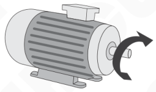

Die folgende Abbildung zeigt einen Motor gegen den Uhrzeigersinn, dessen Welle von der Antriebsseite aus gegen den Uhrzeigersinn dreht.

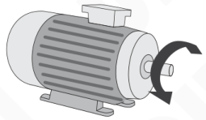

---

## 5.3 Not-Halt des Motors

Dieser Regler kann den Motor per Not-Halt anhalten; diese Stoppquelle wird durch Drücken der Ein-/Aus-Taste am Bedienfeld oder durch den externen Not-Halt-Schalter wirksam aktiviert.

Die Not-Halt-Quelle kann unterschiedliche Signalquellen wählen; werkseitig ist das Signal des Not-Halt-Anschlusses eingestellt. Die Ein-/Aus-Taste am Bedienfeld ist stets eine wirksame Not-Halt-Quelle.

Abhängig vom Not-Halt-Modus wählt der Parameter Sq unterschiedliche Strategien für den Not-Halt:

- **Sq=Sto:** Der Regler schaltet die Versorgung des Motors sofort ab; der Motor läuft trieblich verzögert aus.
- **Sq=Sbc:** Der Motor wird per Gleichstrombremsung zum Stillstand gebracht; die Bremszeit wird durch die Sanftauslaufzeit bestimmt. Der Störungsausgang gibt den Not-Halt-Zustand aus und wird nicht von der Signalquelle gesteuert; es muss ein Sicherheitsbremsrelais verwendet werden.
- **Sq=SS1:** Der Motor verzögert oder bremst gemäß der durch die Sanftauslaufzeit definierten Funktion bis zum Stillstand.

### Anschlussart des Not-Halt-Schalters

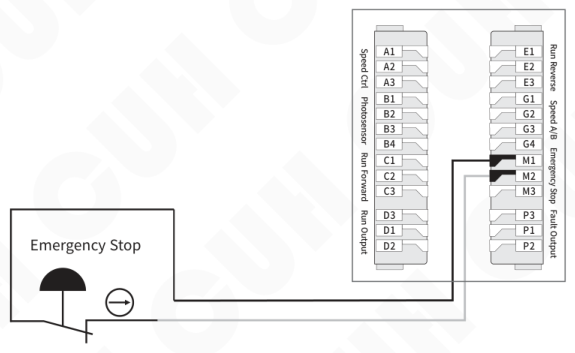

---

### Sto: Sicheres Momentabschalten (Safe Torque Off)

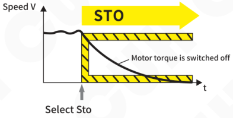

### Sbc: Sicherheitsbremssteuerung

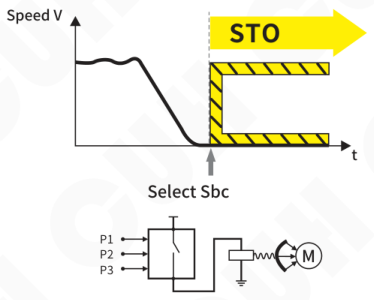

### SS1: Sicherheitsstopp der Kategorie 1

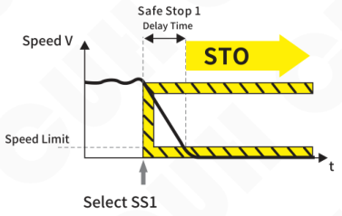

---

## 5.4 Einstellung der Motor-V/F-Kennlinie

Dieser Regler ermöglicht die Anpassung der V/F-Kennlinie, um unterschiedliche Motorlasten abzudecken.

Sie wird definiert durch die Maximalfrequenz y, die Nennfrequenz b, die Nennspannung h, die Zwischenfrequenz n, die Zwischenspannung o, die Minimalfrequenz r und die Minimalspannung u.

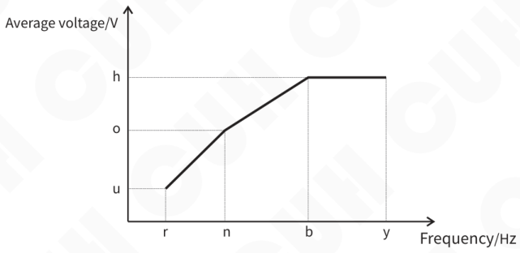

**Hinweis:** Aufgrund des induktiven Charakters der Motorlast sind die Ausgangs-Leiterspannungen auf den gleichgerichteten Mittelwert Vrmn kalibriert, um den Strom im linearen Abschnitt der V/F-Kennlinie zu halten. Im Allgemeinen ist der Effektivwert Vrms der Standard-Sinuswelle 1,11-mal so groß wie der gleichgerichtete Mittelwert Vrmn.

---

**Diagramm des Schutzes bei Überschreitung der oberen Motorleistungsgrenze**

Der Regler überwacht die elektrische Leistung des Motors in Echtzeit. Überschreitet die Leistung das Produkt aus der elektrischen Nennleistung Po des Motors und dem Leistungsüberschreitungsfaktor rc, löst dies den Schutz Er02P (Motorleistung über Grenze) aus. Der elektronische Überhitzungsintegrator des Motors geht unmittelbar in Sättigung. Der Regler reduziert die Ausgangsfrequenz, bis die Ausgangsleistung auf die durch den Leistungsdämpfungsfaktor rL definierte Leistung abgesunken ist. Dabei wird der Integrator zurückgesetzt. Nach abgeschlossenem Reset kehrt der Regler zur Sollfrequenz zurück und beginnt einen neuen Schutzzyklus.

---

## 5.6 Fernsteuerung der Motordrehzahl

Neben der Frequenzeinstellung über das Bedienfeld kann dieser Regler die Ausgangsfrequenz auch über externe analoge Signale steuern. Das Analogsignal unterstützt Potenziometer, 1~5 V, 4~20 mA, 0~5 V und 0~10 V; die Auswahl erfolgt über den Parameter Fernsteuerquelle A.

- **A=PAd:** Die Sollfrequenz wird ausschließlich über die Bedienfeldtasten gesteuert.
- **A=1-5V:** Die externe Eingabe 1-5 V stellt die Sollfrequenz zwischen der Minimalfrequenz r und der Maximalfrequenz y ein. Liegt die Spannung zwischen 0 und 0,5 V, ist die Fernsteuerung ungültig und die Sollfrequenz wird über das Bedienfeld gesteuert. Zwischen 0,5 und 1 V ist die Fernsteuerung gültig, jedoch läuft der Regler nicht.
- **A=0-5V:** Externe Eingabe 0-5 V; die Sollfrequenz liegt zwischen der Minimalfrequenz r und der Maximalfrequenz y.
- **A=0-10:** Externe Eingabe 0-10 V; die Sollfrequenz liegt zwischen der Minimalfrequenz r und der Maximalfrequenz y.

Dieser Regler verfügt zudem über den Parameter Fernsteuerkoeffizient c, um die Wirkung der Fernsteuerspannung zu verstärken oder abzuschwächen; er ist im Bereich 0,5~2,0 einstellbar. Bei 0,5 ist die Wirkung der Fernsteuerung auf die Sollfrequenz halbiert, d. h. ferngesteuert lässt sich nur die halbe Maximalfrequenz y erreichen. Bei 2,0 ist die Wirkung der Fernsteuerspannung auf die Ausgangsspannung verdoppelt, d. h. die Sollfrequenz erreicht y bereits bei der halben Fernsteuerspannung. Wird die Fernsteuerspannung weiter erhöht, kann die Ausgangsspannung nicht weiter ansteigen.

### Anschlussart der Potenziometersteuerung

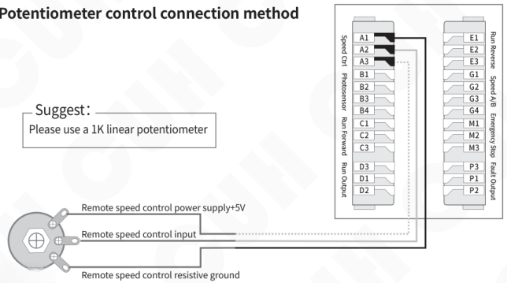

Ist das Potenziometer angeschlossen, leuchtet die Fernsteueranzeige; die Frequenzeinstellung über das Bedienfeld ist zu diesem Zeitpunkt ungültig.

---

## Anschlussart der 1~5-V-Spannungssteuerung

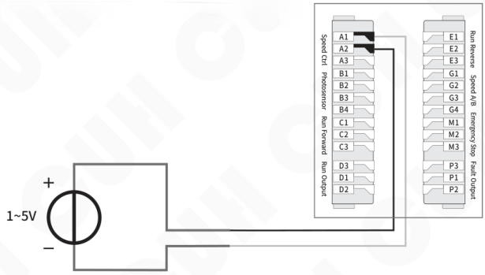

## Anschlussart der 4~20-mA-Stromsteuerung

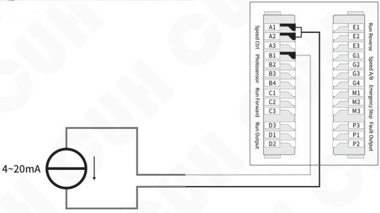

1. Wählen Sie A=1-5V; unterstützt werden Potenziometer-, 1~5-V- und 4~20-mA-Eingänge.
2. Bei Auswahl von 0~5 V oder 0~10 V entspricht die Anschlussart der von 1-5 V.

---

## 5.7 Digitale Drehzahlvoreinstellung des Motors

Die Drehzahlvoreinstellung ist eine Funktion, mit der über externe oder interne Steuersignale direkt eine vorbestimmte Drehzahl ausgewählt wird. Sie bildet ein Steuersystem mit bis zu vier Drehzahlen.

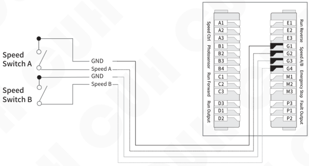

Werkseitig wählt die Drehzahlvoreinstellungsquelle 1 den externen Drehzahl-A-Anschluss SA und die Drehzahlvoreinstellungsquelle 2 den externen Drehzahl-B-Anschluss Sb. Je nach Anwendungsszenario kann die Signalquelle geändert werden, um zwischen verschiedenen Drehzahlen zu wechseln.

Jede Drehzahlvoreinstellungsquelle verfügt über eine entsprechende Anzeige am Bedienfeld, die leuchtet, wenn die Quelle aktiv ist. Die Kombination der beiden Anzeigezustände ergibt 4 Zustände (A und B aus, A an/B aus, A aus/B an, A und B an).

Durch die Kombination der Signale wechselt der Regler in den entsprechenden Drehzahlvoreinstellungs-Zustand; die Sollfrequenz des Reglers kann mit ⊕ und ⊖ verstellt werden. Diese Frequenz wird automatisch gespeichert; das Drehzahlvoreinstellungs-Steuersignal stellt den Regler bei jedem erneuten Eintritt in diesen Zustand unmittelbar auf den gespeicherten Sollfrequenzwert ein.

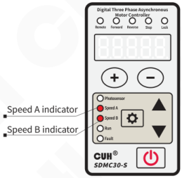

---

## 5.8 Schaltsensor

Der Regler ist mit vier schaltenden Sensoranschlüssen ausgestattet: Vorwärts- und Rückwärtslauf, Drehzahl AB sowie Not-Halt. Diese Anschlüsse unterstützen die Modi NPN, PNP, Ut1 und Ut0 und können über den Parameter Schaltsensortyp ΓA eingestellt werden.

- **Der Ut1-Modus ist eine Einzelabtastung:** Vor dem Ungültigwerden des Sensorsignals werden hoher und niedriger Pegel gewechselt, um zu erkennen, ob der Anschluss gültig ist. Nach dem Auffinden eines gültigen Signals wird der Sensortyp des Anschlusses bestimmt und nicht weiter abgetastet.
- **Der Ut0-Modus ist eine Dauerabtastung:** Unabhängig vom Sensortyp wird stets durch Wechseln zwischen hohem und niedrigem Pegel erkannt, ob am Anschluss ein gültiges Signal anliegt.

Die Schaltverzögerung jedes Schaltwerts kann ebenfalls über die entsprechenden Parameter eingestellt werden; Einzelheiten siehe Parametertabelle.

### Anschlussart des Schaltsensors

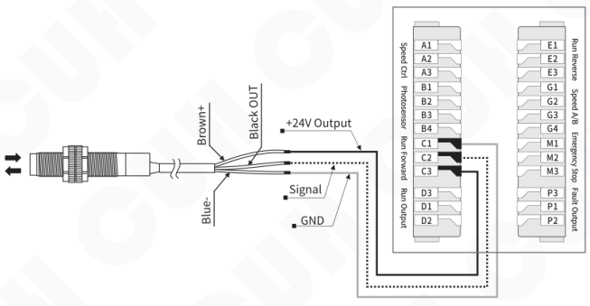

---

## 5.9 Intelligenter fotoelektrischer Sensoranschluss

Der intelligente fotoelektrische Anschluss dieses Reglers unterstützt Durchlicht- oder Reflexions-Lichtschranken aus Leuchtdioden und Fototrioden; über den Parameter P (Empfindlichkeit des intelligenten fotoelektrischen Anschlusses) kann zudem die Unterstützung von NPN- oder PNP-Schaltsensoren eingestellt werden.

### Anschlussart des fotoelektrischen Sensors

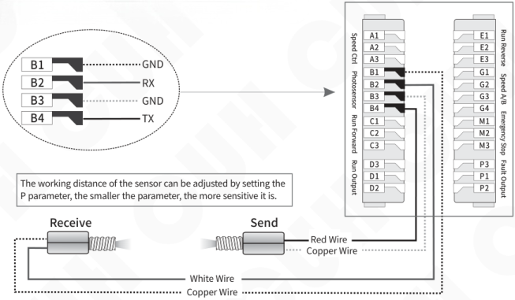

Der Arbeitsabstand des Sensors kann durch Einstellen des Parameters P angepasst werden; je kleiner der Parameter, desto empfindlicher ist der Sensor.

### Anschlussart des Schaltsensors

Wahl des NPN- oder PNP-Typs über den Parameter P.

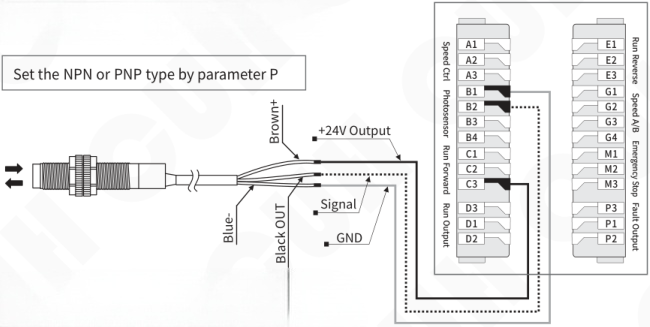

**Hinweis:**

Bei einem P-Wert von nPn oder PnP gibt B4 ein gültiges Signal von 10 mA aus.

Im Bereich von 2 bis 1000 gibt B4 ein moduliertes Signal von 10 mA mit einer Frequenz von etwa 200 Hz aus.

Tritt beim Regler ein Fehler auf, gibt B4 nichts aus. Dies ist die Bereitschaftssignalfunktion.

---

## 5.10 Laufausgang/Störungsausgang

Die Laufaus- und Störungsausgänge können NPN-Ausgang, PNP-Ausgang und Push-Pull-Ausgang unterstützen. Dabei gilt:

- Der NPN-Ausgang ist bei niedrigem Pegel (Low) gültig und im ungültigen Zustand hochohmig.
- Der PNP-Ausgang ist bei hohem Pegel (High) gültig und im ungültigen Zustand hochohmig.
- Der Push-Pull-Ausgang ist bei hohem Pegel (High) gültig und bei niedrigem Pegel (Low) ungültig.

### 5.10.1 Verdrahtung von Laufausgang/Störungsausgang

**Anschlussart des NPN-Ausgangs**

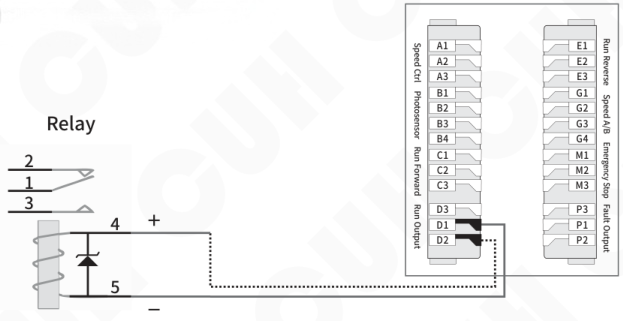

**Anschlussart des PNP- oder Push-Pull-Ausgangs**

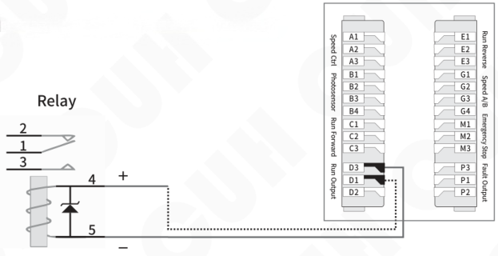

> Beim Anschluss eines 24-V-Relais unbedingt die Polarität der Spule prüfen und einen korrekten Anschluss sicherstellen. Da die Ausgangsstromfähigkeit dieses Anschlusses 350 mA beträgt, würde die interne Schutzdiode des Relais bei verpoltem Anschluss den Anschluss dieses Reglers kurzschließen und den Kurzschlussschutz Er07d/P auslösen.

---

## 5.10.2 Signalquelle und Logikdiagramm von Laufausgang/Störungsausgang

Die Steuerung von Laufausgang/Störungsausgang ist das Ergebnis der logischen Verknüpfung zweier Quellen; aus der folgenden Quellenliste kann gewählt werden.

Bedeutungsliste der Signalquellen:

| Signalquelle | Bedeutung |
|---|---|
| 0 | Ungültiges Signal |
| 1 | Gültiges Signal |
| b | Signal des intelligenten fotoelektrischen Anschlusses |
| -b | Invertiertes Signal des intelligenten fotoelektrischen Anschlusses |
| C | Signal des Vorwärtslaufanschlusses |
| -C | Invertiertes Signal des Vorwärtslaufanschlusses |
| E | Signal des Rückwärtslaufanschlusses |
| -E | Invertiertes Signal des Rückwärtslaufanschlusses |
| SA | Signal des Drehzahl-A-Anschlusses |
| -SA | Invertiertes Signal des Drehzahl-A-Anschlusses |
| Sb | Signal des Drehzahl-B-Anschlusses |
| -Sb | Invertiertes Signal des Drehzahl-B-Anschlusses |
| ES | Signal des Not-Halt-Anschlusses |
| -ES | Invertiertes Signal des Not-Halt-Anschlusses |
| od | Signal des Laufausgangsanschlusses |
| -od | Invertiertes Signal des Laufausgangsanschlusses |
| oP | Signal des Störungsausgangsanschlusses |
| -oP | Invertiertes Signal des Störungsausgangsanschlusses |
| oq | Motorausgangssignal |
| -oq | Invertiertes Motorausgangssignal |
| Er | Beliebiges Fehlersignal |
| -Er | Invertiertes beliebiges Fehlersignal |
| Ar | Beliebiges Warnsignal |
| -Ar | Invertiertes beliebiges Warnsignal |

---

## Logikdiagramm von Laufausgang/Störungsausgang:

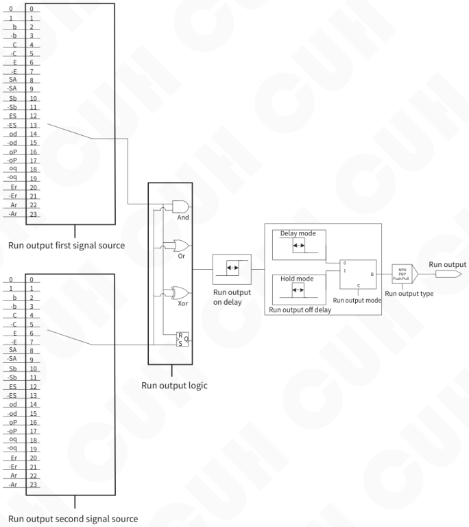

Hinweis: Das Logikdiagramm des Störungsausgangs entspricht dem Logikdiagramm des Laufausgangs.

---

## 5.10.3 Modusbeschreibung von Laufausgang/Störungsausgang

Für Laufausgang/Störungsausgang stehen 2 Modi zur Verfügung: Verzögerungsmodus (delay) und Haltemodus (hold).

**Verzögerungsmodus (delay):** Nachdem das den Laufausgang/Störungsausgang treibende Signal von gültig auf ungültig gewechselt ist, schaltet der Laufausgang/Störungsausgang nach Ablauf der Ausschaltverzögerungszeit ab.

**Haltemodus (hold):** Nachdem das den Laufausgang/Störungsausgang treibende Signal gültig geworden ist, bleibt der Laufausgang/Störungsausgang während der Ausschaltverzögerungszeit eingeschaltet und schaltet erst nach Überschreiten der Ausschaltverzögerungszeit ab.

Der Unterschied zwischen beiden Modi ist nachfolgend als Zeitdiagramm dargestellt; das Eingangssignal ist das nach dem Logikauswahl-Schalter ausgegebene Signal.

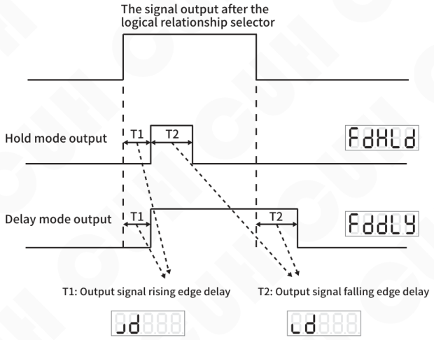

---

## 5.11 Einschalt- und Betriebszustand

Die Einstellfunktion des Einschalt-Betriebszustands erlaubt es, den Zustand der Ein-/Aus-Taste nach dem Einschalten festzulegen. Die Einstellung erfolgt über den Betriebszustandsparameter PS.

- **PS=run:** Die Ein-/Aus-Taste des Reglers befindet sich nach dem Einschalten im Zustand Lauf.
- **PS=stP:** Die Ein-/Aus-Taste des Reglers befindet sich nach dem Einschalten im Zustand Stopp.
- **PS=FoL:** Die Ein-/Aus-Taste des Reglers befindet sich nach dem Einschalten im Zustand des letzten Ausschaltens.

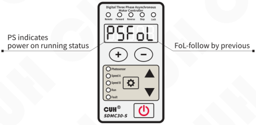

> FoL bezeichnet den Zustand, in dem sich der Regler vor dem Ausschalten befand.
>
> Befand sich der Regler vor dem Ausschalten im Not-Halt-Zustand mit blinkender Stopp-Anzeige, verbleibt er beim erneuten Einschalten in diesem Zustand.

---

## 5.12 Helligkeitseinstellung des Bedienfeldes

Dieser Regler verwendet einen neuen digitalen Anzeigetreiberbaustein, der es Anwendern ermöglicht, den Anzeigehelligkeitswert über den Parameter LED zwischen 1 und 32 einzustellen.

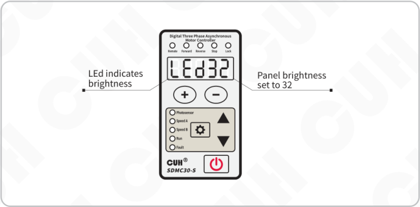

# Kapitel Ⅵ Technische Daten

## 6.1 Abmessungen　(Einheit: mm)

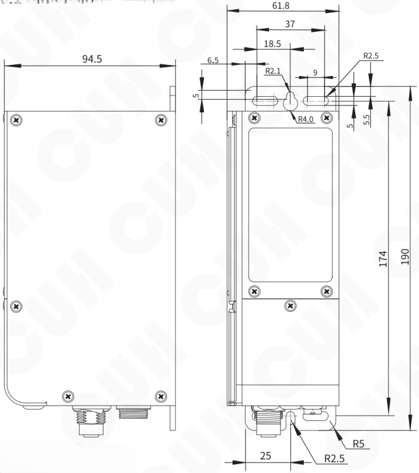

| Größenbereich | Toleranz |
|---|---|
| 0~3 | ±0,05 |
| 3~10 | ±0,1 |
| 10~30 | ±0,15 |
| 30~80 | ±0,2 |
| 80~180 | ±0,3 |
| >180 | ±0,5 |

> **! ZWINGEND**
>
> Befestigen Sie das Produkt unbedingt auf einer stabilen Plattform und nutzen Sie dazu die oberen und unteren Befestigungsbohrungen des Reglers. Installieren Sie das Gerät fern von der Aufstellung schwingungsbehafteter Geräte.

Diese Toleranztabelle gilt für alle Produkte dieser Serie.

---

## 6.2 Technische Daten

| Position | Min | Typ | Max | Einheit | Hinweis |
|---|---|---|---|---|---|
| Eingangsspannung | 85 | 220 | 250 | V | 50/60 Hz AC RMS |
| Ausgangs-Leiterspannung | 0 | 200 | 220 | Vrmn | Gleichgerichteter Mittelwert |
| Effektiver Eingangsstrom | —— | —— | 2,8 | A | |
| Eingangsstrom-Spitzenwert | —— | —— | 8,0 | A | |
| Einstellbereich des Ausgangsstroms | 0 | —— | 1,6 | A | Gleichgerichteter Mittelwert |
| Ausgangsleistung | 0 | —— | 600 | VA | |
| Ausgangsfrequenz | 2,0 | —— | 120,0 | Hz | |
| Frequenzeinstellgenauigkeit | | 0,1 | | Hz | |
| Ausgangswellenform | | Vektor-Sinus | | | |
| Zulässige Motorleistung | —— | —— | 0,2 | kW | 1/4 HP |
| Auslösetemperatur des Überhitzungsschutzes | —— | 65 | —— | ℃ | Rückkehr bei 60 ℃ |
| DC-Steuerausgangsstrom | 0 | —— | 350 | mA | |
| 24-V-Ausgangsstrom | —— | —— | 700 | mA | |
| DC-Steuerausgangsspannung | 22 | 24 | 26 | V | |
| Analogen Steuersignaleingang | | 4~20 / 1~5、0~5、0~10 | | mA / V | Über Parameter A gesteuert |
| Digitales Steuersignal | | 24 | | V | Schaltsignal |
| Einstellmethode | | 6 | | Taste | |
| Leistungsaufnahme im Bereitschaftszustand | —— | 3 | —— | W | |
| Anzeigeart | | 5 | | Stelle | LED |
| Gewicht | | 830 | | g | ohne Zubehör |
| Abmessungen | | 190\*61.8\*94.5 (L\*B\*H) | | mm | |
| Schutzart | | IP20 | | | |
| Umgebungstemperatur | -10 | 25 | 40 | ℃ | keine Kondensation |
| Umgebungsluftfeuchte | 10 | 60 | 85 | % | keine Kondensation |
| Lagerumgebungstemperatur | -20 | 25 | 85 | ℃ | keine Kondensation |
| Zulässige Höhenlage | | <2000 | | m | |

# Kapitel Ⅶ Anhang

## 7.1 Parametertabelle

| Parameter | Definition | Symbol | Anzeigesymbol | Bereich | Werkseinstellung |
|---|---|---|---|---|---|
| Bereitschaftsparameter | Sollfrequenz | F |  | 2,0~120,0 (Hz) (begrenzt durch r und y) | 50,0 |
| Motorparameter — ⚙ lange drücken | Vorwärts-Start/Stopp-Steuerquelle 1 | F1 | 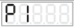 | 0, 1, b, -b, C, -C, E, -E, SA, -SA, Sb, -Sb, ES, -ES, od, -od, oP, -oP | C |
| Motorparameter | Vorwärts-Start/Stopp-Steuerquelle 2 | F2 |  | 0, 1, b, -b, C, -C, E, -E, SA, -SA, Sb, -Sb, ES, -ES, od, -od, oP, -oP | -b |
| Motorparameter | Logische Verknüpfung Vorwärts-Start/Stopp | FA |  | And, or, Xor, rS | And |
| Motorparameter | Rückwärts-Steuerquelle 1 | A1 |  | 0, 1, b, -b, C, -C, E, -E, SA, -SA, Sb, -Sb, ES, -ES, od, -od, oP, -oP | E |
| Motorparameter | Rückwärts-Steuerquelle 2 | A2 |  | 0, 1, b, -b, C, -C, E, -E, SA, -SA, Sb, -Sb, ES, -ES, od, -od, oP, -oP | -b |
| Motorparameter | Logische Verknüpfung Rückwärts | AA |  | And, or, Xor, rS | And |
| Motorparameter | Vorwärts-/Rückwärts-Steuermodus | Fr |  | 0 (Die Vorwärts-Steuerquelle dient zum Starten und Stoppen des Vorwärtslaufs, die Rückwärts-Steuerquelle zum Starten und Stoppen des Rückwärtslaufs) 1 (Die Vorwärts-Steuerquelle dient zum Steuern von Start und Stopp, die Rückwärts-Steuerquelle zur Steuerung von Vorwärts und Rückwärts) | 0 |
| Motorparameter | Not-Halt-Quelle | Eq |  | 0, 1, b, -b, C, -C, E, -E, SA, -SA, Sb, -Sb, ES, -ES, od, -od, oP, -oP, oq, -oq, Er, -Er, Ar, -Ar | ES |
| Motorparameter | Not-Halt-Typ | Sq |  | Sto: sicheres Momentabschalten, Sbc: Sicherheitsbremssteuerung, SS1: Sicherheitsstopp Kategorie 1　(Hinweis 1) | Sto |
| Motorparameter | Sanftanlaufzeit | t |  | 0,0~99,9 (s) | 10,0 |
| Motorparameter | Sanftauslaufzeit | d |  | Gleichstrombremszeit: -0,0~-99,9 (s) Sanftauslaufzeit: 0,0~99,9 (s) | 10,0 |
| Motorparameter | Maximalfrequenz | y |  | 2,0~120,0 (Hz) | 50,0 |
| Motorparameter | Nennfrequenz | b |  | 45,0~65,0 (Hz) | 50,0 |
| Motorparameter | Nennspannung | h |  | 70~220 (Vrmn) | 200 |
| Motorparameter | Zwischenfrequenz | n |  | r~b (Hz) | 10,0 |
| Motorparameter | Zwischenspannung | o |  | u~h (Vrmn) | 40 |
| Motorparameter | Minimalfrequenz | r |  | 2,0~n (Hz) | 2,0 |
| Motorparameter | Minimalspannung | u |  | 0~o (Vrmn) | 8 |
| Motorparameter | Elektrische Nennleistung des Motors | Pn |  | 0,01~0,20 (kW) | 0,20 |
| Motorparameter | Leistungsüberschreitungsfaktor | rc |  | 100~150 (%) | 150 |
| Motorparameter | Bremsstromkoeffizient | cb |  | 10~150 (%) | 100 |
| Motorparameter | Überhitzungsschwelle der elektrischen Leistung | oL |  | 0~90 (Mal*Sekunden) Anmerkung: Wird die elektrische Nennleistung des Motors überschritten, ohne die obere Motorleistungsgrenze zu überschreiten, und übersteigt das Integral pro Sekunden diese Einstellung, wird der elektronische Überhitzungsschutz aktiviert. | 30 |
| Motorparameter | Leistungsdämpfungsfaktor | rL |  | 0~90 (%) 0 bedeutet Abschaltung, 90 bedeutet Reduzierung auf 90 % der Nennleistung. | 0 |
| Motorparameter | Drehrichtungswechsel (Hinweis 2) | Ph |  | Abc: Standardrichtung, Acb: Richtungstausch, A.b.c.: Rückwärtslauf bei Standardrichtung untersagt (nur Vorwärtslauf), A.c.b.: Richtungstausch, Vorwärtslauf untersagt (nur Rückwärtslauf) | AbC |
| Motorparameter | Einschalt-Betriebszustand | PS |  | run: Lauf, stp: Stopp, FoL: letzten Zustand speichern | FoL |

**Anschlussparameter**  
⚙ und ▲ lange drücken

| Definition | Symbol | Anzeigesymbol | Bereich | Werkseinstellung |
|---|---|---|---|---|
| Empfindlichkeit des intelligenten fotoelektrischen Anschlusses | P |  | nPn, PnP, 2~1000 | nPn |
| Einschaltverzögerung des intelligenten fotoelektrischen Anschlusses | J |  | 0,0~99,9 (s) | 0,2 |
| Ausschaltverzögerung des intelligenten fotoelektrischen Anschlusses | L |  | 0,0~99,9 (s) | 0,2 |
| Schaltsensortyp | rA |  | nPn, PnP, Ut1: Einzelabtastung, Ut0: Dauerabtastung | Ut0 |
| Einschaltverzögerung Vorwärtslauf | JC |  | 0,0~99,9 (s) | 0,2 |
| Ausschaltverzögerung Vorwärtslauf | LC |  | 0,0~99,9 (s) | 0,2 |
| Einschaltverzögerung Rückwärtslauf | JE |  | 0,0~99,9 (s) | 0,2 |
| Ausschaltverzögerung Rückwärtslauf | LE |  | 0,0~99,9 (s) | 0,2 |
| Einschaltverzögerung Drehzahl A/B | JG |  | 0,0~99,9 (s) | 0,2 |
| Ausschaltverzögerung Drehzahl A/B | LG |  | 0,0~99,9 (s) | 0,2 |
| Einschaltverzögerung Not-Halt | JJ |  | 0,0~99,9 (s) | 0,2 |
| Ausschaltverzögerung Not-Halt | LL |  | 0,0~99,9 (s) | 0,2 |
| Drehzahlvoreinstellungsquelle 1 | S1 |  | 0, 1, b, -b, C, -C, E, -E, SA, -SA, Sb, -Sb, ES, -ES, od, -od, oP, -oP, oq, -oq, Er, -Er, Ar, -Ar | SA |
| Drehzahlvoreinstellungsquelle 2 | S2 |  | 0, 1, b, -b, C, -C, E, -E, SA, -SA, Sb, -Sb, ES, -ES, od, -od, oP, -oP, oq, -oq, Er, -Er, Ar, -Ar | Sb |
| Laufausgangs-Signalquelle 1 | Ed |  | 0, 1, b, -b, C, -C, E, -E, SA, -SA, Sb, -Sb, ES, -ES, od, -od, oP, -oP, oq, -oq, Er, -Er, Ar, -Ar | oq |
| Laufausgangs-Signalquelle 2 | td |  | 0, 1, b, -b, C, -C, E, -E, SA, -SA, Sb, -Sb, ES, -ES, od, -od, oP, -oP, oq, -oq, Er, -Er, Ar, -Ar | 0 |
| Logische Verknüpfung Laufausgang | Ad |  | And, or, Xor, rS | or |
| Einschaltverzögerung Laufausgang | Jd |  | 0,0~99,9 (s) | 0,0 |
| Ausschaltverzögerung Laufausgang | Ld |  | 0,0~99,9 (s) | 0,0 |
| Laufausgangsmodus | Fd |  | dLy (Verzögerungsmodus), HLd (Haltemodus) | dLy |
| Logikrichtung Laufausgang | Sd |  | `---` gleichphasig, `-﹉-` invertiert, on (Öffner), oFF (Schließer) | `---` |
| Laufausgangstyp | rd |  | nPn, PnP, PSP (Push-Pull) | nPn |
| Störungsausgangs-Signalquelle 1 | EP |  | 0, 1, b, -b, C, -C, E, -E, SA, -SA, Sb, -Sb, ES, -ES, od, -od, oP, -oP, oq, -oq, Er, -Er, Ar, -Ar | Er (Fehlersignal) |
| Störungsausgangs-Signalquelle 2 | 2P |  | 0, 1, b, -b, C, -C, E, -E, SA, -SA, Sb, -Sb, ES, -ES, od, -od, oP, -oP, oq, -oq, Er, -Er, Ar, -Ar | Ar (Warnsignal) |
| Logische Verknüpfung Störungsausgang | AP |  | And, or, Xor, rS | or |
| Einschaltverzögerung Störungsausgang | JP |  | 0,0~99,9 (s) | 0,0 |
| Ausschaltverzögerung Störungsausgang | LP |  | 0,0~99,9 (s) | 0,0 |
| Störungsausgangsmodus | FP |  | dLy (Verzögerungsmodus), HLd (Haltemodus) | dLy |
| Logikrichtung Störungsausgang | SP |  | `---` gleichphasig, `-﹉-` invertiert, on (Öffner), oFF (Schließer) | `---` |
| Störungsausgangstyp | rP |  | nPn, PnP, PSP (Push-Pull) | nPn |

Anzeigesymbole der Logikrichtung: 

| | Definition | Symbol | Anzeigesymbol | Bereich | Werkseinstellung |
|---|---|---|---|---|---|
| Anschlussparameter | Fernsteuerquelle | A |  | Pad (Tastensteuerung), 1-5V, 0-5V, 0-10 | 1-5V |
| Anschlussparameter | Fernsteuerkoeffizient | r |  | 0,50~2,00 | 1,00 |
| Anschlussparameter | Bedienfeldhelligkeit | LEd |  | 1~32 | 16 |
| Anschlussparameter | Wiederherstellen der Werkseinstellungen | 8.8.8.8.8. |  | —— | —— |
| Überwachungsparameter ⚙ und ▼ lange drücken | Reglertemperatur | C |  | -20,0~85,0 (℃) | —— |
| Überwachungsparameter | Ausgangsfrequenz | E |  | 2,0~120,0 (Hz) | —— |
| Überwachungsparameter | System-Wirkleistung (Regler + Motor) | qP |  | 0,00~0,40 (kW) | —— |
| Überwachungsparameter | Busstrom | AC |  | 0,00~3,50 (A) | —— |
| Überwachungsparameter | Ausgangsspannung | dU |  | 0~250 (V) | —— |
| Überwachungsparameter | Busspannung | PU |  | 0~400 (V) | —— |
| Überwachungsparameter | 24-V-Ausgangsspannung | nU |  | 0,0~28,0 (V) | —— |
| Überwachungsparameter | Spannung am Fernsteueranschluss | AU |  | 0,0~10,0 (V) | —— |
| Überwachungsparameter | Signalspannung am intelligenten fotoelektrischen Anschluss | bU |  | 0~999 | —— |
| Überwachungsparameter | Spannung am Vorwärtssignal | tU |  | 0,0~28,0 (V) | —— |
| Überwachungsparameter | Spannung am Laufausgang | dU |  | 0,0~28,0 (V) | —— |
| Überwachungsparameter | Spannung am Rückwärtssignal | EU |  | 0,0~28,0 (V) | —— |
| Überwachungsparameter | Spannung am Drehzahl-A-Anschluss | SA |  | 0,0~28,0 (V) | —— |
| Überwachungsparameter | Spannung am Drehzahl-B-Anschluss | Sb |  | 0,0~28,0 (V) | —— |
| Überwachungsparameter | Spannung am Not-Halt-Anschluss | SU |  | 0,0~28,0 (V) | —— |
| Überwachungsparameter | Spannung am Störungsausgang | FU |  | 0,0~28,0 (V) | —— |
| Überwachungsparameter | Version der Steuerplatine | uc |  | —— | —— |
| Überwachungsparameter | Version der Leistungsplatine | uq |  | —— | —— |

Hinweis 1: Bei Sto schaltet der Regler die Versorgung des Motors sofort ab; der Motor läuft trieblich verzögert aus.

Bei Sbc wird der Motor per Gleichstrombremsung zum Stillstand gebracht; die Bremszeit wird durch die Sanftauslaufzeit bestimmt. Der Störungsausgang gibt den Not-Halt-Zustand aus, wird nicht von der Signalquelle gesteuert, und es muss ein Sicherheitsbremsrelais verwendet werden.

Bei SS1 verzögert oder bremst der Motor gemäß der durch die Sanftauslaufzeit definierten Funktion bis zum Stillstand.

Hinweis 2: Gemäß IEC60034-8 ist die Standardrichtung wie folgt definiert: die im Uhrzeigersinn verlaufende Drehrichtung, von der Antriebsseite des Motors aus betrachtet; dieser Parameter beeinflusst nicht den Zustand der Vorwärts- und Rückwärtsanzeigen.

---

## 7.2 Ein- und Ausgangs-Schaltbilder

**Fernsteuer-Drehzahlanschluss A**

**Intelligenter Fotosensor-Anschluss B**

**Laufausgang D/Störungsausgang P**

---

| Anschluss | Funktion |
|---|---|
| C3/E3/M3 | 24V-Ausgang |
| C2/E2/M2/G2/G4 | Eingang |
| C1/E1/M1/G1/G3 | GND |

**Vorwärtslaufanschluss C/Rückwärtslaufanschluss E/**  
**Not-Haltanschluss M/Drehzahlvoreinstellungsanschluss G**

---

## 7.3 Fehlercodes

| Fehlercode | Bedeutung | Eintrittsbedingungen | Reaktion des Reglers | Störungsbeseitigung |
|---|---|---|---|---|
| Er01 | Kurzschluss des Hauptausgangs | Kurzschluss der Ausgangsphasen untereinander oder gegen PE | Hauptausgang stoppen; mit kurzem Druck auf die Ein-/Aus-Taste quittieren. | ◆ Den Ausgang kurzschließen oder den Ausgangsschalter zweimal ausschalten und anschließend wieder einschalten. |
| Er02H | Elektronik-Überhitzung des Motors | Motor überschreitet die Überhitzungsschwelle der elektrischen Leistung | Stopp und automatischer Neustart oder Betrieb mit verminderter Leistung je nach Einstellung des Dämpfungsfaktors. | ◆ Die eingestellte Motorbetriebsfrequenz ggf. angemessen reduzieren. |
| Er02P | Motorleistung über Grenze | Die Ausgangsleistung überschreitet den Leistungsüberschreitungsfaktor | Stopp und automatischer Neustart oder Betrieb mit verminderter Leistung je nach Einstellung des Dämpfungsfaktors. | ◆ Die eingestellte Motorbetriebsfrequenz ggf. angemessen reduzieren. |
| Er03L | Unterkühlung | Die Reglertemperatur liegt unter -20 ℃ | Hauptausgang stoppen. Bei Rückkehr der Temperatur auf den Normalbereich wird der Ausgang automatisch wieder gestartet. | ◆ Aktivierung des Reglers bei extremen Kälte-Temperaturen vermeiden. |
| Er03H | Überhitzung | Die Reglertemperatur liegt über 65 ℃ | Hauptausgang stoppen. Bei Rückkehr der Temperatur auf den Normalbereich wird der Ausgang automatisch wieder gestartet. | ◆ Installieren Sie den Regler in einer gut belüfteten Umgebung. |
| Er04L | Unterspannung | Die mittlere Busspannung liegt unter 77 V | Hauptausgang stoppen. Bei normaler Versorgungsspannung wird der Ausgang automatisch wiederhergestellt. | ◆ Sicherstellen, dass die Eingangsspannung zwischen 85 V und 250 V liegt. |
| Er04H | Überspannung | Die mittlere Busspannung liegt über 390 V | Hauptausgang stoppen. Bei normaler Versorgungsspannung wird der Ausgang automatisch wiederhergestellt. | ◆ Sicherstellen, dass die Eingangsspannung zwischen 85 V und 250 V liegt. |
| Er05 | Interne Kommunikationsstörung | 2 Sekunden in Folge keine Antwort der Leistungsplatine | Hauptausgang stoppen. Wird bei Wiederherstellung der Kommunikation automatisch beseitigt. | ◆ Sicherstellen, dass am 24-V-Stromanschluss keine externe Spannung anliegt, oder unseren technischen Support kontaktieren. |
| Er06 | Störung des Temperatursensors | Temperatur nicht lesbar | Hauptausgang stoppen und 2 Sekunden lang erneut versuchen, die Temperatur zu lesen. | ◆ Kontaktieren Sie unseren technischen Support. |
| Er07d/P | Kurzschluss Lauf-/Störungsausgang | Ausgangsstrom überschreitet 350 mA oder Kurzschluss | Lauf-/Störungsausgang innerhalb von 5 ms abschalten, 2 Sekunden später Ausgangs-Neustart versuchen. | ◆ Sicherstellen, dass die Last nicht kurzgeschlossen ist und der Strom 350 mA nicht überschreitet. |
| Er10 | Kurzschluss des 24-V-Ausgangs | Der 24-V-Ausgang ist kurzgeschlossen oder der Strom überschreitet 700 mA | 24-V-Ausgang stoppen; durch erneutes Einschalten wird der Ausgang wieder gestartet. | ◆ Sicherstellen, dass der 24-V-Ausgang nicht kurzgeschlossen ist oder den Strom von 700 mA überschreitet. |
| Er11 | Störung des 5-V-Ausgangs | 5-V-Ausgang verlässt den Bereich von ±10 % | Die Fernsteuerung der Drehzahl fällt aus; automatisch wiederherstellbar | ◆ Sicherstellen, dass der 5-V-Ausgang nicht kurzgeschlossen oder mit externer Spannung verbunden wurde. |
| Er12 | 24-V-Spannungsstörung | Prüfung, ob die interne 24-V-Spannung zwischen 22~26 V liegt | Steuerausgangsanschluss geht in hochohmigen Zustand; automatisch wiederherstellbar | ◆ Sicherstellen, dass am 24-V-Stromausgangs- oder Steuerausgangsanschluss keine externe Stromversorgung angeschlossen ist. |
| Er13 | Eingangsphasenausfall (nur bei Dreiphasen-Eingangsmodellen) | Phasenausfall der Dreiphasen-Stromeingabe | Hauptausgang stoppen | ◆ Spannung abschalten, den Phasenausfall am Eingang beseitigen und wieder einschalten. |
| Er14 | Ausgangsphasenausfall | Unsymmetrie der Ausgangsphasenströme von mehr als 50 % | Hauptausgang stoppen | ◆ Spannung abschalten, den Phasenausfall am Ausgang beseitigen und wieder einschalten. |
| Er15 | Vorwärts-/Rückwärtskonflikt | Vorwärts- und Rückwärtssignale liegen gleichzeitig an | Hauptausgang stoppen; nach Beseitigung des Konflikts automatisch wiederherstellbar | ◆ Sicherstellen, dass Vorwärts- und Rückwärtssignale nicht gleichzeitig anliegen. |

## Kapitel Ⅷ Produktgarantie

### 8.1 Garantiezeitraum

Die von der Firma für dieses Produkt gewährte Garantiezeit beträgt 3 Jahre ab Auslieferung des Produkts an den vom Käufer bestimmten Ort.

### 8.2 Garantieumfang

(1) Tritt innerhalb der oben genannten Garantiezeit ein von unserem Unternehmen verursachter Fehler auf, reparieren wir das Produkt kostenlos. Die folgenden Situationen sind jedoch nicht von der Garantie abgedeckt:

a. Nichteinhaltung der in der Kurzanleitung, im Benutzerhandbuch oder in den speziell zwischen Käufer und Firma vereinbarten technischen Anforderungen festgelegten Bedingungen, unsachgemäße Bedienung oder Fehler durch unsachgemäße Verwendung.

b. Fehler, die nicht auf einen Produktmangel, sondern auf die Gerätetechnik oder Softwareauslegung des Käufers zurückzuführen sind.

c. Störungen, die durch Änderungen oder Reparaturen verursacht wurden, die nicht vom Personal der Firma durchgeführt wurden.

d. Fehler, die durch korrekte Wartung oder den Austausch von Verschleißteilen gemäß Kurzanleitung oder Benutzerhandbuch vollständig vermeidbar gewesen wären.

e. Fehler, die nach dem Versand des Produkts aus unserem Unternehmen durch unvorhersehbare Fortschritte der Wissenschaft und Technik entstehen.

f. Fehler durch Naturkatastrophen wie Feuer, Erdbeben, Hochwasser oder durch externe Faktoren wie abnormale Spannung; hierfür besteht keine Garantiehaftung.

(2) Der Garantieumfang beschränkt sich auf die in (1) geregelten Situationen. Für Folgeschäden (z. B. Geräteschäden, entgangene Gelegenheiten, Gewinnausfälle) oder sonstige Verluste übernimmt die Firma keinerlei Verantwortung.

### 8.3 Produkteignung

Die Regler unserer Firma sind für die allgemeine Verwendung in der Motorsteuerungsbranche konzipiert und gefertigt. Daher darf dieser Regler nicht für die folgenden Anwendungen verwendet werden und eignet sich hierfür nicht:

(1) Einrichtungen mit schwerwiegenden Auswirkungen auf Leben und Eigentum, z. B. Kernkraftwerke, Flughäfen, Bahnanlagen, Schiffe, motorisierte Vorrichtungen und medizinische Geräte.

(2) Öffentliche Versorgungseinrichtungen, einschließlich Strom, Gas, Wasserversorgung usw.

(3) Verwendung im Freien unter ähnlichen Bedingungen oder Umgebungen.

---

Nanjing CUH Science & Technology Co.,Ltd  
https://en.cuhnj.com  
Tel.:+86-25-84730411 / 84730415 / 84730416  
Fax:+86-25-84730426  
E-mail:sales@cuhnj.com  
Add.:Building 2, Xueyan Tech Park, Tuscity,  
No.9 Zhineng Rd, Jiangning, Nanjing, China

Dokumentnr.: IDP1000330

