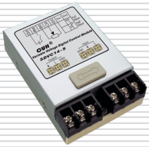
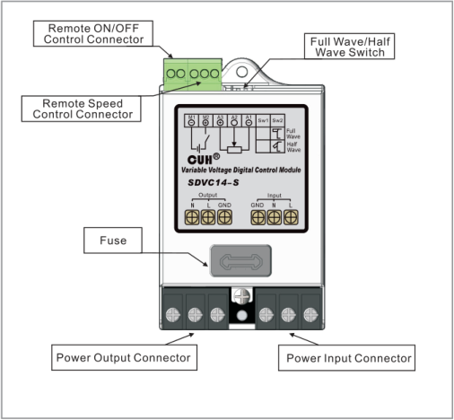
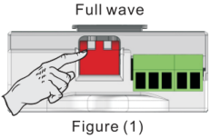
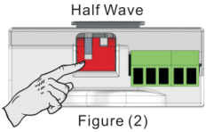

CUH

# Variables digitales Spannungsregelmodul für Schwingförderer

Modell: SDVC14-S

## Überblick:

## Verdrahtung:

## Vollwellen-/Halbwellenschalter:

Ausgangswellenform/Ausgangsfrequenz kann umgeschaltet werden

Bei einer Netzfrequenz von 50/60Hz beträgt die Ausgangsfrequenz 100/120Hz, wenn der Schalter wie in Abbildung (1) dargestellt eingestellt wird

Bei einer Netzfrequenz von 50/60Hz beträgt die Ausgangsfrequenz 50/60Hz, wenn der Schalter wie in Abbildung (2) dargestellt eingestellt wird

## Merkmale:

1) Automatische Spannungsregelung: Die interne digitale Spannungsregelschaltung kann die durch Netzspannungsschwankungen verursachte Schwankung der Fördergeschwindigkeit verringern.

2) Sanftanlauf: Der Regler erhöht die Ausgangsspannung beim Einschalten sanft von 0 auf den voreingestellten Wert, um plötzliches Rütteln zu vermeiden.

3) Lineare Spannungssteuerung: Der Drehwinkel des externen Potentiometers ist linear zur Ausgangsspannung des Regelmoduls.

4) Signalsteuerungsanschlüsse: Das Regelmodul verfügt über Anschlüsse für Fern-Ein/Aus-Steuerung und Fern-Geschwindigkeitssteuerung.

5) Optimiertes Schaltungsdesign zur Gewährleistung von Stabilität und langer Lebensdauer.

6) Überhitzungsschutz: Wenn die Innentemperatur des Regelmoduls zu hoch wird, stoppt das Regelmodul seinen Ausgang, um sich selbst zu schützen.

7) Überstromschutz: Wenn der Ausgangsstrom seinen Nennwert überschreitet, stoppt das Regelmodul seinen Ausgang, um sich selbst und die Last zu schützen.

8) Sicherungs-Kurzschlussschutz: Wenn der Ausgang des Regelmoduls kurzgeschlossen wird, brennt die interne Sicherung durch, um das Regelmodul und die Last zu schützen.

## Technische Daten:

| Punkt | Bereich: Min | Bereich: Typisch | Bereich: Max | Einheit | Beschreibung |
|---|---|---|---|---|---|
| Eingangsspannung | 150 | 220 | 260 | V | AC RMS |
| Einstellbarer Ausgangsspannungsbereich | 35 | —— | Vin-10 | V | Halbwelle |
| | 45 | —— | Vin-5 | | Vollwelle |
| Ansprechzeit der Spannungsregelung | 0 | 0.01 | 0.02 | s | |
| Einstellbarer Ausgangsstrombereich | 0.1 | —— | 4 | A | |
| Ausgangsleistung | 22 | —— | 880 | VA | |
| Ausgangsfrequenz | 45 | 50/60 | 65 | Hz | Halbwelle |
| | 90 | 100/120 | 130 | Hz | Vollwelle |
| Ausgangswellenform | | Phasenanschnitt-Sinus | | | |
| Sanftanlaufzeit | 0.5 | 0.65 | 0.7 | s | |
| Auslösetemperatur des Überhitzungsschutzes | 58 | 60 | 66 | ℃ | |
| Spannung der Fern-Ein/Aus-Steuerung | 5 | —— | 24 | V | |
| Sicherungskapazität | | 6.3 | | A | |
| Umgebungstemperatur | 0 | 25 | 40 | ℃ | Ohne Kondensation |
| Umgebungsfeuchtigkeit | 10 | 60 | 85 | % | |

## Abmessungen und Gewicht:

Abmessungen: 102(L)mm X 63(W)mm X 27(H)mm  
Gewicht: 92g

Nanjing CUH Science & Technology Co.,Ltd  
https://en.cuhnj.com  
Tel.:+86-25-84730411 / 84730415 / 84730416  
Fax:+86-25-84730426  
E-mail:sales@cuhnj.com  
Add.:Building 2, Xueyan Tech Park, Tuscity,  
No.9 Zhineng Rd, Jiangning, Nanjing, China

Document NO. : SDVC14SSMSEN_1.04

