## Digitaler Spannungsregler für Schwingförderer

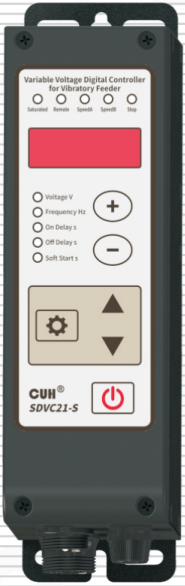

## SDVC21-S

## Benutzerhandbuch

---

## Urheberrechtshinweis

Nanjing CUH Science & Technology CO., Ltd. behält sich alle Rechte vor.

Alle in diesem Benutzerhandbuch enthaltenen Informationen sind Wissen unseres Unternehmens und durch das Urheberrecht sowie andere einschlägige Gesetze geschützt. CUH genießt und behält sich sämtliche durch das Urheberrecht und andere Gesetze verliehenen Rechte vor. Ohne schriftliche Zustimmung von CUH darf dieses Benutzerhandbuch weder ganz noch teilweise kopiert, übersetzt, nachgeahmt oder anderweitig genutzt werden.

## Haftungsausschluss

Sämtliche Inhalte dieses Benutzerhandbuchs beschreiben lediglich die Verwendung der von unserem Unternehmen hergestellten Produkte; sie werden nach dem Stand der Technik und dem Zustand zum Zeitpunkt der Überlassung beschrieben. Sie tragen die entsprechenden Risiken bei der Nutzung dieses Produkts. Soweit gesetzlich vorgeschrieben, übernimmt das Unternehmen keine ausdrückliche oder stillschweigende Haftung für das Produkt aufgrund dieses Benutzerhandbuchs, einschließlich, aber nicht beschränkt auf Personenschäden, Sachschäden, entgangene Gelegenheiten usw.

Sie verstehen die oben genannten Risiken ausdrücklich und stimmen zu, dass das Unternehmen – soweit gesetzlich vorgeschrieben – für keine direkten oder indirekten Schäden oder Verluste Ihnen gegenüber haftet (einschließlich, aber nicht beschränkt auf konkrete Verluste von Personen, Sachwerten, Daten usw. sowie immaterielle Verluste wie Reputation und entgangene Gelegenheiten).

Das Unternehmen behält sich vor, die in diesem Benutzerhandbuch beschriebenen Produkte ohne vorherige oder nachträgliche Ankündigung zu ändern.

---

## Vorwort

Vielen Dank, dass Sie sich für den digitalen Spannungsstellregler CUH SDVC21-S für Schwingförderer entschieden haben (im Folgenden kurz „der Regler“). Diese Reglerserie verwendet hochwertige Komponenten, integriert die neueste Elektroniktechnik und wurde mit leistungsstarken digitalen Signalprozessoren sorgfältig konzipiert.

Dieses Handbuch stellt die grundlegende Bedienung, die funktionale technische Beschreibung sowie typische Anwendungsbeispiele dieses Produkts vor. Es bietet Anwendern relevante Informationen zu Installation und Inbetriebnahme, Parametereinstellung, Fehlerdiagnose, Störungsbeseitigung und routinemäßiger Wartung des Reglers. Um die korrekte Installation und Verwendung dieses Reglers sicherzustellen, lesen Sie dieses Benutzerhandbuch bitte vor der Installation sorgfältig durch und bewahren Sie es ordnungsgemäß auf.

Lesen Sie unbedingt die folgenden Symbole, die Sie auf Vorsichtsmaßnahmen gegen Personenschäden und Produktschäden hinweisen.

|  |  |
|---|---|
| ⚠ GEFAHR | Die Nichtbeachtung dieses Punktes führt zu Personenschaden oder Tod. |
| ⚠ WARNUNG | Die Nichtbeachtung dieses Punktes kann zu Personenschaden oder Tod führen. |
| ⚠ VORSICHT | Die Nichtbeachtung dieses Punktes kann zu mittleren oder leichten Personenschäden führen. |
| HINWEIS | Die Nichtbeachtung dieses Punktes führt zu Schäden am Produkt und zu Sachschäden. |
| ❗ ZWINGEND | Kennzeichnet Vorsichtsmaßnahmen und Einsatzbeschränkungen, die während der Nutzung unbedingt zu beachten sind. |

**Dieses Handbuch ist für folgende Reglermodelle geeignet:**

- Digitaler Spannungsregler für Schwingförderer　SDVC21-S (5A)

---

## Sicherheitshinweise und Vorsichtsmaßnahmen

1. **⚠ GEFAHR** Dieses Produkt dient ausschließlich zum Antrieb von elektromagnetisch basierten Schwingfördereinrichtungen; verwenden Sie dieses Produkt nicht zum Schutz des menschlichen Körpers oder von Körperteilen usw.

2. **⚠ GEFAHR** Dieses Produkt ist nicht als explosionsgeschütztes Produkt konzipiert; verwenden Sie es nicht in Gefahrenbereichen und/oder in einer potenziell explosiven Gasatmosphäre.

3. **⚠ WARNUNG** Dieses Produkt wird aus dem Wechselstromnetz gespeist; legen Sie keine Wechselspannung über 260 Vac an. Überhöhte Eingangsspannung, z. B. 380 Vac, kann dazu führen, dass das Produkt explodiert oder in Brand gerät, mit schwerwiegenden Sicherheitsunfällen als Folge.

4. **⚠ WARNUNG** Dieses Produkt wird über das Netzkabel geerdet. Stellen Sie sicher, dass die Stromversorgungsanlagen für den Regler fachgerecht geerdet sind, andernfalls kann das Gehäuse des Reglers unter Spannung stehen und ein Stromschlagunfall die Folge sein.

5. **⚠ WARNUNG** Speisen Sie keine Wechselspannung in den Ausgang dieses Reglers ein; dies würde den Regler beschädigen.

6. **⚠ WARNUNG** Stecken und ziehen Sie die Leitungen niemals unter Spannung und berühren Sie nicht die Kontakte der einzelnen Anschlussklemmen im Anschlussfach, um Stromschläge zu vermeiden.

7. **HINWEIS** Steuern Sie den Ausgang dieses Produkts bitte nicht durch Unterbrechen der Stromversorgung über Relais oder ähnliche Einrichtungen, da dies die Lebensdauer des Reglers erheblich reduziert.

8. **HINWEIS** Der Regler ist für den Betrieb in einer kühlen und trockenen Umgebung ausgelegt. Betreiben Sie den Regler niemals im Freien, um Durchnässung und Sonneneinstrahlung zu vermeiden. Betreiben Sie den Regler innerhalb der spezifizierten Temperatureigenschaften.

9. **❗ ZWINGEND** Befestigen Sie dieses Produkt unbedingt auf einer stabilen Plattform, die zuverlässig geerdet und von schwingenden Einrichtungen entfernt ist.

10. **❗ ZWINGEND** Betreiben Sie den Regler niemals außerhalb seiner Auslegungsgrenzen.

11. **❗ ZWINGEND** Bedienen Sie den Regler strikt gemäß dieser Anleitung. Bei Schäden am Gerät oder Personenschäden durch unsachgemäßen Betrieb übernehmen wir keinerlei zivil- oder strafrechtliche Haftung.

12. **❗ ZWINGEND** Öffnen Sie niemals das Gehäuse des Reglers, um Stromschläge zu vermeiden. Wenden Sie sich bei einer Störung an CUH. Versuchen Sie niemals, den Regler selbst zu reparieren – dies kann zum Verlust der Garantie führen.

---

## Betriebs- und Lagerumgebung

### Prüfung vor der Inbetriebnahme

Jeder Regler durchläuft vor der Auslieferung eine strenge Qualitätsprüfung und wird in stoßsicherer Verpackung versandt. Prüfen Sie nach dem Auspacken die folgenden Punkte:

1. Ob der Regler beim Transport beschädigt wurde.
2. Ob das Modell des Reglers dem bestellten entspricht.

### Betriebsumgebung

Beachten Sie bitte die folgenden Hinweise, um eine gute Leistung und eine lange Lebensdauer des Reglers sicherzustellen:

- ⚠ Gut belüftete Umgebung
- ⚠ Fernhalten von Wasser, Dampf, Staub und insbesondere öligem Staub
- ⚠ Fernhalten von korrosiven oder brennbaren Gasen und Flüssigkeiten
- ⚠ Fernhalten von schwebendem Staub und Metallpartikeln
- ⚠ Sichere Befestigung, um Eigenschwingungen zu vermeiden
- ⚠ Fernhalten von elektromagnetischen Störungen
- ⚠ Umgebungstemperatur von 0~40 ℃ sicherstellen
- ⚠ Verwendung in Höhenlagen bis 2000 m

---

# Inhaltsverzeichnis

- **Kapitel Ⅰ Vor der Inbetriebnahme — 1**
  - 1.1 Prüfen des Lieferumfangs — 1
  - 1.2 Beschreibung der Anzeigen, Tasten und äußeren Bauteile — 2
  - 1.3 Beschreibung der Anschlussklemmen — 3
  - 1.4 Beschreibung des Typenschilds — 3
- **Kapitel Ⅱ Merkmale — 4**
- **Kapitel Ⅲ Installationsanleitung — 6**
  - 3.1 Betriebsbedingungen des Reglers — 6
  - 3.2 Bedienung der Tasten — 6
  - 3.3 Installation und Inbetriebnahme — 7
- **Kapitel Ⅳ Beschreibung der Grundfunktionen — 9**
  - 4.1 Ausgangsspannung — 9
  - 4.2 Ausgangsfrequenz — 10
  - 4.3 Sanftanlaufzeit — 11
  - 4.4 Ausgangs-Ein-/Ausschalten — 11
  - 4.5 Begrenzung der maximalen Ausgangsspannung — 12
  - 4.6 Tastensperre — 12
  - 4.7 Wiederherstellen der Werkseinstellungen — 13
- **Kapitel Ⅴ Sensoren und Signalsteuerung — 14**
  - 5.1 Intelligente fotoelektrische Erfassung — 14
    - 5.1.1 Verdrahtung des intelligenten fotoelektrischen Sensors — 14
    - 5.1.2 Ein-/Ausschaltverzögerung des intelligenten fotoelektrischen Sensors — 15
    - 5.1.3 Einstellung der Logikrichtung des intelligenten fotoelektrischen Sensors — 16
  - 5.2 Verwendung des NPN-Schaltsensors — 17
    - 5.2.1 Verdrahtung des NPN-Schaltsensors — 17
    - 5.2.2 Ein-/Ausschaltverzögerung des NPN-Schaltsensors — 18
    - 5.2.3 Einstellung der Logikrichtung des NPN-Schaltsensors — 19
  - 5.3 Verwendung des zweiten NPN-Schaltsensors — 20
    - 5.3.1 Verdrahtung des zweiten NPN-Schaltsensors — 20
    - 5.3.2 Ein-/Ausschaltverzögerung des zweiten NPN-Schaltsensors — 21
    - 5.3.3 Einstellung der Logikrichtung des zweiten NPN-Schaltsensors — 22
  - 5.4 Einstellung der logischen Verknüpfung der Steuersignale — 23
  - 5.5 Steuerausgang — 24
    - 5.5.1 Verdrahtung des Steuerausgangs — 24
    - 5.5.2 Einstellung der Logikrichtung des Steuerausgangs — 26
  - 5.6 Fernsteuerung der Geschwindigkeit — 27
  - 5.7 Voreingestellte Geschwindigkeitsumschaltung — 28
- **Kapitel Ⅵ Sicherheitsfunktionen — 29**
  - 6.1 Automatische digitale Spannungsstabilisierung — 29
  - 6.2 Kurzschlussschutz — 29
  - 6.3 Überlastschutz (Strom) — 29
  - 6.4 Überhitzungsschutz — 29
- **Kapitel Ⅶ Technische Daten — 30**
  - 7.1 Abmessungen — 30
  - 7.2 Technische Daten — 31
  - 7.3 Referenznormen — 32
  - 7.4 Parametertabelle — 33
  - 7.5 Störungsbeseitigungshinweise und Fehlererklärungen — 34
- **Kapitel Ⅷ Produktgarantie — 35**
  - 8.1 Garantiezeitraum — 35
  - 8.2 Garantieumfang — 35
  - 8.3 Produkteignung — 35

---

# Kapitel Ⅰ Vor der Inbetriebnahme

Dieses Kapitel stellt den Inhalt der Produktverpackung, die Beschreibung des Reglergehäuses und die Informationen zum Typenschild des Reglers vor.

## 1.1 Prüfen des Lieferumfangs

Prüfen Sie vor der Verwendung die Vollständigkeit des Reglers und des Zubehörs. Stellen Sie einen Defekt oder eine Beschädigung des Produkts, fehlendes Zubehör o. Ä. fest, kontaktieren Sie bitte unser Unternehmen.

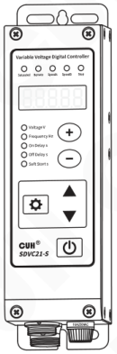

Regler ×1

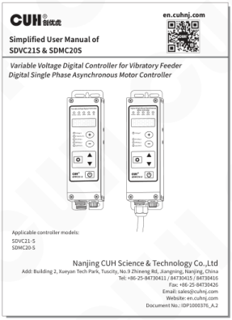

Benutzerhandbuch ×1

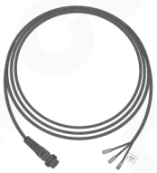

Ausgangsleitung ×1

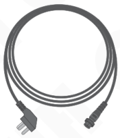

Eingangs-Netzkabel ×1

---

## 1.2 Beschreibung der Anzeigen, Tasten und äußeren Bauteile

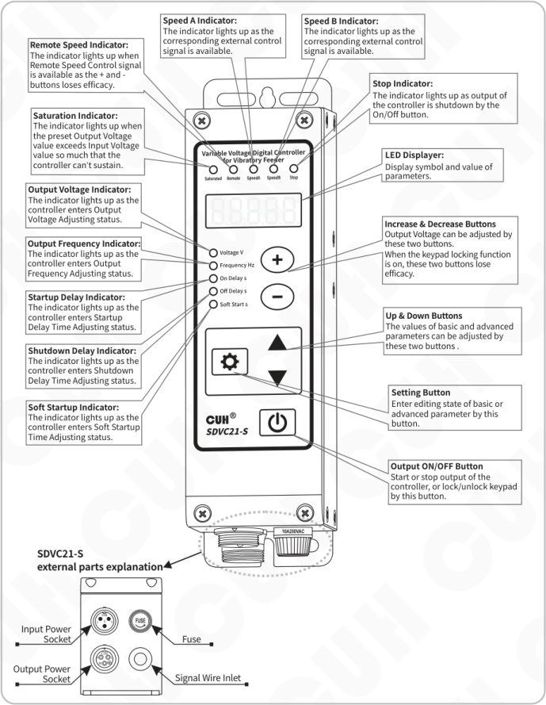

### Anzeigen und Display

**Anzeige Fernsteuerung:**  
Die Anzeige leuchtet, wenn ein Signal zur Fernsteuerung der Geschwindigkeit anliegt, während die Tasten ⊕ und ⊖ außer Funktion sind.

**Anzeige Geschwindigkeit A:**  
Die Anzeige leuchtet, sobald das entsprechende externe Steuersignal anliegt.

**Anzeige Geschwindigkeit B:**  
Die Anzeige leuchtet, sobald das entsprechende externe Steuersignal anliegt.

**Stopp-Anzeige:**  
Die Anzeige leuchtet, wenn der Ausgang des Reglers über die Ein-/Aus-Taste abgeschaltet wird.

**Sättigungsanzeige:**  
Die Anzeige leuchtet, wenn der voreingestellte Wert der Ausgangsspannung den Wert der Eingangsspannung so weit übersteigt, dass der Regler sie nicht mehr stabilisieren kann.

**LED-Anzeige:**  
Zeigt Symbol und Wert der Parameter an.

**Spannungsanzeige (Ausgangsspannung):**  
Die Anzeige leuchtet, wenn der Regler in den Zustand der Ausgangsspannungseinstellung wechselt.

**Frequenzanzeige (Ausgangsfrequenz):**  
Die Anzeige leuchtet, wenn der Regler in den Zustand der Ausgangsfrequenzeinstellung wechselt.

**Anzeige Einschaltverzögerung:**  
Die Anzeige leuchtet, wenn der Regler in den Zustand der Einstellung der Einschaltverzögerungszeit wechselt.

**Anzeige Ausschaltverzögerung:**  
Die Anzeige leuchtet, wenn der Regler in den Zustand der Einstellung der Ausschaltverzögerungszeit wechselt.

**Sanftanlaufanzeige:**  
Die Anzeige leuchtet, wenn der Regler in den Zustand der Einstellung der Sanftanlaufzeit wechselt.

### Tasten

**Tasten ⊕/⊖ (Erhöhen/Vermindern)**  
Mit diesen beiden Tasten lässt sich die Ausgangsspannung einstellen.  
Ist die Tastensperre aktiviert, sind diese beiden Tasten außer Funktion.

**Tasten ▲/▼ (Auf/Ab)**  
Mit diesen beiden Tasten lassen sich die Werte der Basis- und der erweiterten Parameter einstellen.

**Einstelltaste ⚙**  
Mit dieser Taste wird der Bearbeitungszustand eines Basis- oder erweiterten Parameters aufgerufen.

**Ein-/Aus-Taste ⏻**  
Mit dieser Taste wird der Ausgang des Reglers gestartet oder gestoppt bzw. die Tastatur gesperrt oder entsperrt.

### Beschreibung der äußeren Bauteile des SDVC21-S

- Netzanschlussbuchse (Eingang)
- Netzanschlussbuchse (Ausgang)
- Sicherung
- Signalleitungseinführung

---

## 1.3 Beschreibung der Anschlussklemmen

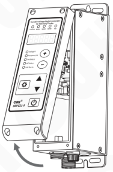

**Schritt 1:** Entfernen Sie die Schrauben an den vier Ecken des Bedienfelds.

**Schritt 2:** Klappen Sie das Bedienfeld nach oben; die Anschlussklemmen befinden sich auf der Rückseite des Bedienfelds.

| Anschlussgruppe | Klemme | Signal |
|---|---|---|
| SensorⅡ | A1 | GND |
| SensorⅡ | A2 | Input |
| SensorⅡ | A3 | +24V |
| Preset | B1 | GND |
| Preset | B2 | Pset A |
| Preset | B3 | GND |
| Preset | B4 | Pset B |
| Ctrl Out | C1 | Output |
| Ctrl Out | C2 | +24V |
| SensorⅠ | D1 | GND |
| SensorⅠ | D2 | Input |
| SensorⅠ | D3 | +24V |
| Photosensor | E1 | GND |
| Photosensor | E2 | Rx |
| Photosensor | E3 | GND |
| Photosensor | E4 | Tx |
| Speed Ctrl | F1 | +5V |
| Speed Ctrl | F2 | Input |
| Speed Ctrl | F3 | RGND |

## 1.4 Beschreibung des Typenschilds

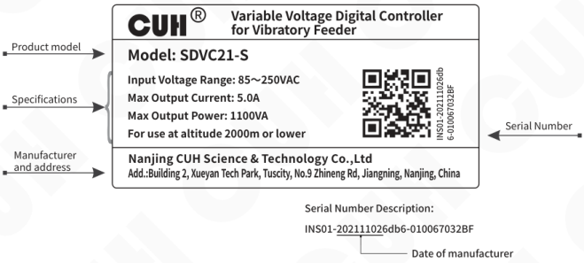

CUH® — **Digitaler Spannungsregler für Schwingförderer**

**Produktmodell**

Modell: SDVC21-S

**Spezifikationen**

- Eingangsspannungsbereich: 85~250 VAC
- Maximaler Ausgangsstrom: 5,0 A
- Maximale Ausgangsleistung: 1100 VA
- Verwendung in Höhenlagen bis 2000 m

**Hersteller und Adresse**

Nanjing CUH Science & Technology Co.,Ltd

Add.:Building 2, Xueyan Tech Park, Tuscity, No.9 Zhineng Rd, Jiangning, Nanjing, China

**Seriennummer**

INS01-202111026db6-010067032BF

**Beschreibung der Seriennummer:**

INS01-**20211102**6db6-010067032BF

Herstellungsdatum: **20211102**

---

## Kapitel Ⅱ Merkmale

Der Regler ist speziell für die Steuerung von Schwingförderern in Automatisierungsanlagen konzipiert. In Verbindung mit der neuesten Elektroniktechnik und durchdachtem Design bietet der Regler folgende komfortable und praktische Funktionen:

**Automatische Spannungsstabilisierung:** Der Regler kann Förderschwankungen ausgleichen, die durch Netzspannungsschwankungen verursacht werden.

**Sanftanlauf:** Um plötzliche Stöße auf die Werkstücke zu vermeiden, kann der Regler beim Start die Ausgangsspannung sanft von 0 auf den voreingestellten Wert anheben.

**Schaltsensor:** Ein NPN-Schaltsensor oder eine SPS kann zum Ein-/Ausschalten des Reglers angeschlossen werden.

**Steuerausgang:** Das vom Transistor ausgehende Steuerausgangssignal kann ein Magnetventil oder andere externe Einrichtungen mit dem Regler koordinieren.

### Folgende Funktionen können kundenspezifisch angepasst werden:

**Doppelter Steuereingang:** Zwei Steuereingänge für „Werkstücke voll“ und „Werkstücke leer“ können die logischen Verknüpfungen AND, OR, NOT, XOR und alle übrigen abbilden.

**Voreinstellfunktion der Ausgangsspannung:** Bis zu vier voreingestellte Ausgangsspannungswerte können über externe Steuersignale ausgewählt werden.

**Intelligente fotoelektrische Erfassung:** Unser adaptiver intelligenter fotoelektrischer Sensor kann den Regler bei vollen oder leeren Werkstücken anhalten und ermöglicht die Funktionen Sanftanlaufzeiteinstellung, Einschaltverzögerung, Ausschaltverzögerung sowie die Anpassung der logischen Verknüpfung.

**Fernsteuerung der Geschwindigkeit:** Die Ausgangsspannung des Reglers kann über ein externes Potentiometer, eine SPS oder ein 1~5V/4~20mA-Gleichstromsignal gesteuert werden.

---

CUH misst dem Qualitätsmanagement und den Sicherheitseigenschaften der Produkte große Bedeutung bei. Über die hochwertigen Komponenten und das strenge Qualitätskontrollsystem hinaus hat CUH mögliche Unfälle der Anwender berücksichtigt und stellt folgende Schutzfunktionen bereit, um die Praxisfreundlichkeit des Reglers zu maximieren.

**Kurzschlussschutz über Sicherung:** Wird der Ausgang des Reglers kurzgeschlossen, schmilzt die interne Sicherung durch und schützt so den Regler und die Last.

**Überlastschutz (Strom):** Der Regler schaltet seinen Ausgang ab, um die Betriebssicherheit der Einrichtungen zu gewährleisten, wenn der Betriebsstrom den Nennwert überschreitet.

**Überhitzungsschutz:** Der Regler schaltet seinen Ausgang ab, um sich selbst zu schützen, wenn die Betriebstemperatur zu hoch ist.

**Überspannungsschutz:** Ist die Eingangsspannung zu hoch, wird die Stromversorgung des Reglers automatisch abgeschaltet, um ihn zu schützen.

CUH-Regler erfüllen strikt die CE-Zertifizierung.

---

# Kapitel Ⅲ Installationsanleitung

Dieses Kapitel stellt die erforderlichen Bedingungen für die Verwendung des Reglers sowie dessen korrekte Installation und Verdrahtung vor.

## 3.1 Betriebsbedingungen des Reglers

Der Regler wird aus dem Netz AC 110/220V gespeist; die Schutzerdung erfolgt über den Stecker des Netzkabels. Stellen Sie bitte ein 110V- oder 220V-, 50Hz/60Hz-Netz sowie normgerechte Stromversorgungs- und Verteilungsanlagen bereit und stellen Sie sicher, dass der Schutzerdungsleiter korrekt angeschlossen ist.

**⚠ WARNUNG** Schließen Sie den Regler niemals an 380V AC an; dies verursacht irreversible schwerwiegende Schäden am Regler und kann zu Explosion, Brand und weiteren Sicherheitsvorfällen führen.

**⚠ WARNUNG** Stellen Sie sicher, dass die Netzseite zuverlässig geerdet ist. Das Metallgehäuse des Reglers ist direkt mit dem Schutzerdungsleiter verbunden. Eine mangelhafte Erdung kann dazu führen, dass das Gehäuse des Reglers unter Spannung steht und ein Stromschlagunfall entsteht.

**HINWEIS** Der Langzeitbetrieb erwärmt das Gerät und lässt die Gehäusetemperatur ansteigen. Installieren Sie den Regler bitte in einer gut belüfteten Umgebung und befestigen Sie ihn sicher, fern von Schwingungsquellen.

**HINWEIS** Der Ausgang dieses Produkts entsteht durch Gleichrichtung und Invertierung der Netzversorgung; zwischen Ein- und Ausgang besteht keine galvanische Trennung. Daher dürfen die Ausgangspole nicht mit der Schutzerdung verbunden werden. Stellen Sie beim Anschluss des Elektromagneten sicher, dass die Magnetspule und das Gehäuse über eine Basisisolation verfügen. Andernfalls können Kriechströme auftreten, die Stromschläge und Schäden am Regler verursachen können.

**HINWEIS** Dieses Produkt ist ein Regler zum Antrieb eines Elektromagneten. Er darf nicht an einen piezoelektrischen Schwingförderer angeschlossen werden.

## 3.2 Bedienung der Tasten

a. Kurz drücken der Taste ⊕ oder ⊖, um die Ausgangsspannung des Reglers in beliebiger LED-Anzeige einzustellen.

b. Durch langes Drücken der Taste ⚙ gelangen Sie in die Oberfläche der Basisparameter bzw. verlassen sie; durch kurzes Drücken der Taste ⚙ wechseln Sie zwischen den Basisparametern, und mit kurzem Drücken der Taste ▼ oder ▲ stellen Sie den Parameterwert ein.

c. Durch gleichzeitiges langes Drücken der Tasten ⚙ und ▲ gelangen Sie in die Oberfläche der erweiterten Parameter bzw. verlassen sie; durch kurzes Drücken der Taste ⚙ wechseln Sie zwischen den erweiterten Parametern, und mit kurzem Drücken der Taste ▼ oder ▲ stellen Sie den Parameterwert ein.

d. Kurz drücken der Taste ⏻ startet bzw. stoppt den Ausgang des Reglers; langes Drücken der Taste ⏻ sperrt bzw. entsperrt die Tastatur.

e. In der LED-Anzeige des Parameters zum Wiederherstellen der Werkseinstellungen: ▲ lange drücken, bis  auf der LED erscheint, um die Werkseinstellungen wiederherzustellen; oder ▼ lange drücken, bis 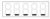 auf der LED erscheint, um auf die moderne Parameteroberfläche umzuschalten.

f. Der SDVC21S verwendet standardmäßig die traditionelle Parameteroberfläche.

---

## 3.3 Installation und Inbetriebnahme

### Schritt eins:

Öffnen Sie den Karton und prüfen Sie den Regler und sämtliches Zubehör.

### Schritt zwei:

Verbinden Sie die Anschlussklemmen des Ausgangsleistungskabels mit der Magnetspule des Vibrators.

Richten Sie die Kerbe am Rundsteckverbinder des Ausgangskabels auf die Dreieckmarkierung an der Ausgangsbuchse des Reglers aus und ziehen Sie danach die Übermutter fest, nachdem das Ausgangskabel korrekt angeschlossen ist.

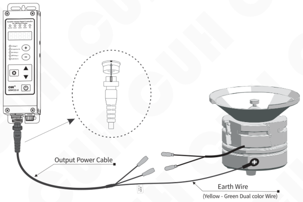

### Hinweis

1. Stellen Sie sicher, dass die Magnetspulen des Vibrators mit den beiden Ausgangspins des Ausgangsleistungskabels verbunden sind und dass das Metallgehäuse des Vibrators zuverlässig geerdet ist.
2. Es ist verboten, piezoelektrische Lasten an den Leistungsausgang anzuschließen; andernfalls kann es zu einem Stromschlagunfall kommen!

---

### Schritt drei:

Verbinden Sie den Stecker des Eingangs-Netzkabels mit der Netzanschlussbuchse des Reglers.

Schließen Sie zuerst die Reglerseite an.

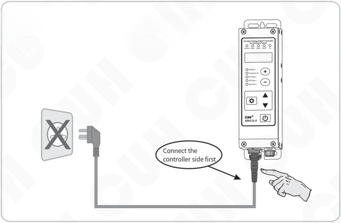

### Schritt vier:

Verbinden Sie den Stecker des Eingangs-Netzkabels mit der Netzsteckdose.

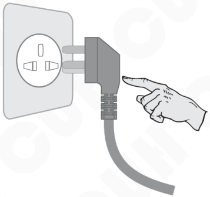

---

## Kapitel Ⅳ Beschreibung der Grundfunktionen

### 4.1 Ausgangsspannung

Die Ausgangsspannung kann direkt und digital über die Tastatur eingestellt werden. Dank der einzigartigen Spannungsstabilisierungsfunktion schwankt die Ausgangsspannung des Reglers nicht mit der Eingangsspannung, sodass der Vibrator bei instabiler Netzspannung im stabilen Betrieb bleibt.

- Schalten Sie den Netzschalter des Reglers ein.
- Der Regler wechselt in den Parameter Ausgangsspannung. Die Spannungsanzeige leuchtet, und die LED zeigt den Parameter Ausgangsspannung U mit dem Standardwert 150 an.
- Drücken Sie ⊕ oder ⊖, um den Parameterwert einzustellen.

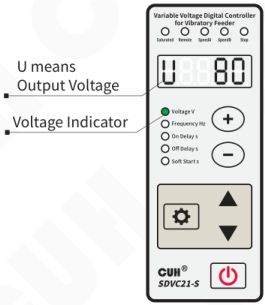

- Der Wert der Ausgangsspannung des Reglers darf den Wert der Eingangsspannung nicht überschreiten. Wird der Ausgangsspannungswert zu nahe an die Eingangsspannung gesetzt, kann der Regler seine Spannungsausgabe nicht mehr stabilisieren, und die Sättigungsanzeige leuchtet auf.
- Wird der Ausgangsspannungswert zu nahe an 0 gesetzt, kann der Regler seine Spannungsausgabe ebenfalls nicht stabilisieren, und die Sättigungsanzeige leuchtet auf.

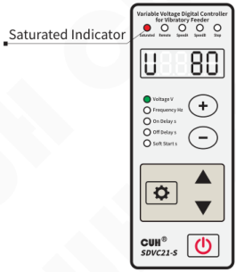

---

## 4.2 Ausgangsfrequenz

Der Regler kann die Ausgangsfrequenz auf die Netzfrequenz oder deren Doppeltes einstellen.

- Drücken Sie ⚙ 2 Sekunden lang, um in die Oberfläche der Basisparameter zu gelangen.
- Die LED zeigt den Ausgangsfrequenzparameter „E“ an, und die Frequenzanzeige leuchtet.
- Drücken Sie ▼ oder ▲, um den Parameterwert einzustellen.

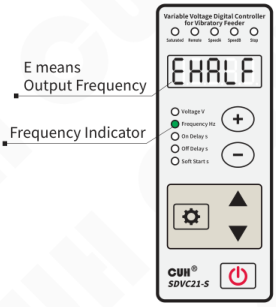

- Beträgt die Netzfrequenz 50 Hz, liegt die Ausgangsfrequenz des Reglers bei 50 Hz, wenn der Parameter E auf HALF gestellt ist, und bei 100 Hz, wenn der Parameter E auf FULL gestellt ist.
- Beträgt die Netzfrequenz 60 Hz, liegt die Ausgangsfrequenz des Reglers bei 60 Hz, wenn der Parameter E auf HALF gestellt ist, und bei 120 Hz, wenn der Parameter E auf FULL gestellt ist.

---

## 4.3 Sanftanlaufzeit

Um plötzliche Stöße auf die Vibratorspule zu vermeiden, kann der Regler beim Start die Ausgangsspannung allmählich von 0 auf den voreingestellten Wert anheben.

**Sanftanlaufzeit ( t ):** Der Zeitraum, den der Regler benötigt, um beim Start seine Ausgangsspannung sanft von 0 auf den voreingestellten Wert ansteigen zu lassen.

- Drücken Sie ⚙ 2 Sekunden lang, um in die Oberfläche der Basisparameter zu gelangen.
- Kurz auf ⚙ drücken, um zum Sanftanlaufparameter „t“ zu wechseln; die Sanftanlaufanzeige leuchtet auf.
- Drücken Sie ▲ oder ▼, um den Parameterwert einzustellen.

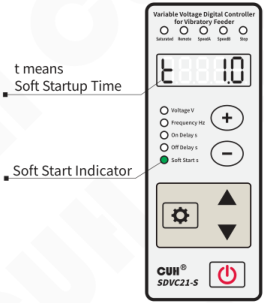

## 4.4 Ausgangs-Ein-/Ausschalten

Mit der Taste ⏻ auf dem Bedienfeld lässt sich der Ausgang des Reglers einfach und schnell starten oder stoppen.

- Über die ⏻ auf dem Bedienfeld des Reglers können Sie Start oder Stopp steuern. Die Stopp-Anzeige leuchtet, wenn der Ausgang des Reglers ausgeschaltet ist.

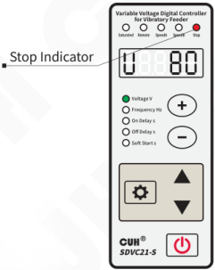

> Dank der Soft-Touch-Taste und der digitalen Signalsteuerungstechnik entsteht kein Funke, der den Kontakt beschädigen könnte. Dadurch verlängern sich die Lebensdauer des Reglers und des Vibrators erheblich.

---

## 4.5 Begrenzung der maximalen Ausgangsspannung

Die maximale Ausgangsspannung des Reglers lässt sich einstellen, um Schäden am Vibrator zu vermeiden.

Die Fernsteuerung der Geschwindigkeit wird durch diesen Parameter beeinflusst.

- Drücken Sie ⚙ und ▲ gleichzeitig lange, um in die Oberfläche der erweiterten Parameter zu gelangen.
- Kurz auf ⚙ drücken, um zum Parameter h zu wechseln.
- Drücken Sie ▲ oder ▼, um den Parameterwert einzustellen.

Der Standardwert der maximalen Ausgangsspannung beträgt 250 V.

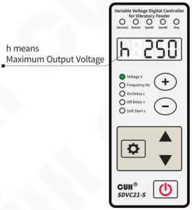

## 4.6 Tastensperre

- Drücken Sie ⏻ 2 Sekunden lang, um alle Tasten auf dem Bedienfeld zu sperren, während die LED „a“ anzeigt.
- Drücken Sie ⏻ erneut 2 Sekunden lang, um die Tastatur zu entsperren.

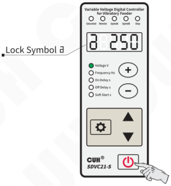

> Die Taste ⏻ wird von der Tastensperre nicht beeinflusst.

---

## 4.7 Wiederherstellen der Werkseinstellungen

Der Anwender kann den Regler schnell in den werkseitigen Standardzustand zurückversetzen.

Aufgrund der umfangreichen Funktionen des Reglers lassen sich viele Parameter anpassen. Für Einsteiger kann es nach mehreren Einstellungen und Änderungen schwierig sein, den normalen Arbeitszustand des Reglers wiederherzustellen. Mit dieser Funktion lässt sich der durcheinandergeratene Parameterzustand schnell auf die werkseitige Standardeinstellung zurücksetzen.

- Drücken Sie ⚙ und ▲ gleichzeitig lange, um in die Oberfläche der erweiterten Parameter zu gelangen.
- Kurz auf ⚙ drücken, bis die LED-Anzeige vollständig blinkt – dies ist der Parameter „Wiederherstellen der Werkseinstellungen“. Halten Sie danach ▲ gedrückt, bis der Regler „-----“ anzeigt; dies zeigt an, dass der Regler zurückgesetzt wurde.

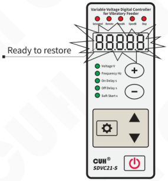

- Lassen Sie ▲ los; nachdem der Regler „CUH“ angezeigt hat, gelangen Sie in den Einstellzustand der Ausgangsspannung „U“. Zu diesem Zeitpunkt sind sämtliche Parameter auf die werkseitigen Standardeinstellungen zurückgesetzt.

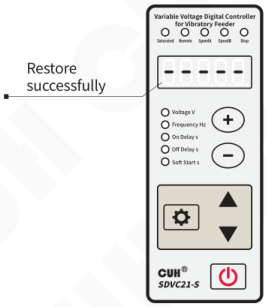

---

# Kapitel Ⅴ Sensoren und Signalsteuerung

Der Regler kann über viele Arten externer Signale und Sensoren gesteuert werden. Dieses Kapitel beschreibt vor allem die Verwendung des intelligenten fotoelektrischen Sensors, der NPN-Schaltsensoren und der SPS.

## 5.1 Intelligente fotoelektrische Erfassung

In Verbindung mit dem fotoelektrischen Sensor SDVC-S1 lässt sich die Funktion der intelligenten fotoelektrischen Erfassung realisieren. Der Sensor SDVC-S1 kann Störungen durch Umgebungslicht herausfiltern, die sich auf die Empfindlichkeit des Reglers auswirken. Dadurch arbeitet der Regler zuverlässig, ohne dass die Empfindlichkeit manuell angepasst werden muss.

### 5.1.1 Verdrahtung des intelligenten fotoelektrischen Sensors

**Anschlussmethode des fotoelektrischen Sensors**

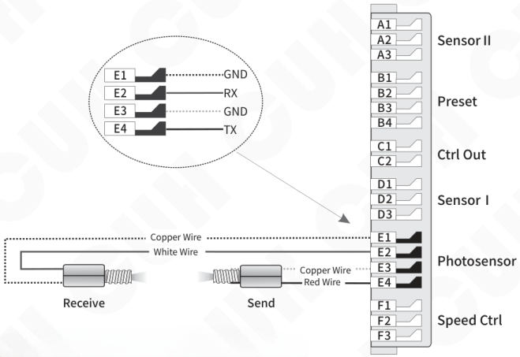

Der Arbeitsabstand des Sensors lässt sich über den Parameter P einstellen; je kleiner der Parameter, desto empfindlicher ist der Sensor.

Hinweis: Die Standard-Logikverknüpfung des Sensors ist auf „Werkstücke leer“ eingestellt.

---

## 5.1.2 Ein-/Ausschaltverzögerung des intelligenten fotoelektrischen Sensors

In den meisten realen Anwendungen soll die Ausgabe des Reglers verzögert werden, wenn das Ein-/Ausschalten des Reglers über externe Signale gesteuert wird. Die Funktion zur Einstellung der Ein-/Ausschaltverzögerungszeit macht diese Art der Anwendung möglich. Darüber hinaus lassen sich Stöße auf die Werkstücke beim Start des Reglers durch die Anpassung der Sanftanlaufzeit vermeiden.

### Einschaltverzögerung ( J )

Der Zeitraum, den der Regler vom Empfang eines Start-Steuersignals bis zur tatsächlichen Ausgabe durchläuft.

- Drücken Sie ⚙ 2 Sekunden lang, um in die Oberfläche der Basisparameter zu gelangen.
- Kurz auf ⚙ drücken, um zum Verzögerungsparameter „J“ zu wechseln; die Anzeige der Einschaltverzögerung leuchtet auf.
- Drücken Sie ▲ oder ▼, um den Parameterwert einzustellen.

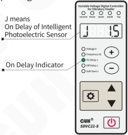

Der Einstellbereich des Parameters reicht von 0,0 bis 9,9 Sekunden.  
Der Standardwert des Parameters beträgt 0,2 Sekunden.

### Ausschaltverzögerung ( L )

Der Zeitraum, den der Regler vom Empfang eines Stopp-Steuersignals bis zur tatsächlichen Abschaltung der Ausgabe durchläuft.

- Drücken Sie ⚙ 2 Sekunden lang, um in die Oberfläche der Basisparameter zu gelangen.
- Kurz auf ⚙ drücken, um zum Verzögerungsparameter „L“ zu wechseln; die Anzeige der Ausschaltverzögerung leuchtet auf.
- Drücken Sie ▲ oder ▼, um den Parameterwert einzustellen.

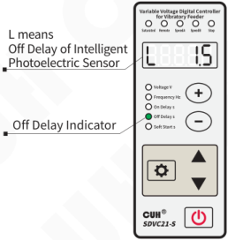

Der Einstellbereich des Parameters reicht von 0,0 bis 9,9 Sekunden.  
Der Standardwert des Parameters beträgt 0,2 Sekunden.

---

### 5.1.3 Einstellung der Logikrichtung des intelligenten fotoelektrischen Sensors

Unter normalen Umständen empfängt die Empfangsseite kein optisches Signal, und der Regler läuft standardmäßig. In einigen Sonderanwendungen muss der Regler jedoch gestoppt werden, wenn die Empfangsseite kein optisches Signal empfängt. Die Anpassung dieses Parameters kann diese Art der Anwendung umsetzen.

- Drücken Sie ⚙ und ▲ gleichzeitig lange, um in die Oberfläche der erweiterten Parameter zu gelangen.
- Kurz auf ⚙ drücken, um zum Parameter Γ1 zu wechseln.
- Drücken Sie ▲ oder ▼, um den Parameterwert einzustellen.

Γ1 bedeutet die Logikrichtung des intelligenten fotoelektrischen Sensors

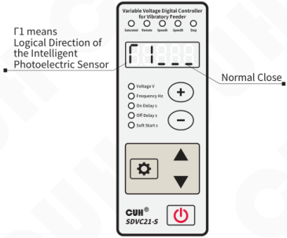

Der Parameter Γ1 ist standardmäßig auf `___` eingestellt

- Ist der Parameter Γ1 auf `___` eingestellt, läuft der Regler, wenn kein optisches Signal empfangen wird.
- Ist der Parameter Γ1 auf `_-_` eingestellt, stoppt der Regler, wenn kein optisches Signal empfangen wird.

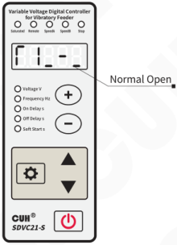

---

## 5.2 Verwendung des NPN-Schaltsensors

Der Regler kann mit vielen Arten von Sensoren arbeiten, beispielsweise Schaltsensoren, optischen Schaltsensoren und Lichtleitungsensoren.

### 5.2.1 Verdrahtung des NPN-Schaltsensors

**Anschlussmethode des Schaltsensors**

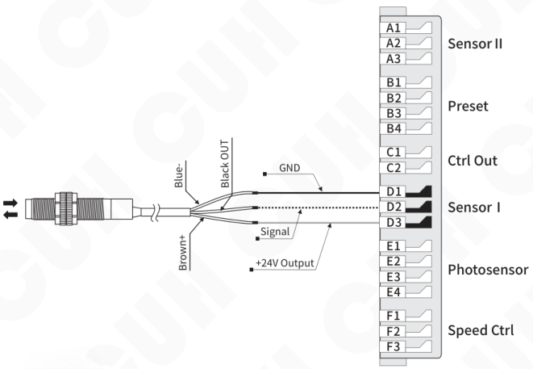

**Konvention**

- Die blaue Leitung ist die Erdungsleitung (GND)
- Die schwarze Leitung ist die Signalleitung
- Die braune Leitung ist die Versorgungsleitung

---

## 5.2.2 Ein-/Ausschaltverzögerung des NPN-Schaltsensors

Standardmäßig teilen sich der intelligente fotoelektrische Sensor und der Schaltsensor dieselbe Einschalt- und Ausschaltverzögerungszeit. Bediener können die Ein- und Ausschaltverzögerungszeit für den Schaltsensor auch unabhängig einstellen.

### Einschaltverzögerung ( J- )

Der Zeitraum, den der Regler vom Empfang eines Start-Steuersignals bis zur Ausgabe durchläuft.

- Drücken Sie ⚙ und ▲ gleichzeitig lange, um in die Oberfläche der erweiterten Parameter zu gelangen.
- Kurz auf ⚙ drücken, um zum Parameter J- zu wechseln.
- Drücken Sie ▲ oder ▼, um den Parameterwert einzustellen.

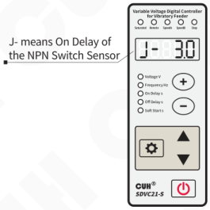

Der Einstellbereich des Parameters reicht von 0,0 bis 9,9 Sekunden; der Standardwert des Parameters ist „---“.

Die unabhängige Einschaltverzögerung des NPN-Schaltsensors wird deaktiviert, wenn der Parameterwert auf 0 eingestellt wird.

### Ausschaltverzögerung ( L- )

Der Zeitraum, den der Regler vom Empfang eines Stopp-Steuersignals bis zur Abschaltung der Ausgabe durchläuft.

- Drücken Sie ⚙ und ▲ gleichzeitig lange, um in die Oberfläche der erweiterten Parameter zu gelangen.
- Kurz auf ⚙ drücken, um zum Parameter L- zu wechseln.
- Drücken Sie ▲ oder ▼, um den Parameterwert einzustellen.

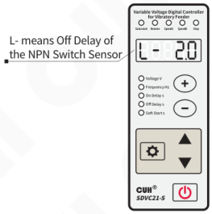

Der Einstellbereich des Parameters reicht von 0,0 bis 9,9 Sekunden; der Standardwert des Parameters ist „---“.

Die unabhängige Ausschaltverzögerung des NPN-Schaltsensors wird deaktiviert, wenn der Parameterwert auf 0 eingestellt wird.

- Sind die Werte von J- und L- auf 0 eingestellt, entsprechen die Ein- und Ausschaltverzögerungszeit des Schaltsensors denen des intelligenten fotoelektrischen Sensors.
- Die Ein- und Ausschaltverzögerungszeit des intelligenten fotoelektrischen Sensors wird durch die Parameter J- und L- nicht beeinflusst.

---

## 5.2.3 Einstellung der Logikrichtung des NPN-Schaltsensors

Unter normalen Umständen empfängt der Regler kein Signal vom NPN-Schaltsensor und läuft standardmäßig. In einigen Sonderanwendungen muss der Regler jedoch gestoppt werden, wenn er kein Signal vom NPN-Schaltsensor empfängt. Die Anpassung dieses Parameters kann diese Art der Anwendung umsetzen.

- Drücken Sie ⚙ und ▲ gleichzeitig lange, um in die Oberfläche der erweiterten Parameter zu gelangen.
- Kurz auf ⚙ drücken, um zum Parameter Γ2 zu wechseln.
- Drücken Sie ▲ oder ▼, um den Parameterwert einzustellen.

Γ2 bedeutet die Logikrichtung des NPN-Schaltsensors.

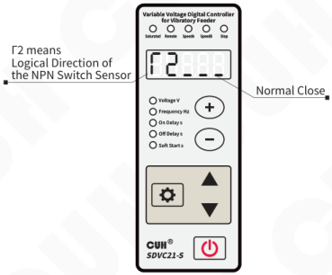

Der Parameter Γ2 ist standardmäßig auf `___` eingestellt.

- Ist der Parameter Γ2 auf `___` eingestellt, läuft der Regler, wenn kein Signal empfangen wird.
- Ist der Parameter Γ2 auf `_-_` eingestellt, stoppt der Regler, wenn kein Signal empfangen wird.

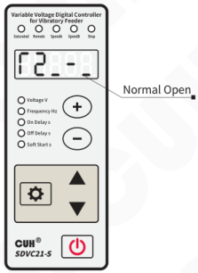

---

## 5.3 Verwendung des 2ⁿᵈ NPN-Schaltsensors

Der Regler erlaubt den Anschluss von drei Sensoren: einem intelligenten fotoelektrischen Sensor und zwei NPN-Schaltsensoren. Mit Hilfe dieser Sensoren können die Funktionen „Anhalten bei vollen Werkstücken“ und „Anhalten bei leeren Werkstücken“ realisiert werden.

### 5.3.1 Verdrahtung des 2ⁿᵈ NPN-Schaltsensors

**Anschlussmethode des Schaltsensors**

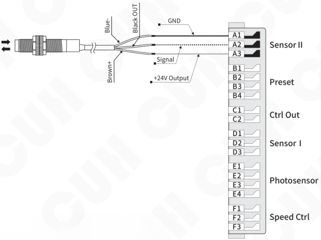

**Konvention**

Die blaue Leitung ist die Erdungsleitung (GND)  
Die schwarze Leitung ist die Signalleitung  
Die braune Leitung ist die Versorgungsleitung

---

## 5.3.2 Ein-/Ausschaltverzögerung des 2ⁿᵈ NPN-Schaltsensors

Standardmäßig teilen sich der intelligente fotoelektrische Sensor und die beiden NPN-Schaltsensoren dieselbe Einschalt- und Ausschaltverzögerungszeit. Bediener können die Ein- und Ausschaltverzögerungszeit für den 2ⁿᵈ NPN-Schaltsensor auch unabhängig einstellen.

### Einschaltverzögerung (J_)

Der Zeitraum, den der Regler vom Empfang eines Start-Steuersignals bis zur Ausgabe durchläuft.

- Drücken Sie ⚙ und ▲ gleichzeitig lange, um in die Oberfläche der erweiterten Parameter zu gelangen.
- Kurz auf ⚙ drücken, um zum Parameter J_ zu wechseln.
- Drücken Sie ▲ oder ▼, um den Parameterwert einzustellen.

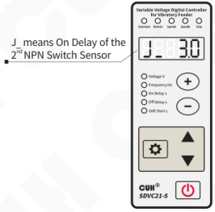

Der Einstellbereich des Parameters reicht von 0,0 bis 9,9 Sekunden; der Standardwert des Parameters ist „---“.

Die unabhängige Einschaltverzögerung des 2ⁿᵈ NPN-Schaltsensors wird deaktiviert, wenn der Parameterwert auf 0 eingestellt wird.

### Ausschaltverzögerung (L_)

Der Zeitraum, den der Regler vom Empfang eines Stopp-Steuersignals bis zur Abschaltung der Ausgabe durchläuft.

- Drücken Sie ⚙ und ▲ gleichzeitig lange, um in die Oberfläche der erweiterten Parameter zu gelangen.
- Kurz auf ⚙ drücken, um zum Parameter L_ zu wechseln.
- Drücken Sie ▲ oder ▼, um den Parameterwert einzustellen.

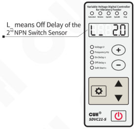

Der Einstellbereich des Parameters reicht von 0,0 bis 9,9 Sekunden; der Standardwert des Parameters ist „---“.

Die unabhängige Ausschaltverzögerung des 2ⁿᵈ NPN-Schaltsensors wird deaktiviert, wenn der Parameterwert auf 0 eingestellt wird.

---

- Sind die Werte von J_ und L_ auf 0 eingestellt, entsprechen die Ein- und Ausschaltverzögerungszeit des 2ⁿᵈ NPN-Schaltsensors denen des intelligenten fotoelektrischen Sensors.
- Die Ein- und Ausschaltverzögerungszeit des intelligenten fotoelektrischen Sensors wird durch die Parameter J_ und L_ nicht beeinflusst.

---

## 5.3.3 Einstellung der Logikrichtung des 2ⁿᵈ NPN-Schaltsensors

Unter normalen Umständen empfängt der Regler kein Signal vom 2ⁿᵈ NPN-Schaltsensor und läuft standardmäßig. In einigen Sonderanwendungen muss der Regler jedoch gestoppt werden, wenn er kein Signal vom 2ⁿᵈ NPN-Schaltsensor empfängt. Die Anpassung dieses Parameters kann diese Art der Anwendung umsetzen.

- Drücken Sie ⚙ und ▲ gleichzeitig lange, um in die Oberfläche der erweiterten Parameter zu gelangen.
- Kurz auf ⚙ drücken, um zum Parameter Γ4 zu wechseln.
- Drücken Sie ▲ oder ▼, um den Parameterwert einzustellen.

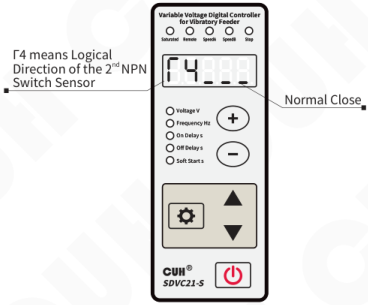

Γ4 bedeutet die Logikrichtung des 2ⁿᵈ NPN-Schaltsensors.

Normal Close

Der Parameter Γ4 ist standardmäßig auf `___` eingestellt

- Ist der Parameter Γ4 auf `___` eingestellt, läuft der Regler, wenn kein Signal empfangen wird.
- Ist der Parameter Γ4 auf `_-_` eingestellt, stoppt der Regler, wenn kein Signal empfangen wird.

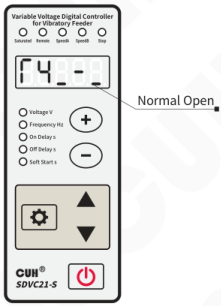

Normal Open

---

## 5.4 Einstellung der logischen Verknüpfung der Steuersignale

Der Regler kann die logische Verknüpfung des intelligenten fotoelektrischen Sensors und des Schaltsensors einstellen, wenn diese gleichzeitig arbeiten.

- Drücken Sie ⚙ und ▲ gleichzeitig lange, um in die Oberfläche der erweiterten Parameter zu gelangen.
- Kurz auf ⚙ drücken, um zum Parameter Π zu wechseln.
- Drücken Sie ▲ oder ▼, um den Parameterwert einzustellen.

Π bedeutet die logische Verknüpfung der Steuersignale

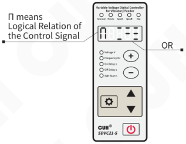

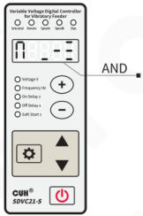

Die Standard-Logikverknüpfung ist AND

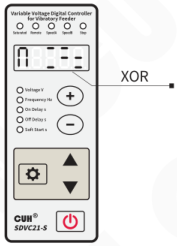

### Logikverknüpfung: AND 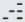:

Der Regler läuft nur, wenn sowohl der intelligente fotoelektrische Sensor als auch der NPN-Schaltsensor den Lauf des Reglers verlangen.

### Logikverknüpfung: OR 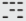:

Der Regler läuft, wenn der intelligente fotoelektrische Sensor oder der NPN-Schaltsensor den Lauf des Reglers verlangt.

### Logikverknüpfung: XOR 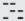:

Der Regler läuft nur, wenn der intelligente fotoelektrische Sensor und der NPN-Schaltsensor entgegengesetzte Steuersignale ausgeben.

---

## 5.5 Steuerausgang

Der Regler kann ein niederspanniges Steuersignal ausgeben, um mit anderen Einrichtungen wie einem Magnetventil, einer SPS oder einem Relais zusammenzuwirken.

### 5.5.1 Verdrahtung des Steuerausgangs

**Anschlussmethode der SPS**

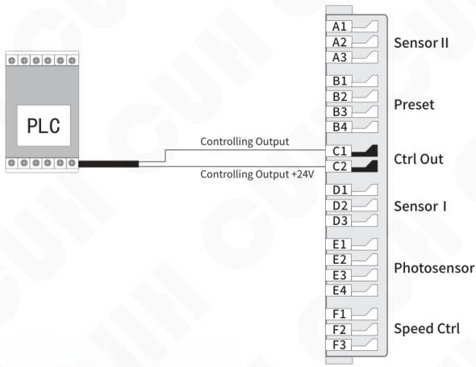

> Relaisausgänge oder NPN-Ausgänge der SPS sind mit dem Regler kompatibel.

Die Parametereinstellung erfolgt wie beim Schaltsensor.

---

## Anschlussmethode des Magnetventils

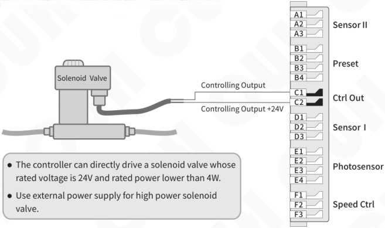

- Der Regler kann ein Magnetventil mit einer Nennspannung von 24 V und einer Nennleistung unter 4 W direkt ansteuern.
- Verwenden Sie für leistungsstarke Magnetventile eine externe Stromversorgung.

## Anschlussmethode des Relais

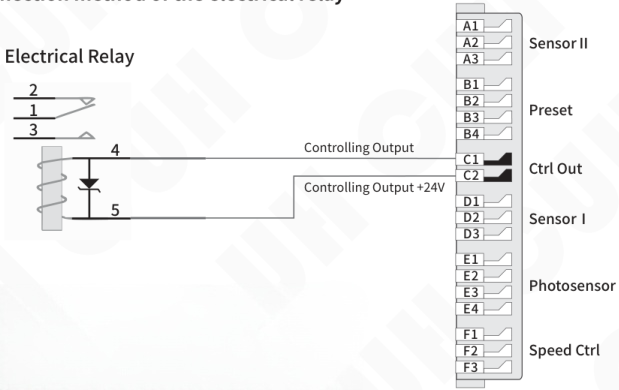

- Der Regler kann ein Relais mit einer Nennspannung von 24 V und einer Nennleistung unter 4 W direkt ansteuern.

---

## 5.5.2 Einstellung der Logikrichtung des Steuerausgangs

- Drücken Sie ⚙ und ▲ gleichzeitig lange, um in die Oberfläche der erweiterten Parameter zu gelangen.
- Kurz auf ⚙ drücken, um zum Parameter Γ3 zu wechseln.
- Drücken Sie ▲ oder ▼, um den Parameterwert einzustellen.

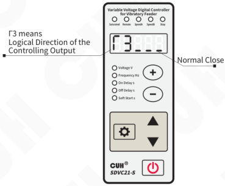

Der Parameter Γ3 ist standardmäßig auf `___` eingestellt

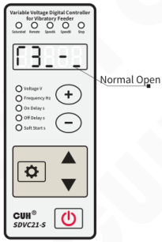

- Ist der Parameter Γ3 auf `___` eingestellt, arbeitet der Steuerausgang, während der Regler läuft.
- Ist der Parameter Γ3 auf `_-_` eingestellt, arbeitet der Steuerausgang nicht, während der Regler läuft.

---

## 5.6 Fernsteuerung der Geschwindigkeit

Die Funktion der Fernsteuerung der Geschwindigkeit ermöglicht es dem Bediener, die Ausgangsspannung über ein externes Potentiometer, eine Spannung von 1~5 V oder einen Strom von 4~20 mA zu steuern. So lässt sich eine externe Fernsteuerung der Geschwindigkeit einfach über eine SPS, ein DCS oder andere Einrichtungen realisieren.

### Anschlussmethode des externen Potentiometers

### Anschlussmethode der SPS

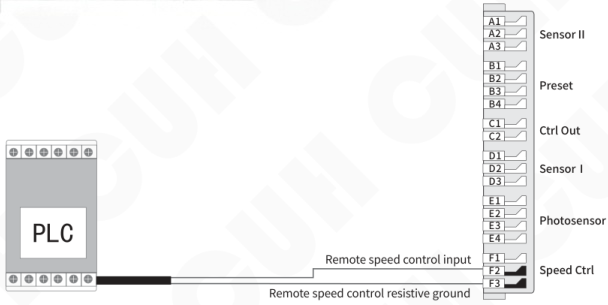

> Wenn das Fernsteuersignal wirksam wird, leuchtet die Anzeige der Fernsteuerung auf; gleichzeitig ist die Spannungsverstellung am Bedienfeld außer Funktion.

---

## 5.7 Voreingestellte Geschwindigkeitsumschaltung

Mit der Funktion der voreingestellten Geschwindigkeitsumschaltung lässt sich die Vorgabegeschwindigkeit über externe Steuersignale wählen – etwa von einer SPS, einem PC, Sensoren oder anderen Signalquellen –, um ein mehrstufiges Fördersystem aufzubauen.

Der Regler besitzt zwei Steuereingänge für die Geschwindigkeits-Voreinstellung, welche die Geschwindigkeitsumschaltung A und die Geschwindigkeitsumschaltung B steuern; beide sind aktiv low (Low-aktiv).

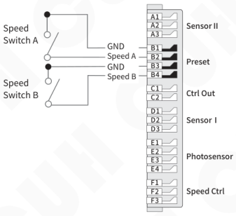

Der Zustand jeder Steuerleitung wird über die entsprechenden Anzeigen auf dem Bedienfeld angezeigt. Liegt an einer Steuerleitung ein gültiges Signal an, leuchtet die zugehörige Anzeige.

Die Kombination der Ein-/Aus-Zustände beider Anzeigen ergibt vier Zustände (A an und B aus, A aus und B an, beide an, beide aus).

Durch die Auswahl des Steuersignals wechselt der Regler in die entsprechende Vorgabegeschwindigkeit. Die Ausgangsspannung des Reglers kann in diesem Zustand über ⊕ oder ⊖ eingestellt werden. Die Spannung wird automatisch gespeichert: Jedes Mal, wenn das Vorgabegeschwindigkeits-Steuersignal den Regler in diesen Zustand versetzt, schaltet dieser sofort auf diese Spannung um.

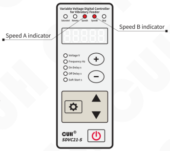

Zustand, wenn an beiden Steuerleitungen gültige Signale anliegen.

---

## Kapitel Ⅵ Sicherheitsfunktionen

### 6.1 Automatische digitale Spannungsstabilisierung

Die interne digitale Spannungsstabilisierungsfunktion des Reglers stabilisiert die Fördergeschwindigkeit unabhängig von Schwankungen der Netzspannung.

### 6.2 Kurzschlussschutz

Wird der Ausgang kurzgeschlossen, schaltet der Regler seine Ausgabe ab und zeigt Err01 an, bis der Regler neu gestartet wird.

### 6.3 Überlastschutz (Strom)

Der Regler schaltet seine Ausgabe ab, wenn der Ausgangsstrom infolge fehlerhafter Bedienung den Nennstrom überschreitet, und zeigt Err02 an, um den Regler und die Anlageneinrichtungen des Kunden zu schützen.

### 6.4 Überhitzungsschutz

Der Regler schaltet seine Ausgabe ab, wenn die Betriebstemperatur 65 °C überschreitet, und zeigt Err03 an, um sich selbst zu schützen, bis die Betriebstemperatur auf 60 °C sinkt.

---

## Kapitel Ⅶ Technische Daten

### 7.1 Abmessungen

Abmessungen (Einheit: mm)

| Maßbereich | Toleranz |
|---|---|
| 0~3 | ±0.05 |
| 3~10 | ±0.1 |
| 10~30 | ±0.15 |
| 30~80 | ±0.2 |
| 80~180 | ±0.3 |
| >180 | ±0.5 |

Diese Toleranztabelle gilt für sämtliche Produkte dieser Serie.

---

## 7.2 Technische Daten

| Position | Min | Typisch | Max | Einheit | Anmerkung |
|---|---|---|---|---|---|
| Eingangsspannung | 85 | 220 | 250 | V | AC RMS |
| Einstellbereich der Ausgangsspannung | 35 | —— | Vin-10 | V | Half Wave |
| Einstellbereich der Ausgangsspannung | 45 | —— | Vin-5 | V | Full Wave |
| Einstellgenauigkeit der Spannung | | 1 | | V | |
| Genauigkeit der Spannungsstabilisierung | —— | —— | 30 | V | Vset = 150V △Vin+ = 70V |
| Ansprechzeit der Spannungsstabilisierung | 0 | 0.01 | 0.02 | s | |
| Einstellbereich des Ausgangsstroms | 0 | —— | 5 | A | |
| Ausgangsleistung | 0 | —— | 1100 | VA | |
| Ausgangsfrequenz | 45 | 50/60 | 65 | Hz | Half Wave |
| Ausgangsfrequenz | 90 | 100/120 | 130 | Hz | Full Wave |
| Ausgangswellenform | | Phasenanschnittsteuerung | | | |
| Sanftanlaufzeit | 0 | —— | 9.9 | s | Standardwert: 1.0 |
| Bereich der Ein-/Ausschaltverzögerung | 0 | —— | 9.9 | s | Standardwert: 0.2 |
| Genauigkeit der Ein-/Ausschaltverzögerung | | 0.1 | | s | |
| Auslösetemperatur des Überhitzungsschutzes | 58 | 60 | 66 | °C | |
| Spannung des DC-Steuerausgangs | 22 | 24 | 26 | V | |
| Strom des DC-Steuerausgangs | 0 | —— | 400 | mA | |
| Analoges Steuersignal | | 1~5/4~20 | | V/mA | Fernsteuersignal |
| Digitales Steuersignal | | 24 | | V | Schaltsignal |
| Einstellmethode | | 6 | | Taste | |
| Sicherungsstrom | | 6.3 | | A | |
| Leistungsaufnahme im Bereitschaftszustand | —— | 2 | —— | W | |
| Anzeigeart | | 5 | | Ziffer | LED |
| Umgebungstemperatur | 0 | 25 | 40 | °C | kein Kondenswasser |
| Umgebungsluftfeuchte | 10 | 60 | 85 | % | kein Kondenswasser |
| Lagerumgebungstemperatur | -20 | 25 | 85 | °C | kein Kondenswasser |

## 7.3 Referenznormen

**Absolute Parameter:**  
Das Überschreiten der Grenzwerte beschädigt den Regler; halten Sie sie strikt ein.

| Position | GB-Norm | IEC-Norm | Grad | Normanforderung | Anmerkung |
|---|---|---|---|---|---|
| Elektrostatische Entladung | GB/T 17626.2-2006 | IEC 61000-4-2:2001 | 4 | ±8 kV | Kontaktentladung |
| | | | 4 | ±15 kV | Entladung in Luft |
| Burst-Prüfung (elektrisch schnelle Transienten) | GB/T 17626.4-2008 | IEC 61000-4-4:2004 | 4 | ±4 kV | |
| Störfestigkeit auf DC-Stromleitungen | GB/T 17626.17-2005 | IEC 61000-4-17:2002 | 4 | 15% | Güteklasse A |

> **Warnung**  
> In Wohnbereichen kann dieses Produkt Funkstörungen verursachen; in diesem Fall können ergänzende Gegenmaßnahmen erforderlich sein.

---

## 7.4 Parametertabelle

| | Definition | Symbol | Segment-Anzeigesymbol | Bereich | Standard |
|---|---|---|---|---|---|
| Allgemeiner Parameter | Ausgangsspannung | U |  | 0~250 V | 150 |
| Basisparameter | Ausgangsfrequenz | E |  | FULL，HALF | FULL |
| Basisparameter | Einschaltverzögerung des intelligenten fotoelektrischen Sensors | J |  | 0.0~9.9 s | 0.2 |
| Basisparameter | Ausschaltverzögerung des intelligenten fotoelektrischen Sensors | L |  | 0.0~9.9 s | 0.2 |
| Basisparameter | Sanftanlauf | t |  | 0.0~9.9 s | 1.0 |
| Erweiterter Parameter | Einschaltverzögerung des NPN-Schaltsensors | J- |  | 0.0~9.9 s | --- wie J |
| Erweiterter Parameter | Ausschaltverzögerung des NPN-Schaltsensors | L- |  | 0.0~9.9 s | --- wie L |
| Erweiterter Parameter | Einschaltverzögerung des zweiten NPN-Schaltsensors | J_ |  | 0.0~9.9 s | --- wie J |
| Erweiterter Parameter | Ausschaltverzögerung des zweiten NPN-Schaltsensors | L_ |  | 0.0~9.9 s | --- wie L |
| Erweiterter Parameter | Logikrichtung des intelligenten fotoelektrischen Sensors | F1 |  | Normal Close, Normal Open  | ___ |
| Erweiterter Parameter | Logikrichtung des NPN-Schaltsensors | F2 |  | Normal Close, Normal Open [[vcrop:41:17]] | ___ |
| Erweiterter Parameter | Logikrichtung des Steuerausgangs | F3 |  | Normal Close, Normal Open [[vcrop:41:17]] | ___ |
| Erweiterter Parameter | Logikrichtung des zweiten NPN-Schaltsensors | F4 |  | Normal Close, Normal Open [[vcrop:41:17]] | ___ |
| Erweiterter Parameter | Logische Verknüpfung der Steuersignale | A |  | or, And, Hor  |  |
| Erweiterter Parameter | Maximale Ausgangsspannung | h |  | 0~250 V | 220 |
| Erweiterter Parameter | Empfindlichkeit des intelligenten fotoelektrischen Sensors | P |  | 0~1000 | 80 |
| Erweiterter Parameter | Wiederherstellen der Werkseinstellungen | 8.8.8.8.8. |  | —— | —— |

## 7.5 Störungsbeseitigungshinweise und Fehlererklärungen

| Fehlercode | Definition | Störungsbeseitigung | Segment-Anzeigesymbol |
|---|---|---|---|
| Keine Anzeige nach dem Einschalten | | Stellen Sie sicher, dass die Steckdose unter Spannung steht. Stellen Sie sicher, dass das Eingangs-Netzkabel zuverlässig mit der Steckdose verbunden ist. | |
| Anzeige normal, aber kein Ausgang | | Stellen Sie sicher, dass das Ausgangskabel zuverlässig mit dem Vibrator verbunden ist. Stellen Sie sicher, dass die Ausgangsspannung nicht zu klein ist. Stellen Sie sicher, dass die Stopp-Anzeige nicht leuchtet. Prüfen Sie, ob „Normal Close“ des Parameters eingestellt wurde, was den Reglerausgang stoppen würde. | |
| Steuersignal ohne Wirkung | | Stellen Sie sicher, dass das Steuersignal korrekt eingegeben wird. Stellen Sie sicher, dass die Erdungsleitung des Steuersignals korrekt mit dem Regler verbunden ist. Stellen Sie sicher, dass die logische Verknüpfung der Steuersignale wie erwartet eingestellt ist. | |
| Schwebungserscheinung | | Vermeiden Sie eine Schwingungskopplung zwischen den Vibratoren. Erhöhen Sie die Resonanzfrequenz der Vibratoren. | |
| Anzeige normal, kein Ausgang, aber Geräusch hörbar | | Stellen Sie alle Parameter gemäß dieser Anleitung ein. | |
| Err01 | Kurzschluss | Stellen Sie sicher, dass das Ausgangsleistungskabel und die Spule nicht kurzgeschlossen sind. |  |
| Err02 | Überstrom | Reduzieren Sie die Ausgangsspannung angemessen und starten Sie dann den Ausgang neu. |  |
| Err03 | Überhitzung | Installieren Sie den Regler in einer gut belüfteten Umgebung. |  |
| Err04 | | Reserviert, kontaktieren Sie bitte CUH |  |
| Err05 | | Reserviert, kontaktieren Sie bitte CUH |  |

## Kapitel Ⅷ Produktgarantie

### 8.1 Garantiezeitraum

Die Garantiezeit, die das Unternehmen für dieses Produkt bereitstellt, beträgt 3 Jahre ab dem Datum der Lieferung des Produkts an den vom Käufer bezeichneten Ort.

### 8.2 Garantieumfang

(1) Tritt innerhalb der oben genannten Garantiezeit ein von unserem Unternehmen verursachter Defekt auf, reparieren wir das Produkt kostenlos. Die folgenden Situationen sind jedoch nicht von der Garantie gedeckt:

a. Nichteinhaltung der in der Kurzanleitung, im Benutzerhandbuch oder in den speziell zwischen Käufer und Unternehmen vereinbarten technischen Anforderungen spezifizierten Bedingungen, unsachgemäßer Betrieb oder ein durch unsachgemäße Verwendung verursachter Defekt.

b. Ein Defekt, der nicht auf einen Produktfehler, sondern auf die Geräte- oder Softwareauslegung des Käufers zurückzuführen ist.

c. Störungen, die durch Änderungen oder Reparaturen verursacht werden, die nicht vom Personal des Unternehmens durchgeführt wurden.

d. Defekte, die durch korrekte Wartung oder den Verschleißteilwechsel gemäß Kurzanleitung oder Benutzerhandbuch vollständig vermeidbar wären.

e. Defekte, die nach dem Versand des Produkts aus unserem Unternehmen durch unvorhersehbare Änderungen des technischen Standes oder dergleichen verursacht werden.

f. Bei Naturkatastrophen wie Brand, Erdbeben, Hochwasser oder externen Faktoren wie abnormaler Spannung übernimmt das Unternehmen keine Garantiehaftung.

(2) Der Garantieumfang beschränkt sich auf die in (1) geregelten Situationen. Für indirekte Verluste (z. B. Geräteschäden, entgangene Gelegenheiten, Gewinnverluste usw.) oder andere Verluste übernimmt das Unternehmen keinerlei Verantwortung.

### 8.3 Produkteignung

Der Regler unseres Unternehmens ist für den allgemeinen Einsatz in der Schwingförderindustrie konzipiert und gefertigt. Daher darf dieser Regler unseres Unternehmens für die folgenden Anwendungen nicht verwendet werden und ist dafür nicht geeignet:

(1) Einrichtungen mit schwerwiegenden Auswirkungen auf Leben und Eigentum, z. B. Kernkraftwerke, Flughäfen, Bahnen, Schiffe, motorisierte Einrichtungen und medizinische Geräte.

(2) Öffentliche Versorgungseinrichtungen, einschließlich Strom, Gas, Wasserversorgung usw.

(3) Einsatz im Freien unter vergleichbaren Bedingungen oder Umgebungen.

---

Nanjing CUH Science & Technology Co.,Ltd  
https://en.cuhnj.com  
Tel.:+86-25-84730411 / 84730415 / 84730416  
Fax:+86-25-84730426  
E-mail:sales@cuhnj.com  
Add.:Building 2, Xueyan Tech Park, Tuscity,  
No.9 Zhineng Rd, Jiangning, Nanjing, China

Dokumentnr.: IDP1000378

