# Digitaler Spannungsregler für Schwingförderer

**IP67**

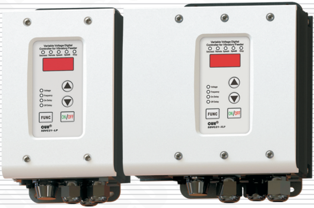

## Benutzerhandbuch der Serie SDVC21P

**Digitaler Spannungsregler für Schwingförderer**

---

## Vorwort

Vielen Dank, dass Sie sich für CUH digitale Schwingförderer-Regler entschieden haben. (Im Folgenden „der Regler“ genannt.)

Diese Betriebsanleitung enthält Hinweise zur Installation, Inbetriebnahme, Parametereinstellung, Wartung und Fehlerbehebung des Reglers. Bitte lesen Sie diese Betriebsanleitung vor dem Betrieb des Reglers sorgfältig durch und bewahren Sie sie gut auf.

### Diese Betriebsanleitung gilt für die folgenden Modelle:

➔Intelligenter digitaler spannungsstabilisierender Regler für Schwingförderer SDVC21-LP  
➔Intelligenter digitaler spannungsstabilisierender Regler für Schwingförderer SDVC21-XLP

---

---

## Hinweis

- Nehmen Sie den Regler niemals im laufenden Betrieb ab und berühren Sie niemals die Kontakte, um elektrische Schläge oder andere Unfälle zu vermeiden.
- Schalten Sie die Eingangsversorgung des Reglers niemals durch Trennen der Stromversorgung über ein Relais oder andere Geräte ab, da sonst die Lebensdauer des Reglers stark verkürzt werden kann.
- Öffnen Sie das Gehäuse nicht ohne Genehmigung, da sonst Wasser-, Öl- und Staubschutz versagen können.
- Betreiben Sie den Regler niemals unter Bedingungen, die seine konstruktiven Grenzen überschreiten.
- Betreiben Sie den Regler streng nach dieser Betriebsanleitung. Wir übernehmen keine zivil- oder strafrechtliche Haftung, wenn Geräteschäden oder Personenschäden durch falsche Bedienung verursacht werden.

> **!**
>
> Öffnen Sie niemals das Gehäuse des Reglers, um elektrische Schläge zu vermeiden. Wenden Sie sich an CUH, wenn der Regler ausfällt.
>
> Versuchen Sie niemals, den Regler umzubauen, da die Festkörper-Leiterplatten im Inneren des Reglers nicht repariert werden können und es keine einstellbaren Teile gibt.

---

# Betriebsumgebung

## Prüfungen vor der Verwendung

Jeder Regler wird vor der Auslieferung einer strengen Qualitätsprüfung unterzogen und in stoßsicherer Verpackung versandt.

## Bitte prüfen Sie nach dem Auspacken die folgenden Punkte:

- Ob der Regler äußerlich beschädigt ist
- Ob das Modell des Reglers genau Ihren bestellten Angaben entspricht

## Betriebsumgebung

Bitte beachten Sie die folgenden Hinweise, um eine bessere Leistung und eine längere Lebensdauer des Reglers zu gewährleisten

- Gut belüftete Umgebung
- Von korrosiven und brennbaren Gasen und Flüssigkeiten fernhalten
- Fest montiert, um Vibrationen zu vermeiden
- Von elektromagnetischen Störungen fernhalten
- Betrieb im Temperaturbereich von 0 °C bis 40 °C
- Für die Verwendung in Höhen von 2000 m oder darunter

---

# Inhaltsverzeichnis

| Abschnitt | Seite |
|---|---:|
| Kapitel I Merkmale | 1 |
| Kapitel II Installationsanleitung | 3 |
| Kapitel III Komponentenbeschreibung | 4 |
| Kapitel IV Funktionsbeschreibung | 6 |
| 4.1 Einstellung der Ausgangsspannung | 6 |
| 4.2 Einstellung der Ausgangsfrequenz | 7 |
| 4.3 Einstellung des Parameters für das Frequenz-Anzeigezeichen | 7 |
| 4.4 Einstellung der Sanftanlaufzeit | 8 |
| 4.5 Ausgangsschalter | 8 |
| 4.6 Begrenzung der maximalen Ausgangsspannung | 9 |
| 4.7 Wiederherstellen der Standardeinstellungen | 10 |
| Kapitel V Sensoren und Signalsteuerung | 11 |
| 5.1 Intelligente fotoelektrische Erfassung | 11 |
| 5.2 Verwendung des Schaltsensors | 15 |
| 5.3 Verwendung des zweiten Schaltsensors | 18 |
| 5.4 Einstellung der logischen Beziehung des Steuersignals | 21 |
| 5.5 Steuerausgang | 22 |
| 5.6 Fernsteuerung der Geschwindigkeit | 26 |
| 5.7 Voreingestellte Geschwindigkeitsumschaltung | 27 |
| Kapitel VI Sicherheitsfunktionen | 28 |
| 6.1 Automatische digitale Spannungsstabilisierung | 28 |
| 6.2 Kurzschlussschutz | 28 |
| 6.3 Stromüberlastschutz | 28 |
| 6.4 Überhitzungsschutz | 28 |
| 6.5 Derating-Kurve der Umgebungstemperatur (nur für SDVC21-XLP) | 28 |

## Anhang

| Abschnitt | Seite |
|---|---:|
| Anhang A: Abmessungen | 29 |
| Anhang B: Definition der Ausgangsschnittstelle | 31 |
| Anhang C: Definition der Signalschnittstelle | 31 |
| Anhang D: Definition der LED-Anzeigezeichen | 34 |
| Anhang E: Elektrische Spezifikation | 35 |
| Anhang F: Tipps zur Fehlerbehebung und Fehlererklärungen | 36 |
| Anhang G: Absolute Parameter | 37 |

---

# Kapitel Ⅰ Merkmale

Der Regler wurde speziell für die Steuerung von Schwingförderern in Automatisierungssystemen entwickelt. Kombiniert mit der neuesten Elektroniktechnologie und einem durchdachten Design bietet der Regler die folgenden praktischen und komfortablen Merkmale:

**Schutzart:** IP67. Dieser Regler kann in feuchten, ölverschmutzten oder staubigen Umgebungen eingesetzt werden.

**Ultraweiter Betriebsspannungsbereich:** Der Eingangsspannungsbereich dieses Reglers reicht von AC 85 V bis 440 V.

**Automatische Spannungsstabilisierung:** Der Regler kann Fördergeschwindigkeitsschwankungen durch Netzspannungsschwankungen eliminieren.

**Spannungseinstellung:** Die Ausgangsspannung reicht von 0 V bis 440 V.

**Sanftanlauf:** Um plötzliche Stöße auf die Werkstücke zu vermeiden, kann der Regler beim Start die Ausgangsspannung sanft von 0 auf den voreingestellten Wert erhöhen.

**Einstellung der Sanftanlaufzeit:** Die Sanftanlaufzeit kann exakt in digitalen Zahlen eingestellt werden.

**Anhalten bei vollem Werkstückbestand:** Ein Schaltsensor kann den Regler anhalten, wenn die Werkstücke voll sind, und die Funktionen Einstellung der Sanftanlaufzeit, Einschaltverzögerung, Ausschaltverzögerung und Einstellung der logischen Beziehung erfüllen.

**Steuerausgang:** Das vom Transistor ausgegebene Steuerausgangssignal kann ein Magnetventil oder andere externe Geräte mit dem Regler koordinieren.

**Überhitzungsschutz:** Der Regler stellt seine Ausgabe ein, um sich selbst zu schützen, wenn die Betriebstemperatur zu hoch ist.

**Stromüberlastschutz:** Der Regler stellt seine Ausgabe ein, um die Betriebssicherheit des Geräts zu gewährleisten, wenn der Betriebsstrom seinen Nennwert überschreitet.

## Die folgenden Merkmale können kundenspezifisch angepasst werden:

**Dualer Steuersignaleingang:** Der duale Steuersignaleingang für „Werkstücke voll“ und „Werkstücke leer“ kann logische Steuerbeziehungen wie AND, OR, NOT, XOR und alle anderen bilden.

**Funktion zur Voreinstellung der Ausgangsspannung:** Bis zu vier voreingestellte Ausgangsspannungswerte können über externe Steuersignale ausgewählt werden.

**Intelligente fotoelektrische Erfassung:** Unser adaptiver intelligenter fotoelektrischer Sensor kann den Regler anhalten, wenn die Werkstücke voll oder leer sind, und die Funktionen Einstellung der Tipp-Startzeit, Einschaltverzögerung, Ausschaltverzögerung und Einstellung der logischen Beziehung erfüllen.

**Fernsteuerung der Geschwindigkeit:** Die Ausgangsspannung des Reglers kann durch ein externes Potentiometer, eine PLC oder ein Spannungssteuersignal von 1 V bis 5 V gesteuert werden.

---

---

**CUH** legt großen Wert auf Produktqualitätsmanagement und Sicherheitsleistung. Neben den von uns verwendeten hochwertigen Komponenten und dem strengen Qualitätskontrollsystem hat **CUH** mögliche Unfälle berücksichtigt, denen Benutzer begegnen können, und bietet die folgenden Schutzfunktionen, um die Praktikabilität des Reglers zu maximieren.

**Kurzschlussschutz:** Wenn der Ausgang des Reglers kurzgeschlossen ist, stellt der Regler seine Ausgabe ein, bis er neu gestartet wird.

**Stromüberlastschutz:** Der Regler stellt seine Ausgabe ein, um die Betriebssicherheit der Geräte zu gewährleisten, wenn der Betriebsstrom seinen Nennwert überschreitet.

**Überhitzungsschutz:** Der Regler stellt seine Ausgabe ein, um sich selbst zu schützen, wenn die Betriebstemperatur zu hoch ist.

**CUH**-Regler sind streng CE-konform.

---

# Kapitel Ⅱ Installationsanleitung

## Schritt Eins:

Öffnen Sie den Verpackungskarton und verbinden Sie das Ausgangsleistungskabel mit den Elektromagnetspulen des Vibrators.

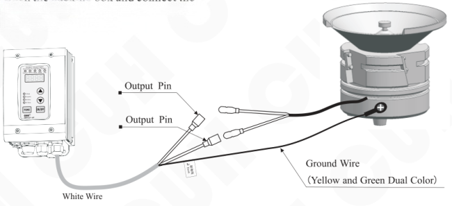

**⚠ Hinweis:**

Stellen Sie sicher, dass die Elektromagnetspulen des Vibrators mit den beiden Ausgangspins des Ausgangsleistungskabels verbunden sind und die Elektromagnetspulen zuverlässig geerdet sind, da sonst eine Reihe von Sicherheitsvorfällen auftreten kann.

## Schritt Zwei:

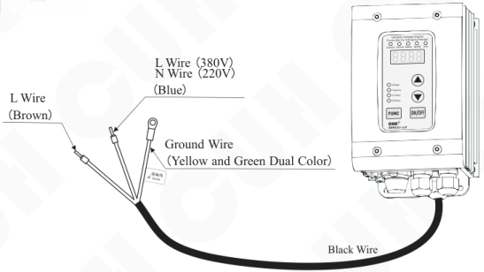

---

# Kapitel Ⅲ Komponentenbeschreibung

Auf dem Bedienfeld befinden sich 4 Tasten: die `FUNC`-Taste zum Umschalten zwischen verschiedenen Funktionen, die ▲-Taste zum Erhöhen des Parameterwerts, die ▼-Taste zum Verringern des Parameterwerts und die `ON/OFF`-Taste.

## Tastaturbeschreibung

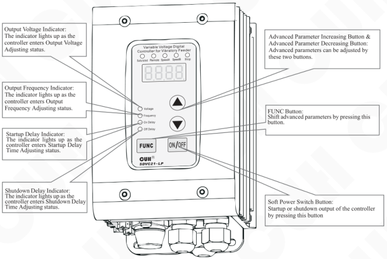

- **Anzeige der Ausgangsspannung:** Die Anzeige leuchtet, wenn der Regler in den Status zur Einstellung der Ausgangsspannung eintritt.
- **Anzeige der Ausgangsfrequenz:** Die Anzeige leuchtet, wenn der Regler in den Status zur Einstellung der Ausgangsfrequenz eintritt.
- **Anzeige der Einschaltverzögerung:** Die Anzeige leuchtet, wenn der Regler in den Status zur Einstellung der Einschaltverzögerungszeit eintritt.
- **Anzeige der Ausschaltverzögerung:** Die Anzeige leuchtet, wenn der Regler in den Status zur Einstellung der Ausschaltverzögerungszeit eintritt.
- **Taste zum Erhöhen der erweiterten Parameter und Taste zum Verringern der erweiterten Parameter:** Mit diesen beiden Tasten können erweiterte Parameter eingestellt werden.
- **FUNC-Taste:** Durch Drücken dieser Taste werden erweiterte Parameter umgeschaltet.
- **Soft-Power-Schaltertaste:** Durch Drücken dieser Taste wird die Ausgabe des Reglers ein- oder ausgeschaltet.

---

## Beschreibung der Statusanzeigen

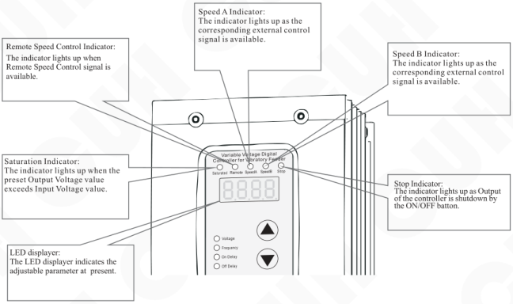

- **Anzeige Fernsteuerung:** Die Anzeige leuchtet, wenn ein Fernsteuerungssignal für die Geschwindigkeit verfügbar ist.
- **Anzeige Geschwindigkeit A:** Die Anzeige leuchtet, wenn das entsprechende externe Steuersignal verfügbar ist.
- **Anzeige Geschwindigkeit B:** Die Anzeige leuchtet, wenn das entsprechende externe Steuersignal verfügbar ist.
- **Sättigungsanzeige:** Die Anzeige leuchtet, wenn der voreingestellte Ausgangsspannungswert den Eingangsspannungswert überschreitet.
- **Stopp-Anzeige:** Die Anzeige leuchtet, wenn die Ausgabe des Reglers durch die ON/OFF-Taste abgeschaltet wird.
- **LED-Anzeige:** Die LED-Anzeige zeigt den aktuell einstellbaren Parameter an.

## Beschreibung der E/A-Schnittstelle

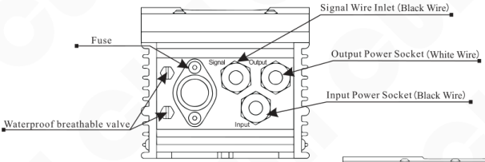

**SDVC21-LP (10 A)**

- Sicherung
- Wasserdichtes atmungsaktives Ventil
- Signalkabeleingang (schwarzes Kabel)
- Ausgangsbuchse (weißes Kabel)
- Eingangsbuchse (schwarzes Kabel)

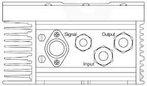

**SDVC21-XLP (25 A)**

Hinweis: Bei Verwendung in stark ölverschmutzten Umgebungen ist es erforderlich, die Oberfläche des wasserdichten atmungsaktiven Ventils regelmäßig zu prüfen, um zu verhindern, dass das Entlüftungsloch des wasserdichten atmungsaktiven Ventils durch Ölverschmutzung verstopft wird.

---

## Kapitel Ⅳ Funktionsbeschreibung

### 4.1 Einstellung der Ausgangsspannung

Die Ausgangsspannung kann direkt und digital über das Bedienfeld eingestellt werden. Dank der einzigartigen Spannungsstabilisierungsfunktion schwankt die Ausgangsspannung des Reglers nicht mit der Eingangsspannung. Dadurch kann ein Vibrator auch bei instabiler Eingangsspannung stabil arbeiten.

- Schalten Sie den Regler ein, indem Sie das Eingangsleistungskabel anschließen.
- Die Anzeige der Ausgangsspannung leuchtet, wenn der Regler in den Status zur Einstellung der Ausgangsspannung eintritt und die LED das Spannungssymbol H und den zuvor eingestellten Spannungswert anzeigt.
- Stellen Sie den Wert der Ausgangsspannung durch Drücken der Taste ▲ oder ▼ ein.

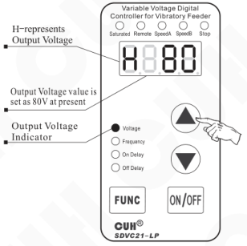

- Der Ausgangsspannungswert des Reglers darf den Eingangsspannungswert nicht überschreiten. Wenn der Ausgangsspannungswert nahe an den Eingangsspannungswert eingestellt wird, kann der Regler seine Spannungsausgabe nicht stabilisieren und die Sättigungsanzeige leuchtet.
- Wenn der Ausgangsspannungswert zu nahe bei Null eingestellt wird, kann der Regler seine Spannungsausgabe nicht stabilisieren und die Sättigungsanzeige leuchtet.

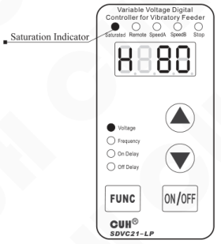

---

## 4.2 Einstellung der Ausgangsfrequenz

Für den SDVC21-LP gibt es zwei Ausgangsfrequenzen zur Auswahl: Vollwelle – verdoppelte Eingangsfrequenz und Halbwelle – Eingangsfrequenz.

Für den SDVC21-XLP gibt es vier Ausgangsfrequenzen zur Auswahl: Vollwelle, Halbwelle, ein Drittel der Vollwelle und ein Viertel der Vollwelle.

- Drücken Sie die **FUNC**-Taste wiederholt, bis in den Status zur Einstellung der Ausgangsfrequenz (E) umgeschaltet wird und die Anzeige der Ausgangsfrequenz leuchtet.
- Drücken Sie die Taste ▲ oder ▼, um die Ausgangsfrequenz einzustellen.

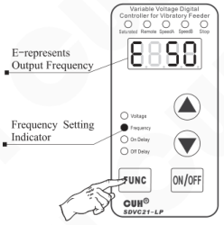

> Die angezeigten Zeichen des Ausgangsfrequenzwerts können über den Parameter für das Frequenz-Anzeigezeichen eingestellt werden. Siehe Abschnitt 4.3.

## 4.3 Einstellung des Parameters für das Frequenz-Anzeigezeichen

- Drücken Sie die **FUNC**-Taste und halten Sie sie zwei Sekunden lang gedrückt, um die erweiterte Parametereinstellungsoberfläche aufzurufen.
- Drücken Sie die **FUNC**-Taste wiederholt, um zum Parameter „ΓE“ zu wechseln, der das Frequenz-Anzeigezeichen definiert.
- Drücken Sie ▲ oder ▼, um den Wert dieses Parameters einzustellen.

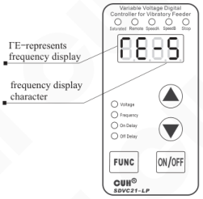

> Wenn der Parameter „ΓE“ auf „-5“ eingestellt ist, lauten die angezeigten Zeichen 100, 50, 33 oder 25.  
> Wenn der Parameter „ΓE“ auf „-6“ eingestellt ist, lauten die angezeigten Zeichen 120, 60, 40 oder 30.  
> Wenn der Parameter „ΓE“ auf „-E“ eingestellt ist, lauten die angezeigten Zeichen „FUL“, „HAF“, „trd“ oder „Foh“.

---

## 4.4 Einstellung der Sanftanlaufzeit

Um plötzliche Stöße auf die Werkstücke zu vermeiden, kann der Regler beim Start die Ausgangsspannung sanft von 0 auf den voreingestellten Wert erhöhen.

Sanftanlaufzeit (t): Die Zeitspanne, die der Regler benötigt, um die Ausgangsspannung beim Start sanft von 0 auf den voreingestellten Wert zu erhöhen.

- Drücken Sie die **FUNC**-Taste und halten Sie sie 2 Sekunden lang gedrückt, um den Status zur Einstellung der erweiterten Parameter aufzurufen.
- Drücken Sie die **FUNC**-Taste wiederholt, bis in den Status zur Einstellung der Sanftanlaufzeit (t) umgeschaltet wird und die Sanftanlaufanzeige leuchtet.
- Drücken Sie die Taste ▲ oder ▼, um den Parameterwert einzustellen. Die Parametereinheit ist Sekunde, und die numerische Genauigkeit beträgt 0,1.

*Die einstellbare Sanftanlaufzeit reicht von 0,0 Sekunden bis 9,9 Sekunden.*

*Der Standardwert des Parameters Sanftanlaufzeit beträgt 1 Sekunde.*

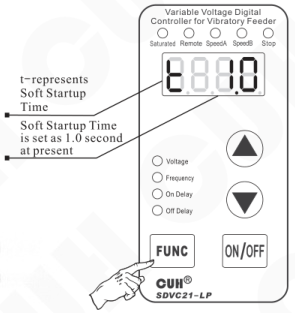

## 4.5 Ausgangsschalter

Die berührungsempfindliche Ausgangsschaltertaste am Bedienfeld kann die Ausgabe des Reglers schnell und einfach ein-/ausschalten.

- Drücken Sie die **ON/OFF**-Taste, um die Ausgabe des Reglers ein-/auszuschalten. Die Stopp-Anzeige leuchtet, wenn die Ausgabe des Reglers ausgeschaltet wird.

> Dank der berührungsempfindlichen Schalter- und digitalen Signalsteuerungstechnologie entsteht kein Funke, der den Kontakt beschädigen könnte. Dadurch wird die Lebensdauer des Reglers und des Vibrators erheblich verlängert.

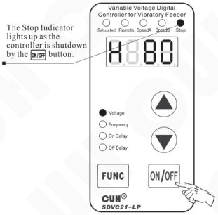

---

## 4.6 Begrenzung der maximalen Ausgangsspannung

Die maximale Ausgangsspannung des Reglers kann eingestellt werden, um Schäden am Vibrator zu verhindern. Die Funktion Fernsteuerung der Geschwindigkeit wird durch diesen Parameter beeinflusst.

- Drücken Sie die **FUNC**-Taste und halten Sie sie 2 Sekunden lang gedrückt, um den Status zur Einstellung der erweiterten Parameter aufzurufen.
- Drücken Sie die **FUNC**-Taste wiederholt, bis in den Status der Begrenzung der maximalen Ausgangsspannung (h) umgeschaltet wird.
- Drücken Sie die Taste ▲ oder ▼, um den Parameterwert einzustellen.

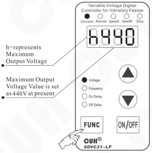

*Der Standardwert der maximalen Ausgangsspannung beträgt 380 V*

---

## 4.7 Wiederherstellen der Werkseinstellungen

Diese Funktion ermöglicht es dem Bediener, alle Standardparametereinstellungen wiederherzustellen.

Aufgrund der umfangreichen Funktionen des Reglers können viele Parameter eingestellt werden. Um zu vermeiden, dass der Regler nach zu vielen Änderungen durch einen Anfänger nicht ordnungsgemäß funktioniert, ermöglicht diese Funktion dem Bediener, die Standardeinstellungen des Reglers auf einfache Weise wiederherzustellen.

- Drücken Sie die **FUNC**-Taste und halten Sie sie 2 Sekunden lang gedrückt, um den Status zur Einstellung der erweiterten Parameter aufzurufen.
- Drücken Sie die **FUNC**-Taste wiederholt, bis der gesamte Bildschirm blinkt, und drücken Sie dann die ▲-Taste und halten Sie sie gedrückt, bis „----“ angezeigt wird, was bedeutet, dass die Standardeinstellungen wiederhergestellt wurden.
- Nach dem Loslassen der ▲-Taste tritt der Regler in den Status zur Einstellung der Ausgangsspannung (H) ein. Zu diesem Zeitpunkt wurden alle Parameter auf die Standardwerte zurückgesetzt.

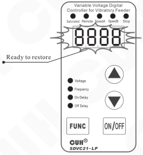

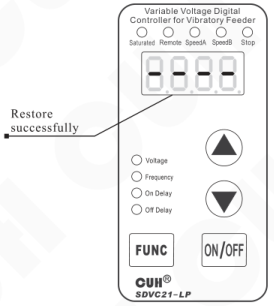

---

# Kapitel Ⅴ Sensoren und Signalsteuerung

Der Regler kann durch viele Arten externer Signale und Sensoren gesteuert werden. Dieses Kapitel erläutert hauptsächlich die Verwendungsmethoden des intelligenten fotoelektrischen Sensors, der Schaltsensoren und der PLC.

## 5.1 Intelligente fotoelektrische Erfassung

In Kombination mit dem fotoelektrischen Sensor SDVC-S1 kann die Funktion der intelligenten fotoelektrischen Erfassung realisiert werden. Der Sensor SDVC-S1 kann Störungen durch Hintergrundlicht herausfiltern, die die Empfindlichkeit des Reglers beeinflussen. Dadurch kann der Regler zuverlässig ohne manuelle Empfindlichkeitseinstellung arbeiten.

### 5.1.1 Anschlussmethode des intelligenten fotoelektrischen Sensors SDVC-S1

Schließen Sie den Sensor SDVC-S1 gemäß dem Diagramm an die Klemmen des Reglers an

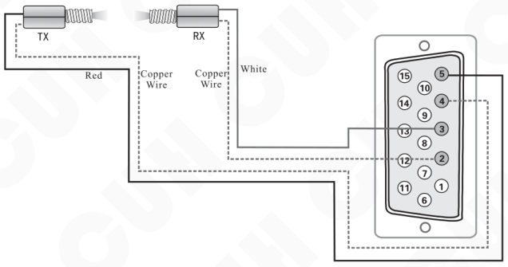

*Hinweis:*  
*Die standardmäßige logische Beziehung des Sensors ist auf „Werkstücke leer“ eingestellt*

---

## 5.1.2 Einstellung der Einschaltverzögerungszeit und Ausschaltverzögerungszeit des intelligenten fotoelektrischen Sensors

In den meisten praktischen Anwendungen sollte die Ausgabe des Reglers um eine bestimmte Zeit verzögert werden, wenn das Ein- oder Ausschalten des Reglers durch externe Signale gesteuert wird. Die Funktion zur Einstellung der Einschaltverzögerungszeit und Ausschaltverzögerungszeit ermöglichte diese Art von Anwendung. Darüber hinaus können Stöße auf die Werkstücke beim Start des Reglers durch Einstellen der Sanftanlaufzeit eliminiert werden.

### Einschaltverzögerung (J)

Die Zeitspanne, die der Regler vom Empfang eines Einschaltsteuersignals bis zur Ausgabe durchläuft.

- Drücken Sie die **FUNC**-Taste wiederholt, bis in den Status zur Einstellung der Einschaltverzögerungszeit (J) umgeschaltet wird und die Anzeige der Einschaltverzögerung am Bedienfeld leuchtet.
- Stellen Sie den Parameter durch Drücken der Taste ▲ oder ▼ ein. Die Parametereinheit ist Sekunde, und die numerische Genauigkeit beträgt 0,1.

*Der einstellbare Bereich des Parameters liegt zwischen 0,0 und 9,9 Sekunden*  
*Der Standardwert des Parameters beträgt 0,2 Sekunden*

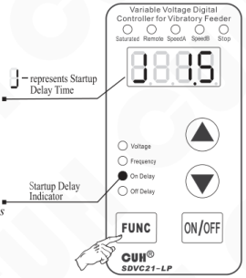

### Ausschaltverzögerung (L)

Die Zeitspanne, die der Regler vom Empfang eines Ausschaltsteuersignals bis zum Abschalten der Ausgabe durchläuft.

- Drücken Sie die **FUNC**-Taste wiederholt, bis in den Status zur Einstellung der Ausschaltverzögerungszeit (L) umgeschaltet wird und die Anzeige der Ausschaltverzögerung am Bedienfeld leuchtet.
- Stellen Sie den Parameter durch Drücken der Taste ▲ oder ▼ ein. Die Parametereinheit ist Sekunde, und die numerische Genauigkeit beträgt 0,1.

*Der einstellbare Bereich des Parameters liegt zwischen 0,0 und 9,9 Sekunden*  
*Der Standardwert des Parameters beträgt 0,2 Sekunden*

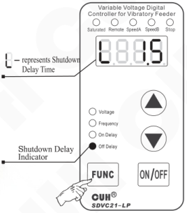

---

### 5.1.3 Einstellung der logischen Beziehung des intelligenten fotoelektrischen Sensors

Unter normalen Umständen empfängt das Empfangsende des intelligenten fotoelektrischen Sensors kein optisches Signal, und der Regler läuft standardmäßig. In einigen speziellen Anwendungen muss der Regler jedoch angehalten werden, wenn das Empfangsende kein optisches Signal empfängt. Das Einstellen dieses Parameters kann diese Art von Anwendungen erfüllen.

- Drücken Sie die **FUNC**-Taste und halten Sie sie 2 Sekunden lang gedrückt, um den Status zur Einstellung der erweiterten Parameter aufzurufen.
- Drücken Sie die **FUNC**-Taste wiederholt, bis in den Status zur Einstellung der logischen Beziehung des intelligenten fotoelektrischen Sensors umgeschaltet wird.
- Stellen Sie den Parameter durch Drücken der Taste ▲ oder ▼ ein.

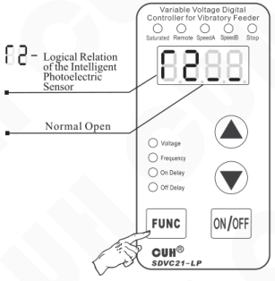

- Wenn die logische Beziehung auf Normal Open eingestellt ist, d. h. kein optisches Signal empfangen wird, läuft der Regler.
- Wenn die logische Beziehung auf Normal Close eingestellt ist, d. h. kein optisches Signal empfangen wird, stoppt der Regler.

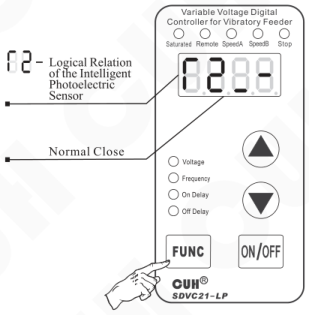

*Der Parameter ist standardmäßig auf Normal Open eingestellt*

---

## 5.1.4 Einstellung des Empfindlichkeitsparameters des CUH intelligenten fotoelektrischen Sensors

Parameter P bezeichnet die Empfindlichkeit des CUH intelligenten fotoelektrischen Sensors, d. h. die Erfassungsdistanz des CUH intelligenten fotoelektrischen Sensors.

Je kleiner der Wert des Parameters P ist, desto empfindlicher ist der Sensor und desto größer ist die Distanz, die er erfassen kann.

- Drücken Sie die **FUNC**-Taste und halten Sie sie zwei Sekunden lang gedrückt, um die erweiterte Parametereinstellungsoberfläche aufzurufen.
- Drücken Sie die **FUNC**-Taste wiederholt, um zur Parametereinstellungsoberfläche der Empfindlichkeit des intelligenten fotoelektrischen Sensors zu gelangen. Das LED-Symbol dieses Parameters ist „P“.
- Drücken Sie ▲ oder ▼, um den Wert dieses Parameters einzustellen.

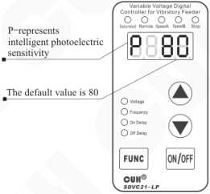

Der Wertebereich des Parameters reicht von 0 bis 999, und der Standardwert ist 80.

---

## 5.2 Verwendung des Schaltsensors

Der Regler kann mit vielen Arten von Sensoren betrieben werden, wie z. B. Schaltsensoren, optischen Schaltsensoren und Glasfasersensoren.

### 5.2.1 Anschlussmethode des Schaltsensors

Schließen Sie den Näherungsschalter gemäß dem Diagramm an die Klemmen des Reglers an.

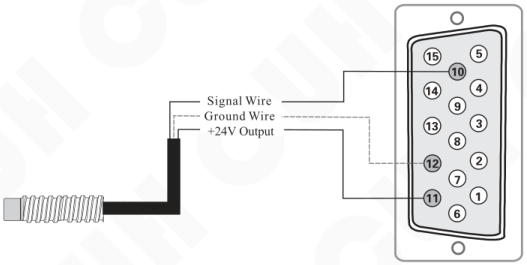

### Konvention

Die blaue Ader repräsentiert die Masseader  
Die schwarze Ader repräsentiert die Signalader  
Die braune Ader repräsentiert die Versorgungsader.

---

## 5.2.2 Einstellung der Einschaltverzögerungszeit und Ausschaltverzögerungszeit des Schaltsensors

Standardmäßig teilen sich der intelligente fotoelektrische Sensor und der Schaltsensor dieselbe Einschaltverzögerungszeit und Ausschaltverzögerungszeit. Bediener können die Einschaltverzögerungszeit und Ausschaltverzögerungszeit des Schaltsensors auch unabhängig einstellen.

### Einschaltverzögerung (J-)

Die Zeitspanne, die der Regler vom Empfang eines Einschaltsteuersignals bis zur Ausgabe durchläuft.

- Drücken Sie die **FUNC**-Taste und halten Sie sie 2 Sekunden lang gedrückt, um den Status zur Einstellung der erweiterten Parameter aufzurufen.
- Drücken Sie die **FUNC**-Taste wiederholt, bis in den Status zur Einstellung der Einschaltverzögerungszeit (`J---`) umgeschaltet wird.
- Stellen Sie den Parameter durch Drücken der Taste ▲ oder ▼ ein. Die Parametereinheit ist Sekunde, und die numerische Genauigkeit beträgt 0,1.

*Der einstellbare Bereich des Parameters liegt zwischen 0,0 und 9,9 Sekunden*  
*Der Standardwert des Parameters ist J---*  
*Die unabhängige Einschaltverzögerung des Schaltsensors wird geschlossen, wenn der Parameterwert auf 0 eingestellt wird*

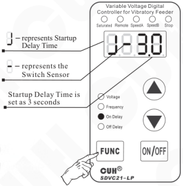

### Ausschaltverzögerung (L-)

Die Zeitspanne, die der Regler vom Empfang eines Ausschaltsteuersignals bis zum Abschalten der Ausgabe durchläuft.

- Drücken Sie die **FUNC**-Taste und halten Sie sie 2 Sekunden lang gedrückt, um den Status zur Einstellung der erweiterten Parameter aufzurufen.
- Drücken Sie die **FUNC**-Taste wiederholt, bis in den Status zur Einstellung der Ausschaltverzögerungszeit (`L---`) umgeschaltet wird.
- Stellen Sie den Parameter durch Drücken der Taste ▲ oder ▼ ein. Die Parametereinheit ist Sekunde, und die numerische Genauigkeit beträgt 0,1.

*Der einstellbare Bereich des Parameters liegt zwischen 0,0 und 9,9 Sekunden*  
*Der Standardwert des Parameters ist L---*  
*Die unabhängige Ausschaltverzögerung des Schaltsensors wird geschlossen, wenn der Parameterwert auf 0 eingestellt wird*

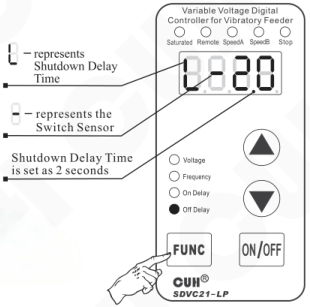

> ➔ Wenn die Werte J- und L- auf 0 eingestellt werden, entsprechen die Einschaltverzögerungszeit und Ausschaltverzögerungszeit des Schaltsensors denen des intelligenten fotoelektrischen Sensors.
>
> ➔ Die Einschaltverzögerungszeit und Ausschaltverzögerungszeit des intelligenten fotoelektrischen Sensors werden nicht durch den Parameter J- oder L- beeinflusst.

---

## 5.2.3 Einstellung der logischen Beziehung des Schaltsensors (Anhalten bei vollem Werkstückbestand)

Unter normalen Umständen empfängt der Regler kein Signal vom Schaltsensor und läuft standardmäßig. In einigen speziellen Anwendungen muss der Regler jedoch angehalten werden, wenn er kein Signal vom Schaltsensor empfängt. Das Einstellen dieses Parameters kann diese Art von Anwendungen erfüllen.

- Drücken Sie die **FUNC**-Taste und halten Sie sie 2 Sekunden lang gedrückt, um den Status zur Einstellung der erweiterten Parameter aufzurufen.
- Drücken Sie die **FUNC**-Taste wiederholt, bis in den Status zur Einstellung der logischen Beziehung des Schaltsensors (Γ1) umgeschaltet wird.
- Stellen Sie den Parameter durch Drücken der Taste ▲ oder ▼ ein.

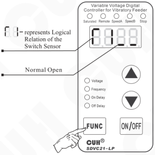

> ➔ Wenn die logische Beziehung auf Normal Open eingestellt ist, d. h. kein Signal empfangen wird, läuft der Regler.
>
> ➔ Wenn die logische Beziehung auf Normal Close eingestellt ist, d. h. kein Signal empfangen wird, stoppt der Regler.

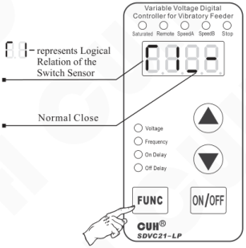

*Der Parameter ist standardmäßig auf Normal Open eingestellt*

---

## 5.3 Verwendung des zweiten Schaltsensors

Der Regler ermöglicht den Anschluss von drei Sensoren: einem intelligenten fotoelektrischen Sensor und zwei Schaltsensoren. Die Funktionen Anhalten bei vollem Werkstückbestand und Anhalten bei leerem Werkstückbestand können mit Hilfe dieser Sensoren arbeiten.

### 5.3.1 Anschlussmethode des zweiten Schaltsensors

Schließen Sie den zweiten Näherungsschalter gemäß dem Diagramm an die Klemmen des Reglers an.

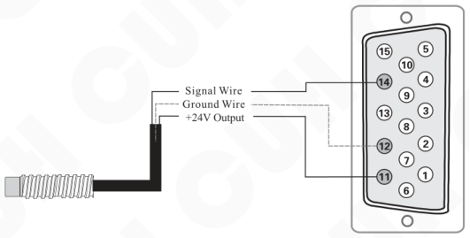

**Üblicherweise**

Die blaue Ader repräsentiert die Masseader  
Die schwarze Ader repräsentiert die Signalader  
Die braune Ader repräsentiert die Versorgungsader

---

### 5.3.2 Einstellung der Einschaltverzögerungszeit und Ausschaltverzögerungszeit des zweiten Schaltsensors

Standardmäßig teilen sich der intelligente fotoelektrische Sensor und die beiden Schaltsensoren dieselbe Einschaltverzögerungszeit und Ausschaltverzögerungszeit. Bediener können die Einschaltverzögerungszeit und Ausschaltverzögerungszeit auch unabhängig für den zweiten Schaltsensor einstellen.

**Einschaltverzögerung (J_):** Die Zeitspanne, die der Regler vom Empfang eines Einschaltsteuersignals bis zur Ausgabe durchläuft.

- Drücken Sie die **FUNC**-Taste und halten Sie sie 2 Sekunden lang gedrückt, um den Status zur Einstellung der erweiterten Parameter aufzurufen.
- Drücken Sie die **FUNC**-Taste wiederholt, bis in den Status zur Einstellung der Einschaltverzögerungszeit (`J_--`) umgeschaltet wird
- Stellen Sie den Parameter durch Drücken der Taste ▲ oder ▼ ein. Die Parametereinheit ist Sekunde, und die numerische Genauigkeit beträgt 0,1.

*Der einstellbare Bereich des Parameters liegt zwischen 0,0 und 9,9 Sekunden*  
*Der Standardwert des Parameters ist `J_--`*  
*Die unabhängige Einschaltverzögerung des zweiten Schaltsensors wird geschlossen, wenn der Parameterwert auf 0 eingestellt wird*

**Ausschaltverzögerung (L_):** Die Zeitspanne, die der Regler vom Empfang eines Ausschaltsteuersignals bis zum Abschalten der Ausgabe durchläuft.

- Drücken Sie die **FUNC**-Taste und halten Sie sie 2 Sekunden lang gedrückt, um den Status zur Einstellung der erweiterten Parameter aufzurufen.
- Drücken Sie die **FUNC**-Taste wiederholt, bis in den Status zur Einstellung der Ausschaltverzögerungszeit (`L_--`) umgeschaltet wird.
- Stellen Sie den Parameter durch Drücken der Taste ▲ oder ▼ ein. Die Parametereinheit ist Sekunde, und die numerische Genauigkeit beträgt 0,1.

*Der einstellbare Bereich des Parameters liegt zwischen 0,0 und 9,9 Sekunden*  
*Der Standardwert des Parameters ist `L_--`*  
*Die unabhängige Ausschaltverzögerung des zweiten Schaltsensors wird geschlossen, wenn der Parameterwert auf 0 eingestellt wird*

- Wenn die Werte J_ und L_ auf 0 eingestellt werden, entsprechen die Einschaltverzögerungszeit und Ausschaltverzögerungszeit des zweiten Schaltsensors denen des intelligenten fotoelektrischen Sensors.
- Die Einschaltverzögerungszeit und Ausschaltverzögerungszeit des intelligenten fotoelektrischen Sensors werden nicht durch den Parameter J_ oder L_ beeinflusst.

---

## 5.3.3 Einstellung der logischen Beziehung des zweiten Schaltsensors (Anhalten bei vollem Werkstückbestand)

Unter normalen Umständen empfängt der Regler kein Signal vom zweiten Schaltsensor und läuft standardmäßig. In einigen speziellen Anwendungen muss der Regler jedoch angehalten werden, wenn er kein Signal vom zweiten Schaltsensor empfängt. Das Einstellen dieses Parameters kann diese Art von Anwendungen erfüllen.

- Drücken Sie die **FUNC**-Taste und halten Sie sie 2 Sekunden lang gedrückt, um den Status zur Einstellung der erweiterten Parameter aufzurufen.
- Drücken Sie die **FUNC**-Taste wiederholt, bis in den Status zur Einstellung der logischen Beziehung des zweiten Schaltsensors (Γ3) umgeschaltet wird
- Stellen Sie den Parameter durch Drücken der Taste ▲ oder ▼ ein.

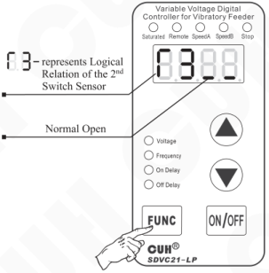

> - Wenn die logische Beziehung auf Normal Open eingestellt ist, d. h. kein Signal empfangen wird, läuft der Regler.
> - Wenn die logische Beziehung auf Normal Close eingestellt ist, d. h. kein Signal empfangen wird, stoppt der Regler.

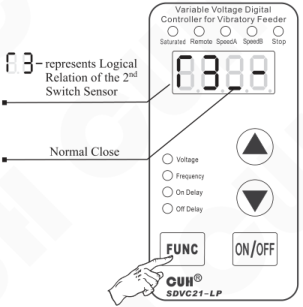

*Der Parameter ist standardmäßig auf Normal Open eingestellt*

---

## 5.4 Einstellung der logischen Beziehung des Steuersignals

Der Regler kann die logische Beziehung des intelligenten fotoelektrischen Sensors und des Schaltsensors festlegen, wenn diese gleichzeitig arbeiten.

- Drücken Sie die **FUNC**-Taste und halten Sie sie 2 Sekunden lang gedrückt, um den Status zur Einstellung der erweiterten Parameter aufzurufen.
- Drücken Sie die **FUNC**-Taste wiederholt, bis in den Status zur Einstellung der logischen Beziehung des Steuersignals (Π) umgeschaltet wird.
- Stellen Sie den Parameter durch Drücken der Taste ▲ oder ▼ ein.

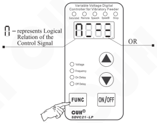

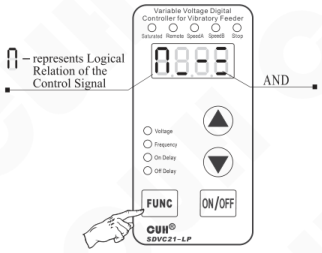

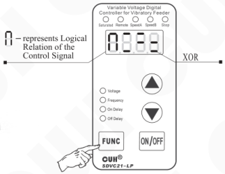

- **Logische Beziehung AND:** Der Regler läuft nur, wenn sowohl der intelligente fotoelektrische Sensor als auch der Schaltsensor den Regler dazu auffordern.
- **Logische Beziehung OR:** Der Regler läuft, wenn der intelligente fotoelektrische Sensor oder der Schaltsensor den Regler dazu auffordert.
- **Logische Beziehung XOR:** Der Regler läuft nur, wenn der intelligente fotoelektrische Sensor und der Schaltsensor das entgegengesetzte Steuersignal ausgeben.

*Die logische Beziehung des Parameters ist standardmäßig auf AND eingestellt.*

---

## 5.5 Steuerausgang

Der Regler kann ein Niederspannungs-Steuersignal ausgeben, um mit anderen Geräten wie einem Magnetventil, einer PLC oder einem elektrischen Relais zusammenzuarbeiten.

### 5.5.1 Anschlussmethode des Steuerausgangs

**Anschlussmethode der gesteuerten PLC**

Verbinden Sie die Signalader und die Masseader des Reglers gemäß dem Diagramm mit den Klemmen des Reglers.

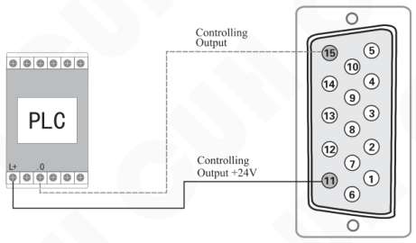

> Relais-Typ oder Source-Typ des Ausgangsports der PLC können an den Regler angeschlossen werden, und die Spannungsspezifikation des Ausgangsports beträgt 24 V.

---

### 5.5.2 Anschlussmethode des gesteuerten Magnetventils

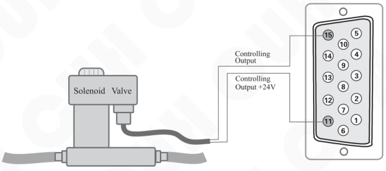

➔ Der Regler kann ein Magnetventil mit einer Nennspannung von 24 V und einer Nennleistung unter 4 W direkt ansteuern.

### 5.5.3 Anschlussmethode des elektrischen Relais

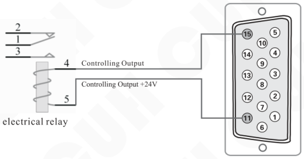

➔ Der Regler kann ein elektrisches Relais mit einer Nennspannung von 24 V und einer Nennleistung unter 4 W direkt ansteuern.

---

## 5.5.4 Einstellung der logischen Beziehung des Steuerausgangs

- Drücken Sie die **FUNC**-Taste und halten Sie sie 2 Sekunden lang gedrückt, um den Status zur Einstellung der erweiterten Parameter aufzurufen.
- Drücken Sie die **FUNC**-Taste wiederholt, bis in den Status zur Einstellung der logischen Beziehung des Steuerausgangs (Γ4) umgeschaltet wird.
- Stellen Sie den Parameter durch Drücken der Taste ▲ oder ▼ ein.

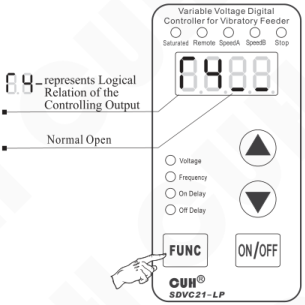

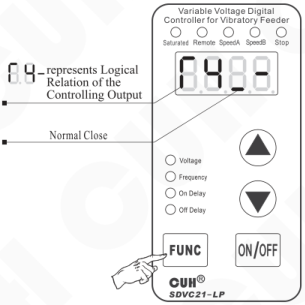

> - Wenn die logische Beziehung auf Normal Open eingestellt ist, arbeitet der Steuerausgang, während der Regler läuft.
> - Wenn die logische Beziehung auf Normal Close eingestellt ist, arbeitet der Steuerausgang nicht, während der Regler läuft.

---

## 5.5.5 Parametereinstellung zur getrennten Zuordnung der Steuersignale zum Ausgang des Reglers oder zum DC-Ausgang

- Drücken Sie die **FUNC**-Taste und halten Sie sie zwei Sekunden lang gedrückt, um die erweiterte Parametereinstellungsoberfläche aufzurufen.
- Drücken Sie die **FUNC**-Taste wiederholt, um zur Einstellungsoberfläche des Parameters zu gelangen. Das LED-Symbol dieses Parameters ist „Γ5“.
- Drücken Sie ▲ oder ▼, um den Wert dieses Parameters einzustellen.

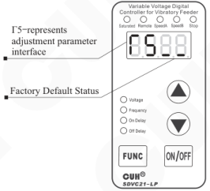

- Wenn Γ5 auf „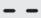“ eingestellt ist, werden der Ausgang zum Vibrator und der DC-Ausgang gemeinsam durch die ON/OFF-Taste am Bedienfeld und das Ergebnis der logischen Verknüpfung des CUH intelligenten fotoelektrischen Sensors und zweier Schaltsensoren gesteuert.
- Wenn Γ5 auf „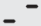“ eingestellt ist, wird der Ausgang zum Vibrator durch die ON/OFF-Taste am Bedienfeld gesteuert. Der DC-Ausgang wird durch das Ergebnis der logischen Verknüpfung des CUH intelligenten fotoelektrischen Sensors und zweier Schaltsensoren gesteuert.
- Wenn Γ5 auf „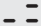“ eingestellt ist, wird der Ausgang zum Vibrator durch die ON/OFF-Taste am Bedienfeld und durch das Ergebnis der logischen Verknüpfung zweier Schaltsensoren gesteuert. Der DC-Ausgang wird durch den CUH intelligenten fotoelektrischen Sensor gesteuert.
- Wenn Γ5 auf „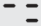“ eingestellt ist, wird der Ausgang zum Vibrator durch die ON/OFF-Taste am Bedienfeld und den CUH intelligenten fotoelektrischen Sensor gesteuert. Der DC-Ausgang wird durch das Ergebnis der logischen Verknüpfung zweier Schaltsensoren gesteuert.

---

## 5.6 Fernsteuerung der Geschwindigkeit

Die Funktion Fernsteuerung der Geschwindigkeit ermöglicht es dem Bediener, die Ausgangsspannung über ein externes Potentiometer oder ein Steuersignal im Bereich von 1 V bis 5 V zu steuern. So kann eine externe Geschwindigkeitsfernsteuerung einfach durch eine PLC, ein DCS oder andere Geräte realisiert werden.

Die Funktion Fernsteuerung der Geschwindigkeit wird für den Regler wirksam, wenn das Steuersignal 0,5 V überschreitet. Gleichzeitig leuchtet die Anzeige Fernsteuerung am Bedienfeld und die Tasten ▲ und ▼ verlieren ihre Wirksamkeit. Die LED-Anzeige zeigt die aktuelle Ausgangsspannung an, wenn der Regler im Status zur Einstellung der Ausgangsspannung läuft.

Es besteht eine lineare Beziehung zwischen der Steuerspannung von 1~5 V und der Ausgangsspannung von 0~440 V

### Anschlussmethode des externen Potentiometers

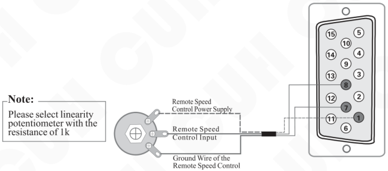

### Anschlussmethode der PLC

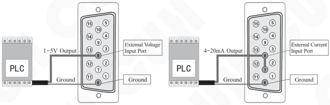

## 5.7 Voreingestellte Geschwindigkeitsumschaltung

Die Funktion Voreingestellte Geschwindigkeitsumschaltung kann die voreingestellte Geschwindigkeit über externe Steuersignale wie eine PLC, einen PC, Sensoren oder andere Signalquellen auswählen, um ein Mehrgeschwindigkeits-Fördersystem aufzubauen.

Der Regler unterstützt zwei externe Geschwindigkeitssteuerschalter. Der Schalter Geschwindigkeit A und der Schalter Geschwindigkeit B sind beide bei niedrigem Pegel wirksam.

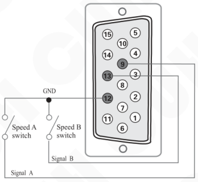

Jeder Geschwindigkeitssteuerschalter hat eine entsprechende Anzeige am Bedienfeld. Wenn der Regler ein wirksames Signal empfängt, leuchtet die entsprechende Anzeige.

Die beiden Anzeigen zeigen 4 Zustände an. (A leuchtet und B erlischt, A erlischt und B leuchtet, beide leuchten, beide erlöschen). Das Diagramm rechts zeigt den Zustand, in dem beiden Geschwindigkeitssteuerschaltern wirksame Signale gegeben werden.

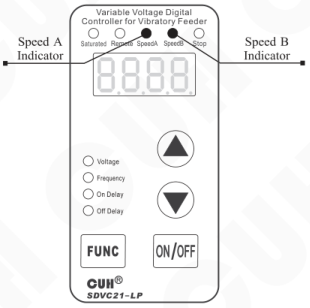

Mittels der Geschwindigkeitssteuerschalter wechselt der Regler in die entsprechende Geschwindigkeit. Die zur Geschwindigkeit gehörende Ausgangsspannung kann durch Drücken der Taste ▲ oder ▼ eingestellt werden. Und die eingestellte Spannung wird automatisch gespeichert. Sobald das Geschwindigkeitssteuersignal empfangen wird, gibt der Regler die entsprechende Spannung sofort aus.

---

## Kapitel Ⅵ Sicherheitsfunktionen

### 6.1 Automatische digitale Spannungsstabilisierung

Die interne digitale Spannungsstabilisierungsfunktion des Reglers kann die Fördergeschwindigkeit unabhängig von Netzspannungsschwankungen stabilisieren.

### 6.2 Kurzschlussschutz

Wenn der Ausgang kurzgeschlossen ist, stoppt der Regler seine Ausgabe und zeigt Err02 an, bis der Regler neu gestartet wird.

### 6.3 Stromüberlastschutz

Der Regler stoppt seine Ausgabe, wenn der Ausgangsstrom durch fehlerhafte Bedienung den Nennstrom überschreitet, und zeigt Err02 an, um den Regler und die Kundenausrüstung zu schützen.

### 6.4 Überhitzungsschutz

Der Regler stoppt seine Ausgabe und zeigt Err03 an, wenn die Betriebstemperatur 65 °C überschreitet, um den Regler zu schützen, bis die Betriebstemperatur auf 60 °C fällt.

### 6.5 Derating-Kurve der Umgebungstemperatur (nur für SDVC21-XLP)

Unter der Bedingung natürlicher Luftkonvektion kann der Regler bei steigender Umgebungstemperatur aufgrund der begrenzten Wärmeableitungsfähigkeit des Reglers nicht kontinuierlich 25 A Strom ausgeben. Verwenden Sie die untenstehende Derating-Kurve.

Wenn der Regler kontinuierlich 25 A Strom ausgeben soll, sorgen Sie bitte für bessere Kühlbedingungen.

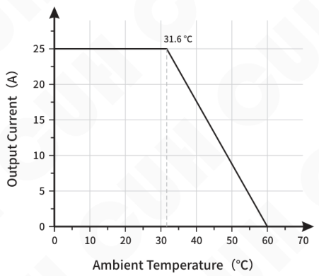

---

## Anhang A: Abmessungen (mm)

### SDVC21-LP

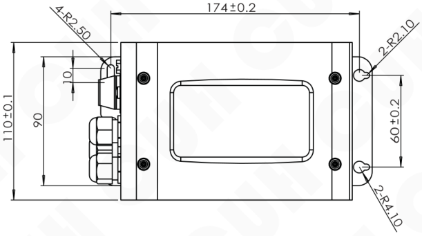

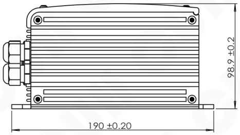

---

## SDVC21-XLP

---

## Anhang B: Definition der Ausgangsschnittstelle

### Querschnittsansicht:

**⚠ Hinweis:**

A: Stellen Sie sicher, dass die Elektromagnetspulen des Vibrators mit den beiden Ausgangspins der Ausgangsleistungsbuchse verbunden sind und das Gehäuse des Vibrators zuverlässig geerdet ist, andernfalls können schwere Sicherheitsvorfälle auftreten.

B: Stellen Sie nach dem Schweißen sicher, dass der freie Bereich mit Isolierband oder Schrumpfschlauch umhüllt ist, bevor Sie ihn in die Ausgangsleistungsbuchse stecken, um elektrische Leckage oder Kurzschluss zu vermeiden.

## Anhang C: Definition der Signalschnittstelle

![Definitionsdiagramm der 15-poligen Signalschnittstelle. 1: Fernsteuerung der Geschwindigkeit (+5V); 2: Fotosensor (GND); 3: Fotosensor Rx; 4: Fotosensor (GND); 5: Fotosensor Tx; 6: Fernsteuerung der Geschwindigkeit (GND); 7: RGND; 8: Fernsteuerung der Geschwindigkeit (Eingang); 9: Pset A (niedriger Spannungspegel ist wirksam); 10: Schaltsensor-Eingang (NPN-Typ: niedriger Spannungspegel ist wirksam; PNP-Typ: hoher Spannungspegel ist wirksam); 11: Steuerausgang (+24V); 12: Steuerausgang (GND); 13: Pset B (niedriger Spannungspegel ist wirksam); 14: Schaltsensor-II-Eingang (NPN-Typ: niedriger Spannungspegel ist wirksam; PNP-Typ: hoher Spannungspegel ist wirksam); 15: Steuerausgang.](assets/images/cuh.sdvc21-lp.manual.v0.0/page-0037-vcrop-02.png)

---

## Port A: Fernsteuerung der Geschwindigkeit

| Port | Pin | Signal |
|---|---|---|
| A3 | ① | +5V |
| A2 | ⑧ | Eingang |
| A1 | ⑦ | RGND |

## Port B: Intelligenter Fotosensor

| Port | Pin | Signal |
|---|---|---|
| B4 | ⑤ | Tx |
| B3 | ④ | GND |
| B2 | ③ | Rx |
| B1 | ② | GND |

## Port C: Schaltsensor

| Port | Pin | Signal |
|---|---|---|
| C1 | ⑫ | GND |
| C2 | ⑩ | Eingang |
| C3 | ⑪ | +24V |

## Port D: Steuerausgang

| Port | Pin | Signal |
|---|---|---|
| D1 | ⑮ | Ausgang |
| D2 | ⑪ | +24V |
| D3 | ⑫ | GND |

---

## Port E: Schaltsensor II

| Port | DB-Pin | Signal |
|---|---|---|
| E1 | ⑫ | GND |
| E2 | ⑭ | Eingang |
| E3 | ⑪ | +24V |

## Port G: Geschwindigkeits-Voreinstellung

| Port | DB-Pin | Signal |
|---|---|---|
| G1 | ⑫ | GND |
| G2 | ⑨ | Pset A |
| G3 | ⑫ | GND |
| G4 | ⑬ | Pset B |

## Port I: 24V DC-Stromversorgung

| Port | DB-Pin | Signal |
|---|---|---|
| I1 | ⑫ | GND |
| I2 | ⑪ | +24V |

Hinweis: Die Zahlen im Kreis repräsentieren die Pins des DB-Steckers.

---

## Anhang D: Definition der LED-Anzeigezeichen

| Anzeigezeichen | Definition | Symbolbild |
|---|---|---|
| H | Ausgangsspannung |  |
| E | Ausgangsfrequenz |  |
| t | Sanftanlauf |  |
| J | Einschaltverzögerungszeit des intelligenten fotoelektrischen Sensors |  |
| J- | Einschaltverzögerungszeit des Schaltsensors |  |
| J_ | Einschaltverzögerungszeit des 2. Schaltsensors |  |
| L | Ausschaltverzögerungszeit des intelligenten fotoelektrischen Sensors |  |
| L- | Ausschaltverzögerungszeit des Schaltsensors |  |
| L_ | Ausschaltverzögerungszeit des 2. Schaltsensors |  |
| Γ1 | Logische Beziehung des Schaltsensors |  |
| Γ2 | Logische Beziehung des intelligenten fotoelektrischen Sensors |  |
| Γ3 | Logische Beziehung des 2. Schaltsensors |  |
| Γ4 | Logische Beziehung des Steuerausgangs |  |
| Γ5 | Parametereinstellung zur Zuweisung der Steuersignale zum Ausgang des Reglers oder zum DC-Ausgang für getrennte Steuerung |  |
| ΓE | Parametereinstellung des Frequenzanzeigezeichens |  |
| h | Maximale Ausgangsspannung |  |
| A | Logische Beziehung des Steuersignals |  |
| P | Einstellung des Empfindlichkeitsparameters des CUH intelligenten fotoelektrischen Sensors |  |
| 8.8.8.8. | Wiederherstellung der Standardeinstellungen |  |
| ---- | Wiederherstellung der Standardeinstellungen erfolgreich |  |
| Err | Fehlerinformation |  |

## Anhang E: Elektrische Spezifikation

| Punkt | Bereich: Min | Bereich: Typisch | Bereich: Max | Einheit | Beschreibung |
|---|---|---|---|---|---|
| Eingangsspannung | 85 | 380 | 440 | V | AC RMS |
| Einstellbarer Ausgangsspannungsbereich | 35 | —— | Vin-10 | V | Halbwelle |
| Einstellbarer Ausgangsspannungsbereich | 45 | —— | Vin-5 | V | Vollwelle |
| Spannungseinstellgenauigkeit | | 1 | | V | |
| Ansprechzeit der Spannungsregelung | 0 | 0.01 | 0.02 | s | |
| Einstellbarer Ausgangsstrombereich | 0 | —— | 10 | A | SDVC21-LP |
| Einstellbarer Ausgangsstrombereich | 0 | —— | 25 | A | SDVC21-XLP |
| Ausgangsleistung | 0 | —— | 3800 | VA | SDVC21-LP |
| Ausgangsleistung | 0 | —— | 9500 | VA | SDVC21-XLP |
| Ausgangsfrequenz | 90 | 100/120 | 130 | Hz | Vollwelle |
| Ausgangsfrequenz | 45 | 50/60 | 65 | Hz | Halbwelle |
| Ausgangsfrequenz | 30 | 33/40 | 43 | Hz | 1/3 Vollwelle SDVC21-XLP |
| Ausgangsfrequenz | 22 | 25/30 | 32 | Hz | 1/4 Vollwelle SDVC21-XLP |
| Ausgangswellenform | | Phasenanschnitt-Sinus | | | |
| Sanftanlaufzeit | 0.0 | —— | 9.9 | s | Werkseinstellung: 0.5 |
| Einschalt-/Ausschaltverzögerungszeit-Bereich | 0.0 | —— | 9.9 | s | Werkseinstellung: 0.2 |
| Genauigkeit der Einschalt-/Ausschaltverzögerungszeit | | 0.1 | | s | |
| Auslösetemperatur des Überhitzungsschutzes | 58 | 60 | 66 | ℃ | |
| DC-Steuerausgangsspannung | 22 | 24 | 26 | V | |
| DC-Steuerausgangsstrom | 0 | —— | 200 | mA | |
| Analoges Steuersignal | | 1-5 | | V | Spannung der Fernsteuerung der Geschwindigkeit |
| Digitales Steuersignal | | 24 | | V | Schaltsignal |
| Einstellmethode | | 4 | | Taste | |
| Sicherungskapazität | | 16 | | A | SDVC21-LP |
| Sicherungskapazität | | 30 | | A | SDVC21-XLP |
| Leistungsaufnahme im Standby | —— | 4 | —— | W | |
| Anzeigemethode | | 4 | | Ziffer | LED-Digitalröhren |
| Schutzart | | IP67 | | | |
| Gewicht | | 4600 | | g | SDVC21-LP |
| Gewicht | | 5800 | | g | SDVC21-XLP |
| Umgebungstemperatur | 0 | 25 | 40 | ℃ | |

---

## Anhang F: Tipps zur Fehlerbehebung und Fehlererklärungen

Die folgenden Tipps können helfen, die Probleme zu lösen, auf die Sie stoßen könnten

| | | | Symbolbild |
|---|---|---|---|
| 1 | Keine Anzeige nach dem Einschalten | ➔Stellen Sie sicher, dass die Steckdose Spannung führt ➔Stellen Sie sicher, dass das Eingangsleistungskabel zuverlässig mit der Steckdose verbunden ist | |
| 2 | Anzeige normal, aber kein Ausgang | ➔Stellen Sie sicher, dass das Eingangsleistungskabel und das Ausgangsleistungskabel fest verbunden sind ➔Stellen Sie sicher, dass der Wert des Parameters Ausgangsspannung nicht zu klein ist ➔Stellen Sie sicher, dass der Regler nicht durch das Steuersignal gestoppt wird ➔Stellen Sie sicher, dass der Regler nicht durch Parameter gestoppt wird, die als Normal Aus eingestellt sind | |
| 3 | Steuersignal verliert seine Wirkung | ➔Stellen Sie sicher, dass das Steuersignal korrekt eingegeben wird ➔Stellen Sie sicher, dass die Masseleitung des Steuersignals korrekt mit dem Regler verbunden ist ➔Stellen Sie sicher, dass die logische Beziehung des Steuersignals korrekt nach Ihren Erwartungen eingestellt ist | |
| 4 | Anzeige normal, kein Ausgang, aber ein Geräusch ist hörbar | ➔Stellen Sie alle Parameter wie in diesem Handbuch beschrieben ein | |
| 5 | Err2 | ➔Ausgangsüberstrom. Stellen Sie sicher, dass die Spezifikationen des Vibrators die Grenzen des Reglers nicht überschreiten. ➔Ausgang im Kurzschluss. Stellen Sie sicher, dass das Ausgangsleistungskabel und der Luftfahrtstecker des Ausgangs nicht kurzgeschlossen sind. ➔Stellen Sie sicher, dass das Ausgangsleistungskabel zuverlässig zwischen Regler und Vibrator verbunden ist. ➔Stellen Sie sicher, dass der Regler zuverlässig geerdet ist. |  |
| 6 | Err3 | ➔Überhitzung. Platzieren Sie den Regler in einer gut belüfteten Umgebung |  |

## Anhang G: Absolute Parameter

Absolute Parameter:
Eine Überschreitung der Normwerte beschädigt den Regler; halten Sie sie strikt ein.

| Punkt | GB-Norm | IEC-Norm | Normanforderung | Erreichter Wert des CUH-Produkts | Anmerkung |
|---|---|---|---|---|---|
| Elektrostatische Entladung | GB/T 17626.2-2006 | IEC 61000-4-2:2001 | 4 kV | ±8 kV | Kontaktentladung |
| | | | 4 kV | ±15 kV | Luftentladung |
| Elektrischer schneller Transiententest | GB/T 17626.4-2008 | IEC 61000-4-4:2004 | 4 kV | ±4 kV | Direkte Kopplung |
| Elektrische Stoßspannung | GB/T 17626.5-2008 | IEC 61000-4-5:2005 | 4 kV | ±4 kV | Leiter-Leiter-Kopplung |
| | | | 4 kV | ±4 kV | Leiter-Erde-Kopplung |

---

Nanjing CUH Science & Technology Co.,Ltd  
https://en.cuhnj.com  
Tel.:+86-25-84730411 / 84730415 / 84730416  
Fax:+86-25-84730426  
E-mail:sales@cuhnj.com  
Add.:Building 2, Xueyan Tech Park, Tuscity,  
No.9 Zhineng Rd, Jiangning, Nanjing, China

Document No.: IDP1000415

