## Digitaler Frequenzregler für Vibrationsfördereinrichtungen

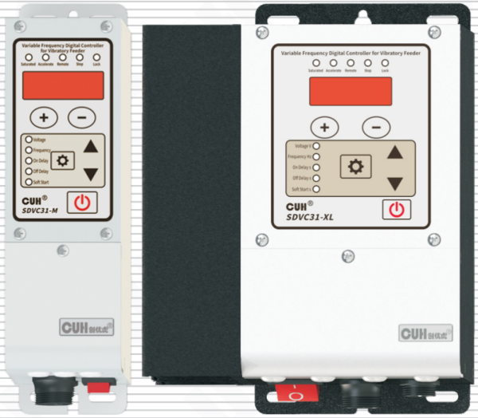

## SDVC31-Serie
Digitaler Frequenzregler für Vibrationsfördereinrichtungen — Serie SDVC31
**Benutzerhandbuch**

---

## Urheberrechtserklärung

Nanjing CUH Science & Technology CO., Ltd. behält sich alle Rechte vor.

Alle in diesem Benutzerhandbuch enthaltenen Informationen sind das Wissen unseres Unternehmens und durch das Urheberrecht sowie andere einschlägige Gesetze geschützt. CUH genießt und behält sich alle Rechte vor, die ihm durch das Urheberrecht und andere Gesetze eingeräumt werden. Ohne die schriftliche Zustimmung von CUH darf dieses Benutzerhandbuch ganz oder teilweise nicht kopiert, übersetzt, nachgeahmt oder auf andere Weise verwendet werden.

## Haftungsausschluss

Alle Inhalte dieses Benutzerhandbuchs beschreiben nur die Verwendungsmethode der von unserem Unternehmen produzierten Produkte und werden gemäß dem bestehenden Technologiestand und dem Zustand beschrieben, der Ihnen bei der Verwendung zur Verfügung gestellt wird. Bei der Verwendung dieses Produkts tragen Sie die damit verbundenen Risiken. Soweit gesetzlich vorgeschrieben, übernimmt das Unternehmen keinerlei ausdrückliche oder stillschweigende Verantwortung für das Produkt aufgrund dieses Benutzerhandbuchs, einschließlich, aber nicht beschränkt auf Personenschäden, Sachschäden, entgangene Chancen usw.

Sie erkennen die oben genannten Risiken ausdrücklich an und stimmen zu, dass das Unternehmen – soweit gesetzlich nicht zwingend vorgeschrieben – für keine direkten oder indirekten Schäden oder Verluste gegenüber Ihnen haftet (einschließlich, aber nicht beschränkt auf materielle Verluste an Personal, Eigentum, Daten usw. und immaterielle Verluste wie Ansehen, Chancen usw.)

Das Unternehmen behält sich das Recht vor, die in diesem Benutzerhandbuch beschriebenen Produkte ohne vorherige oder nachträgliche Ankündigung zu ändern.

---

# Vorwort

Vielen Dank, dass Sie sich für den digitalen Frequenzregler der CUH-Serie SDVC31 für Vibrationsfördereinrichtungen entschieden haben. (Im Folgenden kurz „der Regler"). Diese Reglerserie verwendet hochwertige Komponenten und die neueste Elektroniktechnologie und ist mit leistungsfähigen digitalen Signalprozessoren sorgfältig entwickelt worden.

Dieses Handbuch beschreibt die grundlegende Bedienungsmethode, die technische Funktionsbeschreibung und typische Anwendungsbeispiele dieses Produkts. Es bietet dem Anwender relevante Informationen zur Installation und Inbetriebnahme, zur Parametereinstellung, zur Fehlerdiagnose, zur Fehlerbehebung und zur routinemäßigen Wartung des Reglers. Um eine korrekte Installation und Verwendung dieses Reglers zu gewährleisten, lesen Sie bitte dieses Benutzerhandbuch vor der Installation sorgfältig durch und bewahren Sie es gut auf.

Lesen Sie unbedingt die folgenden Symbole, die Sie auf Vorsichtsmaßnahmen gegen Personenschäden und Produktschäden hinweisen.

| | |
|---|---|
| ⚠ Gefahr | Nichtbeachtung dieses Punktes führt zu Personenschäden oder Tod. |
| ⚠ Warnung | Nichtbeachtung dieses Punktes kann zu Personenschäden oder Tod führen. |
| ⚠ Vorsicht | Nichtbeachtung dieses Punktes kann zu mittleren oder leichten Personenschäden führen. |
| Hinweis | Nichtbeachtung dieses Punktes führt zu Produktschäden und Sachschäden. |
| ❗ Zwingend | Weist auf Vorsichtsmaßnahmen und Nutzungseinschränkungen hin, die während der Verwendung unbedingt zu beachten sind. |

**Dieses Handbuch eignet sich für die folgenden Reglermodelle:**

- Digitaler FM-Vibrationsförderregler SDVC31-S (1,5A)
- Digitaler FM-Vibrationsförderregler SDVC31-M (3,0A)
- Digitaler FM-Vibrationsförderregler SDVC31-L (4,5A)
- Digitaler FM-Vibrationsförderregler SDVC31-XL (6,0A)

---

## Sicherheit und Vorsichtsmaßnahmen

1. **⚠ Gefahr** Dieses Produkt dient nur zum Antrieb magnetbasierten Vibrationsfördergeräts; verwenden Sie dieses Produkt nicht zum Schutz des menschlichen Körpers oder von Körperteilen usw.

2. **⚠ Gefahr** Dieses Produkt ist nicht als explosionsgeschütztes Produkt vorgesehen; verwenden Sie es nicht an gefährlichen Orten und/oder in potenziell explosiver Gasatmosphäre.

3. **⚠ Warnung** Dieses Produkt wird über das Wechselstromnetz mit Strom versorgt; bitte keine Wechselspannung über 260Vac anlegen. Überspannung, wie z. B. 380Vac, kann zur Explosion oder Entzündung des Produkts führen und schwere Sicherheitsunfälle verursachen.

4. **⚠ Warnung** Dieses Produkt ist über das Netzkabel geerdet. Stellen Sie sicher, dass die Stromverteilungseinrichtungen für den Regler gut geerdet sind, da sonst das Reglergehäuse unter Spannung stehen und einen Stromunfall verursachen kann.

5. **⚠ Warnung** Legen Sie keine Wechselspannung an den Ausgang dieses Reglers an, da dies den Regler beschädigt.

6. **⚠ Warnung** Ziehen Sie die Verkabelung nicht unter Spannung ab und berühren Sie nicht die Kontakte der einzelnen Verbindungsklemmen im Anschlussraum, um Stromschläge zu vermeiden.

7. **Hinweis** Vermeiden Sie es, den Ausgang dieses Produkts durch Abschalten der Stromversorgung über Relais oder andere Geräte zu steuern, da dies die Lebensdauer des Reglers erheblich verkürzt.

8. **Hinweis** Der Regler ist für den Betrieb in einer kühlen und trockenen Umgebung ausgelegt. Betreiben Sie den Regler niemals im Freien, um Nässe und Besonnung zu vermeiden. Betreiben Sie den Regler innerhalb der in den elektrischen Kennwerten angegebenen Temperatur.

9. **❗ Zwingend** Befestigen Sie dieses Produkt unbedingt auf einer soliden, zuverlässig geerdeten Plattform und entfernt von Vibrationsgeräten.

10. **❗ Zwingend** Betreiben Sie den Regler niemals außerhalb seiner Auslegungsgrenzen.

11. **❗ Zwingend** Bedienen Sie den Regler strikt gemäß dieser Betriebsanleitung. Wir übernehmen keine zivil- oder strafrechtliche Haftung, wenn Geräteschäden oder Personenschäden durch falsche Bedienung verursacht werden.

12. **❗ Zwingend** Öffnen Sie niemals das Reglergehäuse, um Stromschläge zu vermeiden. Wenden Sie sich bei einer Reglerstörung an CUH. Versuchen Sie niemals, den Regler selbst zu reparieren, da dies zum Erlöschen der Garantie führen kann.

---

# Betriebs- und Lagerumgebung

## Prüfung vor der Verwendung

Jeder Regler durchläuft vor der Auslieferung eine strenge Qualitätsprüfung und wird in stoßfester Verpackung verpackt. Bitte prüfen Sie nach dem Auspacken die folgenden Punkte:

1. Ob der Regler während des Transports beschädigt wurde.
2. Ob das Modell des Reglers dem von Ihnen bestellten Modell entspricht.

## Umgebungsbedingungen im Betrieb

Bitte beachten Sie die folgenden Hinweise, um eine bessere Leistung und längere Lebensdauer des Reglers zu gewährleisten:

- ⚠ Gut belüftete Umgebung
- ⚠ Von Wasser, Dampf, Staub und insbesondere öligem Staub fernhalten
- ⚠ Von korrosiven oder brennbaren Gasen und Flüssigkeiten fernhalten
- ⚠ Von Schwebestaub und Metallpartikeln fernhalten
- ⚠ Fest befestigt, um Eigenvibrationen zu vermeiden
- ⚠ Von elektromagnetischen Störungen fernhalten
- ⚠ Umgebungstemperatur von 0~40 ℃ sicherstellen
- ⚠ Für die Verwendung in Höhenlagen von 2000 m oder darunter

---

# Inhaltsverzeichnis

- **Kapitel Ⅰ Vor der Verwendung — 1**
  - 1.1 Kontrolle des Packungsinhalts — 1
  - 1.2 Erläuterung der Anzeigen und Tasten — 2
  - 1.3 Erläuterung der externen Teile — 3
  - 1.4 Erläuterung der Anschlussklemmen — 4
  - 1.5 Erläuterung des Typenschilds — 4
- **Kapitel Ⅱ Merkmale — 5**
- **Kapitel Ⅲ Installationsanleitung — 7**
  - 3.1 Einsatzbedingungen des Reglers — 7
  - 3.2 Bedienung der Tasten — 7
  - 3.3 Installation und Verwendung — 8
- **Kapitel Ⅳ Beschreibung der Grundfunktionen — 12**
  - 4.1 Ausgangsspannung — 12
  - 4.2 Ausgangsfrequenz — 13
  - 4.3 Ein-/Ausschaltverzögerung des intelligenten photoelektrischen Sensors — 14
  - 4.4 Sanftanlaufzeit — 15
  - 4.5 Tastatursperre — 15
- **Kapitel Ⅴ Beschreibung der erweiterten Funktionen — 16**
  - 5.1 Fernsteuerung der Drehzahl — 16
  - 5.2 Intelligente photoelektrische Sensorik — 18
    - 5.2.1 Anschlussmethode des intelligenten photoelektrischen Sensors — 18
    - 5.2.2 Einstellung der logischen Beziehung des intelligenten photoelektrischen Sensors — 19
  - 5.3 Schaltsensor — 20
    - 5.3.1 Anschlussmethode des Schaltsensors — 20
    - 5.3.2 Ein-/Ausschaltverzögerung des Schaltsensors — 21
    - 5.3.3 Einstellung der logischen Beziehung des Schaltsensors — 22

---

---

- 5.4 Einstellung der logischen Beziehung des Steuersignals — 23
- 5.5 Steuerausgang — 24
  - 5.5.1 Anschlussmethode des Steuerausgangs — 24
  - 5.5.2 Einstellung der logischen Beziehung des Steuerausgangs — 25
  - 5.5.3 Parameter zur Trennung von Haupt- und Steuerausgang — 26
- 5.6 Begrenzung der maximalen Ausgangsspannung — 27
- 5.7 Untere Frequenzgrenze — 27
- 5.8 Beschleunigungsindex — 28
- 5.9 Wellenformindex — 29
- 5.10 Temperaturanzeigefunktion — 30
- 5.11 Wiederherstellen der Werkseinstellungen/Rückkehr in den Fabrikmodus — 31

## Kapitel Ⅵ Technische Daten — 32

- 6.1 Abmessungen — 32
- 6.2 Technische Daten — 34
- 6.3 Referenznorm — 35

## Kapitel Ⅶ Anhang — 36

- 7.1 Parametertabelle — 36
- 7.2 Eingangs- und Ausgangsschaltpläne — 37
- 7.3 Fehlerbehebungsvorschläge und Fehlererläuterungen — 38

## Kapitel Ⅷ Produktgarantieinformationen — 39

- 8.1 Garantiezeitraum — 39
- 8.2 Garantieumfang — 39
- 8.3 Produkteignung — 39

---

# Kapitel Ⅰ Vor der Verwendung

Dieses Kapitel beschreibt den Packungsinhalt des Produkts, die Beschreibung des Regleraussehens und die Informationen zum Typenschild des Reglers.

## 1.1 Kontrolle des Packungsinhalts

Prüfen Sie vor der Verwendung die Unversehrtheit des Reglers und des Zubehörs. Wenn Sie feststellen, dass das Produkt defekt oder beschädigt ist oder Zubehör fehlt, wenden Sie sich bitte an unser Unternehmen.

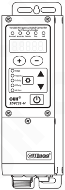

Regler×1

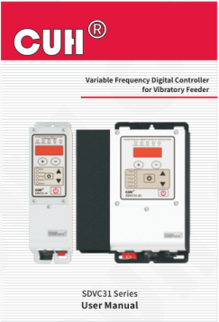

Benutzerhandbuch×1

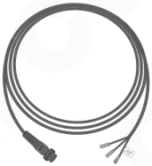

Ausgangskabel×1

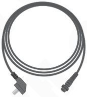

Netzkabel×1

---

## 1.2 Erläuterung der Anzeigen und Tasten

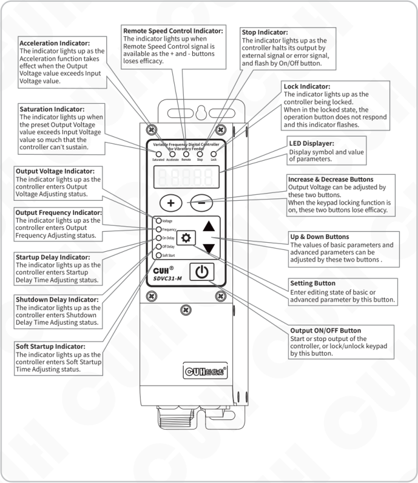

**Beschleunigungsanzeige:**
Die Anzeige leuchtet, wenn die Beschleunigungsfunktion wirksam wird, sobald der Wert der Ausgangsspannung den Wert der Eingangsspannung übersteigt.

**Anzeige der Drehzahlfernsteuerung:**
Die Anzeige leuchtet, wenn ein Signal der Drehzahlfernsteuerung verfügbar ist und die Tasten + und - unwirksam werden.

**Stoppanzeige:**
Die Anzeige leuchtet, wenn der Regler seine Ausgabe durch ein externes Signal oder ein Fehlersignal anhält, und blinkt durch die Ein-/Ausschalttaste.

**Sättigungsanzeige:**
Die Anzeige leuchtet, wenn der voreingestellte Wert der Ausgangsspannung die Eingangsspannung so weit übersteigt, dass der Regler ihn nicht aufrechterhalten kann.

**Sperranzeige:**
Die Anzeige leuchtet, wenn der Regler gesperrt ist.
Im gesperrten Zustand reagiert die Bedientaste nicht und diese Anzeige blinkt.

**LED-Anzeige:**
Zeigt Symbol und Wert der Parameter an.

**Anzeige der Ausgangsspannung:**
Die Anzeige leuchtet, wenn der Regler den Status der Ausgangsspannungseinstellung erreicht.

**Anzeige der Ausgangsfrequenz:**
Die Anzeige leuchtet, wenn der Regler den Status der Ausgangsfrequenzeinstellung erreicht.

**Anzeige der Anlaufverzögerung:**
Die Anzeige leuchtet, wenn der Regler den Status der Einstellung der Anlaufverzögerungszeit erreicht.

**Anzeige der Abschaltverzögerung:**
Die Anzeige leuchtet, wenn der Regler den Status der Einstellung der Abschaltverzögerungszeit erreicht.

**Sanftanlauf-Anzeige:**
Die Anzeige leuchtet, wenn der Regler den Status der Einstellung der Sanftanlaufzeit erreicht.

**Tasten Erhöhen & Verringern**
Mit diesen beiden Tasten kann die Ausgangsspannung eingestellt werden.
Wenn die Tastatursperrfunktion aktiviert ist, sind diese beiden Tasten unwirksam.

**Auf- & Ab-Tasten**
Mit diesen beiden Tasten können die Werte der Grundparameter und erweiterten Parameter eingestellt werden.

**Einstelltaste**
Mit dieser Taste gelangen Sie in den Bearbeitungszustand eines Grund- oder erweiterten Parameters.

**Ein-/Ausschalttaste für den Ausgang**
Starten oder stoppen Sie den Ausgang des Reglers oder sperren/entsperren Sie die Tastatur mit dieser Taste.

## 1.3 Erläuterung der externen Teile

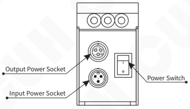

SDVC31-S (1.5A)  
SDVC31-M (3.0A)

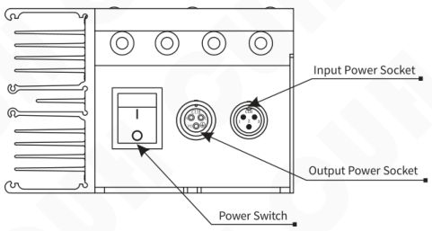

SDVC31-L (4.5A)  
SDVC31-XL (6.0A)

---

## 1.4 Erläuterung der Anschlussklemmen

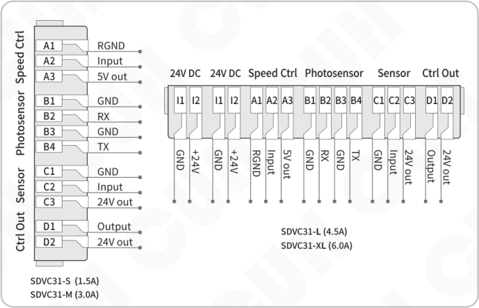

**SDVC31-S (1.5A)**  
**SDVC31-M (3.0A)**

| Klemmengruppe | Klemme | Beschreibung |
|---|---|---|
| Drehzahlsteuerung | A1 | RGND |
| Drehzahlsteuerung | A2 | Eingang |
| Drehzahlsteuerung | A3 | 5V-Ausgang |
| Photosensor | B1 | GND |
| Photosensor | B2 | RX |
| Photosensor | B3 | GND |
| Photosensor | B4 | TX |
| Sensor | C1 | GND |
| Sensor | C2 | Eingang |
| Sensor | C3 | 24V-Ausgang |
| Steuerausgang | D1 | Ausgang |
| Steuerausgang | D2 | 24V-Ausgang |

**SDVC31-L (4.5A)**  
**SDVC31-XL (6.0A)**

| Klemmengruppe | Klemme | Beschreibung |
|---|---|---|
| 24V DC | I1 | GND |
| 24V DC | I2 | +24V |
| 24V DC | I1 | GND |
| 24V DC | I2 | +24V |
| Drehzahlsteuerung | A1 | RGND |
| Drehzahlsteuerung | A2 | Eingang |
| Drehzahlsteuerung | A3 | 5V-Ausgang |
| Photosensor | B1 | GND |
| Photosensor | B2 | RX |
| Photosensor | B3 | GND |
| Photosensor | B4 | TX |
| Sensor | C1 | GND |
| Sensor | C2 | Eingang |
| Sensor | C3 | 24V-Ausgang |
| Steuerausgang | D1 | Ausgang |
| Steuerausgang | D2 | 24V-Ausgang |

## 1.5 Erläuterung des Typenschilds

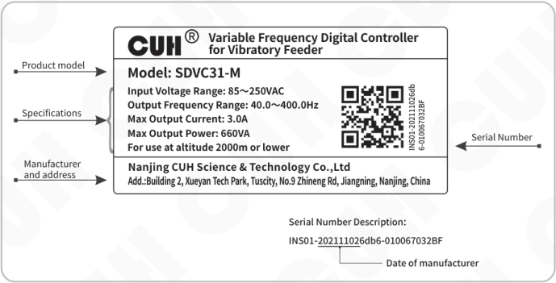

CUH® — Digitaler Frequenzregler für Vibrationsfördereinrichtungen

| Typenschildposition | Inhalt |
|---|---|
| Produktmodell | Modell: SDVC31-M |
| Spezifikationen | Eingangsspannungsbereich: 85～250VAC Ausgangsfrequenzbereich: 40.0～400.0Hz Max. Ausgangsstrom: 3.0A Max. Ausgangsleistung: 660VA Für die Verwendung in Höhenlagen von 2000 m oder darunter |
| Hersteller und Adresse | Nanjing CUH Science & Technology Co.,Ltd Add.:Building 2, Xueyan Tech Park, Tuscity, No.9 Zhineng Rd, Jiangning, Nanjing, China |
| Seriennummer | INS01-202111026db6-010067032BF |

Beschreibung der Seriennummer:

INS01-<ins>20211102</ins>6db6-010067032BF

20211102 → Herstellungsdatum

---

## Kapitel Ⅱ Merkmale

Der Regler ist speziell für die Steuerung von Vibrationsförderern in Automatisierungssystemen konzipiert. Kombiniert mit der neuesten Elektroniktechnologie und durchdachtem Design bietet der Regler die folgenden praktischen und komfortablen Merkmale:

**Frequenzeinstellung:** Der Ausgangsfrequenzbereich reicht von 40.0Hz bis 400.0Hz.

**Spannungseinstellung:** Der Ausgangsspannungsbereich reicht von 0V bis 250V.

**Automatische Spannungsstabilisierung:** Der Regler kann Fördergeschwindigkeitsschwankungen durch Netzspannungsschwankungen ausgleichen.

**Sanftanlauf:** Um plötzliche Stöße auf die Werkstücke zu vermeiden, kann der Regler die Ausgangsspannung beim Start sanft von 0 auf den voreingestellten Wert erhöhen.

**Intelligente photoelektrische Sensorik:** Unser adaptiver intelligenter photoelektrischer Sensor kann dabei helfen, den Regler anzuhalten, wenn die Werkstücke voll sind oder kein Werkstück vorhanden ist, und die Funktionen Sanftanlaufzeiteinstellung, Einschaltverzögerung, Ausschaltverzögerung und Einstellung der logischen Beziehung zu erfüllen.

**Funktion des Bereitschaftssignals:** Gibt ein moduliertes Signal oder ein gültiges Signal über den Übertragungsanschluss B4 der intelligenten Optoelektronik aus, um anzuzeigen, dass sich der Regler im Bereitschaftszustand befindet. Wenn der Regler einen Fehler feststellt, wird das Bereitschaftssignal ungültig.

**Schaltsensor:** Ein adaptiver Schaltsensor oder eine SPS kann angeschlossen werden, um den Regler ein-/auszuschalten.

**Beschleunigung:** Durch diese Funktion kann der maximale Wert der Ausgangsspannung des Reglers bis auf 150 % des Werts der Eingangsspannung erhöht werden.

**Drehzahlfernsteuerung:** Die Ausgangsspannung des Reglers kann durch ein externes Potentiometer, eine SPS oder ein 1~5V/4~20mA-DC-Signal gesteuert werden.

**Steuerausgang:** Das vom Transistor ausgehende Steuerausgangssignal kann ein Magnetventil oder andere externe Geräte mit dem Regler koordinieren.

**Tastatursperrung:** Halten Sie die Ein-/Ausschalttaste 2 Sekunden lang gedrückt, um alle Tasten zur Vermeidung von Fehlbedienung zu sperren. Im gesperrten Zustand reagiert die Bedientaste nicht und diese Anzeige blinkt.

**Begrenzung der maximalen Ausgangsleistung:** Der maximale Wert der Ausgangsspannung kann voreingestellt werden, um das Gerät vor Beschädigung durch Fehlbedienung zu schützen.

**Einstellung des Wellenformindex:** Der Bediener kann Effizienz und maximale Kapazität durch Anpassen dieses Parameters abwägen.

**Wiederherstellung der Werkseinstellungen:** Mit dieser Funktion kann der Anwender alle Standardparametereinstellungen wiederherstellen und den Regler zurücksetzen.

---

---

CUH legt größten Wert auf das Produktqualitätsmanagement und die Sicherheitsleistung. Neben den hochwertigen Komponenten, die wir verwenden, und dem strengen Qualitätskontrollsystem hat CUH mögliche Unfälle berücksichtigt, auf die Anwender stoßen können, und bietet die folgenden Schutzfunktionen, um die Praxistauglichkeit des Reglers zu maximieren.

**Kurzschlussschutz:** Wenn der Ausgang des Reglers kurzgeschlossen ist, hält der Regler seine Ausgabe an, bis er neu gestartet wird.

**Überstromschutz:** Der Regler hält seine Ausgabe an, um die Betriebssicherheit der Geräte zu gewährleisten, wenn der Betriebsstrom seinen Nennwert überschreitet.

**Überhitzungsschutz:** Der Regler hält seine Ausgabe an, um sich selbst zu schützen, wenn die Betriebstemperatur zu hoch ist.

**Über-/Unterspannungsschutz:** Wenn die Eingangsspannung zu hoch/zu niedrig ist, wird die Stromversorgung automatisch zur Selbstschutz abgeschaltet.

CUH-Regler entsprechen streng der CE-Zertifizierung.

---

# Kapitel Ⅲ Installationsanleitung

Dieses Kapitel beschreibt die notwendigen Bedingungen für die Verwendung des Reglers und wie man ihn korrekt installiert und anschließt.

## 3.1 Einsatzbedingungen des Reglers

Der Regler wird mit AC 110/220V betrieben; der Schutzleiteranschluss erfolgt über den Stecker des Netzkabels. Bitte stellen Sie eine 110V- oder 220V-, 50Hz/60Hz-Netzstromversorgung und Verteilungseinrichtungen nach Standard bereit und stellen Sie sicher, dass der Schutzleiter korrekt angeschlossen ist.

**⚠ Warnung** Schließen Sie den Regler niemals an 380V Wechselspannung an; dies verursacht irreversible, schwerwiegende Schäden am Regler, möglicherweise mit Explosion, Brand und anderen Sicherheitsvorfällen.

**⚠ Warnung** Stellen Sie sicher, dass die Netzseite zuverlässig geerdet ist. Das Metallgehäuse des Reglers ist direkt mit dem Schutzleiter verbunden. Schlechte Erdung führt dazu, dass das Reglergehäuse unter Spannung steht und einen Stromunfall verursacht.

**Hinweis** Durch längeren Betrieb entsteht Wärme und die Temperatur des Gehäuses steigt. Bitte installieren Sie den Regler in einer gut belüfteten Umgebung, befestigen Sie ihn gut und halten Sie ihn von Vibrationsquellen fern.

**Hinweis** Der Ausgang dieses Produkts wird durch Gleichrichtung und Rückwandlung des Netzstroms gebildet; zwischen Eingang und Ausgang besteht keine Trennung. Daher dürfen die Ausgangspole nicht mit dem Schutzleiter verbunden werden. Beim Anschluss des Elektromagnets ist sicherzustellen, dass die Elektromagnetspule und das Gehäuse über eine Basisisolationsfähigkeit verfügen. Andernfalls kann ein Stromleck auftreten, das Stromschläge und Schäden am Regler verursachen kann.

**Hinweis** Dieses Produkt ist ein Regler zum Antrieb des Elektromagnets. Es darf nicht an einen piezoelektrischen Vibrationsförderer angeschlossen werden.

## 3.2 Bedienung der Tasten

a. Kurzes Drücken ist definiert als eine Drückdauer von mehr als 0,1 und weniger als 2 Sekunden; langes Drücken ist definiert als eine Drückdauer von mehr als 2 Sekunden.

b. Drücken Sie kurz die Taste ⊕ oder ⊖, um die Ausgangsspannung des Reglers an jeder LED-Schnittstelle einzustellen.

c. Drücken Sie lange die Taste ⚙, um die Grundparameterschnittstelle zu betreten oder zu verlassen, wechseln Sie mit kurzem Drücken der Taste ⚙ zwischen den Grundparametern und stellen Sie den Parameterwert mit kurzem Drücken der Taste ▼ oder ▲ ein.

d. Drücken Sie lange die Tasten ⚙ und ▲, um die erweiterte Parameterschnittstelle zu betreten oder zu verlassen, wechseln Sie mit kurzem Drücken der Taste ⚙ zwischen den erweiterten Parametern und stellen Sie den Parameterwert mit kurzem Drücken der Taste ▼ oder ▲ ein.

e. Drücken Sie kurz die Taste ⏻, um den Ausgang des Reglers zu starten oder zu stoppen, und drücken Sie lange die Taste ⏻, um die Tastatur zu sperren oder zu entsperren.

f. An der LED-Schnittstelle des Parameters zur Wiederherstellung der Werkseinstellungen drücken Sie lange die Taste ▲, bis 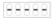 auf der LED angezeigt wird, um die Werkseinstellungen wiederherzustellen, oder drücken Sie lange die Taste ▼, bis  auf der LED angezeigt wird, um zur SDVC311-Schnittstelle zu wechseln.

---

## 3.3 Installation und Verwendung

### Schritt Eins:

Öffnen Sie den Packkarton und prüfen Sie den Regler und das gesamte Zubehör.

### Schritt Zwei:

Verbinden Sie die Anschlussklemmen des Ausgangskabels mit der Elektromagnetspule des Vibrators.

Richten Sie die Kerbe am Rundstecker des Ausgangskabels an der Dreiecksmarke am Ausgangsanschluss des Reglers aus und ziehen Sie die Mutter nach dem korrekten Anschließen des Ausgangskabels fest.

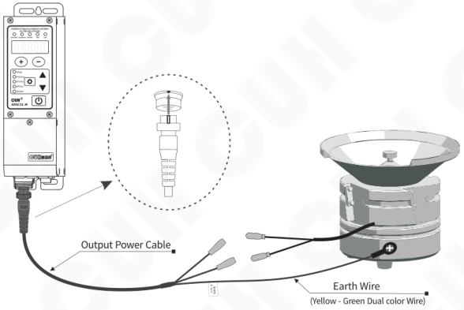

### Hinweis

1. Stellen Sie sicher, dass die Elektromagnetspulen des Vibrators an die beiden Ausgangskontakte des Ausgangskabels angeschlossen sind und dass das Metallgehäuse des Vibrators zuverlässig geerdet ist.
2. Es ist verboten, piezoelektrische Lasten an den Leistungsausgang anzuschließen, da dies sonst einen Stromunfall verursachen kann!

---

### Schritt Drei:

Verbinden Sie den Stecker des Netzkabels mit dem Netzanschluss des Reglers.

Verbinden Sie zuerst die Reglerseite

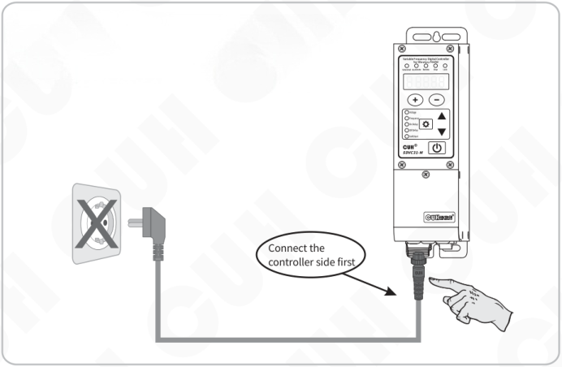

### Schritt Vier:

Stecken Sie den Stecker des Netzkabels in die Netzsteckdose.

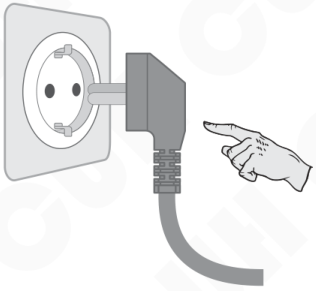

---

## Schritt Fünf:

Schalten Sie den Netzschalter des Reglers ein; es sollte die Spannung „U 150" angezeigt werden, die Spannungsanzeige leuchtet auf und der Vibrationsförderer sollte zu vibrieren beginnen.

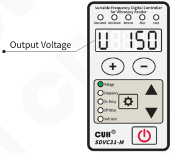

## Schritt Sechs:

Drücken Sie ⊖, um die Spannung auf 30~50V einzustellen, drücken Sie dann ⚙ und halten Sie 2 Sekunden gedrückt, um den Einstellzustand der Ausgangsfrequenz „E" zu erreichen. Verwenden Sie ▼ oder ▲, um die Eigenfrequenz des Vibrationsförderers zu suchen, die die Resonanzfrequenz ist.

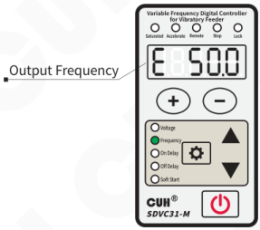

- Die Resonanzfrequenz des Vibrators ist der Frequenzwert, der die maximale Amplitude erzeugt.
- Jeder Vibrator hat seine eigene mechanische Resonanzfrequenz; stellen Sie die Ausgangsfrequenz des Reglers auf diese Frequenz ein, um den besten Arbeitszustand zu erreichen.

---

### Schritt Sieben:

Verwenden Sie ⊕ und ⊖, um die Spannung so lange einzustellen, bis die beste Förderrate erreicht ist.

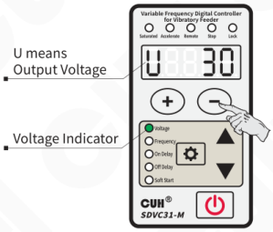

Der Vibrationsförderer sollte jetzt arbeiten. Weitere Steueranweisungen finden Sie in den folgenden Kapiteln.

---

# Kapitel Ⅳ Beschreibung der Grundfunktionen

Dieses Kapitel beschreibt die Einstellungen der Grundparameter.

## 4.1 Ausgangsspannung

Der gleichgerichtete Mittelwert der Ausgangsspannung des Reglers kann direkt und digital über die Tastatur eingestellt werden. Dank der einzigartigen Spannungsstabilisierungsfunktion schwankt die Ausgangsspannung des Reglers nicht mit der Eingangsspannung, sodass der Vibrator bei instabiler Netzspannung stabil weiterarbeiten kann.

- Schalten Sie den Netzschalter des Reglers ein.
- Der Regler gelangt zum Parameter der Ausgangsspannung. Die Spannungsanzeige leuchtet auf und die LED-Anzeige zeigt den Parameter der Ausgangsspannung U und den Standardwert 150 an.
- Drücken Sie ⊕ oder ⊖, um den Parameterwert einzustellen.

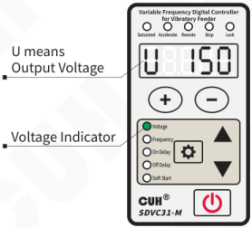

- Der Regler hat keine Boost-Funktion. Wenn der Regler die eingestellte Spannung aufgrund der Begrenzung durch die Eingangsspannung der Stromversorgung nicht erreichen kann, leuchtet die Sättigungsanzeige auf und die Netzspannungskompensation fällt zu diesem Zeitpunkt aus.
- Der Regler kann einen gewissen Beschleunigungseffekt erzielen, indem er die sinusförmigen Eigenschaften der Ausgangswellenform aufgibt; dies wird durch den Parameter „Beschleunigungsindex y" bestimmt. Beim Eintritt in den Beschleunigungszustand ändert sich der Ausgangsstromverlauf von einer Sinuswelle in eine Dreieckswelle und die Beschleunigungsanzeige leuchtet auf.

---

## 4.2 Ausgangsfrequenz

Der Regler verwendet die Technologie der direkten digitalen Frequenzsynthese (DDS), die eine sehr hohe Frequenzgenauigkeit und -stabilität aufweist und sich weder mit der Zeit noch mit der Temperatur ändert.

- Halten Sie ⚙ 2 Sekunden gedrückt, um die Grundparameterschnittstelle zu betreten.
- Die LED-Anzeige zeigt den Parameter der Ausgangsfrequenz „E" und den Standardwert 50.0 an.
- Drücken Sie ▼ oder ▲, um den Parameterwert einzustellen.

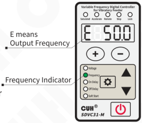

---

## 4.3 Ein-/Ausschaltverzögerung des intelligenten photoelektrischen Sensors

Wenn ein Sensor oder eine SPS verwendet wird, um den Hauptausgang des Reglers ein- oder auszuschalten, kann die Aktion nach dem Geben oder Wiederherstellen des Steuersignals um einen Zeitraum verzögert werden. Die Verzögerungszeit kann über die beiden folgenden Parameter eingestellt werden.

**Einschaltverzögerung ( J ):** Der Zeitraum, den der Regler vom Empfang eines Startsteuersignals bis zur tatsächlichen Ausgabe durchläuft.

- Halten Sie ⚙ 2 Sekunden gedrückt, um die Grundparameterschnittstelle zu betreten.
- Drücken Sie kurz ⚙, um zum Parameter der Einschaltverzögerung „J" mit dem Standardwert 0.2 zu wechseln.
- Drücken Sie ▲ oder ▼, um den Parameterwert einzustellen.

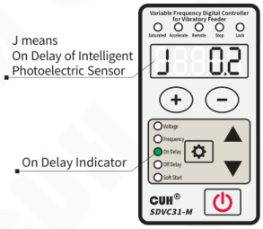

**Ausschaltverzögerung ( L ):** Der Zeitraum, den der Regler vom Empfang eines Abschaltsteuersignals bis zum tatsächlichen Abschalten der Ausgabe durchläuft.

- Halten Sie ⚙ 2 Sekunden gedrückt, um die Grundparameterschnittstelle zu betreten.
- Drücken Sie kurz ⚙, um zum Parameter der Ausschaltverzögerung „L" mit dem Standardwert 0.2 zu wechseln.
- Drücken Sie ▲ oder ▼, um den Parameterwert einzustellen.

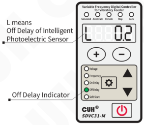

---

## 4.4 Sanftanlaufzeit

Um plötzliche Stöße auf die Vibratorspule zu vermeiden, kann der Regler die Ausgangsspannung beim Start allmählich von 0 auf den voreingestellten Wert erhöhen.

**Sanftanlaufzeit ( t ):** Der Zeitraum, den der Regler benötigt, um seine Ausgangsspannung beim Start sanft von 0 auf den voreingestellten Wert ansteigen zu lassen.

- Halten Sie ⚙ 2 Sekunden gedrückt, um die Grundparameterschnittstelle zu betreten.
- Drücken Sie kurz ⚙, um zum Sanftanlaufparameter „t" mit dem Standardwert 0.5 zu wechseln.
- Drücken Sie ▲ oder ▼, um den Parameterwert einzustellen.

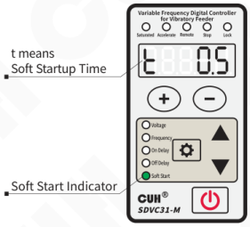

## 4.5 Tastatursperre

Wenn die Parameter des Reglers eingestellt sind, kann die Tastatursperrfunktion alle Tasten auf dem Bedienfeld sperren, um Fehlbedienung zu vermeiden.

Auch wenn das Gerät aus- und wieder eingeschaltet wird, bleibt der Zustand der Tastatursperre so, wie er beim letzten Ausschalten war.

- Halten Sie ⏻ 2 Sekunden gedrückt, um alle Tasten auf dem Bedienfeld zu sperren. Die Sperranzeige leuchtet auf.
- Halten Sie ⏻ erneut 2 Sekunden gedrückt, um zu entsperren.

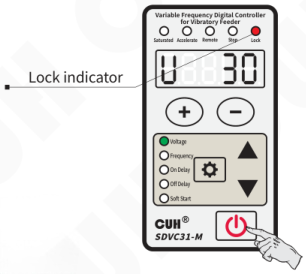

> Der Zustand der Tastatursperre verschwindet nicht durch Abschalten der Stromversorgung.
>
> Im gesperrten Zustand reagiert die Bedientaste nicht und diese Anzeige blinkt.

---

# Kapitel Ⅴ Beschreibung der erweiterten Funktionen

Dieses Kapitel beschreibt die Einstellungen der erweiterten Parameter.

## 5.1 Fernsteuerung der Drehzahl

Der Regler unterstützt die Steuerung der Ausgangsspannung durch ein externes analoges Signal; analoge Signale unterstützen Potentiometer, 1~5V-Spannung und 4~20mA-Strom.

### Potentiometeranschluss

**Empfehlung:**

Bitte verwenden Sie ein 1K-lineares Potentiometer

> Wenn das Signal der Drehzahlfernsteuerung wirksam wird, leuchtet die Anzeige der Drehzahlsteuerung auf; gleichzeitig schlägt die Spannungseinstellung am Bedienfeld fehl.

---

## 1~5V-Spannungssteuerungsanschluss

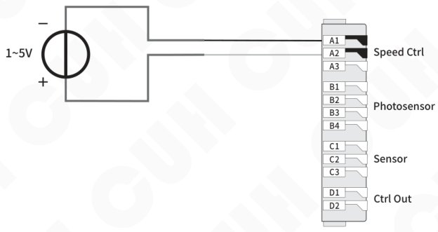

## 4~20mA-Stromsteuerungsanschluss

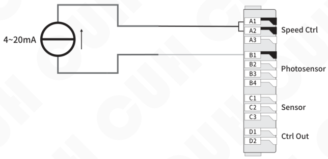

---

## 5.2 Intelligente photoelektrische Sensorik

Der intelligente photoelektrische Anschluss dieses Reglers unterstützt photoelektrische Durchstrahl- oder Reflexionssensoren aus Leuchtdioden und Phototransistoren und kann auch so eingestellt werden, dass er NPN-Schaltsensoren unterstützt. Das spezifische Anschlussdiagramm ist wie folgt:

### 5.2.1 Anschlussmethode des intelligenten photoelektrischen Sensors

**Anschlussmethode des photoelektrischen Sensors**

Der Arbeitsabstand des Sensors kann durch Einstellen des Parameters P angepasst werden; je kleiner der Parameter, desto empfindlicher ist er.

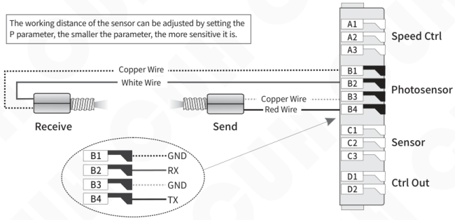

**Anschlussmethode des Schaltsensors**

NPN-Typ durch Parameter P = 0 einstellen, PNP-Sensor wird nicht unterstützt

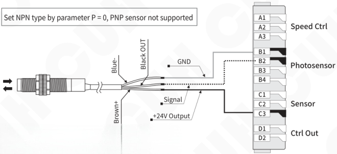

**Hinweis:**

Wenn Parameter P = 0 ist, gibt B4 ein 10mA-gültiges Signal aus.

Von 1 bis 1000 gibt B4 ein 10mA-moduliertes Signal mit einer Frequenz von etwa 200Hz aus.

Wenn der Regler einen Fehler feststellt, gibt B4 nichts aus. Dies ist die Funktion des Bereitschaftssignals.

---

## 5.2.2 Einstellung der logischen Beziehung des intelligenten photoelektrischen Sensors

Unter normalen Umständen empfängt der Empfangskanal kein optisches Signal und der Regler läuft standardmäßig. In einigen besonderen Anwendungen muss der Regler jedoch gestoppt werden, wenn der Empfangskanal kein optisches Signal empfängt. Durch die Einstellung dieses Parameters kann diese Art von Anwendung realisiert werden.

- Halten Sie ⚙ und ▲ gleichzeitig gedrückt, um die erweiterte Parameterschnittstelle zu betreten.
- Drücken Sie kurz ⚙, um zum Parameter Γ1 zu wechseln.
- Drücken Sie ▲ oder ▼, um den Parameterwert einzustellen.

Parameter Γ1 ist standardmäßig auf `___` eingestellt.

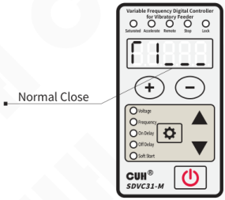

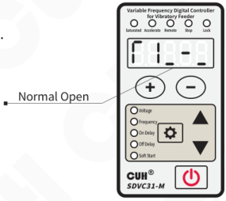

- Wenn Parameter Γ1 auf `___` eingestellt ist, läuft der Regler, wenn kein optisches Signal empfangen wird.
- Wenn Parameter Γ1 auf `_-_` eingestellt ist, stoppt der Regler, wenn kein optisches Signal empfangen wird.

---

## 5.3 Schaltsensor

Der Schaltsensoranschluss kann die Modi NPN, PNP, Ut1 und Ut0 unterstützen.

**Der Modus Ut1 ist ein Einzelscan**, das heißt, bevor das Sensorsignal ungültig wird, werden die High- und Low-Pegel geändert, um zu erkennen, ob der Anschluss gültig ist. Nachdem ein gültiges Signal gefunden wurde, wird der Sensortyp des Anschlusses bestimmt und nicht mehr gescannt.

**Der Modus Ut0 ist ein Dauerhafter Scan**, unabhängig vom Sensortyp wird durch Ändern der High- und Low-Pegel immer erkannt, ob der Anschluss an einem gültigen Signal angeschlossen ist.

### 5.3.1 Anschlussmethode des Schaltsensors

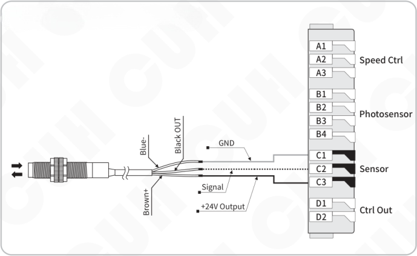

- Stellen Sie den Sensortyp über den erweiterten Parameter ΓA ein.
- Wenn andere externe Signale wie Sensoren verwendet werden, um Start- und Stoppvorgänge über den Anschluss C des Reglers zu steuern, und der Vorgang nach dem Geben oder Wiederherstellen des Signals um einen Zeitraum verzögert werden muss, können Sie die erweiterten Parameter „J-" und „L-" einstellen. Dies kann durch die Zeit von „L-" realisiert werden. Die Bedienungsmethode finden Sie unter 5.3.2.

---

## 5.3.2 Ein-/Ausschaltverzögerung des Schaltsensors

Standardmäßig teilen sich der intelligente photoelektrische Sensor und der Schaltsensor dieselbe Einschaltverzögerungszeit und Ausschaltverzögerungszeit. Der Bediener kann auch Einschaltverzögerungszeit und Ausschaltverzögerungszeit unabhängig für den Schaltsensor einstellen.

### Einschaltverzögerung ( J- )

Der Zeitraum, den der Regler vom Empfang eines Startsteuersignals bis zur Ausgabe durchläuft.

- Halten Sie ⚙ und ▲ gleichzeitig gedrückt, um die erweiterte Parameterschnittstelle zu betreten.
- Drücken Sie kurz ⚙, um zum Parameter J- zu wechseln.
- Drücken Sie ▲ oder ▼, um den Parameterwert einzustellen.

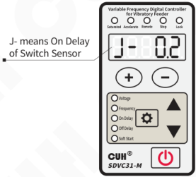

Parameter J- ist standardmäßig auf --- eingestellt, was denselben Wert wie der Parameter J bedeutet.

### Ausschaltverzögerung ( L- )

Der Zeitraum, den der Regler vom Empfang eines Abschaltsteuersignals bis zum Abschalten der Ausgabe durchläuft.

- Halten Sie ⚙ und ▲ gleichzeitig gedrückt, um die erweiterte Parameterschnittstelle zu betreten.
- Drücken Sie kurz ⚙, um zum Parameter L- zu wechseln.
- Drücken Sie ▲ oder ▼, um den Parameterwert einzustellen.

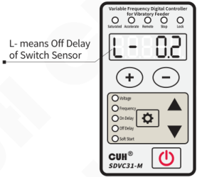

Parameter L- ist standardmäßig auf --- eingestellt, was denselben Wert wie der Parameter L bedeutet.

> - Wenn die Werte von J- und L- auf --- eingestellt sind, sind die Einschaltverzögerungszeit und Ausschaltverzögerungszeit des Schaltsensors gleich der Einschaltverzögerungszeit und Ausschaltverzögerungszeit des intelligenten photoelektrischen Sensors.
> - Die Einschaltverzögerungszeit und Ausschaltverzögerungszeit des intelligenten photoelektrischen Sensors werden von den Parametern J- und L- nicht beeinflusst.

---

### 5.3.3 Einstellung der logischen Beziehung des Schaltsensors

Unter normalen Umständen empfängt der Regler kein Signal vom Schaltsensor und läuft standardmäßig. In einigen besonderen Anwendungen muss der Regler jedoch gestoppt werden, wenn er kein Signal vom Schaltsensor empfängt. Durch die Einstellung dieses Parameters kann diese Art von Anwendung realisiert werden.

- Halten Sie ⚙ und ▲ gleichzeitig gedrückt, um die erweiterte Parameterschnittstelle zu betreten.
- Drücken Sie kurz ⚙, um zum Parameter Γ2 zu wechseln.
- Drücken Sie ▲ oder ▼, um den Parameterwert einzustellen.

Parameter Γ2 ist standardmäßig auf `___` eingestellt.

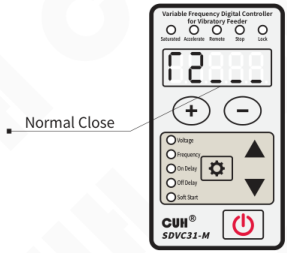

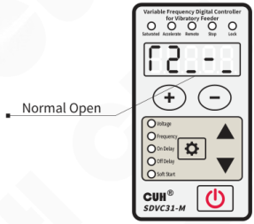

- Wenn Parameter Γ2 auf `___` eingestellt ist, läuft der Regler, wenn kein Signal empfangen wird.
- Wenn Parameter Γ2 auf `_-_` eingestellt ist, stoppt der Regler, wenn kein Signal empfangen wird.

---

## 5.4 Einstellung der logischen Beziehung des Steuersignals

Der Regler kann die logische Beziehung des intelligenten photoelektrischen Sensors und des Schaltsensors einstellen, wenn sie gleichzeitig arbeiten.

- Halten Sie ⚙ und ▲ gleichzeitig gedrückt, um die erweiterte Parameterschnittstelle zu betreten.
- Drücken Sie kurz ⚙, um zum Parameter Π zu wechseln.
- Drücken Sie ▲ oder ▼, um den Parameterwert einzustellen.

Die standardmäßige logische Beziehung ist AND.

**Logische Beziehung: AND 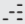:**

Der Regler läuft nur, wenn sowohl der intelligente photoelektrische Sensor als auch der Schaltsensor den Regler dazu auffordern.

**Logische Beziehung: OR 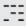:**

Der Regler läuft, wenn der intelligente photoelektrische Sensor oder der Schaltsensor den Regler dazu auffordert.

**Logische Beziehung: XOR 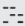:**

Der Regler läuft nur, wenn der intelligente photoelektrische Sensor und der Schaltsensor das entgegengesetzte Steuersignal ausgeben.

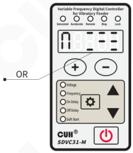

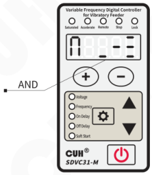

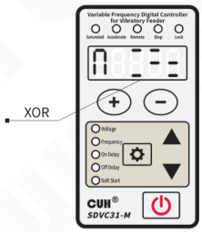

---

## 5.5 Steuerausgang

Der Steuerausgangsanschluss kann NPN-Ausgang unterstützen; der NPN-Ausgang ist als Low-Pegel gültig und als hochohmiger Zustand ungültig.

### 5.5.1 Anschlussmethode des Steuerausgangs

**NPN-Ausgangsanschluss**

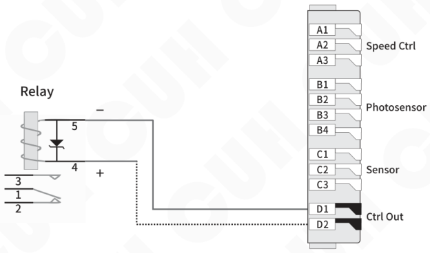

> Wenn ein 24V-Relais angeschlossen wird, achten Sie unbedingt darauf, die Plus- und Minuspole der Spule zu bestätigen, um sicherzustellen, dass sie korrekt angeschlossen sind. Da die Ausgangsstromfähigkeit dieses Anschlusses begrenzt ist, kurzschließt die interne Schutzdioden des Relais nach umgekehrter Verbindung den Anschluss dieses Reglers und löst den Kurzschlussschutz Err07 aus.

---

## 5.5.2 Einstellung der logischen Beziehung des Steuerausgangs

- Halten Sie ⚙ und ▲ gleichzeitig gedrückt, um die erweiterte Parameterschnittstelle zu betreten.
- Drücken Sie kurz ⚙, um zum Parameter Γ3 zu wechseln.
- Drücken Sie ▲ oder ▼, um den Parameterwert einzustellen.

Parameter Γ3 ist standardmäßig auf `___` eingestellt.

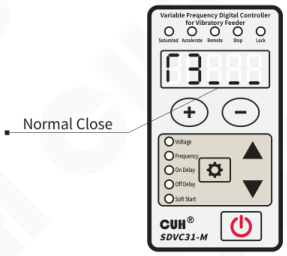

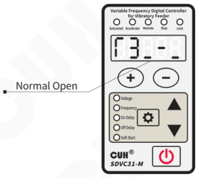

- Wenn Parameter Γ3 auf `___` eingestellt ist, funktioniert der Steuerausgang, solange der Regler läuft.
- Wenn Parameter Γ3 auf `_-_` eingestellt ist, funktioniert der Steuerausgang nicht, solange der Regler läuft.

---

## 5.5.3 Parameter zur Trennung von Haupt- und Steuerausgang

Normalerweise folgt der Hauptausgang dem Steuerausgang.

In besonderen Anwendungen können die Steuerquelle und die Beziehung durch diesen Parameter geändert werden.

- Halten Sie ⚙ und ▲ gleichzeitig gedrückt, um die erweiterte Parameterschnittstelle zu betreten.
- Drücken Sie kurz ⚙, um zum Parameter Γ4 zu wechseln.
- Drücken Sie ▲ oder ▼, um den Parameterwert einzustellen.

Parameter Γ4 ist standardmäßig auf `___` eingestellt.

- Wenn Parameter Γ4 auf 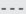 eingestellt ist, sind Hauptausgang und Steuerausgang verknüpft. Gesteuert durch die logische Beziehung zwischen intelligentem photoelektrischem Sensor und Schaltsensor sowie die Ein-/Ausschalttaste.
- Wenn Parameter Γ4 auf 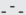 eingestellt ist, sind Hauptausgang und Steuerausgang getrennt. Der Hauptausgang wird durch die Ein-/Ausschalttaste gesteuert. Der Steuerausgang wird durch die logische Beziehung zwischen intelligentem photoelektrischem Sensor und Schaltsensor gesteuert.
- Wenn Parameter Γ4 auf 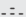 eingestellt ist, wird der Hauptausgang durch die Ein-/Ausschalttaste und den Schaltsensor gesteuert. Der Steuerausgang wird durch den intelligenten photoelektrischen Sensor gesteuert.
- Wenn Parameter Γ4 auf 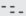 eingestellt ist, wird der Hauptausgang durch die Ein-/Ausschalttaste und den intelligenten photoelektrischen Sensor gesteuert. Der Steuerausgang wird durch den Schaltsensor gesteuert.

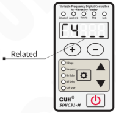

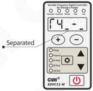

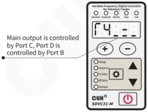

---

## 5.6 Begrenzung der maximalen Ausgangsspannung

Der Regler kann den Parameter für die Begrenzung der maximalen Ausgangsspannung h einstellen, der verhindern kann, dass der Anwender durch Fehlbedienung eine überschüssige Spannung ausgibt und die Vibrationsausrüstung beschädigt.

Weder die am Bedienfeld eingestellte Spannung noch die Fernsteuerungsspannung wird diesen Wert überschreiten.

- In keinem Fall kann oder wird die Ausgangsspannung des Reglers den eingestellten Wert dieses Parameters überschreiten.
- Die Werkseinstellung dieses Parameters ist die maximal mögliche Ausgangsspannung des Geräts.

## 5.7 Untere Frequenzgrenze

Dieser Regler kann den erweiterten Parameter „Untere Frequenzgrenze e" einstellen, um die minimale Ausgangsfrequenz zu begrenzen; dies kann verhindern, dass Anwender versehentlich die Ausgangsfrequenz zu niedrig einstellen und den Elektromagneten beschädigen.

Die am Bedienfeld eingestellte Frequenz wird nicht unter diesen Wert fallen.

---

## 5.8 Beschleunigungsindex

Der Regler kann einen gewissen Beschleunigungseffekt erzielen, indem er die sinusförmigen Eigenschaften der Ausgangswellenform aufgibt. Beim Eintritt in den Beschleunigungszustand ändert sich der Ausgangsstromverlauf von einer Sinuswelle in eine Dreieckswelle und die Beschleunigungsanzeige leuchtet auf. Die Beschleunigungsfunktion kann durch Einstellen des Parameterwerts des erweiterten Parameters „Beschleunigungsindex y" gesteuert werden.

**Beschleunigungsindex (y):** Gibt den Prozentsatz an, den die maximale Ausgangsspannung in Bezug auf die Eingangsspannung erreichen kann.

y bedeutet Beschleunigungsindex  
Werkseinstellung: 150

**Schematisches Diagramm des Beschleunigungsindex, eingestellt auf 150**

---

## 5.9 Wellenformindex

Der Regler kann kontinuierlich die Leistung von höchster Effizienz-maximaler Leistung und minimalstem Geräusch ausbalancieren, um höheren Anforderungen der Kunden gerecht zu werden. Dies kann durch Einstellen des Parameterwerts des erweiterten Parameters „Wellenformindex r" erreicht werden.

- Der Wellenformindexwert von 0 hat die höchste Effizienz und die geringste Belastung der Feder.
- Wenn der Wert 100 beträgt, können die maximale Nennausgangsleistung und das minimale Geräusch erzielt werden, aber die Feder wird einer größeren Belastung ausgesetzt.

**Diagramm des Wellenformindex**

---

## 5.10 Temperaturanzeigefunktion

- Halten Sie ⚙ und ▲ gleichzeitig gedrückt, um die erweiterte Parameterschnittstelle zu betreten.
- Drücken Sie kurz ⚙, um zum Parameter C zu wechseln.
- Der Parameterwert kann nicht geändert werden.

Beispiel:  
C bedeutet Temperaturanzeigeparameter

## 5.11 Wiederherstellen der Werkseinstellungen/Rückkehr in den Fabrikmodus

Der Anwender kann den Regler schnell auf den werkseitigen Standardzustand zurücksetzen.

Aufgrund der leistungsstarken Funktionen des Reglers können viele Parameter angepasst werden. Für Anfänger ist es möglicherweise nicht möglich, den normalen Arbeitszustand des Reglers nach mehreren Einstellungen und Änderungen wiederherzustellen. Verwenden Sie diese Funktion, um den durcheinandergebrachten Parameterzustand schnell auf die werkseitige Standardeinstellung zurückzusetzen.

Um die Werkseinstellungen wiederherzustellen, müssen die Parameter für den Fabrikmodus (Pin) kombiniert verwendet werden. Der Fabrikmodus wird wie folgt beschrieben:

0: Stellt die **Arbeitsparametergruppe** auf die **Benutzerparametergruppe** zurück.  
5: Speichert die **Arbeitsparametergruppe** in der **Benutzerparametergruppe**.  
35: Stellt die **Arbeitsparametergruppe** auf den **Werkswert von CUH** zurück.  
55: Stellt die **Arbeitsparametergruppe** und die **Benutzerparametergruppe** auf den **Werkswert von CUH** zurück.

- Halten Sie ⚙ und ▲ gleichzeitig gedrückt, um die erweiterte Parameterschnittstelle zu betreten.
- Drücken Sie kurz ⚙, um zum vollständig blinkenden Zustand auf der LED-Anzeige zu wechseln, das ist der Parameter „Wiederherstellung der Werkseinstellungen". Drücken Sie dann ▲ und halten Sie gedrückt, bis der Regler „" anzeigt, was anzeigt, dass der Regler wiederhergestellt wurde.
- Lassen Sie ▲ los; nachdem der Regler „CUH" anzeigt, gelangen Sie in den Einstellzustand der Ausgangsspannung „U". Zu diesem Zeitpunkt wurden alle Parameter auf die werkseitigen Standardeinstellungen zurückgesetzt.

Hinweis: Drücken Sie ▼ und halten Sie gedrückt, bis „" auf der LED angezeigt wird, um zur SDVC311-Schnittstelle zu wechseln.

---

## Kapitel Ⅵ Technische Daten

### 6.1 Abmessungen

(Einheit: mm)

SDVC31-S (1.5A)  
SDVC31-M (3.0A)

| Maßbereich | Toleranz |
|---|---|
| 0~3 | ±0.05 |
| 3~10 | ±0.1 |
| 10~30 | ±0.15 |
| 30~80 | ±0.2 |
| 80~180 | ±0.3 |
| >180 | ±0.5 |

Diese Toleranztabelle gilt für alle Produkte dieser Serie.

---

SDVC31-L (4.5A)  
SDVC31-XL (6.0A)

---

## 6.2 Technische Daten

| Position | Min | Typisch | Max | Einheit | Anmerkung |
|---|---|---|---|---|---|
| Eingangsspannung | 85 | 220 | 250 | V | AC RMS |
| Einstellbarer Ausgangsspannungsbereich | 0 | —— | 260 | V | Unter 150 % der Eingangsspannung |
| Genauigkeit der Spannungseinstellung | | 1 | | V | |
| Genauigkeit der Spannungsregelung | 0 | —— | 10 | % | ΔVout/ΔVin |
| Einstellbarer Ausgangsstrombereich | 0 | —— | 1.5 | A | SDVC31-S |
| Einstellbarer Ausgangsstrombereich | 0 | —— | 3.0 | A | SDVC31-M |
| Einstellbarer Ausgangsstrombereich | 0 | —— | 4.5 | A | SDVC31-L |
| Einstellbarer Ausgangsstrombereich | 0 | —— | 6.0 | A | SDVC31-XL |
| Ausgangsleistung | 0 | —— | 330 | VA | SDVC31-S |
| Ausgangsleistung | 0 | —— | 660 | VA | SDVC31-M |
| Ausgangsleistung | 0 | —— | 990 | VA | SDVC31-L |
| Ausgangsleistung | 0 | —— | 1320 | VA | SDVC31-XL |
| Ausgangsfrequenz | 40.0 | —— | 400.0 | Hz | |
| Genauigkeit der Frequenzeinstellung | | 0.1 | | Hz | |
| Ausgangswellenform | | Sinus | | | |
| Sanftanlaufzeit | 0 | —— | 10.0 | s | Standardwert: 0.5 |
| Bereich der Ein-/Ausschaltverzögerungszeit | 0 | —— | 20.0 | s | Standardwert: 0.2 |
| Genauigkeit der Ein-/Ausschaltverzögerungszeit | | 0.1 | | s | |
| Auslösetemperatur des Überhitzungsschutzes | 58 | 60 | 66 | °C | |
| DC-Steuerausgangsstrom | 0 | —— | 400 | mA | |
| DC-Steuerausgangsspannung | 22 | 24 | 26 | V | |
| Analoges Steuersignal | | 1~5/4~20 | | V/mA | Signal der Drehzahlfernsteuerung |
| Digitales Steuersignal | | 24 | | V | Schaltsignal |
| Einstellmethode | | 6 | | Taste | |
| Stromverbrauch im Standby | —— | 3 | —— | W | |
| Anzeigemethode | | 5 | | Stelle | LED |
| Umgebungstemperatur | 0 | 25 | 40 | °C | Keine Kondensation |
| Umgebungsfeuchtigkeit | 10 | 60 | 85 | % | Keine Kondensation |
| Lagertemperatur | -20 | 25 | 65 | °C | Keine Kondensation |

## 6.3 Referenznorm

**Absolute Grenzwerte:**
Das Überschreiten der Normwerte beschädigt den Regler; befolgen Sie sie strikt.

| Position | GB-Norm | IEC-Norm | Stufe | Normanforderung | Anmerkung |
|---|---|---|---|---|---|
| Elektrostatische Entladung | GB/T 17626.2-2006 | IEC 61000-4-2:2001 | 4 | ±8 kV | Kontaktentladung |
| | | | 4 | ±15 kV | Luftentladung |
| Elektrischer schneller Transiententest | GB/T 17626.4-2008 | IEC 61000-4-4:2004 | 4 | ±4 kV | |
| Störfestigkeit gegen Wellen auf der DC-Stromleitung | GB/T 17626.17-2005 | IEC 61000-4-17:2002 | 4 | 15% | Bewertung A |

> **Warnung**  
> In Wohngebieten kann dieses Produkt Funkstörungen verursachen; in diesem Fall können zusätzliche Minderungsmaßnahmen erforderlich sein.

---

# Kapitel Ⅶ Anhang

## 7.1 Parametertabelle

| | Definition | Symbol | Symbolbild | Bereich | Werkseinstellung |
|---|---|---|---|---|---|
| Gemeinsamer Parameter | Ausgangsspannung | U |  | 0~260 V | 150 |
| Grundparameter | Ausgangsfrequenz | E |  | 40.0~400.0 Hz | 50.0 |
| Grundparameter | Einschaltverzögerung des intelligenten photoelektrischen Sensors | J |  | 0.0~20.0 s | 0.2 |
| Grundparameter | Ausschaltverzögerung des intelligenten photoelektrischen Sensors | L |  | 0.0~20.0 s | 0.2 |
| Grundparameter | Sanftanlauf | t |  | 0.0~10.0 s | 0.5 |
| Erweiterter Parameter | Ausschaltverzögerung des NPN-Schaltsensors | L- |  | 0.0~20.0 s | L---- wie L |
| Erweiterter Parameter | Einschaltverzögerung des NPN-Schaltsensors | J- |  | 0.0~20.0 s | J---- wie J |
| Erweiterter Parameter | Logische Richtung des intelligenten photoelektrischen Sensors | F1 |  | Normal geschlossen , Normal offen  |  |
| Erweiterter Parameter | Logische Richtung des Schaltsensors | F2 |  | Normal geschlossen , Normal offen  |  |
| Erweiterter Parameter | Logische Richtung des Steuerausgangs | F3 |  | Normal geschlossen , Normal offen  |  |
| Erweiterter Parameter | Parameter zur Trennung von Haupt- und Steuerausgang | F4 |  | Zugeordnet , Hauptausgang wird durch Anschluss C gesteuert, Anschluss D wird durch Anschluss B gesteuert  Getrennt , Hauptausgang wird durch Anschluss B gesteuert, Anschluss D wird durch Anschluss C gesteuert  |  |
| Erweiterter Parameter | Logische Beziehung des Steuersignals | n |  | oder , Und , Xor  |  |
| Erweiterter Parameter | Maximale Ausgangsspannung | H |  | 0~260 V | 260 |
| Erweiterter Parameter | Beschleunigungsindex | y |  | 100~150 | 150 |
| Erweiterter Parameter | Wellenformindex | r |  | 0~100 | 100 |
| Erweiterter Parameter | Empfindlichkeit des intelligenten photoelektrischen Sensors | P |  | 0~1000 | 80 |
| Erweiterter Parameter | Sensortyp des Anschlusses C | FA |  | nPn, PnP ut1 (Einzelscan), ut0 (Dauerhafter Scan) | nPn |
| Erweiterter Parameter | Temperatur | C |  | -20~85 °C | —— |
| Erweiterter Parameter | Untere Frequenzgrenze | e |  | 40.0~400.0 Hz | 40.0 |
| Erweiterter Parameter | Wiederherstellung der Werkseinstellungen | 8.8.8.8.8. |  | Wird zusammen mit dem Parameter Pin verwendet | —— |
| Erweiterter Parameter | Rückkehr in den Fabrikmodus | Pin |  | 0 : Stellt die Arbeitsparametergruppe auf die Benutzerparametergruppe zurück 5 : Speichert die Arbeitsparametergruppe in der Benutzerparametergruppe 35: Stellt die Arbeitsparametergruppe auf den Werkswert von CUH zurück 55: Stellt die Arbeitsparametergruppe und die Benutzerparametergruppe auf den Werkswert von CUH zurück | 0 |

## 7.2 Eingangs- und Ausgangsschaltpläne

**Anschluss A für Drehzahlfernsteuerung**

**Anschluss B für intelligenten Photosensor**

**Anschluss C für Schaltsensor**

**Steuerausgang D**

---

## 7.3 Fehlerbehebungsvorschläge und Fehlererläuterungen

| Fehlercode | Definition | Fehlerbehebungsmethoden | Symbolbild |
|---|---|---|---|
| Keine Anzeige nach dem Einschalten | | Stellen Sie sicher, dass die Netzsteckdose unter Spannung steht Stellen Sie sicher, dass das Netzkabel zuverlässig mit der Netzsteckdose verbunden ist? | |
| Normale Anzeige, aber keine Ausgabe | | Stellen Sie sicher, dass das Ausgangskabel zuverlässig mit dem Vibrator verbunden ist. Stellen Sie sicher, dass die Ausgangsspannung nicht zu niedrig ist. Stellen Sie sicher, dass die Stoppanzeige nicht leuchtet. Bitte prüfen Sie, ob Normal geschlossen des Parameters eingestellt wurde, wodurch die Reglerausgabe stoppt. | |
| Steuersignal verliert seine Wirkung | | Stellen Sie sicher, dass das Steuersignal korrekt eingespeist wird. Stellen Sie sicher, dass die Masseleitung des Steuersignals korrekt mit dem Regler verbunden ist. Stellen Sie sicher, dass die logische Beziehung der Steuersignale wie erwartet korrekt eingestellt ist. | |
| Schlagphänomene | | Vermeiden Sie Vibrationskopplung zwischen den Vibratoren. Erhöhen Sie die Resonanzfrequenz der Vibratoren. | |
| Normale Anzeige, keine Ausgabe, aber Geräusche sind hörbar | | Stellen Sie alle Parameter wie in diesem Buch beschrieben ein. | |
| Err01 | Kurzschluss | Stellen Sie sicher, dass die Last nicht kurzgeschlossen ist, und versuchen Sie dann, die Ausgabe des Reglers durch zweimaliges Drücken der Ausgangs-Ein-/Ausschalttaste neu zu starten oder den Regler neu einzuschalten. |  |
| Err02 | Überstrom | Verringern Sie die Ausgangsspannung entsprechend und starten Sie dann die Ausgabe neu. |  |
| Err03 | Überhitzung | Installieren Sie den Regler in einer gut belüfteten Umgebung. |  |
| Err04 | Über- oder Unterspannung | Stellen Sie sicher, dass die Eingangsspannung zwischen AC 85~250Vac liegt. |  |
| Err05 | Interne Kommunikation anomal | Stellen Sie sicher, dass keine externe Stromversorgung an den 24V-Stromanschluss angeschlossen ist, oder wenden Sie sich an unseren technischen Support. |  |
| Err06 | Temperatursensor anomal | Stellen Sie sicher, dass die Arbeitstemperatur nicht unter -20℃ liegt, oder wenden Sie sich an unseren technischen Support. |  |
| Err07 | Kurzschlussschutz des Anschlusses D | Stellen Sie sicher, dass die Last des Anschlusses D nicht kurzgeschlossen ist und der Strom 400mA nicht überschreitet, und versuchen Sie dann, die Ausgabe des Anschlusses D neu zu starten. |  |
| Err10 | 24V-Leistungsausgang anomal | Stellen Sie sicher, dass der 24V-Anschluss nicht kurzgeschlossen ist und der Strom 400mA nicht überschreitet. |  |
| Err11 | 5V-Leistungsausgang des Anschlusses A anomal | Stellen Sie sicher, dass die 5V-Stromversorgung des Anschlusses A nicht kurzgeschlossen und nicht mit einer externen Spannung über 5V verbunden ist. |  |

Hinweis: Wenn ein Fehler auftritt, wird TX des Anschlusses B abgeschaltet.

---

# Kapitel Ⅷ Produktgarantieinformationen

## 8.1 Garantiezeitraum

Der von dem Unternehmen für dieses Produkt gewährte Garantiezeitraum beträgt 3 Jahre ab dem Datum der Lieferung des Produkts an den vom Käufer bestimmten Ort.

## 8.2 Garantieumfang

(1) Wenn während des oben genannten Garantiezeitraums ein von unserem Unternehmen verursachter Fehler auftritt, reparieren wir das Produkt kostenlos. Die folgenden Situationen sind jedoch nicht von der Garantie gedeckt:

a. Nichteinhaltung der in der Kurzanleitung, dem Benutzerhandbuch oder den speziell zwischen Käufer und Unternehmen vereinbarten technischen Anforderungen festgelegten Bedingungen, unsachgemäße Bedienung oder durch unsachgemäße Verwendung verursachte Fehler.

b. Der Fehler ist nicht auf einen Produktmangel zurückzuführen, sondern auf die Ausrüstung oder Softwaregestaltung des Käufers.

c. Störungen, die durch Änderungen oder Reparaturen verursacht wurden, die nicht von Personal des Unternehmens durchgeführt wurden.

d. Der Fehler, der durch richtige Wartung oder den Austausch von Verschleißteilen gemäß der Kurzbedienungsanleitung oder dem Benutzerhandbuch vollständig vermieden werden kann.

e. Nachdem das Produkt von unserem Unternehmen versendet wurde, ist er durch Faktoren wie unvorhergesehene Änderungen des Stands von Wissenschaft und Technologie verursacht.

f. Aufgrund von Naturkatastrophen wie Feuer, Erdbeben, Überschwemmung oder externen Faktoren wie anormaler Spannung ist das Unternehmen für die Garantie nicht verantwortlich.

(2) Der Garantieumfang ist auf die in (1) festgelegte Situation beschränkt; für indirekte Verluste (wie Geräteschäden, Chancen, Gewinneinbußen usw.) oder andere Verluste übernimmt das Unternehmen keine Verantwortung.

## 8.3 Produkteignung

Der Regler unseres Unternehmens ist für die allgemeine Verwendung in der Vibrationsförderindustrie konzipiert und produziert. Daher darf dieser Regler unseres Unternehmens nicht für die folgenden Anwendungen verwendet wird und ist für diese nicht geeignet.

(1) Einrichtungen, die erhebliche Auswirkungen auf Leben und Eigentum haben, wie Kernkraftwerke, Flughäfen, Eisenbahnen, Schiffe, motorisierte Geräte und medizinische Geräte.

(2) Öffentliche Versorgungsunternehmen, einschließlich Strom, Gas, Wasserversorgung usw.

(3) Außeneinsatz unter ähnlichen Bedingungen oder Umgebungen.

---

Nanjing CUH Science & Technology Co.,Ltd  
https://en.cuhnj.com  
Tel.:+86-25-84730411 / 84730415 / 84730416  
Fax:+86-25-84730426  
E-mail:sales@cuhnj.com  
Add.:Building 2, Xueyan Tech Park, Tuscity,  
No.9 Zhineng Rd, Jiangning, Nanjing, China

Document No.: IDP1000530

