## Digitaler Frequenzregler für Vibrationsfördereinrichtungen

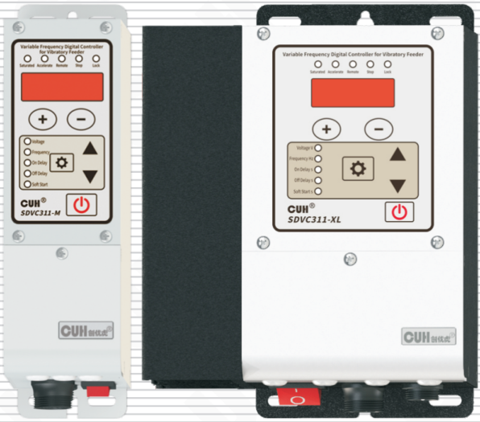

## SDVC311-Serie
Digitaler Frequenzregler für Vibrationsfördereinrichtungen — SDVC311-Serie
## Benutzerhandbuch

---

## Urheberrechtserklärung

Nanjing CUH Science & Technology CO., Ltd. behält sich alle Rechte vor.

Alle in diesem Benutzerhandbuch enthaltenen Informationen sind das Wissen unseres Unternehmens und durch das Urheberrecht sowie andere einschlägige Gesetze geschützt. CUH genießt und behält sich alle Rechte vor, die ihm durch das Urheberrecht und andere Gesetze eingeräumt werden. Ohne die schriftliche Zustimmung von CUH darf dieses Benutzerhandbuch ganz oder teilweise nicht kopiert, übersetzt, nachgeahmt oder auf andere Weise verwendet werden.

## Haftungsausschluss

Alle Inhalte dieses Benutzerhandbuchs beschreiben nur die Verwendungsmethode der von unserem Unternehmen produzierten Produkte und werden gemäß dem bestehenden Technologiestand und dem Zustand beschrieben, der Ihnen bei der Verwendung zur Verfügung gestellt wird. Bei der Verwendung dieses Produkts tragen Sie die damit verbundenen Risiken. Soweit gesetzlich vorgeschrieben, übernimmt das Unternehmen keinerlei ausdrückliche oder stillschweigende Verantwortung für das Produkt aufgrund dieses Benutzerhandbuchs, einschließlich, aber nicht beschränkt auf Personenschäden, Sachschäden, entgangene Chancen usw.

Sie verstehen die oben genannten Risiken ausdrücklich und stimmen zu, dass das Unternehmen – soweit gesetzlich nicht zwingend vorgeschrieben – für keine direkten oder indirekten Schäden oder Verluste gegenüber Ihnen haftet (einschließlich, aber nicht beschränkt auf materielle Verluste an Personal, Eigentum, Daten usw. und immaterielle Verluste wie Ansehen, Chancen usw.)

Das Unternehmen behält sich das Recht vor, die in diesem Benutzerhandbuch beschriebenen Produkte ohne vorherige oder nachträgliche Ankündigung zu ändern.

---

## Vorwort

Vielen Dank, dass Sie sich für den digitalen Frequenzregler der CUH-Serie SDVC311 für Vibrationsfördereinrichtungen entschieden haben. (Im Folgenden kurz „der Regler“). Diese Reglerserie verwendet hochwertige Komponenten und die neueste Elektroniktechnologie und ist mit leistungsfähigen digitalen Signalprozessoren sorgfältig entwickelt worden.

Dieses Handbuch beschreibt die grundlegende Bedienungsmethode, die technische Funktionsbeschreibung und typische Anwendungsbeispiele dieses Produkts. Es bietet dem Anwender relevante Informationen zur Installation und Inbetriebnahme, zur Parametereinstellung, zur Fehlerdiagnose, zur Fehlerbehebung und zur routinemäßigen Wartung des Reglers. Um eine korrekte Installation und Verwendung dieses Reglers zu gewährleisten, lesen Sie bitte dieses Benutzerhandbuch vor der Installation sorgfältig durch und bewahren Sie es gut auf.

Lesen Sie unbedingt die folgenden Symbole, die Sie auf Vorsichtsmaßnahmen gegen Personenschäden und Produktschäden hinweisen.

| | |
|---|---|
| ⚠ Gefahr | Nichtbeachtung dieses Punktes führt zu Personenschäden oder Tod. |
| ⚠ Warnung | Nichtbeachtung dieses Punktes kann zu Personenschäden oder Tod führen. |
| ⚠ Vorsicht | Nichtbeachtung dieses Punktes kann zu mittleren oder leichten Personenschäden führen. |
| Hinweis | Nichtbeachtung dieses Punktes führt zu Produktschäden und Sachschäden. |
| ❗ Zwingend | Weist auf Vorsichtsmaßnahmen und Nutzungseinschränkungen hin, die während der Verwendung unbedingt zu beachten sind. |

**Dieses Handbuch eignet sich für die folgenden Reglermodelle:**

- Digitaler FM-Vibrationsförderregler SDVC311-S (1.5A)
- Digitaler FM-Vibrationsförderregler SDVC311-M (3.0A)
- Digitaler FM-Vibrationsförderregler SDVC311-L (4.5A)
- Digitaler FM-Vibrationsförderregler SDVC311-XL (6.0A)

---

# Sicherheit und Vorsichtsmaßnahmen

1. **⚠ Gefahr** Dieses Produkt dient nur zum Antrieb magnetbasierter Vibrationsfördergeräte; verwenden Sie dieses Produkt nicht zum Schutz des menschlichen Körpers oder von Körperteilen usw.

2. **⚠ Gefahr** Dieses Produkt ist nicht als explosionsgeschütztes Produkt vorgesehen; verwenden Sie es nicht an gefährlichen Orten und/oder in potenziell explosiver Gasatmosphäre.

3. **⚠ Warnung** Dieses Produkt wird über das Wechselstromnetz mit Strom versorgt; bitte keine Wechselspannung über 260Vac anlegen. Überspannung, wie z. B. 380Vac, kann zur Explosion oder Entzündung des Produkts führen und schwere Sicherheitsunfälle verursachen.

4. **⚠ Warnung** Dieses Produkt ist über das Netzkabel geerdet. Stellen Sie sicher, dass die Stromverteilungseinrichtungen für den Regler gut geerdet sind, da sonst das Reglergehäuse unter Spannung stehen und einen Stromunfall verursachen kann.

5. **⚠ Warnung** Legen Sie keine Wechselspannung an den Ausgang dieses Reglers an, da dies den Regler beschädigt.

6. **⚠ Warnung** Ziehen Sie die Verkabelung nicht unter Spannung ab und berühren Sie nicht die Kontakte der einzelnen Verbindungsklemmen im Anschlussraum, um Stromschläge zu vermeiden.

7. **Hinweis** Vermeiden Sie es, den Ausgang dieses Produkts durch Abschalten der Stromversorgung über Relais oder andere Geräte zu steuern, da dies die Lebensdauer des Reglers erheblich verkürzt.

8. **Hinweis** Der Regler ist für den Betrieb in einer kühlen und trockenen Umgebung ausgelegt. Betreiben Sie den Regler niemals im Freien, um Nässe und Besonnung zu vermeiden. Betreiben Sie den Regler innerhalb der in den elektrischen Kennwerten angegebenen Temperatur.

9. **❗ Zwingend** Befestigen Sie dieses Produkt unbedingt auf einer soliden, zuverlässig geerdeten Plattform und entfernt von Vibrationsgeräten.

10. **❗ Zwingend** Betreiben Sie den Regler niemals außerhalb seiner Auslegungsgrenzen.

11. **❗ Zwingend** Bedienen Sie den Regler strikt gemäß dieser Betriebsanleitung. Wir übernehmen keine zivil- oder strafrechtliche Haftung, wenn Geräteschäden oder Personenschäden durch falsche Bedienung verursacht werden.

12. **❗ Zwingend** Öffnen Sie niemals das Reglergehäuse, um Stromschläge zu vermeiden. Wenden Sie sich bei einer Reglerstörung an CUH. Versuchen Sie niemals, den Regler selbst zu reparieren, da dies zum Erlöschen der Garantie führen kann.

---

# Betriebs- und Lagerumgebung

## Prüfung vor der Verwendung

Jeder Regler durchläuft vor der Auslieferung eine strenge Qualitätsprüfung und wird in stoßfester Verpackung verpackt. Bitte prüfen Sie nach dem Auspacken die folgenden Punkte:

1. Ob der Regler während des Transports beschädigt wurde.
2. Ob das Modell des Reglers dem von Ihnen bestellten Modell entspricht.

## Umgebungsbedingungen im Betrieb

Bitte beachten Sie die folgenden Hinweise, um eine bessere Leistung und längere Lebensdauer des Reglers zu gewährleisten:

- ⚠ Gut belüftete Umgebung
- ⚠ Von Wasser, Dampf, Staub und insbesondere öligem Staub fernhalten
- ⚠ Von korrosiven oder brennbaren Gasen und Flüssigkeiten fernhalten
- ⚠ Von Schwebestaub und Metallpartikeln fernhalten
- ⚠ Fest befestigt, um Eigenvibrationen zu vermeiden
- ⚠ Von elektromagnetischen Störungen fernhalten
- ⚠ Umgebungstemperatur von 0~40 ℃ sicherstellen
- ⚠ Für die Verwendung in Höhenlagen von 2000 m oder darunter

---

# Inhaltsverzeichnis

- **Kapitel Ⅰ Vor der Verwendung — 1**
  - 1.1 Kontrolle des Packungsinhalts — 1
  - 1.2 Erläuterung der Anzeigen und Tasten — 2
  - 1.3 Erläuterung der externen Teile — 3
  - 1.4 Erläuterung der Anschlussklemmen — 4
  - 1.5 Erläuterung des Typenschilds — 4
- **Kapitel Ⅱ Merkmale — 5**
  - 2.1 Produkteinführung — 5
  - 2.2 Verbesserung der Produktleistung — 5
  - 2.3 Moderne/Traditionelle Parameterebene — 6
- **Kapitel Ⅲ Installationsanleitung — 7**
  - 3.1 Einsatzbedingungen des Reglers — 7
  - 3.2 Bedienung der Tasten — 7
  - 3.3 Installation und Verwendung — 8
- **Kapitel Ⅳ Beschreibung der Grundfunktionen — 12**
  - 4.1 Ausgangsspannung — 12
  - 4.2 Ausgangsfrequenz — 13
  - 4.3 Ein-/Ausschaltverzögerung des intelligenten photoelektrischen Sensors — 14
  - 4.4 Sanftanlaufzeit — 15
  - 4.5 Bremszyklen/Sanftabschaltzeit — 15
  - 4.6 Tastatursperre — 17
- **Kapitel Ⅴ Beschreibung der erweiterten Funktionen — 18**
  - 5.1 Fernsteuerung der Drehzahl — 18
  - 5.2 Intelligente photoelektrische Sensorik — 20
  - 5.3 Schaltsensor — 21
- 5.4 Steuerausgang — 22
  - 5.4.1 Anschlussmethode des Steuerausgangs — 22
  - 5.4.2 Signalquellen und Logikdiagramm des Steuerausgangs — 23
  - 5.4.3 Beschreibung des Steuerausgangsmodus — 25
  - 5.4.4 Logische Richtung des Steuerausgangs — 26
  - 5.4.5 Steuerfunktion des Hauptausgangssignals — 26
- 5.5 Begrenzung der maximalen Ausgangsspannung — 27
- 5.6 Untere Frequenzgrenze — 27
- 5.7 Beschleunigungsindex — 28
- 5.8 Wellenformindex — 29
- 5.9 Parameter-Passwortsperrfunktion — 30
- 5.10 Wiederherstellen der Werkseinstellungen/Rückkehr in den Fabrikmodus — 31
- 5.11 Parameterüberwachungsfunktion — 32

## Kapitel Ⅵ Technische Daten — 33

- 6.1 Abmessungen — 33
- 6.2 Technische Daten — 35
- 6.3 Referenznorm — 36

## Kapitel Ⅶ Anhang — 37

- 7.1 Parametertabelle — 37
- 7.2 Eingangs- und Ausgangsschaltpläne — 39
- 7.3 Fehlerbehebungsvorschläge und Fehlererläuterungen — 40

## Kapitel Ⅷ Produktgarantieinformationen — 41

- 8.1 Garantiezeitraum — 41
- 8.2 Garantieumfang — 41
- 8.3 Produkteignung — 41

---

# Kapitel Ⅰ Vor der Verwendung

Dieses Kapitel stellt den Lieferumfang des Produkts, die Beschreibung des Regleräußeren und die Informationen zum Typenschild des Reglers vor.

## 1.1 Kontrolle des Packungsinhalts

Prüfen Sie vor der Verwendung die Unversehrtheit des Reglers und des Zubehörs. Wenn Sie feststellen, dass das Produkt defekt oder beschädigt ist, Zubehör fehlt usw., wenden Sie sich bitte an unser Unternehmen.

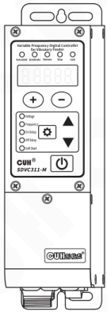

Regler×1

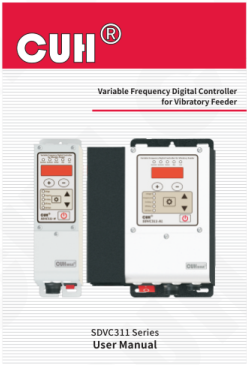

Benutzerhandbuch×1

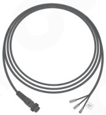

Ausgangskabel×1

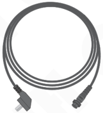

Eingangsnetzkabel×1

---

## 1.2 Erläuterung der Anzeigen und Tasten

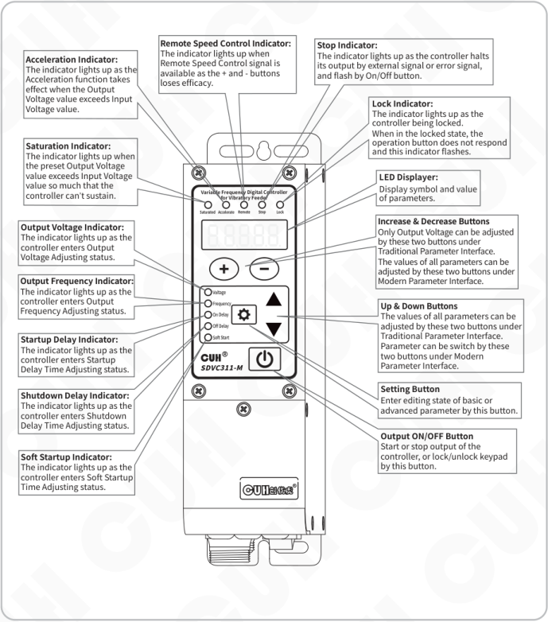

**Beschleunigungsanzeige:**  
Die Anzeige leuchtet auf, wenn die Beschleunigungsfunktion wirksam wird, sobald der Wert der Ausgangsspannung den Wert der Eingangsspannung überschreitet.

**Sättigungsanzeige:**  
Die Anzeige leuchtet auf, wenn der voreingestellte Wert der Ausgangsspannung die Eingangsspannung so stark überschreitet, dass der Regler ihn nicht halten kann.

**Ausgangsspannungsanzeige:**  
Die Anzeige leuchtet auf, wenn der Regler in den Status der Ausgangsspannungseinstellung eintritt.

**Ausgangsfrequenzanzeige:**  
Die Anzeige leuchtet auf, wenn der Regler in den Status der Ausgangsfrequenzeinstellung eintritt.

**Anlaufverzögerungsanzeige:**  
Die Anzeige leuchtet auf, wenn der Regler in den Status der Einstellung der Anlaufverzögerungszeit eintritt.

**Ausschaltverzögerungsanzeige:**  
Die Anzeige leuchtet auf, wenn der Regler in den Status der Einstellung der Ausschaltverzögerungszeit eintritt.

**Sanftanlaufanzeige:**  
Die Anzeige leuchtet auf, wenn der Regler in den Status der Einstellung der Sanftanlaufzeit eintritt.

**Anzeige für Fernsteuerung der Drehzahl:**  
Die Anzeige leuchtet auf, wenn das Signal für die Fernsteuerung der Drehzahl verfügbar ist, da die Tasten + und - dann unwirksam sind.

**Stoppanzeige:**  
Die Anzeige leuchtet auf, wenn der Regler seinen Ausgang durch ein externes Signal oder Fehlersignal anhält, und blinkt bei Betätigung der Ein/Aus-Taste.

**Sperranzeige:**  
Die Anzeige leuchtet auf, wenn der Regler gesperrt ist.  
Im gesperrten Zustand reagiert die Bedientaste nicht und diese Anzeige blinkt.

**LED-Anzeige:**  
Zeigt Symbol und Wert der Parameter an.

**Tasten zum Erhöhen und Verringern**  
Unter der traditionellen Parameterebene kann mit diesen beiden Tasten nur die Ausgangsspannung eingestellt werden.  
Unter der modernen Parameterebene können mit diesen beiden Tasten die Werte aller Parameter eingestellt werden.

**Aufwärts- und Abwärtstasten**  
Unter der traditionellen Parameterebene können mit diesen beiden Tasten die Werte aller Parameter eingestellt werden.  
Unter der modernen Parameterebene kann mit diesen beiden Tasten zwischen Parametern gewechselt werden.

**Einstelltaste**  
Mit dieser Taste den Bearbeitungszustand des Basis- oder erweiterten Parameters aufrufen.

**Ausgangs-Ein/Aus-Taste**  
Mit dieser Taste den Ausgang des Reglers starten oder stoppen bzw. die Tastatur sperren/entsperren.

---

## 1.3 Erläuterung der externen Teile

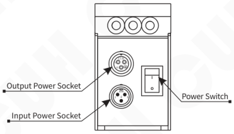

SDVC311-S (1.5A)  
SDVC311-M (3.0A)

- Ausgangsleistungsanschluss
- Eingangsleistungsanschluss
- Netzschalter

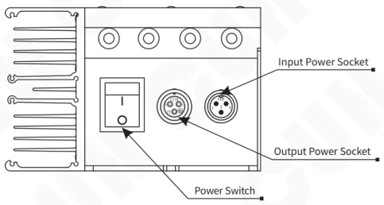

SDVC311-L (4.5A)  
SDVC311-XL (6.0A)

- Eingangsleistungsanschluss
- Ausgangsleistungsanschluss
- Netzschalter

---

## 1.4 Erläuterung der Anschlussklemmen

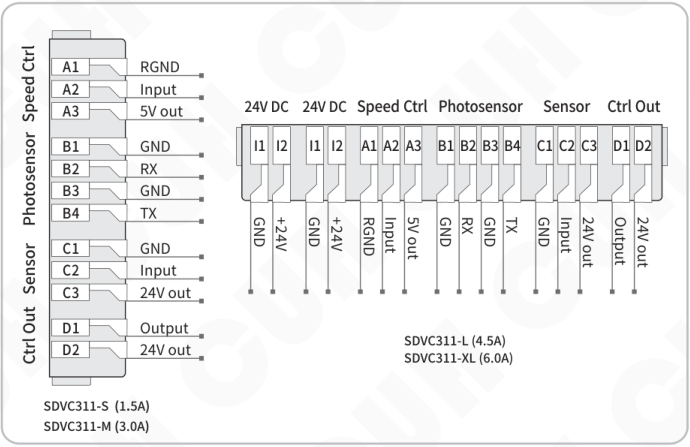

### SDVC311-S (1.5A) / SDVC311-M (3.0A)

| Klemmengruppe | Klemme | Beschreibung |
|---|---|---|
| Drehzahlsteuerung | A1 | RGND |
| Drehzahlsteuerung | A2 | Eingang |
| Drehzahlsteuerung | A3 | 5V-Ausgang |
| Photosensor | B1 | GND |
| Photosensor | B2 | RX |
| Photosensor | B3 | GND |
| Photosensor | B4 | TX |
| Sensor | C1 | GND |
| Sensor | C2 | Eingang |
| Sensor | C3 | 24V-Ausgang |
| Steuerausgang | D1 | Ausgang |
| Steuerausgang | D2 | 24V-Ausgang |

### SDVC311-L (4.5A) / SDVC311-XL (6.0A)

| Klemmengruppe | Klemme | Beschreibung |
|---|---|---|
| 24V DC | I1 | GND |
| 24V DC | I2 | +24V |
| 24V DC | I1 | GND |
| 24V DC | I2 | +24V |
| Drehzahlsteuerung | A1 | RGND |
| Drehzahlsteuerung | A2 | Eingang |
| Drehzahlsteuerung | A3 | 5V-Ausgang |
| Photosensor | B1 | GND |
| Photosensor | B2 | RX |
| Photosensor | B3 | GND |
| Photosensor | B4 | TX |
| Sensor | C1 | GND |
| Sensor | C2 | Eingang |
| Sensor | C3 | 24V-Ausgang |
| Steuerausgang | D1 | Ausgang |
| Steuerausgang | D2 | 24V-Ausgang |

## 1.5 Erläuterung des Typenschilds

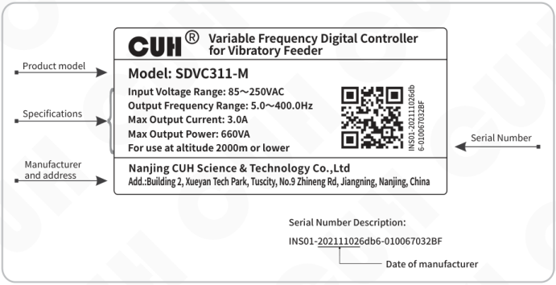

**CUH® — Digitaler Frequenzregler für Vibrationsfördereinrichtungen**

**Produktmodell**

Modell: SDVC311-M

**Spezifikationen**

- Eingangsspannungsbereich: 85~250VAC
- Ausgangsfrequenzbereich: 5.0~400.0Hz
- Max. Ausgangsstrom: 3.0A
- Max. Ausgangsleistung: 660VA
- Für die Verwendung in Höhenlagen von 2000 m oder darunter

**Hersteller und Adresse**

Nanjing CUH Science & Technology Co.,Ltd

Add.:Building 2, Xueyan Tech Park, Tuscity, No.9 Zhineng Rd, Jiangning, Nanjing, China

**Seriennummer**

INS01-202111026db6-010067032BF

**Beschreibung der Seriennummer:**

INS01-<u>20211102</u>6db6-010067032BF

Herstellungsdatum: 20211102

---

## Kapitel Ⅱ Merkmale

Dieses Kapitel enthält eine kurze Einführung und die Hauptmerkmale des Reglers.

### 2.1 Produkteinführung

Der digitale FM-Vibrationsförderregler der SDVC311-Serie ist ein kompakter Universalregler mit FM-Ausgang, der durch den Einsatz der neuesten Elektroniktechnologie und sorgfältige Konstruktion eine einzigartige Leistung bietet. Zu seinen besonderen Merkmalen gehören:

- Der Ausgangsfrequenzbereich umfasst 5.0Hz bis 400.0Hz mit einer Genauigkeit von 0.1Hz.
- Bremsfunktion zum schnellen Stoppen des Vibrationsförderers durch Phasenverschiebung des Stroms um 180° während des Sanftstopp-Vorgangs.
- Intelligente photoelektrische Anschlüsse unterstützen Photosensoren, NPN- oder PNP-Schaltsensoren.
- Bereitschaftssignalfunktion: Über den Übertragungsport B4 der intelligenten Optoelektronik wird ein moduliertes Signal oder ein gültiges Signal ausgegeben, um anzuzeigen, dass sich der Regler im Bereitschaftszustand befindet. Wenn am Regler ein Fehler auftritt, wird das Bereitschaftssignal ungültig.
- Der Schaltsensor-Anschluss unterstützt NPN-, PNP- oder selbstanpassende Typen.
- Der Steuerausgangsanschluss unterstützt den NPN-, PNP- oder Push-Pull-Ausgangsmodus.
- Umfangreiche Schutzfunktionen: Kurzschlussschutz des Hauptausgangs, Überstromschutz, Überhitzungsschutz, Unterspannungs-/Überspannungsschutz, Kurzschlussschutz des Steuerausgangs, Kurzschlussschutz des 24V-Ausgangs und Kurzschlussschutz des 5V-Ausgangs der Drehzahlregelung.

### 2.2 Verbesserung der Produktleistung

Im Vergleich zum Regler der SDVC31-Serie wurde die Leistung der SDVC311-Serie erheblich verbessert. Im Wesentlichen umfasst dies:

- Der Ausgangsfrequenzbereich wurde von 40.0Hz~400.0Hz auf 5.0Hz~400.0Hz erweitert.
- Die maximale Ein-/Ausschaltverzögerungszeit wurde von 20.0 s auf 99.9 s erhöht.
- Die Funktion der Sanftabschaltung wurde hinzugefügt; sie kann auf 0.0~10.0 s eingestellt werden, um die Vibration des Vibrationsförderers langsam zu stoppen.
- Die Bremsfunktion wurde hinzugefügt; Sie können 0~100 Bremszyklen einstellen, um die Vibration der Vibrationsschüssel schnell zu stoppen.
- Der Anschluss des intelligenten photoelektrischen Sensors unterstützt jetzt auch PNP-Sensoren.
- Der Schaltsensor-Anschluss bei vollem Material wurde von NPN und PNP auf softwareeinstellbare Typen aufgerüstet und es wird ein Automatikmodus bereitgestellt.
- Der Steuerausgangsanschluss wurde von NPN-Ausgang auf drei einstellbare Typen aufgerüstet: NPN, PNP und Push-Pull.
- Ein-/Ausschaltverzögerung des Steuerausgangsanschlusses hinzugefügt, einstellbar von 0.0 bis 99.9 s.
- Steuerausgangsmodus hinzugefügt; Sie können den Verzögerungsmodus und den Haltemodus einstellen.
- Messfunktion hinzugefügt, die Temperatur, Busspannung, Bus-Welligkeitsspannung, Ausgangsstrom, Spannung des Fernsteuerungs-Drehzahlanschlusses, Spannung des intelligenten photoelektrischen Sensoranschlusses, Spannung des Schaltsensoranschlusses, Spannung des DC-Steuerausgangsanschlusses und +24V-Versorgungsspannung überwachen kann.

---

## 2.3 Moderne/Traditionelle Parameterebene

Alle neuen Funktionen werden in der modernen Parameterebene umgesetzt. Um mit den Nutzungsgewohnheiten von Stammkunden kompatibel zu sein, können Benutzer durch Tastaturbedienung zwischen der modernen Parameterebene und der traditionellen Parameterebene wechseln.

### Umschalten von der modernen Parameterebene zur traditionellen Parameterebene

An der LED-Schnittstelle des Parameters „Wiederherstellung der Werkseinstellungen“ drücken Sie ⊕ lange, bis 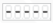 auf der LED angezeigt wird, um zur traditionellen Parameterebene zu wechseln, oder drücken Sie ⊖ lange, bis  auf der LED angezeigt wird, um zur modernen Parameterebene zu wechseln.

### Umschalten von der traditionellen Parameterebene zur modernen Parameterebene

An der LED-Schnittstelle des Parameters „Wiederherstellung der Werkseinstellungen“ drücken Sie ▼ lange, bis 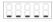 auf der LED angezeigt wird, um zur modernen Parameterebene zu wechseln, oder drücken Sie ▲ lange, bis  auf der LED angezeigt wird, um zur traditionellen Parameterebene zu wechseln.

Dieses Benutzerhandbuch beschreibt die Parametereinstellungen der modernen Ebene. Für die Einstellungen der traditionellen Parameterebene lesen Sie bitte das Benutzerhandbuch des Reglers der SDVC31-Serie.

---

# Kapitel Ⅲ Installationsanleitung

Dieses Kapitel beschreibt die notwendigen Bedingungen für die Verwendung des Reglers und wie er korrekt installiert und angeschlossen wird.

## 3.1 Einsatzbedingungen des Reglers

Der Regler wird mit AC 110/220V betrieben, und die Schutzerdung erfolgt über den Stecker des Netzkabels. Bitte stellen Sie eine den Normen entsprechende Netzversorgung und -verteilung mit 110V oder 220V, 50Hz/60Hz bereit und stellen Sie sicher, dass der Schutzleiter korrekt angeschlossen ist.

**⚠ Warnung** Schließen Sie den Regler niemals an 380V AC an; dies verursacht irreversible schwere Schäden am Regler und kann zu Explosion, Feuer und anderen Sicherheitsvorfällen führen.

**⚠ Warnung** Stellen Sie sicher, dass die Versorgungsseite zuverlässig geerdet ist. Das Metallgehäuse des Reglers ist direkt mit dem Schutzleiter verbunden. Eine schlechte Erdung führt dazu, dass das Reglergehäuse unter Spannung steht und einen Stromunfall verursacht.

**Hinweis** Längerer Betrieb erzeugt Wärme und lässt die Temperatur des Gehäuses ansteigen. Bitte installieren Sie den Regler in einer gut belüfteten Umgebung und befestigen Sie ihn gut, entfernt von Vibrationsquellen.

**Hinweis** Der Ausgang dieses Produkts entsteht durch Gleichrichtung und Umrichtung der Netzversorgung, und es gibt keine Isolierung zwischen Eingang und Ausgang. Daher dürfen die Ausgangspole nicht mit der Schutzerde verbunden werden. Beim Anschluss des Elektromagneten muss sichergestellt werden, dass die Elektromagnetspule und das Gehäuse eine grundlegende Isolationsfähigkeit aufweisen. Andernfalls kann elektrischer Leckstrom auftreten, der einen Stromschlag und Schäden am Regler verursachen kann.

**Hinweis** Dieses Produkt ist ein Regler zum Antrieb des Elektromagneten. Es darf nicht an einen piezoelektrischen Vibrationsförderer angeschlossen werden.

## 3.2 Bedienung der Tasten

a. Kurzes Drücken ist definiert als Drückzeit größer 0.1 und kleiner 2 Sekunden, langes Drücken als Drückzeit größer 2 Sekunden.

a. Drücken Sie die Taste ⊕ oder ⊖ kurz, um die Ausgangsspannung des Reglers in der Standby-Schnittstelle einzustellen.

b. Betreten oder verlassen Sie die Schnittstelle der Grundparameter durch langes Drücken der Taste ⚙, wechseln Sie zwischen den Grundparametern durch kurzes Drücken der Taste ▼ oder ▲ und stellen Sie den Parameterwert durch kurzes Drücken der Taste ⊕ oder ⊖ ein.

c. Betreten oder verlassen Sie die Schnittstelle der erweiterten Parameter durch langes Drücken der Tasten ⚙ und ▲, wechseln Sie zwischen den erweiterten Parametern durch kurzes Drücken der Taste ▼ oder ▲ und stellen Sie den Parameterwert durch kurzes Drücken der Taste ⊕ oder ⊖ ein.

d. Betreten oder verlassen Sie die Schnittstelle der Überwachungsparameter durch langes Drücken der Tasten ⚙ und ▼, und wechseln Sie zwischen den Überwachungsparametern durch kurzes Drücken der Taste ▼ oder ▲; der Parameterwert kann jedoch nicht geändert werden.

e. Drücken Sie die Taste ⏻ kurz, um den Ausgang des Reglers zu starten oder zu stoppen, und drücken Sie die Taste ⏻ lange, um die Tastatur zu sperren oder zu entsperren.

---

## 3.3 Installation und Verwendung

### Schritt eins:

Öffnen Sie den Karton und prüfen Sie den Regler und das gesamte Zubehör.

### Schritt zwei:

Schließen Sie die Anschlussklemmen des Ausgangsleistungskabels an die Elektromagnetspule des Vibrators an.

Richten Sie die Kerbe am Luftfahrtstecker des Ausgangskabels am Dreieckszeichen der Ausgangsbuchse des Reglers aus und ziehen Sie die Mutter fest, nachdem das Ausgangskabel korrekt angeschlossen wurde.

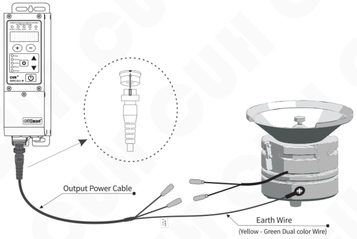

### Hinweis

1. Stellen Sie sicher, dass die Elektromagnetspulen des Vibrators an die beiden Ausgangsstifte des Ausgangsleistungskabels angeschlossen sind und das Metallgehäuse des Vibrators zuverlässig geerdet ist.
2. Es ist verboten, piezoelektrische Lasten an den Leistungsausgang anzuschließen, da dies sonst zu einem Stromschlagunfall führen kann!

---

### Schritt drei:

Schließen Sie den Steckverbinder des Eingangsleistungskabels an die Eingangsleistungsbuchse des Reglers an.

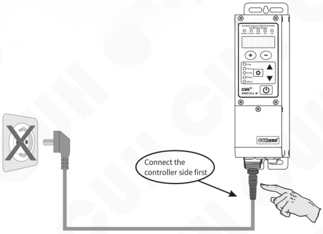

Zuerst die Reglerseite anschließen

### Schritt vier:

Stecken Sie den Stecker des Eingangsleistungskabels in die Netzsteckdose.

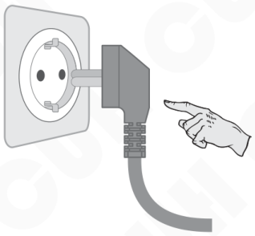

---

### Schritt fünf:

Schalten Sie den Netzschalter des Reglers ein; die Spannung „U 150“ sollte angezeigt werden, Kanal A leuchtet auf und der Vibrationsförderer sollte zu vibrieren beginnen.

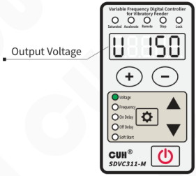

### Schritt sechs:

Drücken Sie ⊖, um die Spannung auf 30~50V einzustellen, drücken Sie dann ⚙ und halten Sie 2 Sekunden lang, um in den Einstellzustand der Ausgangsfrequenz „E“ zu gelangen. Suchen Sie mit ⊕ und ⊖ die Eigenfrequenz des Vibrationsförderers, d. h. die Resonanzfrequenz.

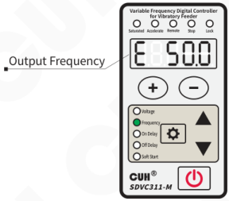

- Die harmonische Frequenz des Vibrators bezeichnet den Frequenzwert, der die maximale Amplitude erzeugt.
- Jeder Vibrator hat seine eigene mechanische Resonanzfrequenz; stellen Sie die Ausgangsfrequenz des Reglers auf diese Frequenz ein, um den besten Arbeitszustand zu erreichen.

---

## Schritt sieben:

Drücken Sie ⚙ lange, um die Ausgangsfrequenz „E“ zu verlassen und zum Spannungseinstellparameter zurückzukehren; Sie können auch ▲ drücken, um zum Spannungseinstellparameter zu wechseln. Stellen Sie mit ⊕ und ⊖ die Spannung bis zur besten Förderrate ein.

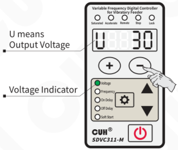

Der Vibrationsförderer sollte jetzt arbeiten. Weitere Steuerungshinweise finden Sie in den folgenden Kapiteln.

---

## Kapitel Ⅳ Beschreibung der Grundfunktionen

Dieses Kapitel beschreibt die grundlegenden Parametereinstellungen in der modernen Parameterebene (Standard).

### 4.1 Ausgangsspannung

Der gleichgerichtete Mittelwert der Ausgangsspannung des Reglers kann direkt und digital über die Tastatur eingestellt werden. Dank der einzigartigen Spannungsstabilisierungsfunktion schwankt die Ausgangsspannung des Reglers nicht mit der Eingangsspannung, sodass der Vibrator auch bei instabilem Netz einen stabilen Betrieb aufrechterhalten kann.

- Schalten Sie den Netzschalter des Reglers ein.
- Der Regler wechselt in den Ausgangsspannungsparameter. Die Spannungsanzeige leuchtet auf und die LED zeigt den Ausgangsspannungsparameter U und den Standardwert 150 an.
- Drücken Sie **⊕** oder **⊖**, um den Parameterwert einzustellen.

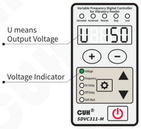

> - Der Regler verfügt über keine Boost-Funktion. Wenn der Regler aufgrund der Begrenzung der Eingangsversorgungsspannung die eingestellte Spannung nicht erreichen kann, leuchtet die Sättigungsanzeige auf, und die Netzspannungskompensation wird zu diesem Zeitpunkt unwirksam.
> - Der Regler kann einen gewissen Beschleunigungseffekt erzielen, indem er die Sinuseigenschaft der Ausgangswellenform opfert; dies wird durch den Parameter „Beschleunigungsindex y“ bestimmt. Beim Eintritt in den Beschleunigungszustand ändert sich die Ausgangsstromwellenform von einer Sinuswelle zu einer Dreieckwelle, und die Beschleunigungsanzeige leuchtet auf.

---

## 4.2 Ausgangsfrequenz

Der Regler verwendet die direkte digitale Frequenzsynthesetechnologie (DDS), die eine sehr hohe Frequenzgenauigkeit und -stabilität aufweist und sich nicht mit Zeit und Temperatur ändert.

- Drücken Sie ⚙ und halten Sie 2 Sekunden lang, um die Schnittstelle der Grundparameter aufzurufen.
- Die LED zeigt den Ausgangsfrequenzparameter „E“ und den Standardwert 50.0 an.
- Drücken Sie ⊕ oder ⊖, um den Parameterwert einzustellen.

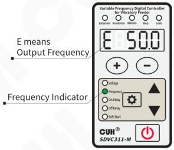

---

## 4.3 Ein-/Ausschaltverzögerung des intelligenten photoelektrischen Sensors

Bei Verwendung eines Sensors oder einer SPS zum Ein- oder Ausschalten des Hauptausgangs des Reglers kann die Aktion um eine gewisse Zeit verzögert werden, nachdem das Steuersignal gegeben oder wiederhergestellt wurde. Die Verzögerungszeit kann über die beiden folgenden Parameter eingestellt werden.

### Einschaltverzögerung ( J )

Die Zeitspanne, die der Regler vom Empfang eines Startsteuersignals bis zur tatsächlichen Ausgabe benötigt.

- Drücken Sie ⚙ und halten Sie 2 Sekunden lang, um die Schnittstelle der Grundparameter aufzurufen.
- Drücken Sie ▲ oder ▼, um zum Einschaltverzögerungsparameter „J“ und dem Standardwert 0.2 zu wechseln.
- Drücken Sie ⊕ oder ⊖, um den Parameterwert einzustellen.

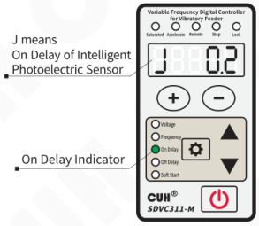

### Ausschaltverzögerung ( L )

Die Zeitspanne, die der Regler vom Empfang eines Abschaltsteuersignals bis zum tatsächlichen Abschalten des Ausgangs benötigt.

- Drücken Sie ⚙ und halten Sie 2 Sekunden lang, um die Schnittstelle der Grundparameter aufzurufen.
- Drücken Sie ▲ oder ▼, um zum Ausschaltverzögerungsparameter „L“ und dem Standardwert 0.2 zu wechseln.
- Drücken Sie ⊕ oder ⊖, um den Parameterwert einzustellen.

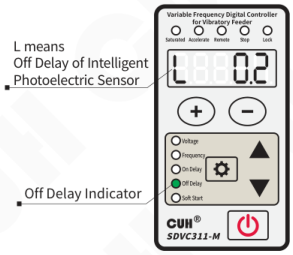

**Hinweis:** In der Standardeinstellung steuert die Ein-/Ausschaltverzögerung des intelligenten photoelektrischen Sensors die Ein-/Ausschaltverzögerung des Hauptausgangs. Wenn die logische Richtung des Hauptausgangs die gleiche Phase oder die umgekehrte Signalquelle ist, tauschen die Bedeutungen der Ein-/Ausschaltverzögerung des intelligenten photoelektrischen Sensors. Die Ein-/Ausschaltverzögerung des Anschlusses C stimmt mit der Ein-/Ausschaltverzögerung des intelligenten photoelektrischen Sensors überein.

---

## 4.4 Sanftanlaufzeit

Um einen plötzlichen Stoß auf die Vibratorspule zu vermeiden, kann der Regler beim Start die Ausgangsspannung schrittweise von 0 auf den voreingestellten Wert erhöhen.

**Sanftanlaufzeit ( t ):** Die Zeitspanne, die der Regler benötigt, um seine Ausgangsspannung beim Start reibungslos von 0 auf den voreingestellten Wert anzuheben.

- Drücken Sie ⚙ und halten Sie 2 Sekunden lang, um die Schnittstelle der Grundparameter aufzurufen.
- Drücken Sie ▲ oder ▼, um zum Sanftanlaufparameter „t“ und dem Standardwert 0.5 zu wechseln.
- Drücken Sie ⊕ oder ⊖, um den Parameterwert einzustellen.

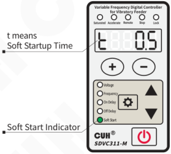

## 4.5 Bremszyklen/Sanftabschaltzeit

Da der Vibrationsförderer nach dem Stoppen des Ausgangs des Reglers für eine gewisse Zeit frei weiterschwingt, bewegt sich das Material während dieser Zeit weiter. Dies verursacht Fehler bei einigen Anwendungen der Präzisionsdosierung und Verpackung von Materialien, daher muss die Vibration schnell gestoppt werden.

**Bremsfunktion:** Die Vibration wird schnell gestoppt, indem der Startpunkt des Sanftstopps um 180° verzögert wird, um den gegenteiligen Effekt der Antriebskraft und der freien Schwingungsphase des Vibrationsförderers zu erzielen. Sie wird realisiert, indem die Sanftabschaltzeit ( 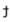 ) als negativer Wert eingestellt wird; die Einheit ist Zyklus, d. h. die Anzahl der Stromzyklen des Gegenantriebs beim Bremsen.

Wenn der Regler aus dem laufenden Zustand gestoppt wird, kann die Ausgangsspannung sanft auf 0 reduziert werden, um eine Stoßbelastung der Vibrationseinrichtung zu vermeiden.

**Sanftabschaltzeit ( 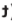 ):** Wenn der Regler aus dem laufenden Zustand stoppt, die Zeit, die die Ausgangsspannung benötigt, um reibungslos vom eingestellten Wert auf 0 zu sinken.

---

- Drücken Sie ⚙ und halten Sie 2 Sekunden lang, um die Schnittstelle der Grundparameter aufzurufen.
- Drücken Sie ▲ oder ▼, um zum Parameter „Bremszyklen/Sanftabschaltung“ „t“ zu wechseln.
- Drücken Sie ⊕, um den Wert des Sanftabschaltungsparameters einzustellen.
- Drücken Sie ⊖, um den Wert des Bremszyklenparameters einzustellen.

t bedeutet Bremszyklen/Sanftabschaltung.

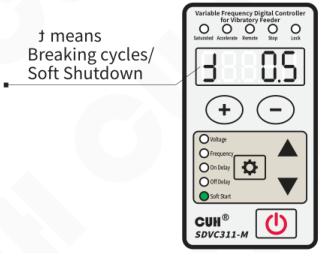

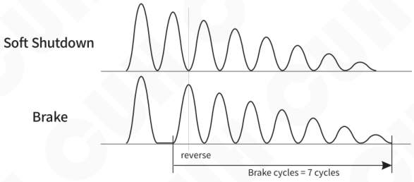

**Schematische Darstellung der Anzahl der Bremszyklen**

---

## 4.6 Tastatursperre

Wenn die Parameter des Reglers eingestellt sind, kann die Tastatursperrfunktion alle Tasten auf dem Bedienfeld sperren, um Fehlbedienungen zu vermeiden.

Auch wenn das Gerät aus- und wieder eingeschaltet wird, bleibt der Zustand der Tastatursperre der Zustand beim letzten Ausschalten.

- Drücken Sie ⏻ und halten Sie 2 Sekunden lang, um alle Tasten auf dem Bedienfeld zu sperren. Die Sperranzeige leuchtet auf.
- Drücken Sie ⏻ erneut 2 Sekunden lang, um zu entsperren.

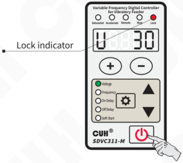

> Der Zustand der Tastatursperre verschwindet nicht durch Abschalten der Stromversorgung.

---

# Kapitel Ⅴ Beschreibung der erweiterten Funktionen

Dieses Kapitel beschreibt die erweiterten Parametereinstellungen in der modernen Parameterebene (Standard).

## 5.1 Fernsteuerung der Drehzahl

Der Regler unterstützt ein externes Analogsignal zur Steuerung der Ausgangsspannung; das Analogsignal unterstützt Potentiometer, 1~5V-Spannung und 4~20mA-Strom.

### Potentiometer-Steueranschluss

**Empfehlung:**

Bitte verwenden Sie ein 1K-Linearpotentiometer

Wenn das Signal der Drehzahlfernsteuerung wirksam wird, leuchtet die Drehzahlsteuerungsanzeige auf; gleichzeitig wird die Einstellung der Spannung am Bedienfeld unwirksam.

---

## 1~5V-Spannungssteueranschluss

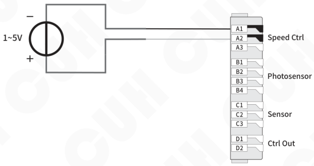

## 4~20mA-Stromsteueranschluss

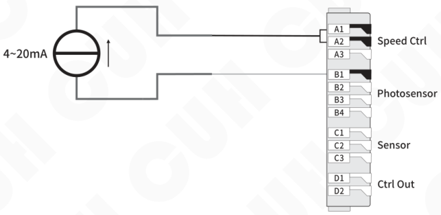

---

## 5.2 Intelligente photoelektrische Sensorik

Der intelligente photoelektrische Anschluss dieses Reglers unterstützt photoelektrische Durchlicht- oder Reflexionssensoren aus Leuchtdioden und Phototransistoren und kann auch auf die Unterstützung von NPN- oder PNP-Schaltsensoren eingestellt werden. Das spezifische Anschlussbild ist wie folgt:

### Anschlussmethode des photoelektrischen Sensors

Der Arbeitsabstand des Sensors kann durch Einstellen des Parameters P angepasst werden; je kleiner der Parameter, desto empfindlicher ist er.

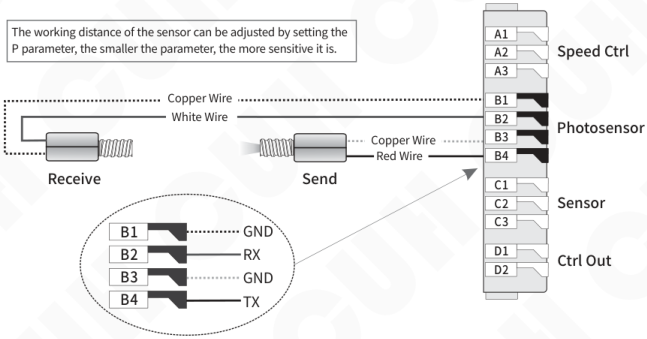

### Anschlussmethode des Schaltsensors

Stellen Sie den NPN- oder PNP-Typ über den Parameter P ein.

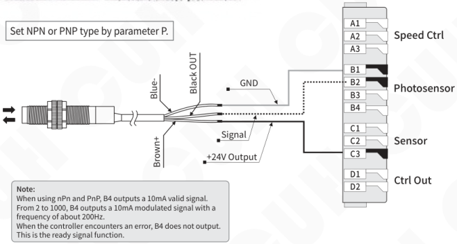

**Hinweis:**

Bei Verwendung von nPn und PnP gibt B4 ein gültiges Signal von 10 mA aus.

Von 2 bis 1000 gibt B4 ein moduliertes Signal von 10 mA mit einer Frequenz von etwa 200 Hz aus.

Wenn am Regler ein Fehler auftritt, gibt B4 nichts aus. Dies ist die Bereitschaftssignalfunktion.

---

## 5.3 Schaltsensor

Der Schaltsensor-Anschluss kann die Modi NPN, PNP, Ut1 und Ut0 unterstützen.

**Der Ut1-Modus ist ein Einzel-Scan,** d. h. bevor das Sensorsignal ungültig ist, werden die High- und Low-Pegel geändert, um zu prüfen, ob der Anschluss gültig ist. Nachdem ein gültiges Signal gefunden wurde, wird der Sensortyp des Anschlusses bestimmt und es wird nicht mehr gescannt.

**Der Ut0-Modus ist ein kontinuierlicher Scan,** unabhängig vom Sensortyp prüft er ständig durch Ändern der High- und Low-Pegel, ob der Anschluss mit einem gültigen Signal verbunden ist.

### Anschlussmethode des Schaltsensors

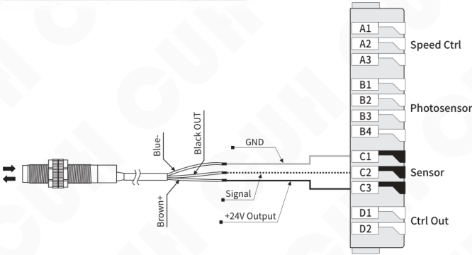

Stellen Sie den NPN- oder PNP-Typ über einen Parameter ein.

- Stellen Sie den Sensortyp über den erweiterten Parameter ΓA ein.
- Wenn andere externe Signale wie Sensoren verwendet werden, um Vorgänge über den C-Anschluss des Reglers zu starten und zu stoppen, und wenn der Vorgang eine gewisse Zeit nach der Signalgabe oder der Signalwiederherstellung verzögert werden muss, können Sie dies über die Zeit der erweiterten Parameter „Einschaltverzögerung des Sensoranschlusses C“ und „Ausschaltverzögerung des Sensoranschlusses C“ realisieren. Für die Vorgehensweise lesen Sie bitte die Einstellung der Ein-/Ausschaltverzögerungszeit des intelligenten photoelektrischen Sensors.

---

## 5.4 Steuerausgang

Der Steuerausgangsanschluss kann NPN-Ausgang, PNP-Ausgang und Push-Pull-Ausgang unterstützen. Darunter:

- Der NPN-Ausgang ist bei niedrigem Pegel gültig, und der Ausgang ist im ungültigen Zustand hochohmig;
- Der PNP-Ausgang ist bei hohem Pegel gültig, und der Ausgang ist im ungültigen Zustand hochohmig;
- Der Push-Pull-Ausgang ist bei hohem Pegel gültig und bei niedrigem Pegel ungültig.

### 5.4.1 Anschlussmethode des Steuerausgangs

**NPN-Ausgangsanschluss**

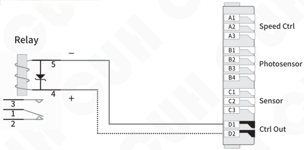

**PNP- oder Push-Pull-Ausgangsanschluss**

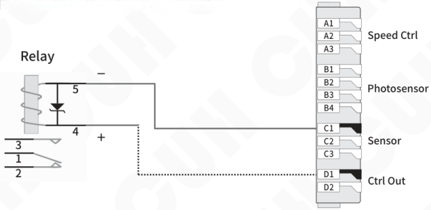

> Wenn Sie ein 24V-Relais anschließen, bestätigen Sie unbedingt die positiven und negativen Pole der Spule, um sicherzustellen, dass sie korrekt angeschlossen sind. Da die Ausgangsstromfähigkeit dieses Anschlusses 400 mA beträgt, wird die interne Schutzdiode des Relais nach einem Falschanschluss den Anschluss dieses Reglers kurzschließen und den Kurzschlussschutz Err07 auslösen.

---

## 5.4.2 Signalquellen und Logikdiagramm des Steuerausgangs

Die Steuerung des Hauptausgangs und des Steuerausgangs wird durch das Ergebnis der logischen Beziehung zwischen den beiden Signalquellen gesteuert.

Stellen Sie die logische Beziehung der beiden Signalquellen durch Einstellen der Parameterwerte der erweiterten Parameter Πd und Πq ein.

Wählen Sie die folgenden Signale durch Einstellen der Parameterwerte der erweiterten Parameter E.d, Ed, E.q, Eq aus.

| Signalquelle | Bedeutung |
|---|---|
| 0 | ungültiges Signal |
| 1 | gültiges Signal |
| b | Signal des intelligenten photoelektrischen Sensoranschlusses |
| -b | Signal des intelligenten photoelektrischen Sensoranschlusses ist invertiert |
| C | Signal des Schaltsensoranschlusses |
| -C | Signal des Schaltsensoranschlusses ist invertiert |
| od | Signal des Steuerausgangsanschlusses |
| -od | Signal des Steuerausgangsanschlusses ist invertiert |
| oq | Signal des Hauptleistungsausgangsanschlusses |
| -oq | Signal des Hauptleistungsausgangsanschlusses ist invertiert |

---

## Steuerausgang-Logikdiagramm

## 5.4.3 Beschreibung des Steuerausgangsmodus

Kunden können 4 Steuerausgangsmodi wählen: Verzögerungsmodus, Haltemodus, periodischer Signalausgabemodus Fn1/Fn2.

**Verzögerungsmodus:** Er bedeutet, dass der Steuerausgang nach einer Ausschaltverzögerungszeit abschaltet, nachdem das Antriebssignal des Reglerausgangs von gültig auf ungültig wechselt.

**Haltemodus:** Nachdem das Antriebssignal des Reglerausgangs gültig wird, bleibt der Steuerausgang während der Ausschaltverzögerungszeit eingeschaltet und schaltet nach Überschreiten der Ausschaltverzögerungszeit ab.

**Periodischer Signalausgabemodus Fn1/Fn2:** Die Dauer des High-Pegel-Signals wird durch die Einschaltverzögerung des Steuerausgangsanschlusses D festgelegt, und die Dauer des Low-Pegel-Signals wird durch die Ausschaltverzögerung des Steuerausgangsanschlusses D festgelegt.

Im Fn1-Modus kann die Umschalttaste die Steuerausgabe nicht stoppen, und im Fn2-Modus kann die Umschalttaste die Steuerausgabe stoppen.

Der Unterschied zwischen den vier Modi wird in Form eines Zeitdiagramms wie folgt dargestellt, wobei das Eingangssignal das Signal ist, das nach dem Logikbeziehungsselektor ausgegeben wird.

---

## 5.4.4 Logische Richtung des Steuerausgangs

Durch Einstellen des erweiterten Parameters „ɔd“ können Kunden 4 logische Richtungen des Steuerausgangs wählen:

**Gleiche Phase `___`:** Zeigt an, dass sich der gültige Zustand des Ausgangssignals nicht ändert.

**Umgekehrt `_-_`:** Zeigt an, dass der gültige Zustand des Ausgangssignals umgekehrt ist.

**Immer aktiv:** Zeigt an, dass das Signal immer aktiv und ungesteuert ist.

**Immer inaktiv:** Zeigt an, dass das Signal immer ungültig und ungesteuert ist.

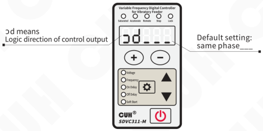

## 5.4.5 Steuerfunktion des Hauptausgangssignals

Die Steuerung des Hauptausgangssignals ähnelt der des Steuerausgangs. Nach der Auswahl von zwei Signalquellen für die logische Beziehungsoperation wird das Steuersignal durch Auswahl des Ein-/Ausschaltverzögerungsmodus und Steuerung der logischen Richtung erhalten. Das Steuersignal wird logisch mit dem Ein-/Ausschaltsignal des Bedienfelds verknüpft und dann an die Leistungsplatine gesendet, um den Hauptausgang zu steuern.

Die Anschlussmethode, die Signalquelle und das Logikdiagramm der Hauptausgangssignalsteuerung finden Sie in der Funktion des Steuerausgangs.

---

## 5.5 Begrenzung der maximalen Ausgangsspannung

Der Regler kann den Parameter h für die Begrenzung der maximalen Ausgangsspannung einstellen, der den Benutzer vor Fehlbedienungen schützen kann, die zu einer übermäßigen Ausgangsspannung und Beschädigung der Vibrationseinrichtung führen.

Weder die am Bedienfeld eingestellte Spannung noch die Fernsteuerungsspannung überschreiten diesen Wert.

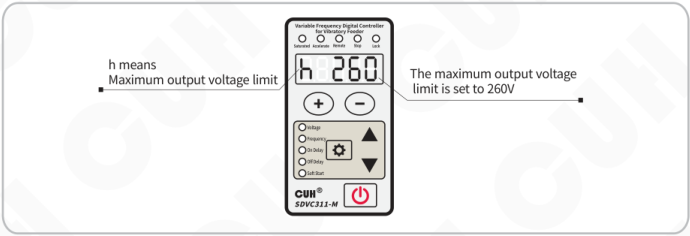

- In keinem Fall kann und wird die Ausgangsspannung des Reglers den eingestellten Wert dieses Parameters überschreiten.
- Die werkseitige Standardeinstellung dieses Parameters ist die maximal mögliche Ausgangsspannung des Geräts.

## 5.6 Untere Frequenzgrenze

Dieser Regler kann den erweiterten Parameter „untere Frequenzgrenze e“ einstellen, um die minimale Ausgangsfrequenz zu begrenzen, was verhindern kann, dass Benutzer die Ausgangsfrequenz versehentlich zu niedrig einstellen und den Elektromagneten beschädigen.

Die am Bedienfeld eingestellte Frequenz wird nicht niedriger als dieser Wert sein.

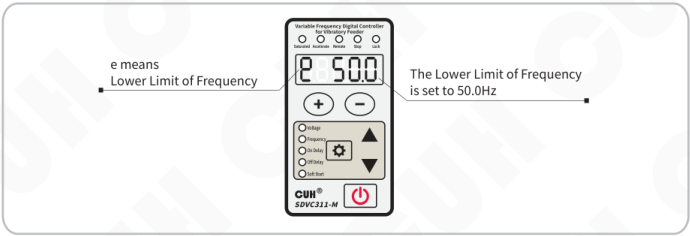

---

## 5.7 Beschleunigungsindex

Der Regler kann einen gewissen Beschleunigungseffekt erzielen, indem er die Sinuseigenschaft der Ausgangswellenform opfert. Beim Eintritt in den Beschleunigungszustand ändert sich die Ausgangsstromwellenform von einer Sinuswelle zu einer Dreieckwelle, und die Beschleunigungsanzeige leuchtet auf. Die Beschleunigungsfunktion kann durch Einstellen des Parameterwerts des erweiterten Parameters „Beschleunigungsindex y“ gesteuert werden.

**Beschleunigungsindex (y):** Drückt aus, dass die maximale Ausgangsspannung den Prozentsatz der Eingangsspannung erreichen kann.

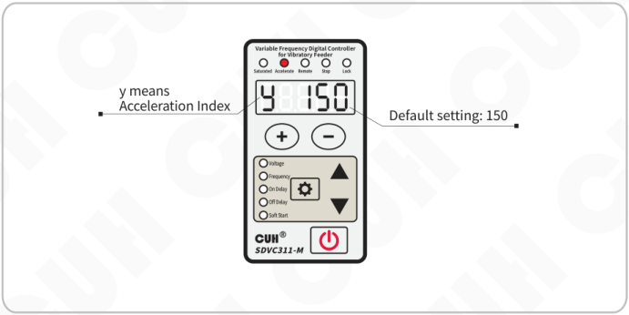

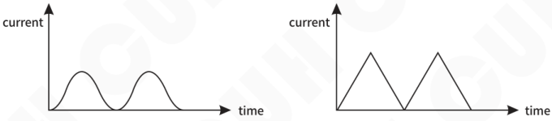

**Schematische Darstellung des Beschleunigungsindex auf 150 eingestellt**

---

## 5.8 Wellenformindex

Der Regler kann die Leistung kontinuierlich zwischen höchster Effizienz – maximaler Leistung – und minimalem Rauschen ausgleichen, um die höheren Anforderungen der Kunden zu erfüllen. Dies kann durch die Einstellung des Parameterwerts des erweiterten Parameters „Wellenformindex r“ erreicht werden.

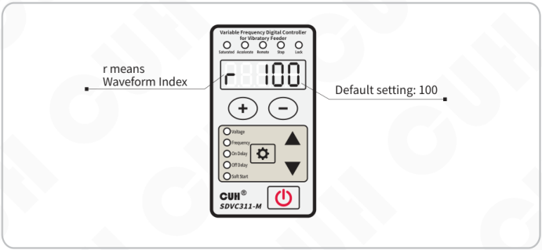

- Der Wellenformindexwert 0 hat die höchste Effizienz und die geringste Belastung der Feder.
- Bei einem Wert von 100 werden die maximale Nennausgangsleistung und das minimale Rauschen erreicht, aber die Feder wird stärker belastet.

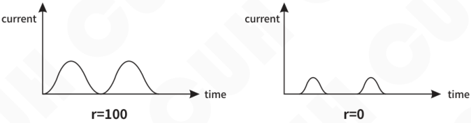

**Wellenformindex-Diagramm**

---

## 5.9 Parameter-Passwortsperrfunktion

Der Regler kann wichtige Parameter sperren, um Fehlbedienungen durch den Benutzer zu verhindern. Die in der Parametertabelle mit "*" gekennzeichneten Parameter können mit der Parameter-Passwortsperre gesperrt werden.

- Drücken Sie ⚙ und ▲ gleichzeitig lange, um die Ebene der erweiterten Parameter aufzurufen.
- Drücken Sie ▲ oder ▼ kurz, um zum 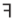 zu wechseln, das zum Einstellen des Passworts dient.
- Drücken Sie ⊕ und ⊖, um den Parameterwert einzustellen.
- Nachdem Sie das Parameterpasswort festgelegt haben, verlassen Sie die aktuelle Ebene und rufen Sie sie erneut auf; Sie werden sehen, dass der Parameterwert verschwindet.
- Rufen Sie die Ebene der erweiterten Parameter auf, wechseln Sie zu , geben Sie das zuvor eingegebene Passwort ein; Sie können den verschwundenen eingestellten Passwortparameter sehen und anschließend das Passwort ändern.

Der Wert des Passwortsperrparameters folgt der 421-Coderegel:

| Sperrparameter | Wellenformindex | Beschleunigungsindex | Begrenzung der maximalen Ausgangsspannung | Logikverknüpfung der Signalquellen des Hauptausgangs | Die zweite Signalquelle des Hauptausgangs | Die erste Signalquelle des Hauptausgangs | Logikverknüpfung der Signalquellen von Steuerport D | Die zweite Signalquelle von Steuerport D | Die erste Signalquelle von Steuerport D | Sensortyp von Port C | Bremszyklen/Sanftabschaltung | Ausgangsfrequenz |
|---|---|---|---|---|---|---|---|---|---|---|---|---|
| 1: Gesperrt | 1 | 1 | 1 | 1 | 1 | 1 | 1 | 1 | 1 | 1 | 1 | 1 |
| 0: Entsperrt | 0 | 0 | 0 | 0 | 0 | 0 | 0 | 0 | 0 | 0 | 0 | 0 |
| Multiplikationsfaktor | 4 | 2 | 1 | 4 | 2 | 1 | 4 | 2 | 1 | 4 | 2 | 1 |
| Wertebereich des Passwortwerts (Summierung) | 0~7 (1. Stelle des Passwortwerts) | | | 0~7 (2. Stelle des Passwortwerts) | | | 0~7 (3. Stelle des Passwortwerts) | | | 0~7 (4. Stelle des Passwortwerts) | | |
| Beispiel 1 | 0 | 0 | 0 | 0 | 0 | 0 | 0 | 0 | 0 | 0 | 0 | 1 |
| | 0 | | | 0 | | | 0 | | | 1\*1=1 | | |
| Beispiel 2 | 1 | 0 | 0 | 0 | 0 | 1 | 0 | 0 | 0 | 0 | 0 | 1 |
| | 1\*4=4 | | | 1\*1=1 | | | 0 | | | 1\*1=1 | | |
| Beispiel 3 | 0 | 0 | 0 | 0 | 0 | 0 | 0 | 0 | 0 | 1 | 1 | 1 |
| | 0 | | | 0 | | | 0 | | | 1\*4+1\*2+1\*1=7 | | |

**Beispiel 1:** Um die Ausgangsfrequenz zu sperren, lauten die 12 Binärcodegruppen 000000000001, und der eingestellte Passwortwert ist 0001.

**Beispiel 2:** Sperren der Ausgangsfrequenz, des Wellenformindex und der ersten Signalquelle des Hauptausgangs; die 12 Binärcodegruppen lauten 100001000001, und der eingestellte Passwortwert ist 4101.

**Beispiel 3:** Sperren der Ausgangsfrequenz, der Bremszyklenzahl/Sanftabschaltzeit und des Sensortyps von Port C; die 12 Binärcodegruppen lauten 000000000111, und der eingestellte Passwortwert ist 0007.

Wenn „Passwortsperrparameterbereich“ auf 9999 eingestellt ist, werden alle mit "*" gekennzeichneten Parameter gesperrt.

---

## 5.10 Wiederherstellen der Werkseinstellungen/Rückkehr in den Fabrikmodus

Der Benutzer kann den Regler schnell in den Werkszustand zurücksetzen.

Aufgrund der leistungsstarken Funktionen des Reglers können viele Parameter angepasst werden. Für Anfänger kann es schwierig sein, nach mehreren Einstellungen und Änderungen den normalen Arbeitszustand des Reglers wiederherzustellen. Verwenden Sie diese Funktion, um den gestörten Parameterzustand schnell auf die Werkseinstellung zurückzusetzen.

Um die Werkseinstellungen wiederherzustellen, ist es erforderlich, den Parameter des Fabrikmodus (Pin) in Kombination zu verwenden. Der Fabrikmodus wird wie folgt beschrieben:

- **0:** Stellen Sie die **Arbeitsparametergruppe** auf die **Benutzerparametergruppe** wieder her.
- **5:** Speichern Sie die **Arbeitsparametergruppe** in der **Benutzerparametergruppe**.
- **35:** Stellen Sie die **Arbeitsparametergruppe** auf den **CUH-Werkswert** wieder her.
- **55:** Stellen Sie die **Arbeitsparametergruppe** und die **Benutzerparametergruppe** auf den **CUH-Werkswert** wieder her.

---

- Drücken Sie ⚙ und ▲ gleichzeitig lange, um die Ebene der erweiterten Parameter aufzurufen.
- Drücken Sie ▼ kurz, um zum vollständigen Blinken auf dem LED-Display zu wechseln, d. h. zum Parameter „Wiederherstellung der Standardeinstellung“. Drücken Sie dann ⊖ lange, bis der Regler "-----" anzeigt, was bedeutet, dass der Regler wiederhergestellt wurde.
- Lassen Sie ⊖ los; nachdem der Regler "CUH" angezeigt hat, wechselt er in den Ausgangsspannungs-Einstellzustand "U". Zu diesem Zeitpunkt wurden alle Parameter auf die Werkseinstellungen zurückgesetzt.

---

## 5.11 Parameterüberwachungsfunktion

Der Regler verfügt über einen speziell entwickelten Satz von Überwachungsparametern zur Überwachung des Reglerzustands.

- Drücken Sie ⚙ und ▼ gleichzeitig lange, um die Überwachungsparameterebene aufzurufen.
- Drücken Sie ▲ oder ▼ kurz, um den zu überwachenden Parameter auszuwählen.
- Der Parameterwert des Überwachungsparameters kann nicht geändert werden.

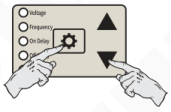

Beispiel: C bedeutet Temperaturanzeigeparameter

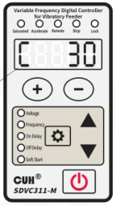

**Die Überwachungsparameter dieses Reglers umfassen:**

Temperaturanzeige C, Busspannung PU, Bus-Welligkeitsspannung rU, Ausgangsstrom AC, Spannung von Port A der analogen Drehzahlregelung AU, Signalspannung von Port B bU, Signalspannung von Port C cU, Ausgangsspannung von Port D dU, 24V-Ausgangsspannung nU.

---

## Kapitel Ⅵ Technische Daten

### 6.1 Abmessungen

(Einheit: mm)

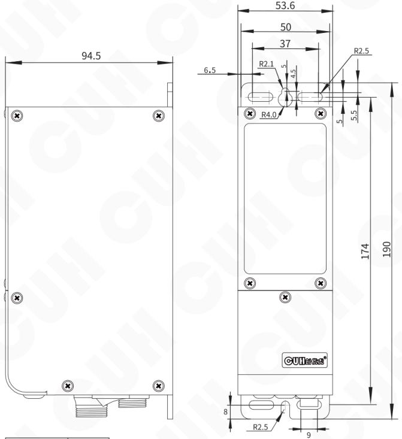

SDVC311-S (1.5A)  
SDVC311-M (3.0A)

| Maßbereich | Toleranz |
|---|---|
| 0~3 | ±0.05 |
| 3~10 | ±0.1 |
| 10~30 | ±0.15 |
| 30~80 | ±0.2 |
| 80~180 | ±0.3 |
| >180 | ±0.5 |

Diese Toleranztabelle gilt für alle Produkte dieser Serie.

---

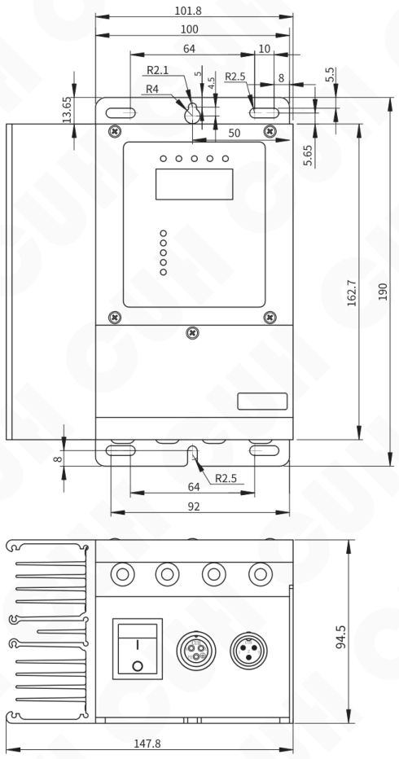

SDVC311-L (4.5A)  
SDVC311-XL (6.0A)

---

## 6.2 Technische Daten

| Element | Min. | Typ. | Max. | Einheit | Anmerkung |
|---|---|---|---|---|---|
| Eingangsspannung | 85 | 220 | 250 | V | AC-Effektivwert |
| Einstellbarer Ausgangsspannungsbereich | 0 | —— | 260 | V | Niedriger als 150% der Eingangsspannung |
| Spannungseinstellgenauigkeit | | 1 | | V | |
| Spannungsregelgenauigkeit | 0 | —— | 10 | % | ΔVout/ΔVin |
| Einstellbarer Ausgangsstrombereich | 0 | —— | 1.5 | A | SDVC311-S |
| Einstellbarer Ausgangsstrombereich | 0 | —— | 3.0 | A | SDVC311-M |
| Einstellbarer Ausgangsstrombereich | 0 | —— | 4.5 | A | SDVC311-L |
| Einstellbarer Ausgangsstrombereich | 0 | —— | 6.0 | A | SDVC311-XL |
| Ausgangsleistung | 0 | —— | 330 | VA | SDVC311-S |
| Ausgangsleistung | 0 | —— | 660 | VA | SDVC311-M |
| Ausgangsleistung | 0 | —— | 990 | VA | SDVC311-L |
| Ausgangsleistung | 0 | —— | 1320 | VA | SDVC311-XL |
| Ausgangsfrequenz | 5.0 | —— | 400.0 | Hz | |
| Frequenzeinstellgenauigkeit | | 0.1 | | Hz | |
| Ausgangswellenform | | Sinus | | | |
| Sanftanlaufzeit | 0 | —— | 10.0 | s | Standardwert: 0.5 |
| Bereich der Ein-/Ausschaltverzögerung | 0 | —— | 99.9 | s | Standardwert: 0.2 |
| Genauigkeit der Ein-/Ausschaltverzögerung | | 0.1 | | s | |
| Auslösetemperatur des Überhitzungsschutzes | 58 | 60 | 66 | °C | |
| DC-Steuerausgangsstrom | 0 | —— | 400 | mA | |
| DC-Steuerausgangsspannung | 22 | 24 | 26 | V | |
| Analoges Steuersignal | | 1~5/4~20 | | V/mA | Signal der Fernsteuerung der Drehzahl |
| Digitales Steuersignal | | 24 | | V | Schaltsignal |
| Einstellmethode | | 6 | | Taste | |
| Leistungsaufnahme im Bereitschaftszustand | —— | 3 | —— | W | |
| Anzeigemethode | | 5 | | Ziffer | LED |
| Umgebungstemperatur | 0 | 25 | 40 | °C | Ohne Kondensation |
| Umgebungsfeuchtigkeit | 10 | 60 | 85 | % | Ohne Kondensation |
| Lagerumgebungstemperatur | -20 | 25 | 65 | °C | Ohne Kondensation |

## 6.3 Referenznorm

**Absolute Parameter:**  
Die Überschreitung der Normwerte beschädigt den Regler; sie sind strikt einzuhalten.

| Element | GB-Norm | IEC-Norm | Grad | Normanforderung | Anmerkung |
|---|---|---|---|---|---|
| Elektrostatische Entladung | GB/T 17626.2-2006 | IEC 61000-4-2:2001 | 4 | ±8 kV | Kontaktentladung |
| | | | 4 | ±15 kV | Luftentladung |
| Test der schnellen transienten Störgrößen | GB/T 17626.4-2008 | IEC 61000-4-4:2004 | 4 | ±4 kV | |
| Störfestigkeit der DC-Stromversorgungsleitung | GB/T 17626.17-2005 | IEC 61000-4-17:2002 | 4 | 15% | Bewertung A |

> **Warnung**  
> In einer Wohnumgebung kann dieses Produkt Funkstörungen verursachen; in diesem Fall können zusätzliche Gegenmaßnahmen erforderlich sein.

---

# Kapitel Ⅶ Anhang

## 7.1 Parametertabelle

| Kategorie | Definition | Symbol | Symbolbild | Bereich | Standardwert |
|---|---|---|---|---|---|
| Allgemeiner Parameter | Ausgangsspannung | U |  | 0~260 V | 150 |
| Grundparameter | Ausgangsfrequenz * | E |  | 5.0~400.0 Hz | 50.0 |
| | Einschaltverzögerung des intelligenten photoelektrischen Sensors | J |  | 0.0~99.9 s | 0.2 |
| | Ausschaltverzögerung des intelligenten photoelektrischen Sensors | L |  | 0.0~99.9 s | 0.2 |
| | Sanftanlauf | t |  | 0.0~10.0 s | 0.5 |
| | Bremszyklen/Sanftabschaltung * | d |  | -100~0 Zyklus (Anzahl der Bremszyklen) 0.0~10.0 s (Sanftabschaltung) | 0.0 |
| | Ausgangsspannung | U |  | 0~260 V | 150 |
| Erweiterter Parameter | Empfindlichkeit des intelligenten photoelektrischen Sensors | P |  | PnP, nPn, 2~1000 | 80 |
| | Sensortyp von Port C * | ΓA |  | nPn, PnP ut1 (Einzel-Scan), ut0 (Kontinuierlicher Scan) | ut0 |
| | Einschaltverzögerung von Port C | J- |  | 0.0~99.9 s | 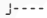 wie J |
| | Ausschaltverzögerung von Port C | L- |  | 0.0~99.9 s |  wie L |
| | Die erste Signalquelle des Hauptausgangs * | Cq | 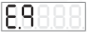 | 0, 1, b, -b, C, -C, od, -od, oq, -oq | b |
| | Die zweite Signalquelle des Hauptausgangs * | Eq |  | 0, 1, b, -b, C, -C, od, -od, oq, -oq | C |
| | Logikverknüpfung der Signalquellen des Hauptausgangs * | nq | 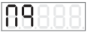 | And, or, Xor, rS | or |
| | Einschaltverzögerung des Hauptausgangs | Jq |  | 0.0~99.9 s | 0.0 |
| | Ausschaltverzögerung des Hauptausgangs | Lq |  | 0.0~99.9 s | 0.0 |
| | Ausgangsmodus des Hauptausgangs | Fq |  | dLy (Verzögerungsmodus), HLd (Haltemodus) | dLy |
| | Logische Richtung des Hauptausgangs | oq |  |  on (immer aktiv), oFF (immer inaktiv) |  |
| | Die erste Signalquelle von Steuerport D * | Cd |  | 0, 1, b, -b, C, -C, od (Ausgangszustand von Port D), -od, oq (Ausgangszustand des Hauptausgangs), -oq | 0 |
| | Die zweite Signalquelle von Steuerport D * | Ed |  | 0, 1, b, -b, C, -C, od (Ausgangszustand von Port D), -od, oq (Ausgangszustand des Hauptausgangs), -oq | oq |
| | Logikverknüpfung der Signalquellen von Steuerport D * | nd |  | And, or, Xor, rS | or |
| | Einschaltverzögerung von Port D | Jd |  | 0.0~99.9 s | 0.0 |

| | Definition | Symbol | Symbolbild | Bereich | Standardwert |
|---|---|---|---|---|---|
| Erweiterter Parameter | Ausschaltverzögerung von Port D | Ld |  | 0.0~99.9 s | 0.0 |
| Erweiterter Parameter | Ausgangsmodus von Port D | Fd |  | dLy (Verzögerungsmodus), HLd (Haltemodus) Fn1 periodischer Signalausgabemodus 1 Fn2 periodischer Signalausgabemodus 2 | dLy |
| Erweiterter Parameter | Logische Richtung von Port D | Sd |  | --- (Gleiche Phase), -⁻- (Umgekehrt) on (immer aktiv), oFF (immer inaktiv) | --- |
| Erweiterter Parameter | Steuerausgangstyp | Cd |  | nPn, PnP, PSP (Push & Pull) | nPn |
| Erweiterter Parameter | Begrenzung der maximalen Ausgangsspannung \* | h |  | 0~260 V | 260 |
| Erweiterter Parameter | Untere Frequenzgrenze | E |  | 5.0~400.0 Hz | 40.0 |
| Erweiterter Parameter | Beschleunigungsindex \* | g |  | 100~150 | 150 |
| Erweiterter Parameter | Wellenformindex \* | r |  | 0~100 | 100 |
| Erweiterter Parameter | Parameterbereich der Funktion zur Deaktivierung der Parameteranpassung | Spezielles 7-Segment-Symbol mit Dezimalpunkt (siehe Abbildung) |  | 0~9999 | 0 |
| Erweiterter Parameter | Sperre der Funktion zur Deaktivierung der Parameteranpassung | Spezielles 7-Segment-Symbol (siehe Abbildung) |  | 0~9999 | 0 |
| Erweiterter Parameter | Wiederherstellung der Standardeinstellung | 88888 |  | Wird in Verbindung mit dem Parameter Pin verwendet | —— |
| Erweiterter Parameter | Rückkehr in den Fabrikmodus | Pin |  | 0 : Arbeitsparametergruppe auf Benutzerparametergruppe wiederherstellen 5 : Arbeitsparametergruppe in Benutzerparametergruppe speichern 35: Arbeitsparametergruppe auf CUH-Werkswert wiederherstellen 55: Arbeitsparametergruppe und Benutzerparametergruppe auf CUH-Werkswert wiederherstellen | 0 |
| Überwachungsparameter | Temperatur | C |  | -20~85 °C | —— |
| Überwachungsparameter | Interne Busspannung | PU |  | 0~400 V | —— |
| Überwachungsparameter | Bus-Welligkeitsspannung | rU |  | 0~200 V | —— |
| Überwachungsparameter | Ausgangsstrom | AC |  | 0.00~1.60 A -SDVC31S/SDVC311S 0.00~3.20 A -SDVC31M/SDVC311M | —— |
| Überwachungsparameter | Signalspannung von Port A | AU |  | 0.00~5.00 V | —— |
| Überwachungsparameter | Signalspannung von Port B | bU |  | 0~999 | —— |
| Überwachungsparameter | Signalspannung von Port C | cU |  | 0.0~28.0 V | —— |
| Überwachungsparameter | Signalspannung von Port D | dU |  | 0.0~28.0 V | —— |
| Überwachungsparameter | Echtzeitspannung des 24V-Anschlusses | nU |  | 0.0~28.0 V | —— |
| Überwachungsparameter | Softwareversion der Steuerplatine | uc |  | —— | —— |
| Überwachungsparameter | Softwareversion der Leistungsplatine | uP |  | —— | —— |

Hinweis: Der Parameter mit dem Symbol \* kann durch  gesperrt werden.  
Alle Parameter des Reglers mit dem Symbol \* werden gesperrt, wenn  9999 ist.

## 7.2 Eingangs- und Ausgangsschaltpläne

Port A der Fernsteuerung der Drehzahl

Port B des intelligenten Photosensors

Port C des Schaltsensors

Steuerausgang Port D

---

## 7.3 Fehlerbehebungsvorschläge und Fehlererläuterungen

| Fehlercode | Definition | Fehlerbehebungsmethoden | Symbolbild |
|---|---|---|---|
| Keine Anzeige nach dem Einschalten | | Stellen Sie sicher, dass die Steckdose stromführend ist Stellen Sie sicher, dass das Eingangsnetzkabel zuverlässig mit der Steckdose verbunden ist? | |
| Anzeige normal, aber kein Ausgang | | Stellen Sie sicher, dass das Ausgangskabel zuverlässig mit dem Vibrator verbunden ist. Stellen Sie sicher, dass die Ausgangsspannung nicht zu klein ist. Stellen Sie sicher, dass die Stoppanzeige nicht leuchtet. Bitte prüfen Sie, ob der Parameter Normal Close eingestellt wurde, wodurch der Reglerausgang gestoppt wird. | |
| Steuersignal verliert seine Wirkung | | Stellen Sie sicher, dass das Steuersignal korrekt eingegeben wird. Stellen Sie sicher, dass die Masseleitung des Steuersignals korrekt mit dem Regler verbunden ist. Stellen Sie sicher, dass die logische Verknüpfung der Steuersignale korrekt nach Ihren Erwartungen eingestellt ist. | |
| Schwebungsphänomene | | Vermeiden Sie die Schwingungskopplung zwischen den Vibratoren. Erhöhen Sie die Resonanzfrequenz der Vibratoren. | |
| Anzeige normal, kein Ausgang, aber Geräusche sind hörbar | | Stellen Sie alle Parameter wie in diesem Handbuch beschrieben ein. | |
| Err01 | Kurzschluss | Stellen Sie sicher, dass die Last nicht kurzgeschlossen ist, und versuchen Sie dann, den Ausgang des Reglers durch zweimaliges Drücken der Ausgangs-EIN/AUS-Taste oder durch erneutes Einschalten des Reglers neu zu starten. |  |
| Err02 | Überstrom | Reduzieren Sie die Ausgangsspannung entsprechend und starten Sie dann den Ausgang neu. |  |
| Err03 | Überhitzung | Installieren Sie den Regler in einer gut belüfteten Umgebung. |  |
| Err04 | Über- oder Unterspannung | Stellen Sie sicher, dass die Eingangsspannung zwischen AC 85~250Vac liegt. |  |
| Err05 | Interne Kommunikation abnormal | Stellen Sie sicher, dass keine externe Stromversorgung am 24V-Stromanschluss angeschlossen ist, oder kontaktieren Sie unseren technischen Support. |  |
| Err06 | Temperatursensor abnormal | Stellen Sie sicher, dass die Arbeitstemperatur nicht unter -20℃ liegt, oder kontaktieren Sie unseren technischen Support. |  |
| Err07 | Kurzschlussschutz von Port D | Stellen Sie sicher, dass die Last von Port D nicht kurzgeschlossen ist und der Strom 400mA nicht überschreitet, und versuchen Sie dann, den Ausgang von Port D neu zu starten. |  |
| Err10 | 24V-Stromausgang abnormal | Stellen Sie sicher, dass der 24V-Anschluss nicht kurzgeschlossen ist und der Strom 400mA nicht überschreitet. |  |
| Err11 | 5V-Stromausgang von Port A abnormal | Stellen Sie sicher, dass die 5V-Stromversorgung von Port A nicht kurzgeschlossen ist oder keine externe Stromspannung über 5V angeschlossen ist. |  |

Hinweis: Wenn ein Fehler auftritt, wird TX von Port B abgeschaltet.

## Kapitel Ⅷ Produktgarantieinformationen

### 8.1 Garantiezeitraum

Der Garantiezeitraum, den das Unternehmen für dieses Produkt gewährt, beträgt 3 Jahre ab dem Datum der Lieferung des Produkts an den vom Käufer bezeichneten Ort.

### 8.2 Garantieumfang

(1) Wenn während des oben genannten Garantiezeitraums ein von unserem Unternehmen verursachter Fehler auftritt, reparieren wir das Produkt kostenlos. Die folgenden Situationen fallen jedoch nicht unter die Garantie:

a. Nichtbeachtung der im Kurzhandbuch, Benutzerhandbuch oder den zwischen dem Käufer und dem Unternehmen speziell vereinbarten technischen Anforderungen genannten Bedingungen, unsachgemäße Bedienung oder Fehler durch unsachgemäße Verwendung.

b. Der Fehler ist nicht auf einen Produktdefekt zurückzuführen, sondern auf die Ausrüstung oder das Softwaredesign des Käufers.

c. Fehlfunktionen, die durch Änderungen oder Reparaturen verursacht werden, die nicht vom Personal des Unternehmens durchgeführt wurden.

d. Fehler, die durch korrekte Wartung oder Austausch von Verschleißteilen gemäß der Kurzbedienungsanleitung oder dem Benutzerhandbuch vollständig vermieden werden können.

e. Fehler, die nach dem Versand des Produkts aus unserem Unternehmen durch Faktoren wie unvorhersehbare Veränderungen des Standes von Wissenschaft und Technik verursacht werden.

f. Bei Naturkatastrophen wie Feuer, Erdbeben, Überschwemmungen oder externen Faktoren wie anormaler Spannung übernimmt das Unternehmen keine Garantie.

(2) Der Garantieumfang ist auf die in (1) festgelegten Situationen beschränkt. Für indirekte Verluste (z. B. Geräteschäden, entgangene Chancen, Gewinnverluste usw.) oder sonstige Verluste übernimmt das Unternehmen keine Verantwortung.

### 8.3 Produkteignung

Der Regler unseres Unternehmens ist für den allgemeinen Einsatz in der Vibrationszuführindustrie ausgelegt und hergestellt. Daher darf dieser Regler unseres Unternehmens nicht für die folgenden Anwendungen verwendet werden und ist für deren Einsatz nicht geeignet.

(1) Einrichtungen mit schwerwiegenden Auswirkungen auf Leben und Eigentum, wie Kernkraftwerke, Flughäfen, Eisenbahnen, Schiffe, motorisierte Geräte und medizinische Geräte.

(2) Öffentliche Versorgungseinrichtungen, einschließlich Strom, Gas, Wasserversorgung usw.

(3) Verwendung im Freien unter ähnlichen Bedingungen oder Umgebungen.

---

Nanjing CUH Science & Technology Co.,Ltd  
https://en.cuhnj.com  
Tel.:+86-25-84730411 / 84730415 / 84730416  
Fax:+86-25-84730426  
E-mail:sales@cuhnj.com  
Add.:Building 2, Xueyan Tech Park, Tuscity,  
No.9 Zhineng Rd, Jiangning, Nanjing, China

Document No.: IDP1000532

