# **Betriebsanleitung der CUH SDVC31 Serie**  
**Digitaler Frequenzregler für Vibrationsfördereinrichtungen**

---
# Vorwort

Vielen Dank, dass Sie sich für die intelligenten digitalen Vibrationsfördereinrichtungs-Controller von **CUH** entschieden haben. (im Folgenden kurz „der Controller")

Diese Betriebsanleitung enthält Hinweise zur Installation, Inbetriebnahme, Parametereinstellung, Wartung und Fehlerbehebung des Controllers. Bitte lesen Sie diese Betriebsanleitung sorgfältig durch, bevor Sie den Controller bedienen, und bewahren Sie sie gut auf.

## Diese Betriebsanleitung gilt für folgende Modelle:

➡Digitaler Frequenzregler für Vibrationsfördereinrichtungen  
SDVC31-S (1,5 A Ausgangsstrom)

➡Digitaler Frequenzregler für Vibrationsfördereinrichtungen  
SDVC31-M (3,0 A Ausgangsstrom)

➡Digitaler Frequenzregler für Vibrationsfördereinrichtungen  
SDVC31-L (4,5 A Ausgangsstrom)

➡Digitaler Frequenzregler für Vibrationsfördereinrichtungen  
SDVC31-XL (6,0 A Ausgangsstrom)

➡Digitaler Frequenzregler für Vibrationsfördereinrichtungen  
SDVC31-U (10,0 A Ausgangsstrom)

➡Digitaler Frequenzregler für Vibrationsfördereinrichtungen  
SDVC31-XU (20,0 A Ausgangsstrom)

---

# Hinweise

➜ Schalten Sie den Controller niemals unter Last um und berühren Sie unter keinen Umständen die Kontakte, um Stromschläge oder andere Unfälle zu vermeiden.

➜ Das Gehäuse des Controllers ist über das Netzkabel geerdet. Bitte stellen Sie sicher, dass die Steckdose gut geerdet ist.

➜ Schließen Sie den Controller niemals an 380 V AC an, da dies irreparable Schäden verursachen kann.  
(Wählen Sie bei Bedarf Produkte, die für 380 V AC ausgelegt sind)

➜ Schalten Sie die Eingangsversorgung des Controllers niemals über ein Relais, eine SPS oder andere Geräte ab, da sonst die Lebensdauer des Controllers erheblich verkürzt werden kann.

➜ Der Controller ist für den Betrieb in einer kühlen und trockenen Umgebung konzipiert. Betreiben Sie ihn niemals im Freien, um Nässe oder Sonneneinstrahlung zu vermeiden. Betreiben Sie den Controller innerhalb des Temperaturbereichs, den seine elektrischen Kennwerte erfordern.

➜ Betreiben Sie den Controller niemals unter Bedingungen, die über seine Auslegungsgrenzen hinausgehen.

➜ Betreiben Sie den Controller strikt gemäß dieser Betriebsanleitung. Wir übernehmen keine zivil- oder strafrechtliche Haftung, wenn Geräteschäden oder Personenschäden durch unsachgemäße Bedienung verursacht werden.

> [!CAUTION]
> **Öffnen Sie niemals das Controllergehäuse, um Stromschläge zu vermeiden.** Wenden Sie sich bei einer Fehlfunktion des Controllers an CUH.
>
> Versuchen Sie niemals, den Controller umzubauen, da die Festkörper-Schaltungen (Platinen) im Inneren des Controllers nicht repariert werden können und es keine einstellbaren Teile gibt.

---

# Betriebsumgebung

## Kontrolle vor der Verwendung

Jeder Controller durchläuft vor der Lieferung eine strenge Qualitätsprüfung und wird  
in stoßfester Verpackung verpackt.

## Bitte prüfen Sie folgende Punkte nach dem Auspacken:

➜ Ob der Controller äußerlich beschädigt ist

➜ Ob das Modell des Controllers genau dem von Ihnen bestellten entspricht

## Betriebsumgebung

Bitte beachten Sie die folgenden Hinweise, um eine bessere Leistung und eine längere Lebensdauer des  
Controllers zu gewährleisten

➜ Gut belüftete Umgebung

➜ Von Wasser, Dampf, Staub und insbesondere öligem Staub fernhalten

➜ Von korrosiven oder brennbaren Gasen und Flüssigkeiten fernhalten

➜ Von Staub und Metallpartikeln fernhalten

➜ Fest befestigen, um Eigenschwingungen zu vermeiden

➜ Von elektromagnetischen Störungen fernhalten

➜ Innerhalb des Temperaturbereichs von 0 °C bis 40 °C betreiben

➜ Für die Verwendung in Höhenlagen von 2000 m oder darunter

---

# Kapitel I Merkmale

Der Controller wurde speziell für die Steuerung von Vibrationsfördereinrichtungen in Automatisierungssystemen entwickelt. Kombiniert mit der neuesten Elektroniktechnologie und durchdachtem Design bietet der Controller folgende komfortable und praktische Merkmale:

**Frequenzeinstellung:** Die Ausgangsfrequenz reicht von 40,0 Hz bis 400,0 Hz.

**Spannungseinstellung:** Die Ausgangsspannung reicht von 0 V bis 250 V.

**Automatische Spannungsstabilisierung:** Der Controller kann Fördergeschwindigkeitsschwankungen durch Netzspannungsschwankungen ausgleichen.

**Sanftanlauf:** Um plötzliche Stöße auf die Werkstücke zu vermeiden, kann der Controller beim Anlauf die Ausgangsspannung sanft von 0 auf den voreingestellten Wert erhöhen.

**Intelligente photoelektrische Sensorik:** Unser adaptiver intelligenter photoelektrischer Sensor kann helfen, den Controller zu stoppen, wenn die Werkstücke voll oder leer sind, und die Funktionen Sanftanlaufzeit-Einstellung, Anlaufverzögerung, Abschaltverzögerung und Logische-Beziehung-Einstellung zu erfüllen.

**Stopp bei vollen Werkstücken:** Ein NPN-Schaltsensor kann helfen, den Controller zu stoppen, wenn die Werkstücke voll sind, und die Funktionen Sanftanlaufzeit-Einstellung, Anlaufverzögerung, Abschaltverzögerung und Logische-Beziehung-Einstellung zu erfüllen.

**Beschleunigung:** Durch diese Funktion kann der maximale Ausgangsspannungswert des Controllers auf bis zu 150 % des Eingangsspannungswerts erhöht werden.

**Fern-Geschwindigkeitsregelung:** Die Ausgangsspannung des Controllers kann durch ein externes Potentiometer, eine SPS oder ein Spannungssteuersignal im Bereich von 1 V bis 5 V gesteuert werden.

**Steuerausgang:** Das vom Transistor ausgehende Steuerausgangssignal kann ein Magnetventil oder andere externe Geräte mit dem Controller koordinieren.

**Tastatursperre:** Halten Sie die ON/OFF-Taste 2 Sekunden lang gedrückt, um alle Tasten vor Fehlbedienung zu sperren.

**Maximale Ausgangsbegrenzung:** Der maximale Ausgangsspannungswert kann voreingestellt werden, um die Geräte vor Beschädigungen durch Fehlbedienung zu schützen.

**Wellenformindex-Einstellung:** Bediener können Effizienz und maximale Kapazität durch Anpassen dieses Parameters abwägen.

**Wiederherstellung der Werkseinstellungen:** Diese Funktion ermöglicht es dem Benutzer, alle Standard-Parametereinstellungen wiederherzustellen und den Controller zurückzusetzen.

**CUH** legt größten Wert auf Produktqualitätsmanagement und Sicherheitsleistung. Neben den hochwertigen Komponenten, die wir verwenden, und dem strengen Qualitätskontrollsystem hat **CUH** mögliche Unfälle der Benutzer berücksichtigt und bietet folgende Schutzfunktionen, um die Praktikabilität des Controllers zu maximieren.

**Kurzschlussschutz:** Wenn der Ausgang des Controllers kurzgeschlossen wird, stoppt der Controller seine Ausgabe, bis er neu gestartet wird.

**Überlastschutz (Strom):** Der Controller stoppt seine Ausgabe, um den sicheren Betrieb der Geräte zu gewährleisten, wenn der Betriebsstrom seinen Nennwert überschreitet.

**Überhitzungsschutz:** Der Controller stoppt seine Ausgabe, um sich selbst zu schützen, wenn die Betriebstemperatur zu hoch ist.

Die Controller von **CUH** erfüllen strikt die CE-Zertifizierung.

---

# Kapitel II Installationsanleitung

## Schritt eins:

Öffnen Sie den Verpackungskarton und prüfen Sie die äußere Erscheinung des Controllers. Stellen Sie sicher, dass das Controllermodell genau dem von Ihnen bestellten entspricht.

## Schritt zwei:

Verbinden Sie das Ausgangskabel im Verpackungskarton mit den Elektromagnetspulen des Vibrators.

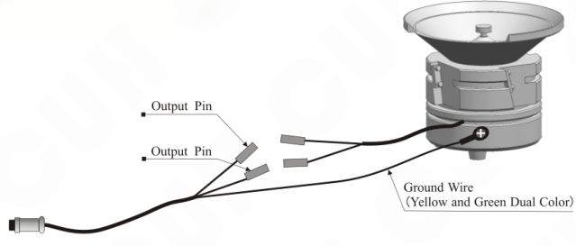

Abbildungsbeschriftungen:

- Ausgangskontakt
- Ausgangskontakt
- Erdungsdraht (gelb-grüne Doppelfarbe)

## ⚠ Hinweis

Stellen Sie sicher, dass die Elektromagnetspulen des Vibrators an die beiden Ausgangskontakte des Ausgangskabels angeschlossen und die Elektromagnetspulen zuverlässig geerdet sind, da sonst Folgeschäden auftreten können.

---

---

## Schritt drei:

Verbinden Sie das Netzkabel mit dem Controller und verriegeln Sie die Kabelverschraubung.

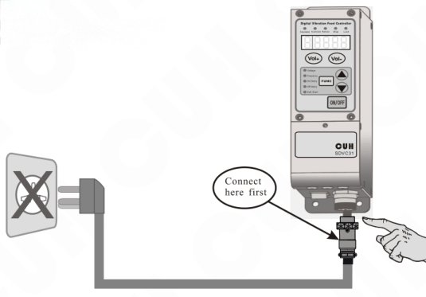

## Schritt vier:

Stecken Sie den Stecker des Netzkabels in die Netzsteckdose.

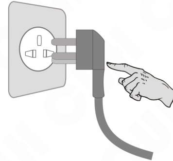

---

---

## Schritt fünf:

Stellen Sie die Ausgangsspannung des Controllers auf einen Wert zwischen 30 und 80 (dargestellt durch den Buchstaben U).

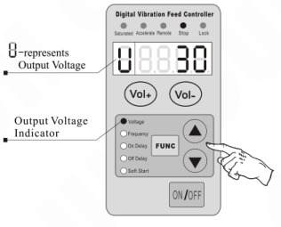

Diagrammbeschriftungen:

- U—repräsentiert die Ausgangsspannung
- Ausgangsspannungsindikator

## Schritt sechs:

Halten Sie die <kbd>FUNC</kbd>-Taste 2 Sekunden lang gedrückt, um in den Einstellstatus der Basisparameter zu gelangen.

Der Ausgangsfrequenzindikator auf der Bedienfeldbeleuchtung leuchtet auf und die LED-Anzeige zeigt den aktuellen Frequenzwert (E). Drücken Sie die ▲- oder ▼-Taste, um den Parameterwert von 400 Hz auf 40 Hz anzupassen, um die Resonanzfrequenz des Vibrators zu ermitteln, und halten Sie diesen Wert.

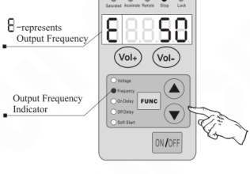

Diagrammbeschriftungen:

- E—repräsentiert die Ausgangsfrequenz
- Ausgangsfrequenzindikator

> ● Die Resonanzfrequenz des Vibrators bedeutet den Frequenzwert, der die maximale Amplitude erzeugt.
>
> ● Jeder Vibrator hat seine eigene mechanische Resonanzfrequenz; stellen Sie die Ausgangsfrequenz des Controllers auf diese Frequenz, um den besten Arbeitszustand zu gewährleisten.

---

---

## Schritt sieben:

Nachdem Sie die Ausgangsfrequenz des Controllers auf die mechanische Resonanzfrequenz des Vibrators eingestellt haben, passen Sie die Ausgangsspannung des Controllers durch Drücken der **Vol+**- oder **Vol-**-Taste an, um die Fördergeschwindigkeit zu ändern.

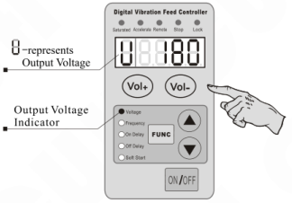

Nach den oben genannten sieben Schritten kann der Controller ordnungsgemäß arbeiten. Bitte beziehen Sie sich bei Bedarf an erweiterten Steuerfunktionen auf die anderen Kapitel.

---

# Kapitel III Beschreibung der Komponenten

## 3.1 Beschreibung des Bedienfelds

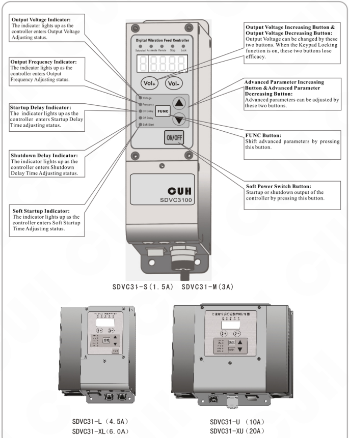

### Bedienfeldanzeigen und -tasten

| Position | Beschreibung |
|---|---|
| Ausgangsspannungsindikator | Die Anzeige leuchtet auf, wenn der Controller in den Ausgangsspannungseinstellstatus wechselt. |
| Ausgangsfrequenzindikator | Die Anzeige leuchtet auf, wenn der Controller in den Ausgangsfrequenzeinstellstatus wechselt. |
| Anlaufverzögerungsindikator | Die Anzeige leuchtet auf, wenn der Controller in den Einstellstatus der Anlaufverzögerungszeit wechselt. |
| Abschaltverzögerungsindikator | Die Anzeige leuchtet auf, wenn der Controller in den Einstellstatus der Abschaltverzögerungszeit wechselt. |
| Sanftanlauf-Indikator | Die Anzeige leuchtet auf, wenn der Controller in den Einstellstatus der Sanftanlaufzeit wechselt. |
| Taste Ausgangsspannung erhöhen & Taste Ausgangsspannung verringern | Die Ausgangsspannung kann mit diesen beiden Tasten geändert werden. Wenn die Tastatursperre aktiviert ist, sind diese beiden Tasten wirkungslos. |
| Taste Erweiterte Parameter erhöhen & Taste Erweiterte Parameter verringern | Erweiterte Parameter können mit diesen beiden Tasten angepasst werden. |
| FUNC-Taste | Wechseln Sie erweiterte Parameter durch Drücken dieser Taste. |
| Soft-Power-Schaltertaste | Starten oder stoppen Sie die Ausgabe des Controllers durch Drücken dieser Taste. |

### Gezeigte Modelle

| Modell | Strom |
|---|---:|
| SDVC31-S | 1,5 A |
| SDVC31-M | 3 A |
| SDVC31-L | 4,5 A |
| SDVC31-XL | 6,0 A |
| SDVC31-U | 10 A |
| SDVC31-XU | 20 A |

---

---

## 3.2 Beschreibung der Statusanzeigen

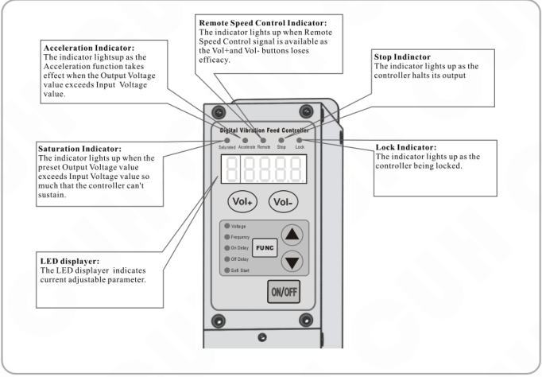

- **Beschleunigungsindikator:** Die Anzeige leuchtet auf, wenn die Beschleunigungsfunktion wirksam wird, sobald der Ausgangsspannungswert den Eingangsspannungswert übersteigt.
- **Indikator der Fern-Geschwindigkeitsregelung:** Die Anzeige leuchtet auf, wenn ein Signal der Fern-Geschwindigkeitsregelung verfügbar ist und die Vol+- und Vol--Tasten wirkungslos werden.
- **Stopp-Indikator:** Die Anzeige leuchtet auf, wenn der Controller seine Ausgabe stoppt.
- **Sättigungsindikator:** Die Anzeige leuchtet auf, wenn der voreingestellte Ausgangsspannungswert den Eingangsspannungswert so weit übersteigt, dass der Controller ihn nicht aufrechterhalten kann.
- **Sperr-Indikator:** Die Anzeige leuchtet auf, wenn der Controller gesperrt ist.
- **LED-Anzeige:** Die LED-Anzeige zeigt den aktuell einstellbaren Parameter an.

## 3.3 Beschreibung der E/A-Schnittstellen

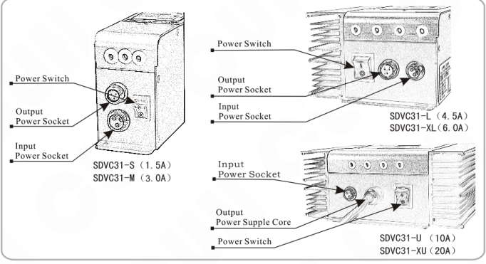

- **SDVC31-S（1,5A） / SDVC31-M（3,0A）**
  - Netzschalter
  - Ausgangsbuchse
  - Netzbuchse
- **SDVC31-L（4,5A） / SDVC31-XL（6,0A）**
  - Netzschalter
  - Ausgangsbuchse
  - Netzbuchse
- **SDVC31-U（10A） / SDVC31-XU（20A）**
  - Netzbuchse
  - Anschlussklemmen für den Ausgang
  - Netzschalter

---

# Kapitel IV Funktionsbeschreibungen

## 4.1 Einstellung der Ausgangsspannung

Die Ausgangsspannung kann direkt und digital über das Bedienfeld eingestellt werden. Dank der einzigartigen Spannungsstabilisierungsfunktion schwankt die Ausgangsspannung des Controllers nicht mit der Eingangsspannung, und ein Vibrator kann in einem instabilen Eingangsspannungsumfeld stabil arbeiten.

- Schalten Sie den Netzschalter ein.

- Der Ausgangsspannungsindikator leuchtet auf, wenn der Controller in den Ausgangsspannungseinstellstatus wechselt; die LED zeigt das Spannungssymbol U und den zuvor eingestellten Spannungswert an.

- Stellen Sie den Ausgangsspannungswert durch Drücken der <kbd>Vol+</kbd>- oder <kbd>Vol-</kbd>-Taste ein.

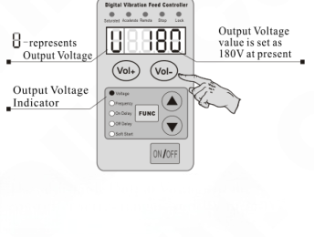

- U — repräsentiert die Ausgangsspannung
- Ausgangsspannungsindikator
- Der Ausgangsspannungswert ist derzeit auf 180 V eingestellt
- Die einstellbare Ausgangsspannung der Controller-Serie reicht von 0 V bis 250 V

> Die Ausgangsspannung kann in jedem Basis-Parameter-Einstellstatus oder erweiterten Parameter-Einstellstatus durch Drücken der <kbd>Vol+</kbd>- oder <kbd>Vol-</kbd>-Taste eingestellt werden. Der Controller kehrt nach dem Einstellen der Ausgangsspannung in den vorherigen Parametereinstellstatus zurück.

## ☺ Beschleunigung

Wenn der gewünschte Ausgangsspannungswert den Eingangsspannungswert übersteigt, arbeitet die Beschleunigungsfunktion des Controllers, und der Beschleunigungsindikator leuchtet auf.

Wenn der gewünschte Ausgangsspannungswert den Eingangsspannungswert zu weit übersteigt, kann der Controller diesen Spannungswert nicht ausgeben, und der Sättigungsindikator leuchtet auf.

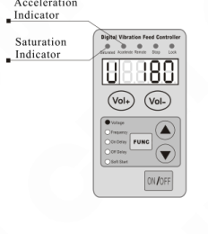

- Beschleunigungsindikator
- Sättigungsindikator

---

---

## 4.2 Einstellung der Ausgangsfrequenz

Der Controller wird mit DDS-Technologie hergestellt; seine Ausgabe weist eine hohe Frequenzgenauigkeit und -stabilität auf, die sich nicht mit der Zeit oder der Temperatur ändert.

- Halten Sie die <kbd>FUNC</kbd>-Taste 2 Sekunden lang gedrückt, um in den Einstellstatus der Basisparameter zu gelangen.

- Der Frequenzindikator auf der Bedienfeldbeleuchtung leuchtet auf und die LED zeigt das Ausgangsfrequenzsymbol **E** und den aktuellen Ausgangsfrequenzwert an.

- Drücken Sie die ▲- oder ▼-Taste, um den Parameterwert anzupassen.

Die Ausgangsfrequenz des Controllers reicht von 40 Hz bis 400 Hz.

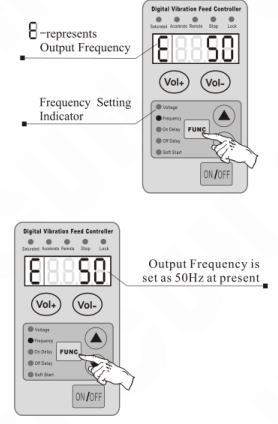

**Abbildungsbeschriftungen:**

- **E** — repräsentiert die Ausgangsfrequenz
- Frequenzeinstellungsindikator
- Die Ausgangsfrequenz ist derzeit auf 50 Hz eingestellt

> ☺
>
> ● Ausgangsfrequenz (E), Anlaufverzögerungszeit, Abschaltverzögerungszeit und Sanftanlaufzeit können eingestellt werden, nachdem Sie durch 2 Sekunden langes Halten der <kbd>FUNC</kbd>-Taste in den Einstellstatus der Basisparameter gelangt sind.
>
> ● Der Controller kehrt 1 Minute nach der Einstellung automatisch in den Ausgangsspannungseinstellstatus zurück.
>
> ● Halten Sie die <kbd>FUNC</kbd>-Taste erneut 2 Sekunden lang gedrückt, um den Einstellstatus der Basisparameter zu verlassen.

---

## 4.3 Sanftanlauf

Um plötzliche Stöße auf die Werkstücke zu vermeiden, kann der Controller beim Anlauf die Ausgangsspannung sanft von 0 auf den voreingestellten Wert erhöhen.

Sanftanlaufzeit (t): Die Zeitspanne, die der Controller benötigt, um die Ausgangsspannung beim Anlauf sanft von 0 auf den voreingestellten Wert zu erhöhen.

» Halten Sie die **FUNC**-Taste 2 Sekunden lang gedrückt, um in den Einstellstatus der Basisparameter zu gelangen.

» Drücken Sie die **FUNC**-Taste wiederholt, bis der Einstellstatus der Sanftanlaufzeit (t) erreicht ist und der Sanftanlauf-Indikator aufleuchtet.

» Drücken Sie die ▲- oder ▼-Taste, um den Parameterwert anzupassen. Die Parametereinheit ist Sekunde und die numerische Genauigkeit beträgt 0,1.

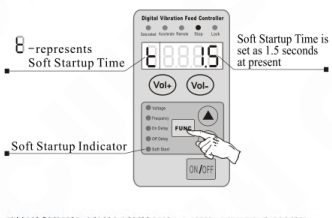

- **t** - repräsentiert die Sanftanlaufzeit
- Sanftanlauf-Indikator
- Die Sanftanlaufzeit ist derzeit auf 1,5 Sekunden eingestellt

Die einstellbare Sanftanlaufzeit reicht von 0,1 Sekunden bis 9,9 Sekunden.

## 4.4 Ausgangsschalttaste

Die Soft-Touch-Schalttaste auf dem Bedienfeld kann die Ausgabe des Controllers schnell und einfach ein- und ausschalten.

» Drücken Sie die **ON/OFF**-Taste, um die Ausgabe des Controllers ein- bzw. auszuschalten. Der Stopp-Indikator leuchtet auf, wenn die Ausgabe des Controllers ausgeschaltet wird.

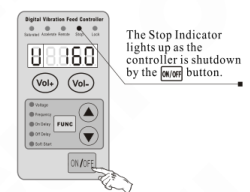

Der Stopp-Indikator leuchtet auf, wenn der Controller über die **ON/OFF**-Taste abgeschaltet wird.

😊

Dank der Soft-Touch-Schalter- und Digitalsignalsteuerungstechnologie entsteht kein Funke, der die Kontakte beschädigen könnte. Dadurch wird die Lebensdauer des Controllers und des Vibrators erheblich verlängert.

---

## 4.5 Begrenzung der maximalen Ausgangsspannung

Die maximale Ausgangsspannung des Controllers kann eingestellt werden, um Schäden am Vibrator zu vermeiden. Die Funktion der Fern-Geschwindigkeitsregelung wird von diesem Parameter beeinflusst.

- Halten Sie die <kbd>FUNC</kbd>- und ▲-Taste gleichzeitig 2 Sekunden lang gedrückt, um in den Einstellstatus der erweiterten Parameter zu gelangen.
- Drücken Sie die <kbd>FUNC</kbd>-Taste wiederholt, bis der Einstellstatus der maximalen Ausgangsspannungsbegrenzung (h) erreicht ist.
- Drücken Sie die ▲- oder ▼-Taste, um den Parameterwert anzupassen.

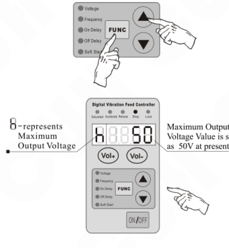

> ● Der Ausgangsspannungswert darf diesen Parameterwert unter keinen Umständen überschreiten.  
> ● Der Standardwert dieses Parameters ist auf den maximal einstellbaren Ausgangsspannungswert eingestellt.

## Verlassen des Einstellstatus der erweiterten Parameter

● Der Controller kehrt 1 Minute nach der Einstellung der erweiterten Parameter automatisch in den Ausgangsspannungseinstellstatus zurück.  
● Halten Sie die <kbd>FUNC</kbd>- und ▲-Taste 2 Sekunden lang gedrückt, um in den Ausgangsspannungseinstellstatus zurückzukehren.  
● Halten Sie die <kbd>FUNC</kbd>-Taste 2 Sekunden lang gedrückt, um in den Einstellstatus der Basisparameter zurückzukehren.

---

## 4.6 Einstellung des Beschleunigungsparameters

Beschleunigungsparameter (y): Dieser Parameter bedeutet die maximale Ausgangsspannung als Prozentsatz der Eingangsspannung. Die Beschleunigungsfunktion wird von diesem Parameter beeinflusst.

- Halten Sie die `FUNC`- und ▲-Taste gleichzeitig 2 Sekunden lang gedrückt, um in den Einstellstatus der erweiterten Parameter zu gelangen.
- Drücken Sie die `FUNC`-Taste wiederholt, bis der Einstellstatus des Beschleunigungsparameters (y) erreicht ist.
- Drücken Sie die ▲- oder ▼-Taste, um den Parameterwert anzupassen.

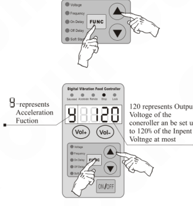

> ● Der einstellbare Beschleunigungswert (y) reicht von 100 bis 150, der Standardwert ist 120.  
> ● Der Sättigungsindikator leuchtet auf, wenn die Ausgangsspannung des Controllers die Grenze überschreitet.

---

---

## 4.7 Einstellung des Wellenformindex

Bediener können Spitzeneffizienz und maximale Leistung (minimales Rauschen) durch Anpassen dieses Parameters abwägen.

- Halten Sie die **FUNC**- und **▲**-Taste gleichzeitig 2 Sekunden lang gedrückt, um in den Einstellstatus der erweiterten Parameter zu gelangen.
- Drücken Sie die **FUNC**-Taste wiederholt, bis der Einstellstatus des Wellenformindex (**r**) erreicht ist.
- Drücken Sie die **▲**- oder **▼**-Taste, um den Parameterwert anzupassen.

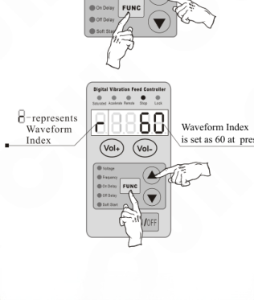

Diagrammbeschriftungen:

- **r** repräsentiert den Wellenformindex
- Der Wellenformindex ist derzeit auf **60** eingestellt

> ☺
>
> ●Der einstellbare Wellenformindex reicht von 0 bis 100.  
> ●Der Wert 0 repräsentiert die Spitzeneffizienz, wenn die Federplatten die minimale Belastung tragen.  
> ●Der Wert 100 repräsentiert die maximale Leistung (minimales Rauschen), wenn die Federplatten die maximale Belastung tragen.

---

## 4.8 Tastatursperre

Die Tastatursperrfunktion kann alle Tasten auf dem Bedienfeld sperren, um Fehlbedienung zu vermeiden.

- Halten Sie die <kbd>ON/OFF</kbd>-Taste 2 Sekunden lang gedrückt, um alle Tasten auf dem Bedienfeld zu sperren; der Tastatursperr-Indikator leuchtet auf.
- Halten Sie im Sperrmodus die <kbd>ON/OFF</kbd>-Taste 2 Sekunden lang gedrückt, um die Tastatur zu entsperren.

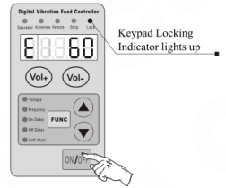

---

## 4.9 Wiederherstellung der Werkseinstellungen

Diese Funktion ermöglicht es dem Bediener, alle Standard-Parametereinstellungen wiederherzustellen.

Aufgrund der zahlreichen Funktionen des Controllers können viele Parameter eingestellt werden. Um zu vermeiden, dass der Controller nach zu vielen Änderungen durch einen Anfänger nicht mehr ordnungsgemäß arbeiten kann, ermöglicht diese Funktion dem Bediener, die Werkseinstellungen auf einfache Weise wiederherzustellen.

- Halten Sie die **FUNC**- und **▲**-Taste gleichzeitig 2 Sekunden lang gedrückt, um in den Einstellstatus der erweiterten Parameter zu gelangen.

  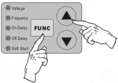

- Drücken Sie die **FUNC**-Taste wiederholt, bis `8888` auf der LED-Anzeige blinkt, und halten Sie dann die **▲**-Taste gedrückt, bis `-----` angezeigt wird, was bedeutet, dass die Werkseinstellungen erfolgreich wiederhergestellt wurden.

  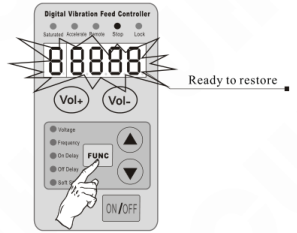

- Nach dem Loslassen der **▲**-Taste gelangt der Controller in den Ausgangsspannungseinstellstatus (U). Zu diesem Zeitpunkt wurden alle Parameter auf die Standardwerte zurückgesetzt.

  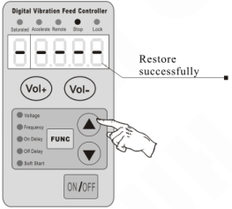

# Kapitel V Sensoren und Signalsteuerung

Der Controller kann durch viele Arten externer Signale und Sensoren gesteuert werden. Dieses Kapitel erläutert hauptsächlich die Verwendungsmethode des intelligenten photoelektrischen Sensors, der Proximity-Schaltsensoren und der SPS.

## 5.1 Intelligente photoelektrische Sensorik

Kombiniert mit dem photoelektrischen Sensor SDVC-S1 kann die Funktion der intelligenten photoelektrischen Sensorik erreicht werden. Der Sensor SDVC-S1 kann Störungen durch Hintergrundlicht herausfiltern, die die Empfindlichkeit des Controllers beeinträchtigen. Dadurch kann der Controller zuverlässig arbeiten, ohne die Empfindlichkeit manuell einzustellen.

### 5.1.1 Anschlussmethode des intelligenten photoelektrischen Sensors SDVC-S1

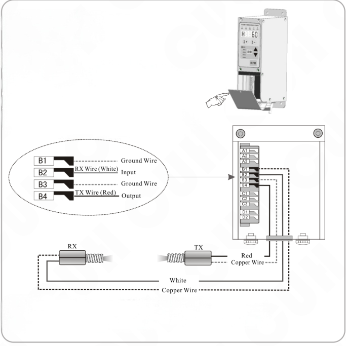

**Schritt 1:**  
Öffnen Sie die obere Abdeckplatte des Controllers.

**Schritt 2:**  
Schließen Sie den Sensor SDVC-S1 gemäß dem Diagramm an die Klemmen des Controllers an.

**Schritt 3:**  
Schließen Sie nach dem Anschluss des Sensors die Abdeckplatte.

**Hinweis:**  
Die voreingestellte logische Beziehung des Sensors ist „Werkstücke sind leer".

---

## 5.1.2 Einstellung der Anlaufverzögerungszeit und Abschaltverzögerungszeit des intelligenten photoelektrischen Sensors

In den meisten praktischen Anwendungen sollte die Ausgabe des Controllers beim Starten oder Stoppen des Controllers durch externe Signale für einen Zeitraum verzögert werden. Die Funktionen zur Einstellung der Anlaufverzögerungszeit und der Abschaltverzögerungszeit machen diese Art von Anwendung möglich. Darüber hinaus können Stöße auf die Werkstücke beim Anlauf des Controllers durch Einstellen der Sanftanlaufzeit beseitigt werden.

### Anlaufverzögerung( J )

Die Zeitspanne, die der Controller vom Empfang eines Startsteuersignals bis zur Ausgabe durchläuft.

- Halten Sie die **FUNC**-Taste 2 Sekunden lang gedrückt, um in den Einstellstatus der Basisparameter zu gelangen.
- Drücken Sie die **FUNC**-Taste wiederholt, bis der Einstellstatus der Anlaufverzögerungszeit ( J ) erreicht ist und der Anlaufverzögerungsindikator auf der Bedienfeldbeleuchtung aufleuchtet.
- Stellen Sie den Parameter durch Drücken der ▲- oder ▼-Taste ein. Die Parametereinheit ist Sekunde und die numerische Genauigkeit beträgt 0,1.

*Der einstellbare Bereich des Parameters reicht von 0,0 bis 9,9 Sekunden*  
*Der Standardwert des Parameters ist 0,2 Sekunden*

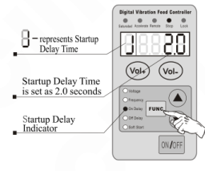

### Abschaltverzögerung (L)

Die Zeitspanne, die der Controller vom Empfang eines Abschaltsteuersignals bis zum Trennen der Ausgabe durchläuft.

- Halten Sie die **FUNC**-Taste 2 Sekunden lang gedrückt, um in den Einstellstatus der Basisparameter zu gelangen.
- Drücken Sie die **FUNC**-Taste wiederholt, bis der Einstellstatus der Abschaltverzögerungszeit (L) erreicht ist und der Abschaltverzögerungsindikator auf der Bedienfeldbeleuchtung aufleuchtet.
- Stellen Sie den Parameter durch Drücken der ▲- oder ▼-Taste ein. Die Parametereinheit ist Sekunde und die numerische Genauigkeit beträgt 0,1.

*Der einstellbare Bereich des Parameters reicht von 0,0 bis 9,9 Sekunden*  
*Der Standardwert des Parameters ist 0,2 Sekunden*

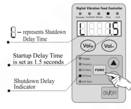

---

## 5.1.3 Einstellung der logischen Beziehung des intelligenten photoelektrischen Sensors

Unter normalen Umständen empfängt der Empfänger kein optisches Signal, und der Controller läuft standardmäßig. In einigen speziellen Anwendungen muss der Controller jedoch gestoppt werden, wenn der Empfänger kein optisches Signal empfängt. Durch die Anpassung dieses Parameters kann diese Art von Anwendung realisiert werden.

- Halten Sie die **FUNC**- und ▲-Taste gleichzeitig 2 Sekunden lang gedrückt, um in den Einstellstatus der erweiterten Parameter zu gelangen.

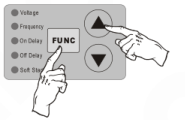

- Drücken Sie die **FUNC**-Taste wiederholt, bis der Einstellstatus der logischen Beziehung des intelligenten photoelektrischen Sensors erreicht ist.

  **08** — repräsentiert die logische Beziehung des intelligenten photoelektrischen Sensors  
  **Normal offen**

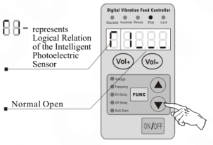

- Stellen Sie den Parameter durch Drücken der ▲- oder ▼-Taste ein.

  **08** — repräsentiert die logische Beziehung des intelligenten photoelektrischen Sensors  
  **Normal geschlossen**

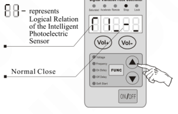

- Wenn die logische Beziehung auf „Normal offen" eingestellt ist, läuft der Controller, d. h. kein optisches Signal empfangen.
- Wenn die logische Beziehung auf „Normal geschlossen" eingestellt ist, stoppt der Controller, d. h. kein optisches Signal empfangen.

---

## 5.2 Verwendungsmethode des NPN-Schaltsensors

Der Controller kann mit allen Arten von Sensoren betrieben werden, wie Schaltsensoren, optischen Schaltsensoren und Lichtwellenleiter-Sensoren.

### 5.2.1 Anschlussmethode des NPN-Proximity-Schaltsensors

**Schritt 1:**  
Öffnen Sie die obere Abdeckplatte des Controllers.

**Schritt 2:**  
Schließen Sie den NPN-Proximity-Schaltsensor gemäß dem Diagramm an die Klemmen des Controllers an.

**Schritt 3:**  
Schließen Sie nach dem Anschluss des Sensors die Abdeckplatte.

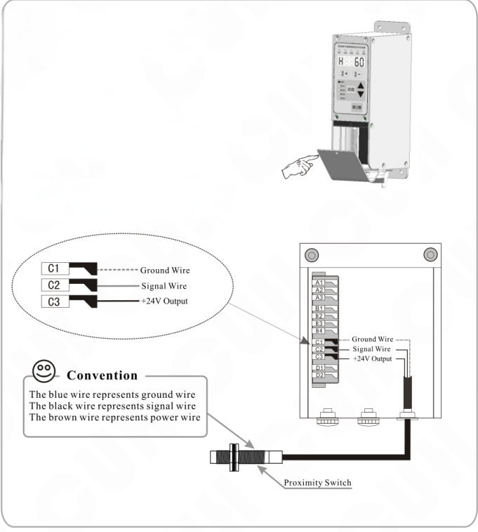

| Klemme | Draht |
|---|---|
| C1 | Erdungsdraht |
| C2 | Signaldraht |
| C3 | +24 V-Ausgang |

**Farbkonvention**

Der blaue Draht repräsentiert den Erdungsdraht  
Der schwarze Draht repräsentiert den Signaldraht  
Der braune Draht repräsentiert den Stromversorgungsdraht

Proximity-Schalter

---

---

### 5.2.2 Anschlussmethode des NPN-Gegenspannungs-Schaltsensors

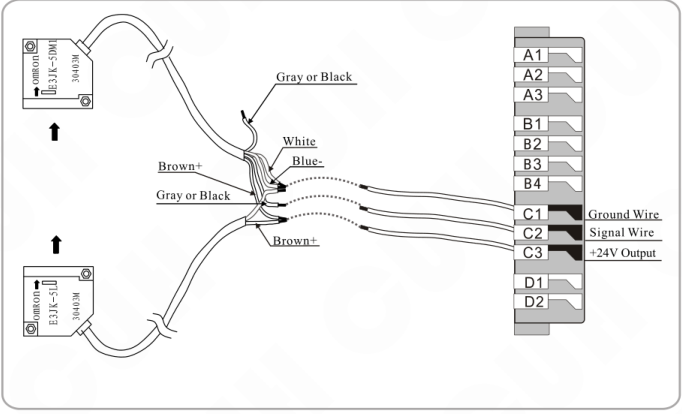

### 5.2.3 Anschlussmethode des photoelektrischen Gegenspannungssensors

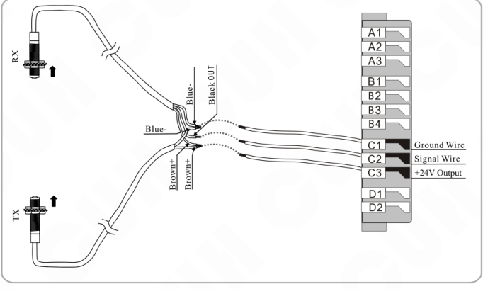

---

## 5.2.4 Anschlussmethode des optischen Lichtwellenleiter-Gegenspannungssensors

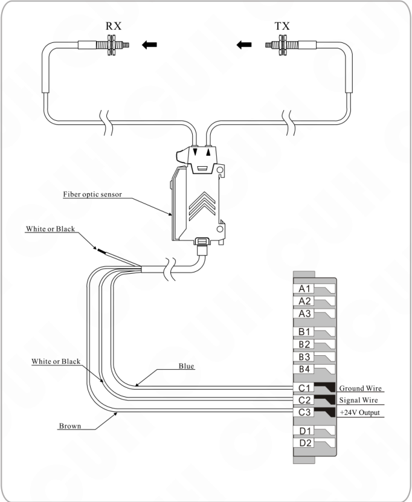

Gezeigte Diagrammbeschriftungen: **RX**, **TX**, **Lichtwellenleiter-Sensor**, **Weiß oder Schwarz**, **Blau**, **Braun**.

Gezeigte Klemmenbeschriftungen:

| Klemme | Beschriftung |
|---|---|
| C1 | Erdungsdraht |
| C2 | Signaldraht |
| C3 | +24 V-Ausgang |

---

## 5.2.5 Anschlussmethode des photoelektrischen Reflexionssensors

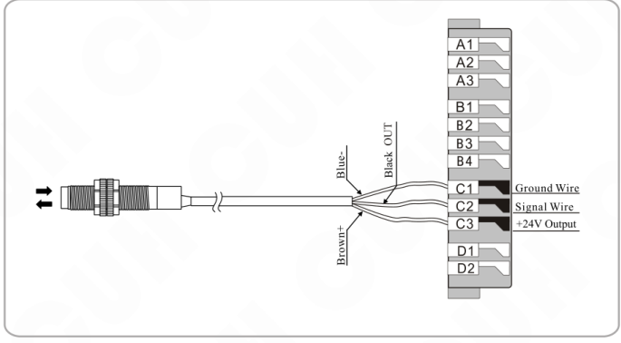

---

---

## 5.3 Einstellung der Anlaufverzögerungszeit und Abschaltverzögerungszeit des NPN-Schaltsensors

Standardmäßig teilen sich der intelligente photoelektrische Sensor und der Schaltsensor dieselbe Anlaufverzögerungszeit und Abschaltverzögerungszeit. Bediener können auch die Anlaufverzögerungszeit und die Abschaltverzögerungszeit unabhängig für den Schaltsensor einstellen.

### Anlaufverzögerung (J-)

Die Zeitspanne, die der Controller vom Empfang eines Startsteuersignals bis zur Ausgabe durchläuft.

- Halten Sie die **FUNC**- und ▲-Taste gleichzeitig 2 Sekunden lang gedrückt, um in den Einstellstatus der erweiterten Parameter zu gelangen.
- Drücken Sie die **FUNC**-Taste wiederholt, bis der Einstellstatus der Anlaufverzögerungszeit (`J---`) erreicht ist und der Anlaufverzögerungsindikator auf der Bedienfeldbeleuchtung aufleuchtet.
- Stellen Sie den Parameter durch Drücken der ▲- oder ▼-Taste ein. Die Parametereinheit ist Sekunde und die numerische Genauigkeit beträgt 0,1.

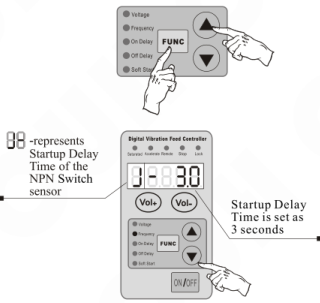

Die Anlaufverzögerung ist standardmäßig auf `J---` eingestellt

### Abschaltverzögerung (L-)

Die Zeitspanne, die der Controller vom Empfang eines Abschaltsteuersignals bis zum Trennen der Ausgabe durchläuft.

- Halten Sie die **FUNC**- und ▲-Taste gleichzeitig 2 Sekunden lang gedrückt, um in den Einstellstatus der erweiterten Parameter zu gelangen.
- Drücken Sie die **FUNC**-Taste wiederholt, bis der Einstellstatus der Abschaltverzögerungszeit (`L-`) erreicht ist und der Abschaltverzögerungsindikator auf der Bedienfeldbeleuchtung aufleuchtet.
- Stellen Sie den Parameter durch Drücken der ▲- oder ▼-Taste ein. Die Parametereinheit ist Sekunde und die numerische Genauigkeit beträgt 0,1.

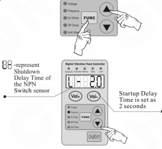

Die Abschaltverzögerung ist standardmäßig auf `L----` eingestellt

> ➜ Wenn die Werte `J-` und `L-` auf 0 eingestellt werden, sind die Anlaufverzögerungszeit und die Abschaltverzögerungszeit des Schaltsensors identisch mit der Anlaufverzögerungszeit und der Abschaltverzögerungszeit des intelligenten photoelektrischen Sensors.  
> ➜ Die Anlaufverzögerungszeit und die Abschaltverzögerungszeit des intelligenten photoelektrischen Sensors werden vom Parameter `J-` oder `L-` nicht beeinflusst.

---

---

## 5.4 Einstellung der logischen Beziehung des NPN-Schaltsensors (Stopp bei vollen Werkstücken)

Unter normalen Umständen empfängt der Controller kein Signal vom NPN-Schaltsensor und läuft standardmäßig. In einigen speziellen Anwendungen muss der Controller jedoch gestoppt werden, wenn er kein Signal vom NPN-Schaltsensor empfängt. Durch die Anpassung dieses Parameters kann diese Art von Anwendung realisiert werden.

▶▶ Halten Sie die <kbd>FUNC</kbd>- und ▲-Taste gleichzeitig 2 Sekunden lang gedrückt, um in den Einstellstatus der erweiterten Parameter zu gelangen.

▶▶ Drücken Sie die <kbd>FUNC</kbd>-Taste wiederholt, bis der Einstellstatus der logischen Beziehung des NPN-Schaltsensors (`F2`) erreicht ist.

▶▶ Stellen Sie den Parameter durch Drücken der ▲- oder ▼-Taste ein.

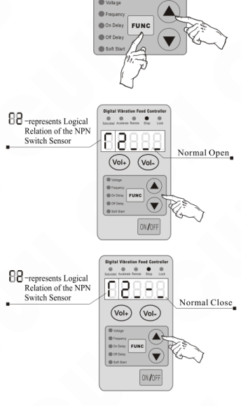

`F2`—repräsentiert die logische Beziehung des NPN-Schaltsensors.

- Normal offen
- Normal geschlossen

> ●Wenn die logische Beziehung auf „Normal offen" eingestellt ist, läuft der Controller, d. h. kein Signal empfangen.  
> ●Wenn die logische Beziehung auf „Normal geschlossen" eingestellt ist, stoppt der Controller, d. h. kein Signal empfangen.

---

## 5.5 Einstellung der logischen Beziehung des Steuersignals

Der Controller kann die logische Beziehung des intelligenten photoelektrischen Sensors und des Schaltsensors einstellen, wenn sie gleichzeitig arbeiten.

▶ Halten Sie die **FUNC**- und ▲-Taste gleichzeitig 2 Sekunden lang gedrückt, um in den Einstellstatus der erweiterten Parameter zu gelangen.

▶ Drücken Sie die **FUNC**-Taste wiederholt, bis der Einstellstatus der logischen Beziehung des Steuersignals erreicht ist.

▶ Stellen Sie den Parameter durch Drücken der ▲- oder ▼-Taste ein.

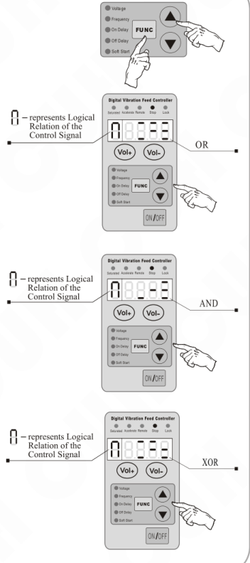

Ⅰ

●Logische Beziehung AND: Der Controller läuft nur, wenn sowohl der intelligente photoelektrische Sensor als auch der NPN-Schaltsensor es anfordern.

●Logische Beziehung OR: Der Controller läuft, wenn der intelligente photoelektrische Sensor oder der NPN-Schaltsensor es anfordert.

●Logische Beziehung NOR: Der Controller läuft nur, wenn der intelligente photoelektrische Sensor und der NPN-Schaltsensor das entgegengesetzte Steuersignal ausgeben.

---

## 5.6 Anschlussmethode der übergeordneten SPS, die den Vibrationsfördereinrichtungs-Controller steuert

### 5.6.1 Anschlussmethode der steuernden SPS

**Schritt eins:**  
Öffnen Sie die obere Abdeckplatte des Controllers.

**Schritt zwei:**  
Schließen Sie die SPS gemäß dem Diagramm an die Klemmen des Controllers an.

**Schritt drei:**  
Schließen Sie nach dem Anschluss des Sensors die Abdeckplatte.

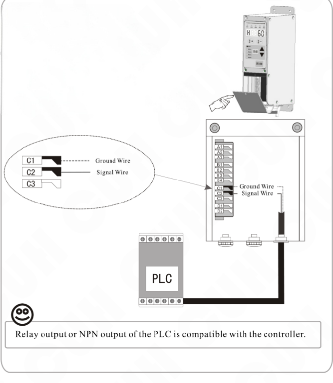

Relaisausgang oder NPN-Ausgang der SPS ist mit dem Controller kompatibel.

---

---

## 5.7 Steuerausgang

Der Controller kann ein Niederspannungs-Steuersignal ausgeben, um mit anderen Geräten wie einem Magnetventil, einer SPS oder einem elektromagnetischen Relais zusammenzuarbeiten.

### 5.7.1 Anschlussmethode des Steuerausgangs

**Anschlussmethode des Magnetventils**

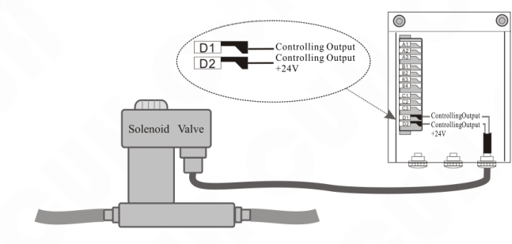

●Der Controller kann ein Magnetventil mit einer Nennspannung von 24 V und einer Nennleistung unter 4 W direkt ansteuern.  
●Verwenden Sie für Magnetventile mit hoher Leistung eine externe Stromversorgung.

**Anschlussmethode des elektromagnetischen Relais**

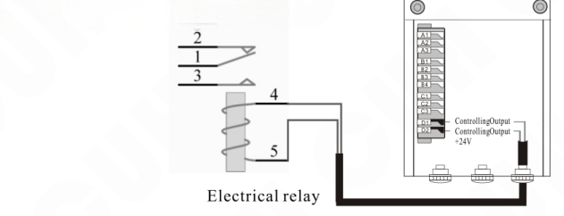

●Der Controller kann ein elektromagnetisches Relais mit einer Nennspannung von 24 V und einer Nennleistung unter 4 W direkt ansteuern.

---

## 5.7.2 Einstellung der logischen Beziehung des Steuerausgangs

- Halten Sie die **FUNC**- und **▲**-Taste gleichzeitig 2 Sekunden lang gedrückt, um in den Einstellstatus der erweiterten Parameter zu gelangen.

- Drücken Sie die **FUNC**-Taste wiederholt, bis der Einstellstatus der logischen Beziehung des Steuerausgangs (F3) erreicht ist.

- Stellen Sie den Parameter durch Drücken der **▲**- oder **▼**-Taste ein.

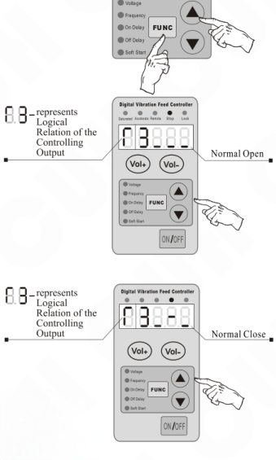

> ● Wenn die logische Beziehung auf „Normal offen" eingestellt ist, arbeitet der Steuerausgang, während der Controller läuft.  
> ● Wenn die logische Beziehung auf „Normal geschlossen" eingestellt ist, arbeitet der Steuerausgang nicht, während der Controller läuft.

---

---

## 5.8 Fern-Geschwindigkeitsregelung

Die Funktion der Fern-Geschwindigkeitsregelung ermöglicht es dem Bediener, die Ausgangsspannung durch ein externes Potentiometer oder ein Steuersignal im Bereich von 1 V bis 5 V zu steuern. So kann eine externe Fern-Geschwindigkeitsregelung einfach durch eine SPS, ein DCS oder andere Mittel erreicht werden.

Die Funktion der Fern-Geschwindigkeitsregelung wird für den Controller wirksam, wenn das Steuersignal 0,5 V überschreitet. Gleichzeitig leuchtet der Indikator der Fern-Geschwindigkeitsregelung auf dem Bedienfeld auf und die `Vol+`- und `Vol-`-Tasten werden wirkungslos. Die LED-Anzeige zeigt die aktuelle Ausgangsspannung an, wenn der Controller im Ausgangsspannungseinstellstatus läuft.

### Anschlussmethode des externen Potentiometers

- A1: Erdungsdraht der Fern-Geschwindigkeitsregelung
- A2: Eingang der Fern-Geschwindigkeitsregelung
- A3: Stromversorgung der Fern-Geschwindigkeitsregelung

**Hinweis:** Bitte wählen Sie ein lineares Potentiometer mit einem Widerstand von 1 kΩ.

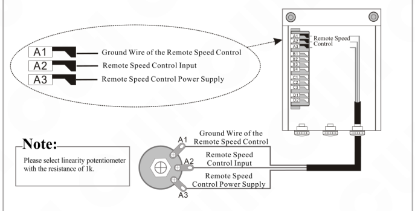

### Anschlussmethode der SPS

- A1: Erdungsdraht der Fern-Geschwindigkeitsregelung
- A2: Eingang der Fern-Geschwindigkeitsregelung
- A3

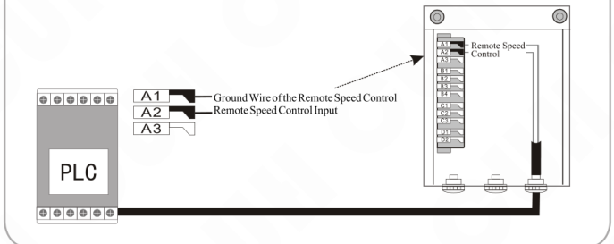

---

---

# Kapitel VI Schutzfunktionen

## 6.1 Automatische Spannungsstabilisierung

Die eingebaute digitale Spannungsstabilisierungsfunktion kann Fördergeschwindigkeitsschwankungen durch Netzspannungsschwankungen ausgleichen.

## 6.2 Kurzschlussschutz

Wenn der Ausgang des Controllers kurzgeschlossen wird, stoppt der Controller seine Ausgabe, bis er neu gestartet wird.

## 6.3 Überlastschutz (Strom)

Der Controller stoppt seine Ausgabe, um den sicheren Betrieb der Geräte zu gewährleisten, wenn der Betriebsstrom seinen Nennwert überschreitet.

## 6.4 Überhitzungsschutz

Der Controller stoppt seine Ausgabe, um sich selbst zu schützen, wenn die Betriebstemperatur zu hoch ist.

---

---

# Anhang

## Anhang A: Abmessungen

Außenabmessungen der Controllermodelle: SDVC31-S und SDVC31-M (Einheit: mm)

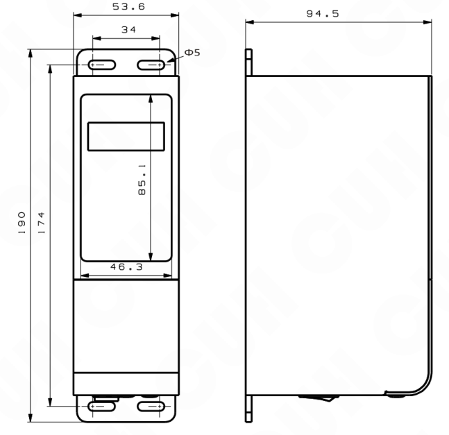

---

Außenabmessungen der Controllermodelle: SDVC31-L und SDVC31-XL (Einheit: mm)

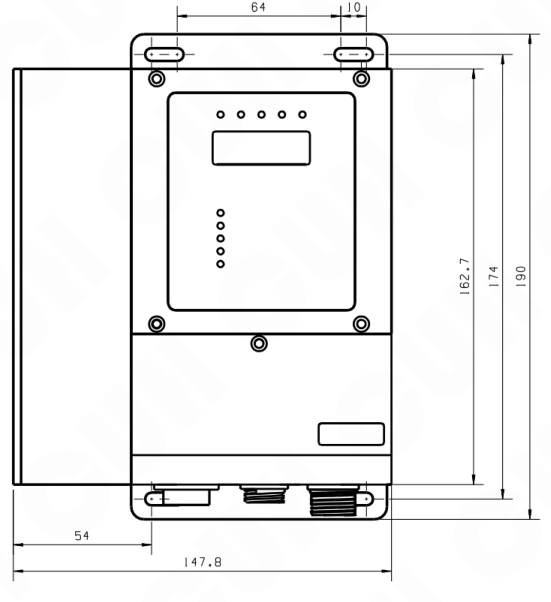

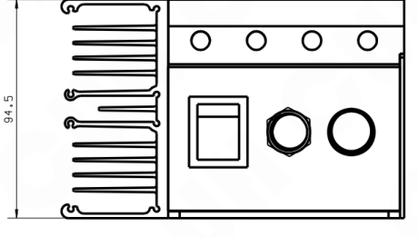

---

Außenabmessungen der Controllermodelle: SDVC31-U und SDVC31-XU (Einheit: mm)

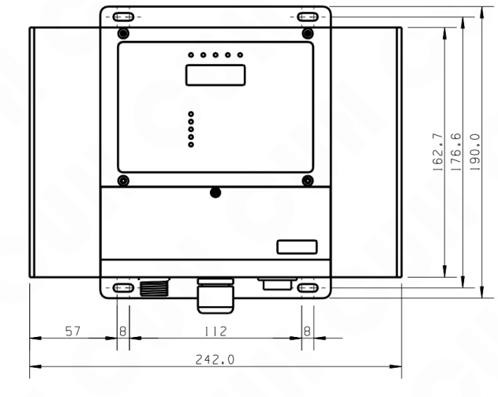

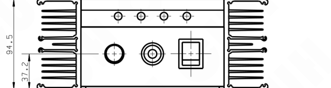

---

---

## Anhang B: Definition der Ausgangsschnittstelle

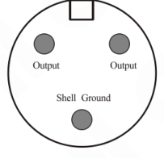

### ☺ Hinweis:

**A:** Stellen Sie sicher, dass die Elektromagnetspulen des Vibrators an die beiden Ausgangskontakte der Ausgangskabelbuchse angeschlossen und das Gehäuse des Vibrators zuverlässig geerdet sind, da sonst Folgeschäden auftreten können.

**B:** Stellen Sie nach dem Schweißen sicher, dass der freie Bereich mit Isolierband oder Schrumpfschlauch umschlossen ist, bevor Sie ihn in die Ausgangskabelbuchse einführen, um Stromleckagen oder Kurzschlüsse zu vermeiden.

## Anhang C: Definition der Signalschnittstelle

| Klemme | Definition |
|---|---|
| A1 | Erdungsdraht der Fern-Geschwindigkeitsregelung |
| A2 | Eingang der Fern-Geschwindigkeitsregelung |
| A3 | Stromversorgung der Fern-Geschwindigkeitsregelung |
| B1 | Masse |
| B2 | Signaleingang des intelligenten photoelektrischen Sensors |
| B3 | Masse |
| B4 | Signalausgang des intelligenten photoelektrischen Sensors |
| C1 | +24 V GND |
| C2 | Signaleingang des NPN-Schaltsensors |
| C3 | +24 V |
| D1 | Steuerausgang |
| D2 | +24 V |

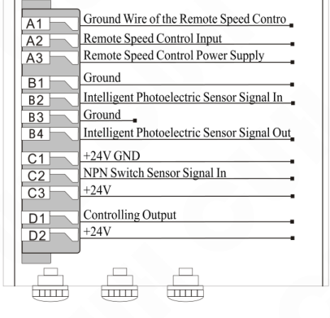

---

## **Anhang D:** Definition der LED-Anzeigeelemente

| Controller | Angezeigtes Zeichen | Symbolbild |
|---|---|---|
| `U` | Ausgangsspannung |  |
| `F` | Ausgangsfrequenz |  |
| `d` | Anlaufverzögerungszeit des intelligenten photoelektrischen Sensors |  |
| `C` | Abschaltverzögerungszeit des intelligenten photoelektrischen Sensors |  |
| `E` | Sanftanlauf |  |
| `U-` | Abschaltverzögerung |  |
| `d-` | Anlaufverzögerungszeit des NPN-Schaltsensors |  |
| `r1` | Logische Beziehung des intelligenten photoelektrischen Sensors | 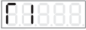 |
| `r2` | Logische Beziehung des NPN-Schaltsensors |  |
| `r3` | Logische Beziehung des Steuerausgangs |  |
| `n` | Logische Beziehung des Steuersignals |  |
| `H` | Maximale Ausgangsspannung |  |
| `A` | Beschleunigungsindex |  |
| `P` | Wellenformindex |  |
| `88888` | Wiederherstellung der Werkseinstellungen |  |

---

## Anhang E: Elektrische Spezifikation

| Position | Minimum | Typisch | Maximum | Einheit | Beschreibung |
|---|---:|---:|---:|:---:|---|
| Eingangsspannung | 85 | 220 | 250 | V | AC RMS |
| Einstellbarer Ausgangs- spannungsbereich | 0 | —— | 250 | V | Unter 150 % der Eingangsspannung |
| Genauigkeit der Spannungs- einstellung |  | 1 |  | V |  |
| Genauigkeit der Spannungs- regelung | 0 | —— | 10 | % | ΔVout/ΔVin |
| Ansprechzeit der Spannungs- regelung | 0.0025 | —— | 0.025 | s | 1/10 der Periode der Ausgangsspannung |
| Einstellbarer Ausgangs- strombereich | 0 | —— | 1.5 | A | SDVC31-S |
|  | 0 | —— | 3 | A | SDVC31-M |
|  | 0 | —— | 4.5 | A | SDVC31-L |
|  | 0 | —— | 6 | A | SDVC31-XL |
|  | 0 | —— | 10 | A | SDVC31-U |
|  | 0 | —— | 20 | A | SDVC31-XU |
| Ausgangsleistung | 0 | —— | 330 | VA | SDVC31-S |
|  | 0 | —— | 660 | VA | SDVC31-M |
|  | 0 | —— | 990 | VA | SDVC31-L |
|  | 0 | —— | 1320 | VA | SDVC31-XL |
|  | 0 | —— | 2200 | VA | SDVC31-U |
|  | 0 | —— | 4400 | VA | SDVC31-XU |
| Ausgangsfrequenz | 40 | —— | 400 | Hz |  |
| Genauigkeit der Frequenz- einstellung |  | 0.1 |  | Hz |  |
| Ausgangswellenform |  | Sinus |  |  |  |
| Sanftanlaufzeit | 0 | —— | 10 | s | Werkseitiger Standard- wert: 0,5 |
| Ein-/Ausschaltverzögerungs- zeitbereich | 0 | —— | 20 | s | Werkseitiger Standard- wert: 0,2 |
| Genauigkeit der Ein-/Aus- schaltverzögerungszeit |  | 0.1 |  | s |  |
| Auslösetemperatur des Über- hitzungsschutzes | 58 | 60 | 66 | ℃ | SDVC31-S\M |
|  | 60 | 65 | 65 | ℃ | SDVC31-L\XL\U\XU |
| DC-Steuerausgangs- spannung | 22 | 24 | 26 | V |  |
| DC-Steuerausgangs- strom | 0 | —— | 200 | mA |  |
| Analoges Steuersignal |  | 1-5 |  | V | Fern-Geschwindigkeits- regelspannung |
| Digitales Steuersignal |  | 24 |  | V | Schaltsignal |
| Einstellmethode |  | 6 |  | Taste |  |
| Standby-Leistungs- aufnahme | —— | 3 | —— | W |  |
| Anzeigemethode |  | 5 |  | Stelle | LED-Siebensegmentanzeigen |
| Umgebungstemperatur | 0 | 25 | 40 | ℃ | Keine Kondensation |
| Umgebungsfeuchtigkeit | 10 | 60 | 85 | % |  |

## Anhang F: Tipps zur Fehlerbehebung und Fehlererläuterungen

Die folgenden Tipps können helfen, Probleme zu lösen, auf die Sie stoßen können

| Nr. | Problem / Anzeige | Symbolbild | Tipps zur Fehlerbehebung und Fehlererläuterungen |
|---:|---|---|---|
| 1 | Keine Anzeige nach Einschalten |  | ◆ Stellen Sie sicher, dass die Steckdose stromführend ist ◆ Stellen Sie sicher, dass das Netzkabel zuverlässig mit der Steckdose verbunden ist |
| 2 | Zeigt normal an, aber keine Ausgabe |  | ◆ Stellen Sie sicher, dass Netzkabel und Ausgangskabel fest angeschlossen sind ◆ Stellen Sie sicher, dass der Ausgangsspannungsparameterwert nicht zu klein ist ◆ Stellen Sie sicher, dass der Controller nicht durch das Steuersignal gestoppt wurde ◆ Stellen Sie sicher, dass der Controller nicht durch Parameter gestoppt wurde, die als normal ausgeschaltet eingestellt sind |
| 3 | Steuersignal verliert seine Wirkung |  | ◆ Stellen Sie sicher, dass das Steuersignal korrekt eingegeben wird ◆ Stellen Sie sicher, dass der Erdungsdraht des Steuersignals korrekt mit dem Controller verbunden ist ◆ Stellen Sie sicher, dass die logische Beziehung des Steuersignals wie erwartet korrekt eingestellt ist |
| 4 | Schlagen (Beat-Phänomen) |  | ◆ Vermeiden Sie Schwingungskopplung zwischen den Vibratoren ◆ Erhöhen Sie die Resonanzfrequenz der Vibratoren |
| 5 | Zeigt normal an, keine Ausgabe, aber Geräusch ist hörbar |  | ◆ Stellen Sie alle Parameter wie in diesem Buch beschrieben ein |
| 6 | Err01 |  | ◆ Ausgang kurzgeschlossen, stellen Sie sicher, dass das Ausgangskabel und die Spule nicht kurzgeschlossen sind |
| 7 | Err02 |  | ◆ Ausgangsstrom zu hoch, verringern Sie den Ausgangsspannungswert und stellen Sie sicher, dass der Ankerluftspalt nicht zu groß ist |
| 8 | Err03 |  | ◆ Überhitzung, platzieren Sie den Controller in einer gut belüfteten Umgebung |
| 9 | Err04 |  | ◆ Reserviert, bitte kontaktieren Sie uns |
| 10 | Err05 |  | ◆ Reserviert, bitte kontaktieren Sie uns |

**Nanjing CUH Science & Technology Co., Ltd**

No. 1 Xiaodong Road, Chenguang Village, Qilin, Nanjing, Jiangsu, China  
Tel: +86-25-84730415  
Fax: +86-25-84730426  
Email: sales@cuhnj.com  
Website: en.cuhnj.com

