## Digitaler Zweikanal-Frequenzregler für Vibrationsfördereinrichtungen

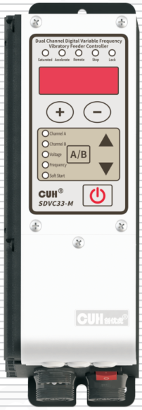

## SDVC33-Serie
Digitaler Zweikanal-Frequenzregler für Vibrationsfördereinrichtungen　SDVC33-Serie
## Benutzerhandbuch

---

## Urheberrechtshinweis

Nanjing CUH Science & Technology CO., Ltd. behält sich alle Rechte vor.

Alle Informationen in diesem Benutzerhandbuch sind das Wissen unseres Unternehmens und sind durch das Urheberrecht und alle anderen Gesetze geschützt. CUH genießt und behält sich alle Urheberrechte und andere gesetzliche Rechte gemäß dem Urheberrechtsgesetz und anderen Gesetzen vor. Ohne schriftliche Zustimmung von CUH darf kein Teil oder das gesamte Benutzerhandbuch in irgendeiner Form kopiert, übersetzt oder anderweitig verwendet werden.

## Haftungsausschluss

Alle Inhalte dieses Benutzerhandbuchs beschreiben nur die Verwendungsmethode der zugehörigen Produkte unseres Unternehmens und werden gemäß dem vorhandenen technischen Stand und dem Zustand beschrieben, in dem sie Ihnen bei der Verwendung übergeben werden. Sie müssen die entsprechenden Risiken bei der Verwendung dieses Produkts tragen. Sofern gesetzlich nicht anders gefordert, übernimmt das Unternehmen aufgrund dieses Benutzerhandbuchs keine ausdrückliche oder stillschweigende Verantwortung für das Produkt, einschließlich, aber nicht beschränkt auf Personenschäden, Sachschäden, Verlust von Chancen usw.

Sie verstehen die oben genannten Risiken ausdrücklich und erklären sich damit einverstanden, dass das Unternehmen, sofern gesetzlich nicht zwingend vorgeschrieben, nicht für direkte oder indirekte Schäden oder Verluste für Sie haftet (einschließlich, aber nicht beschränkt auf materielle Verluste an Personal, Eigentum, Daten usw. und immaterielle Verluste wie Ruf, Chancen usw.)

Das Unternehmen behält sich das Recht vor, die in diesem Benutzerhandbuch anwendbaren Produkte ohne vorherige oder nachträgliche Ankündigung zu ändern.

---

## Vorwort

Vielen Dank, dass Sie sich für den digitalen Zweikanal-Frequenzregler für Vibrationsfördereinrichtungen der CUH-Serie SDVC33 entschieden haben. (Im Folgenden kurz „Controller" genannt.) Diese Controller-Serie verwendet hochwertige Komponenten, integriert die neueste elektronische Technologie und ist mit Hochleistungs-Digitalsignalprozessoren sorgfältig ausgelegt.

Dieses Handbuch enthält Hinweise zur Installation, Inbetriebnahme, Parametereinstellung, Wartung und Fehlerbehebung des Controllers. Bitte lesen Sie dieses Handbuch vor der Bedienung des Controllers sorgfältig durch und bewahren Sie es ordnungsgemäß auf.

Die folgenden Symbole weisen Sie auf die Vermeidung von Personenschäden und Produktschäden hin. Bitte lesen Sie sie unbedingt.

| Symbol | Beschreibung |
|---|---|
| ⚠ Gefahr | Die Nichtbeachtung dieses Punktes führt zu Personenschäden oder zum Tod. |
| ⚠ Warnung | Die Nichtbeachtung dieses Punktes kann zu Personenschäden oder zum Tod führen. |
| ⚠ Vorsicht | Die Nichtbeachtung dieses Punktes kann zu leichten oder mittelschweren Personenschäden führen. |
| Hinweis | Die Nichtbeachtung dieses Punktes führt zu Produkt- und Sachschäden. |
| ❗ Zwingend | Zeigt Vorsichtsmaßnahmen und Nutzungsbeschränkungen an, die während der Verwendung unbedingt beachtet werden müssen. |

**Dieses Handbuch gilt für das folgende Modell**

- SDVC33-M ( Zweikanal-Kombistrom bis zu 3.5A )

---

# Sicherheit und Vorsichtsmaßnahmen

1. **⚠ Gefahr** Dieses Produkt dient ausschließlich zum Antrieb elektromagnetischer Vibrationsfördereinrichtungen. Verwenden Sie dieses Produkt nicht zum Schutz des menschlichen Körpers oder von Körperteilen usw.

2. **⚠ Gefahr** Dieses Produkt ist nicht für den Einsatz als explosionsgeschütztes Produkt vorgesehen. Verwenden Sie es nicht in Gefahrenbereichen und/oder potenziell explosionsgefährdeten Gasumgebungen.

3. **⚠ Warnung** Dieses Produkt wird mit Wechselstromnetz betrieben. Bitte legen Sie keine Wechselspannung über 260Vac an. Eine zu hohe Eingangsspannung, wie z. B. 380Vac, kann dazu führen, dass das Produkt explodiert oder Feuer fängt und schwere Sicherheitsunfälle verursacht.

4. **⚠ Warnung** Dieses Produkt ist über das Netzkabel geerdet. Bitte stellen Sie sicher, dass die Stromverteilungseinrichtungen für den Controller gut geerdet sind, da sonst das Controller-Gehäuse unter Spannung stehen kann und dies zu einem Stromschlagunfall führt.

5. **⚠ Warnung** Führen Sie dem Ausgang dieses Controllers keine Wechselstromversorgung zu, da dies den Controller beschädigt.

6. **⚠ Warnung** Stecken Sie keine stromführenden Leitungen ein oder aus und berühren Sie nicht die Kontakte der einzelnen Klemmen im Anschlussfach, um einen Stromschlag zu vermeiden.

7. **Hinweis** Bitte vermeiden Sie es, den Ausgang dieses Produkts durch Abschalten der Stromversorgung über Relais und andere Geräte zu steuern, da dies die Lebensdauer des Controllers erheblich verkürzt.

8. **Hinweis** Der Controller ist für den Betrieb in einer kühlen und trockenen Umgebung ausgelegt. Betreiben Sie den Controller niemals im Freien, um Durchnässung und Sonneneinstrahlung zu vermeiden. Betreiben Sie den Controller innerhalb der Temperatur, die durch die elektrischen Eigenschaften vorgegeben ist.

9. **! Zwingend** Befestigen Sie dieses Produkt unbedingt auf einer soliden Plattform, die zuverlässig geerdet und von vibrierenden Geräten entfernt ist.

10. **! Zwingend** Betreiben Sie den Controller niemals unter Bedingungen, die seine ausgelegten Grenzen überschreiten.

11. **! Zwingend** Betreiben Sie den Controller strikt gemäß dieser Bedienungsanleitung. Wir übernehmen keine zivil- oder strafrechtliche Haftung, wenn Geräteschäden oder Personenschäden durch unsachgemäße Bedienung verursacht werden.

12. **! Zwingend** Öffnen Sie niemals das Controller-Gehäuse, um einen Stromschlag zu vermeiden. Wenden Sie sich an CUH, wenn der Controller ausfällt. Versuchen Sie niemals, den Controller selbst zu reparieren, da dies zum Erlöschen der Garantie führen kann.

---

---

## Betriebs- und Lagerungsumgebung

### Prüfung vor der Verwendung

Jeder Controller wird vor der Auslieferung einer strengen Qualitätsprüfung unterzogen und in stoßsicherer Verpackung geliefert. Bitte prüfen Sie nach dem Auspacken die folgenden Punkte:

1. Ob der Controller äußerlich beschädigt ist.
2. Ob das Modell des Controllers Ihrem Bestellmodell entspricht.

### Betriebsumgebung

Bitte beachten Sie die folgenden Hinweise, um eine bessere Leistung und eine längere Lebensdauer des Controllers zu gewährleisten:

- ⚠ Gut belüftete Umgebung
- ⚠ Von Wasser, Feuchtigkeit, Staub und insbesondere öligem Staub fernhalten
- ⚠ Von korrosiven oder entflammbaren Gasen und Flüssigkeiten fernhalten
- ⚠ Von schwebendem Staub und Metallpartikeln fernhalten
- ⚠ Fest befestigen, um Eigenschwingungen zu vermeiden
- ⚠ Von elektromagnetischen Störungen fernhalten
- ⚠ Sicherstellen, dass die Umgebungstemperatur 0~40 ℃ beträgt
- ⚠ Zur Verwendung in Höhenlagen von 2000 m oder darunter

---

---

# Inhaltsverzeichnis

**Kapitel Ⅰ Vor der Verwendung — 1**

- 1.1 Prüfen des Packungsinhalts — 1
- 1.2 Erläuterung der Anzeigen, Tasten und externen Teile — 2
- 1.3 Erläuterung der Anschlussports — 3
- 1.4 Erläuterung des Typenschilds — 3

**Kapitel Ⅱ Produkteinführung — 4**

- 2.1 Produkteinführung — 4
- 2.2 Leistungsverbesserung des Produkts — 4
- 2.3 Kombinierte Verwendung der zwei Ausgänge — 5

**Kapitel Ⅲ Installationsanleitung — 6**

- 3.1 Nutzungsbedingungen des Controllers — 6
- 3.2 Bedienungsmethode der Tasten — 6
- 3.3 Installation und Verwendung — 7

**Kapitel Ⅳ Beschreibung der Grundfunktionen — 11**

- 4.1 Einstellung der Ausgangsspannung — 11
- 4.2 Einstellung der Ausgangsfrequenz — 12
- 4.3 Sanftanlauf — 12
- 4.4 Sanftes Stoppen — 13
- 4.5 Bremsfunktion — 13
- 4.6 Ausgangsschalter — 14
- 4.7 Tastatursperre — 14
- 4.8 Werkseinstellungen wiederherstellen — 15

**Kapitel Ⅴ Beschreibung der erweiterten Funktionen — 17**

- 5.1 Fern-Geschwindigkeitsregelung — 17
- 5.2 Intelligente photoelektrische Sensorik — 19
- 5.3 Schaltsensor — 20

---

---

- 5.4 Steuerausgang — 21
  - 5.4.1 Verdrahtungsmethode des Steuerausgangs — 21
  - 5.4.2 Signalquelle und Logikdiagramm des Steuerausgangs — 22
  - 5.4.3 Beschreibung der Steuerausgangsmodi — 24
  - 5.4.4 Signalsteuerungsfunktion des Hauptausgangs — 24
- 5.5 Begrenzung der maximalen Ausgangsspannung — 25
- 5.6 Einstellbarer Überstromschutz — 25
- 5.7 Anpassung der Panel-Helligkeit — 26
- 5.8 Ausgangsüberwachungsfunktion — 26
- 5.9 Zweikanal-Verbundsteuerung — 27
- 5.10 Speichern und Wiederherstellen von Benutzerparametern — 28

## Kapitel Ⅵ Technische Spezifikationen — 29

- 6.1 Abmessungen — 29
- 6.2 Technische Spezifikationen — 30
- 6.3 Referenznorm — 31

## Kapitel Ⅶ Anhang — 32

- 7.1 Parametertabelle — 32
- 7.2 Ein- und Ausgangsschaltpläne — 35
- 7.3 Vorschläge zur Fehlerbehebung und Fehlererklärungen — 36

## Kapitel Ⅷ Produktgarantieinformationen — 37

- 8.1 Garantiezeitraum — 37
- 8.2 Garantieumfang — 37
- 8.3 Produkteignung — 37

---

# Kapitel Ⅰ Vor der Verwendung

Dieses Kapitel beschreibt den Inhalt der Produktverpackung, die Beschreibung des Controller-Äußeren und die Informationen zum Typenschild des Controllers.

## 1.1 Prüfen des Packungsinhalts

Prüfen Sie vor der Verwendung dieses Produkts die Unversehrtheit des Controllers und des Zubehörs. Wenn Sie feststellen, dass das Produkt defekt oder beschädigt ist, Zubehör fehlt usw., wenden Sie sich bitte an unser Unternehmen.

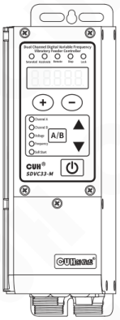

Controller×1

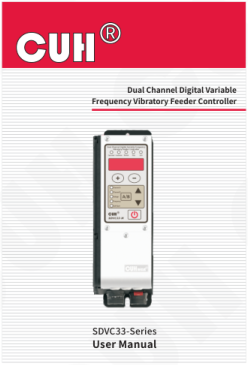

Benutzerhandbuch×1

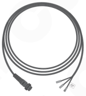

Ausgangskabel×2

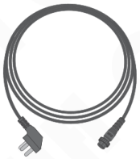

Eingangsnetzkabel×1

---

## 1.2 Erläuterung der Anzeigen, Tasten und externen Teile

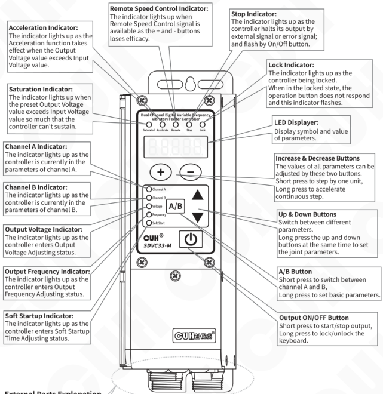

**Beschleunigungsanzeige:**  
Die Anzeige leuchtet auf, wenn die Beschleunigungsfunktion wirksam wird, sobald der Ausgangsspannungswert den Eingangsspannungswert überschreitet.

**Anzeige der Fern-Geschwindigkeitsregelung:**  
Die Anzeige leuchtet auf, wenn ein Signal für die Fern-Geschwindigkeitsregelung anliegt, da die Tasten + und - dann unwirksam sind.

**Stoppanzeige:**  
Die Anzeige leuchtet auf, wenn der Controller seinen Ausgang durch ein externes Signal oder ein Fehlersignal anhält; und blinkt bei Betätigung der Ein/Aus-Taste.

**Sättigungsanzeige:**  
Die Anzeige leuchtet auf, wenn der voreingestellte Ausgangsspannungswert den Eingangsspannungswert so stark überschreitet, dass der Controller ihn nicht aufrechterhalten kann.

**Sperranzeige:**  
Die Anzeige leuchtet auf, wenn der Controller gesperrt ist.  
Im gesperrten Zustand reagiert die Bedientaste nicht und diese Anzeige blinkt.

**LED-Anzeige:**  
Zeigt Symbol und Wert der Parameter an.

**Kanal-A-Anzeige:**  
Die Anzeige leuchtet auf, wenn sich der Controller derzeit in den Parametern von Kanal A befindet.

**Kanal-B-Anzeige:**  
Die Anzeige leuchtet auf, wenn sich der Controller derzeit in den Parametern von Kanal B befindet.

**Ausgangsspannungsanzeige:**  
Die Anzeige leuchtet auf, wenn der Controller in den Zustand der Ausgangsspannungseinstellung eintritt.

**Ausgangsfrequenzanzeige:**  
Die Anzeige leuchtet auf, wenn der Controller in den Zustand der Ausgangsfrequenzeinstellung eintritt.

**Sanftanlaufanzeige:**  
Die Anzeige leuchtet auf, wenn der Controller in den Zustand der Einstellung der Sanftanlaufzeit eintritt.

**Tasten zum Erhöhen und Verringern**  
Die Werte aller Parameter können mit diesen beiden Tasten eingestellt werden.  
Kurz drücken für Einzelschritt,  
Lang drücken für beschleunigtes kontinuierliches Weiterschalten.

**Auf- und Ab-Tasten**  
Zwischen verschiedenen Parametern wechseln.  
Die Auf- und Ab-Tasten gleichzeitig lange drücken, um die Verbundparameter einzustellen.

**A/B-Taste**  
Kurz drücken, um zwischen Kanal A und B zu wechseln,  
Lang drücken, um die Basisparameter einzustellen.

**Ausgang EIN/AUS-Taste**  
Kurz drücken, um den Ausgang zu starten/stoppen,  
Lang drücken, um die Tastatur zu sperren/entsperren.

### Erläuterung der externen Teile

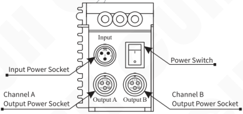

- Eingangsstrombuchse
- Netzschalter
- Ausgangsstrombuchse Kanal A
- Ausgangsstrombuchse Kanal B

## 1.3 Erläuterung der Anschlussports

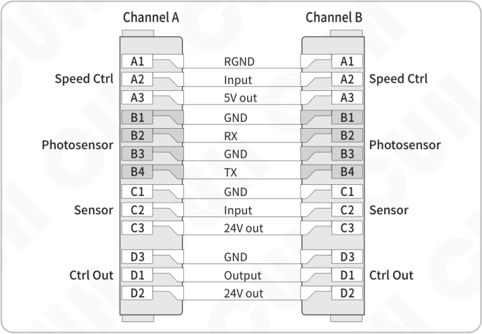

| Funktion | Kanal A | Beschreibung | Kanal B | Funktion |
|---|---|---|---|---|
| Speed Ctrl | A1 | RGND | A1 | Speed Ctrl |
| Speed Ctrl | A2 | Input | A2 | Speed Ctrl |
| Speed Ctrl | A3 | 5V out | A3 | Speed Ctrl |
| Photosensor | B1 | GND | B1 | Photosensor |
| Photosensor | B2 | RX | B2 | Photosensor |
| Photosensor | B3 | GND | B3 | Photosensor |
| Photosensor | B4 | TX | B4 | Photosensor |
| Sensor | C1 | GND | C1 | Sensor |
| Sensor | C2 | Input | C2 | Sensor |
| Sensor | C3 | 24V out | C3 | Sensor |
| Ctrl Out | D3 | GND | D3 | Ctrl Out |
| Ctrl Out | D1 | Output | D1 | Ctrl Out |
| Ctrl Out | D2 | 24V out | D2 | Ctrl Out |

## 1.4 Erläuterung des Typenschilds

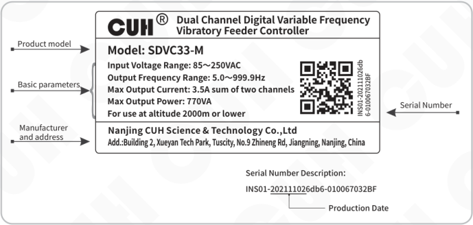

**CUH® — Digitaler Zweikanal-Frequenzregler für Vibrationsfördereinrichtungen**

**Produktmodell**

Modell: SDVC33-M

**Grundparameter**

- Eingangsspannungsbereich: 85～250VAC
- Ausgangsfrequenzbereich: 5.0～999.9Hz
- Max. Ausgangsstrom: 3.5A Summe der beiden Kanäle
- Max. Ausgangsleistung: 770VA
- Zur Verwendung in Höhenlagen von 2000 m oder darunter

**Hersteller und Adresse**

Nanjing CUH Science & Technology Co.,Ltd

Add.:Building 2, Xueyan Tech Park, Tuscity, No.9 Zhineng Rd, Jiangning, Nanjing, China

**Seriennummer**

INS01-202111026db6-010067032BF

**Beschreibung der Seriennummer:**

INS01-**20211102**6db6-010067032BF

Produktionsdatum: **20211102**

---

# Kapitel Ⅱ Produkteinführung

Dieses Kapitel enthält eine kurze Einführung und die Hauptmerkmale des Controllers.

## 2.1 Produkteinführung

Der digitale Doppelkanal-Frequenzregler SDVC33 für Vibrationsfördereinrichtungen ist ein kompakter Universalregler mit zwei FM-Ausgängen, der durch den Einsatz der neuesten elektronischen Technologie und sorgfältige Auslegung eine einzigartige Leistung bietet. Zu seinen besonderen Merkmalen gehören:

- Zweikanal-Leistungsausgang mit beliebiger Stromverteilung; der Überstromschutzstrom jedes Kanals kann einzeln eingestellt werden.
- Der Zweikanal-Betriebsmodus kann Frequenznachführung, Spannungsnachführung oder kombinierte Frequenz-Spannungs-Nachführung wählen.
- Bei der Frequenznachführung kann die Phasendifferenz zwischen den beiden Ausgängen von -180°~180° eingestellt werden.
- Der Ausgangsfrequenzbereich deckt 5Hz bis 999.9Hz mit einer Genauigkeit von 0.1Hz ab.
- Bremsfunktion: Durch Verschiebung der Stromphase um 180° während des Sanftstoppvorgangs wird der Vibrationsförderer schnell gestoppt.
- Intelligente photoelektrische Ports unterstützen Lichtsensoren, NPN- oder PNP-Schaltsensoren.
- Ready-Signal-Funktion: Über den intelligenten optoelektronischen Sendeport B4 wird ein moduliertes Signal oder ein gültiges Signal ausgegeben, um anzuzeigen, dass sich der Controller im Bereitschaftszustand befindet. Wenn am Controller ein Fehler auftritt, wird das Ready-Signal ungültig.
- Der Überlauf-Steuerport unterstützt NPN, PNP oder den auto-adaptiven Typ.
- Der Steuerausgangsport unterstützt NPN, PNP oder den Push-Pull-Ausgangsmodus.
- Der Port für die Fern-Geschwindigkeitsregelung kann kreuzweise ausgewählt werden, sodass ein Potentiometer zwei Ausgänge gleichzeitig steuern kann.
- Die Funktion des Fernsteuerungskoeffizienten kann die Wirkung der Fernsteuerungsspannung um den Faktor 1 vergrößern oder verringern.
- Die Helligkeitseinstellfunktion der LED-Anzeige unterstützt eine 32-stufige Helligkeitsanpassung.
- Funktion zum Speichern und Wiederherstellen von Benutzerparametern: Benutzer können Parameter einstellen und in der Benutzergruppe speichern, um sie einfach wiederherstellen zu können.
- Die Werkseinstellungsfunktion unterstützt die Wiederherstellung des Teilkanals A/B oder des gesamten Controllers.
- Vollständige Schutzfunktionen umfassen: Kurzschlussschutz des Hauptausgangs, Überstromschutz, Überhitzungs- oder Unterkühlungsschutz, Unterspannungs-/Überspannungsschutz, Kurzschlussschutz des Steuerausgangs, Kurzschlussschutz des 24V-Ausgangs, Kurzschlussschutz des 5V-Ausgangs der Geschwindigkeitsregelung.

## 2.2 Leistungsverbesserung des Produkts

Im Vergleich zum Controller SDVC31-M wurde die Leistung des SDVC33 erheblich verbessert. Hauptsächlich umfasst dies:

- Die Ausgangsfrequenz wurde von 40.0Hz~400.0Hz auf 5.0Hz~999.9Hz erhöht.
- Die maximale Ein-/Aus-Verzögerungszeit wurde von 20.0 s auf 99.9 s erhöht.

---

- Neu hinzugefügt: die Funktion des Sanftstopps, einstellbar auf 0.0~10.0 s, um die Vibration des Vibrationsförderers langsam zu stoppen.
- Neu hinzugefügt: die Bremsfunktion, mit der 0~10 Bremszyklen eingestellt werden können, um die Vibration der Vibrationsschüssel schnell zu stoppen.
- Der intelligente photoelektrische Sensorport unterstützt jetzt auch PNP-Sensoren.
- Der Schaltsensor-Port bei vollem Material wurde von NPN und PNP auf softwareeinstellbar aufgerüstet, und es wird ein automatischer Modus bereitgestellt.
- Der Steuerausgangsport wurde von NPN-Ausgang auf drei einstellbare Typen aufgerüstet: NPN, PNP und Push-Pull.
- Neu hinzugefügt: Ein-/Aus-Verzögerung des Steuerausgangsports, einstellbar von 0.0 bis 99.9 s.
- Neu hinzugefügt: der Steuerausgangsmodus, mit dem der Verzögerungsmodus und der Haltemodus eingestellt werden können.
- Neu hinzugefügt: einstellbarer Überstromschutzstrom-Parameter, um den Elektromagneten vor dem Durchbrennen zu schützen.
- Neu hinzugefügt: der Fernsteuerungskoeffizient, der die Steuerwirkung der Fernsteuerungsspannung vergrößern oder verringern kann.
- Neu hinzugefügt: die Funktion zur Einstellung der Panel-Helligkeit; die Anzeigehelligkeit der Gruppe A/B kann separat eingestellt werden.
- Neu hinzugefügt: die Messfunktion zur Überwachung von Ausgangsstrom, Geschwindigkeitsregelungsspannung, Signalspannung des intelligenten photoelektrischen Ports, Eingangsspannung des Schaltsensor-Ports, Ausgangsspannung des Steuerausgangsports, Temperaturanzeige, Buss-Spannung und 24V-Ausgangsspannung.
- Neu hinzugefügt: Funktionen zum Speichern und Wiederherstellen von Parametern. Neben der automatischen Speicherung der Arbeitsgruppenparameter können Sie Arbeitsgruppenparameter auch in der Benutzergruppe speichern, und die Parameter der Gruppe A und Gruppe B können bei Bedarf flexibel aus der Benutzergruppe wiederhergestellt werden.

## 2.3 Kombinierte Verwendung der zwei Ausgänge

Der Controller bietet die Parameter für die gemeinsame Steuerung der Kanäle A/B, mit denen ein zweiachsiger Vektor-Vibrationsförderer oder das Zuführsystem aus einer Vibrationsschüssel und einem Linearförderer gesteuert werden kann.

Standardmäßig arbeiten die Kanäle A und B unabhängig voneinander. Im kombinierten Betrieb kann Kanal B so eingestellt werden, dass er Kanal A nachführt, einschließlich Spannungsnachführung, Frequenznachführung und kombinierter Spannungs-Frequenz-Nachführung. Wenn die Frequenzen gleich sind, werden die Phasen der beiden Ausgänge verriegelt, und der Benutzer kann die Phasendifferenz von -180° bis 180° einstellen.

Nachdem die Spannung und die Frequenz von Kanal B auf doppelte Nachführung von Kanal A eingestellt wurden, müssen Sie nur noch die Spannung und die Frequenz von Kanal A anpassen, um die Ausgangsspannung und die Ausgangsfrequenz von A/B gleichzeitig zu ändern.

---

# Kapitel Ⅲ Installationsanleitung

Dieses Kapitel stellt die notwendigen Bedingungen für die Verwendung des Controllers sowie die korrekte Installation und Verdrahtung vor.

## 3.1 Nutzungsbedingungen des Controllers

Der Controller wird mit Wechselstrom 110/220V betrieben, und die Schutzleiterverbindung erfolgt über den Stecker des Netzkabels. Bitte stellen Sie eine normgerechte 110V- oder 220V-50Hz/60Hz-Netzversorgung und -verteilung bereit und stellen Sie sicher, dass der Schutzleiter korrekt angeschlossen ist.

**⚠ Warnung** Schließen Sie den Controller nicht an 380V Wechselstrom an, da dies zu irreversiblen schweren Schäden am Controller führt und möglicherweise Explosionen, Brände und andere Sicherheitsvorfälle verursacht.

**⚠ Warnung** Stellen Sie sicher, dass die Stromversorgungsseite zuverlässig geerdet ist. Das Metallgehäuse des Controllers ist direkt mit dem Schutzleiter verbunden. Eine schlechte Erdung führt dazu, dass das Controller-Gehäuse unter Spannung steht und einen Stromschlagunfall verursacht.

**Hinweis** Wenn der Controller längere Zeit arbeitet, entsteht Wärme und die Gehäusetemperatur steigt. Bitte installieren Sie den Controller in einer gut belüfteten Umgebung und befestigen Sie ihn gut, entfernt von Vibrationsquellen.

**Hinweis** Der A/B-Ausgang dieses Produkts entsteht durch Gleichrichtung und Wechselrichtung des Netzstroms; dazwischen befindet sich kein Isolierring. Daher dürfen die Ausgangspole nicht an den Schutzleiter angeschlossen werden. Beim Anschließen des Elektromagneten muss sichergestellt werden, dass die Elektromagnetspule und das Gehäuse eine Basisisolierung aufweisen. Andernfalls kann ein Stromaustritt auftreten, was zu Stromschlag und Beschädigung des Controllers führen kann.

**Hinweis** Dieses Produkt ist ein Controller zum Antrieb von Elektromagneten. Es darf nicht an einen piezoelektrischen Vibrationsförderer angeschlossen werden.

## 3.2 Bedienungsmethode der Tasten

a. Die Tastenbetätigung wird je nach Druckdauer in Kurzdruck und Langdruck (Beschleunigung erster Stufe, Beschleunigung zweiter Stufe) unterteilt.  
b. Kurzdruck ist als Druckdauer größer als 0.1 und kleiner als 2 Sekunden definiert, Langdruck als Druckdauer größer als 2 Sekunden.  
f. [A/B] lange drücken, um die Basisschnittstelle für Parameter zu betreten/zu verlassen.  
g. [A/B] und ▲ lange drücken, um die erweiterte Parameterschnittstelle zu betreten/zu verlassen.  
h. [A/B] und ▼ lange drücken, um die Überwachungsparameterschnittstelle zu betreten/zu verlassen.  
I. ▲ und ▼ lange drücken, um die Verbundparameterschnittstelle zu betreten/zu verlassen.  
j. ⊕ lange drücken, bis 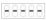 auf der LED angezeigt wird, um die Werkseinstellungen wiederherzustellen; beim Loslassen wird CUH angezeigt – dies bedeutet, dass die Werkseinstellungen wiederhergestellt wurden.  
k. Bei der Speicherung von Benutzerparametern uP1 auswählen, ⊕ und ⊖ lange drücken; nach erfolgreicher Speicherung wird SAU angezeigt.  
l. Bei der Wiederherstellung der Benutzerparameter nach Auswahl der Wiederherstellungsmethode ⊕ und ⊖ lange drücken; bei erfolgreicher Wiederherstellung wird rES angezeigt.

---

## 3.3 Installation und Verwendung

### Schritt Eins:

Öffnen Sie den Verpackungskarton und prüfen Sie den Controller und das gesamte Zubehör.

### Schritt Zwei:

Schließen Sie die Anschlussklemmen des Ausgangsleistungskabels an die Elektromagnetspule des Vibrators an.

Richten Sie die Kerbe am Luftfahrtstecker des A/B-Zweikanal-Ausgangskabels am Dreieck-Zeichen der Ausgangsbuchse des Controllers aus und ziehen Sie nach korrektem Anschluss des Ausgangskabels die Mutter fest.

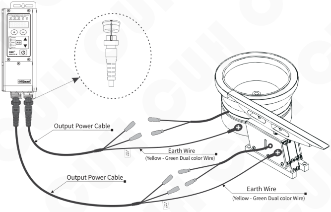

### Hinweis

1. Stellen Sie sicher, dass die Elektromagnetspulen des Vibrators mit den beiden Ausgangsstiften des Ausgangsleistungskabels verbunden sind und die Metallhülle des Vibrators zuverlässig geerdet ist.
2. Es ist verboten, piezoelektrische Lasten an den Leistungsausgang anzuschließen, da dies sonst zu einem Stromschlag-Sicherheitsunfall führen kann!

---

### Schritt Drei:

Schließen Sie den Stecker des Eingangsleistungskabels an die Eingangsleistungsbuchse des Controllers an.

Zuerst die Controllerseite anschließen

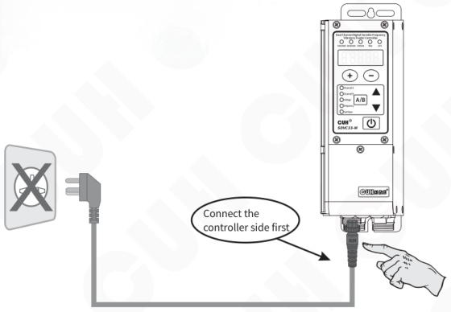

### Schritt Vier:

Schließen Sie den Stecker des Eingangsleistungskabels an die Netzsteckdose an.

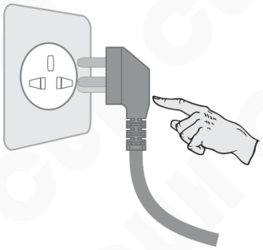

---

## Schritt Fünf:

Schalten Sie den Netzschalter des Controllers ein; die Spannung „U 150" sollte angezeigt werden, Kanal A leuchtet auf und beide Vibrationsförderer sollten vibrieren.

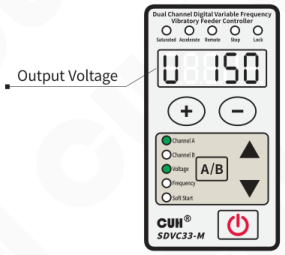

## Schritt Sechs:

Drücken Sie ⊖, um die Spannung von Kanal A auf 30~50V einzustellen, und drücken Sie dann `A/B` 2 Sekunden, um in den Einstellzustand der Ausgangsfrequenz „E" zu gelangen. Suchen Sie mit ⊕ und ⊖ die Eigenfrequenz des Vibrationsförderers, die auch Resonanzfrequenz genannt wird.

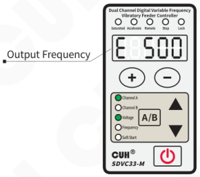

- Die Oberwellenfrequenz des Vibrators bezeichnet den Frequenzwert, der die maximale Amplitude erzeugt.
- Jeder Vibrator hat seine eigene mechanische Eigenresonanzfrequenz; stellen Sie die Ausgangsfrequenz des Controllers auf diese Frequenz ein, um den besten Arbeitszustand zu erreichen.

---

## Schritt Sieben:

Drücken Sie **A/B** lange, um die Ausgangsfrequenz „E" zu verlassen und zum Spannungseinstellparameter zurückzukehren,
stellen Sie mit **+** und **−** die Spannung ein, bis die beste Fördergeschwindigkeit erreicht ist.

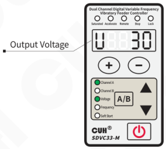

## Einstellungen für Kanal B:

Drücken Sie **A/B** kurz, um zu Kanal B zu wechseln. Wiederholen Sie die Schritte sechs und sieben, um die Einstellung von Kanal B abzuschließen.

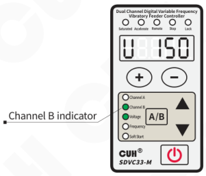

---

## Kapitel IV Beschreibung der Grundfunktionen

Dieses Kapitel beschreibt die Verwendung der Grundfunktionen des Controllers.

### 4.1 Einstellung der Ausgangsspannung

Der Controller kann die Ausgangsspannung direkt am Panel digital einstellen. Da der Controller eine Netzspannungskompensation durchführen kann, ist dieser Wert der Mittelwert der gleichgerichteten Ausgangsspannung; er wird nicht von der Eingangsspannung beeinflusst und kann daher auch bei instabiler Netzspannung eine stabile Ausgabe aufrechterhalten. Gleichzeitig bietet die direkte Spannungswerteinstellung dem Benutzer genaue Daten zum Verständnis des Gerätebetriebs.

- Schalten Sie den Netzschalter des Controllers ein.
- Der Controller zeigt die Ausgangsspannung an. Kanal A und die Spannungsanzeige auf dem Panel leuchten, und die LED zeigt den Ausgangsspannungsparameter U und den Spannungswert an.
- Drücken Sie ⊕ oder ⊖, um den Parameterwert einzustellen.

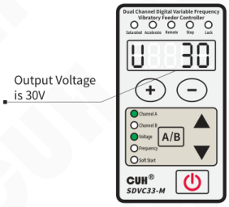

- Der Controller verfügt über keine Boost-Funktion. Wenn der Controller aufgrund der Begrenzung der Eingangsversorgungsspannung die eingestellte Spannung nicht erreichen kann, leuchtet die Sättigungsanzeige auf, und die Netzspannungskompensation schlägt zu diesem Zeitpunkt fehl.
- Der Controller kann einen gewissen Beschleunigungseffekt erzielen, indem er die Sinuscharakteristik der Ausgangswellenform opfert; dies wird durch den Parameter „Beschleunigungsindex y" bestimmt. Beim Eintritt in den Beschleunigungszustand ändert sich die Ausgangsstromwellenform von einer Sinuswelle in eine Dreieckwelle, und die Beschleunigungsanzeige leuchtet auf.

---

## 4.2 Einstellung der Ausgangsfrequenz

Der Controller verwendet die direkte digitale Frequenzsynthesetechnologie (DDS), die eine sehr hohe Frequenzgenauigkeit und Stabilität aufweist und sich nicht mit Zeit und Temperatur ändert.

- Drücken Sie **A/B** und halten Sie 2 Sekunden gedrückt, um die Basisschnittstelle für Parameter zu betreten.
- Die LED zeigt den Ausgangsfrequenzparameter „E" und den Frequenzwert an.
- Drücken Sie **+** oder **−**, um den Parameterwert einzustellen.

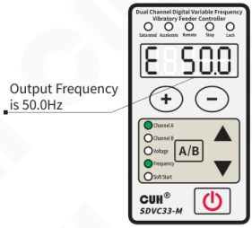

Der Ausgangsfrequenzbereich beträgt 5.0～999.9Hz

## 4.3 Sanftanlauf

Wenn der Controller aus dem gestoppten Zustand gestartet wird, kann die Ausgangsspannung allmählich auf den eingestellten Wert erhöht werden, um den Vibrationsförderer und den Controller vor Stößen zu schützen.

Sanftanlaufzeit (t): Wenn der Controller aus dem Stoppzustand startet, wird die Zeit, die die Ausgangsspannung benötigt, um gleichmäßig von 0V auf den eingestellten Wert anzusteigen, als Sanftanlaufzeit bezeichnet.

- Drücken Sie **A/B** und halten Sie 2 Sekunden gedrückt, um die Basisschnittstelle für Parameter zu betreten.
- Drücken Sie **▲** und **▼**, um zum Einstellzustand „t" des Sanftanlaufparameters zu wechseln.
- Drücken Sie **+** oder **−**, um den Parameterwert einzustellen.

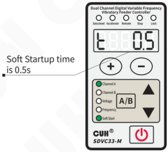

Der Sanftanlaufzeitbereich beträgt 0.0～10.0s

---

## 4.4 Sanftes Stoppen

Wenn der Controller aus dem laufenden Zustand stoppt, kann die Ausgangsspannung sanft auf 0 reduziert werden, um Stöße auf das Vibrationsgerät zu vermeiden.

Sanftstoppzeit (J): Wenn der Controller aus dem laufenden Zustand startet, wird die Zeit, die die Ausgangsspannung benötigt, um gleichmäßig vom eingestellten Wert auf 0 abzusinken, als Sanftstoppzeit bezeichnet.

- Drücken Sie **A/B** und halten Sie 2 Sekunden gedrückt, um die Basisschnittstelle für Parameter zu betreten.
- Drücken Sie **▲** und **▼**, um zum Einstellzustand „J" des Sanftstoppparameters zu wechseln.
- Drücken Sie **+** oder **−**, um den Parameterwert einzustellen.

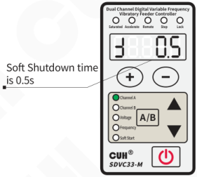

Der Sanftstoppzeitbereich beträgt 0.0～10.0s

## 4.5 Bremsfunktion

Da der Vibrationsförderer nach dem Stoppen des Controllerausgangs eine Zeit lang frei schwingt, bewegt sich das Material in dieser Zeit weiter. Dies verursacht Fehler bei einigen Anwendungen der Präzisionsdosierung und -verpackung von Materialien, sodass die Vibration schnell gestoppt werden muss.

Die Bremsfunktion stoppt die Vibration schnell, indem der Startpunkt des langsamen Stopps um 180° verzögert wird, um einen der Antriebskraft entgegengesetzten Effekt gegenüber der freien Schwingungsphase des Vibrationsförderers zu erzielen. Sie wird realisiert, indem die Sanftstoppzeit auf einen negativen Wert gesetzt wird; die Einheit ist Zyklus, d. h. die Anzahl der Stromzyklen des Gegenantriebs beim Bremsen.

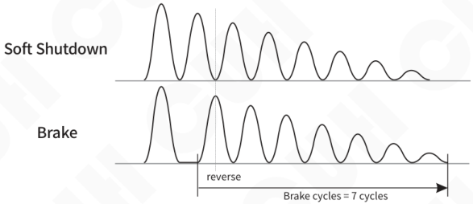

---

## 4.6 Ausgangsschalter

Der leichte Berührungsausgangsschalter am Panel kann den Ausgang des Controllers einfach und schnell starten oder stoppen.

- Verwenden Sie ⏻ auf dem Controller-Panel, um das Gerät zum Starten oder Stoppen des Ausgangs zu steuern. Wenn die Stoppanzeige leuchtet, bedeutet dies, dass der Stoppzustand eingetreten ist.

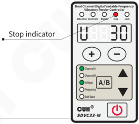

> Standardmäßig steuert ⏻ den Start/Stopp von Kanal A/B unabhängig. Wenn Sie den Start/Stopp von Kanal A/B gleichzeitig steuern möchten, stellen Sie bitte den Steuermodus der EIN/AUS-Taste (OF) im gemeinsamen Parameter von Ind (unabhängig) auf Cob (kombiniert) um.
>
> Wenn der Controller den Ausgang stoppt, blinkt die Stoppanzeige. Wenn jedoch ein externes Signal den Controller stoppt, leuchtet die Stoppanzeige dauerhaft.

## 4.7 Tastatursperre

Nachdem die Parameter des Controllers eingestellt wurden, kann die Tastatursperrfunktion alle Tasten auf dem Panel sperren, um Fehlbedienungen zu vermeiden.

Auch wenn das Gerät aus- und wieder eingeschaltet wird, bleibt der Zustand der Tastatursperre so erhalten, wie er beim letzten Ausschalten war.

- Halten Sie ⏻ 2 Sekunden lang gedrückt, um alle Tasten auf dem Panel zu sperren.
- Halten Sie ⏻ erneut 2 Sekunden lang gedrückt, um die Sperre aufzuheben.

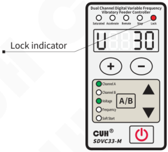

> Die Sperre kann für verschiedene Kanäle erfolgen; die Bedienung von Kanal A und Kanal B kann unabhängig voneinander durchgeführt werden.

---

## 4.8 Wiederherstellen der Werkseinstellungen

Der Benutzer kann den Controller schnell in den Werkszustand zurücksetzen.

Aufgrund der leistungsstarken Funktionen des Controllers können viele Parameter angepasst werden. Für Anfänger kann es nach mehreren Einstellungen und Änderungen möglicherweise nicht mehr möglich sein, den normalen Arbeitszustand des Controllers wiederherzustellen. Verwenden Sie diese Funktion, um einen unübersichtlichen Parameterzustand schnell auf die Werkseinstellungen zurückzusetzen.

Der Controller kann sowohl den gesamten Controller auf die Werkseinstellungen zurücksetzen als auch einen einzelnen Kanal separat auf die Werkseinstellungen zurücksetzen.

### Werkseinstellungen für den gesamten Controller wiederherstellen:

- Halten Sie ▲ und ▼ gleichzeitig lange gedrückt, um die Oberfläche für gemeinsame Parameter aufzurufen.

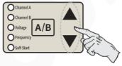

- Drücken Sie ▼ kurz, um zum vollständigen Blinken auf der LED-Anzeige zu wechseln, d. h. zum Parameter „Restore default setting". Halten Sie dann ⊕ gedrückt, bis der Controller „-----" anzeigt, was bedeutet, dass der Controller wiederhergestellt wurde.

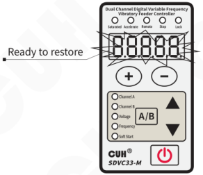

- Lassen Sie ⊕ los; nachdem der Controller „CUH" anzeigt, wechselt er in den Einstellzustand der Ausgangsspannung „U". Zu diesem Zeitpunkt wurden alle Parameter auf die Werkseinstellungen zurückgesetzt.

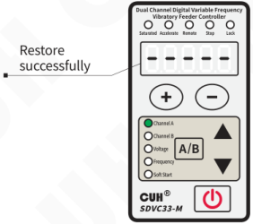

---

## Kanal A/B einzeln auf die Werkseinstellungen zurücksetzen:

- Halten Sie **A/B** und **▲** gleichzeitig lange gedrückt, um die Oberfläche für erweiterte Parameter aufzurufen.

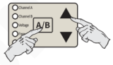

- Drücken Sie **▼** kurz, um zum Parameter „Restore the current channel default setting" zu wechseln. Halten Sie dann **⊕** lange gedrückt, bis der Controller „-----" anzeigt, was bedeutet, dass der aktuelle Kanal wiederhergestellt wurde.

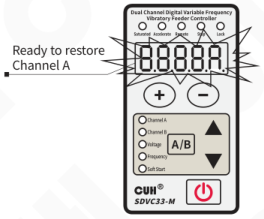

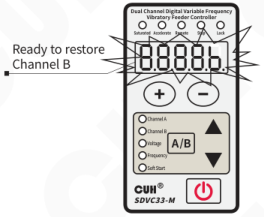

- Lassen Sie **⊕** los; nachdem der Controller „CUH" anzeigt, wechselt er in den Einstellzustand der Ausgangsspannung „U". Zu diesem Zeitpunkt wurden alle Parameter des aktuellen Kanals auf die Werkseinstellungen zurückgesetzt.

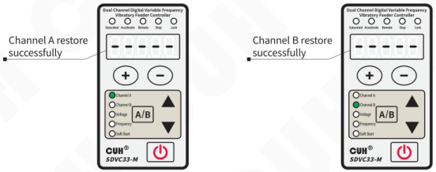

---

## Kapitel Ⅴ Beschreibung der erweiterten Funktionen

Dieses Kapitel beschreibt die Verwendung der erweiterten Funktionen des Controllers.

### 5.1 Fern-Geschwindigkeitsregelung

Der Controller unterstützt ein externes Analogsignal zur Steuerung der Ausgangsspannung; das Analogsignal kann über ein Potentiometer, 1~5V-Spannung oder 4~20mA-Strom bereitgestellt werden. Es gibt zwei analoge Eingangsports AA und bA. Standardmäßig steuert AA Kanal A und bA steuert Kanal B. Es kann auch über den Parameter cS eingestellt werden, sodass ein Signal gleichzeitig die Ausgangsspannung zweier Kanäle steuern kann.

Der Controller verfügt außerdem über den Parameter c des Fernsteuerungskoeffizienten, um die Wirkung der Fernsteuerungsspannung zu vergrößern oder zu verkleinern; er kann von 0.5 bis 2.0 eingestellt werden. Bei Einstellung auf 0.5 wird die Wirkung der Fernsteuerungsspannung auf die Ausgangsspannung halbiert, d. h. die maximale Fernsteuerung kann nur die Hälfte der maximalen Ausgangsspannung h erreichen. Bei Einstellung auf 2.0 wird die Wirkung der Fernsteuerungsspannung auf die Ausgangsspannung verdoppelt, d. h. wenn die Fernsteuerungsspannung 3V erreicht, hat die Ausgangsspannung bereits h erreicht, und eine weitere Erhöhung der Fernsteuerungsspannung kann die Ausgangsspannung nicht erhöhen.

### Anschluss der Potentiometer-Steuerung

Wenn das Fern-Geschwindigkeitsregelungssignal wirksam wird, leuchtet die Geschwindigkeitsregelungsanzeige auf; gleichzeitig ist die Spannungseinstellung am Panel unwirksam.

---

## Anschluss der 1~5V-Spannungssteuerung

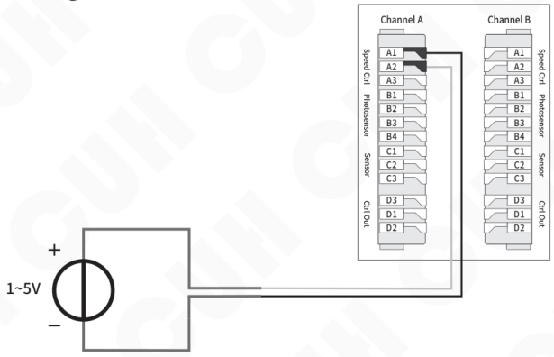

## Anschluss der 4~20mA-Stromsteuerung

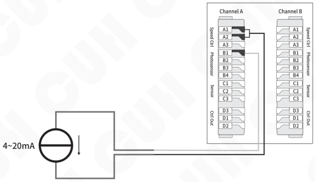

---

## 5.2 Intelligente photoelektrische Sensorik

Der intelligente photoelektrische Port dieses Controllers unterstützt photoelektrische Durchlicht- oder Reflexionssensoren aus Leuchtdioden und Phototransistoren und kann auch so eingestellt werden, dass NPN- oder PNP-Schaltsensoren unterstützt werden. Das spezifische Anschlussdiagramm ist wie folgt:

### Anschlussmethode des photoelektrischen Sensors

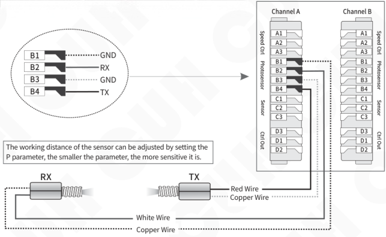

Die Arbeitsentfernung des Sensors kann durch Einstellen des Parameters P angepasst werden; je kleiner der Parameter, desto empfindlicher ist er.

### Anschlussmethode des Schaltsensors

Stellen Sie den Typ NPN oder PNP über den Parameter P ein.

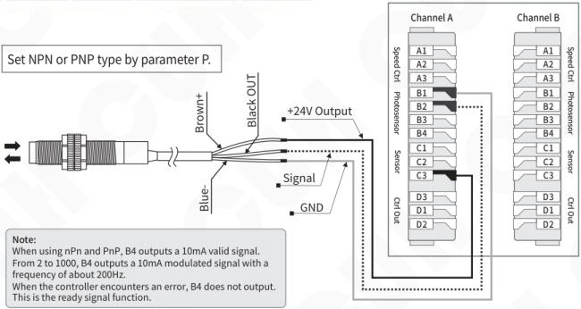

**Hinweis:**

Bei Verwendung von nPn und PnP gibt B4 ein gültiges Signal mit 10mA aus.

Von 2 bis 1000 gibt B4 ein moduliertes Signal mit 10mA und einer Frequenz von etwa 200Hz aus.

Wenn beim Controller ein Fehler auftritt, gibt B4 kein Signal aus. Dies ist die Bereitsignal-Funktion.

---

## 5.3 Schaltsensor

Der Schaltsensor-Port unterstützt die Modi NPN, PNP, Ut1 und Ut0; die Kanäle A und B werden unabhängig voneinander gesteuert.

**Der Modus Ut1 ist ein einmaliger Scan,** d. h. bevor das Sensorsignal ungültig wird, werden die High- und Low-Pegel geändert, um zu erkennen, ob der Port gültig ist. Nachdem ein gültiges Signal gefunden wurde, wird der Sensortyp des Ports festgelegt und nicht mehr gescannt.

**Der Modus Ut0 ist ein kontinuierlicher Scan,** unabhängig vom Sensortyp wird durch Ändern der High- und Low-Pegel stets erkannt, ob am Port ein gültiges Signal anliegt.

### Anschlussmethode des Schaltsensors

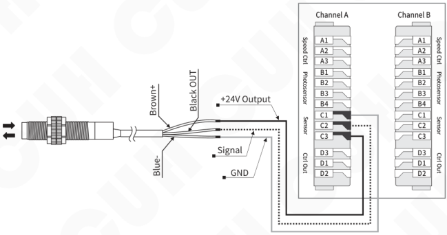

---

## 5.4 Steuerausgang

Der Steuerausgangsport kann NPN-Ausgang, PNP-Ausgang und Gegentakt-Ausgang unterstützen. Dabei gilt:

- Der NPN-Ausgang ist bei niedrigem Pegel gültig; bei ungültigem Ausgang liegt ein hochohmiger Zustand vor;
- Der PNP-Ausgang ist bei hohem Pegel gültig; bei ungültigem Ausgang liegt ein hochohmiger Zustand vor;
- Der Gegentakt-Ausgang ist bei hohem Pegel gültig und bei niedrigem Pegel ungültig.

### 5.4.1 Verdrahtungsmethode des Steuerausgangs

**NPN-Ausgangsanschluss**

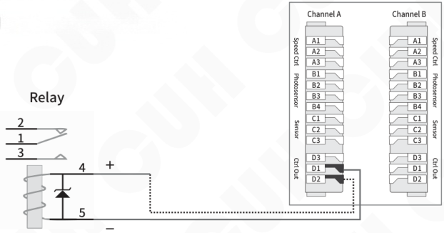

**PNP- oder Gegentakt-Ausgangsanschluss**

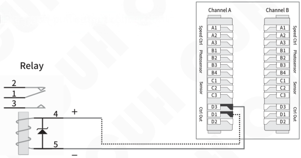

> Beim Anschluss eines 24V-Relais müssen Sie unbedingt den Plus- und Minuspol der Spule bestätigen, um sicherzustellen, dass sie korrekt angeschlossen sind. Da die Ausgangsstromfähigkeit dieses Ports 350mA beträgt, schließt die interne Schutzdiode des Relais bei verkehrtem Anschluss den Port dieses Controllers kurz, wodurch der Kurzschlussschutz Er07 ausgelöst wird.

---

## 5.4.2 Signalquelle und Logikdiagramm des Steuerausgangs

Die Steuerung des Hauptausgangs und des Steuerausgangs erfolgt durch das Ergebnis der logischen Verknüpfung zwischen zwei Signalquellen. Die folgenden Signalquellen können aus der Signalquellenliste ausgewählt werden.

| Signalquelle | Bedeutung |
|---|---|
| 0 | ungültiges Signal |
| 1 | gültiges Signal |
| Ab | Signal des intelligenten photoelektrischen Sensorports von Kanal A |
| -Ab | Signal des intelligenten photoelektrischen Sensorports von Kanal A ist invertiert |
| Ac | Schaltsensor-Portsignal von Kanal A |
| -Ac | Schaltsensor-Portsignal von Kanal A ist invertiert |
| Ad | Steuerausgangs-Portsignal von Kanal A |
| -Ad | Steuerausgangs-Portsignal von Kanal A ist invertiert |
| Aq | Hauptleistungsausgangs-Portsignal von Kanal A |
| -Aq | Hauptleistungsausgangs-Portsignal von Kanal A ist invertiert |
| bb | Signal des intelligenten photoelektrischen Sensorports von Kanal B |
| -bb | Signal des intelligenten photoelektrischen Sensorports von Kanal B ist invertiert |
| bc | Schaltsensor-Portsignal von Kanal B |
| -bc | Schaltsensor-Portsignal von Kanal B ist invertiert |
| bd | Steuerausgangs-Portsignal von Kanal B |
| -bd | Steuerausgangs-Portsignal von Kanal B ist invertiert |
| bq | Hauptleistungsausgangs-Portsignal von Kanal B |
| -bq | Hauptleistungsausgangs-Portsignal von Kanal B ist invertiert |

---

## Logikdiagramm des Steuerausgangs

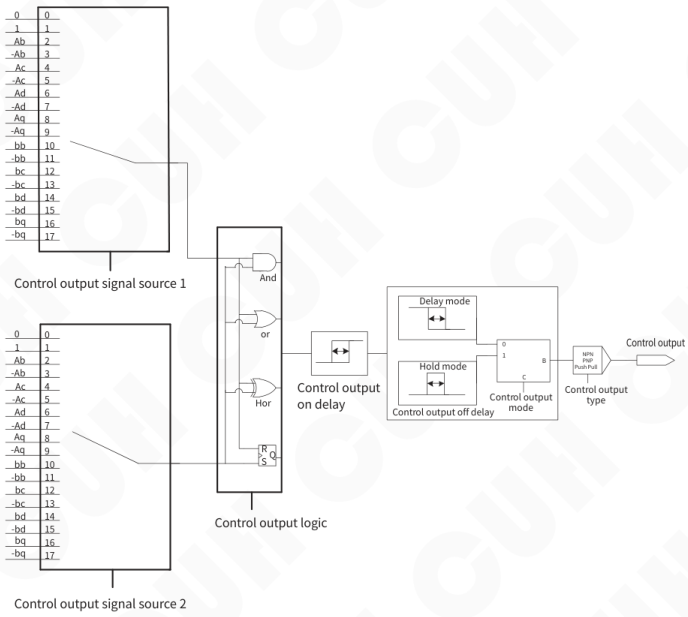

---

## 5.4.3 Beschreibung des Steuerausgangsmodus

Der Anwender kann 2 Steuerausgangsmodi wählen: Verzögerungsmodus und Haltemodus.

**Verzögerungsmodus:** Nachdem das Ausgangstreibersignal des Controllers von gültig auf ungültig wechselt, schaltet der Steuerausgang nach Ablauf einer Aus-Verzögerungszeit aus.

**Haltemodus:** Nachdem das Ausgangstreibersignal des Controllers gültig wird, bleibt der Steuerausgang während der Aus-Verzögerungszeit eingeschaltet und schaltet nach Überschreiten der Aus-Verzögerungszeit aus.

Der Unterschied zwischen den beiden Modi wird in Form eines Zeitdiagramms wie folgt dargestellt, wobei das Eingangssignal das Ausgangssignal nach dem Logikverknüpfungs-Selektor ist.

## 5.4.4 Signalsteuerungsfunktion des Hauptausgangs

Die Signalsteuerung des Hauptausgangs ähnelt der des Steuerausgangs. Nach Auswahl zweier Signalquellen für die logische Verknüpfung wird das Steuersignal durch Auswahl des Ein-/Aus-Verzögerungsmodus und der logischen Richtungssteuerung erhalten. Das Steuersignal wird mit dem Ein-/Aus-Signal des Panels logisch verknüpft und dann an die Leistungsplatine gesendet, um den Hauptausgang zu steuern.

Die Verdrahtungsmethode, die Signalquelle und das Logikdiagramm der Signalsteuerung des Hauptausgangs können der Steuerausgangsfunktion entnommen werden.

---

## 5.5 Begrenzung der maximalen Ausgangsspannung

Für jeden Kanal des Controllers kann der Begrenzungsparameter h der maximalen Ausgangsspannung eingestellt werden; weder die am Panel eingestellte Spannung noch die Fernsteuerungsspannung überschreiten diesen Wert.

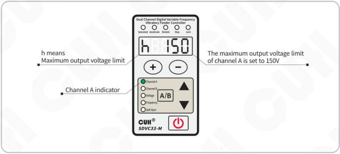

- h bedeutet Begrenzung der maximalen Ausgangsspannung
- Kanal-A-Anzeige
- Die Begrenzung der maximalen Ausgangsspannung von Kanal A ist auf 150V eingestellt

## 5.6 Einstellbarer Überstromschutz

Zum Schutz der Elektromagnetspule hat der Controller den vom Benutzer einstellbaren Parameter „oc" für den Überstromschutzstrom entwickelt, der im Bereich von 0.5A~3.5A eingestellt werden kann.

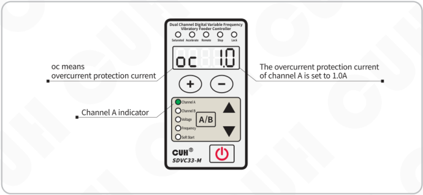

- oc bedeutet Überstromschutzstrom
- Kanal-A-Anzeige
- Der Überstromschutzstrom von Kanal A ist auf 1.0A eingestellt

---

## 5.7 Einstellung der Panel-Helligkeit

Der Controller verwendet einen neuen Digitalanzeige-Treiberchip, der es dem Benutzer ermöglicht, die Helligkeit der LED-Anzeige zwischen 1 und 32 einzustellen.

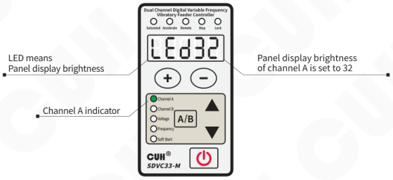

Die Panel-Helligkeit kann für Kanal A und Kanal B unabhängig eingestellt werden; der Benutzer kann vorab unterschiedliche Helligkeiten einstellen, um schnell zu unterscheiden, ob er sich gerade in Kanal A oder Kanal B befindet.

## 5.8 Ausgangsüberwachungsfunktion

Der Controller verfügt über eine speziell entwickelte Gruppe von Überwachungsparametern zur Überwachung des Controller-Status.

**Zu den Überwachungsparametern, die zwischen Kanal A und Kanal B unterscheiden, gehören:**

Ausgangsstrom AC, Spannung des analogen Geschwindigkeitsregelungsports AU, Signalspannung des intelligenten photoelektrischen Ports bU, Schaltsensor-Port cU, Spannung des Steuerausgangsports dU.

**Zu den Überwachungsparametern, die nicht zwischen Kanal A und Kanal B unterscheiden, gehören:**

Temperaturanzeige C, Busspannung PU, 24V-Ausgangsspannung nU, Softwareversion der Steuerplatine uc, Softwareversion der Leistungsplatine uq.

---

## 5.9 Gemeinsame Steuerung beider Kanäle

Die Ausgänge von Kanal A und Kanal B des Controllers können gemeinsam gesteuert werden; mit dem Parameter Cb kann Kanal B gesteuert werden: unabhängiger Betrieb, Nachführen der Frequenz von Kanal A, Nachführen der Spannung von Kanal A, Nachführen von Spannung und Frequenz von Kanal A.

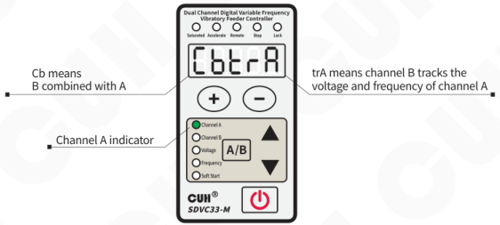

Hinweis: Nach dem Einstellen der Nachführung können Spannung und Frequenz von Kanal B weiterhin eingestellt werden, sie wirken jedoch nicht. Sie wirken erst nach der Rückkehr in den Einzelmodus.

Unabhängig davon, ob Sie Kanal A und Kanal B auf die gleiche Frequenz unabhängig einstellen oder die Frequenz von Kanal B auf Nachführen von Kanal A setzen, sind die Phasen der beiden Kanalausgänge immer miteinander verriegelt. Die Phasendifferenz kann über den gemeinsamen Parameter μ (B bezieht sich auf die Phase von A) gesteuert werden; der Einstellbereich beträgt -180°~180°. Diese Funktion kann zur Steuerung eines Vektor-Vibrationsschüsselförderers oder für Anwendungen verwendet werden, bei denen ein Vibrationsschüsselförderer und ein Linearförderer/Förderband die Zuführung weiterreichen.

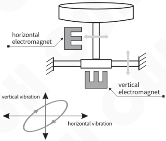

Schematische Darstellung eines Vektor-Vibrationsförderers

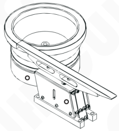

Schematische Darstellung eines Schüsselförderers und eines Linearförderers

---

## 5.10 Speichern und Wiederherstellen von Benutzerparametern

Neben der automatischen Speicherung der Arbeitsparameter hat der Controller auch eine Gruppe von Benutzerparametern entwickelt, um alle vom Benutzer einstellbaren Parameter zu speichern. Durch das Speichern und Wiederherstellen von Benutzerparametern unterscheidet sich die Wiederherstellung von der Funktion zum Wiederherstellen der Werkseinstellungen.

Stellen Sie im gemeinsamen Parameter auf den Parameter SP ein, Anzeige uP1; halten Sie ⊕ und ⊖ gleichzeitig lange gedrückt, bis SAU angezeigt wird, was eine erfolgreiche Speicherung bedeutet. Dadurch werden Kanal A, Kanal B und die gemeinsamen Parameter in der Benutzergruppe gespeichert.

Wenn Sie eine Arbeitsgruppe aus einer gespeicherten Benutzerparametergruppe wiederherstellen müssen, gibt es mehrere Möglichkeiten der Wiederherstellung:

**rP=1Ab:** Die Benutzergruppenparameter stellen die Parameter der Gruppen A und B gleichzeitig wieder her.

**rP=1bA:** Die Benutzergruppenparameter stellen die Parameter der Gruppe A und der Gruppe B gleichzeitig wieder her, sie werden jedoch bei der Wiederherstellung abwechselnd ausgewählt, d. h. die in Gruppe A der Benutzergruppe gespeicherten Daten werden in Arbeitsgruppe B wiederhergestellt und die in Gruppe B der Benutzergruppe gespeicherten Daten werden in Arbeitsgruppe A wiederhergestellt.

**rP=1A0:** Die Benutzergruppenparameter stellen nur Gruppe A wieder her und verwenden die Daten von Gruppe A in der Benutzergruppe zur Wiederherstellung.

**rP=10A:** Die Benutzergruppenparameter stellen nur Gruppe A wieder her und verwenden die Daten von Gruppe B in der Benutzergruppe zur Wiederherstellung.

**rP=1b0:** Die Benutzergruppenparameter stellen nur Gruppe B wieder her und verwenden die Daten von Gruppe B in der Benutzergruppe zur Wiederherstellung.

**rP=10b:** Die Benutzergruppenparameter stellen nur Gruppe B wieder her und verwenden die Daten von Gruppe A in der Benutzergruppe zur Wiederherstellung.

Wählen Sie den Modus aus, der wiederhergestellt werden soll; halten Sie ⊕ und ⊖ gleichzeitig lange gedrückt, bis rES angezeigt wird, was eine erfolgreiche Wiederherstellung bedeutet.

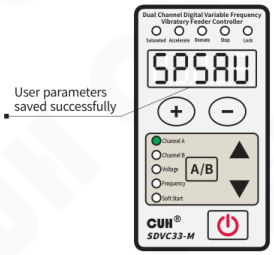

Diagramm der erfolgreichen Speicherung

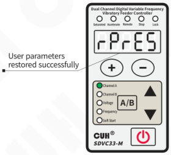

Diagramm der erfolgreichen Wiederherstellung

---

# Kapitel Ⅵ Technische Spezifikationen

## 6.1 Abmessungen

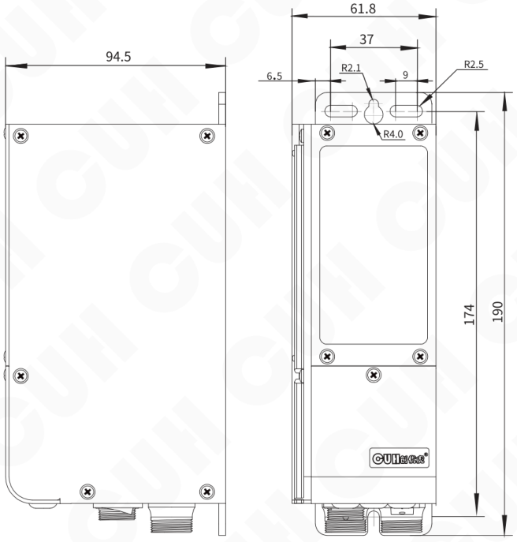

Abmessungen (Einheit: mm)

| Abmessungsbereich | Toleranz |
|---|---|
| 0~3 | ±0.05 |
| 3~10 | ±0.1 |
| 10~30 | ±0.15 |
| 30~80 | ±0.2 |
| 80~180 | ±0.3 |
| >180 | ±0.5 |

Diese Toleranztabelle gilt für alle Produkte dieser Serie.

---

## 6.2 Technische Spezifikationen

| Element | Min | Typisch | Max | Einheit | Anmerkung |
|---|---|---|---|---|---|
| Eingangsspannung | 85 | 220 | 250 | V | AC RMS |
| Einstellbarer Ausgangsspannungsbereich | 0 | —— | 260 | V | Niedriger als 150% der Eingangsspannung |
| Spannungseinstellgenauigkeit | | 1 | | V | |
| Spannungsregelgenauigkeit | 0 | —— | 10 | % | ΔVout/ΔVin |
| Einstellbarer Ausgangsstrombereich | 0 | —— | 3.5 | A | Der kombinierte Strom kann beliebig verteilt werden. |
| Ausgangsleistung | 0 | —— | 770 | VA | |
| Ausgangsfrequenz | 5.0 | —— | 999.9 | Hz | |
| Frequenzeinstellgenauigkeit | | 0.1 | | Hz | |
| Ausgangswellenform | | Sinus | | | |
| Sanftanlaufzeit | 0 | —— | 10 | s | Standardwert: 0.5 |
| Ein-/Aus-Verzögerungszeitbereich | 0 | —— | 99.9 | s | Standardwert: 0.2 |
| Ein-/Aus-Verzögerungszeit-Genauigkeit | | 0.1 | | s | |
| Auslösetemperatur des Überhitzungsschutzes | —— | 65 | —— | °C | Rückkehr zum Normalzustand bei 60°C |
| DC-Steuerausgangsstrom | 0 | —— | 350 | mA | Kanäle A und B werden beide unterstützt |
| 24V-Ausgangsstrom | —— | —— | 700 | mA | Summe der Ausgänge von Kanal A und B |
| DC-Steuerausgangsspannung | 22 | 24 | 26 | V | |
| Analoges Steuersignal | | 4~20/1~5 | | mA/V | |
| Digitales Steuersignal | | 24 | | V | Schaltsignal |
| Einstellmethode | | 6 | | Taste | |
| Leistungsaufnahme im Standby | —— | 3 | —— | W | |
| Anzeigemethode | | 5 | | Ziffer | LED |
| Gewicht | | 850 | | g | Ohne Zubehör |
| Abmessungen | | 190\*61.8\*94.5 ( L\*B\*H ) | | mm | |
| Schutzart | | IP20 | | | |
| Umgebungstemperatur | 0 | 25 | 40 | °C | Ohne Kondensation |
| Umgebungsfeuchtigkeit | 10 | 60 | 85 | % | Ohne Kondensation |
| Lagerungsumgebungstemperatur | -20 | 25 | 85 | °C | Ohne Kondensation |
| Zulässige Höhe | | <2000 | | m | |

## 6.3 Referenznorm

Absolute Parameter:  
Das Überschreiten dieser Werte kann den Controller beschädigen; halten Sie sie strikt ein.

| Element | GB-Standard | IEC-Standard | Grad | Standardanforderung | Anmerkung |
|---|---|---|---|---|---|
| Elektrostatische Entladung | GB/T 17626.2-2006 | IEC 61000-4-2:2001 | 4 | ±8 kV | Kontaktentladung |
| | | | 4 | ±15 kV | Luftentladung |
| Schneller elektrischer Transiententest | GB/T 17626.4-2008 | IEC 61000-4-4:2004 | 4 | ±4 kV | |
| Störfestigkeit gegen Welligkeit der DC-Stromleitung | GB/T 17626.17-2005 | IEC 61000-4-17:2002 | 4 | 15% | Bewertung A |

> **Warnung**  
> In einer Wohnumgebung kann dieses Produkt Funkstörungen verursachen; in diesem Fall können zusätzliche Gegenmaßnahmen erforderlich sein.

---

## Kapitel Ⅶ Anhang

### 7.1 Parametertabelle

| Parametergruppe / Bedienung | Definition | Symbol | Symbolbild | Bereich | Standard |
|---|---|---|---|---|---|
| Standby-Parameter | Ausgangsspannung | U |  | 0~260 V | 150 |
| Grundparameter A/B lange drücken | Ausgangsfrequenz | E |  | 5.0~999.9 Hz | 50.0 |
| Grundparameter | Einschaltverzögerung des intelligenten photoelektrischen Sensors | J |  | 0.0~99.9 s | 0.2 |
| Grundparameter | Ausschaltverzögerung des intelligenten photoelektrischen Sensors | L |  | 0.0~99.9 s | 0.2 |
| Grundparameter | Sanftanlauf | t |  | 0.0~10.0 s | 0.5 |
| Grundparameter | Bremszyklen/Sanftabschaltung | d |  | -10~0 Zyklus (Anzahl der Bremszyklen) 0.0~10.0 s (Sanftabschaltung) | 0.0 |
| Erweiterter Parameter A/B und ▲ lange drücken | Empfindlichkeit des intelligenten photoelektrischen Sensors | P |  | nPn, PnP, 2~1000 | 80 |
| Erweiterter Parameter | Sensortyp von Port C | ΓA |  | nPn, PnP ut1 (Einmaliger Scan), ut0 (Kontinuierlicher Scan) | ut0 |
| Erweiterter Parameter | Einschaltverzögerung von Port C | J- |  | 0.0~99.9 s | 0.2 |
| Erweiterter Parameter | Ausschaltverzögerung von Port C | L- |  | 0.0~99.9 s | 0.2 |
| Erweiterter Parameter | Erste Signalquelle von Steuerport D | E.d |  | 0, 1, Ab, -Ab, Ac, -Ac, Ad, -Ad, Aq, -Aq, bb, -bb, bc, -bc, bd, -bd, bq, -bq | A: 0 B: 0 |
| Erweiterter Parameter | Zweite Signalquelle von Steuerport D | Ed |  | 0, 1, Ab, -Ab, Ac, -Ac, Ad, -Ad, Aq, -Aq, bb, -bb, bc, -bc, bd, -bd, bq, -bq | A: Aq B: bq |
| Erweiterter Parameter | Logische Verknüpfung der Signalquellen von Steuerport D | ∩d | 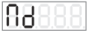 | And, or, Hor, rS | or |
| Erweiterter Parameter | Einschaltverzögerung von Port D | Jd |  | 0.0~99.9 s | 0.0 |
| Erweiterter Parameter | Ausschaltverzögerung von Port D | Ld |  | 0.0~99.9 s | 0.0 |
| Erweiterter Parameter | Ausgangsmodus von Port D | Fd |  | dLy (Verzögerungsmodus), HLd (Haltemodus) | dLy |
| Erweiterter Parameter | Logische Richtung von Port D | ɔd | 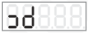 | --- (Gleichphasig), -⁻- (Umgekehrt) on (Normal offen), oFF (Normal geschlossen)  | --- |
| Erweiterter Parameter | Steuerausgangstyp | Γd |  | nPn, PnP, PSP (Push & Pull) | nPn |
| Erweiterter Parameter | Erste Signalquelle des Hauptausgangs | E.q |  | 0, 1, Ab, -Ab, Ac, -Ac, Ad, -Ad, Aq, -Aq, bb, -bb, bc, -bc, bd, -bd, bq, -bq | A: Ab B: bb |
| Erweiterter Parameter | Zweite Signalquelle des Hauptausgangs | Eq |  | 0, 1, Ab, -Ab, Ac, -Ac, Ad, -Ad, Aq, -Aq, bb, -bb, bc, -bc, bd, -bd, bq, -bq | A: Ac B: bc |
| Erweiterter Parameter | Logische Verknüpfung der Signalquellen des Hauptausgangs | ∩q |  | And, or, Hor, rS | or |

| Parameter | Definition | Symbol | Symbolbild | Bereich | Standard |
|---|---|---|---|---|---|
| Erweiterter Parameter A/B und ▲ lange drücken | Einschaltverzögerung des Hauptausgangs | J9 |  | 0.0~99.9 s | 0.0 |
| | Ausschaltverzögerung des Hauptausgangs | L9 |  | 0.0~99.9 s | 0.0 |
| | Ausgangsmodus des Hauptausgangs | F9 |  | dLy (Verzögerungsmodus), HLd (Haltemodus) | dLy |
| | Logische Richtung des Hauptausgangs | Ↄ9 |  |  on (Normal offen), oFF (Normal geschlossen) |  |
| | Begrenzung der maximalen Ausgangsspannung | h |  | 0~260 V | 260 |
| | Überstromschutzstrom | bc |  | 0.5~3.5 A | 3.5 |
| | Beschleunigungsindex | y |  | 100~150 | 150 |
| | Wellenformindex | r |  | 0~100 | 100 |
| | Quelle der Fern-Geschwindigkeitsregelung | cS |  | AA (Port A von A), bA (Port A von B) | A: AA B: bA |
| | Fernsteuerungskoeffizient | c |  | 0.5~2.0 | 1.0 |
| | Panel-Anzeigehelligkeit | LEd |  | 1~32 | 16 |
| | Aktuellen Kanal auf Werkseinstellung zurücksetzen | 8.8.8.8.A. 8.8.8.8.b. |  | —— | —— |
| Überwachungsparameter A/B und ▼ lange drücken | Ausgangsstrom | AC |  | 0.00~3.50 A | —— |
| | Signalspannung von Port A | AU |  | 0.00~5.00 V | —— |
| | Signalspannung von Port B | bU |  | 0.00~5.00 V | —— |
| | Signalspannung von Port C | cU |  | 0.0~28.0 V | —— |
| | Ausgangsspannung von Port D | dU |  | 0.0~28.0 V | —— |
| | Temperaturanzeige # | C |  | -20.0~85.0 ℃ | —— |
| | Interne Busspannung # | PU |  | 0~400 V | —— |
| | Echtzeitspannung des 24V-Ports # | nU |  | 0.0~28.0 V | —— |
| | Softwareversion der Steuerplatine # | uc |  | —— | —— |
| | Softwareversion der Leistungsplatine # | u9 |  | —— | —— |

|  | Definition | Symbol | Symbolbild | Bereich | Standard |
|---|---|---|---|---|---|
| Gemeinsamer Parameter  Lange drücken ▲ und ▼ | B kombiniert mit A # | Cb |  | Ind (unabhängig), trF (B führt Frequenz von A nach), trU (B führt Spannung von A nach), trA (B führt Spannung und Frequenz von A nach) | Ind |
|  | # | Y |  | -180~180 ° | 0 |
|  | Steuermodus der EIN/AUS-Taste # | OF |  | Ind (unabhängig), Cob (kombiniert) | Ind |
|  | Benutzerparameter speichern # | SP |  | uP1 (Benutzergruppe 1 speichern) | uP1 |
|  | Benutzerparameter wiederherstellen # | rP |  | 1Ab (Benutzergruppe 1 stellt die Gruppen A und B wieder her), 1bA (Benutzergruppe 1 stellt die Gruppen A und B kreuzweise wieder her), 1A0 (Benutzergruppe 1 stellt nur Gruppe A wieder her), 10A (Benutzergruppe 1 stellt nur Gruppe A kreuzweise wieder her), 1b0 (Benutzergruppe 1 stellt nur Gruppe B wieder her), 10b (Benutzergruppe 1 stellt nur Gruppe B kreuzweise wieder her) | 1Ab |
|  | Werkseinstellungen wiederherstellen # | 8.8.8.8.8. |  | —— | —— |

Hinweis: Die mit „#" markierten Parameter unterscheiden nicht zwischen den Gruppen A und B.

## 7.2 Ein- und Ausgangsschaltpläne

**Remote Speed Control Port A**

**Intelligent Photosensor Port B**

**Switch Sensor Port C**

**Control Output Port D**

---

## 7.3 Fehlerbehebungsvorschläge und Fehlererläuterungen

| Fehlercode | Definition (Phänomen) | Fehlerbehebungsmethoden |
|---|---|---|
| Er01A/Er01b | Kurzschluss von Kanal A/B (Beide Kanäle stoppen die Ausgänge) | ◆ Stellen Sie sicher, dass die Last nicht kurzgeschlossen ist, und versuchen Sie dann, den Ausgang des Controllers neu zu starten, indem Sie die Ausgangs-EIN/AUS-Taste zweimal drücken oder den Controller neu einschalten. |
| Er02 | Kombinierter Überstrom von Kanal AB (Beide Kanäle pausieren den Ausgang und starten nach 2s neu) | ◆ Reduzieren Sie die Ausgangsspannung entsprechend und starten Sie dann den Ausgang neu. |
| Er02A/Er02b | Einzelner Überstrom von Kanal A/B (Der betroffene Kanal stoppt den Ausgang und startet nach 2s neu) | |
| Er02A./Er02b. | Einzelner Überstrom von Kanal A/B erreicht das eingestellte Maximum | |
| Er03 | Überhitzung oder Unterkühlung (Beide Kanäle stoppen den Ausgang, automatische Wiederherstellung bei -20℃~60℃) | ◆ Installieren Sie den Controller in einer gut belüfteten Umgebung oder vermeiden Sie extreme Kälte. |
| Er041/Er042 | Unter-/Überspannung der Stromversorgung (Beide Kanäle stoppen den Ausgang, automatische Wiederherstellung) | ◆ Stellen Sie sicher, dass die Eingangsspannung zwischen AC 85~250Vac liegt. |
| Er05 | Interne Kommunikation fehlerhaft (Beide Kanäle stoppen den Ausgang) | ◆ Stellen Sie sicher, dass keine externe Stromversorgung an den 24V-Stromport angeschlossen ist, oder kontaktieren Sie unseren technischen Support. |
| Er06 | Temperatursensor fehlerhaft (Beide Kanäle stoppen den Ausgang) | ◆ Stellen Sie sicher, dass die Arbeitstemperatur nicht unter -20℃ liegt, oder kontaktieren Sie unseren technischen Support. |
| Er07A/Er07b | Kurzschluss des Ports D von Kanal A/B (Der Steuerausgang von Kanal A/B stoppt, nach 2s wird ein Neustart versucht) | ◆ Stellen Sie sicher, dass die Last von Port D nicht kurzgeschlossen ist und der Strom 350mA nicht überschreitet. |
| Er10 | 24V-Stromausgang fehlerhaft (Der 24V-Ausgang wird abgeschaltet, nach 2s wird ein Neustart versucht) | ◆ Stellen Sie sicher, dass der 24V-Port nicht kurzgeschlossen ist und der Strom 700mA nicht überschreitet. |
| Er11 | 5V-Stromausgang fehlerhaft (Die Geschwindigkeitsregelungsfunktion wird vorübergehend deaktiviert und nach automatischem Neustart wiederhergestellt) | ◆ Stellen Sie sicher, dass die 5V-Stromversorgung von Port A nicht kurzgeschlossen ist oder keine externe Versorgungsspannung von mehr als 5V angeschlossen ist. |
| Er12 | Spannung der 24V-Stromversorgung fehlerhaft (Beide Kanäle stoppen den Ausgang, Steuerausgang hochohmig, automatische Wiederherstellung) | ◆ Stellen Sie sicher, dass keine externe Stromversorgung an den 24V-Stromport angeschlossen ist. |

# Kapitel Ⅷ Produktgarantieinformationen

## 8.1 Garantiezeitraum

Der Garantiezeitraum, den das Unternehmen für dieses Produkt gewährt, beträgt 3 Jahre ab dem Datum der Lieferung des Produkts an den vom Käufer bezeichneten Ort.

## 8.2 Garantieumfang

(1) Wenn während des oben genannten Garantiezeitraums ein durch unser Unternehmen verursachter Fehler auftritt, reparieren wir das Produkt kostenlos. Die folgenden Situationen sind jedoch nicht durch die Garantie abgedeckt:

a. Nichtbeachtung der im Kurzhandbuch, Benutzerhandbuch oder den zwischen dem Käufer und dem Unternehmen speziell vereinbarten technischen Anforderungen festgelegten Bedingungen, unsachgemäße Bedienung oder durch unsachgemäße Verwendung verursachte Fehler.

b. Fehler, die nicht auf einen Produktdefekt zurückzuführen sind, sondern auf die Ausrüstung oder das Softwaredesign des Käufers.

c. Fehlfunktionen, die durch Änderungen oder Reparaturen verursacht wurden, die nicht von Personal unseres Unternehmens durchgeführt wurden.

d. Fehler, die durch korrekte Wartung oder Austausch von Verschleißteilen gemäß der Kurzbedienungsanleitung oder dem Benutzerhandbuch vollständig vermieden werden können.

e. Fehler, die nach dem Versand des Produkts aus unserem Unternehmen durch Faktoren wie unvorhersehbare Veränderungen des Stands von Wissenschaft und Technik verursacht werden.

f. Bei Fehlern aufgrund von Naturkatastrophen wie Feuer, Erdbeben, Überschwemmung oder externen Faktoren wie anormaler Spannung übernimmt das Unternehmen keine Garantie.

(2) Der Garantieumfang ist auf die in (1) festgelegten Fälle beschränkt; für indirekte Verluste (wie Geräteschäden, entgangene Chancen, Gewinnverluste usw.) oder sonstige Verluste übernimmt das Unternehmen keine Verantwortung.

## 8.3 Produkteignung

Der Controller unseres Unternehmens ist für den allgemeinen Einsatz in der Vibrationszuführindustrie konzipiert und produziert. Daher darf dieser Controller unseres Unternehmens nicht für die folgenden Anwendungen verwendet werden und ist für deren Einsatz nicht geeignet.

(1) Einrichtungen mit schwerwiegenden Auswirkungen auf Leben und Eigentum, wie Kernkraftwerke, Flughäfen, Eisenbahnen, Schiffe, motorisierte Geräte und medizinische Geräte.

(2) Öffentliche Versorgungsbetriebe, einschließlich Strom, Gas, Wasserversorgung usw.

(3) Verwendung im Freien unter ähnlichen Bedingungen oder Umgebungen.

---

Nanjing CUH Science & Technology Co.,Ltd  
https://en.cuhnj.com  
Tel.:+86-25-84730411 / 84730415 / 84730416  
Fax:+86-25-84730426  
E-mail:sales@cuhnj.com  
Add.:Building 2, Xueyan Tech Park, Tuscity,  
No.9 Zhineng Rd, Jiangning, Nanjing, China

Document No.: IDP1000316

