## Digitaler frequenzgeregelter intelligenter Controller für Vibrationsförderer

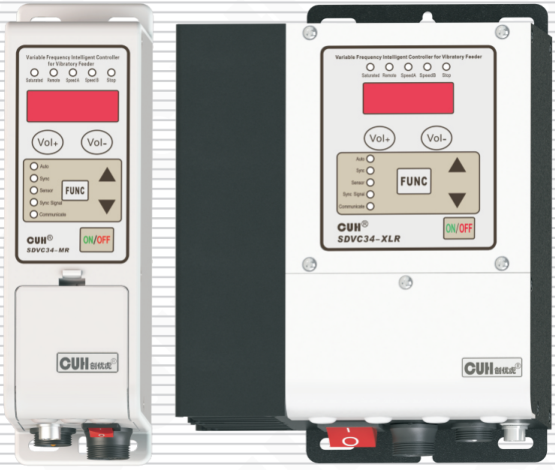

## SDVC34 Series
Digitaler frequenzgeregelter intelligenter Controller für Vibrationsförderer — SDVC34 Series
**Benutzerhandbuch**

---

## Urheberrechtshinweis

Nanjing CUH Science & Technology CO., Ltd. behält sich alle Rechte vor.

Alle Informationen in diesem Benutzerhandbuch sind das geistige Eigentum unseres Unternehmens und sind durch das Urheberrecht und andere damit verbundene Gesetze geschützt. CUH genießt und behält sich alle durch das Urheberrecht und andere Gesetze verliehenen Rechte vor. Ohne schriftliche Zustimmung von CUH darf dieses Benutzerhandbuch weder teilweise noch vollständig kopiert, übersetzt, nachgeahmt oder anderweitig genutzt werden.

## Haftungsausschluss

Alle Inhalte dieses Benutzerhandbuchs beschreiben ausschließlich die Verwendungsmethode der zugehörigen Produkte unseres Unternehmens und sind gemäß dem vorhandenen technischen Stand und dem Zustand beschrieben, in dem das Produkt an Sie übergeben wird. Bei der Verwendung dieses Produkts tragen Sie die entsprechenden Risiken. Sofern gesetzlich nicht anders gefordert, übernimmt das Unternehmen aufgrund dieses Benutzerhandbuchs keine ausdrückliche oder stillschweigende Verantwortung für das Produkt, einschließlich, aber nicht beschränkt auf Personenschäden, Sachschäden, Verlust von Chancen usw.

Sie verstehen die oben genannten Risiken ausdrücklich und erklären sich damit einverstanden, dass das Unternehmen, sofern gesetzlich nicht zwingend vorgeschrieben, nicht für direkte oder indirekte Schäden oder Verluste für Sie haftet (einschließlich, aber nicht beschränkt auf materielle Verluste an Personal, Eigentum, Daten usw. sowie immaterielle Verluste wie Ruf, Chancen usw.).

Das Unternehmen behält sich das Recht vor, die in diesem Benutzerhandbuch anwendbaren Produkte ohne vorherige oder nachträgliche Ankündigung zu ändern.

---

## Vorwort

Vielen Dank, dass Sie sich für den SDVC34-Controller der CUH entschieden haben. (Im folgenden Text kurz „Controller" genannt.) Diese Controller-Serie verwendet hochwertige Komponenten, integriert die neueste elektronische Technologie und ist mit Hochleistungs-Digitalsignalprozessoren sorgfältig ausgelegt.

Dieses Handbuch beschreibt die grundlegende Bedienungsmethode, die funktionale technische Beschreibung und typische Anwendungsbeispiele dieses Produkts. Es bietet Benutzern relevante Informationen zu Installation und Inbetriebnahme, Parametereinstellung, Fehlerdiagnose, Fehlerbehebung und Routenwartung des Controllers. Um die korrekte Installation und Verwendung dieses Controllers zu gewährleisten, lesen Sie dieses Benutzerhandbuch bitte vor der Installation sorgfältig durch und bewahren Sie es ordnungsgemäß auf.

Lesen Sie unbedingt die folgenden Symbole, um auf Vorsichtsmaßnahmen gegen Personenschäden und Produktschäden hingewiesen zu werden.

| | |
|---|---|
| ⚠ Gefahr | Die Nichtbeachtung dieses Punktes führt zu Personenschäden oder zum Tod. |
| ⚠ Warnung | Die Nichtbeachtung dieses Punktes kann zu Personenschäden oder zum Tod führen. |
| ⚠ Vorsicht | Die Nichtbeachtung dieses Punktes kann zu leichten oder mittelschweren Personenschäden führen. |
| Hinweis | Die Nichtbeachtung dieses Punktes führt zu Produkt- und Sachschäden. |
| ❗ Zwingend | Zeigt Vorsichtsmaßnahmen und Nutzungsbeschränkungen an, die während der Verwendung unbedingt beachtet werden müssen. |

**Dieses Benutzerhandbuch ist für die folgenden Controller-Modelle geeignet:**

Digitaler frequenzgeregelter intelligenter Controller für Vibrationsförderer

- SDVC34-MR　3.0A Ausgangsstrom (RS485)
- SDVC34-MRJ　3.0A Ausgangsstrom (RS485 & Zählung)
- SDVC34-XLR　6.0A Ausgangsstrom (RS485)
- SDVC34-XLRJ　6.0A Ausgangsstrom (RS485 & Zählung)

---

# Sicherheit und Vorsichtsmaßnahmen

1. **⚠ Gefahr** Dieses Produkt dient ausschließlich zum Antrieb elektromagnetischer Vibrationsfördereinrichtungen. Verwenden Sie dieses Produkt nicht zum Schutz des menschlichen Körpers oder von Körperteilen usw.

2. **⚠ Gefahr** Dieses Produkt ist nicht für den Einsatz als explosionsgeschütztes Produkt vorgesehen. Verwenden Sie es nicht in Gefahrenbereichen und/oder potenziell explosionsgefährdeten Gasumgebungen.

3. **⚠ Warnung** Dieses Produkt wird mit Wechselstromnetz betrieben. Bitte legen Sie keine Wechselspannung über 260Vac an. Eine zu hohe Eingangsspannung, wie z. B. 380Vac, kann dazu führen, dass das Produkt explodiert oder Feuer fängt und schwere Sicherheitsunfälle verursacht.

4. **⚠ Warnung** Dieses Produkt ist über das Netzkabel geerdet. Bitte stellen Sie sicher, dass die Stromverteilungseinrichtungen für den Controller gut geerdet sind, da sonst das Controller-Gehäuse unter Spannung stehen kann und dies zu einem Stromschlagunfall führt.

5. **⚠ Warnung** Führen Sie dem Ausgang dieses Controllers keine Wechselstromversorgung zu, da dies den Controller beschädigt.

6. **⚠ Warnung** Stecken Sie keine stromführenden Leitungen ein oder aus und berühren Sie nicht die Kontakte der einzelnen Klemmen im Anschlussfach, um einen Stromschlag zu vermeiden.

7. **Hinweis** Bitte vermeiden Sie es, den Ausgang dieses Produkts durch Abschalten der Stromversorgung über Relais und andere Geräte zu steuern, da dies die Lebensdauer des Controllers erheblich verkürzt.

8. **Hinweis** Der Controller ist für den Betrieb in einer kühlen und trockenen Umgebung ausgelegt. Betreiben Sie den Controller niemals im Freien, um Durchnässung und Sonneneinstrahlung zu vermeiden. Betreiben Sie den Controller innerhalb der Temperatur, die durch die elektrischen Eigenschaften vorgegeben ist.

9. **❗ Zwingend** Befestigen Sie dieses Produkt unbedingt auf einer soliden Plattform, die zuverlässig geerdet und von vibrierenden Geräten entfernt ist.

10. **❗ Zwingend** Betreiben Sie den Controller niemals unter Bedingungen, die seine ausgelegten Grenzen überschreiten.

11. **❗ Zwingend** Betreiben Sie den Controller strikt gemäß dieser Bedienungsanleitung. Wir übernehmen keine zivil- oder strafrechtliche Haftung, wenn Geräteschäden oder Personenschäden durch unsachgemäße Bedienung verursacht werden.

12. **❗ Zwingend** Öffnen Sie niemals das Controller-Gehäuse, um einen Stromschlag zu vermeiden. Wenden Sie sich an CUH, wenn der Controller ausfällt. Versuchen Sie niemals, den Controller selbst zu reparieren, da dies zum Erlöschen der Garantie führen kann.

---

# Betriebs- und Lagerungsumgebung

## Prüfung vor der Verwendung

Jeder Controller wird vor der Auslieferung einer strengen Qualitätsprüfung unterzogen und in stoßsicherer Verpackung geliefert. Bitte prüfen Sie nach dem Auspacken die folgenden Punkte:

1. Ob der Controller während des Transports beschädigt wurde.
2. Ob das Modell des Controllers Ihrem Bestellmodell entspricht.

## Betriebsumgebung

Bitte beachten Sie die folgenden Hinweise, um eine bessere Leistung und eine längere Lebensdauer des Controllers zu gewährleisten:

- ⚠ Gut belüftete Umgebung
- ⚠ Von Wasser, Feuchtigkeit, Staub und insbesondere öligem Staub fernhalten
- ⚠ Von korrosiven oder entflammbaren Gasen und Flüssigkeiten fernhalten
- ⚠ Von schwebendem Staub und Metallpartikeln fernhalten
- ⚠ Fest befestigen, um Eigenschwingungen zu vermeiden
- ⚠ Von elektromagnetischen Störungen fernhalten
- ⚠ Sicherstellen, dass die Umgebungstemperatur 0~40 °C beträgt
- ⚠ Zur Verwendung in Höhenlagen von 2000 m oder darunter

---

# Inhaltsverzeichnis

- **Kapitel Ⅰ Anweisungen vor dem Gebrauch — 1**
  - 1.1 Prüfung des Packungsinhalts — 1
  - 1.2 Erklärung der Anzeigen — 2
  - 1.3 Erklärung der Tasten — 4
  - 1.4 Erklärung der externen Teile — 4
  - 1.5 Erklärung der Anschlussklemmen — 5
  - 1.6 Erklärung des Typenschilds — 6
- **Kapitel Ⅱ Merkmale — 7**
  - 2.1 Produkteinführung — 7
  - 2.2 Auswahlhilfe — 8
    - 2.2.1 Modellerklärung — 8
    - 2.2.2 Funktionserklärung — 8
- **Kapitel Ⅲ Installationsanleitung — 9**
  - 3.1 Einsatzbedingungen des Controllers — 9
  - 3.2 Bedienung der Tasten — 9
  - 3.3 Installation und Verwendung — 10
- **Kapitel Ⅳ Parametereinstellung — 12**
  - 4.1 Allgemeine Parameter — 12
  - 4.2 Grundparameter — 12
  - 4.3 Erweiterte Parameter — 13
  - 4.4 Auto-/Sync-Parameter — 18
- **Kapitel Ⅴ Betriebsart — 22**
  - 5.1 Manueller Modus — 22
    - 5.1.1 Einstellung der Ausgangsspannung im manuellen Modus — 23
    - 5.1.2 Einstellung der Ausgangsfrequenz im manuellen Modus — 23
  - 5.2 Auto-Modus — 24
    - 5.2.1 Installation des Vibrationssensors — 24

---

---

- 5.2.2 Einstellung der Fördergeschwindigkeit im Auto-Modus — 26
- 5.2.3 Automatische Frequenzmessung im Auto-Modus — 26
- 5.3 Halbautomatischer Modus — 27
  - 5.3.1 Installation des Vibrationssensors — 27
  - 5.3.2 Einrichtung des halbautomatischen Modus — 27
  - 5.3.3 Einstellung der Fördergeschwindigkeit im halbautomatischen Modus — 28
  - 5.3.4 Einstellung der Ausgangsfrequenz im halbautomatischen Modus — 28
- 5.4 Sync-Modus — 29
  - 5.4.1 Anschlussmethode des Sync-Signalkabels — 30
  - 5.4.2 Anwendungen des Sync-Modus — 31
- 5.5 Zählmodus — 35
  - 5.5.1 Verwendungsmethode — 36
  - 5.5.2 Anschlussmethode — 37
  - 5.5.3 Logikrichtung des Zählpulses — 38
  - 5.5.4 Logikrichtung des Zähl-Reset — 38
  - 5.5.5 Erklärung der Zählparameter — 39

## Kapitel Ⅵ Signalsteuerung — 41

- 6.1 EIN/AUS-Steuerung der C-Ports — 41
  - 6.1.1 Anschlussmethode der C-Ports — 41
  - 6.1.2 EIN/AUS-Verzögerung der C-Ports — 46
  - 6.1.3 Logische Verknüpfung der EIN/AUS-Steuerung der C-Ports — 47
- 6.2 EIN/AUS-Steuerung der E-Ports — 48
  - 6.2.1 Anschlussmethode der E-Ports — 48
  - 6.2.2 EIN/AUS-Verzögerung der E-Ports — 49
  - 6.2.3 Logische Verknüpfung der EIN/AUS-Steuerung der E-Ports — 50
- 6.3 Gemeinsame Parameter der C-Ports und E-Ports — 51
  - 6.3.1 Logische Verknüpfung der C-Ports und E-Ports — 51
  - 6.3.2 Schaltsensor-Typ — 52
  - 6.3.3 Logikoperation des Hauptausgangs — 53
- 6.4 Fernsteuerung der Geschwindigkeit — 54

---

---

- 6.5 Steuerausgang — 56
  - 6.5.1 Anschlussmethode des Steuerausgangs — 56
  - 6.5.2 Logische Verknüpfung des Steuerausgangs — 57
  - 6.5.3 Logikoperation des Steuerausgangs — 58
- 6.6 Speichern und Ausgeben voreingestellter Geschwindigkeiten — 59
- 6.7 RS485-Kommunikation — 61
  - 6.7.1 RS485-Kommunikationsadresse — 61
  - 6.7.2 RS485-Kommunikations-Baudrate — 61
  - 6.7.3 RS485-Kommunikationsprotokoll — 62

**Kapitel Ⅶ Sicherheitsfunktionen — 63**

**Kapitel Ⅷ Anhang — 64**

- 8.1 Abmessungen — 64
- 8.2 Eingangs- und Ausgangsschaltpläne — 67
- 8.3 Technische Spezifikationen — 70
- 8.4 Vorschläge zur Fehlerbehebung und Fehlererklärungen — 71

**Kapitel Ⅸ Informationen zur Produktgarantie — 73**

- 9.1 Garantiezeit — 73
- 9.2 Garantieumfang — 73
- 9.3 Produkteignung — 73

---

# Kapitel I Anweisungen vor dem Gebrauch

Dieses Kapitel beschreibt den Verpackungsinhalt des Produkts, die Beschreibung des Controller-Äußeren und die Informationen auf dem Typenschild des Controllers.

## 1.1 Prüfung des Packungsinhalts

Prüfen Sie vor der Verwendung die Unversehrtheit des Controllers und des Zubehörs. Wenn Sie feststellen, dass das Produkt defekt oder beschädigt ist, Zubehör fehlt usw., wenden Sie sich bitte an unser Unternehmen.

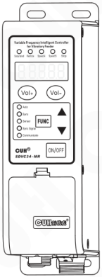

Controller×1

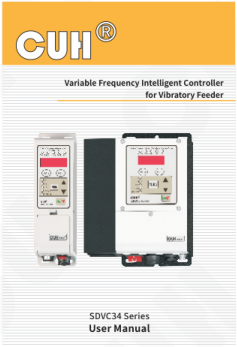

Benutzerhandbuch×1

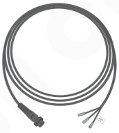

Ausgangskabel×1

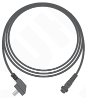

Eingangsnetzkabel×1

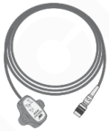

Vibrationssensor×1

---

## 1.2 Erklärung der Anzeigen

### Controller mit RS485-Funktion

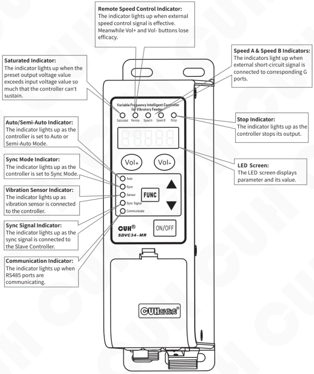

**Anzeige für Fernsteuerung der Geschwindigkeit:**
Die Anzeige leuchtet, wenn das externe Geschwindigkeitssteuersignal wirksam ist. Gleichzeitig verlieren die Tasten Vol+ und Vol- ihre Funktion.

**Sättigungsanzeige:**
Die Anzeige leuchtet, wenn der voreingestellte Ausgangsspannungswert den Eingangsspannungswert so stark überschreitet, dass der Controller ihn nicht halten kann.

**Speed-A- und Speed-B-Anzeigen:**
Die Anzeigen leuchten, wenn ein externes Kurzschlusssignal an die entsprechenden G-Ports angeschlossen ist.

**Auto-/Halbautomatik-Anzeige:**
Die Anzeige leuchtet, wenn der Controller auf Auto- oder Halbautomatik-Modus eingestellt ist.

**Sync-Modus-Anzeige:**
Die Anzeige leuchtet, wenn der Controller auf Sync-Modus eingestellt ist.

**Vibrationssensor-Anzeige:**
Die Anzeige leuchtet, wenn ein Vibrationssensor an den Controller angeschlossen ist.

**Sync-Signal-Anzeige:**
Die Anzeige leuchtet, wenn das Sync-Signal an den Slave-Controller angeschlossen ist.

**Kommunikationsanzeige:**
Die Anzeige leuchtet, wenn die RS485-Ports kommunizieren.

**Stopp-Anzeige:**
Die Anzeige leuchtet, wenn der Controller seine Ausgabe stoppt.

**LED-Bildschirm:**
Der LED-Bildschirm zeigt Parameter und deren Wert an.

---

## Controller mit RS485&Zählfunktion

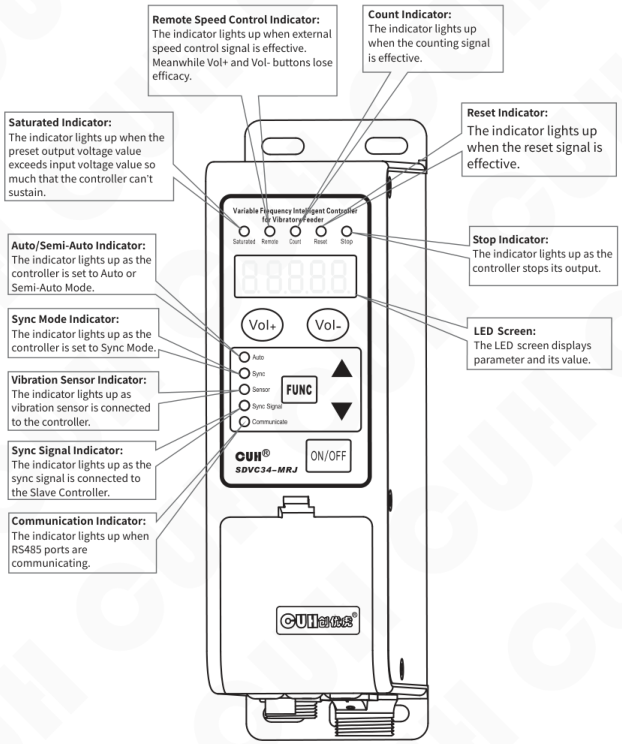

**Anzeige für Fernsteuerung der Geschwindigkeit:**  
Die Anzeige leuchtet, wenn das externe Geschwindigkeitssteuersignal wirksam ist. Gleichzeitig verlieren die Tasten Vol+ und Vol- ihre Funktion.

**Zählanzeige:**  
Die Anzeige leuchtet, wenn das Zählsignal wirksam ist.

**Sättigungsanzeige:**  
Die Anzeige leuchtet, wenn der voreingestellte Ausgangsspannungswert den Eingangsspannungswert so stark überschreitet, dass der Controller ihn nicht halten kann.

**Reset-Anzeige:**  
Die Anzeige leuchtet, wenn das Reset-Signal wirksam ist.

**Auto-/Halbautomatik-Anzeige:**  
Die Anzeige leuchtet, wenn der Controller auf Auto- oder Halbautomatik-Modus eingestellt ist.

**Stopp-Anzeige:**  
Die Anzeige leuchtet, wenn der Controller seine Ausgabe stoppt.

**Sync-Modus-Anzeige:**  
Die Anzeige leuchtet, wenn der Controller auf Sync-Modus eingestellt ist.

**LED-Bildschirm:**  
Der LED-Bildschirm zeigt Parameter und deren Wert an.

**Vibrationssensor-Anzeige:**  
Die Anzeige leuchtet, wenn ein Vibrationssensor an den Controller angeschlossen ist.

**Sync-Signal-Anzeige:**  
Die Anzeige leuchtet, wenn das Sync-Signal an den Slave-Controller angeschlossen ist.

**Kommunikationsanzeige:**  
Die Anzeige leuchtet, wenn die RS485-Ports kommunizieren.

---

## 1.3 Erklärung der Tasten

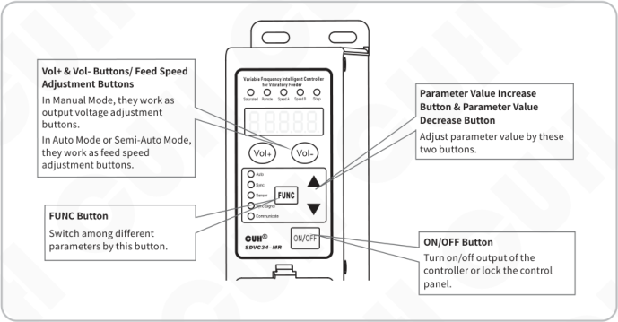

**Vol+ & Vol- Tasten/ Tasten zur Einstellung der Fördergeschwindigkeit**

Im manuellen Modus dienen sie als Tasten zur Einstellung der Ausgangsspannung.

Im Auto-Modus oder halbautomatischen Modus dienen sie als Tasten zur Einstellung der Fördergeschwindigkeit.

**FUNC-Taste**

Mit dieser Taste wird zwischen verschiedenen Parametern gewechselt.

**Taste zum Erhöhen des Parameterwerts & Taste zum Verringern des Parameterwerts**

Mit diesen beiden Tasten wird der Parameterwert eingestellt.

**EIN/AUS-Taste**

Schaltet den Ausgang des Controllers ein/aus oder sperrt das Bedienfeld.

## 1.4 Erklärung der externen Teile

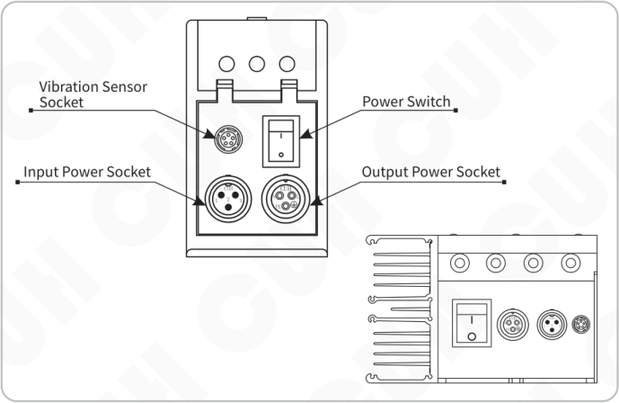

- Vibrationssensor-Buchse
- Eingangsstrom-Buchse
- Netzschalter
- Ausgangsstrom-Buchse

---

## 1.5 Erklärung der Anschlussklemmen

### SDVC34-MR:

### SDVC34-MRJ:

---

### SDVC34-XLR:

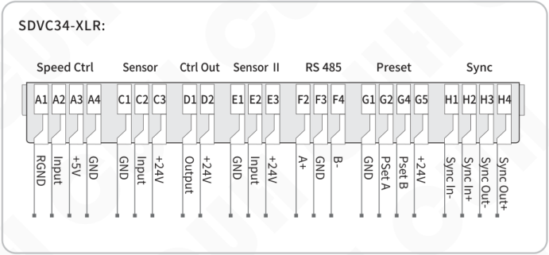

| Funktion | Port | Signal |
|---|---|---|
| Speed Ctrl | A1 | RGND |
| Speed Ctrl | A2 | Input |
| Speed Ctrl | A3 | +5V |
| Speed Ctrl | A4 | GND |
| Sensor | C1 | GND |
| Sensor | C2 | Input |
| Sensor | C3 | +24V |
| Ctrl Out | D1 | Output |
| Ctrl Out | D2 | +24V |
| Sensor Ⅱ | E1 | GND |
| Sensor Ⅱ | E2 | Input |
| Sensor Ⅱ | E3 | +24V |
| RS 485 | F2 | A+ |
| RS 485 | F3 | GND |
| RS 485 | F4 | B- |
| Preset | G1 | GND |
| Preset | G2 | PSet A |
| Preset | G4 | Pset B |
| Preset | G5 | +24V |
| Sync | H1 | Sync In- |
| Sync | H2 | Sync In+ |
| Sync | H3 | Sync Out- |
| Sync | H4 | Sync Out+ |

## 1.6 Erklärung des Typenschilds

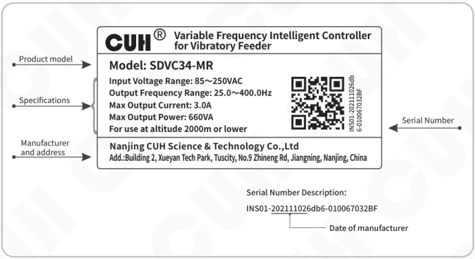

**CUH® — Digitaler frequenzgeregelter intelligenter Controller für Vibrationsförderer**

**Produktmodell**

Modell: SDVC34-MR

**Spezifikationen**

- Eingangsspannungsbereich: 85～250VAC
- Ausgangsfrequenzbereich: 25.0～400.0Hz
- Max. Ausgangsstrom: 3.0A
- Max. Ausgangsleistung: 660VA
- Für die Verwendung in Höhenlagen von 2000 m oder darunter

**Hersteller und Adresse**

Nanjing CUH Science & Technology Co.,Ltd

Add.:Building 2, Xueyan Tech Park, Tuscity, No.9 Zhineng Rd, Jiangning, Nanjing, China

**Seriennummer**

INS01-202111026db6-010067032BF

Beschreibung der Seriennummer:

INS01-<u>20211102</u>6db6-010067032BF

20211102 → Herstellungsdatum

---

## KapitelⅡ Merkmale

### 2.1 Produkteinführung

Der Controller ist speziell für die Steuerung von Vibrationsförderern in Automatisierungssystemen entwickelt. In Kombination mit der neuesten Elektroniktechnologie und aufwendigem Design bietet der Controller die folgenden praktischen und komfortablen Funktionen:

**Auto-FM:** Automatische Ausgangsfrequenzmodulation in Echtzeit, um sicherzustellen, dass der Vibrationsförderer stets mit seiner optimalen Vibrationsfrequenz arbeitet.

**Automatische Konstantgeschwindigkeitsregelung:** Automatische Anpassung der Ausgangsspannung in Echtzeit, um eine konstante voreingestellte Fördergeschwindigkeit unabhängig von Gewichtsänderungen des Fördermaterials im Vibrationsförderer zu gewährleisten.

**Automatische Frequenzmessung:** Automatische Messung und Ausgabe der optimalen Vibrationsfrequenz des Vibrationsförderers.

**Automatische Spannungsregelung:** Eliminiert sowohl die durch Netzspannungsschwankungen verursachte Änderung der Fördergeschwindigkeit als auch den durch die industrielle Wechselstromfrequenz verursachten Schwebungseffekt.

**Wellenform-Synchronisation:** Synchronisiert die Ausgangswellenform der Slave-Controller mit der des Master-Controllers auf dieselbe Frequenz und Phase, um den Schwebungseffekt zu vermeiden.

**Fern-EIN/AUS-Steuerung:** Der Controller verfügt über 2 Gruppen von EIN/AUS-Steuerports. Schaltsensoren oder SPS können angeschlossen werden, um den Controller ein-/auszuschalten. Sanftanlaufzeit, EIN-Verzögerung, AUS-Verzögerung und logische Verknüpfung der EIN/AUS-Steuerung können ebenfalls eingestellt werden.

**Automatische Erkennung des Schaltsensor-Typs:** Der Controller kann sowohl Schaltsensoren vom Typ NPN als auch PNP erkennen und sich daran anpassen.

**Sanftanlauf:** Um einen plötzlichen Stoß auf das Fördermaterial und den Vibrationsförderer zu vermeiden, kann der Controller beim Start die Ausgangsspannung/Fördergeschwindigkeit sanft von 0 auf den voreingestellten Wert erhöhen.

**Voreingestellte Geschwindigkeiten:** 4 voreingestellte Fördergeschwindigkeiten können gespeichert und über ein externes Kurzschlusssignal ausgegeben werden.

**Beschleunigung:** Der maximale Ausgangsspannungswert des Controllers kann auf bis zu 150 % des Eingangsspannungswerts erhöht werden.

**Maximal einstellbare Ausgangsspannung:** Die maximal einstellbare Ausgangsspannung kann voreingestellt werden, um den Vibrationsförderer vor Schäden durch hohe Spannung zu schützen.

**Wellenformindex:** Benutzer können durch Anpassen dieses Parameters Effizienz und maximale Leistung ausbalancieren.

**Fernsteuerung der Geschwindigkeit:** Ausgangsspannung/Fördergeschwindigkeit des Controllers können über ein externes Potentiometer, eine SPS oder ein 1~5V/4~20mA-Gleichstromsignal ferngesteuert werden.

**24-V-DC-Steuerausgang:** Der Controller kann eine 24-V-Gleichstromversorgung in Verbindung mit der Einstellung der logischen Verknüpfung der EIN/AUS-Steuerung ausgeben, um ein Magnetventil, ein elektrisches Relais oder andere externe Geräte anzusteuern.

**Zählfunktion:** Der Controller (nur SDVC34-MRJ) kann die durchlaufenden Teile zählen und seinen Ausgang automatisch verlangsamen oder stoppen, wenn die Anzahl der durchlaufenden Teile den voreingestellten Wert erreicht.

**Bedienfeldsperre:** Alle Tasten auf dem Bedienfeld werden durch Drücken und 2 Sekunden Halten der EIN/AUS-Taste gesperrt, um Fehlbedienungen zu vermeiden.

**Parametersperre:** Alle Parameter außer Ausgangsspannung/Fördergeschwindigkeit werden durch ein selbst definiertes Passwort gesperrt, um unbefugte Bedienung zu verhindern.

**Controller-Reset:** Alle Parameter des Controllers werden auf die Werkseinstellungen zurückgesetzt.

**RS485-Kommunikation:** Alle Parameter können über die RS485-Kommunikationsports eingestellt werden.

---

## 2.2 Auswahlhilfe

### 2.2.1 Modellerklärung

| Controller-Modell | Leistung (VA) | Funktion |
|---|---|---|
| SDVC34-MR | 660 | RS485 |
| SDVC34-MRJ | 660 | RS485 & Zählung |
| SDVC34-XLR | 1320 | RS485 |
| SDVC34-XLRJ | 1320 | RS485 & Zählung |

### 2.2.2 Funktionserklärung

| Funktion | Allgemein | Zählung | RS485 | RS485 & Zählung |
|---|---|---|---|---|
| EIN/AUS-Steuerung der C-Ports | √ | √ | √ | √ |
| Fernsteuerung der Geschwindigkeit | √ | √ | √ | √ |
| Steuerausgang | √ | √ | √ | √ |
| Voreingestellte Geschwindigkeiten | √ | | √ | |
| Zählung | | √ | | √ |
| EIN/AUS-Steuerung der E-Ports | | | √ | √ |
| Synchronisation | | | √ | √ |
| RS 485 | | | √ | √ |
| Vibrationssensor | √ | √ | √ | √ |

---

# Kapitel Ⅲ Installationsanleitung

Dieses Kapitel beschreibt die notwendigen Bedingungen für die Verwendung des Controllers und wie er korrekt installiert und angeschlossen wird.

## 3.1 Einsatzbedingungen des Controllers

Der Controller wird mit Wechselstrom 110/220V betrieben, und die Schutzleiterverbindung erfolgt über den Stecker des Netzkabels. Bitte stellen Sie eine den Normen entsprechende 110V- oder 220V-, 50Hz/60Hz-Netzstromversorgung und -verteilung bereit und stellen Sie sicher, dass der Schutzleiter korrekt angeschlossen ist.

**⚠ Warnung** Schließen Sie den Controller niemals an 380V Wechselstrom an, dies verursacht irreversible schwere Schäden am Controller und kann zu Explosionen, Bränden und anderen Sicherheitsvorfällen führen.

**⚠ Warnung** Stellen Sie sicher, dass die Versorgungsseite zuverlässig geerdet ist. Das Metallgehäuse des Controllers ist direkt mit dem Schutzleiter verbunden. Eine schlechte Erdung führt dazu, dass das Controller-Gehäuse unter Spannung steht und einen Stromschlagunfall verursacht.

**Hinweis** Längerer Betrieb erzeugt Wärme und lässt die Temperatur des Gehäuses ansteigen. Bitte installieren Sie den Controller in einer gut belüfteten Umgebung und befestigen Sie ihn gut, fern von Vibrationsquellen.

**Hinweis** Der Ausgang dieses Produkts entsteht durch Gleichrichtung und Umrichtung der Netzversorgung, und es besteht keine Isolierung zwischen seinem Eingang und Ausgang. Daher dürfen die Ausgangspole nicht mit dem Schutzleiter verbunden werden. Beim Anschließen des Elektromagneten muss sichergestellt werden, dass die Elektromagnetspule und das Gehäuse eine grundlegende Isolationsfähigkeit aufweisen. Andernfalls kann ein Stromleck auftreten, das einen Stromschlag und Schäden am Controller verursachen kann.

**Hinweis** Dieses Produkt ist ein Controller zum Antrieb eines Elektromagneten. Es darf nicht an einen piezoelektrischen Vibrationsförderer angeschlossen werden.

## 3.2 Bedienung der Tasten

a. Kurzes Drücken ist definiert als eine Drückzeit von mehr als 0,1 und weniger als 2 Sekunden, langes Drücken als eine Drückzeit von mehr als 2 Sekunden.

b. Durch kurzes Drücken von `Vol+` oder `Vol-` werden die Ausgangsspannung und die Fördergeschwindigkeit des Controllers an jeder LED-Schnittstelle angepasst. Nach der Einstellung eines allgemeinen Parameters kehrt der Controller zum vorherigen Parameter zurück.

c. Durch langes Drücken von `ON/OFF` werden alle Tasten auf dem Bedienfeld gesperrt oder entsperrt. Im gesperrten Zustand sind alle Tasten nicht einstellbar.

d. Betreten oder Verlassen der Grundparameter-Schnittstelle durch langes Drücken von `FUNC`, Wechseln zwischen den Grundparametern durch kurzes Drücken von `FUNC`, und Anpassen des Parameterwerts durch kurzes Drücken von ▼ oder ▲.

e. Betreten oder Verlassen der Schnittstelle für erweiterte Parameter durch langes Drücken von `FUNC` und ▲, Wechseln zwischen den erweiterten Parametern durch kurzes Drücken von `FUNC`, und Anpassen des Parameterwerts durch kurzes Drücken von ▼ oder ▲.

f. Betreten oder Verlassen der Auto-/Sync-Parameter-Schnittstelle durch langes Drücken von `FUNC` und ▼, Wechseln zwischen den Auto-/Sync-Parametern durch kurzes Drücken von `FUNC`, und Anpassen des Parameterwerts durch kurzes Drücken von ▼ oder ▲.

---

## 3.3 Installation und Verwendung

### Schritt Eins:

Öffnen Sie die Verpackungsschachtel und prüfen Sie den Controller und das gesamte Zubehör.

### Schritt Zwei:

Verbinden Sie die Anschlussklemmen des Ausgangsleistungskabels mit der Elektromagnetspule des Vibrators.

Richten Sie die Kerbe am Luftfahrtstecker des Ausgangskabels am Dreieckszeichen der Ausgangsbuchse des Controllers aus, und ziehen Sie dann die Mutter fest, nachdem das Ausgangskabel korrekt angeschlossen wurde.

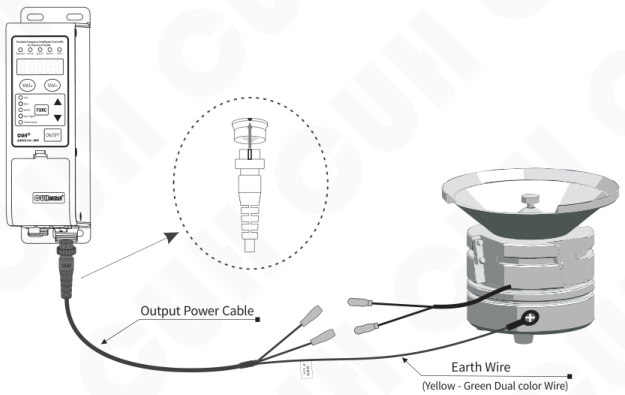

### Hinweis

1. Stellen Sie sicher, dass die Elektromagnetspulen des Vibrators mit den beiden Ausgangsstiften des Ausgangsleistungskabels verbunden sind und die Metallhülle des Vibrators zuverlässig geerdet ist.
2. Es ist verboten, piezoelektrische Lasten an den Leistungsausgang anzuschließen, da dies sonst zu einem Stromschlag-Sicherheitsunfall führen kann!

---

### Schritt Drei:

Verbinden Sie den Stecker des Eingangsleistungskabels mit der Eingangsstrom-Buchse des Controllers.

Zuerst die Controllerseite anschließen

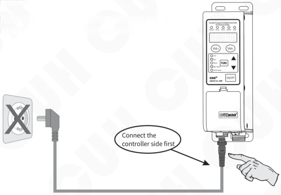

### Schritt Vier:

Nachdem bestätigt wurde, dass sich der Schalter in der Aus-Stellung befindet, verbinden Sie den Stecker des Eingangsleistungskabels mit der Netzsteckdose.

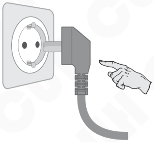

---

# Kapitel Ⅳ Parametereinstellung

Die Parameter des Controllers werden nach verschiedenen Einstellmethoden in 4 Typen eingeteilt: Allgemeine Parameter, Grundparameter, Erweiterte Parameter und Auto-/Sync-Parameter.

## 4.1 Allgemeine Parameter

- Drücken Sie `Vol+` oder `Vol-`, um allgemeine Parameter einzustellen.
- Die Tasten `Vol+` und `Vol-` sind ausschließlich für die Einstellung der allgemeinen Parameter vorgesehen.
- Allgemeine Parameter können durch Drücken von `Vol+` oder `Vol-` auch dann eingestellt werden, wenn ein anderer Parameter auf dem LED-Bildschirm angezeigt wird. Nach der Einstellung eines allgemeinen Parameters kehrt der Controller zum vorherigen Parameter zurück.

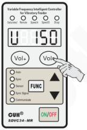

|  | Definition | Symbol | Symbolbild | Bereich | Standardwert |
|---|---|---|---|---|---|
| Allgemeine Parameter | Ausgangsspannung | U |  | 0~250 (V) | 150 |
| Allgemeine Parameter | Fördergeschwindigkeit | A |  | 0~3200 | 200 |
| Allgemeine Parameter | Tastatursperre | a |  | —— | Aktueller Spannungswert/ Aktuelle Fördergeschwindigkeit |

## 4.2 Grundparameter

- Drücken Sie `FUNC` und halten Sie die Taste 2 Sekunden lang gedrückt, um in den Status zur Einstellung der Grundparameter zu gelangen.
- Drücken Sie `FUNC` wiederholt, um zyklisch zwischen den verschiedenen Parametern zu wechseln.
- Drücken Sie die Taste ▲ oder ▼, um den Parameterwert einzustellen.
- Drücken Sie `FUNC` erneut und halten Sie die Taste 2 Sekunden lang gedrückt, um den Status zur Einstellung der Grundparameter zu verlassen.

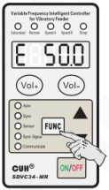

|  | Definition | Symbol | Symbolbild | Bereich | Standardwert |
|---|---|---|---|---|---|
| Grundparameter Langes Drücken von `FUNC` | Ausgangsfrequenz | E |  | 25.0~400.0 (Hz) | 50.0 |
| Grundparameter Langes Drücken von `FUNC` | EIN-Verzögerung der C-Ports | J | 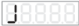 | 0.0~99.9 (s) | 0.2 |
| Grundparameter Langes Drücken von `FUNC` | AUS-Verzögerung der C-Ports | L |  | 0.0~99.9 (s) | 0.2 |
| Grundparameter Langes Drücken von `FUNC` | Sanftanlaufzeit | t |  | 0.0~10.0 (s) | 0.5 |
| Grundparameter Langes Drücken von `FUNC` | Maximales Zähllimit (Controller mit Zählfunktion, Suffix J) | 3 | 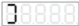 | 0~9999 | 0 |

---

## 4.3 Erweiterte Parameter

- Drücken Sie die Tasten `FUNC` und ▲ gleichzeitig und halten Sie sie 2 Sekunden lang gedrückt, um in den Status zur Einstellung der erweiterten Parameter zu gelangen.
- Drücken Sie `FUNC` wiederholt, um zyklisch zwischen den verschiedenen Parametern zu wechseln.
- Drücken Sie ▲ oder ▼, um den Parameterwert einzustellen.
- Drücken Sie die Tasten `FUNC` und ▲ erneut gleichzeitig und halten Sie sie 2 Sekunden lang gedrückt, um den Status zur Einstellung der erweiterten Parameter zu verlassen.

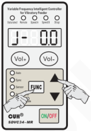

**Erweiterte Parameter**  
Langes Drücken von `FUNC` und ▲

| Definition | Symbol | Symbolbild | Bereich | Standardwert |
|---|---|---|---|---|
| EIN-Verzögerung des E-Ports | J- |  | 0.0~99.9 (s) | 0.0 |
| AUS-Verzögerung des E-Ports | L- |  | 0.0~99.9 (s) | 0.0 |
| EIN-Verzögerung des D-Ports | Jd |  | 0.0~99.9 (s) | 0.0 |
| AUS-Verzögerung des D-Ports | Ld |  | 0.0~99.9 (s) | 0.0 |
| Typ des D-Ports | rd |  | nPn, PnP, PSP (Gegentakt) | nPn |
| Logische Verknüpfung des C-Ports | F2 | 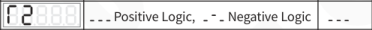 | Positive Logik, Negative Logik | Positive Logik |
| Logische Verknüpfung des E-Ports | F1 | 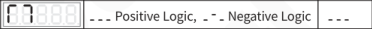 | Positive Logik, Negative Logik | Positive Logik |
| Logische Verknüpfung des Steuerausgangs | F3 | 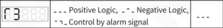 | Positive Logik, Negative Logik, Steuerung durch Alarmsignal | Positive Logik |
| Logikoperation des Hauptausgangs | F4 | 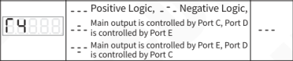 | Positive Logik, Negative Logik, Hauptausgang wird von Port C gesteuert, Port D wird von Port E gesteuert Hauptausgang wird von Port E gesteuert, Port D wird von Port C gesteuert | Positive Logik |
| Logikoperation des Steuerausgangs | F8 |  | Hauptlogik, Zweite Logikgruppe | Hauptlogik |
| Schaltsensor-Typ (Controller mit RS485-Funktion, Suffix R) | FA |  | Uto, nPn, PnP | Uto |
| Schaltsensor-Typ (Controller mit Zählfunktion, Suffix J) | FA |  | nPn, PnP | nPn |
| Logische Verknüpfung von Port C und E | ∩ | 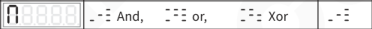 | And, or, Xor | And |
| Logikrichtung des Zählpulses (Controller mit Zählfunktion, Suffix J) | Fb | 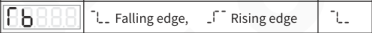 | Fallende Flanke, Steigende Flanke | Fallende Flanke |
| Logikrichtung des Zähl-Reset (Controller mit Zählfunktion, Suffix J) | FC | 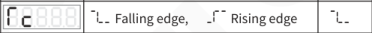 | Fallende Flanke, Steigende Flanke | Fallende Flanke |
| Geschwindigkeitsprozentsatz am Zählende (Controller mit Zählfunktion, Suffix J) | u |  | 0~100 | 30 |
| Anzahl der Zählenden (Controller mit Zählfunktion, Suffix J) | n |  | 0~255 | 3 |
| Zähl-Anti-Jitter-Zeit (Controller mit Zählfunktion, Suffix J) | U | 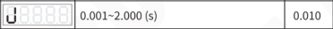 | 0.001~2.000 (s) | 0.010 |

### Erweiterte Parameter

Langes Drücken von **FUNC** und **▲**

| Definition | Symbol | Symbolbild | Bereich | Standardwert |
|---|---|---|---|---|
| Maximal einstellbare Ausgangsspannung | h | 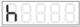 | 0~250 (V) | 250 |
| Untere Grenze der Ausgangsfrequenz | e |  | 25.0~390.0 (Hz) | 40.0 |
| Beschleunigungsindex | y | 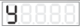 | 100~150 % | 120 |
| Wellenformindex | r |  | 0~100 | 100 |
| Temperaturanzeige | C |  | -10.0~80.0 (°C) | Aktuelle Temperatur |
| Kommunikationsprotokoll | P | 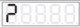 | ASC, rtu | rtu |
| Kommunikationsadresse | Siehe Symbolbild |  | 1~31 | 1 |
| Kommunikations-Baudrate | d | 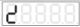 | 0.3~115.2 kbps | 9.6 |
| Parametersperr-Passwort | q- | 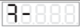 | 0~999 | - - - |
| Einschaltstatus | rd |  | Run, Stop, Follow before power off 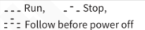 | - - - 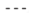 |
| Softwareversion | Ur |  | —— | Aktuelle Version |
| Automatische Rücksetzzeit nach Zählerabschluss (Controller mit Zählfunktion, Suffix J) | rE |  | 0.0~99.9 (s) | 0.0 |
| Controller-Reset | 8.8.8.8.8. | 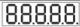 | —— | —— |

---

## Erklärung einiger erweiterter Parameter

### Maximal einstellbare Ausgangsspannung: h

Der Ausgangsspannungsbereich beträgt 0 bis 250 V. Parameter h begrenzt die maximale Ausgangsspannung auf einen bestimmten Wert, um den Vibrationsförderer vor Hochspannung durch Fehlbedienung zu schützen.

Die Spannung der Fernsteuerung der Geschwindigkeit wird ebenfalls von diesem Parameter beeinflusst.

### Untere Grenze der Ausgangsfrequenz: E.

Der Ausgangsfrequenzbereich beträgt 25.0 bis 390.0 (Hz). Parameter E. begrenzt die minimale Ausgangsfrequenz auf einen festgelegten Wert, um den Vibrationsförderer vor Fehlbedienung zu schützen.

### Geschwindigkeitsprozentsatz am Zählende: u

Bedeutet, dass die Fördergeschwindigkeit des Controllers auf diesen Prozentsatz der Anfangsgeschwindigkeit absinkt, wenn die Zählung in den letzten Verlangsamungszustand eintritt.

### Anzahl der Zählenden: n

Bezieht sich auf die Gesamtzahl der Distanzzählungen. Nach Erreichen der „Endzahl" wechselt der Controller in den Zähl-Rückwärtsmodus.

### Zähl-Anti-Jitter-Zeit: J

Die effektive Zeit des hohen oder niedrigen Pegels im Zählerstatus.

### Beschleunigungsindex: y

Gibt an, welchen Prozentsatz der Eingangsspannung die maximale Ausgangsspannung erreichen kann. Nach der Einstellung überschreitet die maximale Ausgangsspannung weiterhin nicht den Wert von Parameter h.

### Wellenformindex: r

Der Controller kann die Leistung zwischen höchster Effizienz, maximaler Leistung und minimalem Rauschen kontinuierlich ausbalancieren, um den höheren Anforderungen der Kunden gerecht zu werden.

### EIN/AUS-Verzögerung des D-Ports: Jd und Ld

Der EIN/AUS-Verzögerungsbereich beträgt 0,0~99,9 s, der Standardwert ist 0,0 s.

### Typ des D-Ports: rd

Der Steuerausgangsport kann NPN-Ausgang, PNP-Ausgang und Gegentakt-Ausgang unterstützen. Dabei gilt:

Der NPN-Ausgang ist bei niedrigem Pegel gültig, und der Ausgang ist bei hoher Impedanz ungültig;

Der PNP-Ausgang ist bei hohem Pegel gültig, und der Ausgang ist bei hoher Impedanz ungültig;

Der Gegentakt-Ausgang ist bei hohem Pegel gültig und bei niedrigem Pegel ungültig.

---

### Logikoperation des Steuerausgangs: Γ8

Für die Logik von Hauptausgang und Steuerausgang kann der Benutzer festlegen, dass das Steuerausgangssignal dem Hauptausgangssignal folgt.

### Temperaturanzeige: C

Zeigt die Innentemperatur des Controllers in Echtzeit an. Nur Lesen.

### Parametersperr-Passwort: 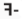

Sperrt alle Parameter außer dem Ausgangsspannungsparameter U/ dem Fördergeschwindigkeitsparameter A durch ein selbst definiertes Passwort, um unbefugte Bedienung zu verhindern.

Aktiviert die Parametersperrfunktion durch Festlegen von 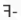 eines Passworts; dieses Passwort wirkt auch nach dem Ausschalten weiter. Wenn der Benutzer die erweiterten Parameter aufruft, zeigt das LED-Display 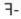 als Hinweis, dass ein Passwort erforderlich ist. Ist das Passwort korrekt, führt ein kurzes Drücken von `FUNC` in die Einstellungen der erweiterten Parameter. Ist das Passwort falsch, wird das kurze Drücken von `FUNC` ignoriert.

### Einschaltstatus: Γd

Gibt den Betriebsstatus des Controllers nach dem Einschalten an.

### Softwareversion: Ur

Zeigt die aktuelle Softwareversion des Controllers an. Nur Lesen.

### Automatische Rücksetzzeit nach Zählerabschluss: ΓE

Dieser Parameter ΓE legt die automatische Rücksetzverzögerungszeit nach dem Vollzählen fest; wenn die Verzögerungszeit erreicht ist, wird der Zähler auf null zurückgesetzt, und die Zähl- und Reset-Anzeige leuchten auf.

---

## Controller-Reset-Parameter: 8.8.8.8.8.

Setzt bei Bedarf alle Parameter über diesen Parameter auf die Werkseinstellungen zurück.

### Controller-Reset

**Schritt 1:** Drücken Sie die Tasten **FUNC** und ▲ gleichzeitig und halten Sie sie 2 Sekunden lang gedrückt, um in den Status zur Einstellung der erweiterten Parameter zu gelangen.

**Schritt 2:** Drücken Sie **FUNC**, um zum blinkenden Parameter `8.8.8.8.8.` auf dem LED-Bildschirm zu wechseln.

**Schritt 3:** Halten Sie die Taste ▲ gedrückt, bis `-----` auf dem LED-Bildschirm angezeigt wird.

**Schritt 4:** Lassen Sie die Taste ▲ los, um den Controller-Reset abzuschließen; auf dem LED-Bildschirm wird U150 angezeigt.

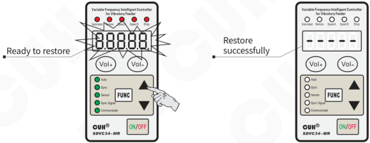

---

## 4.4 Auto-/Sync-Parameter

- Drücken Sie die Tasten **FUNC** und ▼ gleichzeitig und halten Sie sie 2 Sekunden lang gedrückt, um in den Status zur Einstellung der Auto-/Sync-Parameter zu gelangen.
- Drücken Sie **FUNC** wiederholt, um zyklisch zwischen den verschiedenen Parametern zu wechseln.
- Drücken Sie ▲ oder ▼, um den Parameterwert einzustellen.
- Drücken Sie die Tasten **FUNC** und ▼ erneut gleichzeitig und halten Sie sie 2 Sekunden lang gedrückt, um den Status zur Einstellung der Auto-/Sync-Parameter zu verlassen.

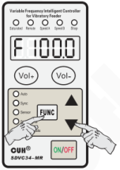

**Auto-/Sync-Parameter**  
Langes Drücken von **FUNC** und ▼

| Definition | Symbol | Symbolbild | Bereich | Standardwert |
|---|---|---|---|---|
| Mittelfrequenz | F |  | 25.0~400.0 (Hz) | 100.0 |
| Maximaler Offset bei Auto-FM | n |  | 0.0~180.0 (Hz) | 30.0 |
| Ausgangsspannungs-Einstellmethode | FS | 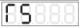 | Auto, Manual（entsprechende Symbole siehe Abbildung）  | - - - |
| Ausgangsfrequenz-Einstellmethode | FG | 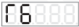 | Auto, Manual, Sync（entsprechende Symbole siehe Abbildung） 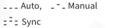 | - - - |
| Ausgangsfrequenz-Auto-Einstellindex | iF | 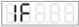 | 0~200 | 20 |
| Amplituden-Auto-Einstellindex | PA | 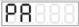 | 0~999 | 60 |
| Amplituden-Auto-Einstellindex | iA | 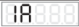 | 0~999 | 50 |
| Fördergeschwindigkeitsanzeige | U | 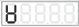 | 0~H | 0 |
| Ausgangsspannungsanzeige | G | 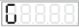 | 0~h (V) | 150 |
| Untere Spannungsgrenze | GL | 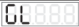 | 0~250 (V) | 0 |
| Untere Frequenzgrenze | e |  | 25.0~400.0 (Hz) | 40.0 |
| Maximaler Amplitudenindex | P |  | 0~500 | 500 |
| Maximal einstellbare Fördergeschwindigkeit | H |  | 0~3200 | 1500 |
| Phasendifferenz | Y |  | -180~180 ° | 0 |
| Maximale Ausgangsspannung beim automatischen Frequenzmessprozess | b |  | 0~250 (V) | 100 |
| Frequenzsuchgeschwindigkeit | SP |  | 1~7 | 5 |
| Minimale Einstellstufe der Fördergeschwindigkeit | c |  | 1~10 | 1 |
| Vibrationssensor-Nummer | t |  | 0, 1, 2, 3, 4, 203, 204, 205, 206 | 205 |

---

## Erklärung der Auto-/Sync-Parameter

### Ausgangsspannungs-Einstellmethode: Γ5

Wenn Parameter Γ5 auf `_-_` eingestellt ist, wird der Ausgangsspannungsparameter U sichtbar und Parameter A ausgeblendet. Der Ausgangsspannungsparameter U kann manuell eingestellt werden.

Wenn Parameter Γ5 auf `___` eingestellt ist und ein Vibrationssensor an den Controller angeschlossen ist, wird der Fördergeschwindigkeitsparameter A sichtbar und Parameter U ausgeblendet. Die Ausgangsspannung wird automatisch anhand der Rückmeldung des Vibrationssensors angepasst, um eine konstante voreingestellte Fördergeschwindigkeit zu gewährleisten.

> Wenn kein Vibrationssensor an den Controller angeschlossen ist, bleibt Parameter U auch bei einem auf `___` eingestellten Parameter Γ5 sichtbar und manuell einstellbar.

### Ausgangsfrequenz-Einstellmethode: Γ6

Wenn Parameter Γ6 auf `_-_` eingestellt ist, kann der Ausgangsfrequenzparameter E manuell eingestellt werden.

Wenn Parameter Γ6 auf `___` eingestellt ist und ein Vibrationssensor an den Controller angeschlossen ist, wird der Ausgangsfrequenzparameter E automatisch auf die Resonanzfrequenz (beste Vibrationsfrequenz) des Vibrationsförderers geregelt, basierend auf der Rückmeldung des Vibrationssensors. Die Ausgangsfrequenz kann nicht manuell eingestellt werden.

Wenn Parameter Γ6 auf  eingestellt ist und das Sync-Signalkabel zwischen Master- und Slave-Controller angeschlossen ist, ist die Ausgangsfrequenz des Slave-Controllers immer mit der des Master-Controllers konsistent. Die Ausgangsfrequenz des Slave-Controllers kann nicht manuell eingestellt werden.

> Wenn kein Vibrationssensor an den Controller angeschlossen ist, wird die Ausgangsfrequenz auch bei einem auf `___` eingestellten Parameter Γ6 weiterhin manuell eingestellt.

### Mittenfrequenz: F

Die Mittenfrequenz sollte etwa auf die Resonanzfrequenz des Vibrationsförderers eingestellt werden, damit der Controller die beste Vibrationsfrequenz schneller finden kann.

### Maximaler Offset bei Auto-FM: n

Der Auto-FM-Bereich beträgt (F ±n) Hz.

Der empfohlene Wert für n liegt bei etwa 30,0 Hz.

Ist Parameter n zu groß eingestellt, kann der Vibrationsförderer mit einer ungeeigneten Vibrationsfrequenz arbeiten.

Ist Parameter n zu klein eingestellt, kann die Flexibilität des Vibrationsförderers beeinträchtigt werden.

---

### Autoeinstellindex der Ausgangsfrequenz: 1F

Der Auto-FM-Prozess läuft über einen PID-Algorithmus. „IF“ ist ein Frequenz-Integrationsindex.

Je größer Parameter „IF“ eingestellt ist, desto schneller wird die Ausgangsfrequenz automatisch moduliert. Ein zu großer Wert für „IF“ kann jedoch zu Schwingungen der Ausgangsfrequenz führen.

### Autoeinstellindex der Amplitude: PA

Der Controller stellt die Ausgangsspannung automatisch über einen PID-Algorithmus ein. PA ist ein Geschwindigkeitsverhältnis-Index.

Je größer Parameter PA eingestellt ist, desto schneller wird die Ausgangsspannung automatisch angepasst. Ein zu großer PA-Wert kann jedoch zu Schwingungen der Ausgangsspannung führen.

### Autoeinstellindex der Amplitude: 1A

Der Controller stellt die Ausgangsspannung automatisch über einen PID-Algorithmus ein. IA ist ein Geschwindigkeits-Integrationsindex.

Je größer Parameter IA eingestellt ist, desto schneller wird die Ausgangsspannung automatisch angepasst. Ein zu großer IA-Wert kann jedoch zu Schwingungen der Ausgangsspannung führen.

### Anzeige der Fördergeschwindigkeit: 

Dieser Parameter dient zur Anzeige der Fördergeschwindigkeit und ist nicht einstellbar.

### Anzeige der Ausgangsspannung: G

Dieser Parameter dient zur Anzeige der Ausgangsspannung und ist nicht einstellbar.

### Untergrenze der Spannung und Untergrenze der Frequenz: GL und 

Wenn Γ3 auf  (Steuerung durch Alarmsignal) eingestellt ist und sich der Controller im Automatikmodus befindet (nur Spannung automatisch, nur Frequenz automatisch oder vollautomatisch) und normal arbeitet (kein externes Signal, kein manueller Stopp, kein Sanftanlauf und kein Fehlerzustand), und wenn die Ausgangsspannung niedriger ist als die durch GL eingestellte Untergrenze oder die Ausgangsfrequenz niedriger ist als die durch  eingestellte Untergrenze, dann ist der 24V-Steuerausgang gültig (D1-Port-Ausgang ist niedrig). Wenn keiner dieser Fälle auftritt, ist der Ausgang ungültig (D1-Port-Ausgang ist hochohmig).

Die oben genannten drei Parameter Γ3, GL und  können nach der Einstellung automatisch gespeichert werden und können in der RS485-Kommunikation eingestellt und gelesen werden.

### Maximaler Amplitudenindex: P

Stellen Sie Index P ein, um die maximale Amplitude des Vibrationsförderers zu begrenzen.

### Maximale einstellbare Fördergeschwindigkeit: H

Der Fördergeschwindigkeitsbereich ist 0 bis H. Parameter H begrenzt die maximale Fördergeschwindigkeit auf einen bestimmten Wert, um den Vibrationsförderer vor hoher Spannung durch Fehlbedienung zu schützen.

Die Fördergeschwindigkeit der Fernsteuerung der Geschwindigkeit wird ebenfalls von diesem Parameter beeinflusst.

### Phasendifferenz: 

Stellen Sie Parameter  ein, um die Phase der Ausgangswelle zu ändern; die Standard-Phasendifferenz beträgt 0°.

---

## Maximale Ausgangsspannung im automatischen Frequenzmessprozess: b

Die Ausgangsspannung überschreitet im automatischen Frequenzmessprozess nicht den Wert von Parameter b, um den Vibrationsförderer vor Schäden zu schützen.

## Frequenzsuchgeschwindigkeit: SP

Parameter SP steht für die Frequenzsuchgeschwindigkeit. Je höher dieser Wert, desto schneller der Frequenzsuchfortschritt. Parameter SP reicht von 1 bis 7.

## Minimale Einstellschrittweite der Fördergeschwindigkeit: c

Parameter c steht für die Einstellschrittweite des Fördergeschwindigkeitsparameters A bei einem Tastendruck auf Vol+ oder Vol-. Parameter c reicht von 1 bis 10.

## Vibrationssensor-Nummer: ├

Der Controller ist zu 8 verschiedenen Vibrationssensor-Modellen kompatibel. Stellen Sie Parameter ├ entsprechend dem Sensormodell ein, sodass der Controller bei eingestellter Fördergeschwindigkeit denselben Spannungswert ausgibt, unabhängig davon, welches Vibrationssensor-Modell angeschlossen ist.

| Parameterwert | Entsprechendes Modell | Spezifikation Beschleunigung X-Achse/Y-Achse/Z-Achse |
|---|---|---|
| 1 | SDVS20-1 | 16g/16g/16g |
| 2 | SDVS20-2 | 35g/35g/—— |
| 3 | SDVS20-3 | 50g/50g/—— |
| 4 | SDVS20-4 | 70g/70g/—— |
| 203 | SDVS203 | 8g/8g/8g |
| 204 | SDVS204 | 16g/16g/16g |
| 205 | SDVS205 | 32g/32g/32g |
| 206 | SDVS206 | 64g/64g/64g |

---

# KapitelⅤ Betriebsart

Der Controller kann je nach den spezifischen Anwendungsanforderungen auf eine der folgenden fünf Betriebsarten eingestellt werden.

- **Manueller Modus:** Sowohl die Ausgangsspannung als auch die Ausgangsfrequenz werden manuell eingestellt.
- **Auto-Modus:** Sowohl die Ausgangsspannung als auch die Ausgangsfrequenz werden anhand der Rückmeldung des Vibrationssensors automatisch angepasst, um eine konstante voreingestellte Fördergeschwindigkeit und die beste Vibrationsfrequenz des Vibrationsförderers zu gewährleisten.
- **Halbautomatischer Modus:** Die Ausgangsspannung wird anhand der Rückmeldung des Vibrationssensors automatisch angepasst, um eine konstante voreingestellte Fördergeschwindigkeit zu gewährleisten. Die Ausgangsfrequenz wird manuell eingestellt.
- **Sync-Modus:** In der Sync-Konfiguration, wenn die Ausgangsfrequenz von Controller B immer konstant mit der von Controller A ist, definieren wir Controller A als Master-Controller, Controller B als Slave-Controller und die Betriebsart von Controller B als Sync-Modus.
- **Zählmodus:** Der Controller (nur SDVC34-MRJ) kann die durchlaufenden Teile zählen und seine Ausgabe automatisch verlangsamen oder stoppen, wenn die Menge der durchlaufenden Teile den voreingestellten Wert erreicht.

| Betriebsart | Ausgangsspannung U — Einstellmethode | Ausgangsspannung U — Γ5-Einstellung | Ausgangsfrequenz E — Einstellmethode | Ausgangsfrequenz E — Γ6-Einstellung | Symbolbild |
|---|---|---|---|---|---|
| Manueller Modus | Manuell | `_ - _` | Manuell | `_ - _` |  |
| Auto-Modus | Auto | `- - -` | Auto | `- - -` |  |
| Halbautomatischer Modus | Auto | `- - -` | Manuell | `_ - _` |  /  |
| Sync-Modus | Manuell oder Auto | `_ - _` oder `- - -` | Automatische Synchronisation mit dem Master-Controller |  |  /  /  |

## 5.1 Manueller Modus

Im manuellen Modus werden sowohl die Ausgangsspannung als auch die Ausgangsfrequenz manuell eingestellt.

| Betriebsart | Ausgangsspannung U — Einstellmethode | Ausgangsspannung U — Γ5-Einstellung | Ausgangsfrequenz E — Einstellmethode | Ausgangsfrequenz E — Γ6-Einstellung | Symbolbild |
|---|---|---|---|---|---|
| Manueller Modus | Manuell | `_ - _` | Manuell | `_ - _` |  |

Zur Vereinfachung der Bedienung sind die Parameter Γ5 und Γ6 werkseitig auf `_ _ _` eingestellt. Bei dieser Einstellung arbeitet der Controller im manuellen Modus, wenn kein Vibrationssensor an den Controller angeschlossen ist, oder im Auto-Modus, wenn ein Vibrationssensor angeschlossen ist.

> - Wenn sowohl Γ5 als auch Γ6 auf `_ - _` eingestellt sind, arbeitet der Controller im manuellen Modus, unabhängig davon, ob ein Vibrationssensor an den Controller angeschlossen ist.
> - Wenn kein Vibrationssensor an den Controller angeschlossen ist, arbeitet der Controller immer im manuellen Modus.

## 5.1.1 Einstellung der Ausgangsspannung im manuellen Modus

Der tatsächliche Ausgangsspannungswert des Controllers kann digital und genau auf dem LED-Bildschirm angezeigt werden.

- Schalten Sie den Netzschalter ein, wenn kein Vibrationssensor an den Controller angeschlossen ist.
- Der LED-Bildschirm zeigt den Ausgangsspannungsparameter U und seinen Wert an.
- Stellen Sie den Wert U durch Drücken von `Vol+` oder `Vol-` ein.

## 5.1.2 Einstellung der Ausgangsfrequenz im manuellen Modus

Mit Hilfe der DDS-Technologie ist die Ausgangsfrequenz des Controllers unabhängig von Zeit- oder Temperaturänderungen stets stabil und hochpräzise.

- Drücken Sie `FUNC` und halten Sie sie 2 Sekunden lang gedrückt, um in den Status zur Einstellung der Grundparameter zu gelangen.
- Der LED-Bildschirm zeigt den Ausgangsfrequenzparameter E und seinen Wert an.
- Stellen Sie den Wert E durch Drücken der Taste ▲ oder ▼ ein, wenn kein Vibrationssensor an den Controller angeschlossen ist.

---

## 5.2 Auto-Modus

Im Auto-Modus muss ein Vibrationssensor an den Controller angeschlossen sein. Die Ausgangsspannung und die Ausgangsfrequenz werden anhand der Rückmeldung des Vibrationssensors automatisch angepasst, um eine konstante voreingestellte Fördergeschwindigkeit und die beste Vibrationsfrequenz zu gewährleisten. Die Ausgangsspannung und die Ausgangsfrequenz können nicht manuell eingestellt werden.

Werksseitig arbeitet der Controller bei angeschlossenem Vibrationssensor im Auto-Modus

| Betriebsart | Ausgangsspannung U — Einstellmethode | Ausgangsspannung U — Γ5-Einstellung | Ausgangsfrequenz E — Einstellmethode | Ausgangsfrequenz E — Γ6-Einstellung |
|---|---|---|---|---|
| Auto-Modus | Auto | - - - | Auto | - - - |

> **Hinweis:** Der Controller arbeitet weiterhin im manuellen Modus, wenn kein Vibrationssensor angeschlossen ist.

### 5.2.1 Installation des Vibrationssensors

#### 5.2.1.1 Anschlussmethode des Vibrationssensors

Verbinden Sie den Stecker des Vibrationssensors mit der Vibrationssensor-Buchse des Controllers.

**Hinweis: Bitte stecken Sie den Vibrationssensor bei ausgeschaltetem Controller ein oder aus.**

---

## 5.2.1.2 Installationsanleitung des Vibrationssensors

Befestigen Sie den Vibrationssensor an der glatten Oberfläche des Vibrators; die Installationsrichtung ist beliebig. Die Installationsmethoden des Vibrationssensors sind unten dargestellt:

- Methode 1: Wie in Abb. 1 dargestellt

  Vorteil: Einfache Installation

- Methode 2: Wie in Abb. 2 dargestellt

  Hinweis: Der Vibrationssensor darf nicht vom Vibratortopf gedrückt werden.

- Methode 3: Schweißen Sie eine Halterung an den Vibrator und befestigen Sie den Vibrationssensor an der Halterung. Wie in Abb. 3 dargestellt

  Empfohlene Abmessungen der Halterung des Vibrators sind in Abb. 4 dargestellt.

- Nicht empfohlene Installationsmethode, wie in Abb. 5 und Abb. 6 dargestellt.

  Wenn der Installationsort nicht geeignet ist, kann der Vibrationssensor die Resonanzfrequenz nicht genau zurückmelden und der Controller sucht die ganze Zeit nach der Resonanzfrequenz.

---

## 5.2.2 Einstellung der Fördergeschwindigkeit im Auto-Modus

- Schalten Sie den Netzschalter ein, wenn ein Vibrationssensor an den Controller angeschlossen ist. Die Vibrationssensor-Anzeige leuchtet auf.
- Der LED-Bildschirm zeigt den Fördergeschwindigkeitsparameter A und seinen Wert an.
- Stellen Sie den Wert A durch Drücken von **Vol+** oder **Vol-** auf die gewünschte Fördergeschwindigkeit ein.

## 5.2.3 Automatische Frequenzmessung im Auto-Modus

Durch die automatische Frequenzmessung erkennt der Controller die beste Vibrationsfrequenz des Vibrationsförderers und stellt alle zugehörigen Parameter automatisch ein. Der Benutzer muss lediglich den Fördergeschwindigkeitsparameter A einstellen, danach arbeitet der Controller im optimalen Zustand.

- Drücken Sie ▲ und ▼ gleichzeitig und halten Sie sie 3 Sekunden lang gedrückt, wenn ein Vibrationssensor an den Controller angeschlossen ist, um die automatische Frequenzmessung zu starten. Der Ausgangsfrequenzparameter E und sein Wert werden während des Messvorgangs auf dem LED-Bildschirm angezeigt.
- Nach dem automatischen Frequenzmessprozess stellt der Controller automatisch alle zugehörigen Parameter ein, einschließlich Mittenfrequenz-Parameter F, Maximaler Offset bei Auto-FM Parameter n, Autoeinstellindex der Ausgangsfrequenz IF, Autoeinstellindex der Amplitude PA, Autoeinstellindex der Amplitude IA, Phasendifferenz-Parameter , Ausgangsspannungs-Einstellmethode-Parameter Γ5 und Ausgangsfrequenz-Einstellmethode-Parameter Γ6 werden auf \_\_\_ eingestellt.

> - Wenn der LED-Bildschirm in dem Moment, in dem der automatische Frequenzmessprozess startet, Err02 anzeigt, ist dies normal, da Parameter b zu hoch eingestellt ist.
> - Wenn Sie den automatischen Frequenzmessprozess abbrechen möchten, drücken Sie **ON/OFF**. Danach kehrt der Controller zum Status vor der automatischen Frequenzmessung zurück.

**Nach der Einstellung der Fördergeschwindigkeit und der automatischen Frequenzmessung arbeitet der Controller im optimalen Zustand mit der gewünschten Fördergeschwindigkeit.**

---

## 5.3 Halbautomatischer Modus

Im halbautomatischen Modus muss ein Vibrationssensor an den Controller angeschlossen sein und Parameter Γ6 muss auf `_-_` eingestellt sein.

Die Ausgangsspannung wird anhand der Rückmeldung des Vibrationssensors automatisch angepasst, um eine konstante voreingestellte Fördergeschwindigkeit zu gewährleisten. Die Ausgangsfrequenz wird manuell eingestellt.

| Betriebsart | Ausgangsspannung U — Einstellmethode | Ausgangsspannung U — Γ5-Einstellung | Ausgangsfrequenz E — Einstellmethode | Ausgangsfrequenz E — Γ6-Einstellung | Symbolbild |
|---|---|---|---|---|---|
| Halbautomatischer Modus | Auto | `---` | Manuell | `_-_` | Γ5:  Γ6:  |

> **Hinweis:** Der Controller arbeitet weiterhin im manuellen Modus, wenn kein Vibrationssensor angeschlossen ist.

### 5.3.1 Installation des Vibrationssensors

Wie in Abschnitt 5.2.1.

### 5.3.2 Einrichtung des halbautomatischen Modus

- Schalten Sie den Netzschalter ein, wenn ein Vibrationssensor an den Controller angeschlossen ist. Die Vibrationssensor-Anzeige leuchtet auf.
- Drücken Sie die Tasten `FUNC` und ▼ gleichzeitig und halten Sie sie 2 Sekunden lang gedrückt, um in den Status zur Einstellung der Auto-/Sync-Parameter zu gelangen.
- Drücken Sie `FUNC` wiederholt, um zum Ausgangsfrequenz-Einstellmethode-Parameter Γ6 zu wechseln.
- Drücken Sie die Taste ▲ oder ▼, um Γ6 auf `_-_` einzustellen.

---

### 5.3.3 Einstellung der Fördergeschwindigkeit im halbautomatischen Modus

- Stellen Sie den Wert A durch Drücken von Vol+ oder Vol- auf die gewünschte Fördergeschwindigkeit ein.

### 5.3.4 Einstellung der Ausgangsfrequenz im halbautomatischen Modus

- Drücken Sie **FUNC** und halten Sie sie 2 Sekunden lang gedrückt, um in den Status zur Einstellung der Grundparameter zu gelangen.
- Der LED-Bildschirm zeigt den Ausgangsfrequenzparameter E und seinen Wert an.
- Stellen Sie den Wert E durch Drücken der Taste ▲ oder ▼ ein.

---

## 5.4 Sync-Modus

Im Sync-Modus muss das Sync-Signalkabel zwischen Master- und Slave-Controller angeschlossen sein. Die Ausgangsfrequenz des Controllers (Slave-Controller) ist immer mit der des Master-Controllers konsistent. Die Ausgangsspannung des Controllers (Slave-Controller) kann manuell oder automatisch angepasst werden.

| Betriebsart | Ausgangsspannung U — Einstellmethode | Ausgangsspannung U — Γ5-Einstellung | Ausgangsfrequenz E — Einstellmethode | Ausgangsfrequenz E — Γ6-Einstellung | Symbolbild |
|---|---|---|---|---|---|
| Sync-Modus | Manuell oder Auto | Zwei Symboleinstellungen (siehe Bild, mit „oder“ verbunden) | Automatische Synchronisation mit dem Master-Controller | Siehe Bild | Γ5: ；Γ6:  |

Der Sync-Modus gilt für die Situation, dass mehr als ein Controller mehrere Vibrationsförderer im Zuführsystem steuern und die Ausgänge der Controller nicht synchron sind, sodass sie sich gegenseitig beeinflussen (Schwebungseffekt). Der Sync-Modus wurde entwickelt, um den Schwebungseffekt zu beseitigen, da die Ausgangswellenformen von Master- und Slave-Controller exakt synchron sind.

Controller S ist nicht in den Synchronisationsmodus versetzt, und die Ausgangswellenformen der beiden Controller sind nicht synchronisiert.

Controller S ist in den Synchronisationsmodus versetzt, und die Ausgangswellenformen der beiden Controller sind vollständig synchronisiert.

---

## 5.4.1 Anschlussmethode des Sync-Signalkabels

### Schritt 1:

Öffnen Sie die Abdeckplatten der Signalkontrollanschluss-Boxen beider Controller.

### Schritt 2:

Schließen Sie das Sync-Signalkabel zwischen Master- und Slave-Controller gemäß dem folgenden Schaltplan an.

Ein Master-Controller kann mehrere Slave-Controller ansteuern.

> Der Slave-Controller stoppt seinen Ausgang, wenn das Sync-Signal instabil oder nicht angeschlossen ist. Und die Sync-Anzeige erlischt.

---

## 5.4.2 Anwendungen des Sync-Modus

### • Sub-Pattern 1

| Controller | Ausgangsspannung U — Einstellmethode | Ausgangsspannung U — Γ5-Einstellung | Ausgangsfrequenz E — Einstellmethode | Ausgangsfrequenz E — Γ6-Einstellung | Symbolbild |
|---|---|---|---|---|---|
| Master-Controller | Manuell | Siehe Symbolbild | Manuell | Siehe Symbolbild | Γ5：；Γ6： |
| Slave-Controller | Manuell | Siehe Symbolbild | Automatische Synchronisation mit dem Master-Controller | Siehe Symbolbild | Γ5：；Γ6： |

### • Sub-Pattern 2

| Controller | Ausgangsspannung U — Einstellmethode | Ausgangsspannung U — Γ5-Einstellung | Ausgangsfrequenz E — Einstellmethode | Ausgangsfrequenz E — Γ6-Einstellung | Symbolbild |
|---|---|---|---|---|---|
| Master-Controller | Auto | — — — | Auto | — — — | Γ5, Γ6： |
| Slave-Controller | Manuell | Siehe Symbolbild | Automatische Synchronisation mit dem Master-Controller | Siehe Symbolbild | Γ5：；Γ6： |

### • Sub-Pattern 3

| Controller | Ausgangsspannung U — Einstellmethode | Ausgangsspannung U — Γ5-Einstellung | Ausgangsfrequenz E — Einstellmethode | Ausgangsfrequenz E — Γ6-Einstellung | Symbolbild |
|---|---|---|---|---|---|
| Master-Controller | Auto | — — — | Manuell | Siehe Symbolbild | Γ5：；Γ6： |
| Slave-Controller | Manuell | Siehe Symbolbild | Automatische Synchronisation mit dem Master-Controller | Siehe Symbolbild | Γ5：；Γ6： |

### • Sub-Pattern 4

| Controller | Ausgangsspannung U — Einstellmethode | Ausgangsspannung U — Γ5-Einstellung | Ausgangsfrequenz E — Einstellmethode | Ausgangsfrequenz E — Γ6-Einstellung | Symbolbild |
|---|---|---|---|---|---|
| Master-Controller | Manuell | Siehe Γ5-Bild in der rechten Spalte | Manuell | Siehe Γ6-Bild in der rechten Spalte | Γ5： Γ6： |
| Slave-Controller | Auto | Siehe Γ5-Bild in der rechten Spalte | Automatische Synchronisation mit dem Master-Controller | Siehe Γ6-Bild in der rechten Spalte | Γ5： Γ6： |

### • Sub-Pattern 5

| Controller | Ausgangsspannung U — Einstellmethode | Ausgangsspannung U — Γ5-Einstellung | Ausgangsfrequenz E — Einstellmethode | Ausgangsfrequenz E — Γ6-Einstellung | Symbolbild |
|---|---|---|---|---|---|
| Master-Controller | Auto | --- | Auto | --- | Γ5, Γ6： |
| Slave-Controller | Auto | --- | Automatische Synchronisation mit dem Master-Controller | Siehe Symbolbild | Γ5：；Γ6： |

### • Sub-Pattern 6

| Controller | Ausgangsspannung U — Einstellmethode | Ausgangsspannung U — Γ5-Einstellung | Ausgangsfrequenz E — Einstellmethode | Ausgangsfrequenz E — Γ6-Einstellung | Symbolbild |
|---|---|---|---|---|---|
| Master-Controller | Auto | --- | Manuell | Siehe Symbolbild | Γ5：；Γ6： |
| Slave-Controller | Auto | --- | Automatische Synchronisation mit dem Master-Controller | Siehe Symbolbild | Γ5：；Γ6： |

---

## 5.5 Zählmodus

Bitte ignorieren Sie dieses Kapitel, wenn der Controller keine Zählfunktion hat.

Die SDVC34-Serienmodelle mit dem Suffix J haben eine integrierte Zählfunktion, die die durchlaufenden Teile zählen und ihren Ausgang automatisch verlangsamen oder stoppen kann, wenn die Menge der durchlaufenden Teile den voreingestellten Wert erreicht.

**Verlangsamungsfunktion vor dem Stopp:** Wie im folgenden Diagramm dargestellt, gibt der Controller die vom Benutzer eingestellte normale Fördergeschwindigkeit aus, bis die Zählzahl „J-C“ erreicht, woraufhin der Controller sofort auf eine voreingestellte niedrigere Fördergeschwindigkeit umschaltet, um Überförderung zu verhindern. Wenn die Zählzahl den Zählzielwert J erreicht, stoppt der Controller seinen Ausgang sofort.

Die Super-Anti-Jitter-Funktion der Zählfunktion wurde speziell entwickelt, um das Problem der Fehlzählung vibrierender durchlaufender Teile durch Einstellung der Dauer des Zählsignals zu lösen. Nur wenn das Zählpulssignal mindestens die Zeit b lang angedauert hat, kann es bestätigt werden. Diese Funktion verbessert die Zuverlässigkeit der Zählung effektiv.

Bitte beachten Sie das folgende Diagramm.

**Hinweis:**

Anti-Jitter-Stabilisierungszeit bedeutet die Stabilisierungszeit des High-Pegels und des Low-Pegels. Ein gültiger Puls besteht aus kontinuierlich aktivem High-Pegel und Low-Pegel, dann zählt der Zähler um eins hoch.

---

## 5.5.1 Verwendungsmethode

Wenn das Zähler-Rücksetzsignal kurzzeitig ungültig gesetzt und dann wieder gültig wird, wird der Zählerwert gelöscht und der Zähler startet neu, was ein Zurücksetzen darstellt. Während der kurzen Zeit (nicht länger als 2 Sekunden), in der der Zählzustand verlassen wird, schaltet der Controller den Ausgang vorübergehend aus. Daher kann dieses Signal nach Bedarf als Zähler-Rücksetzsignal verwendet werden.

Im normalen Zählzustand kann der Zähler mit den Tasten „▲“ oder „▼“ auf dem Bedienfeld zurückgesetzt werden. Das Zählpulssignal wird über den Anschluss „N2“ der Controllerschnittstelle eingegeben, und der Zählerwert wird im Zustand „“ angezeigt. Wenn `FUNC` verwendet wird, um andere Parametereinstellungszustände aufzurufen, wird die Zählarbeit nicht gestoppt und der Zählwert geht nicht verloren.

> Es gibt nur einen Weg für den Controller, in den Zählzustand zu gelangen, nämlich das Zählsteuersignal (Freigabe-/Rücksetzsignal „N3“) gültig zu halten. Nach dem Eintritt in den Zählzustand wird der Anfangszustand als „“ angezeigt, und die Zählanzeige und die Rücksetzanzeige leuchten gleichzeitig auf, was anzeigt, dass das Zählpulssignal akzeptiert werden kann und die Zählung beginnt.

---

## 5.5.2 Anschlussmethode

Verdrahtungsmethode, wenn der ΓA-Zustand NPN ist

Verdrahtungsmethode, wenn der ΓA-Zustand PNP ist

---

## 5.5.3 Logikrichtung des Zählpulses

- Drücken Sie `FUNC` und ▲ gleichzeitig und halten Sie sie 2 Sekunden lang gedrückt, um in den Status zur Einstellung der erweiterten Parameter zu gelangen.
- Drücken Sie `FUNC` wiederholt, um zum Parameter Γb zu wechseln.
- Drücken Sie die Taste ▲ oder ▼, um Γb einzustellen.

> - Wenn die aktive Flanke von Γb auf die fallende Flanke eingestellt ist, werden die Zählpulse an der fallenden Flanke gezählt, die von „High-Pegel“ zu „Low-Pegel“ wechselt.
> - Wenn die aktive Flanke von Γb auf die steigende Flanke eingestellt ist, werden die Zählpulse an der steigenden Flanke gezählt, die von „Low-Pegel“ zu „High-Pegel“ wechselt.

## 5.5.4 Logikrichtung des Zähl-Reset

- Drücken Sie `FUNC` und ▲ gleichzeitig und halten Sie sie 2 Sekunden lang gedrückt, um in den Status zur Einstellung der erweiterten Parameter zu gelangen.
- Drücken Sie `FUNC` wiederholt, um zum Parameter Γc zu wechseln.
- Drücken Sie die Taste ▲ oder ▼, um Γc einzustellen.

> - Wenn die aktive Flanke von Γc auf die fallende Flanke eingestellt ist und der Zählsteuerpin nicht an ein Signal angeschlossen ist, geht der Controller nicht in den „Zähl“-Zustand über; wenn das Signal dieses Pins auf „Low-Pegel“ gezogen wird, geht der Controller in den „Zähl“-Zustand über.
> - Wenn die aktive Flanke von Γc auf die steigende Flanke eingestellt ist und kein Signal an den Zählsteuerpin angeschlossen ist, geht der Controller in den „Zähl“-Zustand über; wenn das Signal dieses Pins auf „Low-Pegel“ gezogen wird, verlässt der Controller den „Zähl“-Zustand.

---

## 5.5.5 Erklärung der Zählparameter

### Maximale Zählgrenze: 

- Drücken Sie im Zählzustand **FUNC**, um in den Parameter  zu gelangen.
- Drücken Sie die Taste ▲ oder ▼, um den Parameterwert einzustellen.

Wenn der Zählerwert diesen Schwellenwert erreicht, ist die Zählung des Controllers gesättigt, der Controllerausgang wird gestoppt und die Förderung wird ebenfalls gestoppt, bis der Zähler zurückgesetzt wird. Nach dem Eintritt in den Zählsättigungszustand wird die Zählung fortgesetzt, wenn das Zählpulssignal weiterhin gesendet wird, aber der Controllerausgang bleibt gestoppt.

### Anzahl der Zählungsenden: n

- Drücken Sie **FUNC** und ▲ gleichzeitig und halten Sie sie 2 Sekunden lang gedrückt, um in den Status zur Einstellung der erweiterten Parameter zu gelangen.
- Drücken Sie **FUNC** wiederholt, um zum Parameter n zu wechseln.
- Drücken Sie die Taste ▲ oder ▼, um den Parameterwert einzustellen.

Wenn die Anzahl der Zählwerte von der Zählgrenze die Anzahl der Zählungsenden erreicht, geht der Controller in den Endzustand über und die Fördergeschwindigkeit wird auf die Endgeschwindigkeit reduziert.

Wenn die Verlangsamungsfunktion am Zählungsende nicht verwendet wird, kann dieser Parameter auf 0 gesetzt werden, um die Verlangsamungsfunktion unwirksam zu machen.

---

## Geschwindigkeitsprozentsatz der Zählungsenden: u

- Drücken Sie `FUNC` und ▲ gleichzeitig und halten Sie sie 2 Sekunden lang gedrückt, um in den Status zur Einstellung der erweiterten Parameter zu gelangen.
- Drücken Sie `FUNC` wiederholt, um zum Parameter u zu wechseln.
- Drücken Sie die Taste ▲ oder ▼, um den Parameterwert einzustellen.

Wenn die Zählung in den endgültigen Zählzustand eintritt, verringert sich die Fördergeschwindigkeit des Controllers um einen Prozentsatz der Anfangsgeschwindigkeit.

## Zähl-Anti-Jitter-Zeit: J

- Drücken Sie `FUNC` und ▲ gleichzeitig und halten Sie sie 2 Sekunden lang gedrückt, um in den Status zur Einstellung der erweiterten Parameter zu gelangen.
- Drücken Sie `FUNC` wiederholt, um zum Parameter J zu wechseln.
- Drücken Sie die Taste ▲ oder ▼, um den Parameterwert einzustellen.

Da die Anti-Jitter-Zeit die Stabilisierungszeit des High- bzw. Low-Pegels ist, sollte der Wert dieses Parameters kleiner sein als:

$$
\frac{1}{2} \times \frac{1}{\text{die maximale Anzahl der Zählungen pro Sekunde}}
$$

Die maximale Anzahl pro Sekunde sollte auf der Grundlage der tatsächlichen Situation und der maximal möglichen Geschwindigkeit der spezifischen Ausrüstung während des Betriebs festgelegt werden. Eine Überschätzung der Geschwindigkeit führt dazu, dass die Anti-Jitter-Funktion nicht den gewünschten Effekt erzielt, und ein zu niedriger Wert führt zu fehlenden Zählungen.

---

# Kapitel Ⅵ Signalsteuerung

Die Signalsteuerung umfasst: EIN/AUS-Steuerung der C-Ports, EIN/AUS-Steuerung der E-Ports, Fernsteuerung der Geschwindigkeit, Speichern und Ausgeben voreingestellter Geschwindigkeiten, RS485-Kommunikation und 24V-DC-Steuerausgang.

## 6.1 EIN/AUS-Steuerung der C-Ports

Die Ausgabe des Controllers kann über die C-Ports durch jede Art von Schaltsensor oder SPS ein- oder ausgeschaltet werden.

### 6.1.1 Anschlussmethode der C-Ports

**Anschlussmethode des Näherungssensors**

**Schritt 1:**

Öffnen Sie die Abdeckplatten der Signalsteuerungsanschlusskästen des Controllers.

**Schritt 2:**

Schließen Sie den Näherungssensor gemäß der Abbildung an die C-Ports an.

**Konvention**

Das blaue Kabel steht für die Erdungsleitung  
Das schwarze Kabel steht für die Signalleitung  
Das braune Kabel steht für die Stromversorgungsleitung

---

## Anschlussmethode des Durchstrahl-Lichtschranken-Sensors

---

## Anschlussmethode des photoelektrischen Reflexionssensors

---

## Anschlussmethode des Durchstrahl-Lichtwellenleiter-Sensors

---

## Anschlussmethode der SPS

### Anschlussmethode des NPN-Ausgangs der SPS

### Anschlussmethode des PNP-Ausgangs der SPS

Hinweis: Relaisausgang, NPN-Ausgang und PNP-Ausgang der SPS – jeder einzelne davon kann den Controller ein-/ausschalten.

Hinweis: Wenn Sie eine SPS zum Ein-/Ausschalten des Controllers verwenden, verwenden Sie bitte eine SPS mit 24V-Ausgang.

---

## 6.1.2 EIN/AUS-Verzögerung der C-Ports

Wenn Sie möchten, dass der Controller nach Empfang des EIN-Steuersignals der C-Ports erst nach einer gewissen Zeit mit der Ausgabe beginnt, stellen Sie Parameter J ein.

Wenn Sie möchten, dass der Controller nach Empfang des AUS-Steuersignals der C-Ports noch eine gewisse Zeit lang weiter ausgibt, stellen Sie Parameter L ein.

### EIN-Verzögerung der C-Ports

Die Zeitdauer vom Empfang des EIN-Steuersignals der C-Ports bis zum Beginn der Ausgabe.

- Drücken Sie `FUNC` und halten Sie die Taste 2 Sekunden lang gedrückt, um in den Status zur Einstellung der Grundparameter zu gelangen.
- Drücken Sie `FUNC` wiederholt, um zum Parameter J zu wechseln.
- Drücken Sie die Taste ▲ oder ▼, um den Wert einzustellen. Die Parametereinheit ist Sekunde und die Einstellgenauigkeit beträgt 0,1.

### AUS-Verzögerung der C-Ports

Die Zeitdauer vom Empfang des AUS-Steuersignals der C-Ports bis zum Abschalten der Ausgabe.

- Drücken Sie `FUNC` und halten Sie die Taste 2 Sekunden lang gedrückt, um in den Status zur Einstellung der Grundparameter zu gelangen.
- Drücken Sie `FUNC` wiederholt, um zum Parameter L zu wechseln.
- Drücken Sie die Taste ▲ oder ▼, um den Wert einzustellen. Die Parametereinheit ist Sekunde und die Einstellgenauigkeit beträgt 0,1.

---

## 6.1.3 Logische Verknüpfung der EIN/AUS-Steuerung der C-Ports

Standardmäßig läuft der Controller, wenn die C-Ports kein Signal empfangen. In einigen anderen Anwendungen muss der Controller jedoch stoppen, wenn die C-Ports kein Signal empfangen.

Stellen Sie Parameter Γ2 ein, um eine der beiden Anforderungen zu erfüllen.

- Drücken Sie **FUNC** und ▲ gleichzeitig und halten Sie sie 2 Sekunden lang gedrückt, um in den Status zur Einstellung der erweiterten Parameter zu gelangen.
- Drücken Sie **FUNC** wiederholt, um zum Parameter Γ2 zu wechseln.
- Drücken Sie die Taste ▲ oder ▼, um die logische Verknüpfung zu ändern.

Parameter Γ2 ist standardmäßig auf `___` eingestellt.

- Wenn Parameter Γ2 auf `___` eingestellt ist, ist die Ausgabe des Controllers eingeschaltet, wenn die C-Ports kein Signal empfangen.
- Wenn Parameter Γ2 auf `_-_` eingestellt ist, ist die Ausgabe des Controllers ausgeschaltet, wenn die C-Ports kein Signal empfangen.

---

## 6.2 EIN/AUS-Steuerung der E-Ports

Die Ausgabe des Controllers kann über die E-Ports durch jede Art von Schaltsensor oder SPS ein- oder ausgeschaltet werden.

Die EIN/AUS-Steuerung der C-Ports und die EIN/AUS-Steuerung der E-Ports sind unabhängig voneinander.

### 6.2.1 Anschlussmethode der E-Ports

**Anschlussmethode des Näherungssensors**

**Schritt 1:**

Öffnen Sie die Abdeckplatten der Signalsteuerungsanschlusskästen des Controllers.

**Schritt 2:**

Schließen Sie den Näherungssensor gemäß der Abbildung an die E-Ports an.

**Konvention**

- Das blaue Kabel steht für die Erdungsleitung
- Das schwarze Kabel steht für die Signalleitung
- Das braune Kabel steht für die Stromversorgungsleitung

Die Anschlussmethode anderer Arten von Schaltsensoren und SPS an die E-Ports ist ähnlich wie die der C-Ports.

---

## 6.2.2 EIN/AUS-Verzögerung der E-Ports

Wenn Sie möchten, dass der Controller nach Empfang des EIN-Steuersignals der E-Ports erst nach einer gewissen Zeit mit der Ausgabe beginnt, stellen Sie Parameter J- ein.

Wenn Sie möchten, dass der Controller nach Empfang des AUS-Steuersignals der E-Ports noch eine gewisse Zeit lang weiter ausgibt, stellen Sie Parameter L- ein.

Die EIN/AUS-Verzögerung der E-Ports entspricht werkseitig der EIN/AUS-Verzögerung der C-Ports.

Die EIN/AUS-Verzögerung der E-Ports kann auch unabhängig eingestellt werden, indem Parameter J- und Parameter L- angepasst werden.

### EIN-Verzögerung der E-Ports

Die Zeitdauer vom Empfang des EIN-Steuersignals der E-Ports bis zum Beginn der Ausgabe.

- Drücken Sie **FUNC** und ▲ gleichzeitig und halten Sie sie 2 Sekunden lang gedrückt, um in den Status zur Einstellung der erweiterten Parameter zu gelangen.
- Drücken Sie **FUNC**, um zum Parameter J- zu wechseln.
- Drücken Sie die Taste ▲ oder ▼, um den Wert einzustellen. Die Parametereinheit ist Sekunde und die Einstellgenauigkeit beträgt 0,1.

### AUS-Verzögerung der E-Ports

Die Zeitdauer vom Empfang des AUS-Steuersignals der E-Ports bis zum Abschalten der Ausgabe.

- Drücken Sie **FUNC** und ▲ gleichzeitig und halten Sie sie 2 Sekunden lang gedrückt, um in den Status zur Einstellung der erweiterten Parameter zu gelangen.
- Drücken Sie **FUNC**, um zum Parameter L- zu wechseln.
- Drücken Sie die Taste ▲ oder ▼, um den Wert einzustellen. Die Parametereinheit ist Sekunde und die Einstellgenauigkeit beträgt 0,1.

> Parameter J- und L- sind auf ___ eingestellt , was denselben Wert wie bei Parameter J und L bedeutet.

---

## 6.2.3 Logische Verknüpfung der EIN/AUS-Steuerung der E-Ports

Standardmäßig läuft der Controller, wenn die E-Ports kein Signal empfangen. In einigen anderen Anwendungen muss der Controller jedoch stoppen, wenn die E-Ports kein Signal empfangen.

Stellen Sie Parameter Γ7 ein, um eine der beiden Anforderungen zu erfüllen.

- Drücken Sie **FUNC** und ▲ gleichzeitig und halten Sie sie 2 Sekunden lang gedrückt, um in den Status zur Einstellung der erweiterten Parameter zu gelangen.
- Drücken Sie **FUNC** wiederholt, um zum Parameter Γ7 zu wechseln.
- Drücken Sie die Taste ▲ oder ▼, um die logische Verknüpfung zu ändern.

Parameter Γ7 ist standardmäßig auf `___` eingestellt.

- Wenn Parameter Γ7 auf `___` eingestellt ist, ist die Ausgabe des Controllers eingeschaltet, wenn die E-Ports kein Signal empfangen.
- Wenn Parameter Γ7 auf `_-_` eingestellt ist, ist die Ausgabe des Controllers ausgeschaltet, wenn die E-Ports kein Signal empfangen.

---

## 6.3 Gemeinsame Parameter der C-Ports und E-Ports

### 6.3.1 Logische Verknüpfung der C-Ports und E-Ports

Parameter Π bestimmt die Reaktion des Controllers, wenn sowohl die C-Ports als auch die E-Ports wirksam sind.

- Drücken Sie `FUNC` und ▲ gleichzeitig und halten Sie sie 2 Sekunden lang gedrückt, um in den Status zur Einstellung der erweiterten Parameter zu gelangen.
- Drücken Sie `FUNC` wiederholt, um zum Parameter Π zu wechseln.
- Drücken Sie die Taste ▲ oder ▼, um die logische Verknüpfung zu ändern.

**Logische Verknüpfung: AND** 

Die Ausgabe des Controllers ist nur dann EIN, wenn beide Ports den Betrieb des Controllers anfordern.

**Logische Verknüpfung: OR** 

Die Ausgabe des Controllers ist EIN, wenn einer oder beide Ports den Betrieb des Controllers anfordern.

**Logische Verknüpfung: XOR** 

Die Ausgabe des Controllers ist nur dann EIN, wenn einer der Ports den Betrieb des Controllers anfordert und der andere das Stoppen anfordert.

Die standardmäßige logische Verknüpfung ist AND.

---

## 6.3.2 Schaltsensor-Typ

Der Controller kann den Typ des Schaltsensors, NPN oder PNP, automatisch erkennen.

Benutzer können den Schaltsensor-Typ auch manuell einstellen.

- Drücken Sie `FUNC` und ▲ gleichzeitig und halten Sie sie 2 Sekunden lang gedrückt, um in den Status zur Einstellung der erweiterten Parameter zu gelangen.
- Drücken Sie `FUNC` wiederholt, um zum Parameter ΓA zu wechseln.
- Drücken Sie die Taste ▲ oder ▼, um den Wert zu ändern.

> **Uto:** Automatische Erkennung des Schaltsensor-Typs
>
> **nPn:** Schaltsensor vom Typ NPN
>
> **PnP:** Schaltsensor vom Typ PNP

Hinweis: Bei Controllern mit Zählfunktion hat ΓA nur zwei Zustände, nPn und PnP.

---

## 6.3.3 Logikoperation des Hauptausgangs

- Drücken Sie `FUNC` und ▲ gleichzeitig und halten Sie sie 2 Sekunden lang gedrückt, um in den Status zur Einstellung der erweiterten Parameter zu gelangen.
- Drücken Sie `FUNC` wiederholt, um zum Parameter Γ4 zu wechseln.
- Drücken Sie die Taste ▲ oder ▼, um den Wert zu ändern.

Parameter Γ4 ist standardmäßig auf `___` eingestellt.

- Wenn Parameter Γ4 auf  eingestellt ist, sind Hauptausgang und Steuerausgang miteinander verbunden. Gesteuert durch die logische Verknüpfung zwischen Port C und Port E und die EIN/AUS-Taste.
- Wenn Parameter Γ4 auf  eingestellt ist, sind Hauptausgang und Steuerausgang getrennt. Der Hauptausgang wird durch die EIN/AUS-Taste gesteuert. Der Steuerausgang wird durch die logische Verknüpfung zwischen Port C und Port E gesteuert.
- Wenn Parameter Γ4 auf  eingestellt ist, wird der Hauptausgang durch die EIN/AUS-Taste und Port C gesteuert. Der Steuerausgang wird durch Port E gesteuert.
- Wenn Parameter Γ4 auf  eingestellt ist, wird der Hauptausgang durch die EIN/AUS-Taste und Port E gesteuert. Der Steuerausgang wird durch Port C gesteuert.

---

## 6.4 Fernsteuerung der Geschwindigkeit

Die Ausgangsspannung/Fördergeschwindigkeit kann über ein Potentiometer oder ein 1~5V/4~20mA-Gleichstrom-Steuersignal ferngesteuert werden.

Wenn die Spannung der Fernsteuerung der Geschwindigkeit 0,5 V überschreitet, wird sie für den Controller wirksam, während die Tasten "Vol+" und "Vol-" unwirksam werden.

Während der Fernsteuerung der Geschwindigkeit leuchtet die Fernsteuerungs-Anzeige und der LED-Bildschirm zeigt die Ausgangsspannung/Fördergeschwindigkeit und ihren Wert an.

### Anschlussmethode des Potentiometers für die Fernsteuerung der Geschwindigkeit

## Anschlussmethode der SPS für die Fernsteuerung der Geschwindigkeit

| Signal der Fernsteuerung der Geschwindigkeit | Ausgangsspannung U/Fördergeschwindigkeit A |
|---|---|
| weniger als 0.5V | Gesteuert durch die Tasten Vol+ und Vol- |
| 0.5V~1V | Ausgangsspannung U=20V/Fördergeschwindigkeit A=0 Gesteuert durch das Signal der Fernsteuerung der Geschwindigkeit |
| 1~5V/4~20mA | Ausgangsspannung U/Fördergeschwindigkeit A wird linear durch das Signal der Fernsteuerung der Geschwindigkeit gesteuert |

## 6.5 Steuerausgang

Der Controller kann 24V-DC-Steuerleistung ausgeben, um ein Magnetventil, ein elektrisches Relais oder eine SPS usw. in Abstimmung mit der EIN/AUS-Steuerung von Port C/Port E anzusteuern.

### 6.5.1 Anschlussmethode des Steuerausgangs

**Anschluss an ein Magnetventil**

- Der Controller kann ein Magnetventil mit einer Nennspannung von 24V und einer Nennleistung von bis zu 4W ansteuern.

**Anschluss an ein elektrisches Relais**

- Der Controller kann ein elektrisches Relais mit einer Nennspannung von 24V und einer Nennleistung von bis zu 4W ansteuern.

Hinweis: Bitte schließen Sie den Plus- und Minuspol des Relais oder Magnetventils korrekt an: D2 wird mit dem Pluspol verbunden, D1 mit dem Minuspol. Ein Vertauschen der Anschlüsse kann einen Kurzschluss und Schäden am Steuerausgang verursachen.

---

## 6.5.2 Logische Verknüpfung des Steuerausgangs

- Drücken Sie **FUNC** und ▲ gleichzeitig und halten Sie sie 2 Sekunden lang gedrückt, um in den Status zur Einstellung der erweiterten Parameter zu gelangen.
- Drücken Sie **FUNC** wiederholt, um zum Parameter Γ3 zu wechseln.
- Drücken Sie die Taste ▲ oder ▼, um die logische Verknüpfung zu ändern.

Parameter Γ3 ist standardmäßig auf `___` eingestellt.

- Wenn Parameter Γ3 auf  eingestellt ist, ist der Steuerausgang EIN, wenn der Ausgang des Controllers EIN ist.
- Wenn Parameter Γ3 auf  eingestellt ist, ist der Steuerausgang AUS, wenn der Ausgang des Controllers EIN ist.
- Wenn Parameter Γ3 auf  eingestellt ist, ist der Steuerausgang nur vom Alarmsignal abhängig, das durch den Parameter "GL" (Untergrenze der Spannung) und "e" (Untergrenze der Frequenz) definiert wird. Siehe Kapitel 4.4 für Details.

---

## 6.5.3 Logikoperation des Steuerausgangs

- Drücken Sie `FUNC` und ▲ gleichzeitig und halten Sie sie 2 Sekunden lang gedrückt, um in den Status zur Einstellung der erweiterten Parameter zu gelangen.
- Drücken Sie `FUNC` wiederholt, um zum Parameter Γ8 zu wechseln.
- Drücken Sie die Taste ▲ oder ▼, um den Wert zu ändern.

Parameter Γ8 ist standardmäßig auf `___` eingestellt.

- Wenn Γ8 auf Hauptlogik eingestellt ist, teilen sich Steuerausgang und Hauptausgang dieselben Logikeinstellungen.
- Wenn Γ8 auf die zweite Logikgruppe eingestellt ist, wird der Steuerausgang durch die Einstellungen der zweiten Logikgruppe gesteuert und der Hauptausgang durch die Einstellungen der Hauptlogik.

---

## 6.6 Speichern und Ausgeben voreingestellter Geschwindigkeiten

Diese Funktion ist für Controller ohne Zählfunktion geeignet.

Der Controller kann 4 verschiedene voreingestellte Geschwindigkeiten speichern und ausgeben. Die 4 Arten der EIN/AUS-Kombination der Speed A-Anzeige und der Speed B-Anzeige entsprechen jeweils Geschwindigkeit 1, Geschwindigkeit 2, Geschwindigkeit 3und Geschwindigkeit 4.

| Voreingestellte Geschwindigkeit | G1- & G2-Ports — Speed A-Anzeige | G1- & G2-Ports — Schalter 1 | G3- & G4-Ports — Speed B-Anzeige | G3- & G4-Ports — Schalter 2 |
|---|---|---|---|---|
| Geschwindigkeit 1 | EIN | Geschlossen | AUS | Offen |
| Geschwindigkeit 2 | AUS | Offen | EIN | Geschlossen |
| Geschwindigkeit 3 | EIN | Geschlossen | EIN | Geschlossen |
| Geschwindigkeit 4 | AUS | Offen | AUS | Offen |

> Manueller Spannungsmodus, 4 eingestellte Geschwindigkeiten beziehen sich auf 4 Spannungseinstellungen U  
> Manueller Frequenzmodus, 4 eingestellte Geschwindigkeiten beziehen sich auf 4 Ausgangsfrequenzeinstellungen E  
> Automatischer Spannungsmodus, 4 eingestellte Geschwindigkeiten beziehen sich auf 4 Fördergeschwindigkeiten A  
> Automatischer Frequenzmodus, 4 eingestellte Geschwindigkeiten beziehen sich auf 4 Mittenfrequenzen F

### Anschlussmethode, wenn ΓA auf NPN eingestellt ist

---

## Anschlussmethode, wenn ΓA auf PNP eingestellt ist

### Speichern voreingestellter Geschwindigkeiten

Nehmen Sie das Speichern von Geschwindigkeit 1 als Beispiel:

- Schließen Sie K1, die Speed A-Anzeige leuchtet auf; öffnen Sie K2, die Speed B-Anzeige erlischt.
- So stellen Sie die gewünschte Fördergeschwindigkeit ein:
  - Im manuellen Modus stellen Sie den Ausgangsspannungsparameter U und den Ausgangsfrequenzparameter E ein.
  - Im Auto-Modus stellen Sie den Fördergeschwindigkeitsparameter A ein.
  - Im halbautomatischen Modus stellen Sie den Fördergeschwindigkeitsparameter A und den Ausgangsfrequenzparameter E ein.
- Nachdem der Ausgang des Controllers stabil ist, drücken Sie `FUNC` und ▼ gleichzeitig und halten Sie sie 2 Sekunden lang gedrückt; zu diesem Zeitpunkt wird "SAVE" auf dem LED-Bildschirm angezeigt, was bedeutet, dass Geschwindigkeit 1 gespeichert wurde.

### Ausgeben voreingestellter Geschwindigkeiten

Nehmen Sie die Ausgabe von Geschwindigkeit 1 als Beispiel:

- Schließen Sie K1 erneut, die Speed A-Anzeige leuchtet auf; öffnen Sie K2 erneut, die Speed B-Anzeige erlischt.
- Der Controller gibt Geschwindigkeit 1 sofort aus.

---

## 6.7 RS485-Kommunikation

Alle Parameter des Controllers können über die RS485-Kommunikationsanschlüsse ferngesteuert angepasst werden.

### 6.7.1 RS485-Kommunikationsadresse

Parameter  repräsentiert die ID-Nummer des Controllers in der RS485-Kommunikation.  
Der Bereich des Parameters: 1 bis 31.  
Stellen Sie sicher, dass die Kommunikationsadressen aller Controller im selben Netzwerk unterschiedlich sind, um die Controller voneinander zu unterscheiden.

- Drücken Sie **FUNC** und ▲ gleichzeitig und halten Sie sie 2 Sekunden lang gedrückt, um in den Status zur Einstellung der erweiterten Parameter zu gelangen.
- Drücken Sie **FUNC** wiederholt, um zum Parameter  zu wechseln.
- Drücken Sie die Taste ▲ oder ▼, um den Wert zu ändern.

### 6.7.2 RS485-Kommunikations-Baudrate

Die Baudrate der RS485-Kommunikation kann sein: 3, 12, 24, 96, 192, 576 oder 1152.  
Einheit: 0,1 Kbps.  
Standardwert: 9,6 Kbps.  
Controller im selben Netzwerk sollten dieselbe Baudrate verwenden.

- Drücken Sie **FUNC** und ▲ gleichzeitig und halten Sie sie 2 Sekunden lang gedrückt, um in den Status zur Einstellung der erweiterten Parameter zu gelangen.
- Drücken Sie **FUNC** wiederholt, um zum Parameter  zu wechseln.
- Drücken Sie die Taste ▲ oder ▼, um den Wert zu ändern.

---

## 6.7.3 RS485-Kommunikationsprotokoll

Auswahl des RS485-Kommunikationstyps, Modbus-ASCII-Typ und Modbus-RTU-Typ.

Standard: RTU.

- Drücken Sie `FUNC` und ▲ gleichzeitig und halten Sie sie 2 Sekunden lang gedrückt, um in den Status zur Einstellung der erweiterten Parameter zu gelangen.
- Drücken Sie `FUNC` wiederholt, um zum Parameter  zu wechseln.
- Drücken Sie die Taste ▲ oder ▼, um den Wert zu ändern.

Das RS485-Kommunikationsprotokoll ist in der Download-Spalte unserer offiziellen Website verfügbar: **www.cuh-controller.com**

Hinweis: Aufgrund der begrenzten Anzahl an Löschvorgängen des nichtflüchtigen Speichers des Controllers muss der 485-Speicherbefehl nach dem Ändern der Parameter manuell ausgeführt werden, um zu vermeiden, dass Speicherbefehle häufig über das Programm gesendet werden.

---

# Kapitel Ⅶ Sicherheitsfunktionen

### Automatische Spannungsregelung

Eliminiert sowohl die durch Netzspannungsschwankungen verursachte Änderung der Fördergeschwindigkeit als auch den durch die industrielle Wechselstromfrequenz verursachten Schwebungseffekt.

### Kurzschlussschutz

Wenn der Ausgang des Controllers kurzgeschlossen ist, stoppt der Controller seinen Ausgang und zeigt Err01 auf dem LED-Bildschirm an, bis er neu gestartet wird.

### Überstromschutz

Wenn der Ausgangsstrom durch Fehlbedienung seinen Nennwert überschreitet, stoppt der Controller seinen Ausgang, um die Betriebssicherheit zu gewährleisten, und zeigt Err02 auf dem LED-Bildschirm an.

### Überhitzungsschutz

Wenn die interne Temperatur des Controllers 65°C überschreitet, stoppt der Controller seinen Ausgang, um sich selbst zu schützen, und zeigt Err03 auf dem LED-Bildschirm an, bis die interne Temperatur unter 60°C fällt.

### Überlastschutz

Wenn ein Vibrationssensor an den Controller angeschlossen ist und die Vibrationsamplitude die Einstellung des maximalen Amplitudenindex überschreitet, reduziert der Controller seinen Ausgang, um den Vibrationsförderer zu schützen.

### Überspannungsschutz

Wenn die Eingangsspannung viel höher als der Nenn-Eingangsspannungsbereich ist, brennt die Sicherung im Controller durch, um den Controller vor weiterem Schaden zu schützen. Bitte kontaktieren Sie uns für eine Reparatur.

---

## Kapitel Ⅷ Anhang

### 8.1 Abmessungen

SDVC34-MR/MRJ (Einheit: mm)

| Abmessungsbereich | Toleranz |
|---|---|
| 0~3 | ±0.05 |
| 3~10 | ±0.1 |
| 10~30 | ±0.15 |
| 30~80 | ±0.2 |
| 80~180 | ±0.3 |
| >180 | ±0.5 |

Diese Toleranztabelle gilt für alle Produkte dieser Serie.

---

## SDVC34-XL-Serie (Einheit: mm)

## SDVC34-U-Serie (Einheit: mm)

## 8.2 Eingangs- und Ausgangsschaltpläne

### Port A: Fernsteuerung der Geschwindigkeit

### Port C: Sensor

### Port D: Steuerausgang

---

### Port E: Sensor Ⅱ

### Port F: RS485

### Port G: Geschwindigkeitsvorwahl

## Port H: Synchronisation

## Port N: Zählung

---

## 8.3 Technische Spezifikationen

| Element | Min | Typisch | Max | Einheit | Hinweis |
|---|---|---|---|---|---|
| Eingangsspannung | 85 | 220 | 250 | V | AC RMS |
| Einstellbarer Ausgangsspannungsbereich | 0 | —— | 250 | V | Niedriger als 150 % der Eingangsspannung |
| Einstellgenauigkeit der Spannung | | 1 | | V | |
| Genauigkeit der Spannungsregelung | 0 | —— | 10 | % | ΔVout/ΔVin |
| Einstellbarer Ausgangsstrombereich | 0 | —— | 3 | A | SDVC34-MR/MRJ |
| Einstellbarer Ausgangsstrombereich | 0 | —— | 6 | A | SDVC34-XLR/XLRJ |
| Ausgangsleistung | 0 | —— | 660 | VA | SDVC34-MR/MRJ |
| Ausgangsleistung | 0 | —— | 1320 | VA | SDVC34-XLR/XLRJ |
| Ausgangsfrequenz | 25 | —— | 400 | Hz | |
| Einstellgenauigkeit der Frequenz | | 0.1 | | | |
| Ausgangswellenform | | Sinus | | | |
| Sanftanlaufzeit | 0 | —— | 10 | s | Standardwert: 0.5 |
| Bereich der Ein-/Ausschaltverzögerung | 0 | —— | 99.9 | s | Standardwert: 0.2 |
| Genauigkeit der Ein-/Ausschaltverzögerung | | 0.1 | | s | |
| Auslösetemperatur des Überhitzungsschutzes | 60 | 65 | 65 | °C | |
| Digitale Kommunikation | | ModBus 485 | | | |
| DC-Steuerausgangsspannung | 22 | 24 | 26 | V | |
| DC-Steuerausgangsstrom | 0 | —— | 350 | mA | |
| Analoges Steuersignal | | 1~5/ 4~20 | | V/ mA | Fernsteuerung der Geschwindigkeit |
| Digitales Steuersignal | | 24 | | V | Schaltsignal |
| Einstellmethode | | 6 | | Tasten | |
| Leistungsaufnahme im Standby | —— | 5 | —— | W | |
| Anzeigemethode | | 5 | | Ziffern | LED |
| Umgebungstemperatur | 0 | 25 | 40 | °C | Keine Kondensation |
| Umgebungsfeuchtigkeit | 10 | 60 | 85 | % | Keine Kondensation |
| Umgebungstemperatur bei Lagerung | -20 | 25 | 65 | °C | Keine Kondensation |

## 8.4 Vorschläge zur Fehlerbehebung und Fehlererklärungen

| Fehlerphänomen | Vorschläge zur Fehlerbehebung | Symbolbild |
|---|---|---|
| Keine Anzeige auf dem LED-Bildschirm nach dem Einschalten | ◆ Stellen Sie sicher, dass die Netzsteckdose Strom führt. ◆ Stellen Sie sicher, dass das Eingangsleistungskabel zuverlässig angeschlossen ist. | |
| LED-Bildschirm zeigt normal an, aber der Vibrationsförderer hat keine Ausgabe oder kein Geräusch | ◆ Stellen Sie sicher, dass das Ausgangsleistungskabel zuverlässig angeschlossen ist. ◆ Stellen Sie sicher, dass die Ausgangsspannung nicht zu niedrig ist. ◆ Stellen Sie sicher, dass der Controller nicht durch die EIN/AUS-Taste gestoppt wurde, wenn die Stopp-Anzeige leuchtet. ◆ Stellen Sie sicher, dass der Controller nicht durch die Einstellung von Parameter Γ2 oder Γ7 gestoppt wurde, wenn die Stopp-Anzeige leuchtet. ◆ Setzen Sie den Controller zurück. | |
| EIN/AUS-Steuerung funktioniert nicht | ◆ Stellen Sie sicher, dass das EIN/AUS-Steuersignal korrekt am Controller angeschlossen ist. ◆ Stellen Sie sicher, dass die Parameter Γ2, Γ7 und Π entsprechend Ihrer Steuerungserwartung korrekt eingestellt sind. ◆ Setzen Sie den Controller zurück. | |
| Schwebungseffekt | ◆ Verbinden Sie das Sync-Signalkabel zwischen den Controllern und stellen Sie den Slave-Controller auf Sync-Modus ein. | |
| LED-Bildschirm zeigt normal an, Geräusche sind vom Vibrationsförderer zu hören, aber keine Ausgabe | ◆ Stellen Sie sicher, dass die Ausgangsfrequenz nicht weit von der Resonanzfrequenz des Vibrationsförderers entfernt ist. ◆ Setzen Sie den Controller zurück. | |
| Err01 | **Kurzschlussschutz** ◆ Stellen Sie sicher, dass das Ausgangsleistungskabel und der Vibrator-Elektromagnet nicht kurzgeschlossen sind. ◆ Trennen Sie das Ausgangsleistungskabel vom Controller und schalten Sie den Netzschalter erneut ein. Wenn Err01 weiterhin angezeigt wird, kontaktieren Sie uns für eine Reparatur. |  |
| Err02 | **Überstromschutz** ◆ Reduzieren Sie die Ausgangsspannung des Controllers. ◆ Stellen Sie sicher, dass der Ankerspalt des Vibrator-Elektromagneten nicht zu groß ist. |  |
| Err03 | **Überhitzungsschutz** ◆ Stellen Sie den Controller an einen gut belüfteten Ort. |  |
| Err04 | ◆ Reserviert, kontaktieren Sie uns für eine Reparatur. |  |
| Err05 | ◆ Interne Kommunikation abnormal, kontaktieren Sie uns für eine Reparatur. |  |
| Err06 | ◆ Temperatursensor abnormal, kontaktieren Sie uns für eine Reparatur. |  |
| Err07 | **Kurzschlussschutz von Port D** ◆ Stellen Sie sicher, dass die Last von Port D nicht kurzgeschlossen ist und der Strom 350mA nicht überschreitet |  |
| Err08 | ◆ Sync-Signal-Fehler, kontaktieren Sie uns für eine Reparatur. |  |

| Fehlerphänomen | Symbolbild | Vorschläge zur Fehlerbehebung |
|---|---|---|
| Err09 |  | Vibrationssensor-Typ-Fehler ◆ Der Typ des an den Controller angeschlossenen Vibrationssensors stimmt nicht mit dem im Controller eingestellten Parameter "Vibrationssensor-Typ " überein. |
| Err10 |  | 24V-Ausgang abnormal ◆ Schließen Sie keine externe Stromversorgung an den 24V-Ausgang an. ◆ Stellen Sie sicher, dass der 24V-Laststrom 350mA nicht überschreitet. |
| Err11 |  | 5V-Ausgang von Port A abnormal ◆ Schließen Sie keine externe Stromversorgung an den 5V-Ausgang an. ◆ Schließen Sie den 5V-Ausgang nicht gegen GND kurz. |

## Kapitel Ⅸ Informationen zur Produktgarantie

### 9.1 Garantiezeit

Der Garantiezeitraum, den das Unternehmen für dieses Produkt gewährt, beträgt 3 Jahre ab dem Datum der Lieferung des Produkts an den vom Käufer bezeichneten Ort.

### 9.2 Garantieumfang

(1) Tritt während des oben genannten Garantiezeitraums ein von unserem Unternehmen verursachter Fehler auf, reparieren wir das Produkt kostenlos. Die folgenden Situationen sind jedoch nicht von der Garantie abgedeckt:

a. Nichtbeachtung der Bedingungen, die in der Kurzanleitung, der Bedienungsanleitung oder den zwischen dem Käufer und dem Unternehmen ausdrücklich vereinbarten technischen Anforderungen festgelegt sind, unsachgemäße Bedienung oder durch unsachgemäße Verwendung verursachte Fehler.

b. Der Fehler ist nicht auf einen Produktdefekt, sondern auf die Ausrüstung oder das Softwaredesign des Käufers zurückzuführen.

c. Fehlfunktionen, die durch Änderungen oder Reparaturen verursacht wurden, die nicht vom Personal des Unternehmens durchgeführt wurden.

d. Fehler, die durch ordnungsgemäße Wartung oder Austausch von Verschleißteilen gemäß der Kurzanleitung oder Bedienungsanleitung vollständig vermieden werden können.

e. Nach dem Versand des Produkts aus unserem Unternehmen verursachte Fehler, die auf Faktoren wie unvorhersehbare Veränderungen des technischen Stands zurückzuführen sind.

f. Bei Fehlern aufgrund von Naturkatastrophen wie Feuer, Erdbeben oder Überschwemmungen oder aufgrund externer Faktoren wie anormaler Spannung übernimmt das Unternehmen keine Garantie.

(2) Der Garantieumfang ist auf die in (1) festgelegten Situationen beschränkt. Für indirekte Verluste (wie Geräteschäden, entgangene Gelegenheiten, Gewinnverluste usw.) oder andere Verluste übernimmt das Unternehmen keine Haftung.

### 9.3 Produkteignung

Der Controller unseres Unternehmens ist für den allgemeinen Einsatz in der Vibrationsförderindustrie ausgelegt und hergestellt. Daher darf dieser Controller unseres Unternehmens nicht für die folgenden Anwendungen verwendet werden und ist für deren Verwendung nicht geeignet.

(1) Einrichtungen mit schwerwiegenden Auswirkungen auf Leben und Eigentum, wie Kernkraftwerke, Flughäfen, Eisenbahnen, Schiffe, motorisierte Geräte und medizinische Geräte.

(2) Öffentliche Versorgungseinrichtungen, einschließlich Strom-, Gas- und Wasserversorgung usw.

(3) Verwendung im Freien unter ähnlichen Bedingungen oder in ähnlichen Umgebungen.

---

Nanjing CUH Science & Technology Co.,Ltd  
https://en.cuhnj.com  
Tel.:+86-25-84730411 / 84730415 / 84730416  
Fax:+86-25-84730426  
E-mail:sales@cuhnj.com  
Add.:Building 2, Xueyan Tech Park, Tuscity,  
No.9 Zhineng Rd, Jiangning, Nanjing, China

Document No.: IDP1000478

