**Automatischer Frequenzregler für Vibrationsfördereinrichtungen**

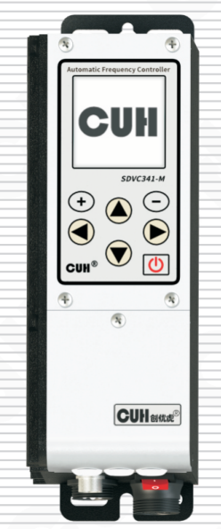

## SDVC341-M
Automatischer Frequenzregler für Vibrationsfördereinrichtungen  SDVC341-M
# Benutzerhandbuch


---

## Urheberrechtshinweis

Nanjing CUH Science & Technology CO., Ltd. behält sich alle Rechte vor.

Alle Informationen in diesem Benutzerhandbuch sind das geistige Eigentum unseres Unternehmens und sind durch das Urheberrecht und andere damit verbundene Gesetze geschützt. CUH genießt und behält sich alle durch das Urheberrecht und andere Gesetze verliehenen Rechte vor. Ohne schriftliche Zustimmung von CUH darf dieses Benutzerhandbuch weder teilweise noch vollständig kopiert, übersetzt, nachgeahmt oder anderweitig genutzt werden.

## Haftungsausschluss

Alle Inhalte dieses Benutzerhandbuchs beschreiben ausschließlich die Verwendungsmethode der zugehörigen Produkte unseres Unternehmens und sind gemäß dem vorhandenen technischen Stand und dem Zustand beschrieben, in dem das Produkt an Sie übergeben wird. Bei der Verwendung dieses Produkts tragen Sie die entsprechenden Risiken. Sofern gesetzlich nicht anders gefordert, übernimmt das Unternehmen aufgrund dieses Benutzerhandbuchs keine ausdrückliche oder stillschweigende Verantwortung für das Produkt, einschließlich, aber nicht beschränkt auf Personenschäden, Sachschäden, Verlust von Chancen usw.

Sie verstehen die oben genannten Risiken ausdrücklich und erklären sich damit einverstanden, dass das Unternehmen, sofern gesetzlich nicht zwingend vorgeschrieben, nicht für direkte oder indirekte Schäden oder Verluste für Sie haftet (einschließlich, aber nicht beschränkt auf materielle Verluste an Personal, Eigentum, Daten usw. sowie immaterielle Verluste wie Ruf, Chancen usw.).

Das Unternehmen behält sich das Recht vor, die in diesem Benutzerhandbuch anwendbaren Produkte ohne vorherige oder nachträgliche Ankündigung zu ändern.

---


---

# Vorwort

Vielen Dank, dass Sie sich für den automatischen Frequenzregler für Vibrationsfördereinrichtungen der CUH-Serie SDVC341 entschieden haben. (Im folgenden Text kurz „Controller" genannt.) Diese Controller-Serie verwendet hochwertige Komponenten, integriert die neueste elektronische Technologie und ist mit Hochleistungs-Digitalsignalprozessoren sorgfältig ausgelegt.

Dieses Handbuch beschreibt die grundlegende Bedienungsmethode, die funktionale technische Beschreibung und typische Anwendungsbeispiele dieses Produkts. Es bietet Benutzern relevante Informationen zu Installation und Inbetriebnahme, Parametereinstellung, Fehlerdiagnose, Fehlerbehebung und Routinewartung des Controllers. Um die korrekte Installation und Verwendung dieses Controllers zu gewährleisten, lesen Sie dieses Benutzerhandbuch bitte vor der Installation sorgfältig durch und bewahren Sie es ordnungsgemäß auf.

Lesen Sie unbedingt die folgenden Symbole, um auf Vorsichtsmaßnahmen gegen Personenschäden und Produktschäden hingewiesen zu werden.

| Symbol | Beschreibung |
|---|---|
| Gefahr | Die Nichtbeachtung dieses Punktes<br>führt zu Personenschäden oder zum Tod. |
| Warnung | Die Nichtbeachtung dieses Punktes<br>kann zu Personenschäden oder zum Tod führen. |
| Vorsicht | Die Nichtbeachtung dieses Punktes<br>kann zu leichten oder mittelschweren Personenschäden führen. |
| Hinweis | Die Nichtbeachtung dieses Punktes<br>führt zu Produkt- und Sachschäden. |
| Zwingend | Zeigt Vorsichtsmaßnahmen und Nutzungsbeschränkungen an,<br>die während der Verwendung unbedingt beachtet werden müssen. |

**Dieses Handbuch ist für die folgenden Controller-Modelle geeignet:**

◆ Automatischer Frequenzregler für Vibrationsfördereinrichtungen　　SDVC341-M (3.0A)

---


---

# Sicherheit und Vorsichtsmaßnahmen

1. **Gefahr** Dieses Produkt dient ausschließlich zum Antrieb elektromagnetischer Vibrationsfördereinrichtungen. Verwenden Sie dieses Produkt nicht zum Schutz des menschlichen Körpers oder von Körperteilen usw.

2. **Gefahr** Dieses Produkt ist nicht für den Einsatz als explosionsgeschütztes Produkt vorgesehen. Verwenden Sie es nicht in Gefahrenbereichen und/oder potenziell explosionsgefährdeten Gasumgebungen.

3. **Warnung** Dieses Produkt wird mit Wechselstromnetz betrieben. Bitte legen Sie keine Wechselspannung über 250Vac an. Eine zu hohe Eingangsspannung, wie z. B. 380Vac, kann dazu führen, dass das Produkt explodiert oder Feuer fängt und schwere Sicherheitsunfälle verursacht.

4. **Warnung** Dieses Produkt ist über das Netzkabel geerdet. Bitte stellen Sie sicher, dass die Stromverteilungseinrichtungen für den Controller gut geerdet sind, da sonst das Controller-Gehäuse unter Spannung stehen kann und dies zu einem Stromschlagunfall führt.

5. **Warnung** Führen Sie dem Ausgang dieses Controllers keine Wechselstromversorgung zu, da dies den Controller beschädigt.

6. **Warnung** Stecken Sie keine stromführenden Leitungen ein oder aus und berühren Sie nicht die Kontakte der einzelnen Klemmen im Anschlussfach, um einen Stromschlag zu vermeiden.

7. **Hinweis** Bitte vermeiden Sie es, den Ausgang dieses Produkts durch Abschalten der Stromversorgung über Relais und andere Geräte zu steuern, da dies die Lebensdauer des Controllers erheblich verkürzt.

8. **Hinweis** Der Controller ist für den Betrieb in einer kühlen und trockenen Umgebung ausgelegt. Betreiben Sie den Controller niemals im Freien, um Durchnässung und Sonneneinstrahlung zu vermeiden. Betreiben Sie den Controller innerhalb der Temperatur, die durch die elektrischen Eigenschaften vorgegeben ist.

9. **Zwingend** Befestigen Sie dieses Produkt unbedingt auf einer soliden Plattform, die zuverlässig geerdet und von vibrierenden Geräten entfernt ist.

10. **Zwingend** Betreiben Sie den Controller niemals unter Bedingungen, die seine ausgelegten Grenzen überschreiten.

11. **Zwingend** Betreiben Sie den Controller strikt gemäß dieser Bedienungsanleitung. Wir übernehmen keine zivil- oder strafrechtliche Haftung, wenn Geräteschäden oder Personenschäden durch unsachgemäße Bedienung verursacht werden.

12. **Zwingend** Öffnen Sie niemals das Controller-Gehäuse, um einen Stromschlag zu vermeiden. Wenden Sie sich an CUH, wenn der Controller ausfällt. Versuchen Sie niemals, den Controller selbst zu reparieren, da dies zum Erlöschen der Garantie führen kann.

---


---

# Betriebs- und Lagerungsumgebung

## Prüfung vor der Verwendung

Jeder Controller wird vor der Auslieferung einer strengen Qualitätsprüfung unterzogen und in stoßsicherer Verpackung geliefert. Bitte prüfen Sie nach dem Auspacken die folgenden Punkte:

1. Ob der Controller während des Transports beschädigt wurde.
2. Ob das Modell des Controllers Ihrem Bestellmodell entspricht.

## Betriebsumgebung

Bitte beachten Sie die folgenden Hinweise, um eine bessere Leistung und eine längere Lebensdauer des Controllers zu gewährleisten:

- ❗ Gut belüftete Umgebung
- ❗ Von Wasser, Feuchtigkeit, Staub und insbesondere öligem Staub fernhalten
- ❗ Von korrosiven oder entflammbaren Gasen und Flüssigkeiten fernhalten
- ❗ Von schwebendem Staub und Metallpartikeln fernhalten
- ❗ Fest befestigen, um Eigenschwingungen zu vermeiden
- ❗ Von elektromagnetischen Störungen fernhalten
- ❗ Sicherstellen, dass die Umgebungstemperatur 0~40 °C beträgt
- ❗ Zur Verwendung in Höhenlagen von 2000 m oder darunter

---


---

# Inhaltsverzeichnis

**Kapitel Ⅰ Hinweise vor der Inbetriebnahme** --------------------------------------------------1

1.1 Paketinhalt prüfen----------------------------------------------------------------1

1.2 Typenschild-Erläuterung ----------------------------------------------------2

1.3 Nutzungsbedingungen des Controllers-----------------------------------------------------------2

1.4 Hinweise--------------------------------------------------------------------------------3

**Kapitel Ⅱ Produkteinführung**------------------------------------------------------4

2.1 Produkteinführung ------------------------------------------------------------------4

2.2 Tastenfeld und I/O-Anschlüsse --------------------------------------------------5

2.3 Installationsanleitung für den Vibrationssensor ---------------------------------6

2.4 Beschreibung der Startseiten-Parameter -----------------------------------------7

2.5 Definition der Signalsteuerungsanschlüsse --------------------------------------7

2.6 Tastenfeldbedienung --------------------------------------------------------------8

2.7 Rotationsdiagramm der Bedienoberfläche ----------------------------------------8

**Kapitel Ⅲ Stromverkabelung und Grundbedienung**-----------------------------------------9

3.1 Stromverkabelung---------------------------------------------------------------------------9

3.2 Grundbedienung------------------------------------------------------------------------11

**Kapitel Ⅳ Detaillierte Funktionsbeschreibung**-------------------------------------------13

4.1 Allgemeine Parametereinstellungen -----------------------------------------------------------14

4.1.1 Spannung -----------------------------------------------------------------------------14

4.1.2 Frequenz ---------------------------------------------------------------------------14

4.1.3 Fördergeschwindigkeit------------------------------------------------------------------------15

4.1.4 Sanftanlaufzeit/Sanftstoppzeit------------------------------------------------------15

4.1.5 Maximalspannung/Maximalstrom --------------------------------------------------15

4.1.6 Maximale Ausgangsfrequenz/Minimale Ausgangsfrequenz--------------------------------15

4.1.7 Lasterkennung ----------------------------------------------------------------------16

4.1.8 Materialmangel-Alarm-----------------------------------------------------------------------16

4.1.9 Abschaltalarm ----------------------------------------------------------------------16

4.1.10 Hintergrundbeleuchtungs-Helligkeit -------------------------------------------------------------16

4.1.11 Hintergrundbeleuchtung Aus-------------------------------------------------------17

4.1.12 Sprache----------------------------------------------------------------------------17

4.2 Automatische Resonanzfrequenzsuche -------------------------------------------------17

4.2.1 Frequenzsuch-Oberfläche -------------------------------------------------------17

---


4.3 Konstante Fördergeschwindigkeit ----------------------------------------------------------------18

  4.3.1 Mittenfrequenz -------------------------------------------------------------18

  4.3.2 Frequenzversatz --------------------------------------------------------------18

  4.3.3 Frequenzintegration ---------------------------------------------------------18

  4.3.4 Amplitudenintegration --------------------------------------------------------19

  4.3.5 Amplitudenverhältnis ---------------------------------------------------------------19

  4.3.6 Automatische Phase --------------------------------------------------------------------19

  4.3.7 Strom während der Frequenzsuche -------------------------------------------19

  4.3.8 Amplitude während der Frequenzsuche -----------------------------------------19

  4.3.9 Maximale Fördergeschwindigkeit ------------------------------------------------------------19

  4.3.10 Phasenversatz des Slave-Controllers ------------------------------------------------19

  4.3.11 Steuermodus der Ausgangsspannung --------------------------------------------------20

  4.3.12 Steuermodus der Ausgangsfrequenz ------------------------------------------------20

  4.3.13 Synchronisationsquelle ------------------------------------------------------------------20

  4.3.14 Typ des Vibrationssensors --------------------------------------------------------20

  4.3.15 Geschwindigkeit der automatischen Resonanzfrequenzsuche ----------------------------------------20

4.4 Ausgangsparameter ------------------------------------------------------------------21

  4.4.1 Hauptausgangsparameter --------------------------------------------------------21

  4.4.2 Parameter des DC-Steuerausgangs --------------------------------------------------28

4.5 Signalsteuerung ---------------------------------------------------------------------30

  4.5.1 Sensortyp -------------------------------------------------------------------30

  4.5.2 C-Port/E-Port-Logik -----------------------------------------------------------31

  4.5.3 C-Port Ein-/Aus-Verzögerung und E-Port Ein-/Aus-Verzögerung ----------------------------------31

  4.5.4 Speed-A-Logik/Speed-B-Logik ---------------------------------------------------32

  4.5.5 Speed A Ein-/Aus-Verzögerung und Speed B Ein-/Aus-Verzögerung --------------------------------32

4.6 Materialzählung----------------------------------------------------------33

  4.6.1 Materialzählung (oder Speed A/B) -------------------------------------33

  4.6.2 Zielmenge ---------------------------------------------------------------34

  4.6.3 Endgeschwindigkeit ----------------------------------------------------------------34

  4.6.4 Endgeschwindigkeitsmenge -------------------------------------------------------35

  4.6.5 Zählwert auf 0 zurücksetzen -----------------------------------------------------35

  4.6.6 RS-Priorität -------------------------------------------------------------------35


4.7 Einstellungen speichern ----------------------------------------------------------------36

&nbsp;&nbsp;&nbsp;&nbsp;4.7.1 Rückrufeinstellungen ----------------------------------------------------------36

&nbsp;&nbsp;&nbsp;&nbsp;4.7.2 Einstellungen speichern---------------------------------------------------------------36

&nbsp;&nbsp;&nbsp;&nbsp;4.7.3 Werkseinstellungen wiederherstellen-------------------------------------------------------------37

&nbsp;&nbsp;&nbsp;&nbsp;4.7.4 Einstellungen kopieren --------------------------------------------------------------37

&nbsp;&nbsp;&nbsp;&nbsp;4.7.5 Benutzerpasswort -------------------------------------------------------------37

&nbsp;&nbsp;&nbsp;&nbsp;4.7.6 Passwort eingeben-------------------------------------------------------------37

4.8 RS485-Kommunikation-----------------------------------------------------------38

&nbsp;&nbsp;&nbsp;&nbsp;4.8.1 Kommunikationstyp --------------------------------------------------------38

&nbsp;&nbsp;&nbsp;&nbsp;4.8.2 Baudrate------------------------------------------------------------------39

&nbsp;&nbsp;&nbsp;&nbsp;4.8.3 Adresse des Slave-Controllers---------------------------------------------------39

&nbsp;&nbsp;&nbsp;&nbsp;4.8.4 Portwiderstand/Synchronisationswiderstand-------------------------------------39

4.9 CUHBus-DS®-Vernetzung---------------------------------------------------------40

&nbsp;&nbsp;&nbsp;&nbsp;4.9.1 Gerätevernetzung ---------------------------------------------------------41

&nbsp;&nbsp;&nbsp;&nbsp;4.9.2 Synchronisationsfunktion--------------------------------------------------------------45

&nbsp;&nbsp;&nbsp;&nbsp;4.9.3 Signal-Sharing ------------------------------------------------------------51

&nbsp;&nbsp;&nbsp;&nbsp;4.9.4 Datensicherung----------------------------------------------------------------53

&nbsp;&nbsp;&nbsp;&nbsp;4.9.5 Fernsteuerungsdaten--------------------------------------------------------54

4.10 Controller-Statusüberwachung ------------------------------------------------54

4.11 Fehlerprotokoll -------------------------------------------------------------------55

4.12 Startseite anpassen ----------------------------------------------------------55

**Kapitel Ⅴ Typische Anwendungen** ----------------------------------------------56

&nbsp;&nbsp;&nbsp;&nbsp;5.1 Wie können zwei Vibrationsförderer mit derselben Frequenz betrieben werden? ------------56

&nbsp;&nbsp;&nbsp;&nbsp;5.2 Wie wird Controller B über einen an Controller A angeschlossenen Sensor ein-/ausgeschaltet? -----57

&nbsp;&nbsp;&nbsp;&nbsp;5.3 Wie werden zwei Controller gleichzeitig ein-/ausgeschaltet?---------------------------58

**Kapitel Ⅵ Häufig gestellte Fragen**-----------------------------------------59

&nbsp;&nbsp;&nbsp;&nbsp;6.1 Keine Anzeige beim Einschalten ----------------------------------------------------59

&nbsp;&nbsp;&nbsp;&nbsp;6.2 Keine Vibration, kein Geräusch, Controller-Anzeige normal ---------------------------59

&nbsp;&nbsp;&nbsp;&nbsp;6.3 Steuersignal funktioniert nicht-------------------------------------------------59

&nbsp;&nbsp;&nbsp;&nbsp;6.4 Keine Vibration, normales Geräusch, Controller-Anzeige normal --------------------59

&nbsp;&nbsp;&nbsp;&nbsp;6.5 Instabile Resonanzfrequenz-Nachführung-----------------------------------------59

&nbsp;&nbsp;&nbsp;&nbsp;6.6 Langsame Geschwindigkeitskorrektur bei konstanter Fördergeschwindigkeit ------------------------60


---

6.7 Wie wird der Controller schnell auf die Werkseinstellungen zurückgesetzt -------------------------60

**Kapitel Ⅶ Anhang** ------------------------------------------------------------------------61

&nbsp;&nbsp;&nbsp;&nbsp;7.1 Abmessungen -------------------------------------------------------------------------------61

&nbsp;&nbsp;&nbsp;&nbsp;7.2 Technische Daten---------------------------------------------------------------62

&nbsp;&nbsp;&nbsp;&nbsp;7.3 Referenznorm---------------------------------------------------------------------63

&nbsp;&nbsp;&nbsp;&nbsp;7.4 Parameterliste----------------------------------------------------------------------------64

&nbsp;&nbsp;&nbsp;&nbsp;&nbsp;&nbsp;&nbsp;&nbsp;7.4.1 Schnittstellen-Parametergruppe -----------------------------------------------------64

&nbsp;&nbsp;&nbsp;&nbsp;&nbsp;&nbsp;&nbsp;&nbsp;7.4.2 Allgemeine Parametergruppe-----------------------------------------------------65

&nbsp;&nbsp;&nbsp;&nbsp;&nbsp;&nbsp;&nbsp;&nbsp;7.4.3 Hauptausgangs-Parametergruppe ------------------------------------------------66

&nbsp;&nbsp;&nbsp;&nbsp;&nbsp;&nbsp;&nbsp;&nbsp;7.4.4 Parametergruppe konstante Geschwindigkeit-----------------------------------------------67

&nbsp;&nbsp;&nbsp;&nbsp;&nbsp;&nbsp;&nbsp;&nbsp;7.4.5 Signal-Eingangs-Parametergruppe-------------------------------------------------68

&nbsp;&nbsp;&nbsp;&nbsp;&nbsp;&nbsp;&nbsp;&nbsp;7.4.6 Steuerausgangs-Parametergruppe---------------------------------------------69

&nbsp;&nbsp;&nbsp;&nbsp;&nbsp;&nbsp;&nbsp;&nbsp;7.4.7 DC-Zähl-Parametergruppe ------------------------------------------------70

&nbsp;&nbsp;&nbsp;&nbsp;&nbsp;&nbsp;&nbsp;&nbsp;7.4.8 Kommunikations-Parametergruppe -------------------------------------------71

&nbsp;&nbsp;&nbsp;&nbsp;&nbsp;&nbsp;&nbsp;&nbsp;7.4.9 Gruppe Einstellungen speichern--------------------------------------------------------------72

&nbsp;&nbsp;&nbsp;&nbsp;&nbsp;&nbsp;&nbsp;&nbsp;7.4.10 Überwachungs-Parametergruppe-------------------------------------------------73

&nbsp;&nbsp;&nbsp;&nbsp;&nbsp;&nbsp;&nbsp;&nbsp;7.4.11 Anhangliste----------------------------------------------------------------------75

&nbsp;&nbsp;&nbsp;&nbsp;7.5 Ein- und Ausgangsschaltpläne -------------------------------------------------76

&nbsp;&nbsp;&nbsp;&nbsp;7.6 Fehlercode---------------------------------------------------------------------------------78

&nbsp;&nbsp;&nbsp;&nbsp;7.7 Warnungscode ----------------------------------------------------------------------------79

**Kapitel Ⅷ Produktgarantieinformationen**-------------------------------------80

&nbsp;&nbsp;&nbsp;&nbsp;8.1 Garantiezeitraum -------------------------------------------------------------------------80

&nbsp;&nbsp;&nbsp;&nbsp;8.2 Garantieumfang--------------------------------------------------------------------------80

&nbsp;&nbsp;&nbsp;&nbsp;8.3 Produkteignung-----------------------------------------------------------------------80

---


# Kapitel Ⅰ Hinweise vor der Inbetriebnahme

Dieses Kapitel beschreibt den Produktverpackungsinhalt, die Beschreibung des Controller-Äußeren und die Informationen zum Controller-Typenschild.

## 1.1 Paketinhalt prüfen

Prüfen Sie vor der Verwendung die Unversehrtheit des Controllers und des Zubehörs. Sollten Sie feststellen, dass das Produkt defekt oder beschädigt ist, Zubehör fehlt usw., wenden Sie sich bitte an unser Unternehmen.

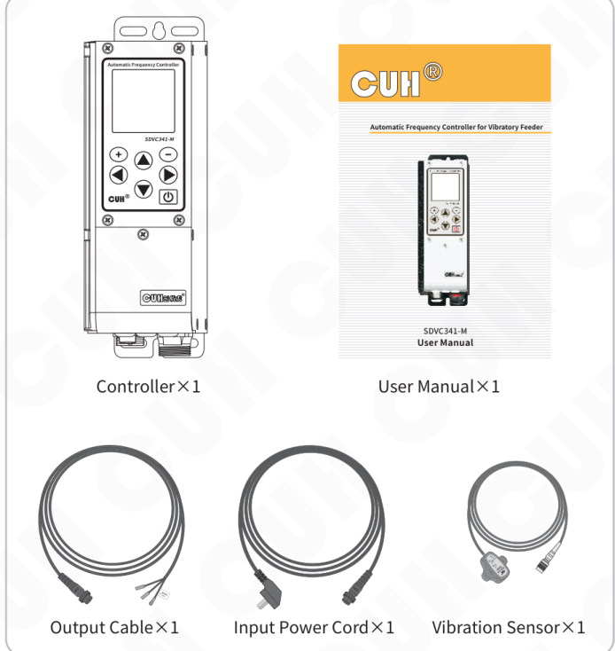

Dargestellter Lieferumfang:

- Controller×1
- Benutzerhandbuch×1
- Ausgangskabel×1
- Eingangsnetzkabel×1
- Vibrationssensor×1

---


## 1.2 Typenschild-Erläuterung

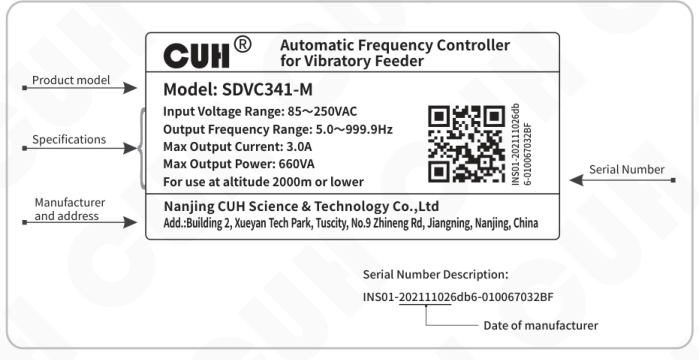

Im Bild dargestellte Typenschild-Informationen:

- Produktmodell: **Model: SDVC341-M**
- Produktname: **Automatischer Frequenzregler für Vibrationsfördereinrichtungen**
- Spezifikationen:
  - Eingangsspannungsbereich: **85~250VAC**
  - Ausgangsfrequenzbereich: **5.0~999.9Hz**
  - Max. Ausgangsstrom: **3.0A**
  - Max. Ausgangsleistung: **660VA**
  - Zur Verwendung in einer Höhe von **2000m oder darunter**
- Hersteller und Adresse:
  - **Nanjing CUH Science & Technology Co., Ltd**
  - Add.: **Building 2, Xueyan Tech Park, Tuscity, No.9 Zhineng Rd, Jiangning, Nanjing, China**
- Seriennummer-Beschreibung: **INS01-202111026db6-010067032BF**
  - Herstellungsdatum: **20211102**

## 1.3 Nutzungsbedingungen des Controllers

Der Controller wird mit AC 85V~250V versorgt und über den Netzstecker des Netzkabels mit dem Schutzleiter verbunden. Bitte verwenden Sie ein Standard-Stromnetz und stellen Sie sicher, dass der Schutzleiter korrekt angeschlossen ist.

> ⚠️ **Warnung**  
> Schließen Sie den Controller niemals an 380V Wechselstrom an, da dies irreversible schwere Schäden am Controller verursacht, möglicherweise in Form von Explosion, Brand und anderen Sicherheitsvorfällen.

> ⚠️ **Warnung**  
> Stellen Sie sicher, dass die Versorgungsseite zuverlässig geerdet ist. Das Metallgehäuse des Controllers ist direkt mit dem Schutzleiter verbunden. Eine mangelhafte Erdung führt dazu, dass das Controller-Gehäuse unter Spannung steht und einen Stromschlagunfall verursacht.

> **Hinweis**  
> Bei längerem Betrieb entsteht Wärme und die Temperatur des Gehäuses steigt. Bitte installieren Sie den Controller in einer gut belüfteten Umgebung und befestigen Sie ihn sicher, entfernt von Vibrationsquellen.

> **Hinweis**  
> Dieses Produkt ist ein Controller zum Antrieb von Elektromagneten. Es darf nicht an einen piezoelektrischen Vibrationsförderer angeschlossen werden.


---

## 1.4 Hinweise

Dieses Benutzerhandbuch hat einen Umfang von etwa 28000 Wörtern; für das vollständige Lesen benötigen Sie voraussichtlich etwa eine Stunde.

◆ Bitte lesen Sie dieses Handbuch vor der Verwendung sorgfältig durch, um Schäden am Controller durch unsachgemäße Bedienung zu vermeiden.

◆ Benutzer können die relevanten Funktionen und Bedienmethoden des Controllers anhand des Handbuchverzeichnisses schnell finden.

◆ Die Unterüberschriften der Kapitel und der hervorgehobene Text im Text sind die tatsächlich angezeigten Parameterelemente des Controllers, wie z. B. Spannung.

◆ Benutzer können „Kapitel Ⅴ Typische Anwendungen" lesen, um sich schnell mit diesem Controller vertraut zu machen.

◆ Benutzer können die Funktions-Tag-Codes im Abschnitt „7.4 Parameterliste" schnell suchen.

◆ Das gleichzeitige Drücken von ⊕ und ⊖ bedeutet Bestätigung.

---


---

# Kapitel Ⅱ Produkteinführung

Der Hauptinhalt dieses Kapitels umfasst eine kurze Einführung und die Hauptmerkmale dieses Produkts.

## 2.1 Produkteinführung

Die Serie SDVC341 des automatischen Frequenzreglers für Vibrationsfördereinrichtungen ist ein Produkt, das speziell für hochwertige Zuführsysteme entwickelt wurde.

Einzigartige Leistung wird durch den Einsatz der neuesten elektronischen Technologie und Signalverarbeitungsmethoden erzielt. Zu den besonderen Merkmalen gehören:

- Ausgestattet mit PFC-Leistungsfaktorkorrektur-Boost-Funktion, die eine maximale Ausgangsspannung von 250V innerhalb des Eingangsspannungsbereichs von 85~250V unterstützt.
- Bremsen kann angewendet werden, um den Vibrationsförderer schnell zu stoppen.
- Über die CUHBus-DS®-Kommunikation können Synchronisation, Sicherung und Wiederherstellung von Fernsteuerungsspannung, -frequenz, -phase und anderen Parametern jedes Controllers realisiert werden.
- Signale von anderen Controller-Ports können über die CUHBus-DS®-Kommunikation für die Logiksteuerung verwendet werden.
- Die Funktion des Materialmangel-Alarms kann ohne Installation zusätzlicher Sensoren realisiert werden.
- Über den Vibrationsförderer können akustische Signalhinweise mit auswählbaren Tonhöhen ausgegeben werden.
- Die Ausgangsfrequenz wird auf 5Hz~999.9Hz erweitert.
- Der analoge Geschwindigkeitssteuerungsanschluss unterstützt 0~5V, 1~5V, 0~10V, 4~20mA und weitere Modi.
- Ausgestattet mit Zählfunktion, einschließlich Zählverlangsamung und Zählstopp.
- Die verbesserte Konstantamplituden-Frequenzsuche stellt sicher, dass zwei Vibrationsförderer mit kleinem Abstand während des Frequenzsuchvorgangs nicht kollidieren.
- Unterstützt die Protokolle RS485 Modbus ASCII und RS485 Modbus RTU.
- Ein Software-Upgrade kann über die RS485-Schnittstelle durchgeführt werden.
- Es verwendet ein LCD-Display mit 128 * 128 Auflösung und unterstützt drei Sprachen: Chinesisch, Englisch und Deutsch.
- Erkennung der Laststromcharakteristik zur Unterstützung der Benutzer bei der Fehlerdiagnose.
- Der Fehlercode kann die neuesten 64 Fehlerprotokolle speichern.

---


## 2.2 Tastenfeld und I/O-Anschlüsse

### Erklärung der Anzeige und Tasten

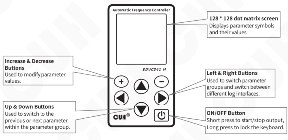

| Element | Erklärung |
|---|---|
| Erhöhen-/Verringern-Tasten | Zum Ändern von Parameterwerten. |
| Auf- und Ab-Tasten | Zum Wechseln zum vorherigen oder nächsten Parameter innerhalb der Parametergruppe. |
| Links- und Rechts-Tasten | Zum Wechseln der Parametergruppen und zum Wechseln zwischen verschiedenen Protokoll-Oberflächen. |
| 128 * 128 Punktmatrix-Bildschirm | Zeigt Parametersymbole und ihre Werte an. |
| EIN/AUS-Taste | Kurzes Drücken zum Starten/Stoppen der Ausgabe, langes Drücken zum Sperren des Tastenfelds. |

### Erklärung der externen Teile

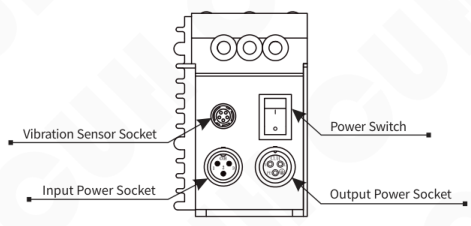

| Externes Teil | In der Abbildung dargestellte Beschriftung |
|---|---|
| Vibrationssensor-Buchse | Vibrationssensor-Buchse |
| Eingangsstrom-Buchse | Eingangsstrom-Buchse |
| Netzschalter | Netzschalter |
| Ausgangsstrom-Buchse | Ausgangsstrom-Buchse |


---

## 2.3 Installationsanleitung für den Vibrationssensor

Befestigen Sie den Vibrationssensor an einer glatten Oberfläche des Vibrators, die Einbaurichtung ist beliebig. Die Installationsmethoden des Vibrationssensors sind unten dargestellt:

- Methode 1: Wie in Abb. 2.3.1 dargestellt  
  Vorteil: Einfache Installation

- Methode 2: Wie in Abb. 2.3.2 dargestellt  
  Hinweis: Der Vibrationssensor darf nicht vom Zuführtopf gedrückt werden.

- Methode 3: Schweißen Sie einen Halter am Vibrator fest und befestigen Sie den Vibrationssensor am Halter. Wie in Abb. 2.3.3 dargestellt  
  Die empfohlenen Abmessungen des Halters des Vibrationssensors sind in Abb. 2.3.4 dargestellt.

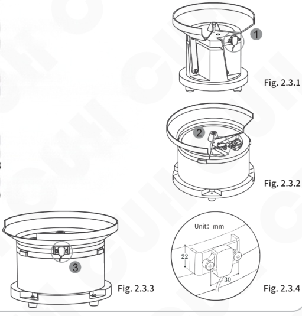

- Nicht empfohlene Installationsmethode, wie in Abb. 2.3.5 und Abb. 2.3.6 dargestellt.  
  Wenn die Einbaulage nicht geeignet ist, kann der Vibrationssensor die Resonanzfrequenz nicht genau zurückmelden und der Controller führt die Suche nach der Resonanzfrequenz dauerhaft aus.

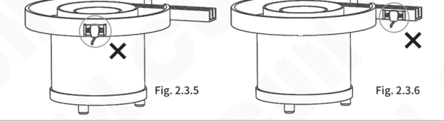

---


## 2.4 Beschreibung der Startseiten-Parameter

Der Controller kann auf der Startseite den Hauptausgangsstatus, den Tastatursperrstatus, den Portstatus, Überwachungsparameter und den Oberflächennamen anzeigen. Innerhalb des Portstatus: Hervorgehobenes X zeigt an, dass der Port gültig ist. X zeigt an, dass der Port bei niedrigem Pegel gültig ist, und X zeigt an, dass der Port bei hohem Pegel gültig ist.

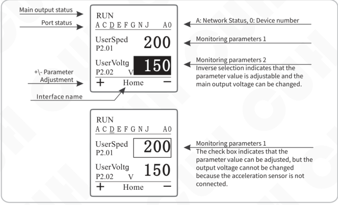

Dargestellte Diagrammbeschriftungen:

- Hauptausgangsstatus
- Portstatus
- A: Netzwerkstatus, 0: Gerätenummer
- Überwachungsparameter 1
- Überwachungsparameter 2  
  Die umgekehrte Auswahl zeigt an, dass der Parameterwert einstellbar ist und die Hauptausgangsspannung geändert werden kann.
- +/- Parameteranpassung
- Oberflächenname
- Überwachungsparameter 1  
  Das Kontrollkästchen zeigt an, dass der Parameterwert eingestellt werden kann, die Ausgangsspannung jedoch nicht geändert werden kann, da der Beschleunigungssensor nicht angeschlossen ist.

Dargestellte Beispielwerte der Startseite:

| Element | Angezeigter Inhalt |
|---|---|
| Hauptausgangsstatus | RUN |
| Portstatus | A C D E F G N J |
| Netzwerk / Gerätenummer | A0 |
| Überwachungsparameter 1 | UserSped / P2.01 / 200 |
| Überwachungsparameter 2 | UserVoltg / P2.02 / V / 150 |
| Oberflächenname | Home |
| Parameteranpassungstasten | + / - |

## 2.5 Definition der Signalsteuerungsanschlüsse

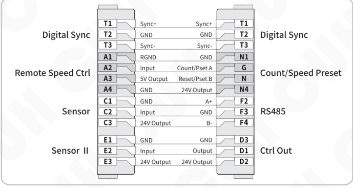

| Seite | Funktionsgruppe | Port | Definition |
|---|---|---|---|
| Links | Digital Sync | T1 | Sync+ |
| Links | Digital Sync | T2 | GND |
| Links | Digital Sync | T3 | Sync- |
| Links | Remote Speed Ctrl | A1 | RGND |
| Links | Remote Speed Ctrl | A2 | Input |
| Links | Remote Speed Ctrl | A3 | 5V Output |
| Links | Remote Speed Ctrl | A4 | GND |
| Links | Sensor | C1 | GND |
| Links | Sensor | C2 | Input |
| Links | Sensor | C3 | 24V Output |
| Links | Sensor II | E1 | GND |
| Links | Sensor II | E2 | Input |
| Links | Sensor II | E3 | 24V Output |
| Rechts | Digital Sync | T1 | Sync+ |
| Rechts | Digital Sync | T2 | GND |
| Rechts | Digital Sync | T3 | Sync- |
| Rechts | Count/Speed Preset | N1 | GND |
| Rechts | Count/Speed Preset | G | Count/Pset A |
| Rechts | Count/Speed Preset | N | Reset/Pset B |
| Rechts | Count/Speed Preset | N4 | 24V Output |
| Rechts | RS485 | F2 | A+ |
| Rechts | RS485 | F3 | GND |
| Rechts | RS485 | F4 | B- |
| Rechts | Ctrl Out | D3 | GND |
| Rechts | Ctrl Out | D1 | Output |
| Rechts | Ctrl Out | D2 | 24V Output |


---

## 2.6 Tastenfeldbedienung

a. Dieser Controller verwendet einen 128 * 128 Punktmatrix-Bildschirm zur Anzeige der Parameterinhalte.

b. Je nach Dauer des Tastendrucks werden die Tastenaktionen in kurzes Drücken, langes Drücken, Beschleunigung erster Stufe und Beschleunigung zweiter Stufe unterteilt.

[Kurzes Drücken]: Länger als 0,1 Sekunden, aber kürzer als 0,5 Sekunden drücken.

[Langes Drücken]: Länger als 2 Sekunden drücken.

[Beschleunigung Stufe 1]: Länger als 0,5 Sekunden, aber kürzer als 2 Sekunden drücken.

[Beschleunigung Stufe 2]: Länger als 2 Sekunden drücken.

c. ⊕ und ⊖ haben die Hauptfunktion, Parameterwerte zu ändern.

d. Wechseln Sie in der Parametereinstellungs-Oberfläche durch kurzes Drücken von ◀ oder ▶ zwischen den oberen und unteren Parametergruppen.

e. Wechseln Sie in der Parametereinstellungs-Oberfläche durch kurzes Drücken von ▲ oder ▼ zwischen den oberen und unteren Parametern dieser Gruppe.

f. Kurzes Drücken von ⏻ startet/stoppt den Hauptausgang, langes Drücken von ⏻ sperrt/entsperrt das Tastenfeld.

g. Gelangen Sie über die folgenden Tastenkombinationen in verschiedene Parametergruppen:

Langes Drücken von ▲+▼: Frequenzsuch-Oberfläche aufrufen oder verlassen.

Langes Drücken von ▲+◀: Parametereinstellungs-Oberfläche aufrufen oder verlassen.

Langes Drücken von ▲+▶: Protokolloberfläche aufrufen oder verlassen.

## 2.7 Rotationsdiagramm der Bedienoberfläche

In jeder Oberfläche: Langes Drücken von **▲+▶** ruft die **Protokolloberfläche** auf, erneutes langes Drücken kehrt zur **Hauptoberfläche** zurück.

In jeder Oberfläche: Langes Drücken von **▲+▼** ruft die **Frequenzsuch-Oberfläche** auf, kurzes Drücken der Stopptaste kehrt zur **Hauptoberfläche** zurück.

In jeder Oberfläche: Langes Drücken von **▲+◀** ruft die **Parametereinstellungs-Oberfläche** auf, erneutes langes Drücken kehrt zur **Hauptoberfläche** zurück.

In jeder Oberfläche: Bei Inaktivität von mehr als 5 Minuten wird die **Standby-Oberfläche** aufgerufen; erneutes Drücken einer beliebigen Taste führt zur **Hauptoberfläche**.

---


---

# Kapitel Ⅲ Stromverkabelung und Grundbedienung

## 3.1 Stromverkabelung

### Schritt eins:

Öffnen Sie die Verpackung und prüfen Sie den Controller und das gesamte Zubehör.

### Schritt zwei:

Schließen Sie die Anschlussklemmen des Ausgangsstromkabels an die Elektromagnetspule des Vibrators an.

Richten Sie die Kerbe am Luftfahrtstecker des Ausgangskabels am Dreiecksymbol der Ausgangsbuchse des Controllers aus und ziehen Sie nach dem korrekten Anschließen des Ausgangskabels die Überwurfmutter fest.

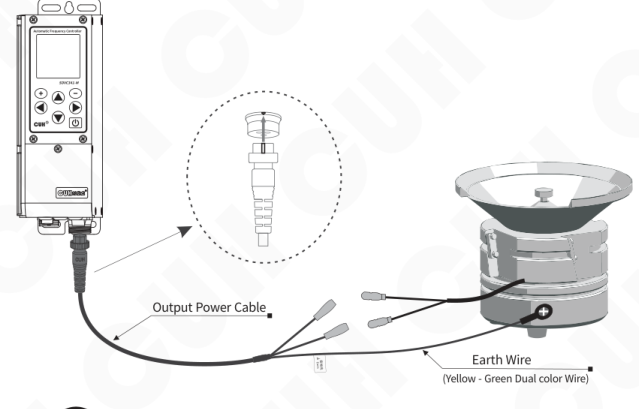

> **Hinweis**
>
> 1. Stellen Sie sicher, dass die Elektromagnetspulen des Vibrators mit den beiden Ausgangsstiften des Ausgangsstromkabels verbunden sind und das Metallgehäuse des Vibrators zuverlässig geerdet ist.
>
> 2. Der Anschluss piezoelektrischer Lasten am Leistungsausgang ist verboten, da dies sonst zu einem Stromschlag-Sicherheitsunfall führen kann!

---


---

### Schritt drei:

Verbinden Sie den Stecker des Eingangsstromkabels mit der Eingangsstrom-Buchse des Controllers.

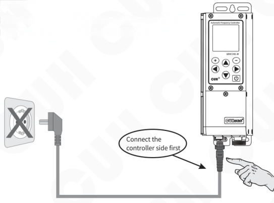

### Schritt vier:

Nachdem Sie bestätigt haben, dass sich der Schalter in der Aus-Stellung befindet, verbinden Sie den Stecker des Eingangsstromkabels mit der Netzsteckdose.

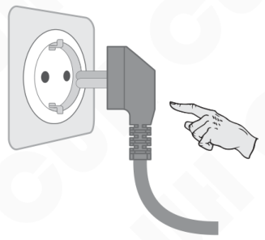

---


## 3.2 Grundbedienung

### Schritt fünf:

Schalten Sie den Netzschalter des Controllers ein; der Controller zeigt die Hauptoberfläche an.

```text
RUN
A C D E F G N J     A0
─────────────────────
UserSped           200
P2.01
EffectCu          0.00
P10.05        A
+       Home       −
```

### Schritt sechs:

Der Vibrationsförderer beginnt zu arbeiten. Stellen Sie die Frequenz- und Spannungsparameterwerte in der Parametergruppe „2 Common" ein, um die passende Fördergeschwindigkeit auszuwählen.

- Langes Drücken von ▲ und ◀ ruft die Parametereinstellungs-Oberfläche auf; kurzes Drücken von ▶ wechselt zur Parametergruppe „2 Common".
- Kurzes Drücken von ▲ oder ▼ positioniert den Cursor auf dem Spannungsparameterwert.
- Drücken Sie ⊕ oder ⊖, um den Parameterwert anzupassen.
- Kurzes Drücken von ▲ oder ▼ positioniert den Cursor auf dem Frequenzparameterwert.
- Drücken Sie ⊕ oder ⊖, um den Parameterwert anzupassen.

```text
RUN
A C D E F G N J     A0
─────────────────────
01.UserSped        200
02.UsrVoltg        150 V
03.UsrFrqnc       50.0 Hz
04.SoftStar        0.5 S
05.SoftStop        0.5 S
+      2Common      −
```

> ☺
>
> - Die Frequenz, bei der die Vibration ihr Maximum erreicht, ist die Eigenfrequenz des Schwingkörpers.
> - Jeder Vibrationsförderer hat seine mechanische Resonanzfrequenz; stellen Sie die Ausgangsfrequenz des Controllers auf diese Frequenz ein, um den besten Arbeitszustand zu erreichen.


### Schritt sieben:

Kunden können zusätzlich den Beschleunigungssensor anschließen, um die automatische Frequenzsuche des Controllers zu realisieren. (Hinweis: Der Benutzer muss die Materialien in der Vibrationsplatte nicht entleeren.)

Entnehmen Sie den Sensor, verbinden Sie den Sensorstecker mit dem Controller und ziehen Sie die Überwurfmutter fest; befestigen Sie das Sensorgehäuse korrekt an der Vibrationsplatte (siehe Kapitel 2.3).

### Schritt acht:

- Langes Drücken von ▲ und ▼ ruft die Frequenzsuch-Oberfläche auf.
- Zu diesem Zeitpunkt zeigt das Display die Amplitudenkurve der Vibrationsplatte während des Frequenzsuchvorgangs an (drei Phasen) und zeigt synchron die aktuellen Werte von Ausgangsspannung, Strom und Beschleunigung an.
- Nach Abschluss der Frequenzsuche zeigt der Controller „Save" an, um anzuzeigen, dass die Frequenzsuche erfolgreich war und die Mittenfrequenz gespeichert wurde. Der Controller kehrt automatisch zur Startseite zurück.
- Benutzer können die Fördergeschwindigkeit des Vibrationsförderers über ⊕ oder ⊖ weiter anpassen.

| Anzeigezustand | Anzeigen | Frequenz | Spannung | Strom | Beschleunigung | Oberfläche |
|---|---|---|---:|---:|---:|---:|---|
| RUN | A C D E F G N J A0 | 95Hz | 4V | 0.26A | 1.0g | SearchFr |
| RUN | A C D E F G N J A0 | 442Hz | 23V | 0.42A | 0.5g | SearchFr |
| RUN | A C D E F G N J A0 | 1033Hz | 54V | 0.46A | 0.3g | SearchFr |
| Save | A C D E F G N J A0 | 841Hz | 81V | 0.84A | 2.1g | SearchFr |

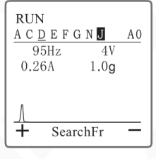

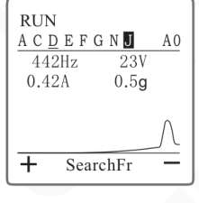

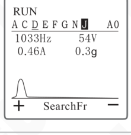

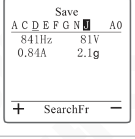


---

# Kapitel Ⅳ Detaillierte Funktionsbeschreibung

Dieses Kapitel beschreibt detaillierte Funktionen und Einstellungen des Controllers.  
Langes Drücken von ▲ und ◀ ruft auf jeder Oberfläche die Parametereinstellungs-Oberfläche auf.  
Die Parametereinstellungs-Oberfläche enthält die folgenden zehn Parametergruppen.  
Durch kurzes Drücken von ◀ oder ▶ wechseln Sie zwischen verschiedenen Parametergruppen.

```text
                         1EditHome
                             ↕
                          2Common
                             ↕
                         3M_output
                             ↕
                         4Stabilize
                             ↕
Short press ▶            5On&Off              Short press ▶
                             ↕
                         6DCoutput
                             ↕
                          7Counter
                             ↕
                           8Comm
                             ↕
                           9Save
                             ↕
                          10Monitor
```

Rotationsdiagramm der Parametergruppen

---


## 4.1 Allgemeine Parametereinstellungen

Dieses Kapitel beschreibt hauptsächlich die Einstellung und Anpassung der grundlegenden allgemeinen Parameter des Controllers.

### 4.1.1 Spannung

Dieser Controller kann die Ausgangsspannung direkt digital am Bedienfeld einstellen. Da der Controller über eine spannungsstabilisierende Ausgangsfunktion verfügt, ist dieser Wert der gleichgerichtete Spannungsmittelwert und wird nicht durch die Eingangsspannung beeinflusst. Die Ausgangsspannung kann auch bei instabiler Netzspannung stabil gehalten werden. Gleichzeitig bietet die direkte Einstellung des Spannungswerts den Benutzern genaue Daten zum Verständnis des Betriebs der Anlage.

» Rufen Sie die allgemeine Parametergruppe auf und suchen Sie die Spannungs-Einstellparameter.

» Drücken Sie ⊕ oder ⊖, um den Parameterwert anzupassen.

Der Spannungsbereich beträgt 0~250V, der Standardwert ist 150V und die Einstellgenauigkeit beträgt 1V.

```text
RUN
A C D E F G N J    A0
01.UserSped     200
02.UsrVoltg     150 V
03.UsrFrqnc     50.0 Hz
04.SoftStar       0.5 S
05.SoftStop       0.5 S
+    2Common       −
```

### 4.1.2 Frequenz

Der Controller verwendet die Technologie der direkten digitalen Frequenzsynthese (DDS), die eine sehr hohe Frequenzgenauigkeit und -stabilität aufweist und sich nicht mit der Zeit und der Temperatur ändert.

» Rufen Sie die allgemeine Parametergruppe auf und suchen Sie die Frequenz-Einstellparameter.

» Drücken Sie ⊕ oder ⊖, um den Parameterwert anzupassen.

Der Frequenzbereich beträgt 5,0~999,9Hz, der Standardwert ist 50,0Hz und die Einstellgenauigkeit beträgt 0,1Hz.

```text
RUN
A C D E F G N J    A0
01.UserSped     200
02.UsrVoltg     150 V
03.UsrFrqnc     50.0 Hz
04.SoftStar       0.5 S
05.SoftStop       0.5 S
+    2Common       −
```

Die anderen Parameter dieser Parametergruppe können gemäß den obigen Schritten angepasst werden.


---

### 4.1.3 Fördergeschwindigkeit

**Fördergeschwindigkeit:** Die Vorschubgeschwindigkeit des Materials im Vibrationsförderer. Wenn der Controller mit dem Beschleunigungssensor verbunden ist und der Parameterwert des „Spannungsmodus" auf „automatisch" eingestellt ist, kann die Materialvorschubgeschwindigkeit über den Parameter Fördergeschwindigkeit eingestellt werden, und die Vibrationsplatte kann stabil mit der eingestellten Fördergeschwindigkeit arbeiten.

Der Bereich der Fördergeschwindigkeit beträgt 0~3200, der Standardwert ist 200 und die Einstellgenauigkeit beträgt 1.

### 4.1.4 Sanftanlaufzeit/Sanftstoppzeit

**Sanftanlaufzeit:** Die Zeit, die der Controller benötigt, um beim Start aus dem Stillstand die Ausgangsspannung sanft von 0V auf die eingestellte Ausgangsspannung zu erhöhen.

Der Bereich der Sanftanlaufzeit beträgt 0,0~40,0s, der Standardwert ist 0,5 Sekunden und die Einstellgenauigkeit beträgt 0,1 Sekunden.

**Sanftstoppzeit:** Wenn der Controller den Betrieb stoppt, fällt die Ausgangsspannung sanft von der eingestellten Ausgangsspannung ab, bis sie den Wert 0V erreicht. Die dafür benötigte Zeit ist die Sanftstoppzeit.

Der Bereich der Sanftstoppzeit beträgt -0,1~40,0s, der Standardwert ist 0,5 Sekunden und die Einstellgenauigkeit beträgt 0,1 Sekunden.

Beim Starten oder Stoppen dieses Controllers kann die Ausgangsspannung sanft erhöht oder verringert werden, um eine Beschädigung der Vibrationsgeräte durch Stöße zu vermeiden.

### 4.1.5 Maximalspannung/Maximalstrom

**Maximalspannung:** Der maximale Spannungswert, den der Controller ausgibt.

Der Bereich der Maximalspannung beträgt 0-250V, der Standardwert ist 220V und die Einstellgenauigkeit beträgt 1V.

**Maximalstrom:** Der maximale Stromwert, den der Controller ausgibt.

Der Bereich des Maximalstroms beträgt 0,1~3,0A, der Standardwert ist 3,0A und die Einstellgenauigkeit beträgt 0,1A.

Dieser Controller kann maximale Ausgangsspannungs- und maximale Ausgangsstrom-Grenzwerte einstellen, wodurch verhindert werden kann, dass Benutzer durch versehentliche Ausgabe übermäßiger Spannung oder übermäßigen Stroms die Vibrationsgeräte beschädigen.

### 4.1.6 Maximale Ausgangsfrequenz/Minimale Ausgangsfrequenz

**Maximale Ausgangsfrequenz:** Begrenzt den oberen Grenzwert des Parameters „Frequenz". Die obere Frequenzgrenze während der Frequenzsuche wird ebenfalls durch diesen Parameterwert begrenzt.

Der Bereich der maximalen Ausgangsfrequenz beträgt 5,0~999,9Hz, der Standardwert ist 400,0Hz und die Einstellgenauigkeit beträgt 0,1Hz.

**Minimale Ausgangsfrequenz:** Begrenzt den unteren Grenzwert des Parameters „Frequenz". Die untere Frequenzgrenze während der Frequenzsuche wird ebenfalls durch diesen Parameterwert begrenzt.

Der Bereich der minimalen Ausgangsfrequenz beträgt 5,0~999,9Hz, der Standardwert ist 40,0Hz und die Einstellgenauigkeit beträgt 0,1Hz.

**Hinweis:** Der Unterschied zwischen der maximalen Ausgangsfrequenz und der minimalen Ausgangsfrequenz beträgt nicht weniger als 50,0Hz.

---


---

### 4.1.7 Lasterkennung

Der Controller kann die Induktivität, den Widerstandswert, den Sättigungsstrom usw. des als Last angeschlossenen Vibrationsförderers erkennen. Nach Verwendung der Lasterkennungsfunktion können Benutzer die gemessenen lastbezogenen Werte in der Überwachungsparametergruppe anzeigen. Standardmäßig None.

| Parameter | Bedeutung |
|---|---|
| None | Nicht erkannt |
| Valid | Startet einen Test (wechselt nach Abschluss automatisch in den ungültigen Zustand und testet nicht mehr) |

### 4.1.8 Materialmangel-Alarm

Wenn der Controller mit einem Beschleunigungsmesser verbunden ist und die Parameterwerte des „Spannungsmodus" und des „Frequenzmodus" beide auf „automatisch" eingestellt sind, wird die Materialmangel-Alarmfunktion aktiviert. Benutzer können den Parameter „Materialmangelalarm" in der Überwachungsparametergruppe finden, wenn der Vibrationsförderer leer oder mit wenig Material gefüllt ist; gleichzeitig können Sie durch langes Drücken von <kbd>+</kbd> und <kbd>−</kbd> den Messwert des „Materialmangelalarms" in der Überwachungsparametergruppe aufzeichnen und anhand des Messwerts den Alarmwert des „Materialmangelalarms" einstellen. Sie können den Alarmwert auch über <kbd>+</kbd> oder <kbd>−</kbd> weiter anpassen.

Wenn der Controller feststellt, dass der Messwert des Vibrationsförderers unter dem Alarmwert liegt, wird seine Alarmfunktion ausgelöst.

Der Bereich des Materialmangelalarms beträgt 0~3000, der Standardwert ist 10 und die Einstellgenauigkeit beträgt 1.

Hinweis: Benutzer können Alarmsignale als Hauptausgangs- oder D-Port-Ausgangsquellensignale verwenden, um verschiedene Ausgangszustände des Controllers anzusteuern.

### 4.1.9 Abschaltalarm

**Abschaltalarm:** Wenn der Controller die Ausgabe stoppt, erzeugt der Controller durch Ansteuerung des Vibrationsförderers unterschiedliche Alarmtöne, um den Benutzer in lauten Umgebungen auf das Abschalten hinzuweisen. Optional sind drei Klangeffekte oder ungültig (kein Ton). Standardmäßig None.

| Parameter | Bedeutung |
|---|---|
| None | Ungültig |
| Sound 1 | Steuert die Vibrationsplatte an, um den Alarmton des Klangeffekts 1 auszugeben |
| Sound 2 | Steuert die Vibrationsplatte an, um den Alarmton des Klangeffekts 2 auszugeben |
| Sound 3 | Steuert die Vibrationsplatte an, um den Alarmton des Klangeffekts 3 auszugeben |

### 4.1.10 Hintergrundbeleuchtungs-Helligkeit

**Hintergrundbeleuchtungs-Helligkeit:** Das ist die Helligkeit der Display-Hintergrundbeleuchtung des Controllers. Die Hintergrundbeleuchtungs-Helligkeit des Displays kann an unterschiedliche Umgebungslichtbedingungen angepasst werden.

Der Bereich der Hintergrundbeleuchtungs-Helligkeit beträgt 20~100, der Standardwert ist 100 und die Einstellgenauigkeit beträgt 1.

---


### 4.1.11 Hintergrundbeleuchtung Aus

**Hintergrundbeleuchtung Aus:** Das ist die Abschaltzeit der Hintergrundbeleuchtung. Wenn der Controller über einen bestimmten Zeitraum keine Bedienung ausführt, schaltet der Controller die Bildschirmhintergrundbeleuchtung aus. Durch Drücken einer beliebigen Taste kann die Bildschirmhintergrundbeleuchtung wieder eingeschaltet werden.

Der Bereich der Hintergrundbeleuchtungs-Abschaltung beträgt 1-30min, der Standardwert ist 5min und die Einstellgenauigkeit beträgt 1min. Bei Einstellung auf 31 bedeutet dies dauerhaft hell.

### 4.1.12 Sprache

**Sprache:** Das ist die auf dem Bedienfeld des Controllers angezeigte Sprache. Der Controller verfügt über drei integrierte Sprachen: Chinesisch, Englisch und Deutsch, damit Benutzer in verschiedenen Regionen einfach wechseln können. Standardmäßig Englis.

| Parameter | Bedeutung |
|---|---|
| Englis | Englische Oberfläche |
| Chines | Chinesische Oberfläche |
| German | Deutsche Oberfläche |

## 4.2 Automatische Resonanzfrequenzsuche

Dieses Kapitel beschreibt, wie die Resonanzfrequenz der Vibrationsplatte in der Frequenzsuch-Oberfläche dieses Produkts schnell lokalisiert und der Betrieb der Vibrationsplatte realisiert wird.

### 4.2.1 Frequenzsuch-Oberfläche

Wenn der Beschleunigungssensor korrekt an die Vibrationsplatte angeschlossen ist und sowohl der „Spannungsmodus" als auch der „Frequenzmodus" auf „Auto" eingestellt sind, können Sie den Resonanzfrequenzwert des Vibrationsförderers durch Aufrufen der Frequenzsuch-Oberfläche schnell lokalisieren.

Die Bedienungsschritte finden Sie in Schritt acht in Kapitel 3.2.


---

## 4.3 Konstante Fördergeschwindigkeit

Dieses Kapitel beschreibt hauptsächlich, wie die relevanten Parameter des Controllers eingestellt werden und wie die Funktionen des Controllers reibungslos aufrechterhalten werden.

### 4.3.1 Mittenfrequenz

Der Frequenzbereich, den der Controller automatisch anpassen kann, ist „Mittenfrequenz" ± „Frequenzversatz". Die Mittenfrequenz sollte nahe am Resonanzpunkt der Vibrationsausrüstung eingestellt werden, damit der Controller bei der automatischen Frequenzanpassung so schnell wie möglich den besten Arbeitspunkt erreichen kann.

> » Langes Drücken von ▲ und ◀ ruft die Parametereinstellungs-Oberfläche auf; kurzes Drücken von ▶ wechselt zur Parametergruppe „4 Stabilize".
>
> » Kurzes Drücken von ▲ oder ▼ wechselt zum Parameter Mittenfrequenz.
>
> » Drücken Sie ⊕ oder ⊖, um den Parameterwert anzupassen.
>
> ```text
> RUN
> A C D E F G N J    A0
> 01.AutFCent 100.0 Hz
> 02.AutFRang  30.0 Hz
> 03.AutFIntg    20
> 04.AutAIntg   250
> 05.AutAProp   500
> +   4Stabilize   -
> ```
>
> Der Bereich der Mittenfrequenz beträgt 5,0~999,9Hz, der Standardwert ist 100,0Hz und die Einstellgenauigkeit beträgt 0,1Hz.

Die anderen Parameter dieser Parametergruppe können gemäß den obigen Schritten angepasst werden.

### 4.3.2 Frequenzversatz

Der Frequenzbereich, den der Controller automatisch anpassen kann, ist „Mittenfrequenz" ± „Frequenzversatz". Dies dient zur Definition eines relativ kleinen automatischen Frequenzsuchbereichs. Der allgemeine Wert des Frequenzversatzes beträgt etwa 30,0Hz. Ist er zu groß, kann das Vibrationsgerät an einem ungeeigneten Arbeitspunkt arbeiten; ist er zu klein, kann dies die Anpassungsfähigkeit des Vibrationsgeräts verringern.

Der Bereich des Frequenzversatzes beträgt 0,0~180,0Hz, der Standardwert ist 30,0Hz und die Einstellgenauigkeit beträgt 0,1Hz.

### 4.3.3 Frequenzintegration

Der Controller passt die Ausgangsfrequenz über einen PID-Algorithmus automatisch an. Je größer dieser Wert ist, desto schneller kann der Controller die Ausgangsfrequenz anpassen; ist er jedoch zu groß, kann dies zu einer Schwingung der Ausgangsfrequenz führen.

Der Bereich der Frequenzintegration beträgt 0-2000, der Standardwert ist 20 und die Einstellgenauigkeit beträgt 1.

---


---

### 4.3.4 Amplitudenintegration

Der Controller passt die Ausgangsspannung über eine PID-Regelung automatisch an. Je größer dieser Wert ist, desto schneller kann der Controller die Ausgangsspannung anpassen und die Schwingungsamplitude und -frequenz der Ausgangsspannung reduzieren. Ist er jedoch zu groß, wird die Schwingungsamplitude der Ausgangsspannung größer.

Der Bereich der Amplitudenintegration beträgt 0~9999, der Standardwert ist 250 und die Einstellgenauigkeit beträgt 1.

### 4.3.5 Amplitudenverhältnis

Der Controller passt die Ausgangsspannung über eine PID-Regelung automatisch an. Je größer dieser Wert ist, desto schneller kann der Controller die Ausgangsspannung anpassen; ist er jedoch zu groß, führt dies zu häufigen Schwingungen der Ausgangsspannung.

Der Bereich des Amplitudenverhältnisses beträgt 0~9999, der Standardwert ist 500 und die Einstellgenauigkeit beträgt 1.

### 4.3.6 Automatische Phase

Dieser Parameter kann die Phasendifferenz zwischen der Ausgangsstromwellenform und dem Beschleunigungssignal des Beschleunigungssensors ändern.

Der Bereich der automatischen Phase beträgt -180 °~180 °, der Standardwert ist 0 ° und die Einstellgenauigkeit beträgt 1 °.

### 4.3.7 Strom während der Frequenzsuche

Stellen Sie den maximalen Ausgangsstrom des Controllers während der automatischen Frequenzsuche ein, damit der tatsächliche Ausgangsstrom der Vibrationsplatte den eingestellten Frequenzsuchstrom nicht überschreitet.

Der Bereich des Frequenzsuchstroms beträgt 1,0~6,0A, der Standardwert ist 3,0A und die Einstellgenauigkeit beträgt 0,1A.

### 4.3.8 Amplitude während der Frequenzsuche

Die maximale Amplitude des Controllers überschreitet während der automatischen Frequenzsuche diesen Wert nicht, um die Sicherheit der Vibrationsausrüstung zu schützen.

Der Bereich der Frequenzsuchamplitude beträgt 0~3200, der Standardwert ist 200 und die Einstellgenauigkeit beträgt 1.

### 4.3.9 Maximale Fördergeschwindigkeit

Stellen Sie diesen Parameter ein, um die maximal einstellbare Fördergeschwindigkeit zu begrenzen, damit Benutzer nicht versehentlich eine übermäßige Spannung ausgeben und die Vibrationsausrüstung beschädigen. Bei Verwendung der Fernsteuerungs-Geschwindigkeitsregelung wird die Obergrenze der Fördergeschwindigkeit ebenfalls von diesem Parameter beeinflusst.

Der maximale Bereich der Materialgeschwindigkeit beträgt 0-4000, der Standardwert ist 3200 und die Einstellgenauigkeit beträgt 1.

### 4.3.10 Phasenversatz des Slave-Controllers

Manuelle Phase bedeutet, dass die Phase der Ausgangswellenform des Slave-Controllers manuell so eingestellt werden kann, dass sie eine feste Phasenabweichung vom vom Master-Controller ausgegebenen Synchronisationssignal aufweist.

Der Bereich der manuellen Phase beträgt -180 °~180 °, der Standardwert ist 0 ° und die Einstellgenauigkeit beträgt 1 °.

---


### 4.3.11 Steuermodus der Ausgangsspannung

Dieser Parameter wird verwendet, um den Spannungsausgabemodus des Controllers umzuschalten, um unterschiedliche Steuerformen für den Ausgang zu erreichen. Standard ist Auto.

| Parameter | Bedeutung |
|---|---|
| Manuel | Die Ausgangsspannung wird durch den Parameterwert „Spannung" oder durch den DC-Analogeingang der Fernsteuerungs-Geschwindigkeitsregelung gesteuert. |
| Auto | Wenn der Beschleunigungssensor korrekt an den Controller angeschlossen ist, passt der Controller die Ausgangsspannung automatisch basierend auf den Rückmeldedaten des Vibrationssensors an, um sicherzustellen, dass die Fördergeschwindigkeit der Vibrationsausrüstung stabil beim Wert der „Fördergeschwindigkeit" liegt. |

### 4.3.12 Steuermodus der Ausgangsfrequenz

Dieser Parameter wird verwendet, um den Frequenzausgabemodus des Controllers umzuschalten. Standard ist Auto.

| Parameter | Bedeutung |
|---|---|
| Manuel | Die Ausgangsfrequenz wird durch den Parameterwert „Frequenz" gesteuert |
| Auto | Wenn der Beschleunigungssensor korrekt an den Controller angeschlossen ist, passt der Controller die Ausgangsfrequenz automatisch basierend auf den Rückmeldedaten des Vibrationssensors an, sodass die Vibrationsfrequenz bei der optimalen Arbeitsfrequenz der Vibrationsausrüstung liegt |
| SynV | Frequenzsynchronisation, Phasensynchronisation Vibrationssensor |
| SynE | Frequenzsynchronisation, Phasensynchronisation Hauptausgangsstrom |

### 4.3.13 Synchronisationsquelle

Wenn der Benutzer den Frequenzmodus als manuell oder automatisch auswählt, wird dieser Parameter verwendet, um die Quelle des Synchronisationssignals des Geräts auszuwählen. Standardmäßig None.

| Parameter | Bedeutung |
|---|---|
| None | Nicht synchronisiert |
| PhaseV | Synchronisation des Vibrationssensor-Phasensignals |
| PhaseE | Synchronisation der Hauptausgangsstrom-Phase |

### 4.3.14 Typ des Vibrationssensors

Der Controller unterstützt Vibrationssensoren mit unterschiedlichen Messbereichen. Bei gleicher Fördergeschwindigkeit variiert die Ausgangsspannung des Controllers für Vibrationssensoren mit unterschiedlichen Messbereichen. Benutzer sollten diesen Parameter entsprechend dem tatsächlichen Modell des Vibrationssensors einstellen. Standard 205.

| Parameter | Entsprechendes Modell | Spezifikation X-Achse/Y-Achse/Z-Achse Beschleunigung |
|---|---|---|
| 20-1 | 16g | 16g/16g/16g |
| 20-2 | 35g | 35g/35g/—— |
| 20-3 | 50g | 50g/50g/—— |
| 20-4 | 70g | 70g/70g/—— |
| 203 | 8g | 8g/8g/8g |
| 204 | 16g | 16g/16g/16g |
| 205 | 32g | 32g/32g/32g |
| 206 | 64g | 64g/64g/64g |

### 4.3.15 Geschwindigkeit der automatischen Resonanzfrequenzsuche

Der Controller unterstützt 6 Frequenzsuchgeschwindigkeiten, von langsam bis schnell, im Bereich von 0 bis 5. Die Standard-Suchgeschwindigkeit ist 3.


---

## 4.4 Ausgangsparameter

Dieses Kapitel dient der Einführung in die Einstellung und Verwendung der Hauptausgangsparameter und Steuerausgangsparameter des Controllers, um die ideale Ausgangsfunktion des Controllers zu erreichen.

### 4.4.1 Hauptausgangsparameter

Diese Zusammenfassung beschreibt hauptsächlich die Einstellungen der Hauptausgangsparameter des Controllers.

> » Langes Drücken von ▲ und ◀ ruft die Parametereinstellungs-Oberfläche auf; kurzes Drücken von ▶ wechselt zur Parametergruppe „3 M_output".
>
> » Kurzes Drücken von ▲ oder ▼ wechselt zwischen den Parametern in der Hauptausgangs-Parametergruppe.
>
> » Drücken Sie ⊕ oder ⊖, um den Parameterwert anzupassen.
>
> Controller-Anzeige:
>
> ```text
> RUN
> A C D E F G N J    A0
> 01.MainLogc        On
> 02.MainSor1        In_PtC
> 03.MainSor1        In_PtE
> 04.MainUpDy        0.2 S
> 05.MainDnDy        0.2 S
> +   3M_output      −
> ```

Die anderen Parameter dieser Parametergruppe können gemäß den obigen Schritten angepasst werden.

### 4.4.1.1 Hauptquelle 1/Hauptquelle 2

„Hauptquelle 1" und „Hauptquelle 2" beziehen sich auf das „Hauptlogikquellensignal 1" und das „Hauptlogikquellensignal 2"; über diese beiden Parameter können Sie das Logikquellensignal des Hauptausgangs einstellen. Hauptquelle 1 und Hauptquelle 2 sind Buchstaben. Das Signal durchläuft zunächst die Beurteilung des Portsignaltyps, dann die Beurteilung der Logikrichtung und wird schließlich, nachdem es die Einschaltverzögerung und die Ausschaltverzögerung durchlaufen hat, zum Ergebnissignal der Hauptausgangslogikquelle 1/2.

---


---

Das Signalflussdiagramm ist wie folgt:

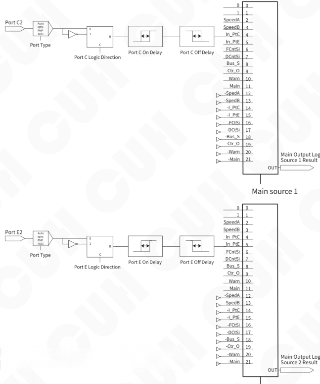

Für die Signalquellenoptionen von Hauptquelle ½,  
lesen Sie bitte das Kapitel 7.4.11 Anhang.

**Abbildung 4.4.1.1**

Hinweis: Der Hauptausgangszustand wird auch dadurch gesteuert, ob sich die Start-/Stopp-Taste oder der Controller selbst in einem Fehlerzustand befindet. Die Fehlersteuerungsebene der Start-/Stopp-Taste oder des Controllers selbst ist höher als das Hauptausgangslogiksignal. Das heißt: Wenn die Start-/Stopp-Taste auf Stopp gesetzt ist, geht der Controller sofort in den Stoppzustand über; wenn ein Fehler wie Kurzschluss, Übertemperatur, Überstrom usw. auftritt, geht der Controller ebenfalls sofort in den Stoppzustand über. In diesem Fall kann das Hauptausgangslogiksignal den Hauptausgang des Controllers nicht einschalten.

---


## 4.4.1.2 Hauptlogik

Das Ergebnis der Hauptausgangslogikquelle 1 und die Verknüpfung der Hauptausgangslogikquelle 2 werden nach der logischen Operation über die Hauptausgangslogik durch die Hauptausgangsrichtung, dann durch die Einschalt- und Ausschaltverzögerung des Hauptausgangs und schließlich durch den Hauptausgangsmodus geführt und dienen zum Ansteuern des Start-/Stopp-Zustands des Hauptausgangs.

Das Signalflussdiagramm ist wie folgt:

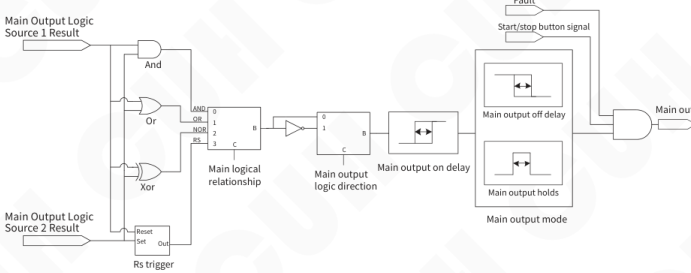

**Abbildung 4.4.1.2**

Dieser Controller kann die logische Beziehungstabelle zwischen Haupt(logik)quelle 1 und Hauptquelle 2 wie folgt festlegen. Standard Or.

| Parameter | Bedeutung |
|---|---|
| And | Logisches UND, Ausgabe gültig, wenn sowohl Hauptquelle 1 als auch Hauptquelle 2 gültig sind |
| Or | Logisches ODER, Ausgabe gültig, wenn mindestens eine der Hauptquellen 1 oder 2 gültig ist |
| Xor | Logisches XOR, gültig, wenn Hauptquelle 1 und Hauptquelle 2 unterschiedliche Zustände aufweisen, andernfalls ungültig |
| RS | RS-Flip-Flop |

## 4.4.1.3 Hauptrichtung

Das heißt die Logikrichtung des Hauptausgangs; die konkrete Ausgangsrichtung kann nach der logischen Verknüpfung der Signale festgelegt werden. Für das Signalflussdiagramm siehe Abbildung 4.4.1.2. Standard Const.

| Parameter | Bedeutung |
|---|---|
| Const | Der Zustand nach der Hauptausgangslogikoperation wird nicht invertiert und ist standardmäßig der Normalzustand |
| Inv | Der Zustand wird nach der Hauptausgangslogikoperation invertiert |
| On | Der Zustand bleibt nach der Hauptausgangslogikoperation im Betrieb |
| Off | Der Zustand ist nach der Hauptausgangslogikoperation stets gestoppt |


## 4.4.1.4 Haupt-Ein-Verzögerung/Haupt-Aus-Verzögerung

Wenn der Hauptausgangszustand des Geräts über andere externe Signale wie Sensoren gesteuert wird, ist in den meisten Fällen nach Anlegen des Signals oder Wiederherstellung des Signals eine Verzögerung erforderlich, bevor der Vorgang ausgeführt werden kann. Für solche Anwendungen kann dies durch Einstellen der Zeitwerte der Einschaltverzögerung und der Ausschaltverzögerung erreicht werden. Für das Signalflussdiagramm siehe Abbildung 4.4.1.2.

**Haupt-Ein-Verzögerung:** Das ist die Einschaltverzögerung des Hauptausgangs; die Verzögerungszeit vom Anlegen eines Steuersignals, das den Controller in den Betriebszustand versetzt, bis zum tatsächlichen Start der Ausgabe des Controllers. Die in diesem Zeitraum auftretende Verzögerungszeit wird als Einschaltverzögerung bezeichnet.

**Haupt-Aus-Verzögerung:** Das ist die Ausschaltverzögerung des Hauptausgangs; die Verzögerungszeit vom Anlegen eines Steuersignals, das den Controller in den Stoppzustand versetzt, bis zum tatsächlichen Stopp der Ausgabe des Controllers. Die in diesem Zeitraum auftretende Verzögerungszeit wird als Ausschaltverzögerung bezeichnet.

Der Ein-/Aus-Verzögerungsbereich des Hauptausgangs beträgt 0,0~99,9s, der Standardwert ist 0,2s und die Einstellgenauigkeit beträgt 0,1s.

## 4.4.1.5 Hauptmodus

Es stehen 2 Hauptausgangsmodi zur Verfügung: Verzögerungsmodus und Haltemodus. Signalflussdiagramm siehe Abbildung 4.4.1.2. Standard Delay.

| Parameter | Bedeutung |
|---|---|
| Delay | Bezieht sich auf den Zustand des Hauptausgangs nach der Logikoperation, den Zustand, der den Hauptausgang nach der Einschaltverzögerung und der Ausschaltverzögerung ansteuert |
| Hold | Bezieht sich auf den Zustand nach der Hauptausgangs-Logikoperation. Nach der Einschaltverzögerung bleibt der Betriebszustand für die Dauer der Ausschaltverzögerung erhalten und wechselt dann sofort in den Stoppausgabezustand |

Der Unterschied zwischen den beiden Modi wird in Form eines Zeitdiagramms wie folgt dargestellt, wobei das Eingangssignal eine logische Beziehungsauswahl ist.


---

### 4.4.1.6 Wellenformindex

Dieser Parameter ermöglicht es dem Controller, ein Gleichgewicht zwischen maximaler Effizienz, maximaler Leistung und minimalem Geräusch zu finden, um den höheren Anforderungen der Kunden gerecht zu werden.

Der Bereich des Wellenformindex beträgt 50~100, der Standardwert ist 100 und die Einstellgenauigkeit beträgt 1.

**Hinweis:**

1. Wenn der Wellenformindex 50 beträgt, ist die Effizienz am höchsten und die Belastung der Feder am geringsten.
2. Wenn der Wert 100 beträgt, können die maximale Nennausgangsleistung und das minimale Geräusch erreicht werden, aber die Feder wird einer größeren Belastung ausgesetzt.

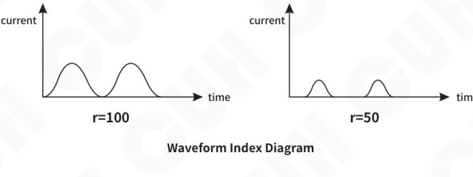

### 4.4.1.7 DC-Strom

Der Antriebsausgang des Controllers kann so eingestellt werden, dass dem sinusförmigen Strom eine DC-Stromkomponente überlagert wird.

Der Bereich des DC-Stroms beträgt 0,0~2,00A, der Standardwert ist 0,10A und die Einstellgenauigkeit beträgt 0,01A.

### 4.4.1.8 Einschaltzustand

Stellen Sie den Betriebszustand des Controllers nach dem Einschalten ein. Standard On.

| Parameter | Bedeutung |
|---|---|
| On | Nach dem Einschalten des Geräts befindet sich der Zustand der Schalttaste in Betrieb |
| Off | Nach dem Einschalten des Geräts befindet sich der Zustand der Schalttaste in Stopp |
| Keep | Nach dem Einschalten des Geräts bleibt der Zustand der Schalttaste unverändert wie vor dem letzten Ausschalten |

---


#### 4.4.1.9 Fernsteuerungsquelle

Die Ausgangsspannung und die Fördergeschwindigkeit des Controllers können über Bedienfeldparameter geändert oder direkt über die Größe des Eingangssignals der Fernsteuerungsquelle gesteuert werden. Optionale Steuerungsmethoden umfassen: Bedienfeld, 4-20mA DC-Eingang, 1-5V DC-Eingang, 0-5V DC-Eingang, 0-10V DC-Eingang sowie digitales Synchronisationsbussignal. Standard ist Panel.

**Potentiometer-Steuerungsanschluss**

Empfehlung: Bitte verwenden Sie ein 1K-Linearpotentiometer

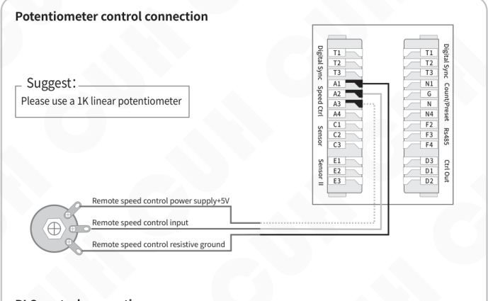

**PLC-Steuerungsanschluss**

- 1~5V/0~5V/0~10V DC-Eingang
- 4~20mA DC-Eingang

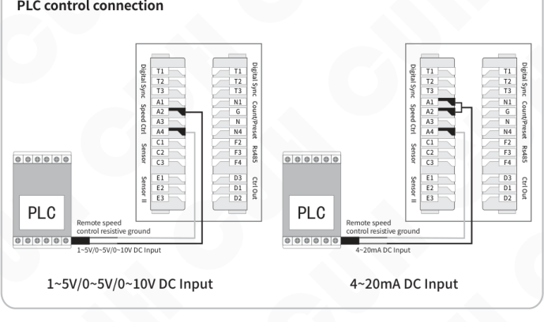


| Fernsteuerungssignal | Fernsteuerungssignal | Ausgangsspannung/Fördergeschwindigkeit |
|---|---|---|
| Panel |  | Ausgangsspannung und Fördergeschwindigkeit werden nicht durch das Fernsteuerungssignal gesteuert |
| 20mA | <2mA | Wenn der Spannungsmodus Manuell ist, Ausgangsspannung = 0<br>Wenn der Spannungsmodus Auto ist, Fördergeschwindigkeit = 0<br>LCD zeigt die Fehlerinformation „Fernsteuerung Unterspannung" an |
|  | 2mA~4mA | Ausgangsspannung = 0, Fördergeschwindigkeit = 0 |
|  | 4mA~20mA | Proportional gesteuert durch das Fernsteuerungssignal (0%~100%)<br>Wenn der Spannungsmodus Manuell ist, Ausgangsspannung = (Eingangsstrom - 4mA)/16 × maximale Ausgangsspannung<br>Wenn der Spannungsmodus Auto ist, Fördergeschwindigkeit = (Eingangsstrom - 4mA)/16 × maximale Fördergeschwindigkeit |
| 1~5V | Weniger als 0.5V | Ausgangsspannung = 0, Fördergeschwindigkeit = 0<br>LCD zeigt die Fehlerinformation „Fernsteuerung Unterspannung" an |
|  | 0.5V~1V | Ausgangsspannung = 0, Fördergeschwindigkeit = 0 |
|  | 1V~5V | Proportional gesteuert durch das Fernsteuerungssignal (0%~100%)<br>Wenn der Spannungsmodus Manuell ist, Ausgangsspannung = (Eingangsspannung - 1V)/4 × maximale Ausgangsspannung<br>Wenn der Spannungsmodus Auto ist, Fördergeschwindigkeit = (Eingangsspannung - 1V)/4 × maximale Fördergeschwindigkeit |
| 0~5V | 0V~5V | Proportional gesteuert durch das Fernsteuerungssignal (0%~100%)<br>Wenn der Spannungsmodus Manuell ist, Ausgangsspannung = Eingangsspannung/5 × maximale Ausgangsspannung<br>Wenn der Spannungsmodus Auto ist, Fördergeschwindigkeit = Eingangsspannung/5 × maximale Fördergeschwindigkeit |
| 0~10V | 0V~10V | Proportional gesteuert durch das Fernsteuerungssignal (0%~100%)<br>Wenn der Spannungsmodus Manuell ist, Ausgangsspannung = Eingangsspannung/10 × maximale Ausgangsspannung<br>Wenn der Spannungsmodus Auto ist, Fördergeschwindigkeit = Eingangsspannung/10 × maximale Fördergeschwindigkeit |
| DigSym | Digital Sync | Die Spannung des Fernsteuerungssignals ist die Fernsteuerungseingangsspannung eines bestimmten Geräts am Bus (festgelegt über die Fernsteuerungssynchronisationsparameter)<br>Proportional gesteuert durch das Fernsteuerungseingangsspannungssignal eines bestimmten Geräts am Bus, mit einem Spannungsbereich von 0% bis 100%.<br>Wenn der Spannungsmodus Manuell ist, Ausgangsspannung = Eingangsspannung/10 × maximale Ausgangsspannung<br>Wenn der Spannungsmodus Auto ist, Fördergeschwindigkeit = Eingangsspannung/10 × maximale Fördergeschwindigkeit |

#### 4.4.1.10 Fernsteuerungskoeffizient

Wenn als Fernsteuerungsquelle etwas anderes als „Panel" und „Sync" ausgewählt wird, kann der Fernsteuerungskoeffizient verwendet werden, um den Steuerbetrag des Fernsteuerungseingangssignals zu verstärken oder zu verringern.

Der Bereich des Fernsteuerungskoeffizienten beträgt 0,5~2,0, der Standardwert ist 1,0 und die Einstellgenauigkeit beträgt 0,1.

Beispiel: Der Fernsteuerungskoeffizient beträgt 0,5; wenn das Fernsteuerungseingangssignal 2V beträgt, beträgt die vom Controller ermittelte äquivalente Fernsteuerungseingangsspannung zu diesem Zeitpunkt 2V * 0,5=1V.

---


## 4.4.2 Parameter des DC-Steuerausgangs

Diese Zusammenfassung beschreibt hauptsächlich die Einstellungen der Steuerausgangsparameter des Controllers. Das schematische Diagramm des Steuerausgangssignalflusses ist wie folgt:

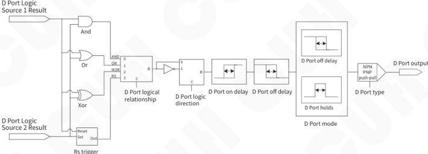

Die Einstellmethode für die Steuerausgangsparameter ist wie folgt:

- Langes Drücken von ▲ und ◀ ruft die Parametereinstellungs-Oberfläche auf; kurzes Drücken von ▶ wechselt zur Parametergruppe „6 DC output".
- Kurzes Drücken von ▲ oder ▼ wechselt zwischen den Parametern in der Steuerausgangs-Parametergruppe.
- Drücken Sie ⊕ oder ⊖, um den Parameterwert anzupassen.

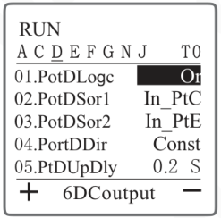

Die anderen Parameter dieser Parametergruppe können gemäß den obigen Schritten angepasst werden.

„D-Port-Quelle 1", „D-Port-Quelle 2", „D-Port-Logik", „D-Port-Richtung", „D-Ein-Verzögerung", „D-Aus-Verzögerung" und „D-Port-Modus": Für die oben genannten Parameter können die Einstellungen der Hauptausgangsparameter herangezogen werden.


## 4.4.2.1 D-Port-Typ

Der D-Port-Ausgang kann drei Typen unterstützen: NPN-Ausgang, PNP-Ausgang und Push-Pull-Ausgang.  
Standard Ou_P&P (Push-Pull).

| Parameter | Bedeutung |
|---|---|
| Ou_NPN | Wenn das Ausgangssignal von Port D gültig ist, gibt Port D ein Signal mit niedrigem Pegel (0V) aus; wenn es ungültig ist, ist der Ausgang hochohmig |
| Ou_PNP | Wenn das Ausgangssignal von Port D gültig ist, gibt Port D ein Signal mit hohem Pegel (24V) aus; wenn es ungültig ist, ist der Ausgang hochohmig |
| Ou_P&P<br>(Push Pull) | Wenn das Ausgangssignal von Port D gültig ist, gibt Port D ein Signal mit hohem Pegel (24V) aus. Wenn das Ausgangssignal von Port D ungültig ist, gibt Port D ein Signal mit niedrigem Pegel (0V) aus |

Das Diagramm ist wie folgt:

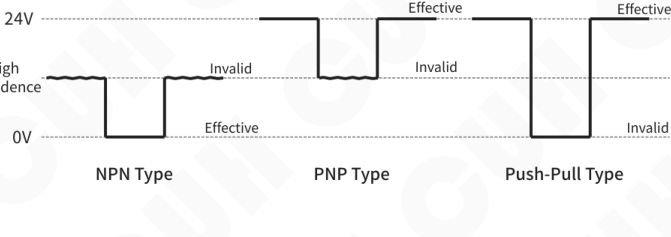


# 4.5 Signalsteuerung

Der Controller kann den Status des Materials im Vibrationsförderer über einen externen Sensor beurteilen und so das „Stoppen bei vollem Material" oder „Stoppen bei leerem Material" des Controllers realisieren. Das Port-Signalflussdiagramm ist wie folgt:

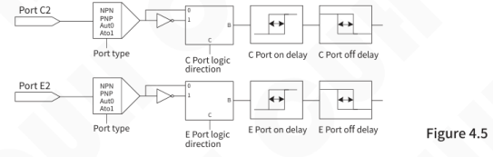

**Abbildung 4.5**

Die Methode zum Einstellen der Signaleingangsparameter ist wie folgt:

- Langes Drücken von ▲ und ◀ ruft die Parametereinstellungs-Oberfläche auf; kurzes Drücken von ▶ wechselt zur Parametergruppe „5On&Off".
- Kurzes Drücken von ▲ oder ▼ wechselt zwischen den Parametern in der Signal-Eingangs-Parametergruppe.
- Drücken Sie ⊕ oder ⊖, um den Parameterwert anzupassen.

```text
RUN
A C D E F G N J        A0
01.PortType        Auto
02.PortCDir        Const
03.PtCUpDly        0.2 S
04.PtCDnDly        0.2 S
05.PortEDir        Const
+     5On&Off        −
```

Die anderen Parameter dieser Parametergruppe können gemäß den obigen Schritten angepasst werden.

## 4.5.1 Sensortyp

Der Controller kann den Typ des Schaltsensors auf „Auto", „NPN", „PNP" oder „Ato1" einstellen oder den Sensortyp manuell festlegen.

| Parameter | Bedeutung |
|---|---|
| Auto | Unabhängig vom Sensortyp wird stets durch Änderung des Hoch- und Niedrigpegelsignals erkannt, ob der Portzugang gültig ist; der werkseitige Standardwert ist die automatische Erkennung |
| NPN | NPN-Sensor |
| PNP | PNP-Sensor |
| Ato1 | Bevor das Sensorsignal ungültig ist, wird durch Änderung des Hoch- und Niedrigpegels erkannt, ob der Port gültig ist. Nach dem Erkennen eines gültigen Signals wird der Port-Sensortyp bestimmt und nicht mehr abgefragt |


## 4.5.2 C-Port/E-Port-Logik

Dieser Parameter wird verwendet, um für den Eingangsport C und den Eingangsport E des Controllers „Stopp bei vollem Material" oder „Stopp bei leerem Material" umzuschalten.

Wenn bei den Werkseinstellungen am Schalteingangsport C/Port E kein Signal empfangen wird, befindet sich der Controller im Zustand „Laufend" (d. h. Stopp bei vollem Material). Einige spezielle Anwendungen erfordern, dass sich der Controller im Zustand „Stopp" befindet (d. h. Stopp bei leerem Material), wenn Port C/Port E kein Signal empfängt. Dies kann durch Ändern dieses Parameters erreicht werden. Das Signalflussdiagramm finden Sie in Abbildung 4.5.

| Parameter | Bedeutung |
|---|---|
| Const | Wenn kein Steuersignal vorhanden ist, befindet sich der Controller im laufenden Zustand (Stopp bei vollem Material) |
| Inv | Wenn kein Steuersignal vorhanden ist, befindet sich der Controller im Stoppzustand (Stopp bei leerem Material) |

## 4.5.3 C-Port Ein-/Aus-Verzögerung und E-Port Ein-/Aus-Verzögerung

Die Verzögerungszeit von dem Zeitpunkt, an dem ein Signal angelegt wird, das den Controller in den Betriebszustand versetzt, bis zu dem Zeitpunkt, an dem das Signal vom Controller als gültig betrachtet wird, wird als Einschaltverzögerung bezeichnet.

Die Verzögerungszeit von dem Zeitpunkt, an dem ein Signal angelegt wird, das den Controller in den Stoppzustand versetzt, bis zu dem Zeitpunkt, an dem das Signal vom Controller als gültig betrachtet wird, wird als Ausschaltverzögerung bezeichnet.

Das Signalflussdiagramm finden Sie in Abbildung 4.5.

Der Ein-/Aus-Verzögerungsbereich beträgt 0,0~99,9s, der Standardwert ist 0,2s und die Einstellgenauigkeit beträgt 0,1s.

**Hinweis:** Bei Verwendung von Port C, E für die Start-/Stopp-Steuerung kann, falls der Vorgang nach Empfang des Signals um eine gewisse Zeit verzögert werden muss, um sicherzustellen, dass das Signal stabil ist, dies durch Einstellen der Einschaltverzögerung und der Ausschaltverzögerung erreicht werden.


## 4.5.4 Speed-A-Logik/Speed-B-Logik

Das Signalflussdiagramm ist wie folgt:

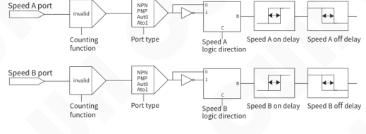

**Abbildung 4.5.4**

Dieser Parameter wird verwendet, um den gültigen Zustand der Eingangsports für Geschwindigkeit A und Geschwindigkeit B des Controllers umzuschalten. Dieser Parameter muss in der Parametergruppe „Material voll" eingestellt werden. Standard ist Const.

| Parameter | Bedeutung |
|---|---|
| Const | Wenn kein Steuersignal vorhanden ist, sind Geschwindigkeit A und Geschwindigkeit B des Controllers ungültig |
| Inv | Wenn kein Steuersignal vorhanden ist, sind Geschwindigkeit A und Geschwindigkeit B des Controllers wirksam |

## 4.5.5 Speed A Ein-/Aus-Verzögerung und Speed B Ein-/Aus-Verzögerung

Vom Anlegen eines gültigen Signals an den Speed-A/B-Port bis zum Aktivieren der Geschwindigkeit wird dieser Zeitraum als Einschaltverzögerung bezeichnet.

Vom Anlegen eines ungültigen Signals an den Speed-A/B-Port bis zum Deaktivieren der Geschwindigkeit wird dieser Zeitraum als Ausschaltverzögerung bezeichnet.

Das Signalflussdiagramm finden Sie in Abbildung 4.5.4.

Der Ein-/Aus-Verzögerungsbereich für Speed A und B beträgt 0,0~99,9s, der Standardwert ist 0,2s und die Einstellgenauigkeit beträgt 0,1s.


---

## 4.6 Materialzählung

Dieser Controller verfügt über eine integrierte Zählfunktion, die Zählimpulse zählen und automatisch abbremsen oder stoppen kann, wenn die Anzahl der Impulse die eingestellte Gesamtzählmenge erreicht. Außerdem verfügt er über spezielle Funktionen wie eine starke Anti-Jitter-Funktion und eine Endverlangsamung, um ein Überschießen zu verhindern. Das Signalflussdiagramm ist wie folgt:

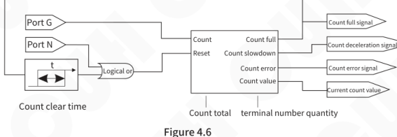

**Abbildung 4.6**

» Langes Drücken von ▲ und ◀ ruft die Parametereinstellungs-Oberfläche auf; kurzes Drücken von ▶ wechselt zur Parametergruppe „7Counter".

» Kurzes Drücken von ▲ oder ▼ wechselt zwischen den Parametern in der Zählparametergruppe.

» Drücken Sie ⊕ oder ⊖, um den Parameterwert einzustellen.

```text
RUN
A C D E F G N J    A0
01.TotaCout       10
02.PrcntTrm       50 %
03.CotAhead        3
04.CotRstTm       0.0 S
05.CotPotSe       None
+    7Counter      −
```

Die übrigen Parameter dieser Parametergruppe können gemäß den obigen Schritten eingestellt werden.

### 4.6.1 Materialzählung (oder Speed A/B)

Dieser Parameter dient zum Aktivieren und Deaktivieren der Zählfunktion.

Der Standardwert ist None, das heißt, die Zählfunktion ist ausgeschaltet, und die Speed-A/B-Funktion ist zu diesem Zeitpunkt aktiviert.

Wenn der Parameter der Zählfunktion gültig (aktiviert) ist, fungieren Speed A und Speed B als Speed-A/B-Steuerung, und der Controller kann weitere Operationen für die Zählfunktion ausführen. Für das Signalflussdiagramm siehe Abbildung 4.6.

| Parameter | Bedeutung |
|---|---|
| None | Die Zählfunktion ausschalten und die Speed-A/B-Funktion aktivieren |
| Valid | Den Speed-A-Port als Zählport und den Speed-B-Port als Port zum Löschen des Zählwerts verwenden |

---


---

## 4.6.2 Zielmenge

Nachdem der „aktuelle Zählwert" den Grenzwert erreicht hat, ist das Signal „Zähler voll" gültig, bis der Zähler zurückgesetzt wird. Wenn nach dem Eintritt in den Zustand „Zähler voll" weiterhin Zählimpulse gesendet werden, wird die Zählung fortgesetzt, aber das Signal „Zähler voll" bleibt gültig. Für das Signalflussdiagramm siehe Abbildung 4.6.

Der Gesamtzählbereich beträgt 0~9999, der Standardwert ist 10, und die Einstellgenauigkeit beträgt 1.

## 4.6.3 Endgeschwindigkeit

**Endgeschwindigkeit** bedeutet, dass beim Eintritt der Zählung in den Endverlangsamungszustand die Fördergeschwindigkeit und die Spannung des Controllers auf den Prozentsatz der Anfangsgeschwindigkeit und Anfangsspannung absinken, siehe Abbildung 4.6.3.

Wenn die Zählzahl sich der Gesamtzahl nähert, steht der Zählvorgang kurz vor dem Abschluss. Um zu verhindern, dass das Material aufgrund seiner Hochgeschwindigkeitsbewegung nicht rechtzeitig anhalten kann und es zu einem Zählüberschießen kommt, reduziert der Controller automatisch die Geschwindigkeit auf die vom Benutzer eingestellte Endgeschwindigkeit (das Zählverlangsamungssignal ist gültig), wenn die verbleibende Anzahl kleiner ist als die Endanzahl. Wenn der Zählwert die Gesamtzählmenge erreicht (das Signal „Zähler voll" ist gültig), stoppt der Controller sofort die Ausgabe, und der Förderer kann eine präzise Zählsteuerung erzielen.

Der Endgeschwindigkeitsbereich beträgt 0~100 %, der Standardwert ist 50 %, und die Einstellgenauigkeit beträgt 1 %.

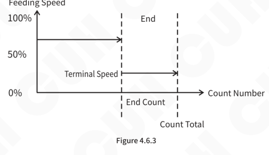

---


### 4.6.4 Endgeschwindigkeitsmenge

Anzahl der Endabschnitte: Bezieht sich auf die Gesamtzahl der Distanzzählungen. Nach Erreichen der „Endanzahl" wechselt der Controller in den Modus der Zählverringerung.

Im Geschwindigkeitszustand sinken die Fördergeschwindigkeit und die Spannung auf die Endgeschwindigkeit und die Endspannung ab. Wenn der Wert der „Endabschnittsmenge" 0 ist, bedeutet dies, dass die Endverlangsamungsfunktion nicht verwendet wird. Für das Signalflussdiagramm siehe Abbildung 4.6.

Die Anzahl der Endabschnitte reicht von 0 bis 9999, der Standardwert ist 3, und die Einstellgenauigkeit beträgt 1.

### 4.6.5 Zählwert auf 0 zurücksetzen

Wenn der Zähler voll ist, löscht der Controller den Zählwert nach der Verzögerungszeit zum „Zählwert löschen" automatisch. Wenn der Wert zum „Zählwert löschen" 0,0 s beträgt, bedeutet dies, dass die verzögerte automatische Auslösung der Zählrücksetzfunktion deaktiviert ist.

Der Bereich der Zählrücksetzzeit beträgt 0,0~999,9 s, der Standardwert ist 0,0 s, und die Einstellgenauigkeit beträgt 0,1 s.

### 4.6.6 RS-Priorität

Wird verwendet, um die Priorität des RS-Triggerports festzulegen. Standard ist Same.

| Parameter | Bedeutung |
|---|---|
| Same | Der R-Port und der S-Port haben dieselbe Priorität. Wenn an den R- und S-Ports Signale anliegen, meldet der Controller eine Warnung „Haupt-RS-Fehler" oder „Steuer-RS-Fehler" |
| Reset | Rücksetz-Priorität. Wenn an den R- und S-Ports Signale anliegen, hat das Signal des R-Ports Vorrang, das heißt, das Rücksetzsignal hat Vorrang |
| Set | Setz-Priorität. Wenn an den R- und S-Ports Signale anliegen, hat das Signal des S-Ports Vorrang, das heißt, das Setzsignal hat Vorrang |
| Revers | Wenn an den R- und S-Ports Signale anliegen, wird das aktuelle logische Ausgangsergebnis invertiert |


---

## 4.7 Einstellungen speichern

Dieses Kapitel beschreibt hauptsächlich die Verwendung der Parameter-Speicherung und der Rückrufparameter-Funktionen des Controllers.

### 4.7.1 Rückrufeinstellungen

Der Controller kann zusätzlich zur Arbeitsgruppe 3 verschiedene Sätze voreingestellter Parameter auslesen, die als „User 1", „User 2" und „User 3" bezeichnet werden.

Wenn der Benutzer die Parameter ändert, werden die Parameter des Controllers standardmäßig in der Arbeitsgruppe gespeichert. Wenn der Controller erneut eingeschaltet wird, werden die Parameter automatisch aus der Arbeitsgruppe gelesen und die Parameterwerte vor dem letzten Ausschalten wiederhergestellt. Gleichzeitig kann der Benutzer manuell aus „UsrD1", „UsrD2" und „UsrD3" eine weitere, manuell in den drei Gruppen gespeicherte Datei auslesen. Die Daten werden an die Arbeitsgruppe im Controller gesendet, sodass der Controller den Arbeitsstatus sofort umschalten kann.

| Parameter | Bedeutung |
|---|---|
| None | Ungültig |
| UsrD1 | Vom Benutzer eingestellter Parameter 1 |
| UsrD2 | Vom Benutzer eingestellter Parameter 2 |
| UsrD3 | Vom Benutzer eingestellter Parameter 3 |

### 4.7.2 Einstellungen speichern

Der Controller kann 4 verschiedene Sätze voreingestellter Parameter speichern, die als „Work", „UsrD1", „UsrD2" und „UsrD3" bezeichnet werden.

Wenn der Benutzer die Parameter ändert, werden die Parameter des Controllers standardmäßig automatisch in „Work" gespeichert. Wenn der Controller erneut eingeschaltet wird, werden die Parameter automatisch aus der Arbeitsgruppe gelesen und die Parameterwerte vor dem letzten Ausschalten wiederhergestellt. Benutzer können die Parameter der Arbeitsgruppe manuell in „UsrD1", „UsrD2" und „UsrD3" speichern.

| Parameter | Bedeutung |
|---|---|
| None | Ungültig |
| Work | Standard-Arbeitsgruppe |
| UsrD1 | Vom Benutzer eingestellter Parameter 1 |
| UsrD2 | Vom Benutzer eingestellter Parameter 2 |
| UsrD3 | Vom Benutzer eingestellter Parameter 3 |

---


---

### 4.7.3 Werkseinstellungen wiederherstellen

Verwenden Sie die Parameter-Rücksetzung, um alle Parameter der Arbeitsgruppe auf die Werkseinstellungen zurückzusetzen.

Nachdem Sie „RWork" in „Reset Parameters" ausgewählt haben, halten Sie ⊕ und ⊖ gleichzeitig gedrückt; nach mehr als zwei Sekunden wechselt die Anzeigeoberfläche zur Standby-Oberfläche, und die Parameter wurden erfolgreich wiederhergestellt.

| Parameter | Bedeutung |
|---|---|
| None | Ungültig |
| Rwork | Arbeitsgruppenparameter auf Werkseinstellungen zurücksetzen. (User 1, User 2 und User 3 werden nicht wiederhergestellt) |

### 4.7.4 Einstellungen kopieren

Der Controller kann die Parametergruppe dieses Controllers durch die Daten der beiden Controller im Netzwerk ersetzen, die er gesichert hat, um die Parameter der beiden Controller schnell zu kopieren.

Wählen Sie die ID-Nummer des Controllers aus, auf den kopiert werden soll, um die Funktion des Kopierens der Daten des Controllers zu realisieren. Der Auswahlbereich der Kopierparameter beträgt 1~8.

### 4.7.5 Benutzerpasswort

Benutzer können das Parameterpasswort selbst festlegen. Nach der Sperrung kann der Benutzer nur unter der „Überwachungs-Parametergruppe" und der „Startseite" arbeiten.

Wenn der Benutzer das „Benutzerpasswort" auf einen Wert ungleich 0 setzt, bedeutet dies, dass die erweiterte Parametersperrfunktion aktiviert ist. In diesem Fall müssen Sie beim Wechsel in die Parametergruppe auf der Startseite das Passwort eingeben. Nachdem der Benutzer das „Passwort eingeben" eingegeben und ▼ + ▲ gedrückt hat, kann er nur die Überwachungs-Parametergruppe aufrufen, wenn das „Passwort eingeben" und das „Benutzerpasswort" unterschiedlich sind. Nur wenn das Passwort korrekt ist, kann der Benutzer andere Parametergruppen aufrufen.

Der Auswahlbereich des Benutzerpassworts beträgt 0~9999.

### 4.7.6 Passwort eingeben

Wenn das „Passwort eingeben" und das „Benutzerpasswort" unterschiedlich sind, kann der Benutzer nur unter „Startseite" und „Überwachungs-Parametergruppe" arbeiten. Nur wenn das Passwort korrekt ist, kann der Benutzer andere Parametergruppen aufrufen.

Der Auswahlbereich für die Eingabe des Passworts beträgt 0~9999.

---


## 4.8 RS485-Kommunikation

Dieser Controller unterstützt die RS485-Kommunikation. Nach dem Modbus-Protokollmodus ASCII und RTU können alle Parameter und Zustände des Controllers remote geändert und gelesen werden.

Das lokale RS485-Kommunikationsprotokoll „SDVC341 Series 485 Register Address Table 1.02" kann aus dem Download-Bereich der Website unseres Unternehmens heruntergeladen werden: www.cuhnj.com.

> » Langes Drücken von ▲ und ◀ ruft die Parametereinstellungs-Oberfläche auf; kurzes Drücken von ▶ wechselt zur Parametergruppe „8Comm".
>
> » Kurzes Drücken von ▲ oder ▼ wechselt zwischen den Parametern in der Kommunikations-Parametergruppe.
>
> » Drücken Sie ⊕ oder ⊖, um den Parameterwert einzustellen.
>
> ```text
> RUN
> A C D E F G N J      A0
> 01.485type       RTU
> 02.BaudRate    115.2 K
> 03.485SlvID      1
> 04.Enab485R    None
> 05.DigSynAd      1
> +      8Comm      -
> ```

Die übrigen Parameter dieser Parametergruppe können gemäß den obigen Schritten eingestellt werden.

### 4.8.1 Kommunikationstyp

Auswahl des RS485-Kommunikationstyps: Modbus-ASCII-Typ und Modbus-RTU-Typ. Standard ist RTU.

| Parameter | Bedeutung |
|---|---|
| ASCⅡ | Modbus-ASCII-Typ |
| RTU | Modbus-RTU-Typ |


## 4.8.2 Baudrate

Verschiedene Optionen für die RS485-Kommunikations-Baudrate. Standard ist 115.2K.

| Parameter | Bedeutung |
|---|---|
| 0.3K | 0.3 Kbps |
| 1.2K | 1.2 Kbps |
| 2.4K | 2.4 Kbps |
| 9.6K | 9.6 Kbps |
| 19.2K | 19.2 Kbps |
| 57.6K | 57.6 Kbps |
| 115.2K | 115.2 Kbps |

## 4.8.3 Adresse des Slave-Controllers

Stellen Sie die Slave-Adressnummer in der RS485-Kommunikation ein.

Die Slave-Nummer reicht von 1 bis 31. Standard ist 1.

## 4.8.4 Portwiderstand/Synchronisationswiderstand

Der RS485-Kommunikationsport/digitale Synchronisationsport verfügt über eine Anpassungswiderstands-Funktion (120Ω). Standard ist None.

| Parameter | Bedeutung |
|---|---|
| None | Anpassungswiderstand (120Ω) nicht verwenden |
| Valid | Anpassungswiderstand (120Ω) verwenden |


---

## 4.9 CUHBus-DS®-Vernetzung

Der Controller SDVC341-M verwendet das serielle Kommunikationsprotokoll des LAN-Busses (CUHBus-DS®). Es wird die Vernetzung von bis zu 8 Geräten im selben Netzwerk erreicht. Nach der Vernetzung können zwischen den Controllern die folgenden Funktionen implementiert werden:

**Sync-Funktionen:** Die Frequenz, die Phase, die Fernsteuerungsgeschwindigkeitseinstellung und andere Parameter jedes Controllers im Netzwerk können mit der Ausgabe jedes anderen Controllers im Netzwerk übereinstimmen oder davon abweichen.

**Signal-Sharing:** Jedes Statussignal jedes Controllers im Netzwerk kann als Signal-Eingangsquelle jedes anderen Controllers im Netzwerk gemeinsam genutzt werden. Dadurch kann jeder Controller im Netzwerk neben der lokalen Einheit über reichere Signalquellen verfügen und diese nach logischen Operationen ausgeben, um komplexere Controller-Betriebslogiken vor Ort beim Benutzer zu realisieren.

**Datensicherung:** Die Daten jedes Controllers im Netzwerk werden auf den anderen beiden Controllern im Netzwerk gesichert. Jeder Controller im Netzwerk kann durch Austausch und Hinzufügen perfekt ersetzt werden, und es kann mit den Daten des ersetzten Controllers weitergearbeitet werden.

> ☺
>
> **Dieses Netzwerksystem weist die folgenden Merkmale auf:**
>
> - Es lässt sich leicht erweitern, und neue Geräte können schnell in das Netzwerk aufgenommen werden.
> - Das Netzwerk ist gleichwertig aufgebaut, mit einem Satz gleichwertiger CUHBus-DS®-Kommunikationsklemmen links und rechts, um den Anschluss für den Benutzer zu erleichtern.
> - Das Gerät unterstützt Hot-Swapping; Erweiterungen von Controllern können bei stabilem Betrieb des Controller-Systems ohne Abschalten der Stromversorgung hinzugefügt oder entfernt werden.

---


---

## 4.9.1 Gerätevernetzung

Dieses Kapitel beschreibt hauptsächlich die schnelle Vernetzung zwischen mehreren Controllern, wie ein neuer Controller in ein bestehendes Netzwerk aufgenommen und wie ein Controller aus dem Netzwerk entfernt wird.

### 4.9.1.1 Gerätevernetzung

Ein einzelner Controller ist für sich allein ein Netzwerk. Wenn die CUHBus-DS®-Signalleitungen der Controller korrekt verbunden und einfache Bedienungen durchgeführt werden, können mehrere Geräte ein neues digitales synchrones Kommunikationsnetzwerk bilden.

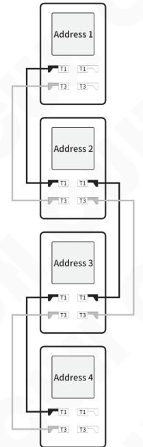

---


**Schritte:**

1. Verbinden Sie alle T1-Signale aller Controller miteinander und alle T3-Signale miteinander, wie in der obigen Abbildung dargestellt.

2. Wenn das neue Gerät eingeschaltet wird, wechselt der neue Controller automatisch in die „Kommunikations-Parametergruppe".

3. Stellen Sie in der Kommunikations-Parametergruppe die Gerätenummer für die lokale digitale Synchronisationskommunikation ein; „DigSynAd" ist ein beliebiger Wert [1~8]. Sie müssen keine Einstellung vornehmen, das Programm generiert automatisch eine Nummer.

4. Stellen Sie in der Kommunikations-Parametergruppe den Parameterwert von „EnNetwok " auf „Expand" ein und halten Sie dann ⊕ und ⊖ gleichzeitig gedrückt, um zu bestätigen.

5. Nach erfolgreichem Hinzufügen ändert sich der Parameterwert des neuen Geräts „EnNetwok " automatisch in „Online", was anzeigt, dass das neue Gerät erfolgreich hinzugefügt wurde.

Benutzer können über die Gerätevernetzungs-Statusparameter prüfen, ob das Netzwerk korrekt vernetzt wurde, sowie die Gesamtzahl der Geräte im Netzwerk und die Anzahl der Online-Geräte prüfen.

Hinweis: Nur das Anschließen der CUHBus-DS®-Signalleitung ohne die entsprechenden Einstellungen zählt nicht als Beitritt zum Netzwerk.

**Überprüfungsmethode:**

1. In der Überwachungs-Parametergruppe gibt der Wert des Parameters „DevicNum" [1~8] die Gesamtzahl der Geräte im Netzwerk an.

2. In der Überwachungs-Parametergruppe gibt der Wert des Parameters „OnlinNum" [1~8] an, wie viele Controller derzeit im Netzwerk online sind.

**Synchronisationswiderstand:**

Der CUHBus-DS®-Kommunikationsport verfügt über eine Anpassungswiderstands-Funktion (120Ω), die ungültig oder gültig sein kann.

| Parameter | Bedeutung |
|---|---|
| None | Anpassungswiderstand (120Ω) nicht verwenden |
| Valid | Anpassungswiderstand (120Ω) verwenden |


## 4.9.1.2 Gerät tritt bei

Benutzer können die folgenden Erweiterungs- und Hinzufügungsschritte befolgen, um einen neuen Controller in das vorhandene Netzwerk aufzunehmen.

Der neue Controller kann nach dem Beitritt das Signal jedes Controllers im Netzwerk aufrufen und als Controller-Signalquelle für jeden anderen Controller im Netzwerk fungieren. Dies bereichert die System-Signalquellen.

**Schritte:**

1. Verbinden Sie die CUHBus-DS®-Schnittstellen T1 und T3 des neuen Geräts mit dem ursprünglichen vollständigen Netzwerk; die Ports unterstützen Hot-Swapping.

2. Wenn das neue Gerät eingeschaltet wird, wechselt der neue Controller automatisch in die „Kommunikations-Parametergruppe".

3. Stellen Sie in der Kommunikations-Parametergruppe die Gerätenummer für die lokale digitale Synchronisationskommunikation ein; „DigSynAd" ist ein beliebiger Wert [1~8]. Sie müssen keine Einstellung vornehmen, das Programm generiert automatisch eine Nummer.

4. Stellen Sie in der Kommunikations-Parametergruppe den Parameterwert von „EnNetwok " auf „Expand" ein und halten Sie dann ⊕ und ⊖ gleichzeitig gedrückt, um zu bestätigen.

5. Nach erfolgreichem Hinzufügen ändert sich der Parameterwert des neuen Geräts „EnNetwok " automatisch in „Online", was anzeigt, dass das neue Gerät erfolgreich hinzugefügt wurde.

Benutzer können über die Gerätevernetzungs-Statusparameter prüfen, ob das Netzwerk korrekt vernetzt wurde, sowie die Gesamtzahl der Geräte im Netzwerk und die Anzahl der Online-Geräte prüfen.

Hinweis: Nur das Anschließen der CUHBus-DS®-Signalleitung ohne die entsprechenden Einstellungen zählt nicht als Beitritt zum Netzwerk.

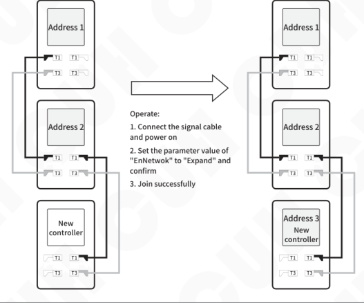


---

## 4.9.1.3 Geräteentfernung

Wenn Sie einen Controller dauerhaft aus dem Netzwerk entfernen müssen, verwenden Sie die Funktion „Controller aus Netzwerk entfernen". Das Löschen eines Controllers im Netzwerk kann von jedem Controller im Netzwerk aus initiiert werden. Die nach dem Löschen verbleibenden Controller reorganisieren sich zu einem vollständigen neuen Netzwerk.

Wenn der Controller jedoch direkt entfernt wird (einschließlich Stromausfall), ohne den Controller zu löschen, bleiben die Daten des Controllers weiterhin im Netzwerk erhalten. In diesem Fall befindet sich das Netzwerk in einem degradierten Zustand, und neue Controller können nicht hinzugefügt werden. Es muss manuell über den Controller gelöscht werden, um die Integrität des Netzwerks zu erhalten und die Erweiterung und Hinzufügung neuer Controller abzuschließen.

**Schritte zum Löschen eines Controllers:**

1. Rufen Sie die „Kommunikations-Parametergruppe" über einen beliebigen Controller im Netzwerk auf.
2. Ändern Sie den Wert des Parameters „DeltDevi" in die Adresse des Netzwerkgeräts, das gelöscht werden soll.
3. Halten Sie nach dem Ändern des Werts ⊕ und ⊖ lange gedrückt, um das Löschen des Geräts zu bestätigen.
4. Nach Abschluss des Löschens ändert sich der Parameterwert „DeltDevi" in einen nicht auswählbaren Wert, was anzeigt, dass das Gerät erfolgreich gelöscht wurde.
5. Prüfen Sie zu diesem Zeitpunkt den neuen Netzwerkstatus am Bediengerät und bestätigen Sie die Anzahl der neuen Netzwerk-Controller.

Beispiel: Löschen Sie den Controller mit Adresse 3 aus dem Netzwerk.

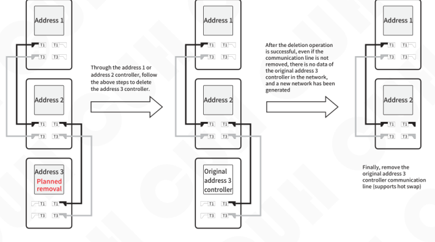

---


---

## 4.9.2 Synchronisationsfunktion

Die Frequenz, die Phase oder die ferngesteuerte Geschwindigkeit jedes Controllers im Netzwerk kann einem anderen Master-Controller mit Übereinstimmung oder einer bestimmten Abweichung folgen. Mehrere Controller können jedoch nicht gegenseitig folgen, da ihre Ausgaben sonst instabil werden.

Beispiel 1: Der Controller mit Adresse 3 folgt der Ausgangsfrequenz des Controllers mit Adresse 1, sodass die beiden von ihnen angesteuerten Vibrationsförderer mit derselben Frequenz laufen.

Beispiel 2: Wenn der Controller mit Adresse 3 bereits der Ausgangsfrequenz des Controllers mit Adresse 1 folgt, kann der Controller mit Adresse 1 nicht so eingestellt werden, dass er der Ausgangsfrequenz des Controllers mit Adresse 3 folgt. Das bedeutet, dass die Controller nicht gegenseitig folgen können.

➢ **Frequenzsynchronisation**

Das Verfahren zum Einstellen der Frequenzsynchronisation ist wie folgt:

1. Bilden Sie aus zwei oder mehr Controllern, zwischen denen eine Frequenzsynchronisation erforderlich ist, dasselbe digitale synchrone Kommunikationsnetzwerk; siehe hierzu das Kapitel „Gerätevernetzung".

2. Stellen Sie den Parameterwert „FrqncSyn" in der Kommunikations-Parametergruppe des frequenzsynchronisierten Controllers auf die „Digital Sync"-Adressnummer des synchronisierten Controllers (Frequenz) ein.

3. Wechseln Sie beim frequenzsynchronisierten Controller in die Parametergruppe konstante Geschwindigkeit und stellen Sie „FrqncMod" auf „SynV" oder „SynE" ein.

➢ **Fernsteuerungs-Geschwindigkeitssynchronisation**

Das Verfahren zum Einstellen der Fernsteuerungs-Geschwindigkeitssynchronisation ist wie folgt:

1. Bilden Sie aus zwei oder mehr Controllern, zwischen denen eine Fernsteuerungssynchronisation erforderlich ist, dasselbe digitale synchrone Kommunikationsnetzwerk; siehe hierzu das Kapitel „Gerätevernetzung".

2. Stellen Sie den Parameterwert „RemotSyn" in der Kommunikations-Parametergruppe des fernsteuerungssynchronisierten Controllers auf die „Digital Sync"-Adressnummer des synchronisierten Controllers (Fernsteuerung) ein.

3. Stellen Sie den Parameterwert „CtrlSour" in der Hauptausgangs-Parametergruppe auf „DigSym" ein.

➢ **Master-/Slave-Betriebsart**

Benutzer können den Controller je nach Anwendungsanforderung so einstellen, dass er in einer der folgenden beiden Betriebsarten läuft:

Hauptmodus: Hier steuert ein Controller unabhängig eine Last-Vibrationsplatte.

Slave-Modus: Wenn zwei oder mehr Controller synchron arbeiten müssen, wird ein Controller als Master-Controller verwendet und arbeitet im Master-Modus als Frequenzreferenz. Alle anderen Controller arbeiten im Slave-Modus, fungieren als Slave-Controller und arbeiten synchron mit dem Master-Controller.

---


## Hauptmodus

Der im Hauptmodus arbeitende Controller, im Folgenden als Haupt-Controller bezeichnet, ändert die Parameter in der Parametergruppe konstante Geschwindigkeit. Mit den Parametern „Spannungsmodus" und „Frequenzmodus" kann der Controller auf die entsprechende Betriebsart eingestellt werden. Der Spannungsmodus und der Frequenzmodus haben die folgenden Kombinationen:

| Betriebsart | Spannungs-<br>steuermethode | Frequenz-<br>steuermethode | Erforderlicher Vibrationssensor |
|---|---|---|---|
| Vollständig manuell | Manuell | Manuell | Nein |
| Vollständig automatisch | Auto | Auto | Ja |
| Spannung automatisch | Auto | Manuell | Ja |
| Frequenz automatisch | Manuell | Auto | Ja |

■ **Vollständig manueller Modus**

In diesem Modus werden die Ausgangsspannung und die Ausgangsfrequenz des Controllers manuell eingestellt.

**Hinweis:** Selbst wenn der Parameter „Spannungsmodus" oder „Frequenzmodus" auf „Auto" eingestellt ist, arbeitet der Controller weiterhin im vollständig manuellen Modus, wenn der Vibrationssensor nicht angeschlossen ist.

■ **Vollständig automatischer Modus**

Der Controller passt die Ausgangsspannung und die Ausgangsfrequenz automatisch anhand der vom Vibrationssensor zurückgemeldeten Daten an, um sicherzustellen, dass die Fördergeschwindigkeit der Vibrationseinrichtung nahe dem eingestellten Wert „Fördergeschwindigkeit" stabil ist und die Vibrationsfrequenz bei der optimalen Betriebsfrequenz der Vibrationseinrichtung liegt. Die Ausgangsspannung und die Ausgangsfrequenz werden nicht durch die Parameter „Spannung" und „Frequenz" gesteuert.

**Hinweis:** Die Werkseinstellung des Controllers ist der vollautomatische Modus. Wenn der Vibrationssensor jedoch nicht korrekt eingesteckt ist, befindet sich der Controller weiterhin im vollständig manuellen Zustand. Der Controller wechselt erst dann in den vollständig automatischen Zustand, wenn der Vibrationssensor korrekt eingesteckt ist.

■ **Spannung automatischer Modus**

In diesem Modus passt der Controller die Ausgangsspannung automatisch anhand der vom Vibrationssensor zurückgemeldeten Daten an, um sicherzustellen, dass die Fördergeschwindigkeit der Vibrationseinrichtung stabil beim eingestellten Wert liegt. Die Ausgangsfrequenz wird vom Benutzer manuell eingestellt. Der Controller muss für eine ordnungsgemäße Funktion dieses Modus an einen Vibrationssensor angeschlossen sein.

■ **Frequenz automatischer Modus**

In diesem Modus passt der Controller die Ausgangsfrequenz automatisch anhand der vom Vibrationssensor zurückgemeldeten Daten an, sodass die Vibrationsfrequenz bei der optimalen Betriebsfrequenz der Vibrationseinrichtung liegt, und die Ausgangsspannung wird manuell eingestellt. Der Controller muss für eine ordnungsgemäße Funktion dieses Modus an einen Vibrationssensor angeschlossen sein.


## Slave-Modus

Wenn mehrere Controller vernetzt sind, kann jeder von ihnen den Slave-Modus auswählen. In diesem Modus ist die Ausgangsfrequenz des Slave-Controllers immer strikt identisch mit der Ausgangsfrequenz des Master-Controllers. Der im Slave-Modus arbeitende Controller wird im Folgenden als Slave-Controller bezeichnet.

Der Frequenzsynchronisationsmodus wird in Situationen verwendet, in denen mehrere Controller in einem Fördersystem vorhanden sind und ihre Ausgangsfrequenzen und Phasen synchronisiert werden müssen. Durch den Synchronmodus können der Master- und der Slave-Controller vollständig synchrone Wellenformen ausgeben, wodurch gegenseitige Störungen zwischen den Controller-Ausgängen beseitigt werden.

Wenn der im Master-Modus arbeitende Controller M und der im Slave-Modus (Synchronmodus) arbeitende Controller S betrieben werden, sind die Ausgangswellenformen der beiden Controller vollständig synchronisiert. Wie unten dargestellt:

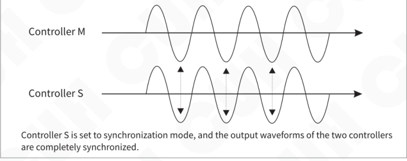

Wenn Controller S nicht auf den Slave-Modus eingestellt ist (SynV- oder SynE-Modus), sind die Ausgangswellenformen der beiden Controller nicht synchronisiert. Wie unten dargestellt:

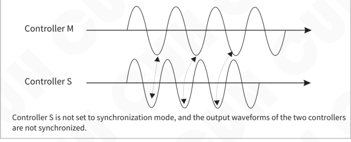


---

Für mechanische Geräte, die eine präzise Ausrichtung erfordern, müssen zwei oder mehr Vibrationseinrichtungen möglicherweise physisch übereinstimmende Phasen aufweisen, aber jede Einrichtung hat eine unterschiedliche Resonanzfrequenz. Durch Einstellen des Frequenzmodus auf „SynV" kann der Controller die Phasen jeder Einrichtung entsprechend den Vibrationsbedingungen automatisch anpassen, um Übereinstimmung zu erreichen. Wenn der Frequenzmodus „SynE" ist, legt der Benutzer den Phasenkompensationswert manuell fest.

Ändern Sie die Parameter „Spannungsmodus" und „Frequenzmodus" in der Parametergruppe konstante Geschwindigkeit, um den Controller so einzustellen, dass er im entsprechenden „Betriebsmodus" arbeitet. Der Spannungsmodus und der Frequenzmodus haben die folgenden Kombinationen:

| Betriebsart | Spannungsmethode | Frequenzmethode | Phasensteuerung | Erforderlicher Vibrationssensor |
|---|---|---|---|---|
| Automatische Spannung<br>Automatische Phase | Auto | SynV | Auto | Ja |
| Automatische Spannung<br>Manuelle Phase | Auto | SynE | Manuelle Einstellung | Ja |
| Manuelle Spannung<br>Automatische Phase | Manuell | SynV | Auto | Ja |
| Manuelle Spannung<br>Manuelle Phase | Manuell | SynE | Manuelle Einstellung | Nein |

☺

> **Hinweis:**
>
> 1. Selbst wenn die Parameter „Spannungsmodus" und „Frequenzmodus" auf „Auto" und „SynV" eingestellt sind, arbeitet der Controller weiterhin im Zustand manuelle Spannung und manuelle Phase, wenn der Vibrationssensor nicht angeschlossen ist.
>
> 2. Automatische Spannung bedeutet, dass ein an einen Vibrationssensor angeschlossener Slave-Controller die Ausgangsspannung automatisch anpasst, um die Fördergeschwindigkeit nahe dem vom Benutzer eingestellten Wert zu stabilisieren.
>
> 3. Automatische Phase bedeutet, dass der an einen Vibrationssensor angeschlossene Slave-Controller die Phase der Ausgangswellenform anhand des Rückmeldesignals des Sensors automatisch korrigiert, sodass das vom Slave-Controller ausgegebene Synchronisationssignal mit dem Master-Controller phasengleich ist.
>
> 4. Manuelle Phase bezieht sich auf die Phase der Ausgangswellenform des Slave-Controllers, die manuell so eingestellt werden kann, dass sie eine feste Phasenabweichung von der Ausgangswellenform des Master-Controllers aufweist.

---


---

## Anschlussmethode der Sync-Signalleitung zwischen Master- und Slave-Controllern

Schließen Sie einfach den Master- und den Slave-Controller an dasselbe digitale synchrone Kommunikationsnetzwerk an und vernetzen Sie sie. Stellen Sie den Parameterwert „Frequenzsynchronisation" in der Kommunikations-Parametergruppe des Slave-Controllers auf die „digitale Synchronisation"-Adressnummer des Master-Controllers ein. Ändern Sie dann den „Frequenzmodus" in der Parametergruppe konstante Geschwindigkeit auf „synchronisierte Vibration" oder „synchronisierte Elektrik".

### Anwendungsszenarien, in denen sowohl der Master- als auch der Slave-Controller an Vibrationssensoren angeschlossen sind

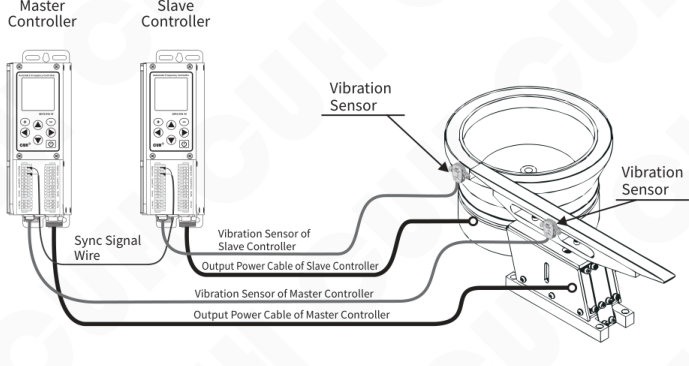

> 1. Wenn der Slave-Controller im Modus manuelle Spannung, manuelle Phase arbeitet, muss der Slave-Controller nicht an einen Vibrationssensor angeschlossen werden.
>
> 2. Wenn der Haupt-Controller im vollständig manuellen Modus arbeitet, muss der Haupt-Controller nicht an einen Vibrationssensor angeschlossen werden.

---


**■ Modus automatische Spannung, automatische Phase**

In diesem Modus muss der Controller an einen Vibrationssensor angeschlossen sein. Der Controller passt die Ausgangsspannung automatisch anhand der vom Vibrationssensor zurückgemeldeten Daten an, um sicherzustellen, dass die Fördergeschwindigkeit der Vibrationseinrichtung stabil beim eingestellten Wert liegt. Die Frequenz und die Phase der Ausgangswellenform stimmen mit dem Haupt-Controller überein oder weisen eine Phasendifferenz auf, die durch den Parameter „Automatische Phase" eingestellt wird.

**■ Modus automatische Spannung, manuelle Phase**

In diesem Modus muss der Controller an einen Vibrationssensor angeschlossen sein. Der Controller passt die Ausgangsspannung automatisch anhand der vom Vibrationssensor zurückgemeldeten Daten an, um sicherzustellen, dass die Fördergeschwindigkeit der Vibrationseinrichtung stabil beim eingestellten Wert liegt. Die Ausgangsfrequenz stimmt mit dem Haupt-Controller überein. Die Ausgangswellenform unterscheidet sich von der Ausgangswellenform des Haupt-Controllers um einen festen Phasendifferenzwert, der durch den Parameter „Manuelle Phase" eingestellt wird.

**■ Modus manuelle Spannung, automatische Phase**

In diesem Modus muss der Controller an einen Vibrationssensor angeschlossen sein. Die Ausgangsspannung des Controllers wird manuell eingestellt. Die Frequenz und die Phase der Ausgangswellenform stimmen mit dem Haupt-Controller überein oder weisen eine Phasendifferenz auf, die durch den Parameter „Automatische Phase" eingestellt wird.

**■ Modus manuelle Spannung, manuelle Phase**

In diesem Modus wird die Ausgangsspannung des Controllers manuell eingestellt, und die Ausgangsfrequenz stimmt mit dem Haupt-Controller überein. Die Ausgangswellenform unterscheidet sich von der Ausgangswellenform des Haupt-Controllers um einen festen Phasendifferenzwert, der durch den Parameter „Manuelle Phase" eingestellt wird.

> ☺
>
> 1. Der Modus automatische Phase erfordert, dass der Parameterwert „Frequenzmodus" des Slave-Controllers auf „SynV" eingestellt wird.
>
> 2. Der Modus manuelle Phase erfordert, dass der Parameterwert „Frequenzmodus" des Slave-Controllers auf „SynE" eingestellt wird.


---

## 4.9.3 Signal-Sharing

Nach der Vernetzung des Geräts kann der Controller jedes Signal von jedem anderen Controller im Netzwerk abrufen, um einen reicheren Signalabrufport zu erreichen.

Die Signalquelle eines Controllers im Netzwerk kann aus jedem Port jedes Controllers im Netzwerk ausgewählt werden. Und es können komplexe logische Steuerungen durch UND-, ODER-, XOR- oder RS-Logikoperationen realisiert werden.

Bedienschritte zum Abrufen anderer Signalquellen vom Hauptausgang des Controllers:

➢ **Wählen Sie den Controller aus, der das Netzwerksignal beziehen soll, rufen Sie die Hauptausgangsgruppe auf und führen Sie die folgenden Einstellungen durch:**

1. Stellen Sie den Parameter „MainSor1" oder den Parameter „MainSor2" auf „Bus" ein.
2. Stellen Sie den Parameter „MainLogc" auf einen von „And", „Or", „Xor" und „RS" ein.
3. Stellen Sie den Parameter „MainDire" dieses Controllers auf einen von „Const", „Inv", „On" oder „Off" ein.
4. Stellen Sie die Zeiten „MainUpDy" und „MainDnDy" dieses Controllers ein.
5. Stellen Sie den Parameter „MainMode" dieses Controllers auf einen von „Delay" oder „Hold" ein.

➢ **Wechseln Sie zur Kommunikationsgruppe und führen Sie die folgenden Einstellungen durch:**

6. Stellen Sie „BSigMID1" dieses Controllers auf die Adresse des zu folgenden Controllers ein (die Controller-Nummer kann über die digitale Synchronisation abgefragt werden).
7. Stellen Sie „BSigMID2" dieses Controllers auf die Adresse des zu folgenden Controllers ein.
8. Stellen Sie die spezifische Statusbit-Nummer von „BSigM_B1" dieses Controllers ein. Sie müssen die „Statusbits 1~16" des gefolgten Controllers prüfen und die von der Maschine benötigte Statusbit-Sequenznummer auswählen.
9. Stellen Sie die spezifische Statusbit-Nummer von „BSigM_B2" dieses Controllers ein. Sie müssen die „Statusbits 1~16" des gefolgten Controllers prüfen und die von der Maschine benötigte Statusbit-Sequenznummer auswählen.

Jeder Controller kann 16 seiner eigenen Status auf den Bus senden, die über „Statusbit 1" ~ „Statusbit 16" unabhängig eingestellt werden können, und „Statusbit 1" ~ „Statusbit 16" sind standardmäßig mit den ersten 16 Bits des Kapitels „7.4.11 Anhang" identisch.

Jeder Controller kann das Signal auf dem Bus abrufen (standardmäßig). Bedeutung und Details finden Sie im Kapitel „7.4.11 Anhang".

---


---

Beispiel: Nach der Vernetzung ruft der Controller mit Adresse 3 das C-Port-Signal des Steuersystems mit Adresse 1 und das C-Port-Signal des Steuersystems mit Adresse 2 ab, führt eine logische ODER-Verknüpfung durch, und wenn ein Signal als gültig erkannt wird, stoppt der Hauptausgang des Controllers mit Adresse 3.

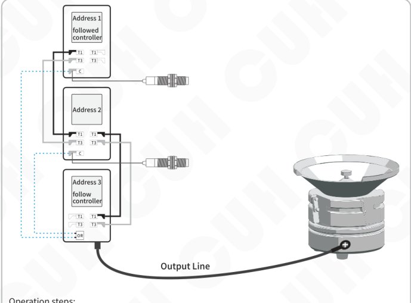

Bedienschritte:

1. Legen Sie in der Hauptausgangs-Parametergruppe des Controllers mit Adresse 3 „MainSor1" auf „bus" und „MainSor2" auf „bus" fest.
2. Stellen Sie den Parameter „MainLogc" des Controllers mit Adresse 3 auf „And" ein.
3. Stellen Sie den Parameter „MainDire" (Hauptausgangsrichtung) des Controllers mit Adresse 3 auf „Const" ein.
4. Stellen Sie die Zeiten „MainUpDy" und „MainDnDy" des Controllers mit Adresse 3 auf den erforderlichen Zeitwert ein. Der Standardwert ist 0,2 Sekunden.
5. Stellen Sie „MainMode" (Hauptausgangsmodus) des Controllers mit Adresse 3 auf „Delay" ein.
6. Stellen Sie „BSigMID1" in der „Kommunikations-Parametergruppe" des Controllers mit Adresse 3 auf „1" ein (gibt den Controller mit Adresse 1 an).
7. Stellen Sie „BSigMID2" des Controllers mit Adresse 3 auf „2" ein (gibt den Controller mit Adresse 2 an).
8. Stellen Sie „BSigM_B1" des Controllers mit Adresse 3 auf „4" ein (gibt das C-Port-Signal an).
9. Stellen Sie „BSigM_B2" des Controllers mit Adresse 3 auf „4" ein (gibt das C-Port-Signal an).
10. Die Einstellung ist abgeschlossen. Für die Steuerausgangseinstellungen des D-Ports des Controllers siehe die Hauptausgangseinstellungen des Controllers.

---


---

## 4.9.4 Datensicherung

Wenn alle Controller vernetzt sind, können alle Controller im Netzwerk die Daten der jeweils anderen sichern. Jeder Controller sichert die anderen beiden Controller im Netzwerk. Wenn ein Controller im ursprünglichen Netzwerk ausfällt, können Benutzer den ausgefallenen Controller schnell durch einen neuen Controller ersetzen. Alle Parameter des neuen Controllers stimmen mit denen des Controllers vor dem Austausch überein.

Wenn weniger als 3 nummerierte benachbarte Controller im Netzwerk ausfallen, kann der Austauschvorgang erfolgreich sein. Wenn jedoch mehr als 3 oder mehr nummerierte Controller ausfallen, können nicht alle Gerätedaten wiederhergestellt werden.

➢ **Schritte für den Beitritt eines neuen Controllers als Ersatzgerät ins Netzwerk:**

1. Schalten Sie das zu ersetzende Gerät aus und entfernen Sie das CUHBus-DS®-Kommunikationskabel.
2. Schließen Sie die CUHBus-DS®-Schnittstelle des neuen Geräts an das ursprüngliche Netzwerk an.
3. Wenn das neue Gerät eingeschaltet wird, wechselt der neue Zugangs-Controller automatisch in die „Kommunikations-Parametergruppe".
4. Stellen Sie den Parameter „DigSynAd" (lokale digitale Synchronisationsadresse) ein. Da dieses Netzwerk unvollständig ist, zeigt der Wert dieses Parameters nur die Gerätenummer an, die ersetzt werden muss.
5. Stellen Sie den Wert des Parameters „EnNetwok " auf „Replace" ein und halten Sie dann ⊕ und ⊖ gleichzeitig gedrückt, um zu bestätigen.
6. Nach erfolgreichem Austausch ändert sich der Parameterwert des neuen Geräts „EnNetwok " automatisch in „Online".

Beispiel 1: Das ursprüngliche Netzwerk besteht aus den Controllern mit Adresse 1, Adresse 2 und Adresse 3. Da Adresse 3 ausgefallen ist, muss das ursprüngliche Gerät durch ein neues Gerät ersetzt und alle Einstellungen des ursprünglichen Geräts wiederhergestellt werden.

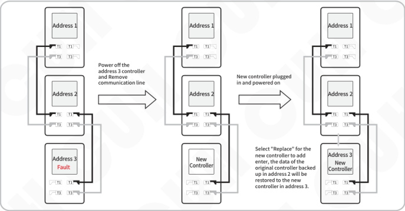

Beispiel 2: Im Netzwerk gibt es vier Controller mit den Adressen 1, 2, 3 und 4. Darunter sind die Controller mit den Adressen 2, 3 und 4 im Netzwerk ausgefallen. Da jedoch jedes Gerät im Netzwerk Daten von bis zu zwei Controllern sichert, kann der Controller mit Adresse 4 die Datenwiederherstellung nicht abschließen. Für die Austauscheinstellungen der Controller mit den Adressen 2 und 3 siehe den obigen Fall.

Beispiel 3: Im Netzwerk gibt es ursprünglich fünf Maschinen mit den Adressen 1, 2, 3, 4 und 5. Darunter sind die Adressen 1, 2 und 4 fehlerhaft (drei nicht aufeinanderfolgende Einheiten). Sie können von Adresse 5 die Daten der Controller mit Adresse 1 und Adresse 2 wiederherstellen und von Adresse 3 die Daten des Controllers mit Adresse 4 wiederherstellen, wodurch alle Daten der ausgefallenen Controller wiederhergestellt werden. Für die Controller-Austauscheinstellungen siehe den obigen Fall.

---


## 4.9.5 Fernsteuerungsdaten

Benutzer können wählen, welche Datenquellen an das Synchronisationsnetzwerk gesendet werden, und können manuelle Spannung, Fernsteuerungsspannung, manuelle Geschwindigkeit und Fernsteuerungsgeschwindigkeit auswählen.

| Parameter | Bedeutung |
|---|---|
| ManVol | Manuelle Spannung bezieht sich auf die vom Bedienfeld des Benutzers eingestellte Spannung |
| RemVol | Fernsteuerungsspannung bezieht sich auf die über den Fernsteuerungs-Geschwindigkeitsport eingestellte Spannung |
| ManSpd | Manuelle Geschwindigkeit bezieht sich auf die vom Bedienfeld des Benutzers eingestellte Fördergeschwindigkeit |
| RemSpd | Fernsteuerungsgeschwindigkeit bezieht sich auf die über den Fernsteuerungs-Geschwindigkeitsport eingestellte Fördergeschwindigkeit |

## 4.10 Controller-Statusüberwachung

In der Überwachungs-Parametergruppe können der Betriebsstatus und die Parameterwerte des Controllers in Echtzeit gelesen werden.

Lesbare Parametereinträge finden Sie im Kapitel „Parameterliste", Parametergruppe 10, Überwachungs-Parametergruppe.

```text
┌────────────────────────────┐
│ RUN                        │
│ A C D E F G N J      A0   │
│ 01.Voltage        150  V   │
│ 02.Frequenc       50.0 Hz  │
│ 03.SpeedNow          0     │
│ 04.VoltgOut     223.8 V   │
│ 05.EffectCu      0.00 A   │
│ +    10Monitor        −   │
└────────────────────────────┘
```


## 4.11 Fehlerprotokoll

Der Controller kann 64 Protokollsätze in einer Schleife aufzeichnen, um später den Zeitpunkt des Auftretens des Problems und spezifische Informationen anzeigen zu können. Auf jeder Oberfläche ruft langes Drücken von ▲ und ▶ die Protokoll-Oberflächengruppe auf, die wie folgt angezeigt wird:

```text
┌────────────────────────┐
│ RUN                    │
│ A C D E F G N J     A0 │
│      0 H   0 M    1 S  │
│ Err CodeError       01 │  } Die beiden obigen Zeilen zeigen das Fehlerprotokoll
│ 01.Voltage       150 V │
│ 02.Frequenc     50.0Hz │  } Die folgenden drei Zeilen zeigen die
│ 03.SpeedNow         0  │    Überwachungs-Parametergruppe
│ +       Note        −  │
└────────────────────────┘
```

## 4.12 Startseite anpassen

Um Benutzern die effiziente und schnelle Nutzung des Controllers zu erleichtern, können Benutzer in der Oberflächen-Parametergruppe Anpassungen vornehmen. Durch Extrahieren von höchstens 16 aller Parameter werden diese als Überwachungselemente in der Oberflächen-Parametergruppe platziert, und der Benutzer kann schnelle Vorgänge auf der Hauptoberfläche durchführen.

Beispiel: Wählen Sie 1. UsrVoltg (P2.02), 2. UsrFrqnc (P2.03), 3. UserSped (P2.01), 4. SoftStar (P2.04), SoftStop (P2.05), insgesamt fünf Parameter in der Hauptoberfläche aus. Die Schritte sind wie folgt:

```text
» Langes Drücken von ▲ und ◀ ruft die         ┌────────────────────────┐
  Parametereinstellungs-Oberfläche auf;       │ RUN                    │
  kurzes Drücken von ▶ wechselt zur           │ A C D E F G N J     A0 │
  Parametergruppe „1EditHome".                │ 01.Monit  1     P2.02 │
                                              │ 02.Monit  2     P2.03 │
» Kurzes Drücken von ▲ oder ▼                │ 03.Monit  3     P2.01 │
  wechselt zwischen verschiedenen             │ 04.Monit  4     P2.04 │
  Überwachungselementen.                      │ 05.Monit  5     P2.05 │
                                              │ +    1EditHome      −  │
» Drücken Sie ⊕ oder ⊖, um die               └────────────────────────┘
  Funktionsbezeichnungen auszuwählen,
  die festgelegt werden sollen.

Hinweis: Funktionsbezeichnungen können über das Kapitel „Parameterliste" abgefragt werden.
      Ist der Wert des Überwachungselements leer, bedeutet dies, dass kein Überwachungselement vorhanden ist.
```

Nach Abschluss des Vorgangs: Wenn der Benutzer die Parameterwerte von Spannung, Frequenz, Fördergeschwindigkeit, Sanftanlaufzeit und Sanftstoppzeit anpassen muss, rufen Sie das spezifische Überwachungselement in der Parametergruppe der Oberfläche „Home" auf und schließen Sie die Parameteranpassung über ⊕ oder ⊖ ab.


# Kapitel Ⅴ Typische Anwendungen

## 5.1 Wie können zwei Vibrationsförderer mit derselben Frequenz betrieben werden?

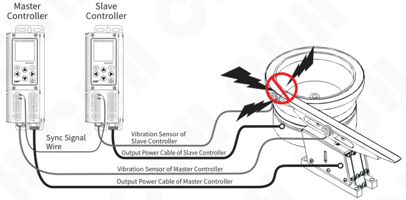

Dieser Abschnitt beschreibt, wie zwei SDVC341-Controller vernetzt werden und erreichen, dass ein Direktvibrator und ein Rundvibrator mit derselben Frequenz arbeiten, um eine Kollision zwischen den Platten aufgrund unterschiedlicher Betriebsfrequenzen zu vermeiden.

1. Der Controller schließt das Netzkabel und das Ausgangskabel korrekt an.
2. Nehmen Sie den Sensor heraus, dem der Controller folgt, schließen Sie den Sensorstecker an den Controller an und ziehen Sie die Mutter fest, und befestigen Sie den Sensorkörper korrekt auf der Vibrationsplatte (siehe „2.3 Installationsanleitung für den Vibrationssensor")
3. Öffnen Sie die Abdeckung des Geräteanschlussfachs, verbinden Sie alle T1-Signale aller Controller miteinander und verbinden Sie alle T3-Signale miteinander.
4. Nachdem die beiden Geräte eingeschaltet wurden, wechselt einer der Controller automatisch in die „Kommunikations-Parametergruppe".
5. In der Kommunikations-Parametergruppe des Controllers generiert das Programm automatisch eine festgelegte Gerätenummer für die digitale Synchronisationskommunikation. „Digitale Synchronisation" ist ein beliebiger Wert [1~8]. Benutzer können diesen Wert auch selbst ändern.
6. Stellen Sie in der Kommunikations-Parametergruppe den Parameter „EnNetwok " auf „Expand" ein und halten Sie dann ⊕ und ⊖ gleichzeitig gedrückt, um zu bestätigen.
7. Nachdem der Folger-Controller erfolgreich hinzugefügt wurde, ändert sich der Parameterwert von „EnNetwok" automatisch in „Online", was anzeigt, dass die Vernetzung erfolgreich war.
8. Der Benutzer hält ▲ und ◀ gedrückt, um die Parametereinstellungs-Oberfläche aufzurufen, und wechselt durch kurzes Drücken von ◀ oder ▶ zur Kommunikations-Parametergruppe, um die digitale Synchronisationsadresse jedes Controllers anzuzeigen und zu notieren.
9. Stellen Sie den Parameterwert „FrqncSyn" des folgenden Controllers in der Kommunikations-Parametergruppe auf die „DigSynAd"-Adressnummer des gefolgten Controllers ein.

Nach Abschluss der obigen Einstellungen kann ein Controller einem anderen Controller mit derselben Frequenz folgen.

---


## 5.2 Wie wird Controller B über einen an Controller A angeschlossenen Sensor ein-/ausgeschaltet?

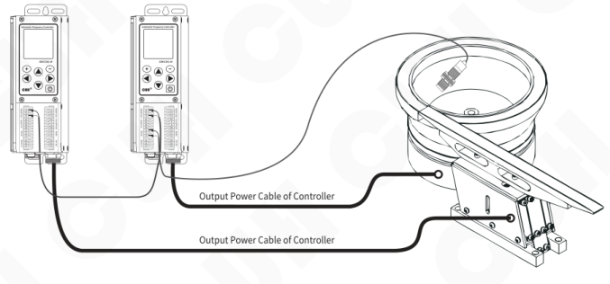

Dieser Abschnitt beschreibt, wie zwei SDVC341-Controller vernetzt werden und erreichen, dass der Hauptausgang des gesteuerten Controllers durch das C-Port-Signal eines anderen Hauptsteuer-Controllers gestartet und gestoppt wird, sodass der Controller auch ohne direkt angeschlossenen Sensor über das vernetzte Signal bedient werden kann. Die Signalquellen des Controllers werden dadurch erheblich erweitert.

1. Der Controller schließt das Netzkabel und das Ausgangskabel korrekt an.

2. Öffnen Sie die Abdeckung des Geräteanschlussfachs, verbinden Sie alle T1-Signale aller Controller miteinander und verbinden Sie alle T3-Signale miteinander.

3. Nachdem die beiden Geräte eingeschaltet wurden, wechselt einer der Controller automatisch in die „Kommunikations-Parametergruppe".

4. In der Kommunikations-Parametergruppe des Controllers generiert das Programm automatisch eine Gerätenummer für die digitale Synchronisationskommunikation, und „digitale Synchronisation" ist ein beliebiger Wert [1~8]. Benutzer können diesen Wert auch selbst ändern.

5. Der Benutzer hält ▲ und ◀ gedrückt, um die Parametereinstellungs-Oberfläche aufzurufen, und wechselt durch kurzes Drücken von ◀ oder ▶ zur Kommunikations-Parametergruppe, um die digitale Synchronisationsadresse jedes Controllers anzuzeigen und zu notieren.

6. Der gesteuerte Controller wechselt gemäß der obigen Methode zur Hauptausgangs-Parametergruppe, und die Parameter werden wie folgt eingestellt:

„MainSor1" ist „Bus", „MainSor2" ist „Bus", „MainLogc" ist „And", „MainDire" ist „Const", „MainUpDy" und „MainDnDy" sind auf den erforderlichen Zeitwert eingestellt, der Standardwert ist 0,2 Sekunden, „MainMode" ist auf „Delay" eingestellt.

7. Der gesteuerte Controller wechselt gemäß der obigen Methode zur Kommunikations-Parametergruppe, und die Parameter werden wie folgt eingestellt:

„BSigMID1" ist auf „X" eingestellt (X: ist die digitale Synchronisations-Bitnummer des Controllers, dessen Signal abgerufen werden soll), „BSigM_B1" ist auf „4" eingestellt (Materialeingangsport-C-Signal), „BSigM_B2" ist auf „0" eingestellt (0 bedeutet ungültiges Signal).

Nach Abschluss der obigen Einstellungen wird der Ausgang eines Controllers durch das C-Port-Signal eines anderen Controllers gesteuert.


## 5.3 Wie werden zwei Controller gleichzeitig ein-/ausgeschaltet?

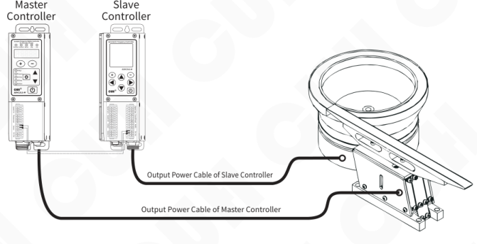

Dieser Abschnitt beschreibt einen Direktvibrations-Controller (mit SDVC311) und einen Teller-Controller (mit SDVC341), die synchron starten und stoppen. Auch verschiedene Controller-Serien können die Funktion des synchronen Startens und Stoppens erfüllen.

1. Der Controller schließt das Netzkabel und das Ausgangskabel korrekt an.

2. Öffnen Sie die Abdeckung des Geräteanschlussfachs, verbinden Sie D1 des SDVC341 mit C2 des SDVC311 und verbinden Sie D3 des SDVC341 mit C1 des SDVC311.

3. Nachdem die beiden Geräte eingeschaltet wurden, halten Sie ▲ und ◀ gedrückt, um die Parametereinstellungs-Oberfläche aufzurufen; wechseln Sie durch kurzes Drücken von ◀ oder ▶ zur Steuerausgangs-Parametergruppe.

4. Stellen Sie in der Steuerausgangs-Parametergruppe die Parameter wie folgt ein:

„PotDLogc" ist auf „Or" eingestellt, „PotDSor1" ist auf „Main" eingestellt, „PotDType" ist auf „Ou_PNP" eingestellt, die übrigen Standardwerte bleiben unverändert.

Mit den obigen Einstellungen ist die Konfiguration abgeschlossen, und ein Direktvibrations-Controller (mit SDVC311) sowie ein Teller-Controller (mit SDVC341) behalten das synchronisierte Starten und Stoppen bei.

---


---

# Kapitel Ⅵ Häufig gestellte Fragen

## 6.1 Keine Anzeige beim Einschalten

Lösung:

◆ Prüfen Sie, ob die Steckdose Strom führt.

◆ Prüfen Sie, ob der Netzstecker zuverlässig mit der Steckdose verbunden ist.

## 6.2 Keine Vibration, kein Geräusch, Controller-Anzeige normal

Lösung:

◆ Prüfen Sie, ob das Ausgangsleistungskabel korrekt mit dem Controller und dem Vibrationsförderer verbunden ist.

◆ Prüfen Sie, ob die Parameterwerte des Controllers für Ausgangsspannung und Ausgangsfrequenz angemessen eingestellt sind.

◆ Prüfen Sie, ob der Controller durch ein Steuersignal gestoppt wird.

◆ Prüfen Sie, ob der Controller durch eine Logik-Aus-Einstellung von Parametern gestoppt wird.

## 6.3 Steuersignal funktioniert nicht

Lösung:

◆ Prüfen Sie, ob das Steuersignal zuverlässig angeschlossen ist.

◆ Prüfen Sie, ob die Masseleitung des Steuersignals mit dem GND-Port des Controllers verbunden ist.

◆ Prüfen Sie, ob die Steuersignal-Logik korrekt eingestellt ist.

## 6.4 Keine Vibration, normales Geräusch, Controller-Anzeige normal

Lösung:

◆ Passen Sie die Parametereinstellungen gemäß diesem Benutzerhandbuch an.

## 6.5 Instabile Resonanzfrequenz-Nachführung

Lösung:

◆ Erhöhen Sie den Frequenz-Integralwert angemessen; beachten Sie jedoch, dass ein zu großer Wert eine Schwingung der Ausgangsfrequenz verursachen kann.

---


---

## 6.6 Langsame Geschwindigkeitskorrektur bei konstanter Fördergeschwindigkeit

Lösung:

◆ Passen Sie den Amplituden-Integralwert angemessen an; beachten Sie jedoch, dass bei einem zu großen Wert die Schwingungsamplitude der Ausgangsspannung größer wird.

## 6.7 Wie wird der Controller schnell auf die Werkseinstellungen zurückgesetzt

Aufgrund der leistungsstarken Funktionen dieses Controllers gibt es eine große Anzahl von Steuerparametern, die vom Benutzer eingestellt werden können. Für Anfänger kann der normale Arbeitszustand des Controllers nach mehrfachen Einstellungsänderungen möglicherweise nicht wiederhergestellt werden. Verwenden Sie diese Funktion, um einen unübersichtlichen Parameterzustand schnell auf die Werkseinstellungen zurückzusetzen.

Lösung:

◆ Halten Sie ▲ und ◀ gedrückt, um die Parametereinstellungs-Oberfläche aufzurufen; wechseln Sie durch kurzes Drücken von ◀ oder ▶ zur Gruppe „Einstellungen speichern".

◆ Wechseln Sie zum Parameter „Einstellungen wiederherstellen" und wählen Sie die Arbeitsgruppen-Parameter. Halten Sie ⊕ und ⊖ gleichzeitig länger als zwei Sekunden gedrückt, um zur Standby-Oberfläche zu wechseln. Zu diesem Zeitpunkt werden alle Parameter in der Arbeitsgruppe auf die Werkseinstellungen zurückgesetzt (User 1, User 2 und User 3 bleiben unverändert).

Wenn der Benutzer zuvor Parameter in „User 1", „User 2" oder „User 3" gespeichert hat, können auch die Benutzereinstellungen wiederhergestellt werden.

---


# Kapitel Ⅶ Anhang

## 7.1 Abmessungen

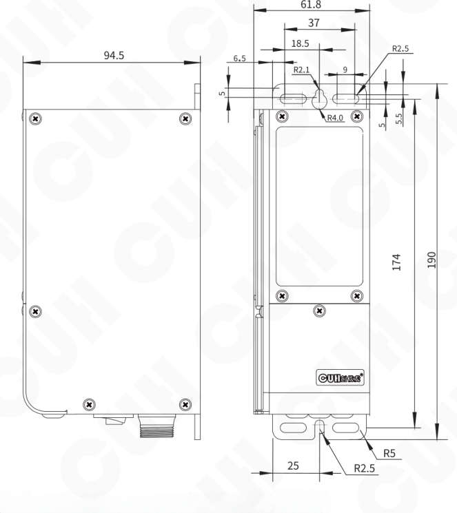

| Abmessungsbereich | Toleranz |
|---|---:|
| 0~3 | ±0.05 |
| 3~10 | ±0.1 |
| 10~30 | ±0.15 |
| 30~80 | ±0.2 |
| 80~180 | ±0.3 |
| >180 | ±0.5 |

Diese Toleranztabelle gilt für alle Produkte dieser Serie.


## 7.2 Technische Daten

| Punkt | Min | Typisch | Max | Einheit | Anmerkung |
|---|---:|---:|---:|---|---|
| Eingangsspannung | 85 | 220 | 250 | V | AC RMS |
| Einstellbarer Ausgangsspannungsbereich | 0 | —— | 250 | V |  |
| Spannungseinstellgenauigkeit |  | 1 |  | V |  |
| Spannungsregelgenauigkeit | 0 | —— | 10 | % | ΔVout/ΔVin |
| Einstellbarer Ausgangsstrombereich | 0 | —— | 3.0 | A |  |
| Ausgangsleistung | 0 | —— | 660 | VA |  |
| Ausgangsfrequenz | 5.0 | —— | 999.9 | Hz |  |
| Frequenzeinstellgenauigkeit |  | 0.1 |  | Hz |  |
| Ausgangswellenform |  | Sine |  |  |  |
| Sanftanlaufzeit | 0 | —— | 40.0 | s | Standardwert: 0.5 |
| Ein-/Aus-Verzögerungszeitbereich | 0.0 | —— | 99.9 | s | Standardwert: 0.2 |
| Ein-/Aus-Verzögerungszeit-Genauigkeit |  | 0.1 |  | s |  |
| Auslösetemperatur des Überhitzungsschutzes | 60 | 65 | 65 | ℃ |  |
| Sync-Kommunikation |  | CUHBus-DS® |  |  |  |
| Digitale Kommunikation |  | ModBUS485/Digital Sync |  |  |  |
| DC-Steuerausgangsstrom | 0 | —— | 350 | mA |  |
| DC-Steuerausgangsspannung | 22 | 24 | 26 | V |  |
| Analoges Steuersignal |  | 4~20 |  | mA | Strom der Fernsteuerungs-Geschwindigkeitsregelung |
|  |  | 1~5/0~5/0~10 |  | V | Spannung der Fernsteuerungs-Geschwindigkeitsregelung |
| Digitales Steuersignal |  | 24 |  | V | Schaltsignal |
| Einstellmethode |  | 7 |  | Taster |  |
| Standby-Leistungsaufnahme | —— | —— | 5 | W |  |
| Anzeigemethode |  | 128*128 |  |  | Matrixanzeige |
| Schutzart |  | IP20 |  |  |  |
| Umgebungstemperatur | 0 | 25 | 40 | ℃ |  |
| Umgebungsfeuchtigkeit | 10 | 60 | 85 | % | Keine Kondensation |
| Lagerungs-Umgebungstemperatur | -20 | 25 | 65 | ℃ |  |


## 7.3 Referenznorm

**Absolute Parameter:**  
Eine Überschreitung dieser Normen beschädigt den Controller; sie sind strikt einzuhalten.

| Punkt | GB-Norm | IEC-Norm | Grad | Normanforderung | Anmerkung |
|---|---|---|---|---|---|
| Elektrostatische<br>Entladung | GB/T 17626.2-2006 | IEC 61000-4-2:2001 | 4 | ±8 kV | Kontakt-<br>entladung |
|  |  |  | 4 | ±15 kV | Luftentladung |
| Elektrischer schneller<br>Transiententest | GB/T 17626.4-2008 | IEC 61000-4-4:2004 | 4 | ±4 kV |  |
| DC-Stromleitungs-<br>Wellenimmunität | GB/T 17626.17-2005 | IEC 61000-4-17:2002 | 4 | 15% | Bewertung A |

> **Warnung**  
> In einer Wohnumgebung kann dieses Produkt Funkstörungen verursachen; in diesem Fall können zusätzliche Gegenmaßnahmen erforderlich sein.


## 7.4 Parameterliste

### 7.4.1 Schnittstellen-Parametergruppe

| Funktion | Parameter | Anzeige | Wertebereich/Aufzählungselement | Standardwert |
|---|---|---|---|---|
| P1.01 | Überwachungselement 1 | 01.Monit1 | Parametergruppe 2~Parametergruppe 10 | P2.01 |
| P1.02 | Überwachungselement 2 | 02.Monit2 | Parametergruppe 2~Parametergruppe 10 | P10.05 |
| P1.03 | Überwachungselement 3 | 03.Monit3 | Parametergruppe 2~Parametergruppe 10 | P2.02 |
| P1.04 | Überwachungselement 4 | 04.Monit4 | Parametergruppe 2~Parametergruppe 10 | P2.03 |
| P1.05 | Überwachungselement 5 | 05.Monit5 | Parametergruppe 2~Parametergruppe 10 |  |
| P1.06 | Überwachungselement 6 | 06.Monit6 | Parametergruppe 2~Parametergruppe 10 |  |
| P1.07 | Überwachungselement 7 | 07.Monit7 | Parametergruppe 2~Parametergruppe 10 |  |
| P1.08 | Überwachungselement 8 | 08.Monit8 | Parametergruppe 2~Parametergruppe 10 |  |
| P1.09 | Überwachungselement 9 | 09.Monit9 | Parametergruppe 2~Parametergruppe 10 |  |
| P1.10 | Überwachungselement 10 | 10.Monit10 | Parametergruppe 2~Parametergruppe 10 |  |
| P1.11 | Überwachungselement 11 | 11.Monit11 | Parametergruppe 2~Parametergruppe 10 |  |
| P1.12 | Überwachungselement 12 | 12.Monit12 | Parametergruppe 2~Parametergruppe 10 |  |
| P1.13 | Überwachungselement 13 | 13.Monit13 | Parametergruppe 2~Parametergruppe 10 |  |
| P1.14 | Überwachungselement 14 | 14.Monit14 | Parametergruppe 2~Parametergruppe 10 |  |
| P1.15 | Überwachungselement 15 | 15.Monit15 | Parametergruppe 2~Parametergruppe 10 |  |
| P1.16 | Überwachungselement 16 | 16.Monit16 | Parametergruppe 2~Parametergruppe 10 |  |


## 7.4.2 Allgemeine Parametergruppe

| Funktion | Parameter | Anzeige | Wertebereich/Aufzählungselement | Standardwert |
|---|---|---|---|---|
| P2.01 | Vom Benutzer eingestellte Fördergeschwindigkeit | 01.UserSped | 0~3200 | 200 |
| P2.02 | Vom Benutzer eingestellte Spannung | 02.UsrVoltg | 0~250 V | 150 |
| P2.03 | Vom Benutzer eingestellte Frequenz | 03.UsrFrqnc | 5.0~999.9 Hz | 50.0 |
| P2.04 | Sanftanlaufzeit | 04.SoftStar | 0.0~40.0 s | 0.5 |
| P2.05 | Sanftstoppzeit | 05.SoftStop | -0.1~40.0 s | 0.5 |
| P2.06 | Maximale Ausgangsspannung | 06.MaxVoltg | 0~250 V | 220 |
| P2.07 | Maximaler Ausgangsstrom | 07.MaxCurre | 0.1~3.0 A | 3.0 |
| P2.08 | Maximale Ausgangsfrequenz | 08.MaxFre | 5.0~999.9 Hz | 400.0 |
| P2.09 | Minimale Ausgangsfrequenz | 09.MiniFre | 5.0~999.9 Hz | 40.0 |
| P2.10 | Lasterkennung | 10.Measure | None, Valid | None |
| P2.11 | Materialmangel-Alarm | 11.LowAlrm | 0~3000 | 10 |
| P2.12 | Abschaltalarm | 12.AlrmShut | None, Sound1, Sound2, Sound3 | None |
| P2.13 | Hintergrundbeleuchtungs-Helligkeit | 13.Brightne | 20~100 % | 100 |
| P2.14 | Hintergrundbeleuchtungs-Auszeit | 14.Off_time | 1~30 Mi，31(dauerhaft hell) | 5 |
| P2.15 | Sprache | 15.Language | Englis, Chines, German | Englis |


## 7.4.3 Hauptausgangs-Parametergruppe

| Funktion | Parameter | Anzeige | Wertebereich/Aufzählungselement | Standardwert |
|---|---|---|---|---|
| P3.01 | Logik des Hauptausgangsports | 01.MainLogc | And, Or, Xor, RS | Or |
| P3.02 | Logik-Eingangsquelle 1<br>des Hauptausgangsports | 02.MainSor1 | Siehe Anhang 7.4.11 | In_PtC |
| P3.03 | Logik-Eingangsquelle 2<br>des Hauptausgangsports | 03.MainSor2 | Siehe Anhang 7.4.11 | In_PtE |
| P3.04 | Haupt-Ein-Verzögerung | 04.MainUpDy | 0.0~99.9 s | 0.2 |
| P3.05 | Haupt-Aus-Verzögerung | 05.MainDnDy | 0.0~99.9 s | 0.2 |
| P3.06 | Logische<br>Richtung des Hauptausgangs | 06.MainDire | Const, Inv, On, Off | Const |
| P3.07 | Hauptausgangsmodus | 07.MainMode | Delay, Hold | Delay |
| P3.08 | Wellenformindex | 08.WavFmInd | 50~100 | 100 |
| P3.09 | Gleichstrom | 09.DCCurent | 0.0~2.00 A | 0.10 |
| P3.10 | Einschaltstatus | 10.PowOnSta | On, Off, Keep | On |
| P3.11 | Fernsteuerungsquelle | 11.CtrlSour | Panel, 20mA, 1-5V, 0-5V, 0-10V, DigSym | Panel |
| P3.12 | Fernsteuerungskoeffizient | 12.CtrlCoef | 0.5~2.0 | 1.0 |


## 7.4.4 Parametergruppe konstante Geschwindigkeit

| Funktion | Parameter | Anzeige | Wertebereich/Aufzählungselement | Standardwert |
|---|---|---|---|---|
| P4.01 | Mittenfrequenz der<br>automatischen Frequenz | 01.AutFCent | 5.0~999.9 Hz | 100.0 |
| P4.02 | Einstellbereich der<br>automatischen Frequenz | 02.AutFRang | 0.0~180.0 Hz | 30.0 |
| P4.03 | Integral der<br>automatischen Frequenzanpassung | 03.AutFIntg | 0~2000 | 20 |
| P4.04 | Integral der<br>automatischen Amplitudenanpassung | 04.AutAIntg | 0~9999 | 250 |
| P4.05 | Proportionalanteil der<br>automatischen Amplitudenanpassung | 05.AutAProp | 0~9999 | 500 |
| P4.06 | Automatische Phase | 06.AutoPhas | -180~180 ° | 0 |
| P4.07 | Maximaler Strom der<br>automatischen Frequenzsuche | 07.AutSrhCM | 1.0~6.0 A | 3.0 |
| P4.08 | Maximale Amplitude der<br>automatischen Frequenzsuche | 08.AutSrhAM | 0~3200 | 200 |
| P4.09 | Automatische<br>Suchfrequenz | 09.AutSpedM | 0~4000 | 3200 |
| P4.10 | Benutzereingestellte Phase | 10.UserPhas | -180~180 ° | 0 |
| P4.11 | Spannungsmodus | 11.VoltgMod | Manuel, Auto | Auto |
| P4.12 | Frequenzmodus | 12.FrqncMod | Manuel, Auto, SynV, SynE | Auto |
| P4.13 | Synchronisationsquelle | 13.SynSourc | None, PhaseV, PhaseE | None |
| P4.14 | Beschleunigungssensor-Typ | 14.AcSnsrTp | 20-1, 20-2, 20-3, 20-4, 203, 204, 205, 206 | 205 |
| P4.15 | Frequenzsuchgeschwindigkeit | 15.SrhSpeed | 0~5 | 3 |


## 7.4.5 Signal-Eingangs-Parametergruppe

| Funktion | Parameter | Anzeige | Wertebereich/Aufzählungselement | Standardwert |
|---|---|---|---|---|
| P5.01 | Schaltsensor-Typ | 01.PortType | Auto, NPN, PNP, Ato1 (einmalige automatische Erkennung) | Auto |
| P5.02 | Logische Richtung von Port C | 02.PortCDir | Const, Inv | Const |
| P5.03 | C-Ein-Verzögerung | 03.PtCUpDly | 0.0~99.9 s | 0.2 |
| P5.04 | C-Aus-Verzögerung | 04.PtCDnDly | 0.0~99.9 s | 0.2 |
| P5.05 | Logische Richtung von Port E | 05.PortEDir | Const, Inv | Const |
| P5.06 | E-Ein-Verzögerung | 06.PtEUpDly | 0.0~99.9 s | 0.2 |
| P5.07 | E-Aus-Verzögerung | 07.PtEDnDly | 0.0~99.9 s | 0.2 |
| P5.08 | Logische Richtung von Speed A | 08.SpedADir | Const, Inv | Const |
| P5.09 | Speed A Ein-Verzögerung | 09.SpdAUpDy | 0.0~99.9 s | 0.2 |
| P5.10 | Speed A Aus-Verzögerung | 10.SpdADnDy | 0.0~99.9 s | 0.2 |
| P5.11 | Logische Richtung von Speed B | 11.SpedBDir | Const, Inv | Const |
| P5.12 | Speed B Ein-Verzögerung | 12.SpdBUpDy | 0.0~99.9 s | 0.2 |
| P5.13 | Speed B Aus-Verzögerung | 13.SpdBDnDy | 0.0~99.9 s | 0.2 |


## 7.4.6 Steuerausgangs-Parametergruppe

| Funktion | Parameter | Anzeige | Wertebereich/Aufzählungselement | Standardwert |
|---|---|---|---|---|
| P6.01 | Logische Beziehung von Port D | 01.PotDLogc | And, Or, Xor, RS | Or |
| P6.02 | Logik-Eingangsquelle 1 von Port D | 02.PotDSor1 | Siehe Anhang 7.4.11 | In_PtC |
| P6.03 | Logik-Eingangsquelle 2 von Port D | 03.PotDSor2 | Siehe Anhang 7.4.11 | In_PtE |
| P6.04 | Logische Richtung von Port D | 04.PortDDir | Const, Inv, On, Off | Const |
| P6.05 | D-Ein-Verzögerung | 05.PtDUpDly | 0.0~99.9 s | 0.2 |
| P6.06 | D-Aus-Verzögerung | 06.PtDDnDly | 0.0~99.9 s | 0.2 |
| P6.07 | Ausgangstyp von Port D | 07.PotDType | Ou_PNP, Ou_NPN, Ou_P&P (Push Pull) | Ou_P&P |
| P6.08 | Ausgangsmodus von Port D | 08.PotDMode | Delay, Hold | Delay |


## 7.4.7 DC-Zähl-Parametergruppe

| Funktion | Parameter | Anzeige | Wertebereich/Aufzählungselement | Standardwert |
|---|---|---|---|---|
| P7.01 | Gesamtzählmenge | 01.TotaCout | 0~9999 | 10 |
| P7.02 | Prozentsatz der<br>Endgeschwindigkeit | 02.PrcntTrm | 0~100 % | 50 |
| P7.03 | Vorlauf vor dem Zählende | 03.CotAhead | 0~9999 | 3 |
| P7.04 | Automatische Rücksetzzeit<br>der Zählung | 04.CotRstTm | 0.0~999.9 s | 0.0 |
| P7.05 | Auswahl des Zählports | 05.CotPotSe | None, Valid | None |
| P7.06 | Priorität des RS-Trigger-Ports | 06.RSPriori | Same, Reset, Set, Revers | Same |

---


## 7.4.8 Kommunikations-Parametergruppe

| Funktion | Parameter | Anzeige | Wertebereich/Aufzählungselement | Standardwert |
|---|---|---|---|---|
| P8.01 | 485BUS-Kommunikationstyp | 01.485type | ASCII, RTU | RTU |
| P8.02 | Baudrate der 485-Kommunikation | 02.BaudRate | 0.3, 1.2, 2.4, 9.6, 19.2, 57.6, 115.2 Kbps | 115.2 |
| P8.03 | Slave-Identifikationsnummer der 485-Kommunikation | 03.485SlvID | 1~31 | 1 |
| P8.04 | Aktivierung des Anpassungswiderstands des 485-Kommunikationsports | 04.Enab485R | None, Valid | None |
| P8.05 | Lokale Adresse der digitalen Synchronisation | 05.DigSynAd | 1~8 |  |
| P8.06 | Aktivierung des Anpassungswiderstands des digitalen Synchronisations-Kommunikationsports | 06.EnabSynR | None, Valid | None |
| P8.07 | Bus-Signaladresse der Logik-Eingangsquelle 1 des Hauptausgangsports | 07.BSigMID1 | 1~8 |  |
| P8.08 | Bus-Signaladresse der Logik-Eingangsquelle 2 des Hauptausgangsports | 08.BSigMID2 | 1~8 |  |
| P8.09 | Bus-Signaladresse der Logik-Eingangsquelle 1 von Port D | 09.BSgD_ID1 | 1~8 |  |
| P8.10 | Bus-Signaladresse der Logik-Eingangsquelle 2 von Port D | 10.BSgD_ID2 | 1~8 |  |
| P8.11 | Bus-Signal-Bitadresse der Logik-Eingangsquelle 1 des Hauptausgangsports | 11.BSigM_B1 | 1~16 | 5 |
| P8.12 | Bus-Signal-Bitadresse der Logik-Eingangsquelle 2 des Hauptausgangsports | 12.BSigM_B2 | 1~16 | 6 |
| P8.13 | Bus-Signal-Bitadresse der Logik-Eingangsquelle 1 von Port D | 13.BSigD_B1 | 1~16 | 5 |
| P8.14 | Bus-Signal-Bitadresse der Logik-Eingangsquelle 2 von Port D | 14.BSigD_B2 | 1~16 | 6 |
| P8.15 | Signal der lokalen Bus-Signal-Bitadresse 1 | 15.LBSig_B1 | Siehe Anhang 7.4.11 | 0 |
| P8.16 | Signal der lokalen Bus-Signal-Bitadresse 2 | 16.LBSig_B2 | Siehe Anhang 7.4.11 | 1 |
| P8.17 | Signal der lokalen Bus-Signal-Bitadresse 3 | 17.LBSig_B3 | Siehe Anhang 7.4.11 | SpeedA |
| P8.18 | Signal der lokalen Bus-Signal-Bitadresse 4 | 18.LBSig_B4 | Siehe Anhang 7.4.11 | SpeedB |
| P8.19 | Signal der lokalen Bus-Signal-Bitadresse 5 | 19.LBSig_B5 | Siehe Anhang 7.4.11 | In_PtC |
| P8.20 | Signal der lokalen Bus-Signal-Bitadresse 6 | 20.LBSig_B6 | Siehe Anhang 7.4.11 | In_PtE |
| P8.21 | Signal der lokalen Bus-Signal-Bitadresse 7 | 21.LBSig_B7 | Siehe Anhang 7.4.11 | FCntSi |
| P8.22 | Signal der lokalen Bus-Signal-Bitadresse 8 | 22.LBSig_B8 | Siehe Anhang 7.4.11 | DCntSi |
| P8.23 | Signal der lokalen Bus-Signal-Bitadresse 9 | 23.LBSig_B9 | Siehe Anhang 7.4.11 | Ctr_O |
| P8.24 | Signal der lokalen Bus-Signal-Bitadresse 10 | 24.LBSigB10 | Siehe Anhang 7.4.11 | Warn |
| P8.25 | Signal der lokalen Bus-Signal-Bitadresse 11 | 25.LBSigB11 | Siehe Anhang 7.4.11 | Main |
| P8.26 | Signal der lokalen Bus-Signal-Bitadresse 12 | 26.LBSigB12 | Siehe Anhang 7.4.11 | -SpeedA |
| P8.27 | Signal der lokalen Bus-Signal-Bitadresse 13 | 27.LBSigB13 | Siehe Anhang 7.4.11 | -SpeedB |
| P8.28 | Signal der lokalen Bus-Signal-Bitadresse 14 | 28.LBSigB14 | Siehe Anhang 7.4.11 | -In_PtC |
| P8.29 | Signal der lokalen Bus-Signal-Bitadresse 15 | 29.LBSigB15 | Siehe Anhang 7.4.11 | -In_PtE |
| P8.30 | Signal der lokalen Bus-Signal-Bitadresse 16 | 30.LBSigB16 | Siehe Anhang 7.4.11 | -FCtSi |
| P8.31 | Funktion zum Hinzufügen zum Netzwerk aktivieren | 31.EnNetwok | Online, Offlin, Expand, Replace |  |
| P8.32 | Gerätenummer aus dem Netzwerk entfernen | 32.DeltDevi | 1~8 |  |
| P8.33 | Lokale Frequenzsynchronisationsnummer | 33.FrqncSyn | 1~8 |  |
| P8.34 | Lokale Nummer der Fernsteuerungs-Geschwindigkeitssynchronisation | 34.RemotSyn | 1~8 |  |
| P8.35 | Fernsteuerungsdaten | 35.RemotDat | ManVol, RemVol, ManSpd, RemSpd | ManVol |


---

## 7.4.9 Gruppe Einstellungen speichern

| Funktion | Parameter | Anzeige | Wertebereich/Aufzählungselement | Standardwert |
|---|---|---|---|---|
| P9.01 | Alle Parameter aus der<br>Benutzergruppe lesen | 01.ReadALLF | None, UsrD1, UsrD2, UsrD3 | None |
| P9.02 | Alle Parameter in der<br>Benutzergruppe speichern | 02.SaveALLT | None, Work, UsrD1, UsrD2, UsrD3 | None |
| P9.03 | Slave-Identifikationsnummer | 03.RestorAL | None, RWork (Standard-Arbeitsgruppe) | None |
| P9.04 | Lokale Daten mit der<br>Bus-Sicherung<br>wiederherstellen | 04.RDatFrBs | 1~8 |  |
| P9.05 | Benutzerpasswort | 05.PassWord | 0~9999 | 0 |
| P9.06 | Passwort festlegen | 06.SetWord | 0~9999 | 0 |

---


## 7.4.10 Überwachungs-Parametergruppe

| Funktion | Parameter | Anzeige | Wertebereich/Aufzählungselement | Standardwert |
|---|---|---|---|---|
| P10.01 | Ausgangsspannung | 01.Voltage | 0~250 V |  |
| P10.02 | Ausgangsfrequenz | 02.Frequenc | 5.0~999.9 Hz |  |
| P10.03 | Aktuell gemessene Fördergeschwindigkeit | 03.SpeedNow | 0~4000 |  |
| P10.04 | Aktuelle Ausgangsspannung | 04.VoltgOut | 0.0~250.0 V |  |
| P10.05 | Effektiver Stromwert | 05.EffectCu | 0.0~9.99 A |  |
| P10.06 | Aktueller Maximalwert | 06.CurrentM | 0.0~9.99 A |  |
| P10.07 | Wirkleistung | 07.PowActiv | 0.0~999.9 W |  |
| P10.08 | Blindleistung | 08.PowReact | 0.0~999.9 Var |  |
| P10.09 | Temperatur | 09.Temperat | -20.0~85.0 ℃ |  |
| P10.10 | Induktivitätswert | 10.Inductan | 0.0~9.999 H |  |
| P10.11 | Widerstandswert | 11.Resistan | 0.0~999.9 Ω |  |
| P10.12 | Externe Synchronisationsfrequenz | 12.SynchrFr | 5.0~999.9 Hz |  |
| P10.13 | Aktuelle Zählzahl | 13.CoutNumb | 0~9999 |  |
| P10.14 | Sättigungsstrom | 14.SatCurre | 0.0~9.9 A |  |
| P10.15 | Eingangssignalstatus von Port C | 15.Sig-PotC | 0~1 |  |
| P10.16 | Eingangssignalstatus von Port E | 16.Sig-PotE | 0~1 |  |
| P10.17 | Ausgangsstatus von Port D | 17.Sig-PotD | 0~1 |  |
| P10.18 | Eingangssignalstatus von Port G | 18.Sig-PotG | 0~1 |  |
| P10.19 | Eingangssignalstatus von Port N | 19.Sig-PotN | 0~1 |  |
| P10.20 | Status des Hauptausgangs | 20.Sig-Main | 0~1 |  |
| P10.21 | Eingangsspannung von Port C | 21.Vol-PotC | 0.0~26.0 V |  |
| P10.22 | Eingangsspannung von Port E | 22.Vol-PotE | 0.0~26.0 V |  |
| P10.23 | Ausgangsspannung von Port D | 23.Vol-PotD | 0.0~26.0 V |  |
| P10.24 | Eingangsspannung von Port G | 24.Vol-PotG | 0.0~26.0 V |  |
| P10.25 | Eingangsspannung von Port N | 25.Vol-PotN | 0.0~26.0 V |  |
| P10.26 | Fernsteuerungseingangsspannung | 26.Vol-Remo | 0.0~10.0 V |  |
| P10.27 | 24V-Versorgungsspannung | 27.Vol-24V | 0.0~26.0 V |  |
| P10.28 | 5V-Versorgungsspannung | 28.Vol-5V | 0.0~6.0 V |  |
| P10.29 | Aktuelle Eingangsbusspannung | 29.Vol-Bus | 0.0~390.0 V |  |
| P10.30 | Effektivwert der Eingangsspannung | 30.Vol-Inpt | 0.0~280.0 V |  |
| P10.31 | Restwert der automatischen Phase | 31.PhaseRem | -180~180 ° |  |
| P10.32 | Überlast des Automatik-Sensors | 32.Overload | 0~1 |  |
| P10.33 | Beschleunigte Geschwindigkeit | 33.Accelera | 0~64 g |  |
| P10.34 | Gerätenummer | 34.DevicNum | 1~8 Geräte |  |
| P10.35 | Online-Nummer | 35.OnlinNum | 1~8 Geräte |  |
| P10.36 | Materialmangel-Alarm | 36.LowAlarm | 0~3000 |  |
| P10.37 | Betriebsstunden | 37.WorkHour | 0~9999 (Einheit：8h) |  |
| P10.38 | Amplitude X | 38.Amp-X | 0~9999 um |  |
| P10.39 | Amplitude Y | 39.Amp-Y | 0~9999 um |  |


| Funktion | Parameter | Anzeige | Wertebereich/Aufzählungselement | Standardwert |
|---|---|---|---|---|
| P10.40 | Amplitude Z | 40.Amp-Z | 0~9999 um |  |
| P10.41 | Amplitudensumme | 41.Amp-Sum | 0~9999 um |  |
| P10.42 | Firmware-Versionsnummer des Masters | 42.Vr-Main | 0~9999 |  |
| P10.43 | Firmware-Versionsnummer des Slaves | 43.Vr-Slave | 0~9999 |  |


### 7.4.11 Anhangliste

Die Liste der Signalquellendefinitionen lautet wie folgt:

| Laufende Nummer | Bedeutung | Anzeige |
|---:|---|---|
| 0 | 0 | 0 |
| 1 | 1 | 1 |
| 2 | Speed-A-Port | SpeedA |
| 3 | Speed-B-Port | SpeedB |
| 4 | Eingangsport C | In_PtC |
| 5 | Eingangsport E | In_PtE |
| 6 | Zähler-voll-Signal | FCntSi |
| 7 | Zählverlangsamungssignal | DCntSi |
| 8 | Bussignal | Bus_S |
| 9 | Steuerausgang | Ctr_O |
| 10 | Warnung | Warn |
| 11 | Hauptausgang | Main |
| 12 | Invertierter Speed-A-Port | -SpedA |
| 13 | Invertierter Speed-B-Port | -SpedB |
| 14 | Invertierter Eingangsport C | -I_PtC |
| 15 | Invertierter Eingangsport E | -I_PtE |
| 16 | Invertiertes Zähler-voll-Signal | -FCtSi |
| 17 | Invertiertes Zählverlangsamungssignal | -DCtSi |
| 18 | Invertiertes Bussignal | -Bus_S |
| 19 | Invertierter Steuerausgang | -Ctr_O |
| 20 | Invertierte Warnung | -Warn |
| 21 | Invertierter Hauptausgang | -Main |

Die Vergleichstabelle des Gerätevernetzungsstatus lautet wie folgt:

| Anzeige | Gerätevernetzungsstatus |
|---|---|
| A | Alle Netzwerkgeräte sind online |
| B | Mindestens ein Netzwerkgerät ist offline |
| C | Dieses Gerät ist kein Gerät in diesem Netzwerk |
| D | Gerät wird gelöscht |
| E | Erweiterung zum Beitritt von Geräten |
| F | Konkurrierende Netzwerksteuerung |
| R | Ersetzen des beitretenden Geräts |
| S | Dieses Gerät ist vom Netzwerk getrennt |


## 7.5 Ein- und Ausgangsschaltpläne

### Fernsteuerungs-Geschwindigkeitsport A

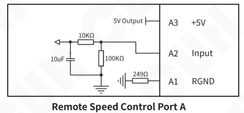

| Klemme | Signal |
|---|---|
| A3 | +5V |
| A2 | Input |
| A1 | RGND |

### Schaltsensor-Port C

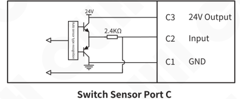

| Klemme | Signal |
|---|---|
| C3 | 24V Output |
| C2 | Input |
| C1 | GND |

### Schaltsensor-Port E

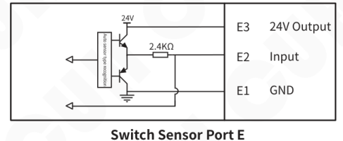

| Klemme | Signal |
|---|---|
| E3 | 24V Output |
| E2 | Input |
| E1 | GND |

### Steuerausgangs-Port D

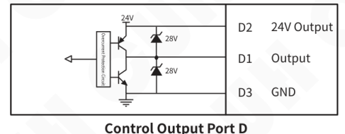

| Klemme | Signal |
|---|---|
| D2 | 24V Output |
| D1 | Output |
| D3 | GND |

---


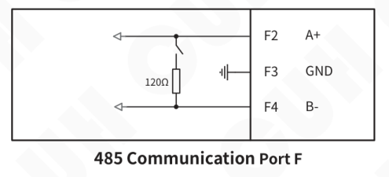

**485-Kommunikationsport F**

| Klemme | Signal |
|---|---|
| F2 | A+ |
| F3 | GND |
| F4 | B- |

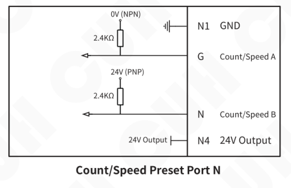

**Zähl-/Geschwindigkeitsvorwahl-Port N**

| Klemme | Signal |
|---|---|
| N1 | GND |
| G | Count/Speed A |
| N | Count/Speed B |
| N4 | 24V Output |

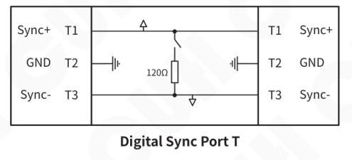

**Digitaler Synchronisationsport T**

| Klemme | Signal |
|---|---|
| T1 | Sync+ |
| T2 | GND |
| T3 | Sync- |


## 7.6 Fehlercode

Die Fehlerdiagnose dieses Controllers ist in Fehlercodes und Warnungscodes unterteilt. Die jeweiligen Codes werden nacheinander angezeigt.

**Fehlercode:** Die Maschine muss sofort gestoppt werden; warten Sie, bis der Fehler verschwunden ist, bevor die Anzeige erlischt.

**Warnungscode:** Ein Stopp ist nicht erforderlich. Warten Sie, bis das Warnzeichen verschwunden ist, bevor die Anzeige erlischt.

### Fehlercodetabelle

| Fehlercode | Anzeige | Bedeutung | Ausschlussmethode |
|---|---|---|---|
| Error01 | Short | Kurzschluss | Prüfen Sie, ob die Hauptausgangsleitung kurzgeschlossen ist, und verdrahten Sie sie neu |
| Error02 | OvrCurrt | Überstrom | Reduzieren Sie die Ausgangsspannung oder erhöhen Sie die Ausgangsfrequenz |
| Error03 | OverHot | Überhitzung | Stellen Sie den Controller an einem gut belüfteten und wärmeableitenden Ort auf |
| Error04 | UndrCool | Unterkühlung | Stellen Sie den Controller an einem Ort auf, an dem die Umgebungstemperatur über -20℃ liegt |
| Error05 | CommErr | Kommunikationsfehler | Wenden Sie sich an den technischen Support des Unternehmens |
| Error06 | TSnerErr | Temperatursensorfehler | Wenden Sie sich an den technischen Support des Unternehmens |
| Error07 | OverVolt | Überspannung | Die Eingangsnetzspannung darf den Effektivwert von 250V nicht überschreiten |
| Error08 | UndrVolt | Unterspannung | Die Eingangsnetzspannung darf den Effektivwert von 85V nicht unterschreiten |
| Error09 | LoadErr | Lastunterbrechung | Prüfen Sie, ob die Ausgangsleitung korrekt an die Vibrationsplatte angeschlossen ist |
| Error10 | Send_Seed | Senden des Seeds fehlgeschlagen | Wenden Sie sich an den technischen Support des Unternehmens |
| Error11 | Send_Exit | Der Befehl zum Verlassen des Bootvorgangs konnte nicht ausgeführt werden | Wenden Sie sich an den technischen Support des Unternehmens |
| Error14 | SynchEr0 | CUHBus-DS®-Bus hat 2 oder mehr Master-Geräte | 1. Wenn ein Alarm auftritt, setzen Sie das Gerät auf offline und dann wieder auf online.<br>2. Nachdem das neu hinzugefügte Gerät ausgeschaltet wurde, verbinden Sie das CUHBus-DS®-Kabel mit dem Netzwerkgerät. |
| Error15 | SynchEr1 | Busfehler | Prüfen Sie, ob die CUHBus-DS®-Kommunikationsleitung korrekt angeschlossen ist, und organisieren Sie das Netzwerk ordnungsgemäß |
| Error16 | SynchEr2 | Synchronisationsgerät ist nicht online | Das Synchronisationskommunikationsnetzwerk, das Frequenzsynchronisationsgerät oder das Fernsteuerungssynchronisationsgerät ist nicht online |


## 7.7 Warnungscode

Warnungscodetabelle

| Warnungscode | Anzeige | Bedeutung | Ausschlussmethode |
|---|---|---|---|
| Warn01 | Saturate | Ausgangssättigung | Reduzieren Sie die Ausgangsspannung |
| Warn02 | decline | Zählverlangsamung | Zählverlangsamungszustand |
| Warn03 | CND | Ende der Zählung | Zählendestatus |
| Warn04 | FrqncyLo | Ausgangsfrequenz zu niedrig | Erhöhen Sie den Wert des Frequenzversatzparameters |
| Warn05 | FrqncyHi | Ausgangsfrequenz zu hoch | Erhöhen Sie den Wert des Frequenzversatzparameters |
| Warn06 | LoMAlarm | Materialmangel | Reduzieren Sie den Parameterwert des Materialmangelalarms oder fügen Sie Material in die Materialwanne hinzu |
| Warn07 | PortDErr | Ausgangsüberstrom von Port D | Reduzieren Sie die Steuerlast des Ausgangsports |
| Warn08 | RemotLow | Fernsteuerungseingangsspannung/-strom zu niedrig | Erhöhen Sie die Fernsteuerungseingangsspannung oder den -strom |
| Warn09 | MRSErr | RS-Logikfehler des Hauptausgangs | Wenn die Ausgangslogik ein RS-Flipflop ist, dürfen die Signale von Hauptquelle 1 und Hauptquelle 2 nicht gleichzeitig gültig sein |
| Warn10 | 24VErr | 24V-Fehler | Schließen Sie keine externe 24V-Stromversorgung an den Ausgangsport des Controllers an |
| Warn11 | 5VErr | 5V-Fehler | Schließen Sie keine externe 5V-Stromversorgung an den Ausgangsport des Controllers an |
| Warn12 | CtrlRSErr | RS-Logikfehler des Steuerausgangs | Wenn die Logik von Port D ein RS-Flipflop ist, dürfen die Signale von D-Port-Quelle 1 und D-Port-Quelle 2 nicht gleichzeitig gültig sein |
| Warn13 | OverLoad | Überlast des Beschleunigungssensors | Ersetzen Sie den Beschleunigungssensor durch einen mit geeignetem Messbereich |
| Warn14 | AcceleEr | Ausfall des Beschleunigungssensors | Der Sensor ist beschädigt; ersetzen Sie ihn durch einen neuen |
| Warn15 | EEPErr | Fehler beim Speichern der Parameter | Bestätigen Sie, dass die CUHBus-DS®-Kommunikationsleitung ordnungsgemäß angeschlossen und die Vernetzung korrekt abgeschlossen ist. |


# Kapitel VIII Produktgarantieinformationen

## 8.1 Garantiezeitraum

Der Garantiezeitraum, den das Unternehmen für dieses Produkt gewährt, beträgt 3 Jahre ab dem Datum, an dem das Produkt an den vom Käufer bezeichneten Ort geliefert wird.

## 8.2 Garantieumfang

(1) Wenn während des oben genannten Garantiezeitraums ein von unserem Unternehmen verursachter Fehler auftritt, reparieren wir das Produkt kostenlos. Die folgenden Situationen sind jedoch nicht durch die Garantie abgedeckt:

&nbsp;&nbsp;&nbsp;&nbsp;a. Fehler aufgrund der Nichteinhaltung der in der Kurzanleitung, im Benutzerhandbuch oder in den zwischen dem Käufer und dem Unternehmen speziell vereinbarten technischen Anforderungen festgelegten Bedingungen, aufgrund unsachgemäßer Bedienung oder unsachgemäßer Verwendung.

&nbsp;&nbsp;&nbsp;&nbsp;b. Der Fehler ist nicht auf einen Produktdefekt, sondern auf die Ausrüstung oder das Softwaredesign des Käufers zurückzuführen.

&nbsp;&nbsp;&nbsp;&nbsp;c. Fehlfunktionen, die durch Änderungen oder Reparaturen verursacht wurden, die nicht vom Personal des Unternehmens durchgeführt wurden.

&nbsp;&nbsp;&nbsp;&nbsp;d. Fehler, die durch ordnungsgemäße Wartung oder Austausch von Verschleißteilen gemäß der Kurzanleitung oder dem Benutzerhandbuch vollständig vermieden werden können.

&nbsp;&nbsp;&nbsp;&nbsp;e. Nach dem Versand des Produkts aus unserem Unternehmen verursachte Fehler aufgrund von Faktoren wie unvorhersehbaren Veränderungen des technischen Stands.

&nbsp;&nbsp;&nbsp;&nbsp;f. Bei Fehlern aufgrund von Naturkatastrophen wie Feuer, Erdbeben oder Überschwemmungen oder aufgrund externer Faktoren wie anormaler Spannung übernimmt das Unternehmen keine Garantie.

(2) Der Garantieumfang ist auf die in (1) festgelegten Situationen beschränkt. Für indirekte Verluste (wie Geräteschäden, entgangene Gelegenheiten, Gewinnverluste usw.) oder andere Verluste übernimmt das Unternehmen keine Haftung.

## 8.3 Produkteignung

Der Controller unseres Unternehmens ist für den allgemeinen Einsatz in der Vibrationsförderindustrie konzipiert und hergestellt. Daher darf dieser Controller unseres Unternehmens nicht für die folgenden Anwendungen verwendet werden und ist für deren Verwendung nicht geeignet.

(1) Einrichtungen mit schwerwiegenden Auswirkungen auf Leben und Eigentum, wie Kernkraftwerke, Flughäfen, Eisenbahnen, Schiffe, motorisierte Geräte und medizinische Geräte.

(2) Öffentliche Versorgungseinrichtungen, einschließlich Strom-, Gas- und Wasserversorgung usw.

(3) Verwendung im Freien unter ähnlichen Bedingungen oder in ähnlichen Umgebungen.

---


|  |  |
|---|---|
|  | Nanjing CUH Science & Technology Co.,Ltd<br>https://en.cuhnj.com<br>Tel.:+86-25-84730411 / 84730415 / 84730416<br>Fax:+86-25-84730426<br>E-mail:sales@cuhnj.com<br>Add.:Building 2, Xueyan Tech Park, Tuscity,<br>No.9 Zhineng Rd, Jiangning, Nanjing, China |

<div align="right">Document No.: IDP1000504</div>


