## Intelligenter automatischer Controller für Vibrationsförderer

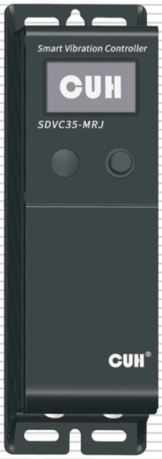

## SDVC35-Series
Intelligenter automatischer Controller für Vibrationsförderer — SDVC35 Series
## Benutzerhandbuch

## Vorwort

Vielen Dank, dass Sie sich für den intelligenten digitalen Vibrationsförderer-Controller von CUH entschieden haben.

(Im Folgenden kurz „Controller“ genannt).

Dieses Handbuch enthält Hinweise zur Installation, Inbetriebnahme, Parametereinstellung, Wartung und Fehlerbehebung des Controllers. Bitte lesen Sie dieses Handbuch vor der Inbetriebnahme des Controllers sorgfältig durch und bewahren Sie es ordnungsgemäß auf.

**Dieses Handbuch gilt für die folgenden Modelle**

- SDVC35-MRJ　( Ausgangsstrom 3A )
- SDVC35-LRJ　( Ausgangsstrom 4.5A )

---

## Hinweis:

1. Ziehen Sie bei eingeschaltetem Controller niemals das Kabel ab und berühren Sie niemals die Steckdosen, um Stromschläge oder andere Unfälle zu vermeiden.
2. Schließen Sie den Controller niemals an 380V AC an, da dies zu irreparablen Schäden führen kann. (Wir haben Produkte, die für 380V AC ausgelegt sind.)
3. Schalten Sie den Eingang des Controllers niemals durch Unterbrechen der Stromversorgung ein/aus, um den Ausgang ein-/auszuschalten, da dies die Lebensdauer des Controllers verringern kann.
4. Der Controller ist für den Betrieb in einer kühlen und trockenen Umgebung ausgelegt. Betreiben Sie den Controller niemals im Freien, um Durchnässung und Sonneneinstrahlung zu vermeiden. Betreiben Sie den Controller innerhalb der in den elektrischen Kenndaten angegebenen Temperatur.
5. Betreiben Sie den Controller niemals unter Bedingungen, die seine Auslegungsgrenzen überschreiten.
6. Betreiben Sie den Controller streng nach diesem Handbuch. Wir übernehmen keine zivil- oder strafrechtliche Haftung, wenn Geräteschäden oder Personenschäden durch unsachgemäßen Betrieb verursacht werden.

> Öffnen Sie niemals das Controller-Gehäuse, um einen Stromschlag zu vermeiden. Wenden Sie sich an CUH, wenn der Controller ausfällt. Versuchen Sie niemals, den Controller selbst zu reparieren, da dies zum Erlöschen der Garantie führen kann.

---

## Betriebs- und Lagerungsumgebung

### Prüfung vor der Verwendung

Jeder Controller durchläuft vor der Auslieferung eine strenge Qualitätsprüfung und wird in stoßsicherer Verpackung geliefert. Bitte prüfen Sie nach dem Auspacken die folgenden Punkte:

1. Ob der Controller äußerlich beschädigt ist.
2. Ob das Modell des Controllers Ihrer Bestellung entspricht.

### Betriebsumgebung

Bitte beachten Sie die folgenden Hinweise, um eine bessere Leistung und eine längere Lebensdauer des Controllers zu gewährleisten:

- ⚠ Gut belüftete Umgebung
- ⚠ Von Wasser, Feuchtigkeit, Staub und insbesondere öligem Staub fernhalten
- ⚠ Von korrosiven oder entflammbaren Gasen und Flüssigkeiten fernhalten
- ⚠ Von schwebendem Staub und Metallpartikeln fernhalten
- ⚠ Fest befestigen, um Eigenschwingungen zu vermeiden
- ⚠ Von elektromagnetischen Störungen fernhalten
- ⚠ Sicherstellen, dass die Umgebungstemperatur 0~40 ℃ beträgt
- ⚠ Für die Verwendung in Höhenlagen von 2000m oder darunter

---

# Inhaltsverzeichnis

- **Kapitel I Merkmale — 1**
  - 1.1 Hauptmerkmale — 1
  - 1.2 Weitere Merkmale — 1
- **Kapitel II Installationsanleitung — 3**
  - 2.1 Beschreibung der externen Teile — 3
  - 2.2 Installationsbeschreibung — 5
  - 2.3 Installation des Vibrationssensors — 7
  - 2.4 Automatische Resonanzfrequenzsuche — 9
- **Kapitel III HMI-Beschreibung — 10**
  - 3.1 Standby-Oberfläche — 10
  - 3.2 Passworteingabe-Oberfläche — 13
  - 3.3 Funktionsgruppen-Oberfläche — 14
  - 3.4 Anzeige-Oberfläche des Resonanzfrequenzsuchprozesses — 16
- **Kapitel IV Funktionsbeschreibung — 17**
  - 4.1 EIN/AUS-Steuerung der digitalen Eingangsports C und E — 17
  - 4.2 Zählfunktion — 20
  - 4.3 Hauptausgangs-Steuersignal — 24
  - 4.4 DC-Steuerausgang Port D und Port P — 28
  - 4.5 Fernsteuerung der Geschwindigkeit — 33
  - 4.6 Hauptmodus — 35
  - 4.7 Sync-Modus — 39
  - 4.8 Funktion voreingestellter Parameter — 44
  - 4.9 Wiederherstellung der Werkseinstellungen — 45
  - 4.10 RS485-Kommunikation — 46
  - 4.11 Ethernet-Kommunikation — 48
  - 4.12 Lastprüfung — 48
  - 4.13 Arbeitszustandsüberwachung — 49
- **Kapitel V Sicherheitsfunktionen — 50**

---

---

Anhang A: Abmessungen — 51

Anhang B: Beschreibung der elektrischen Anschlüsse — 52

Anhang C: Elektrische Spezifikation — 53

Anhang D: Vorschläge zur Fehlerbehebung und Fehlererklärung — 55

Anhang E: Warnungs- und Fehlerbeschreibung und Vorschläge zur Fehlerbehebung — 56

Anhang F: Beschreibung des Betriebszustands und des Netzwerkkartentyps — 57

Anhang G: Verdrahtungsmethode von Schaltsensoren und SPS an die digitalen Eingangsports — 58

Anhang H: Parametertabelle — 61

---

# Kapitel I Merkmale

## 1.1 Hauptmerkmale

**OLED-Anzeige:** Bietet drei Sprachen (Chinesisch, Englisch, Deutsch) und eine benutzerfreundliche Bedienoberfläche.

**Automatische Resonanzfrequenzsuche:** Die Resonanzfrequenz der Last kann mit oder ohne Sensor ermittelt werden.

**Automatische Konstantgeschwindigkeitsregelung:** Automatische Anpassung der Ausgangsspannung in Echtzeit, um eine konstante voreingestellte Fördergeschwindigkeit unabhängig von Gewichtsänderungen des Fördermaterials im Vibrationsförderer zu gewährleisten.

**Synchronausgang mehrerer Controller:** Die Ausgangswellenform der Slave-Controller wird mit der des Master-Controllers auf gleiche Frequenz und Phase synchronisiert, um Schwebungseffekte zu vermeiden.

**Dualer Push-Pull-Steuerausgang:** Der Controller kann 24V DC in Verbindung mit der Einstellung der logischen Verknüpfung der EIN/AUS-Steuerung ausgeben, um ein Magnetventil, ein elektrisches Relais oder andere externe Geräte anzusteuern.

**Ethernet-Kommunikation:** Einstellung aller Parameter und Überwachung der Betriebszustände des Controllers. Unterstützt Ethercat- und Profinet-Kommunikationsprotokoll.

**Firmware-Upgrade:** Unterstützt die Online-Aktualisierung der Firmware, um die neuesten Entwicklungsergebnisse unseres Unternehmens bereitzustellen.

**Lasterkennung:** Misst die Induktivität, den maximalen Strom und den Widerstand der Last.

## 1.2 Weitere Merkmale

Der Controller ist speziell für die Steuerung von Vibrationsförderern in Automatisierungssystemen ausgelegt. In Kombination mit der neuesten elektronischen Technologie und einem durchdachten Design bietet der Controller die folgenden praktischen und komfortablen Funktionen:

**Automatische Spannungsregelung:** Eliminiert Geschwindigkeitsschwankungen durch Netzspannungsschwankungen und Schwebungseffekte durch die industrielle AC-Frequenz.

**EIN/AUS-Steuerung mit zwei Schaltsensoren:** Es können 2 Schaltsensoren oder eine SPS angeschlossen werden, um den Controller ein-/auszuschalten.

**Automatische Erkennung des Schaltsensortyps:** Der Controller kann den NPN/PNP-Typ des Schaltsensors automatisch erkennen.

**Sanftstart:** Um einen plötzlichen Stoß auf den Vibrationsförderer zu vermeiden, kann der Controller die Ausgangsspannung/Fördergeschwindigkeit beim Start sanft von 0 auf den voreingestellten Wert erhöhen.

---

---

**Parametervoreinstellung:** Es können 4 Sätze voreingestellter Parameter ausgewählt werden.

**Beschleunigungsfunktion:** Der maximale Ausgangsspannungswert des Controllers kann auf bis zu 150% des Eingangsspannungswerts erhöht werden (außer im Zustand der automatischen Nachführung ohne Sensor).

**Maximal einstellbare Ausgangsspannung:** Die maximal einstellbare Ausgangsspannung kann voreingestellt werden, um die Last vor Schäden durch zu hohe Spannung zu schützen.

**Wellenformindex:** Er repräsentiert den äquivalenten Tastgrad des sinusförmigen Ausgangsstroms innerhalb eines Zyklus. Ein höherer Parameterwert entspricht einem größeren äquivalenten Tastgrad. Dieser Parameter kann angepasst werden, um die Betriebseffizienz und die maximale Ausgangsleistung des Controllers auszubalancieren.

**DC-Strom:** DC-Offsetkomponente des sinusförmigen Ausgangsstromsignals.

**Fernsteuerung der Geschwindigkeit:** Die Ausgangsspannung des Controllers kann über ein externes Potentiometer oder ein 4~20mA-, 0~5V-, 1~5V-, 0~10V-DC-Signal eingestellt werden.

**Zählung:** Wenn die Anzahl der gezählten Werkstücke den voreingestellten Wert erreicht, wird die Fördergeschwindigkeit verlangsamt oder auf Null gesetzt.

**EIN/AUS-Ausgang:** Kurzes Drücken der EIN/AUS-Taste startet/stoppt den Controller.

**Tastatursperre:** Langes Drücken der EIN/AUS-Taste sperrt das Tastenfeld.

**Parameter-Passwort:** Der Benutzer kann eine Berechtigung per Passwort festlegen, die das Anpassen von Parametern (wie Ausgangsspannung und Fördergeschwindigkeit) verhindert.

**Parameterspeicherfunktion:** Der Benutzer kann den Controller mit einem von vier Parametersätzen arbeiten lassen, die in den Benutzerdaten voreingestellt und gespeichert sind und über die Parameter "SavedALLTo" und "ReadALLFrm" in Funktion 8 des Controllers angepasst werden.

**Wiederherstellung der Werkseinstellungen:** Diese Funktion ermöglicht es dem Bediener, alle Parameter auf die Werkseinstellung zurückzusetzen.

**RS485-Kommunikation:** Alle Parameter können aus der Ferne eingestellt und überwacht werden.

**Selbstdefinierbare OLED-Standby-Oberfläche:** Der Benutzer kann die Parameter auswählen, die auf der Standby-Oberfläche angezeigt werden sollen.

**Alarmsignalausgang:** Das Alarmsignal kann über den Steuerausgangsport oder den Kommunikationsport für die automatische Verarbeitung ausgegeben werden.

---

# Kapitel Ⅱ Installationsanleitung

## 2.1 Beschreibung der externen Teile

### 2.1.1 Beschreibung des Äußeren

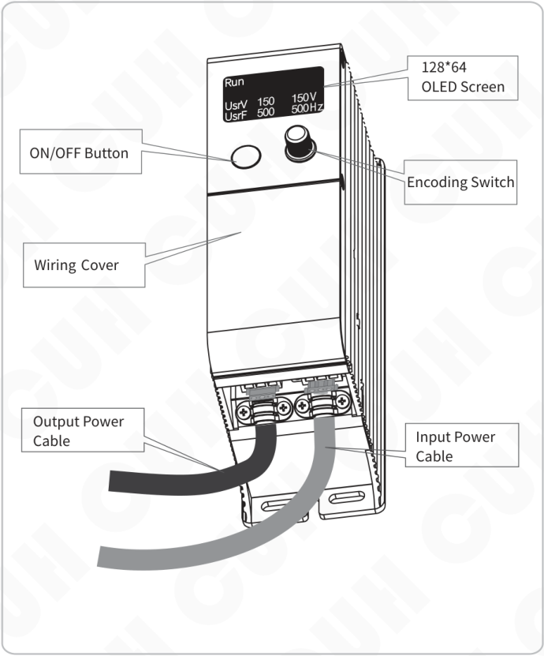

## 2.1.2 Beschreibung der Anschlussklemmen

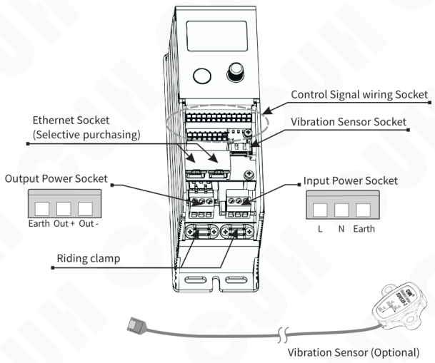

- Steuerungssignal-Buchse
- Vibrationssensor-Buchse
- Ethernet-Buchse (optional erhältlich)
- Ausgangsleistungsbuchse: Erde / Out + / Out -
- Eingangsleistungsbuchse: L / N / Erde
- Kabelklemme
- Vibrationssensor (optional)

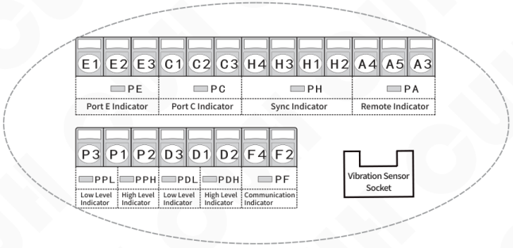

Obere Klemmenreihe (von links nach rechts): E1, E2, E3, C1, C2, C3, H4, H3, H1, H2, A4, A5, A3.

| PE | PC | PH | PA |
|---|---|---|---|
| Port-E-Anzeige | Port-C-Anzeige | Sync-Anzeige | Fernanzeige |

Untere Klemmenreihe (von links nach rechts): P3, P1, P2, D3, D1, D2, F4, F2.

| PPL | PPH | PDL | PDH | PF |
|---|---|---|---|---|
| Low-Pegel-Anzeige | High-Pegel-Anzeige | Low-Pegel-Anzeige | High-Pegel-Anzeige | Kommunikationsanzeige |

Vibrationssensor-Buchse

**Hinweis:** Port D oder Port P ist ein Hochimpedanzausgang, wenn die High-Pegel-Anzeige und die Low-Pegel-Anzeige leuchten.

---

## 2.2 Installationsbeschreibung

### Schritt Eins:

Öffnen Sie den Verpackungskarton und prüfen Sie den Controller und das gesamte Zubehör.

### Schritt Zwei:

Verbinden Sie die Anschlussklemmen des Ausgangsleistungskabels mit der elektromagnetischen Spule des Vibrators.

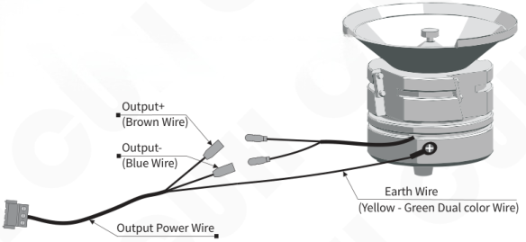

- Output+ (braune Ader)
- Output- (blaue Ader)
- Erdungsleitung (gelb-grüne Zweifarbenader)
- Ausgangsleistungskabel

> Hinweis: Stellen Sie sicher, dass die elektromagnetische Spule des Vibrators mit dem Außenleiter und dem Neutralleiter des Ausgangsleistungskabels verbunden und das Gehäuse des Vibrators zuverlässig geerdet ist.

### Schritt Drei:

Öffnen Sie die Abdeckung.

Verbinden Sie den Stecker des Ausgangsleistungskabels mit der Buchse des Controllers und befestigen Sie das Ausgangsleistungskabel mit der Kabelklemme am Gehäuse des Controllers.

Bitte arbeiten Sie nicht unter Spannung, um einen Stromschlag zu vermeiden.

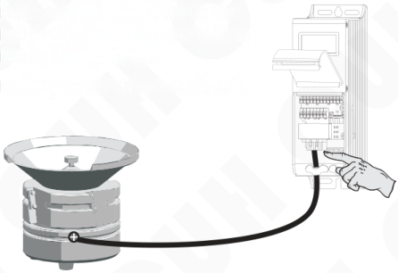

---

## Schritt Vier:

Verbinden Sie den Stecker des Eingangsleistungskabels mit der Eingangsleistungsbuchse des Controllers und befestigen Sie das Eingangsleistungskabel mit der Kabelklemme am Gehäuse des Controllers.

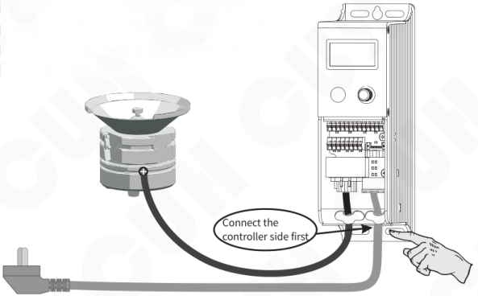

Schließen Sie zuerst die Controllerseite an

## Schritt Fünf:

Verbinden Sie den Stecker des Eingangsleistungskabels mit der Netzsteckdose.

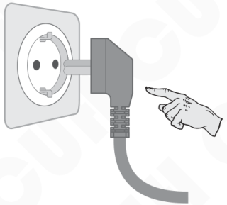

Der Controller schaltet sich ein und das OLED-Display zeigt kurzzeitig die Startoberfläche an, danach zeigt das OLED-Display die Standby-Oberfläche an.

---

## 2.3 Installation des Vibrationssensors

### 2.3.1 Anschlussmethode des Vibrationssensors

- Schalten Sie den Controller aus und verbinden Sie den Stecker des Vibrationssensors mit der Vibrationssensor-Buchse des Controllers.
- Befestigen Sie den Vibrationssensor in der Nähe des Ankers des Vibrators. Die Methode und der Ort der Installation sind unten dargestellt:

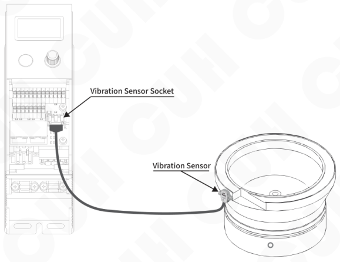

---

## 2.3.2 Montage des Vibrationssensors am Vibrator

Befestigen Sie den Vibrationssensor an der glatten Oberfläche des Vibrators; die Einbaurichtung ist beliebig. Die Montagemethoden des Vibrationssensors sind unten dargestellt:

- Methode 1: Wie in Abb. 1 dargestellt

  Vorteil: Einfache Montage

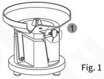

- Methode 2: Wie in Abb. 2 dargestellt

  Hinweis: Der Vibrationssensor darf nicht vom Zuführbecher gedrückt werden.

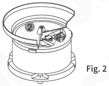

- Methode 3: Schweißen Sie einen Halter auf den Vibrator und befestigen Sie den Vibrationssensor am Halter. Wie in Abb. 3 dargestellt

  Die empfohlenen Abmessungen des Halters des Vibrationssensors sind in Abb. 4 dargestellt.

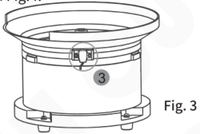

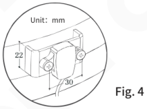

- Nicht empfohlene Montagemethode, wie in Abb. 5 und Abb. 6 dargestellt.

  Wenn die Einbauposition ungeeignet ist, kann der Vibrationssensor die Resonanzfrequenz nicht genau zurückmelden und der Controller führt die Resonanzfrequenzsuche kontinuierlich aus.

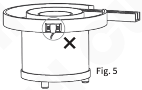

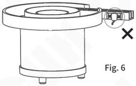

---

## 2.4 Automatische Resonanzfrequenzsuche

### 2.4.1 Automatische Resonanzfrequenzsuche ohne Sensor

Der Controller verfügt über eine automatische Resonanzfrequenzsuche ohne Sensor; der Benutzer muss lediglich den Parameter "Usr_Voltag" anpassen, damit der Vibrator unter optimalen Bedingungen arbeitet.

Starten Sie die automatische Resonanzfrequenzsuche ohne Sensor, indem Sie den Parameter "AtoSnsrTyp " in Funktionsgruppe 3 auf "Auto" und "AutoSerch_ " in Funktionsgruppe 1 auf "Star" einstellen.

Hinweis: Die automatische Resonanzfrequenzsuche ohne Sensor ist nur gültig, wenn der Controller im Hauptmodus läuft; im Sync-Modus muss der Vibrationssensor angeschlossen sein.

### 2.4.2 Automatische Resonanzfrequenzsuche mit Sensor

Durch die automatische Resonanzfrequenzsuche mit Vibrationssensor kann der Controller den Vibrator mit optimaler Frequenz arbeiten lassen und die zugehörigen Parameter des Controllers werden automatisch angepasst. Der Benutzer muss lediglich den Parameter Fördergeschwindigkeit einstellen, damit der Vibrator optimal arbeitet.

Nach dem Anschließen des Vibrationssensors schalten Sie den Controller ein; der Controller prüft automatisch, ob die Resonanzfrequenz des Vibrators innerhalb des voreingestellten Bereichs des Controllers liegt. Ist dies nicht der Fall, startet der Controller die automatische Resonanzfrequenzsuche.

**Schritte der automatischen Resonanzfrequenzsuche:**

- Halten Sie den Drehschalter auf der Standby-Oberfläche lange gedrückt, um die Funktionsgruppen-Parameteroberfläche aufzurufen.
- Stellen Sie den Parameter "AutoSerch_" in Funktionsgruppe 1 auf "Start" ein und drücken Sie dann den Drehschalter kurz, um den Prozess der automatischen Resonanzfrequenzsuche zu starten.
- Nach Abschluss des Prozesses der automatischen Resonanzfrequenzsuche zeigen das Resonanzfrequenzergebnis und "Save" auf dem OLED-Display an, dass der Parameter gespeichert wurde.

Nach dem Prozess der automatischen Resonanzfrequenzsuche kann der Vibrator normal arbeiten. Drücken Sie den Drehschalter kurz oder drehen Sie ihn, um zur vorherigen Oberfläche zurückzukehren.

> 1. Der Prozess der automatischen Resonanzfrequenzsuche muss bei leerem Zuführbecher durchgeführt werden.
> 2. Der Frequenzsuchvorgang während des Prozesses der automatischen Resonanzfrequenzsuche wird durch kurzes Drücken der "ON/OFF"-Taste abgebrochen.
> 3. Wenn das OLED-Display während des Prozesses der automatischen Resonanzfrequenzsuche "OverCurrent" anzeigt, bedeutet dies, dass "AtoSrhVMax" zu hoch eingestellt ist; der Prozess der automatischen Resonanzfrequenzsuche wird jedoch nicht beeinträchtigt.

---

## Kapitel Ⅲ HMI-Beschreibung

### 3.1 Standby-Oberfläche

Die Standby-Oberfläche ist unten dargestellt:

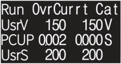

Der Controller wechselt in die Standby-Oberfläche, wenn er länger als 2 Minuten nicht bedient wird.

Die Standby-Oberfläche hat 4 Anzeigezeilen; die erste Anzeigezeile dient zur Anzeige des Betriebszustands sowie von Fehler- oder Alarminformationen des Controllers.

1. Der linke Bereich der ersten Anzeigezeile dient zur Anzeige von Start/Stopp des Controllers.
2. Der rechte Bereich der ersten Anzeigezeile dient zur Anzeige des Typs der Netzwerkkarte.
3. Der mittlere Bereich der ersten Anzeigezeile dient zur Anzeige der Warnung/des Fehlers des Controllers.

Alle Elemente der drei Bereiche werden in Anhang F und E erläutert.

Die 2. bis 4. Anzeigezeile dienen zur Parametereinstellung; der Benutzer kann bis zu drei Parameter auswählen, die auf der Standby-Oberfläche angezeigt werden.

Jede Anzeigezeile der Standby-Oberfläche enthält 4 Elemente: Parametername, Einstellwert/Parameterzustand, aktueller Messwert/Ausgangswert, Einheit. Das Beispiel der Standby-Oberfläche ist wie folgt:

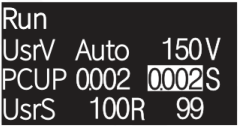

Die zweite Anzeigezeile ist der Ausgangsspannungsparameter; "Auto" bedeutet, dass dieser Parameter vom Controller automatisch angepasst wird, und die tatsächliche Ausgangsspannung beträgt 150V.

Die dritte Anzeigezeile ist der EIN-Verzögerungsparameter von Port C; der Einstellwert ist 0.002S und das dritte Element ist der Echtzeitwert des Verzögerungsprozesses. Wenn der Verzögerungsprozess abgeschlossen ist, wird der Echtzeitwert invers dargestellt.

Die vierte Anzeigezeile ist der Fördergeschwindigkeitsparameter; der Einstellwert ist 100 und die Echtzeit-Fördergeschwindigkeit ist 99. Das "R" hinter dem Einstellwert bedeutet, dass die Fördergeschwindigkeit über den Fernsteuerungsport gesteuert wird.

---

Die auf der Standby-Oberfläche anzeigbaren Parameter sind unten dargestellt.

| Eintrag | Beschreibung |
|---|---|
| UsrV | Ausgangsspannung |
| UsrF | Ausgangsfrequenz |
| UsrS | Fördergeschwindigkeit |
| Cout | Aktueller Zählwert |
| PCUp | EIN-Verzögerung Port C |
| PCDn | AUS-Verzögerung Port C |
| PEUp | EIN-Verzögerung Port E |
| PEDn | AUS-Verzögerung Port E |
| PDUp | EIN-Verzögerung Port D |
| PDDn | AUS-Verzögerung Port D |
| PPUp | EIN-Verzögerung Port P |
| PPDn | AUS-Verzögerung Port P |
| MaUp | EIN-Verzögerung Hauptsteuerung |
| MaDn | AUS-Verzögerung Hauptsteuerung |
| BusV | Leistungsbusspannung |
| CurE | Effektivwert des Ausgangsstroms |
| CurM | Maximaler Ausgangsstrom |
| PwrA | Wirkleistung |
| PwrR | Blindleistung |
| Temp | Temperatur |
| SynF | Frequenz des externen Synchronisierungssignals |
| Remo | Fernsteuerungs-Eingangsspannung |
| PCV | Eingangsspannung Port C |
| PEV | Eingangsspannung Port E |
| PDV | Ausgangsspannung Port D |
| PPV | Ausgangsspannung Port P |

---

---

### 3.1.1 Methode zur Parameteranpassung auf der Standby-Oberfläche

Wenn der Benutzer den Parameterwert anpassen möchte, drücken Sie den Drehschalter kurz; der Einstellwert der zweiten Anzeigezeile wird invers mit weißem Hintergrund dargestellt. Drehen Sie dann den Drehschalter, um den Einstellwert anzupassen. Durch kurzes Drücken des Drehschalters wechseln Sie die Einstellwert-Anpassungsoberfläche zwischen den drei Anzeigezeilen um und passen den Parameterwert durch Drehen des Drehschalters an.

Hinweis:

Wenn der Einstellwert "Auto" ist, kann der Parameterwert nicht manuell angepasst werden.

Steht das "R" hinter dem Einstellwert, kann der Parameterwert nicht manuell angepasst werden, wie z. B. "Voltage" und "Feeding speed".

Wenn das Passwort zum Sperren der Parametereinstellung gesetzt ist, erfolgt beim kurzen Drücken des Drehschalters keine Reaktion.

### 3.1.2 Energiesparmodus des OLED in der Standby-Oberfläche

Wenn die Standby-Oberfläche länger als 2 Minuten nicht bedient wird, verringert sich die Helligkeit des OLED und es wechselt in den Energiesparmodus, um die OLED-Lebensdauer zu verlängern. Drücken Sie den Drehschalter kurz oder drehen Sie ihn, um den Energiesparmodus zu beenden.

---

## 3.2 Passworteingabe-Oberfläche

Wenn "Passsword 1" oder "Passsword 2" nicht Null ist, ist die Berechtigung zur Parameteranpassung gesperrt. Halten Sie den Drehschalter auf der Standby-Oberfläche lange gedrückt; das OLED-Display zeigt die Passworteingabe-Oberfläche an, um den Benutzer zur Eingabe des Passworts aufzufordern.

Die Passworteingabe-Oberfläche ist unten dargestellt:

Passen Sie den Passwortwert durch Drehen des Drehschalters an und drücken Sie den Drehschalter kurz, um das eingegebene Passwort zu bestätigen. Wenn das Passwort korrekt ist, wird die Funktionsgruppen-Oberfläche aufgerufen.

Die von Passwort 1 und Passwort 2 gesteuerten Objekte sind unten dargestellt:

| Gesteuertes Objekt | Passwort 2 | Passwort 1 |
|---|---|---|
| EIN/AUS-Taste | ○ | ○ |
| Standby-Oberfläche | ○ | √ |
| Funktionsgruppe 1 und Funktionsgruppe 9 | √ | √ |
| Andere Funktionsgruppen | × | √ |
| Erklärung | Ohne Berechtigung können die EIN/AUS-Taste und die Parameter der Standby-Oberfläche bedient werden.  Mit Berechtigung können die Parameter der Funktionsgruppe 1 und der Funktionsgruppe 9, die EIN/AUS-Taste und die Parameter der Standby-Oberfläche bedient werden. | Ohne Berechtigung kann die EIN/AUS-Taste bedient werden.  Mit Berechtigung können alle Funktionen bedient werden. |

Hinweis: ○ bedeutet nicht gesteuert, √ bedeutet gesteuert, × bedeutet keine Berechtigung.

---

## 3.3 Funktionsgruppen-Oberfläche

Die Funktionsgruppen-Oberfläche dient zur Anpassung aller Parameter des Controllers. Es gibt 9 Funktionsgruppen, deren Parameter angepasst werden können, und 1 Funktionsgruppe, deren Parameter nur gelesen werden können.

Die erste Anzeigezeile der Funktionsgruppen-Oberfläche dient zur Anzeige des Betriebszustands sowie von Fehler- oder Alarminformationen des Controllers. Die 2. bis 4. Anzeigezeile sind der Bereich, der die Parameter der Funktionsgruppe anzeigt. Die Oberfläche ist unten dargestellt:

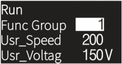

### 3.3.1 Auswahl der Funktionsgruppe

Nach dem Aufrufen der Funktionsgruppen-Oberfläche durch langes Drücken des Drehschalters auf der Standby-Oberfläche befindet sich der Cursor auf dem Wert von "Function Group". Drehen Sie den Drehschalter, um den Wert anzupassen und zwischen "Function Group 0" und "Function Group 9" zu wechseln.

Alle Parameter der Funktionsgruppen werden in Anhang H erläutert.

### 3.3.2 Methode zur Parameteranpassung in der Funktionsgruppe

Es gibt 3 Methoden zum Wechseln der Parameter in der Funktionsgruppen-Oberfläche:

1. Drücken Sie den Drehschalter kurz, um zwischen den Parametern zu wechseln.
2. Drücken Sie den Drehschalter und halten Sie ihn nicht länger als 2s gedrückt; drehen Sie gleichzeitig den Drehschalter, um zwischen den Parametern zu wechseln.

---

3. Drücken Sie den Drehschalter und halten Sie ihn länger als 2.5s gedrückt, bis die Parameteranzeigezeile invers dargestellt wird, und lassen Sie ihn dann los.

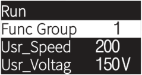

Drehen Sie den Drehschalter, um den Parameter auszuwählen.

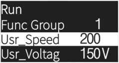

Nach Auswahl des Parameters drücken Sie den Drehschalter kurz, um in den Zustand der Parameteranpassung zu gelangen.

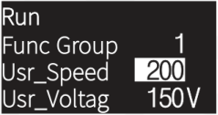

Diese Anpassungsmethode eignet sich für das Umschalten zwischen mehreren Parametern.

**Alle Parameter der Funktionsgruppen werden in Anhang H erläutert.**

---

## 3.4 Anzeige-Oberfläche des Resonanzfrequenzsuchprozesses

Wenn der Prozess der automatischen Resonanzfrequenzsuche gestartet wird, zeigt das OLED-Display die Kurve "Frequenz über Beschleunigung" an, wie unten dargestellt. Die horizontale Richtung der Kurve ist die Frequenz mit einem Bereich von 25Hz bis 400Hz und die vertikale Richtung der Kurve ist die Beschleunigung

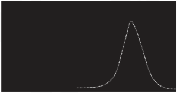

Nach Abschluss des Prozesses der automatischen Resonanzfrequenzsuche werden das Resonanzfrequenzergebnis und "Save" auf dem OLED-Display angezeigt, um anzuzeigen, dass die Parameter gespeichert wurden, wie unten dargestellt.

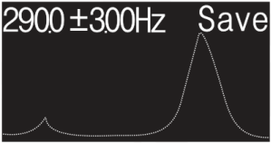

---

# Kapitel Ⅳ Funktionsbeschreibung

## 4.1 EIN/AUS-Steuerung der digitalen Eingangsports C und E

Es gibt zwei digitale Eingangsports C und E, die den NPN/PNP-Typ des angeschlossenen Sensors automatisch erkennen können, um den Controller ein-/auszuschalten. Das an die Ports angeschlossene Gerät kann ein Näherungsschalter, ein photoelektrischer Sensor, ein Fasersensor oder eine SPS usw. sein.

### 4.1.1 Der elektrische Schaltplan von Port C und Port E

Der elektrische Schaltplan von Port C

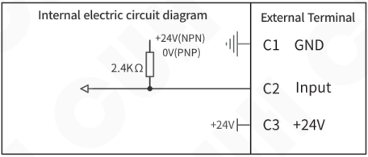

Der elektrische Schaltplan von Port E ist identisch mit Port C

### 4.1.2 Verwendungsmethode

Am Beispiel des Näherungsschalters ist die Verdrahtungsmethode unten dargestellt:

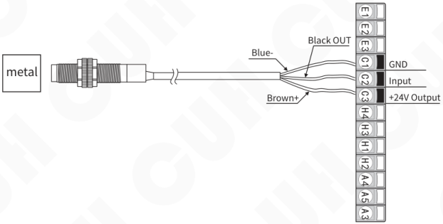

Die Verdrahtungsmethoden anderer Schaltsensoren sind in Anhang G dargestellt.

---

## 4.1.3 Signalflussdiagramm von Port C und Port E

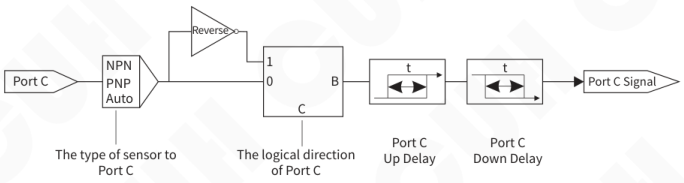

Das Signalflussdiagramm von Port E ist identisch mit Port C

## 4.1.4 Beschreibung der zugehörigen Parameter

Die Parameter von Port C werden in Funktionsgruppe 4 angepasst, die Parameter von Port E in Funktionsgruppe 5.

**"PortCType_" Parameter**

Der Controller kann den NPN/PNP-Typ des angeschlossenen Sensors automatisch erkennen (Werksvorgabe ist Auto).

**"PortCDir__" Parameter**

Werkseitig läuft der Controller, wenn Port C kein Signal empfängt. In einigen speziellen Anwendungen muss der Controller gestoppt werden, wenn Port C kein Signal empfängt; dies erfolgt durch Anpassen des Parameters "PortCDir__".

Wenn "PortCDir__" auf "Const" eingestellt ist und Port C kein Signal empfängt, wird der Controller gestartet.

Wenn "PortCDir__" auf "Revrs" eingestellt ist und Port C kein Signal empfängt, wird der Controller gestoppt.

---

---

### "PortCUpDly" Parameter

EIN-Verzögerung Port C bedeutet die Zeitspanne vom Gültigwerden des Startsignals an Port C bis zum Start des Controllers.

### "PortCDnDly" Parameter

AUS-Verzögerung Port C bedeutet die Zeitspanne vom Gültigwerden des Stoppsignals an Port C bis zum Stopp des Controllers.

Hinweis: Wenn Port C zum Starten/Stoppen des Controllers verwendet wird, muss die Verzögerungszeit von Port C eingestellt werden, um Signal-Jitter zu beseitigen.

---

## 4.2 Zählfunktion

### 4.2.1 Signalflussdiagramm der Zählfunktion

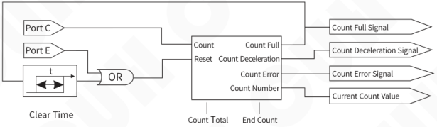

Der Controller verfügt über eine integrierte Zählfunktion, die Impulse zählen kann. Wenn die Anzahl der gezählten Impulse die voreingestellte Gesamtzahl erreicht, wird die Fördergeschwindigkeit verlangsamt oder auf Null gesetzt.

### 4.2.2 Endverlangsamungsfunktion

Um die durch eine hohe, nicht rechtzeitig stoppbare Fördergeschwindigkeit verursachte Überzählung der Zählfunktion zu beseitigen, müssen die Endfördergeschwindigkeit und der Endzählwert eingestellt werden. Die Fördergeschwindigkeit wird auf die Endfördergeschwindigkeit verringert, wenn sich die verbleibende Zählanzahl dem voreingestellten Endzählwert nähert, der kleiner als die Gesamtzahl ist. Wenn die Zählanzahl die Gesamtzahl erreicht, wird die Fördergeschwindigkeit rechtzeitig gestoppt, um genau zu zählen.

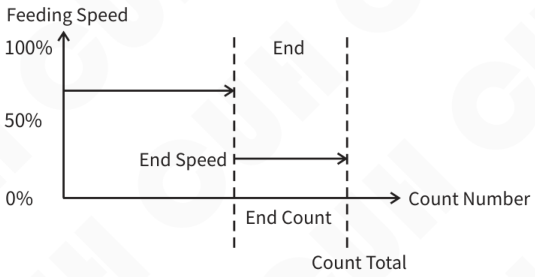

---

## 4.2.3 Super-Anti-Jitter-Funktion

Die Super-Anti-Jitter-Funktion wurde speziell entwickelt, um Fehlzählungen durch vibrierende Förderbedingungen zu beseitigen. Durch Einstellen der Stabilisierungszeit des Zählsignals wird die Super-Anti-Jitter-Funktion realisiert: Ein Zählimpuls gilt erst nach der Stabilisierungszeit des Zählsignals als gültig. Die Genauigkeit der Stabilisierungszeit des Zählsignals beträgt Millisekunden.

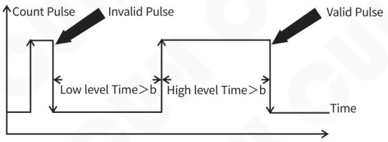

Hinweis: Die Anti-Jitter-Stabilisierungszeit bezeichnet die Stabilisierungszeit des High-Pegels und des Low-Pegels. Ein gültiger Impuls besteht aus kontinuierlich aktivem High-Pegel und Low-Pegel, dann zählt der Zähler um eins hoch.

### Methode zur Einstellung der Stabilisierungszeit des Zählsignals

Port C dient als Eingangsport für den Zählimpuls des Zählers. "PortCUpDly " und "PortCDnDly " sind jeweils die Stabilisierungszeit des High-Pegels und des Low-Pegels des Zählpulses.

Port E dient als Eingangsport für den Rücksetzimpuls des Zählers. "PortEUpDly" und "PortEDnDly" sind jeweils die Stabilisierungszeit des High-Pegels und des Low-Pegels des Rücksetzimpulses.

---

## 4.2.4 Timer-Rücksetzfunktion des Zählers

Wenn die Zählanzahl die Gesamtzahl erreicht, wird der Zähler nach einer durch "Clear Time" in Funktionsgruppe 1 eingestellten Verzögerungszeit zurückgesetzt und beginnt erneut zu zählen.

Wenn der Wert von "Clear Time" 0.0s beträgt, ist die Timer-Rücksetzfunktion des Zählers deaktiviert.

## 4.2.5 Anwendungsmethode der Zählung

Der Controller verfügt über einen integrierten Zähler, wobei Port C als Zählport und Port E als Rücksetzport des Zählers dient.

Der Zustand des Zählers kann den Hauptsteuerausgang, den Ausgang Port D und den Ausgang Port P steuern.

- Wenn der in Funktionsgruppe 2 eingestellte Wert von "Main Logic" "Count" ist, wird der Hauptsteuerausgang durch das Vollzählsignal gesteuert.
- Wenn der in Funktionsgruppe 6 eingestellte Wert von "Port D Logic" "END" ist, wird der Ausgang Port D durch das Vollzählsignal gesteuert.  
  Wenn der in Funktionsgruppe 7 eingestellte Wert von "Port P Logic" "END" ist, wird der Ausgang Port P durch das Vollzählsignal gesteuert.
- Wenn der in Funktionsgruppe 6 eingestellte Wert von "Port D Logic" "Near" ist, wird der Ausgang Port D durch das Zählverlangsamungssignal gesteuert.  
  Wenn der in Funktionsgruppe 7 eingestellte Wert von "Port P Logic" "Near" ist, wird der Ausgang Port P durch das Zählverlangsamungssignal gesteuert.

---

## 4.2.6 Beschreibung der zugehörigen Parameter

### "CountNumbr" Parameter

"CountNumbr", die bereits gezählte Anzahl des Zählers, wird in Funktionsgruppe 9 angezeigt.

### "TotalCount" Parameter

Nachdem "CountNumbr" den in Funktionsgruppe 1 eingestellten erwarteten "TotalCount" erreicht hat, ist das Vollzählsignal des Zählers bis zur Rücksetzung des Zählers gültig; der Zähler kann bis zur Rücksetzung weiterzählen.

### "CountAhead" Parameter

"CountAhead" wird in Parametergruppe 2 eingestellt und bezeichnet die verbleibende Anzahl des Zählers bis zum Erreichen von "TotalCount". Wenn "CountNumbr" "CountAhead" erreicht, sinkt die Fördergeschwindigkeit auf den in Funktionsgruppe 2 eingestellten Wert "PrcntTrmnl".

### "PrcntTrmnl" Parameter

"PrcntTrmnl" wird in Funktionsgruppe 2 eingestellt; wenn "CountNumbr" "CountAhead" erreicht, sinkt die Fördergeschwindigkeit auf die mit "PrcntTrmnl" multiplizierte Anfangsgeschwindigkeit.

### "Clear Time" Parameter

Wenn die Zählanzahl die Gesamtzahl erreicht, wird der Zähler nach einer durch "Clear Time" in Funktionsgruppe 1 eingestellten Verzögerungszeit zurückgesetzt und beginnt erneut zu zählen.

Wenn der Wert von "Clear Time" 0.0s beträgt, ist die Timer-Rücksetzfunktion des Zählers deaktiviert.

### Die Richtung des Eingangsports des Zählpulses

Die Richtung des Eingangsports des Zählpulses entspricht dem in Funktionsgruppe 4 eingestellten "PortCDir_".

### Die Richtung des Eingangsports des Rücksetzimpulses

Die Richtung des Eingangsports des Rücksetzimpulses entspricht dem in Funktionsgruppe 5 eingestellten "PortEDir_".

---

## 4.3 Hauptausgangs-Steuersignal

Das Hauptausgangs-Steuersignal dient zum EIN-/AUS-Schalten des Hauptausgangs des Controllers; alle Parameter der Hauptausgangssteuerung werden in Funktionsgruppe 2 eingestellt.

### 4.3.1 Signalflussdiagramm des Hauptausgangs-Steuersignals

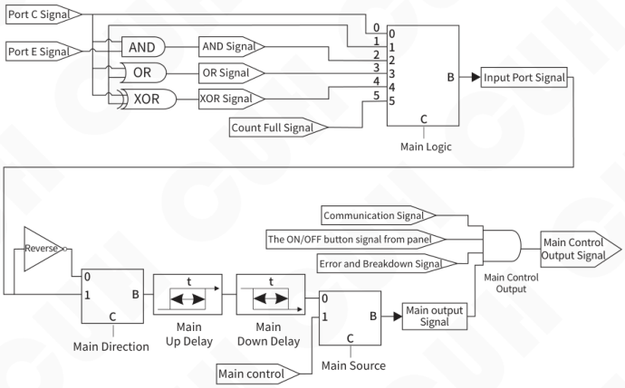

---

## 4.3.2 Signalbeschreibung

### Kommunikationssignal

Das Kommunikationssignal stammt von RS485 oder Ethernet.

Wenn das Stoppsignal über RS485 oder Ethernet an den Controller gesendet wird, wird der Controller gestoppt.

Wenn das Startsignal über RS485 oder Ethernet an den Controller gesendet wird, wird der Controller gestartet.

### Das Signal der EIN/AUS-Taste am Bedienfeld

Das Steuersignal stammt von der EIN/AUS-Taste am Bedienfeld. Durch kurzes Drücken der EIN/AUS-Taste am Bedienfeld wird der Controller EIN- oder AUS-geschaltet.

Der Betriebszustand des Controllers beim Einschalten der Stromversorgung wird durch den Parameter "PowrOnStat" in Funktionsgruppe 2 festgelegt.

Wenn "PowrOnStat" auf "ON" eingestellt ist, startet der Controller den Hauptausgang beim Einschalten der Stromversorgung.

Wenn "PowrOnStat" auf "OFF" eingestellt ist, stoppt der Controller den Hauptausgang beim Einschalten der Stromversorgung.

### Fehler- und Störungssignal

Wenn einer der Fehler wie Überstrom, Kurzschluss, Überhitzung usw. auftritt, wird der Controller gestoppt.

Wenn beim Zählvorgang der Rücksetz- und der Aufwärtszählvorgang gleichzeitig auftreten, wird der Controller gestoppt.

### Hauptausgangssignal

Das Hauptausgangssignal ist das durch "MainDir_", "MainUpDely", "MainDwnDly" und "MainSrc_" eingestellte Eingangsportsignal.

### Eingangsportsignal

Die Quelle des Eingangsportsignals wird durch Einstellen des Werts von "MainLogic_ " in Funktionsgruppe 2 ausgewählt. Die Werte von "MainLogic_ " sind "Port C", "Port E", "AND", "OR", "XOR", "Count".

---

## 4.3.3 Beschreibung der zugehörigen Parameter

### "MainLogic_ " Parameter

- Wenn der Wert von "MainLogic_ " "Port C" ist, bedeutet dies, dass die Signalquelle des Eingangsports vom Signal von Port C stammt.

  Wenn das Signal von Port C den Controller auffordert, in den Betriebszustand zu wechseln, fordert das Eingangsportsignal den Start des Controllers an.

  Wenn das Signal von Port C den Controller auffordert, in den Stoppzustand zu wechseln, fordert das Eingangsportsignal den Stopp des Controllers an.

- Wenn der Wert von "MainLogic_ " "Port E" ist, bedeutet dies, dass die Signalquelle des Eingangsports vom Signal von Port E stammt.

  Wenn das Signal von Port E den Controller auffordert, in den Betriebszustand zu wechseln, fordert das Eingangsportsignal den Start des Controllers an.

  Wenn das Signal von Port E den Controller auffordert, in den Stoppzustand zu wechseln, fordert das Eingangsportsignal den Stopp des Controllers an.

- Wenn der Wert von "MainLogic_ " "AND", "OR" oder "XOR" ist, bedeutet dies, dass die Signalquelle des Eingangsports aus dem Ergebnis der logischen Verknüpfung zwischen Port C und Port E stammt.

  "AND" bedeutet, dass die Signale von Port C und Port E gemeinsam den Stopp des Controllers anfordern und das Eingangsportsignal den Controller stoppt.

  "OR" bedeutet, dass das Signal von Port C oder Port E den Stopp des Controllers anfordert und das Eingangsportsignal den Controller stoppt.

  "XOR" bedeutet, dass die Anforderungen von Port C und Port E unterschiedlich sind und das Eingangsportsignal den Controller stoppt.

- Wenn der Wert von "MainLogic_ " "Count" ist, bedeutet dies, dass das Eingangsportsignal vom Vollzählsignal des Zählers stammt.

  Wenn das Vollzählsignal gültig ist, stoppt der Controller den Hauptausgang und auf dem Bildschirm wird "CND" angezeigt.

  Wenn das Vollzählsignal nicht gültig ist, schaltet der Controller den Hauptausgang ein.

---

### "MainDir_" Parameter

"Main Direction" gibt an, ob das Signal des Eingangsports umgekehrt werden muss.

Wenn der Wert von "Main Direction" "Normal ON" ist, muss das Signal des Eingangsports nicht umgekehrt werden.

Wenn der Wert von "Main Direction" "Normal OFF" ist, muss das Signal des Eingangsports umgekehrt werden.

### "MainUpDely " Parameter

EIN-Verzögerung des Hauptsignals bedeutet die Zeitspanne von der Anforderung zum Start des Controllers bis zum Gültigwerden des Anforderungssignals.

### "MainDwnDly" Parameter

AUS-Verzögerung des Hauptsignals bedeutet die Zeitspanne von der Anforderung zum Stopp des Controllers bis zum Gültigwerden des Anforderungssignals.

### "MainSrc_" Parameter

Das Hauptausgangssignal stammt von " Input port Signal" oder "Main control".

Wenn der Wert von "MainSrc_" "Local" ist, stammt das Hauptausgangssignal von " Input port Signal".

Wenn der Wert von "MainSrc_" "Remot" ist, stammt das Hauptausgangssignal von "MainCtrl_".

### "MainCtrl_" Parameter

"MainCtrl_" hat zwei Zustände: Stopp des Ausgangs des Controllers und Start des Ausgangs des Controllers.

Wenn der Wert von "MainCtrl_" "OFF" ist, bedeutet dies den Stopp des Ausgangs des Controllers.

Wenn der Wert von "MainCtrl_" "ON" ist, bedeutet dies den Start des Ausgangs des Controllers.

---

## 4.4 DC-Steuerausgang Port D und Port P

Es gibt zwei 24V-DC-Ausgangsports: Port D und Port P zum Ansteuern von Magnetventilen, SPS oder anderen externen Geräten.

Das Funktionsprinzip und die Methode zur Parameteranpassung von Port P und Port D sind identisch.

### 4.4.1 Der Schaltplan von Port D und Port P

Der Schaltplan von Port D

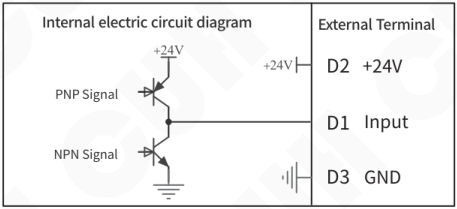

Der Schaltplan von Port P entspricht dem von Port D.

---

## 4.4.2 Anwendungsmethode

Die Verdrahtungsmethode des Magnetventils

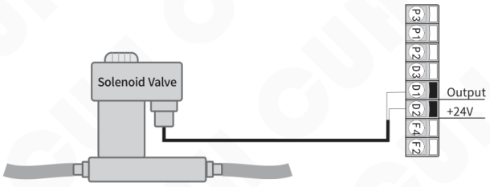

Die Verdrahtungsmethode des elektrischen Relais

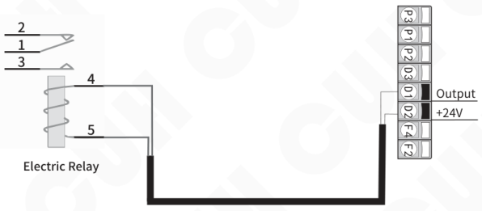

Die Verdrahtungsmethode von Port D und Port P ist identisch.

---

## 4.4.3 Signalflussdiagramm von Port D und Port P

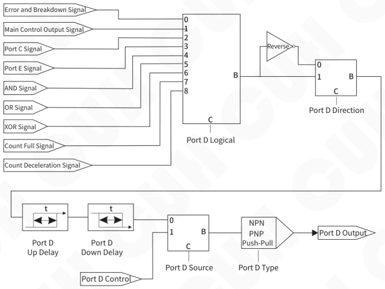

Die Signalflussdiagramme von Port D und Port P sind identisch.

## 4.4.4 Beschreibung der zugehörigen Parameter

Die Parameter von Port D werden in Funktionsgruppe 6 eingestellt, die Parameter von Port P in Funktionsgruppe 7.

### "PortDLogic" Parameter

Die Signalquelle von Port D wird durch Einstellen des Werts von "PortDLogic" in Funktionsgruppe 6 ausgewählt. Die Werte von "PortDLogic" sind "Error", "Main", "Port C", "Port E", "AND", "OR", "XOR", "Count", "Near".

- Wenn der Wert von "PortDLogic" "Error" ist, bedeutet dies, dass die Signalquelle von Port D vom Störungszustand des Controllers oder vom Zählfehler des Zählermodus stammt.

Wenn einer der Fehler wie Überstrom, Kurzschluss, Überhitzung usw. auftritt, wird das Ausschalten von Port D angefordert.

Wenn beim Zählvorgang der Rücksetz- und der Aufwärtszählvorgang gleichzeitig auftreten, wird das Ausschalten von Port D angefordert.

Wenn weder Fehler noch Zählfehler auftreten, wird das Einschalten von Port D angefordert.

---

---

- Wenn der Wert von "PortDLogic" "Main" ist, bedeutet dies, dass die Signalquelle von Port D von der Hauptsteuerung stammt.

  Wenn sich das Signal der Hauptsteuerung im Betriebszustand befindet, wird das Einschalten von Port D angefordert.

  Wenn sich das Signal der Hauptsteuerung im Stoppzustand befindet, wird das Ausschalten von Port D angefordert.

- Wenn der Wert von "PortDLogic" "Port C" ist, bedeutet dies, dass die Signalquelle von Port D vom Signal von Port C stammt.

  Wenn das Signal von Port C den Controller auffordert, in den Betriebszustand zu wechseln, wird das Einschalten von Port D angefordert.

  Wenn das Signal von Port C den Controller auffordert, in den Stoppzustand zu wechseln, wird das Ausschalten von Port D angefordert.

- Wenn der Wert von "PortDLogic" "Port E" ist, bedeutet dies, dass die Signalquelle von Port D vom Signal von Port E stammt.

  Wenn das Signal von Port E den Controller auffordert, in den Betriebszustand zu wechseln, wird das Einschalten von Port D angefordert.

  Wenn das Signal von Port E den Controller auffordert, in den Stoppzustand zu wechseln, wird das Ausschalten von Port D angefordert.

- Wenn der Wert von "PortDLogic" "AND", "OR" oder "XOR" ist, bedeutet dies, dass die Signalquelle von Port D aus dem Ergebnis der logischen Verknüpfung zwischen Port C und Port E stammt.

  "AND" bedeutet, dass die Signale von Port C und Port E gemeinsam den Stopp des Controllers anfordern und das Ausschalten von Port D angefordert wird.

  "OR" bedeutet, dass das Signal von Port C oder Port E den Stopp des Controllers anfordert und das Ausschalten von Port D angefordert wird.

  "XOR" bedeutet, dass die Anforderungen von Port C und Port E unterschiedlich sind und das Ausschalten von Port D angefordert wird.

- Wenn der Wert von "PortDLogic" "END" ist, bedeutet dies, dass die Signalquelle von Port D vom Vollzählsignal des Zählers stammt.

  Wenn das Vollzählsignal gültig ist, wird das Ausschalten von Port D angefordert.

- Wenn der Wert von "PortDLogic" "Near" ist, bedeutet dies, dass die Signalquelle von Port D vom Zählverlangsamungssignal des Zählers stammt.

  Wenn das Zählverlangsamungssignal gültig ist, wird das Ausschalten von Port D angefordert.

---

### "PortDDir_" Parameter

"PortDDir__ " gibt an, ob das Signal von Port D umgekehrt werden muss.
Wenn der Wert von "PortDDir_" "Normal ON" ist, bedeutet dies, dass das Eingangssignal von Port D nicht umgekehrt werden muss.

Wenn der Wert von "PortDDir_" "Normal OFF" ist, bedeutet dies, dass das Eingangssignal von Port D umgekehrt werden muss.

### "PortDUpDly" Parameter

EIN-Verzögerung Port D bedeutet die Zeitspanne von der Anforderung zum Einschalten des Ausgangs von Port D bis zum Gültigwerden des Anforderungssignals.

### "PortDDnDly" Parameter

AUS-Verzögerung Port D bedeutet die Zeitspanne von der Anforderung zum Ausschalten des Ausgangs von Port D bis zum Gültigwerden des Anforderungssignals.

### "PortDSrc_" Parameter

Die Ausgangssignalquelle von Port D stammt von " Input Signal of Port D " oder "Port D Output state".

Wenn der Wert von "PortDSrc__ " "Local" ist, stammt die Ausgangssignalquelle von Port D von " Input Signal of Port D ".

Wenn der Wert von "PortDSrc__ " "Remot" ist, stammt die Ausgangssignalquelle von Port D von "Port D Output state".

### "PortDCtrl_" Parameter

"PortDCtrl_" hat zwei Zustände: Stopp und Start des Ausgangs von Port D.

Wenn der Wert von "PortDCtrl_" "OFF" ist, bedeutet dies den Stopp des Ausgangs von Port D. Wenn der Wert von "PortDCtrl_" "ON" ist, bedeutet dies den Start des Ausgangs von Port D.

### "PortDType_ " Parameter

Es gibt drei Typen von Port D: NPN, PNP und Ps&Pu.

- Der NPN-Typ bedeutet, dass der Ausgang von Port D bei Gültigkeit einen Low-Pegel und bei Ungültigkeit einen Hochimpedanzzustand ausgibt.
- Der Ps&Pu-Typ bedeutet, dass der Ausgang von Port D bei Gültigkeit einen High-Pegel und bei Ungültigkeit einen Low-Pegel ausgibt.
- Der PNP-Typ bedeutet, dass der Ausgang von Port D bei Gültigkeit einen High-Pegel und bei Ungültigkeit einen Hochimpedanzzustand ausgibt.

---

## 4.5 Fernsteuerung der Geschwindigkeit

Die Ausgangsspannung des Controllers kann über ein externes Potentiometer oder ein 4~20mA-, 0~5V-, 1~5V-, 0~10V-DC-Signal eingestellt werden, sodass der Benutzer sie einfach über Potentiometer, SPS und andere externe Geräte anpassen kann.

### 4.5.1 Der Schaltplan von Port A der Fernsteuerung der Geschwindigkeit

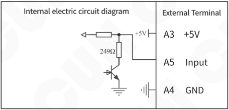

### 4.5.2 Typ des Fernsteuerungssignals

Es können 6 Typen von Fernsteuerungssignalen eingestellt werden: "Panel", 20mA, 1~5V, 0~5V, 0~10V, meter.

Der Typ des Fernsteuerungssignals wird durch den Wert von "control source" in Funktionsgruppe 2 eingestellt (Der Standardwert ist "Panel").

---

| Typ des Fernsteuerungssignals | Fernsteuerungssignal | Ausgangsspannung/Fördergeschwindigkeit |
|---|---|---|
| Panel | | Ausgangsspannung und Fördergeschwindigkeit werden nicht durch das Fernsteuerungssignal gesteuert |
| 20mA | <2mA | Wenn der Spannungsmodus Manuell ist, Ausgangsspannung = 0 Wenn der Spannungsmodus Auto ist, Fördergeschwindigkeit = 0 LCD zeigt die Fehlerinformation "<2mA Err" an |
| | 2mA~4 mA | Ausgangsspannung = 0, Fördergeschwindigkeit = 0 |
| | 4 mA ~20mA | proportional gesteuert durch das Fernsteuerungssignal (0%~100%) Wenn der Spannungsmodus Manuell ist, Ausgangsspannung = (Eingangsstrom - 4mA)/16 ×Max. Ausgangsspannung Wenn der Spannungsmodus Auto ist, Fördergeschwindigkeit = (Eingangsstrom - 4mA)/16 ×Max. Fördergeschwindigkeit |
| 1~5V | <0.5V | Ausgangsspannung = 0, Fördergeschwindigkeit = 0 LCD zeigt die Fehlerinformation "<0.5V Err" an |
| | 0.5V~1V | Ausgangsspannung = 0, Fördergeschwindigkeit = 0 |
| | 1V~5V | proportional gesteuert durch das Fernsteuerungssignal (0%~100%) Wenn der Spannungsmodus Manuell ist, Ausgangsspannung = (Eingangsspannung 1V)/4 ×Max. Ausgangsspannung Wenn der Spannungsmodus Manuell ist, Ausgangsspannung = (Eingangsspannung 1V)/4 ×Max. Ausgangsspannung |
| 0~5V | 0V~5V | proportional gesteuert durch das Fernsteuerungssignal (0%~100%) Wenn der Spannungsmodus Manuell ist, Ausgangsspannung = Eingangsspannung/5 × Max. Ausgangsspannung Wenn der Spannungsmodus Auto ist, Fördergeschwindigkeit = Eingangsspannung/5 ×Max. Fördergeschwindigkeit |
| 0~10V | 0V~10V | proportional gesteuert durch das Fernsteuerungssignal (0%~100%) Wenn der Spannungsmodus Manuell ist, Ausgangsspannung = Eingangsspannung/10 × Max. Ausgangsspannung Wenn der Spannungsmodus Auto ist, Fördergeschwindigkeit = Eingangsspannung/10 ×Max. Fördergeschwindigkeit |
| Meter (Potentiometer) | Teilerverhältnis des Potentiometers <4% | Ausgangsspannung = 0, Fördergeschwindigkeit = 0 |
| | Teilerverhältnis des Potentiometers beträgt 4%~96% | proportional gesteuert durch das Fernsteuerungssignal (0%~100%) Wenn der Spannungsmodus Manuell ist, Ausgangsspannung = ((Teilerverhältnis - 4%)/92%)× Max. Ausgangsspannung Wenn der Spannungsmodus Auto ist, Fördergeschwindigkeit =((Eingangsspannung Internalspannung × 4%)/Internalspannung × 92%) ×Max. Fördergeschwindigkeit |

## 4.6 Hauptmodus

Hauptmodus: Die Anwendung, bei der der Controller den Vibrator unabhängig ansteuert.

Durch Anpassen der Parameter "Voltage mode" und "Frequency Mode" wird der Hauptmodus des Controllers festgelegt; die Kombination ist wie folgt definiert:

| Der Hauptmodus | Spannungsmodus | Frequenzmodus | Vibrationssensor angeschlossen |
|---|---|---|---|
| Vollmanueller Modus | Manual | Manual | Nein |
| Vollautomatischer Modus | Automatic | Automatic | Ja |
| Halbautomatischer Spannungsmodus | Automatic | Manual | Ja |
| Halbautomatischer Frequenzmodus | Manual | Automatic | Ja |

### 4.6.1 Vollmanueller Modus

Ausgangsspannung und Ausgangsfrequenz des Controllers werden manuell angepasst.

**Einstellmethode der Ausgangsspannung**

Bewegen Sie den Cursor auf den Wert "Usr_Voltag" in Funktionsgruppe 1 und passen Sie den Wert der Ausgangsspannung durch Drehen des Drehschalters an.

**Einstellmethode der Ausgangsfrequenz**

Bewegen Sie den Cursor auf den Wert "Usr_Frqncy" in Funktionsgruppe 1 und passen Sie den Wert der Ausgangsfrequenz durch Drehen des Drehschalters an.

> Hinweis:
>
> Sofern in diesem Handbuch nicht anders angegeben, ist die Spannung die gleichgerichtete Durchschnittsspannung.
>
> Dieser Controller verfügt über eine automatische Spannungsregelungsfunktion.

---

## 4.6.2 Vollautomatischer Modus

Der Controller passt die Ausgangsspannung und die Ausgangsfrequenz automatisch anhand der Daten des Vibrationssensors an, um die durch "User_Speed" in Funktionsgruppe 1 eingestellte Fördergeschwindigkeit des Vibrators zu stabilisieren.

### Einstellmethode der Fördergeschwindigkeit

Bewegen Sie den Cursor auf den Wert "User_Speed" in Funktionsgruppe 1 und passen Sie den Wert der Fördergeschwindigkeit durch Drehen des Drehschalters an.

### Beschreibung weiterer zugehöriger Parameter

**"AtoFCenter”**

Der automatische Frequenzanpassungsbereich des Controllers ist "AtoFCenter ± AtoFRange_"; die Mittenfrequenz sollte auf die Nähe der Resonanzfrequenz des Vibrators eingestellt werden.

**"AtoFRange_"**

Der automatische Frequenzanpassungsbereich des Controllers ist "AtoFCenter ± AtoFRange_"; der empfohlene Frequenzbereich beträgt 30.0Hz. Ein übermäßiger Wert des Frequenzbereichs führt dazu, dass der Vibrator nicht mit optimaler Frequenz arbeiten kann, und ein zu kleiner Wert kann die Anpassungsfähigkeit des Vibrators verringern.

**"AtoFIntgrl”**

Die Ausgangsfrequenz des Controllers wird durch den PID-Algorithmus automatisch angepasst: Je größer der Frequenz-Integralwert des PID ist, desto schneller wird die Ausgangsfrequenz angepasst, aber ein übermäßiger Wert kann die Ausgangsfrequenz zum Schwingen bringen.

**"AtoAProptn”**

Die Ausgangsspannung des Controllers wird durch den PID-Algorithmus automatisch angepasst: Je größer der Amplituden-Proportionalwert des PID ist, desto schneller wird die Ausgangsspannung angepasst, aber ein übermäßiger Wert kann die Ausgangsspannung zum Schwingen bringen.

**"AtoAIntgrl”**

Die Ausgangsspannung des Controllers wird durch den PID-Algorithmus automatisch angepasst: Je größer der Amplituden-Integralwert des PID ist, desto schneller werden Häufigkeit und Amplitude der Ausgangsspannungsschwingung verringert, aber ein übermäßiger Wert kann die Amplitude der Ausgangsspannungsschwingung vergrößern.

---

### "AtoSnsrMax”

Begrenzen Sie die maximale Ausgangsamplitude durch Einstellen von "AtoSnsrMax", um Schäden am Vibrator zu vermeiden.

### "AutoPhase”

Passen Sie die Wellenformphase durch Einstellen des Parameters "AutoPhase" an.

### "AtoSpedMax”

Der Anpassungsbereich der Fördergeschwindigkeit reicht von 0 bis "AtoSpedMax".

### "AtoSrhVMax”

Begrenzen Sie die Ausgangsspannung im Prozess der automatischen Resonanzfrequenzsuche, um Schäden am Vibrationsgerät zu vermeiden.

### "AtoSnsrTyp"

Der Controller unterstützt mehrere Vibrationssensortypen; bei gleicher Fördergeschwindigkeit unterscheidet sich die Ausgangsspannung des Controllers je nach Typ.

| Technischer Wert | Vibrationssensortyp | Beschleunigung der X/Y/Z-Richtung |
|---|---|---|
| 16g | SDVS20-1 | 16g/16g/16g |
| 35g | SDVS20-2 | 35g/35g/- |
| 50g | SDVS20-3 | 50g/50g/- |
| 70g | SDVS20-4 | 70g/70g/- |
| Auto | Keine | Keine |

### "Speed_Now_”

Die Echtzeit-Fördergeschwindigkeit wird durch "Speed_Now_" in Funktionsgruppe 9 angezeigt, um dem Benutzer zu helfen, den Betriebszustand des Geräts zu beobachten.

### "VoltagOut_"

Die Echtzeit-Ausgangsspannung wird in Funktionsgruppe 9 angezeigt, um dem Benutzer zu helfen, den Betriebszustand des Geräts zu beobachten.

Hinweis: Der Controller ist ab Werk auf den vollautomatischen Modus eingestellt, arbeitet jedoch im vollmanuellen Modus, wenn der Vibrationssensor nicht oder nicht ordnungsgemäß angeschlossen ist.

Überprüfen Sie auf der Standby-Oberfläche, ob die Ausgangsspannung und die Ausgangsfrequenz "auto" sind, um zu bestätigen, dass der Controller im vollautomatischen Modus arbeitet.

---

## 4.6.3 Halbautomatischer Spannungsmodus

Der Controller passt die Ausgangsspannung automatisch anhand der Daten des Vibrationssensors an, um die Fördergeschwindigkeit sicherzustellen, die Ausgangsfrequenz wird jedoch manuell angepasst.

**Einstellmethode der Fördergeschwindigkeit**

Bewegen Sie den Cursor auf den Wert "User_Speed" in Funktionsgruppe 1 und passen Sie den Wert der Ausgangsfrequenz durch Drehen des Drehschalters an.

**Einstellmethode der Ausgangsfrequenz**

Bewegen Sie den Cursor auf den Wert "Usr_Frqncy" in Funktionsgruppe 1 und passen Sie den Wert der Ausgangsfrequenz durch Drehen des Drehschalters an.

## 4.6.4 Halbautomatischer Frequenzmodus

Der Controller passt die Ausgangsfrequenz automatisch anhand der Daten des Vibrationssensors an, damit das Vibrationsgerät mit der Resonanzfrequenz arbeitet, die Ausgangsspannung wird jedoch manuell angepasst.

**Einstellmethode der Ausgangsspannung**

Bewegen Sie den Cursor auf den Wert "Usr_Voltag" in Funktionsgruppe 1 und passen Sie den Wert der Ausgangsspannung durch Drehen des Drehschalters an.

---

## 4.7 Sync-Modus

Sync-Modus: Wenn mehr als ein Controller mehrere Vibrationsförderer im Zufuhrsystem steuert, müssen die Ausgänge der Controller synchron sein. Nur ein Controller muss im Hauptmodus arbeiten, die anderen folgen in Echtzeit der Ausgangsfrequenz des im Hauptmodus arbeitenden Controllers (Master-Controller).

Der Sync-Modus gilt für die Situation, in der mehr als ein Controller mehrere Vibrationsförderer im Zufuhrsystem steuert. Die Ausgänge der Controller sind nicht synchron und stören sich daher gegenseitig (Schwebungseffekt). Der Sync-Modus wurde entwickelt, um den Schwebungseffekt zu beseitigen, da die Ausgangswellenformen von Master- und Slave-Controller exakt synchron sind.

Wenn der Controller M im Hauptmodus und der Controller S im Sync-Modus arbeitet, sind die Ausgangswellenformen der beiden Controller vollständig synchron, wie unten dargestellt:

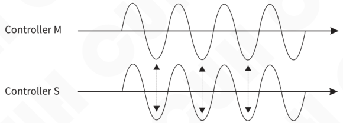

Controller S ist auf den Sync-Modus eingestellt; die Ausgangswellenformen der beiden Controller sind synchron.

Wenn der Controller S nicht auf den Sync-Modus eingestellt ist, sind die Ausgangswellenformen der beiden Controller nicht synchron.

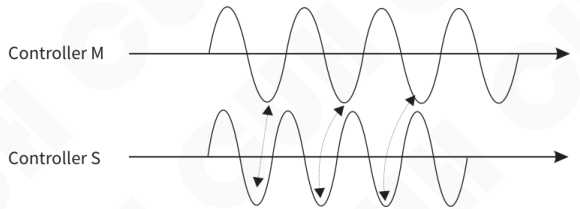

Controller S ist nicht auf den Sync-Modus eingestellt; die Ausgangswellenformen der beiden Controller sind nicht synchron.

---

## Die Verdrahtungsmethode des Sync-Modus zwischen Master- und Slave-Controllern

Verbinden Sie das Sync-Signalkabel zwischen Master- und Slave-Controller, um sicherzustellen, dass die Ausgangsfrequenzen von Master- und Slave-Controller synchronisiert sind.

### Der Schaltplan des Sync-Signalports

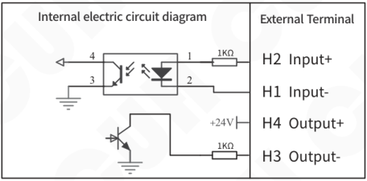

### Das Verdrahtungsdiagramm des Sync-Signals zwischen Master- und Slave-Controller

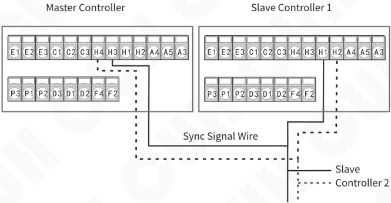

---

Durch Anpassen der Parameter "VoltagMode" und "FrqncyMode" in Funktionsgruppe 3 wird der Slave-Modus des Controllers festgelegt; die Kombination ist wie folgt definiert:

| Sync-Modus | Spannungsmodus | Frequenzmodus | Phasensteuerung | Vibrationssensor angeschlossen |
|---|---|---|---|---|
| Automatischer Spannungs- und Phasenmodus | Manual | Slave C | Manual | Ja |
| Automatischer Spannungs- und manueller Phasenmodus | Manual | Slave M | Automatic | Ja |
| Manueller Spannungs- und automatischer Phasenmodus | Automatic | Slave C | Manual | Ja |
| Manueller Spannungs- und manueller Phasenmodus | Automatic | Slave M | Automatic | Nein |

> "Auto" des Spannungsmodus bedeutet, dass die Ausgangsspannung automatisch angepasst wird, um die von Ihnen eingestellte "Fördergeschwindigkeit" des Vibrators zu stabilisieren.
>
> "Slave C" des Frequenzmodus bedeutet, dass die Phase der Ausgangswellenform des Slave-Controllers anhand der Rückmeldedaten des Vibrationssensors automatisch angepasst wird, um sich mit dem Master-Controller zu synchronisieren.
>
> "Slave M" des Frequenzmodus bedeutet, dass die Phasendifferenz der Ausgangswellenform des Slave-Controllers zum Master-Controller manuell angepasst wird.

---

Die Situation, in der sowohl der Master- als auch der Slave-Controller mit den Vibrationssensoren verbunden sind

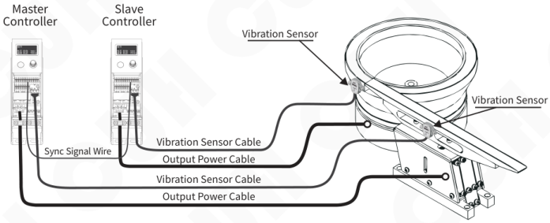

1. Wenn der Slave-Controller im manuellen Spannungs- und manuellen Phasenmodus arbeitet, muss der Vibrationssensor nicht angeschlossen werden.
2. Wenn der Master-Controller im vollmanuellen Modus arbeitet, muss der Vibrationssensor nicht angeschlossen werden.

## 4.7.1 Automatischer Spannungs- und Phasenmodus

Der Controller passt die Ausgangsspannung automatisch anhand der Rückmeldedaten des Vibrationssensors an, um die von Ihnen eingestellte "Fördergeschwindigkeit" des Vibrators zu stabilisieren; Frequenz und Phase der Ausgangswellenform des Slave-Controllers stimmen mit dem Master-Controller überein.

### Einstellmethode der Fördergeschwindigkeit

Bewegen Sie den Cursor auf den Wert "User Speed" in Funktionsgruppe 1 und passen Sie den Wert der Fördergeschwindigkeit durch Drehen des Drehschalters an.

---

## 4.7.2 Automatischer Spannungs- und manueller Phasenmodus

Der Controller passt die Ausgangsspannung automatisch anhand der Rückmeldedaten des Vibrationssensors an, um die von Ihnen eingestellte Fördergeschwindigkeit des Vibrators zu stabilisieren; die Ausgangsfrequenz des Slave-Controllers stimmt mit dem Master-Controller überein, und die Phasendifferenz der Ausgangswellenform des Slave-Controllers zum Master-Controller ist fest.

**Einstellmethode der Fördergeschwindigkeit**

Bewegen Sie den Cursor auf den Wert "User_Speed" in Funktionsgruppe 1 und passen Sie den Wert der Fördergeschwindigkeit durch Drehen des Drehschalters an.

**Einstellmethode der manuellen Phase**

Bewegen Sie den Cursor auf den Wert "UserPhase_" in Funktionsgruppe 3 und passen Sie den Wert "UserPhase_" durch Drehen des Drehschalters an.

## 4.7.3 Manueller Spannungs- und automatischer Phasenmodus

Die Ausgangsspannung des Controllers wird manuell angepasst; die Ausgangsfrequenz und die Phase der Ausgangswellenform des Slave-Controllers stimmen jedoch durch automatische Anpassung mit dem Master-Controller überein.

**Einstellmethode der Ausgangsspannung**

Bewegen Sie den Cursor auf den Wert "Usr_Voltag" in Funktionsgruppe 1 und passen Sie den Wert der Ausgangsspannung durch Drehen des Drehschalters an.

## 4.7.4 Manueller Spannungs- und manueller Phasenmodus

Die Ausgangsspannung des Controllers wird manuell angepasst; die Ausgangsfrequenz des Slave-Controllers stimmt mit dem Master-Controller überein, und die Phasendifferenz der Ausgangswellenform des Slave-Controllers zum Master-Controller ist fest.

**Einstellmethode der Ausgangsspannung**

Bewegen Sie den Cursor auf den Wert "Usr_Voltag " in Funktionsgruppe 1 und passen Sie den Wert der Ausgangsspannung durch Drehen des Drehschalters an.

**Einstellmethode der manuellen Phase**

Bewegen Sie den Cursor auf den Wert "UserPhase_" in Funktionsgruppe 3 und passen Sie den Wert "User phase" durch Drehen des Drehschalters an.

**Hinweis: Selbst wenn "VoltagMode" und "FrqncyMode" auf "Auto" und "Slave C" eingestellt sind, arbeitet der Controller im manuellen Spannungs- und manuellen Phasenmodus, weil der Vibrationssensor nicht angeschlossen ist.**

---

## 4.8 Funktion voreingestellter Parameter

Der Controller kann alle Parameter des Controllers in "Work", "UsrD1 ", "UsrD2" und "UsrD3" speichern und wiederherstellen.

### 4.8.1 Wiederherstellung voreingestellter Parameter

Stellen Sie die Parameter aus "UsrD1", "UsrD2" oder "UsrD3" wieder her, indem Sie den Wert von "ReadALLFrm" in Funktionsgruppe 8 anpassen und den Drehschalter kurz drücken, um den Wiederherstellungsvorgang abzuschließen.

### 4.8.2 Speichern voreingestellter Parameter

Speichern Sie die Parameter in "Work", "UsrD1", "UsrD2" oder "UsrD3", indem Sie den Wert von "SavedALLTo" in Funktionsgruppe 8 anpassen und den Drehschalter kurz drücken, um den Speichervorgang abzuschließen.

**Hinweis:**

1. Alle angepassten Parameter werden standardmäßig in "Work" gespeichert, sodass nach jeder Parameteranpassung kein Speichervorgang erforderlich ist.
2. Nach Auswahl des Werts von "SavedALLTo" muss der Drehschalter einmal kurz gedrückt werden, um den Speichervorgang abzuschließen.

---

## 4.9 Wiederherstellung der Werkseinstellungen

- Halten Sie auf der Standby-Oberfläche den Drehschalter lange gedrückt, um die Funktionsgruppen-Parameteroberfläche aufzurufen.
- Stellen Sie den Wert von "RestorALL" in Funktionsgruppe 8 auf "Work" ein.
- Drücken Sie den Drehschalter einmal kurz, um die Wiederherstellung der Werkseinstellungen abzuschließen.
- Wenn sich der Wert von "RestorALL" von "Work" zu "None" ändert, ist die Wiederherstellung der Werkseinstellungen abgeschlossen.

---

## 4.10 RS485-Kommunikation

Der Controller unterstützt den RTU-Modus und den ASCII-Modus des Modbus-Protokolls für die RS485-Kommunikation; alle Parameter des Controllers können fern eingestellt und überwacht werden.

### 4.10.1 Der Schaltplan der RS485-Kommunikation (Port F)

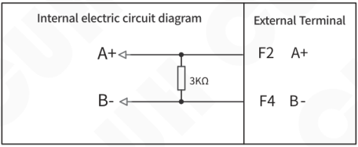

### 4.10.2 Kommunikationsadresse der RS485-Kommunikation

Die durch den Wert von "Slave_ID" (Standardwert ist 1) in Parametergruppe 8 eingestellte Kommunikationsadresse stellt die ID-Nummer des Controllers in der RS485-Kommunikation dar; ihr Bereich ist 1~31, damit alle Controller im selben Netzwerk unterschieden werden können.

### 4.10.3 Die Baudrate der RS485-Kommunikation

Die durch den Wert von "Baud_Rate" in Parametergruppe 8 eingestellte Baudrate der RS485-Kommunikation kann sein: 3, 12, 24, 96, 192, 576 oder 1152. Einheit: 0.1Kbps. Standardwert ist: 115.2 Kbps.

Die Controller im selben Netzwerk sollten dieselbe Baudrate verwenden.

### 4.10.4 RS485-Kommunikationsprotokoll

"CUH Modbus Communication Protocol " und "Address Table of Coil and Register of SDVC35 series for Modbus protocol" können von unserer offiziellen Website heruntergeladen werden: en.cuhnj.com

---

### 4.10.5 Firmware-Aktualisierung

Die Firmware-Aktualisierung des Controllers wird über die RS485-Kommunikationsschnittstelle unterstützt.

**Die auf dem Computer laufende Anwendungssoftware zum Aktualisieren der Firmware und die Firmware-Datei sind wie folgt:**

1. UpdateFirmwareUi.exe
2. Firmware-Datei: SDVC35K4.10_enc.script (Aktuelle Version)

Die Anwendungssoftware und die neueste Firmware-Datei können auf unserer offiziellen Website heruntergeladen werden: en.cuhnj.com

**Der für die Firmware-Aktualisierung erforderliche Konverter, der zwischen Computer und Controller angeschlossen wird:**

USB-zu-RS485-Konverter

**Die Schritte der Firmware-Aktualisierung:**

1. Verbinden Sie den RS485-Port des Konverters mit dem Controller und den USB-Port des Konverters mit dem Computer.
2. Prüfen Sie den USB-Seriellen Port (COM), der den USB-zu-RS485-Konverter erkannt hat.
3. Starten Sie die UpdateFirmwareUi.exe.
4. Wählen Sie den in Schritt 2 gemerkten COM-Port in der UpdateFirmwareUi.exe aus.
5. Wählen Sie die Baudrate 115200 aus.
6. Klicken Sie auf die Schaltfläche "Open" rechts neben der Baudrate in der Anwendungssoftware, um den seriellen Port zu öffnen. Der Erfolgs- und Fehlerstatus des Öffnens des seriellen Ports wird im Statusfeld angezeigt.
7. Klicken Sie auf die Schaltfläche "Open" rechts neben der Firmware-Datei in der Anwendungssoftware, um die neueste Firmware-Datei zu laden.
8. Halten Sie die EIN/AUS-Taste des Controllers gedrückt und schalten Sie den Controller ein, bis alle grünen LEDs des Anschlussports leuchten.
9. Klicken Sie auf die Schaltfläche "Update" in der Anwendungssoftware, um die Firmware zu aktualisieren. Der Fortschritt wird im Statusfeld angezeigt. Nach Abschluss des Upgrades wird “Firmware download OK!” im Statusfeld angezeigt.
10. Führen Sie nach Abschluss des Upgrades einmal die Wiederherstellung der Werkseinstellungen durch.

---

## 4.11 Ethernet-Kommunikation

Der Controller unterstützt EtherCat und Profinet; alle Parameter des Controllers können fern eingestellt und überwacht werden.

Die Protokolle EtherCat und Profinet unterstützen den zyklischen und azyklischen Kommunikationsmodus. Die zyklische Ethernet-Kommunikationszeit beträgt 5ms oder mehr, die typische zyklische Kommunikationszeit beträgt 10ms.

Die Nachrichtenlänge des zyklischen Kommunikationsmodus (die Länge des Input-Output-Puffers) beträgt bis zu 5760 Bytes.

Die Nachrichtenlänge des azyklischen Kommunikationsmodus (die Länge des Send-Mailbox- und Receive-Mailbox-Puffers) beträgt bis zu 1596 Bytes.

Die Ethernet-Kommunikationsprotokoll-Dateien "Hilscher NETX51 RE ECS V4.2.X-EtherCATSlave-20160520.xml" und "GSDML-V2.31-HILSCHER-NETX51-RE PNS-Profinet_20160912.xml" können von unserer offiziellen Website heruntergeladen werden: en.cuhnj.com

Wenn Ethernet und RS485 gleichzeitig verwendet werden, antwortet der Controller der Reihe nach, und der Zustand der letzten Anweisung wird gespeichert.

## 4.12 Lastprüfung

Der Controller kann die Induktivität, den maximalen Strom und die Impedanz des Vibrators testen.

Starten Sie die Lastprüfungsfunktion, indem Sie den Parameter "Measure" auf "valid" einstellen; die Lastprüfung ist abgeschlossen, wenn der Parameter "Measure" automatisch auf "Invalid" gesetzt wird.

Der Benutzer kann das Ergebnis der Lastprüfung in Funktionsgruppe 9 prüfen.

---

## 4.13 Arbeitszustandsüberwachung

Der Benutzer kann den Betriebszustand des Controllers anhand der Parameter in Funktionsgruppe 9 prüfen.

**Echtzeitüberwachung der internen 5V- und 24V-Stromversorgung:** Die Spannung der 5V- und 24V-Stromversorgung wird durch die Parameter "5V_Power_" und "24V_Power_" angezeigt.

**Echtzeitüberwachung des Hauptausgangszustands:** Der Hauptausgangszustand wird durch den Parameter "MainOutPut " angezeigt.

**Echtzeitüberwachung des digitalen Eingangszustands:** Der Zustand und die Spannung von Port C und E werden durch die Parameter "PortC_" und "PortCInput    ", "PortE_" und "PortEInput" angezeigt.

**Echtzeitüberwachung des DC-24V-Steuerausgangszustands:** Der Zustand und die Spannung von Port D und P werden durch die Parameter "PortD_" und "PortD_Out_ ", "PortP_" und "PortP_Out_ " angezeigt.

**Echtzeitüberwachung der Synchronfrequenz:** Wenn der Controller im Sync-Modus arbeitet, kann die dem Master-Controller folgende Synchronfrequenz durch den Parameter "SynchrFrqy" angezeigt werden.

**Echtzeitüberwachung der internen Temperatur des Controllers:** Die Temperatur des Controllers wird durch den Parameter "Temperatur" angezeigt; der Controller stoppt, wenn die Temperatur 65 ℃ überschreitet.

**Echtzeitüberwachung des Vibrationssensorzustands:** Der Zustand des Vibrationssensors wird durch die Parameter "AtoSnsrVld" und "AtoSnsrOvr " angezeigt, um zu prüfen, ob der Vibrationssensor gültig und ob der Vibrationssensor überlastet ist.

---

## Kapitel Ⅴ Sicherheitsfunktionen

### Kurzschlussschutz

Wenn der Ausgang des Controllers kurzgeschlossen ist, stoppt der Controller seinen Ausgang und "ShortCircuit" wird auf dem OLED angezeigt, bis der Controller neu gestartet oder die EIN/AUS-Taste am Bedienfeld des Controllers kurz gedrückt wird.

### Überstromschutz

Wenn der Ausgangsstrom durch Fehlbedienung seinen Nennwert überschreitet, stoppt der Controller den Ausgang, um die Betriebssicherheit zu gewährleisten, und "OverCurrent" wird auf dem OLED angezeigt.

### Überhitzungsschutz

Wenn die interne Temperatur des Controllers 65℃ überschreitet, stoppt der Controller seinen Ausgang zum Selbstschutz und "OverHot" wird auf dem OLED angezeigt, bis die interne Temperatur unter 60℃ fällt.

### Überlastschutz

Wenn der Vibrationssensor an den Controller angeschlossen ist und die Vibrationsamplitude den durch den Wert von "AtoSnsrMax" in Parametergruppe 3 eingestellten Wert überschreitet, regelt der Controller seinen Ausgang herunter, um den Vibrationsförderer zu schützen, und "OverLoad" wird auf dem OLED angezeigt.

### Überspannungsschutz

Wenn die Eingangsspannung höher als der Nennwert ist, schaltet sich der Controller automatisch aus, bis die Eingangsspannung wieder normal ist.

### Ultra-Überspannungsschutz

Wenn die Eingangsspannung die Schutzgrenzspannung weit überschreitet und die Spitzenspannung bis zu 430V erreicht, brennt die Sicherung des Controllers durch, um den Controller vor weiteren Schäden zu schützen. Bitte kontaktieren Sie uns für die Reparatur.

---

## Anhang A: Abmessungen

SDVC35-Abmessungen (Einheit: mm)

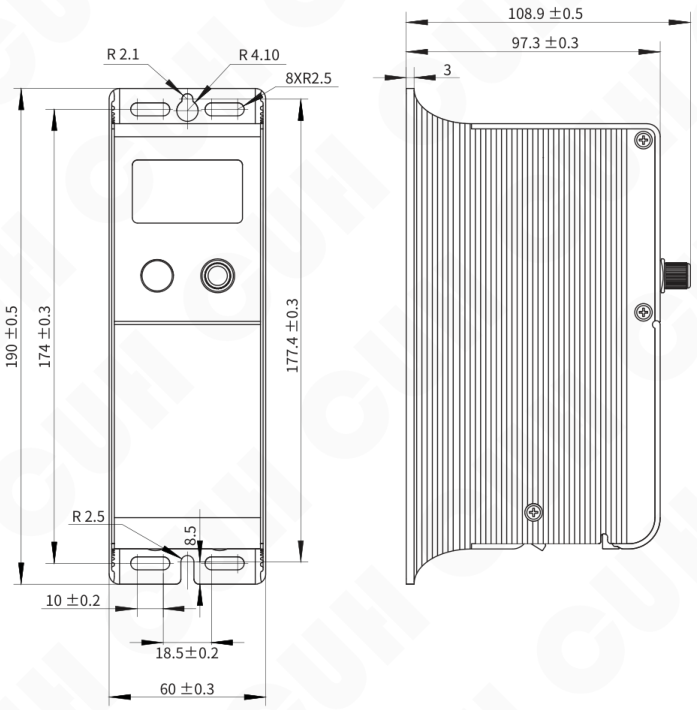

---

## Anhang B: Beschreibung der elektrischen Anschlüsse

| Sensor | | | Sensor | | | Sync | | | | Speed Ctrl | | |
|---|---|---|---|---|---|---|---|---|---|---|---|---|
| PortE | | | PortC | | | PortH | | | | PortA | | |
| E1 | E2 | E3 | C1 | C2 | C3 | H4 | H3 | H1 | H2 | A4 | A5 | A3 |
| GND | Input | +24V | GND | Input | +24V | Sync Out+ | Sync Out- | Sync In- | Sync In+ | GND | Input | +5V |

| Ctrl Out | | | Ctrl Out | | | RS485 | | |
|---|---|---|---|---|---|---|---|
| PortP | | | PortD | | | PortF | | |
| P3 | P1 | P2 | D3 | D1 | D2 | F4 | F2 |
| GND | Output | +24V | GND | Output | +24V | B- | A+ |

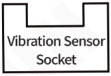

---

## Anhang C: Elektrische Spezifikation

| Eintrag | Bereich: Min | Bereich: Typisch | Bereich: Max | Einheit | Hinweis |
|---|---|---|---|---|---|
| Eingangsspannung | 85 | 220 | 250 | V | AC RMS |
| Einstellbarer Ausgangsspannungsbereich | 0 | —— | 260 | V | Niedriger als 150% der Eingangsspannung |
| Spannungseinstellgenauigkeit | | 1 | | V | |
| Spannungsregelgenauigkeit | 0 | —— | 10 | % | ΔVout/ΔVin |
| Ansprechzeit der Spannungsregelung | | Echtzeit | | s | Spannungsregelung für jede Wellenform |
| Einstellbarer Ausgangsstrombereich | 0 | —— | 3 | A | SDVC35-MRJ |
| Einstellbarer Ausgangsstrombereich | 0 | —— | 4.5 | A | SDVC35-LRJ |
| Ausgangsleistung | 0 | —— | 660 | VA | SDVC35-MRJ |
| Ausgangsleistung | 0 | —— | 990 | VA | SDVC35-LRJ |
| Ausgangsfrequenz | 25 | —— | 400 | Hz | |
| Frequenzeinstellgenauigkeit | | 0.1 | | Hz | |
| Ausgangswellenform | | Sinus | | | |
| Sanftanlaufzeit | 0 | —— | 10 | s | Standardwert: 0.5 |
| EIN/AUS-Verzögerungszeit-Bereich | 0 | —— | 20 | s | Standardwert: 0.2 |
| EIN/AUS-Verzögerungszeit-Genauigkeit | | 0.1 | | s | |
| Auslösetemperatur des Überhitzungsschutzes | 60 | 65 | 65 | °C | |
| Digitale Kommunikation | | ModBUS485-Kommunikation | | | |
| Digitale Kommunikation | | EtherCat | | | Optional |
| Digitale Kommunikation | | Profinet | | | Optional |
| DC-Steuerausgangsstrom | 0 | —— | 200 | mA | Dualer 24V-Ausgang |
| DC-Steuerausgangsspannung | 22 | 24 | 26 | V | Dualer 24V-Ausgang |
| Analoges Steuersignal | | 4~20 | | mA | 1 Stromkanal für Fernsteuerung der Geschwindigkeit |
| Analoges Steuersignal | | 1~5/0~5/0~10 | | V | 3 Spannungskanäle für Fernsteuerung der Geschwindigkeit |
| Digitales Steuersignal | | 24 | | V | Schaltsignal |
| Einstellmethode | | 1 Taste + 1 Drehgeber | | | |
| Standby-Leistungsaufnahme | —— | —— | 3 | W | |
| Anzeigemethode | | 128\*64 | | | OLED-Matrixanzeige |
| Umgebungstemperatur | 0 | 25 | 40 | °C | Keine Kondensation |
| Umgebungsluftfeuchtigkeit | 10 | 60 | 85 | % | Keine Kondensation |
| Lagerungsumgebungstemperatur | -20 | 25 | 65 | °C | Keine Kondensation |

## Absolute Parameter:

Das Überschreiten dieser Normen beschädigt den Controller; halten Sie sie strikt ein.

| Eintrag | GB-Norm | IEC-Norm | Norm-Anforderung | Erreichtes Niveau des CUH-Produkts | Hinweis |
|---|---|---|---|---|---|
| Elektrostatische Entladung | GB/T 17626.2-2006 | IEC 61000-4-2:2001 | 4 kV | ±8 kV | Kontaktentladung |
| | | | 8 kV | ±15 kV | Luftentladung |
| Elektrischer Fast-Transient-Test | GB/T 17626.4-2008 | IEC 61000-4-4:2004 | 2 kV | ±4 kV | |
| Elektrische Stoßspannung | GB/T 17626.5-2008 | IEC 61000-4-5:2005 | 1 kV | ±4 kV | Leitung-Leitung-Kopplung |
| | | | 2 kV | ±2 kV | Leitung-Erde-Kopplung |

---

## Anhang D: Vorschläge zur Fehlerbehebung und Fehlererklärung

| | Fehlerphänomen | Vorschläge zur Fehlerbehebung |
|---|---|---|
| 1 | Keine Anzeige nach dem Einschalten | • Stellen Sie sicher, dass die Steckdose stromführend ist • Stellen Sie sicher, dass das Eingangsleistungskabel zuverlässig mit der Steckdose verbunden ist |
| 2 | Normale Anzeige, aber kein Ausgang | • Stellen Sie sicher, dass die Ausgangsspannung nicht zu klein ist • Stellen Sie sicher, dass der Betriebszustand des Controllers nicht “Man” ist, der durch Drücken der “ON/OFF”-Taste am Bedienfeld gesteuert wird • Stellen Sie sicher, dass der Betriebszustand des Controllers nicht “STP” ist, der durch Port C/E gesteuert wird • Stellen Sie sicher, dass der Betriebszustand des Controllers nicht “STP” ist, der durch den logischen Richtungsparameter von Port C/E gesteuert wird • Setzen Sie den Controller durch die in Funktionsgruppe 8 eingestellte Wiederherstellung der Werkseinstellungen zurück |
| 3 | Port C/E kann nicht normal arbeiten | • Stellen Sie sicher, dass das EIN/AUS-Steuersignalkabel korrekt an Port C/E angeschlossen ist • Stellen Sie sicher, dass alle von Ihnen angepassten Parameter von Port C/E korrekt sind • Setzen Sie den Controller durch die in Funktionsgruppe 8 eingestellte Wiederherstellung der Werkseinstellungen zurück |
| 4 | Schwebungseffekt | • Verbinden Sie das Sync-Signalkabel zwischen den Controllern und stellen Sie den Slave-Controller auf den Sync-Modus ein |
| 5 | Normale Anzeige, Geräusche vom Vibrationsförderer hörbar, aber kein Ausgang | • Stellen Sie sicher, dass die Ausgangsfrequenz nicht weit von der Resonanzfrequenz des Vibrationsförderers entfernt ist • Setzen Sie den Controller durch die in Funktionsgruppe 8 eingestellte Wiederherstellung der Werkseinstellungen zurück |

---

## Anhang E: Warnungs- und Fehlerbeschreibung und Vorschläge zur Fehlerbehebung

| Fehleranzeige | Fehlertyp | Vorschläge zur Fehlerbehebung |
|---|---|---|
| 24VErr | Fehler der internen 24V-Stromversorgung | Ausfall der internen 24V-Stromversorgung des Controllers, bitte kontaktieren Sie uns für die Reparatur |
| 5VErr | Fehler der internen 5V-Stromversorgung | Ausfall der internen 5V-Stromversorgung des Controllers, bitte kontaktieren Sie uns für die Reparatur |
| <2mA Err | Der Eingangsstrom des Fernsteuerungssignals ist zu niedrig an Port A | Der Eingangsstrom des Fernsteuerungssignals ist zu niedrig an Port A; stellen Sie sicher, dass er größer als 2mA ist |
| <0.5V Err | Die Eingangsspannung des Fernsteuerungssignals ist zu niedrig an Port A | Die Eingangsspannung des Fernsteuerungssignals ist zu niedrig an Port A; stellen Sie sicher, dass sie größer als 0.5V ist |
| CommErr(1~5) | Kommunikationsfehler | Bitte kontaktieren Sie uns für die Reparatur |
| decline | Zählverlangsamung | Wenn die Zählanzahl den von Ihnen eingestellten "End Count" erreicht, sinkt die Ausgangsspannung (oder Fördergeschwindigkeit) |
| EEPErr | Fehler beim Speichern voreingestellter Parameter | Bitte kontaktieren Sie uns für die Reparatur |
| FrqncyHi | Sync-Referenzfrequenz ist zu hoch | Eingangsfrequenz des Sync-Signals des Slave-Controllers ist größer als 400Hz Stellen Sie sicher, dass die Frequenz des Sync-Signals zwischen 25 Hz und 400 Hz liegt |
| FrqncyLo | Sync-Referenzfrequenz ist zu niedrig | Eingangsfrequenz des Sync-Signals des Slave-Controllers ist kleiner als 25Hz Stellen Sie sicher, dass die Frequenz des Sync-Signals zwischen 25 Hz und 400 Hz liegt |
| OverHot | Überhitzung | Interne Temperatur des Controllers überschreitet 65℃ Stellen Sie sicher, dass der Controller in einer gut belüfteten Umgebung arbeitet |
| OverLoad | Überlast des Vibrationssensors | Der Vibrationssensor hat erkannt, dass die Beschleunigung seinen absoluten Amplitudenwert überschreitet |
| OvrCurrt | Überstrom | Ausgangsstrom des Controllers überschreitet 3A |
| OvrVoltg | Überspannung | Ausgangsspannung des Controllers überschreitet 260V Stellen Sie sicher, dass der Eingangsspannungsbereich zwischen 85V und 260V liegt |
| PortDErr | Fehler Port D | Ausgangsspannungsabweichung von Port D überschreitet 3V Stellen Sie sicher, dass die Lastleistung von Port D 4.8W nicht überschreitet |
| PortPErr | Fehler Port P | Ausgangsspannungsabweichung von Port P überschreitet 3V Stellen Sie sicher, dass die Lastleistung von Port P 4.8W nicht überschreitet |
| Saturate | Ausgangssättigung | Wenn die Ausgangsspannung des Controllers größer als die Eingangsspannung ist, tritt der Controller in den Sättigungszustand ein |
| Save | Speichern voreingestellter Parameter | Nach dem Vorgang der automatischen Resonanzfrequenzsuche werden die zugehörigen Parameter erfolgreich gespeichert |
| SenorErr | Vibrationssensorfehler | Das Signal des Vibrationssensors ist ungewöhnlich, bitte kontaktieren Sie uns für die Reparatur |
| SenTypEr | Fehler des Vibrationssensortyps | Der Typ des an den Controller angeschlossenen Vibrationssensors stimmt nicht mit dem im Controller eingestellten Parameter "Vibrationssensortyp" überein |
| Short | Kurzschluss | Der Ausgang des Controllers ist kurzgeschlossen; stellen Sie sicher, dass der Ausgangsanschluss nicht kurzgeschlossen ist |
| SynchErr | Sync-Signalfehler | Das Sync-Signalkabel ist nicht mit dem Slave-Controller verbunden Stellen Sie sicher, dass das Sync-Signalkabel korrekt mit dem Controller verbunden ist |
| UndrVolt | Unterspannung | Eingangsspannung des Controllers ist kleiner als 85V. Stellen Sie sicher, dass der Eingangsspannungsbereich zwischen 85V und 260V liegt |
| UpgradeSlv | Firmware-Aktualisierung | Die Firmware wird aktualisiert; der Controller kehrt nach der Aktualisierung zum Normalbetrieb zurück |

## Anhang F: Beschreibung des Betriebszustands und des Netzwerkkartentyps

Die Betriebszustände des Controllers sind wie folgt dargestellt:

| Anzeige des Controller-Zustands | Zustandstyp | Beschreibung |
|---|---|---|
| RUN | Der Controller läuft | Der Ausgang des Controllers ist gültig |
| MAN | Der Controller ist gestoppt | Drücken Sie die “ON/OFF”-Taste kurz, um den Run/Stop-Zustand des Ausgangs des Controllers umzuschalten |
| CND | Der Zählvorgang ist abgeschlossen, um den Controller zu stoppen | Wenn der Zählvorgang abgeschlossen ist, wird der Ausgang des Controllers gestoppt |
| RMT | Fernstopp des Ausgangs des Controllers | Stoppen Sie den Ausgang des Controllers fern über RS485- oder Ethernet-Kommunikation |
| STP | Port C/E stoppt den Ausgang des Controllers | Stoppen Sie den Ausgang des Controllers über den digitalen Eingangsport C/E |
| Lok | Tastatursperre | Die EIN/AUS-Taste und der Drehschalter sind deaktiviert; halten Sie den Drehschalter lange gedrückt, um die Tastatursperre aufzuheben |
| ERR | Ausgangsstopp des Controllers durch Zählfehler | Wenn der Wert von "Main Logic" "Count" ist und beim Zählvorgang der Rücksetz- und der Aufwärtszählvorgang gleichzeitig auftreten, wird der Ausgang des Controllers gestoppt |

Die Netzwerkzustände sind unten dargestellt:

| Anzeige des Controller-Zustands | Zustandstyp | Beschreibung |
|---|---|---|
| Wit | Keine Netzwerkkarte angeschlossen | |
| Cat | EtherCat-Netzwerkkarte angeschlossen | |
| Pro | Profinet-Netzwerkkarte angeschlossen | |

---

## Anhang G: Verdrahtungsmethode von Schaltsensoren und SPS an die digitalen Eingangsports

### Anschlussmethode des NPN-Sensors

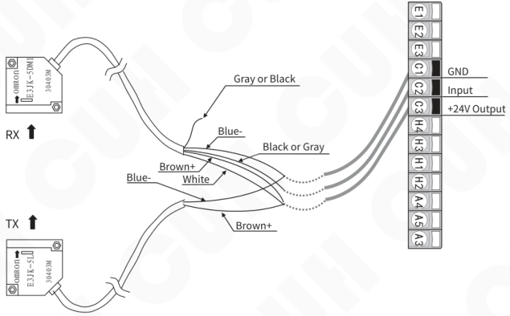

### Anschlussmethode des photoelektrischen Strahlsensors

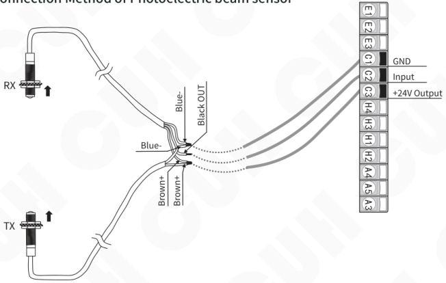

## Anschlussmethode des faseroptischen Strahlsensors

## Anschlussmethode des photoelektrischen Reflexionssensors

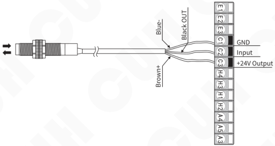

## Anschlussmethode des NPN-Ausgangs der SPS an Port C

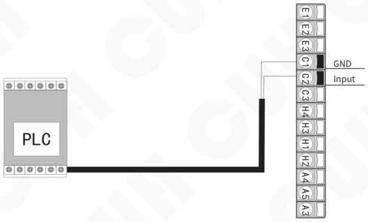

## Anschlussmethode des PNP-Ausgangs der SPS an Port C

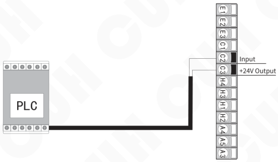

Relaisausgang, NPN-Ausgang und PNP-Ausgang der SPS – jeder von ihnen kann den Controller ein-/ausschalten.

**Hinweis: Wenn das Steuersignal der SPS zum Ein-/Ausschalten des Controllers verwendet wird, darf die Spannung des Eingangssignals 24V nicht überschreiten.**

## Anhang H: Parametertabelle

### Die Funktion jeder Parametergruppe

| Der Name der Parametergruppe | Beschreibung |
|---|---|
| Funktionsgruppe 0 | Die Elemente, die auf der Standby-Oberfläche angezeigt werden können |
| Funktionsgruppe 1 | Grundparameter |
| Funktionsgruppe 2 | Parameter der Hauptausgangssteuerung |
| Funktionsgruppe 3 | Parameter der Auto-/Sync-Funktion |
| Funktionsgruppe 4 | Parameter der Steuerung von Port C |
| Funktionsgruppe 5 | Parameter der Steuerung von Port E |
| Funktionsgruppe 6 | Parameter der Steuerung von Port D |
| Funktionsgruppe 7 | Parameter der Steuerung von Port P |
| Funktionsgruppe 8 | Erweiterte Parameter |
| Funktionsgruppe 9 | Parameter des Betriebszustands des Controllers |

---

Alle Parameter der Funktionsgruppe 0 sind unten dargestellt:

| Eintrag | Min | Standardwert | Max | Einheit/Aufzählung | Beschreibung |
|---|---|---|---|---|---|
| MonitPart1 | —— | None | —— | None | Die entsprechende LCD-Zeile wird auf der Standby-Oberfläche leer angezeigt |
| | | | | UsrV | Ausgangsspannung |
| | | | | UsrF | Ausgangsfrequenz |
| | | | | UsrS | Fördergeschwindigkeit |
| | | | | Cout | Aktueller Zählwert |
| | | | | PCUP | EIN-Verzögerung Port C |
| | | | | PCDn | AUS-Verzögerung Port C |
| | | | | PEUp | EIN-Verzögerung Port E |
| | | | | PEDn | AUS-Verzögerung Port E |
| | | | | PDUP | EIN-Verzögerung Port D |
| | | | | PDDn | AUS-Verzögerung Port D |
| | | | | PPUP | EIN-Verzögerung Port P |
| | | | | PPDn | AUS-Verzögerung Port P |
| | | | | MaUP | EIN-Verzögerung Hauptsteuerung |
| | | | | MaDn | AUS-Verzögerung Hauptsteuerung |
| | | | | InV | Eingangsspannung |
| | | | | CurE | Effektivwert des Ausgangsstroms |
| | | | | CurM | Maximaler Ausgangsstrom |
| | | | | PwrA | Wirkleistung |
| | | | | PwrR | Blindleistung |
| | | | | Temp | Temperatur |
| | | | | SynF | Frequenz des externen Synchronisierungssignals |
| | | | | Remo | Fernsteuerungs-Eingangsspannung |
| | | | | PCV | Ausgangsspannung Port C |
| | | | | PEV | Ausgangsspannung Port E |
| | | | | PDV | Ausgangsspannung Port D |
| | | | | PPV | Ausgangsspannung Port P |
| MonitPart2 | —— | UsrV | —— | Dasselbe wie MonitPart1 | |
| MonitPart3 | —— | UsrF | —— | Dasselbe wie MonitPart1 | |

Alle Parameter der Funktionsgruppe 1 sind unten dargestellt:

| Eintrag | Min | Standardwert | Max | Einheit/Aufzählung |
|---|---|---|---|---|
| User_Speed | 0 | 200 | 3200 | |
| Usr_Voltag | 0 | 150 | 260 | V |
| Usr_Frqncy | 25.0 | 50.0 | 400.0 | Hz |
| TotalCount | 1 | 1 | 9999 | |
| Clear Time | 0 | 0 | 999.9 | s |
| AutoSerch_ | —— | Idle | —— | Idle Start |
| PassWord2_ | 0 | 0 | 9999 | |
| Language | —— | Englsh | —— | Englsh 中文 dt |

---

Alle Parameter der Funktionsgruppe 2 sind unten dargestellt:

| Eintrag | Min | Standardwert | Max | Einheit/Aufzählung |
|---|---|---|---|---|
| SoftStart_ | 0 | 0.2 | 9.9 | s |
| SoftStop__ | 0 | 0.2 | 9.9 | s |
| MainUpDely | 0 | 0.2 | 9999 | 0.1s |
| MainDwnDly | 0 | 0.2 | 9999 | 0.1s |
| MainLogic_ | —— | AND | —— | PortC PortE AND OR XOR Count |
| MainDir___ | —— | Const | —— | Const Revrs |
| MainCtrl__ | —— | On | —— | On Off |
| MainSrc___ | —— | Local | —— | Local Remot |
| PowrOnStat | —— | On | —— | On Off Keep |
| PrcntTrmnl | 0 | 50 | 100 | % |
| CountAhead | 0 | 0 | 9999 | |
| CtrlSource | —— | Panel | —— | Panel 20mA 1~5V 0~5V 0~10V Meter |
| AccelrIndx | 100 | 100 | 150 | % |
| MaxVoltage | 0 | 150.0 | 260.0 | V |
| WavFomIndx | 50 | 100 | 100 | % |
| CmpnstCurt | —— | Valid | —— | Valid None |
| DCCurrent | 0 | 0.1 | 3 | A |

---

Alle Parameter der Funktionsgruppe 3 sind unten dargestellt:

| Eintrag | Min | Standardwert | Max | Einheit/Aufzählung |
|---|---|---|---|---|
| AtoFCenter | 25.0 | 100.0 | 400.0 | Hz |
| AtoFRange_ | 0 | 30.0 | 180.0 | Hz |
| VoltagMode | —— | Auto | —— | Manul Auto |
| FrqncyMode | —— | Auto | —— | Manul Auto SlavC SlavM |
| AtoFIntgrl | 0 | 20 | 2000 | 1 |
| AtoAIntgrl | 0 | 400 | 9999 | 1 |
| AtoAProptn | 0 | 500 | 9999 | 1 |
| AtoSnsrTyp | 16g | 16g | 70g | 16g 35g 50g 70g Auto |
| AtoSrhVMax | 0 | 100.0 | 260.0 | V |
| AtoSnsrMax | 0 | 100 | 100 | % |
| AtoSpedMax | 0 | 3200 | 4000 | |
| AutoPhase_ | -180 | 0 | 180 | ° |
| UserPhase_ | -180 | 0 | 180 | |
| Measure | —— | None | —— | None Valid |

Alle Parameter der Funktionsgruppe 4 sind unten dargestellt:

| Eintrag | Min | Standardwert | Max | Einheit/Aufzählung |
|---|---|---|---|---|
| PortCUpDly | 0 | 0.002 | 9.999 | s |
| PortCDnDly | 0 | 0.002 | 9.999 | s |
| PortCDir__ | —— | Const | —— | Const |
| | | | | Revrs |
| PortCType_ | —— | Auto | —— | NPN |
| | | | | Auto |
| | | | | PNP |

---

Alle Parameter der Funktionsgruppe 5 sind unten dargestellt:

| Eintrag | Min | Standardwert | Max | Einheit/Aufzählung |
|---|---|---|---|---|
| PortEUpDly | 0 | 0.002 | 9.999 | s |
| PortEDnDly | 0 | 0.002 | 9.999 | s |
| PortEDir__ | —— | Const | —— | Const |
| | | | | Revrs |
| PortEType__ | —— | Auto | —— | NPN |
| | | | | Auto |
| | | | | PNP |

---

Alle Parameter der Funktionsgruppe 6 sind unten dargestellt:

| Eintrag | Min | Standardwert | Max | Einheit/Aufzählung |
|---|---|---|---|---|
| PortDUpDly | 0 | 0.0 | 999.9 | s |
| PortDDnDly | 0 | 0.0 | 999.9 | s |
| PortDDir__ | —— | Const | —— | Const |
| | | | | Revrs |
| PortDLogic | —— | Error | —— | Error |
| | | | | Main |
| | | | | PortC |
| | | | | PortE |
| | | | | And |
| | | | | Or |
| | | | | Xor |
| | | | | End |
| | | | | Near |
| PortDCtrl_ | —— | On | —— | On |
| | | | | Off |
| PortDSrc__ | —— | Local | —— | Local |
| | | | | Remot |
| PortDType_ | —— | Ps&Pu | —— | NPN |
| | | | | Ps&Pu |
| | | | | PNP |

Alle Parameter der Funktionsgruppe 7 sind unten dargestellt:

| Eintrag | Min | Standardwert | Max | Einheit/Aufzählung |
|---|---|---|---|---|
| PortPUpDly | 0 | 0.0 | 999.9 | 0.1s |
| PortPDnDly | 0 | 0.0 | 999.9 | 0.1s |
| PortPDir__ | —— | Const | —— | Const |
| | | | | Revrs |
| PortPLogic | —— | Error | —— | Error |
| | | | | Main |
| | | | | PortC |
| | | | | PortE |
| | | | | And |
| | | | | Or |
| | | | | Xor |
| | | | | End |
| | | | | Near |
| PortPCtrl_ | —— | On | —— | On |
| | | | | Off |
| PortPSrc__ | —— | Local | —— | Local |
| | | | | Remot |
| PortPType_ | —— | Ps&Pu | —— | NPN |
| | | | | Ps&Pu |
| | | | | PNP |

---

Alle Parameter der Funktionsgruppe 8 sind unten dargestellt:

| Eintrag | Min | Standardwert | Max | Einheit/Aufzählung |
|---|---|---|---|---|
| Slave_ID | 1 | 1 | 31 | |
| Baud_Rate | 0.3K | 115.2 K | 115.2 K | 0.3 Kbps |
| | | | | 1.2 Kbps |
| | | | | 2.4 Kbps |
| | | | | 9.6 Kbps |
| | | | | 19.2 Kbps |
| | | | | 57.6 Kbps |
| | | | | 115.2 Kbps |
| ReadALLFrm | —— | None | —— | None |
| | | | | UsrD1 |
| | | | | UsrD2 |
| | | | | UsrD3 |
| SavedALLTo | —— | None | —— | None |
| | | | | Work |
| | | | | UsrD1 |
| | | | | UsrD2 |
| | | | | UsrD3 |
| RestorALL | —— | None | —— | None |
| | | | | RWork |
| PassWord1_ | 0 | 0 | 9999 | |

Alle Parameter der Funktionsgruppe 9 sind unten dargestellt:

| Eintrag | Min | Max | Einheit | Beschreibung |
|---|---|---|---|---|
| BusVoltage | 0 | 380.0 | V | Busspannung (Durchschnittswert) |
| Speed_Now_ | 0 | 4000 | 1 | Echtzeit-Messwert |
| VoltagOut_ | 0 | 260.0 | V | Durchschnittswert der Gleichrichtung |
| AtoVltgOut | 0 | 260.0 | V | Automatische Berechnung der Ausgangsspannung |
| SynchrFrqy | 25.0 | 400.0 | Hz | Frequenz des externen Synchronisierungssignals |
| AtoFrqyOut | 25.0 | 400.0 | Hz | Automatische Ausgangsfrequenz |
| EffectCurt | 0 | 9.999 | A | |
| CurrentMax | 0 | 9.999 | A | |
| AtoPhasRem | -180 | 180 | ° | Automatischer Phasenrestwert |
| MainOutPut | 0 | 1 | | |
| RemotInput | 0 | 10.0 | V | |
| 5V_Power_ | 0 | 6.0 | V | |
| PortC_____ | 0 | 1 | | |
| PortCInput | 0 | 26.0 | V | |
| PortE_____ | 0 | 1 | | |
| PortEInput | 0 | 26.0 | V | |
| PortD_____ | 0 | 1 | | |
| PortD_Out_ | 0 | 26.0 | V | |
| PortP_____ | 0 | 1 | | |
| PortP_Out_ | 0 | 26.0 | V | |
| 24V_Power_ | 0 | 26.0 | V | |
| PowrAvtive | 0 | 9999 | W | |
| PowrReactv | 0 | 9999 | W | |
| Temperatur | 0 | 85.0 | °C | |
| Inductance | 0 | 9.999 | H | |
| Resistance | 0 | 9999 | Ω | |
| Saturatn | 0 | 9.999 | A | |
| AtoSnsrVld | —— | —— | | |
| AtoSnsrOvr | —— | —— | | |
| AtoDistrtn | 0 | 100 | % | |
| CountNumbr | 0 | 9999 | | |
| Flag______ | 0 | FFFF | | HEX |
| FwVrsnMain | 0 | 9999 | | |
| FwVrsnSlav | 0 | 9999 | | |

Nanjing CUH Science & Technology Co.,Ltd  
https://en.cuhnj.com  
Tel.:+86-25-84730411 / 84730415 / 84730416  
Fax:+86-25-84730426  
E-mail:sales@cuhnj.com  
Add.:Building 2, Xueyan Tech Park, Tuscity,  
No.9 Zhineng Rd, Jiangning, Nanjing, China

Document No.: IDP1000482

