## Digitaler frequenzgeregelter piezoelektrischer Vibrationsförderungs-Controller

**Variable Frequency Digital Controller for Piezo Vibratory Feeder**

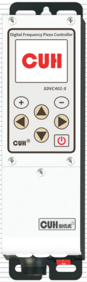

## SDVC402-S
Digitaler frequenzgeregelter piezoelektrischer Vibrationsförderungs-Controller　　**SDVC402-S**
## Benutzerhandbuch

---

## Urheberrechtshinweis

Nanjing CUH Science & Technology CO., Ltd. behält sich alle Rechte vor.

Alle in diesem Benutzerhandbuch enthaltenen Informationen sind geistiges Eigentum unseres Unternehmens und durch das Urheberrechtsgesetz und andere einschlägige Gesetze geschützt. CUH genießt und behält sich alle Rechte vor, die ihm durch das Urheberrecht und andere Gesetze verliehen werden. Ohne schriftliche Zustimmung von CUH darf dieses Benutzerhandbuch weder ganz noch teilweise kopiert, übersetzt, nachgeahmt oder anderweitig genutzt werden.

## Haftungsausschluss

Alle Inhalte dieses Benutzerhandbuchs beschreiben lediglich die Verwendungsmethode der von unserem Unternehmen hergestellten Produkte und sind nach dem aktuellen Stand der Technik sowie dem Zustand beschrieben, in dem es Ihnen bei der Nutzung übergeben wird. Sie müssen die entsprechenden Risiken bei der Verwendung dieses Produkts tragen. Sofern nicht gesetzlich vorgeschrieben, übernimmt das Unternehmen keine ausdrückliche oder stillschweigende Verantwortung für das Produkt aufgrund dieses Benutzerhandbuchs, einschließlich, aber nicht beschränkt auf Personenschäden, Sachschäden, Verlust von Gelegenheiten usw.

Sie verstehen die oben genannten Risiken klar und stimmen zu, dass das Unternehmen – sofern nicht gesetzlich vorgeschrieben – nicht für direkte oder indirekte Schäden oder Verluste Ihnen gegenüber verantwortlich ist (einschließlich, aber nicht beschränkt auf konkrete Verluste von Personal, Vermögen, Daten usw. sowie immaterielle Verluste wie Ruf und Gelegenheiten).

Das Unternehmen behält sich das Recht vor, die in diesem Benutzerhandbuch beschriebenen Produkte ohne vorherige oder nachträgliche Ankündigung zu ändern.

---

## Vorwort

Vielen Dank, dass Sie sich für den CUH SDVC402-S Digitaler frequenzgeregelter piezoelektrischer Vibrationsförderungs-Controller entschieden haben (im Folgenden kurz „Controller“ genannt). Diese Controller-Serie verwendet hochwertige Komponenten, integriert die neueste Elektroniktechnologie und wurde sorgfältig mit leistungsstarken digitalen Signalprozessoren konzipiert.

Dieses Handbuch stellt die grundlegende Bedienungsmethode, die funktionale technische Beschreibung und typische Anwendungsbeispiele dieses Produkts vor. Es bietet Benutzern relevante Informationen zu Installation und Inbetriebnahme, Parametereinstellung, Fehlerdiagnose, Fehlerbehebung und routinemäßiger Wartung des Controllers. Um eine ordnungsgemäße Installation und Verwendung dieses Controllers sicherzustellen, lesen Sie dieses Benutzerhandbuch vor der Installation sorgfältig durch und bewahren Sie es ordnungsgemäß auf.

Achten Sie darauf, die folgenden Symbole zu lesen, die Sie auf Vorsichtsmaßnahmen gegen Personenschäden und Produktschäden hinweisen.

| | |
|---|---|
| ⚠ Gefahr | Die Nichtbeachtung dieses Punkts führt zu Personenschäden oder Tod. |
| ⚠ Warnung | Die Nichtbeachtung dieses Punkts kann zu Personenschäden oder Tod führen. |
| ⚠ Vorsicht | Die Nichtbeachtung dieses Punkts kann zu mittleren oder geringen Personenschäden führen. |
| Hinweis | Die Nichtbeachtung dieses Punkts führt zu Schäden am Produkt und Sachschäden. |
| ❗ Wesentlich | Kennzeichnet Vorsichtsmaßnahmen und Nutzungsbeschränkungen, die bei der Verwendung unbedingt zu beachten sind. |

**Dieses Handbuch ist für die folgenden Controller-Modelle geeignet:**

- Digitaler frequenzgeregelter piezoelektrischer Vibrationsförderungs-Controller  
  SDVC402-S (150mA)

---

# Sicherheitshinweise

1. **⚠ Gefahr** Dieses Produkt dient ausschließlich zum Antrieb von piezoelektrischen Vibrationsförderanlagen. Verwenden Sie dieses Produkt nicht zum Schutz des menschlichen Körpers oder von Körperteilen usw.

2. **⚠ Gefahr** Dieses Produkt ist nicht als explosionsgeschütztes Produkt konzipiert. Verwenden Sie es nicht in Gefahrenbereichen und/oder in einer potenziell explosiven Gasatmosphäre.

3. **⚠ Warnung** Dieses Produkt wird über das Wechselstromnetz versorgt. Legen Sie keine Wechselspannung über 250 Vac an. Eine überhöhte Eingangsspannung, z. B. 300 Vac, kann dazu führen, dass das Produkt explodiert oder in Brand gerät, was zu schwerwiegenden Sicherheitsunfällen führen kann.

4. **⚠ Warnung** Dieses Produkt wird über das Netzkabel geerdet. Stellen Sie sicher, dass die Stromversorgungsanlagen für den Controller ordnungsgemäß geerdet sind, andernfalls kann das Controller-Gehäuse unter Spannung stehen und einen Stromschlagunfall verursachen.

5. **⚠ Warnung** Speisen Sie keine Wechselspannung in den Ausgang dieses Controllers ein, da dies den Controller beschädigt.

6. **⚠ Warnung** Stecken Sie die Verdrahtung nicht unter Spannung um und berühren Sie nicht die Kontakte der Anschlussklemmen im Anschlussfach, um Stromschläge zu vermeiden.

7. **Hinweis** Vermeiden Sie es, den Ausgang dieses Produkts durch das Abschalten der Stromversorgung über Relais und andere Geräte zu steuern, da dies die Lebensdauer des Controllers erheblich verkürzt.

8. **Hinweis** Der Controller ist für den Betrieb in einer kühlen und trockenen Umgebung ausgelegt. Betreiben Sie den Controller niemals im Freien, um Durchnässung und Sonneneinstrahlung zu vermeiden. Betreiben Sie den Controller innerhalb der temperaturabhängigen elektrischen Eigenschaften.

9. **❗ Wesentlich** Befestigen Sie dieses Produkt unbedingt auf einer stabilen Plattform, die zuverlässig geerdet und von schwingenden Geräten entfernt ist.

10. **❗ Wesentlich** Betreiben Sie den Controller niemals in einem Zustand, der außerhalb seiner ausgelegten Grenzen liegt.

11. **❗ Wesentlich** Betreiben Sie den Controller strikt gemäß diesem Benutzerhandbuch. Wir übernehmen keine zivil- oder strafrechtliche Haftung, wenn Geräteschäden oder Personenschäden durch unsachgemäßen Betrieb verursacht werden.

12. **❗ Wesentlich** Öffnen Sie niemals das Controller-Gehäuse, um Stromschläge zu vermeiden. Wenden Sie sich an CUH, wenn der Controller ausfällt. Versuchen Sie niemals, den Controller selbst zu reparieren, da dies zum Erlöschen der Garantie führen kann.

---

---

## Betriebs- und Lagerungsumgebung

### Kontrolle vor der Verwendung

Jeder Controller durchläuft vor der Auslieferung eine strenge Qualitätskontrolle und wird in stoßgeschützter Verpackung versandt. Bitte prüfen Sie nach dem Auspacken die folgenden Punkte:

1. Ob der Controller während des Transports beschädigt wurde.
2. Ob das Controller-Modell Ihrer Bestellung entspricht.

### Betriebsumgebung

Bitte beachten Sie die folgenden Hinweise, um eine bessere Leistung und eine längere Lebensdauer des Controllers zu gewährleisten:

- ⚠ Gut belüftete Umgebung
- ⚠ Von Wasser, Dampf, Staub und insbesondere ölhaltigem Staub fernhalten
- ⚠ Von korrosiven oder entflammbaren Gasen und Flüssigkeiten fernhalten
- ⚠ Von herumfliegendem Staub und Metallpartikeln fernhalten
- ⚠ Fest montieren, um Eigenschwingungen zu vermeiden
- ⚠ Von elektromagnetischen Störungen fernhalten
- ⚠ Umgebungstemperatur von 0~40 °C sicherstellen
- ⚠ Für die Verwendung in Höhen bis 2000 m

---

# Inhaltsverzeichnis

- Kapitel Ⅰ Hinweise vor der Verwendung — 1
  - 1.1 Prüfen des Lieferumfangs — 1
  - 1.2 Bedienfeld und E/A-Anschlüsse — 2
  - 1.3 Beschreibung der Startseitenparameter — 3
  - 1.4 Erläuterung der Anschlussklemmen — 3
  - 1.5 Erläuterung des Typenschilds — 4
- Kapitel Ⅱ Leistungsmerkmale — 5
- Kapitel Ⅲ Installationsanleitung — 7
  - 3.1 Betriebsbedingungen des Controllers — 7
  - 3.2 Bedienung der Tasten — 7
  - 3.3 Installation und Inbetriebnahme — 8
- Kapitel Ⅳ Kurzbeschreibung der Funktionen — 12
  - 4.1 Ausgangsspannung — 12
  - 4.2 Ausgangsfrequenz — 13
  - 4.3 Sanftanlaufzeit — 14
  - 4.4 Ausgangsschalter — 14
  - 4.5 Begrenzung der maximalen Ausgangsspannung — 15
  - 4.6 Tastatursperre — 16
  - 4.7 Einstellung des Einschalt-Betriebszustands — 17
  - 4.8 Wiederherstellung der Werkseinstellungen — 18
- Kapitel Ⅴ Sensoren und Signalsteuerung — 19
  - 5.1 Intelligente fotoelektrische Sensorik — 19
    - 5.1.1 Anschluss des intelligenten fotoelektrischen Sensors — 19
    - 5.1.2 Einschalt- und Ausschaltverzögerung des intelligenten fotoelektrischen Sensors — 20
    - 5.1.3 Logikrichtung des intelligenten fotoelektrischen Sensors — 21
  - 5.2 Verwendung des Schaltsensors — 22
    - 5.2.1 Anschluss des NPN-Näherungsschalters — 22
    - 5.2.2 Einschalt- und Ausschaltverzögerung des Schaltsensors — 26
    - 5.2.3 Logikrichtung des Schaltsensors — 27
    - 5.2.4 Typ des Schaltsensors — 28

---

---

- 5.3 Steuerausgang — 29
- 5.4 Fernsteuerung der Geschwindigkeit — 30

## Kapitel Ⅵ Detaillierte Funktionsbeschreibung — 32

- 6.1 Startseite anpassen — 33
- 6.2 Allgemeine Parametereinstellungen — 34
  - 6.2.1 Spannung — 34
  - 6.2.2 Frequenz — 34
  - 6.2.3 Sanftanlaufzeit/Sanftstoppzeit — 35
  - 6.2.4 Maximale Ausgangsspannung/Minimale Ausgangsspannung — 35
  - 6.2.5 Maximale Ausgangsfrequenz/Minimale Ausgangsfrequenz — 35
  - 6.2.6 Hintergrundbeleuchtungs-Ausschaltzeit — 36
  - 6.2.7 Sprache — 36
- 6.3 Ausgangsparameter — 37
  - 6.3.1 Hauptausgangsparameter — 37
    - 6.3.1.1 Hauptquelle 1/Hauptquelle 2 — 37
    - 6.3.1.2 Hauptlogik — 39
    - 6.3.1.3 Einschaltverzögerung/Ausschaltverzögerung des Hauptausgangs — 40
    - 6.3.1.4 Hauptmodus — 40
    - 6.3.1.5 Hauptrichtung — 41
    - 6.3.1.6 Einschaltzustand — 41
  - 6.3.2 Parameter des DC-Steuerausgangs — 42
    - 6.3.2.1 Ausgangsmodus von Port D — 44
    - 6.3.2.2 Typ von Port D — 45
- 6.4 Signalsteuerung — 46
  - 6.4.1 Empfindlichkeit von Port B — 47
  - 6.4.2 Logikrichtung von Port B/Port C — 47
  - 6.4.3 Ein-/Ausschaltverzögerung von Port B und Port C — 47
- 6.5 Einstellungen speichern — 48
  - 6.5.1 Parameterrückruf — 48
  - 6.5.2 Einstellungen speichern — 48
  - 6.5.3 Werksreset — 49

---

---

- 6.5.4 Typ und Nummer des lokalen Geräts — 49
- 6.5.5 Benutzerpasswort — 49
- 6.6 Statusüberwachung des Controllers — 50

## Kapitel Ⅶ Anhang — 51

- 7.1 Abmessungen — 51
- 7.2 Technische Spezifikationen — 52
- 7.3 Referenznormen — 53
- 7.4 Parameterliste — 54
- 7.5 Ein- und Ausgangsschaltpläne — 56
- 7.6 Fehler- und Warnungscodes — 57

## Kapitel Ⅷ Produktgarantieinformationen — 58

- 8.1 Garantiezeitraum — 58
- 8.2 Garantieumfang — 58
- 8.3 Produkteignung — 58

---

# Kapitel Ⅰ Hinweise vor der Verwendung

Dieses Kapitel stellt den Inhalt der Produktverpackung, die Beschreibung des Controller-Aufbaus und die Informationen zum Typenschild des Controllers vor.

## 1.1 Prüfen des Lieferumfangs

Prüfen Sie vor der Verwendung die Vollständigkeit des Controllers und des Zubehörs. Wenn Sie feststellen, dass das Produkt defekt oder beschädigt ist, Zubehör fehlt usw., wenden Sie sich bitte an unser Unternehmen.

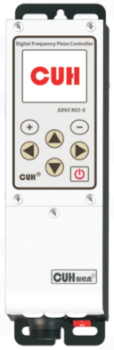

Controller×1

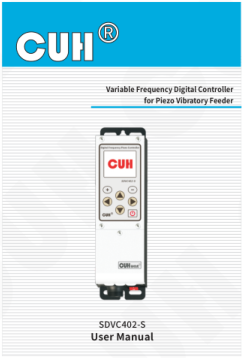

Benutzerhandbuch×1

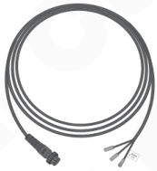

Ausgangskabel×1

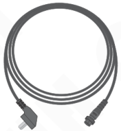

Eingangsnetzkabel×1

---

## 1.2 Bedienfeld und E/A-Anschlüsse

### Erläuterung von Display und Tasten

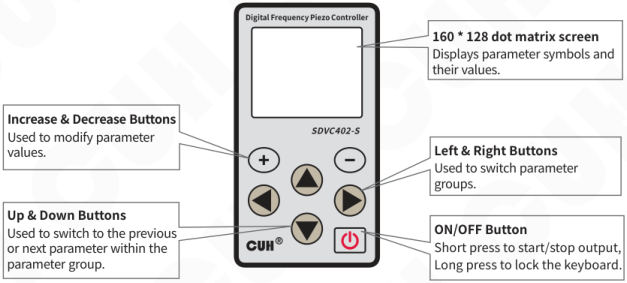

**160*128-Punktmatrixdisplay**  
Zeigt Parametersymbole und deren Werte an.

**Tasten Erhöhen & Verringern**  
Dienen zum Ändern der Parameterwerte.

**Tasten Auf & Ab**  
Dienen zum Wechseln zum vorherigen oder nächsten Parameter innerhalb der Parametergruppe.

**Tasten Links & Rechts**  
Dienen zum Wechseln der Parametergruppen.

**Ein-/Aus-Taste**  
Kurz drücken zum Starten/Stoppen des Ausgangs, lang drücken zum Sperren der Tastatur.

### Erläuterung der externen Teile

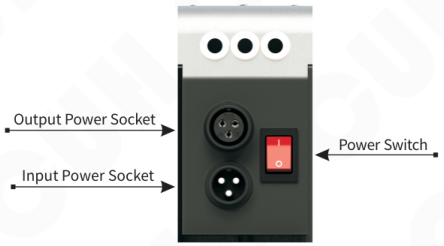

- Ausgangs-Strombuchse
- Eingangs-Strombuchse
- Netzschalter

---

## 1.3 Beschreibung der Startseitenparameter

Der Controller kann auf der Startseite den Hauptausgangsstatus, den Tastatursperrstatus, den Portstatus, die Überwachungsparameter und den Schnittstellennamen anzeigen. Beim Portstatus gilt:

Ein hervorgehobenes X zeigt an, dass der Port gültig ist. <u>X</u> zeigt an, dass der Port bei niedrigem Pegel gültig ist, und X̅ zeigt an, dass der Port bei hohem Pegel gültig ist.

## 1.4 Erläuterung der Anschlussklemmen

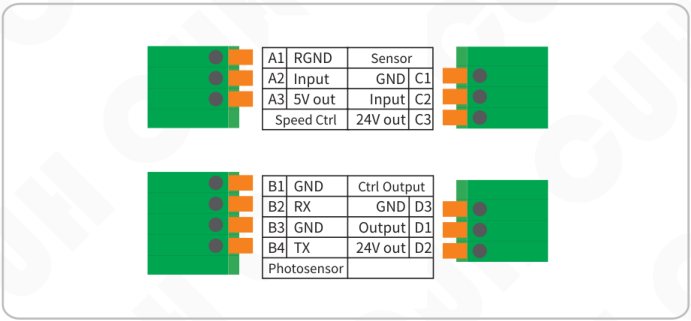

| | | | |
|---|---|---|---|
| A1 | RGND | Sensor | |
| A2 | Input | GND | C1 |
| A3 | 5V out | Input | C2 |
| Speed Ctrl | | 24V out | C3 |

| | | | |
|---|---|---|---|
| B1 | GND | Ctrl Output | |
| B2 | RX | GND | D3 |
| B3 | GND | Output | D1 |
| B4 | TX | 24V out | D2 |
| Photosensor | | | |

---

## 1.5 Erläuterung des Typenschilds

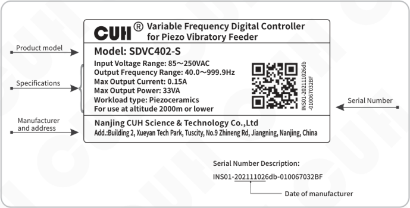

**CUH® Variable Frequency Digital Controller for Piezo Vibratory Feeder**

**Produktmodell**

Modell: SDVC402-S

**Spezifikationen**

- Eingangsspannungsbereich: 85～250VAC
- Ausgangsfrequenzbereich: 40.0～999.9Hz
- Max. Ausgangsstrom: 0.15A
- Max. Ausgangsleistung: 33VA
- Belastungsart: Piezokeramik
- Für die Verwendung in Höhen bis 2000 m

**Hersteller und Adresse**

Nanjing CUH Science & Technology Co.,Ltd

Add.:Building 2, Xueyan Tech Park, Tuscity, No.9 Zhineng Rd, Jiangning, Nanjing, China

**Seriennummer**

INS01-202111026db-010067032BF

**Beschreibung der Seriennummer:**

INS01-<u>20211102</u>6db-010067032BF

Herstellungsdatum → 20211102

---

## Kapitel Ⅱ Leistungsmerkmale

Der Controller wurde speziell für die Steuerung von Vibrationsförderern in Automatisierungssystemen entwickelt. In Kombination mit modernster Elektroniktechnologie und durchdachtem Design bietet der Controller die folgenden praktischen und komfortablen Funktionen:

**Frequenzeinstellung:** Der Ausgangsfrequenzbereich reicht von 40,0Hz bis 999,9Hz.

**Spannungseinstellung:** Der Ausgangsspannungsbereich reicht von 0V bis 220V.

**Automatische Spannungsstabilisierung:** Der Controller kann Förderschwankungen durch Netzspannungsschwankungen eliminieren.

**Intelligente fotoelektrische Sensorik:** Unser adaptiver intelligenter fotoelektrischer Sensor kann den Controller stoppen, wenn die Werkstücke vollständig vorhanden oder leer sind, und die Funktionen Sanftanlaufzeit-Einstellung, Einschaltverzögerung, Ausschaltverzögerung und Logikrichtungsanpassung erfüllen.

**Schaltsensor:** Ein adaptiver Schaltsensor oder eine SPS kann angeschlossen werden, um den Controller ein-/auszuschalten.

**Fernsteuerung der Geschwindigkeit:** Die Ausgangsspannung des Controllers kann durch ein externes Potenziometer, eine SPS oder ein 1~5V/4~20mA-Gleichstromsignal gesteuert werden.

**Ausgangsschalter:** Die Ein-/Aus-Taste am Bedienfeld ermöglicht sofortiges Starten und Stoppen und erleichtert die Fehlersuche am Anwendergerät.

**Tastatursperre:** Halten Sie die Ein-/Aus-Taste 2 Sekunden lang gedrückt, um alle Tasten gegen Fehlbedienung zu sperren.

**Einschaltzustand:** Durch Einstellen dieses Parameters können Benutzer den Startbetriebszustand des Controllers bequem festlegen.

**Steuerausgang:** Das vom Transistor ausgegebene Steuerausgangssignal kann ein Magnetventil oder andere externe Geräte mit dem Controller koordinieren.

**Begrenzung des maximalen Ausgangs:** Der maximale Ausgangsspannungswert kann voreingestellt werden, um die Ausrüstung vor Schäden durch Fehlbedienung zu schützen.

**Wiederherstellung der Werkseinstellungen:** Diese Funktion ermöglicht dem Benutzer, alle Parameter auf die Werkseinstellungen zurückzusetzen und den Controller neu zu starten.

**LCD-Display:** Es verwendet ein Farbdisplay mit 160*128 Auflösung und unterstützt sowohl chinesische als auch englische Sprache.

**Speichern und Abrufen von Parametergruppen:** Bis zu 4 Benutzer-Parametergruppen können gespeichert und abgerufen werden.

---

---

CUH legt großen Wert auf Produktqualitätsmanagement und Sicherheitsleistung. Neben den hochwertigen Komponenten und dem strengen Qualitätskontrollsystem berücksichtigt CUH mögliche Unfälle der Benutzer und bietet die folgenden Schutzfunktionen, um die Praktikabilität des Controllers zu maximieren.

**Kurzschlussschutz:** Wenn der Ausgang des Controllers kurzgeschlossen ist, stoppt der Controller seinen Ausgang bis zum Neustart.

**Stromüberlastschutz:** Der Controller stoppt seinen Ausgang, um die Betriebssicherheit der Ausrüstung zu gewährleisten, wenn der Betriebsstrom seinen Nennwert überschreitet.

**Überhitzungsschutz:** Der Controller stoppt seinen Ausgang, um sich selbst zu schützen, wenn die Betriebstemperatur zu hoch ist.

CUH-Controller entsprechen streng der CE-Zertifizierung.

---

# Kapitel Ⅲ Installationsanleitung

Dieses Kapitel stellt die notwendigen Bedingungen für die Verwendung des Controllers sowie die korrekte Installation und den korrekten Anschluss vor.

## 3.1 Betriebsbedingungen des Controllers

Der Controller wird mit Wechselstrom 85V~250V betrieben und über den Stecker des Netzkabels mit dem Schutzleiter verbunden. Bitte verwenden Sie eine Standardnetzversorgung und stellen Sie sicher, dass der Schutzleiter korrekt angeschlossen ist.

**⚠ Warnung** Schließen Sie den Controller niemals an 380V Wechselspannung an, da dies zu irreversiblen schweren Schäden am Controller führt, möglicherweise mit Explosion, Brand und anderen Sicherheitsvorfällen.

**⚠ Warnung** Stellen Sie sicher, dass die Versorgungsseite zuverlässig geerdet ist. Das Metallgehäuse des Controllers ist direkt mit dem Schutzleiter verbunden. Bei schlechter Erdung kann das Controller-Gehäuse unter Spannung stehen und einen Stromschlagunfall verursachen.

**Hinweis** Längerer Betrieb erzeugt Wärme und lässt die Gehäusetemperatur ansteigen. Bitte installieren Sie den Controller in einer gut belüfteten Umgebung und befestigen Sie ihn gut, entfernt von Vibrationsquellen.

**Hinweis** Dieses Produkt ist ein Controller zum Antrieb des piezoelektrischen Vibrationsförderers.

## 3.2 Bedienung der Tasten

a. Je nach Dauer des Tastendrucks werden die Tastenaktionen in Kurzdruck, Langdruck, Beschleunigung erster Stufe und Beschleunigung zweiter Stufe unterteilt.

b. Kurzdruck ist definiert als eine Drückdauer von mehr als 0,1 und weniger als 2 Sekunden, Langdruck als eine Drückdauer von mehr als 2 Sekunden.

c. Mit ⊕ und ⊖ werden Parameterwerte geändert. Mit ▲ und ▼ werden verschiedene Parameter ausgewählt.

d. Wechseln Sie zwischen den oberen und unteren Parametergruppen in der Parametereinstellungsoberfläche durch kurzes Drücken von ◀ oder ▶.

e. Wechseln Sie zwischen den oberen und unteren Parametern dieser Gruppe in der Parametereinstellungsoberfläche durch kurzes Drücken von ▲ oder ▼.

f. Kurz ⏻ drücken zum Starten/Stoppen des Hauptausgangs, lang ⏻ drücken zum Sperren/Entsperren der Tastatur.

g. Wenn auf einer Oberfläche länger als 5 Minuten keine Aktion erfolgt, wechselt das Gerät zur Startseitenoberfläche.

---

## 3.3 Installation und Inbetriebnahme

### Schritt 1:

Öffnen Sie den Karton und prüfen Sie den Controller und das gesamte Zubehör.

### Schritt 2:

Verbinden Sie die Anschlussklemmen des Ausgangsleistungskabels mit den Elektroden des Piezo-Vibrators.

Richten Sie die Kerbe am Luftfahrt-Stecker des Ausgangskabels am Dreiecksymbol der Ausgangsbuchse des Controllers aus und ziehen Sie anschließend die Überwurfmutter fest, nachdem das Ausgangskabel korrekt angeschlossen wurde.

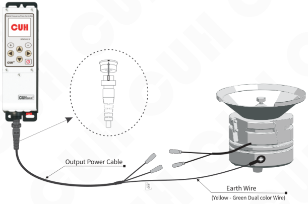

> **Hinweis**
>
> Stellen Sie sicher, dass die Elektroden des Piezo-Vibrators mit den beiden Ausgangsstiften des Ausgangsleistungskabels verbunden sind und das Metallgehäuse des Vibrators zuverlässig geerdet ist.

---

### Schritt 3:

Verbinden Sie den Stecker des Eingangsnetzkabels mit der Eingangs-Strombuchse des Controllers.

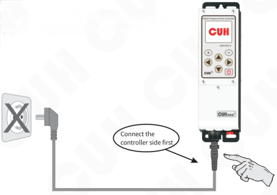

Zuerst die Controllerseite anschließen

### Schritt 4:

Nachdem Sie bestätigt haben, dass sich der Schalter in der Aus-Stellung befindet, stecken Sie den Stecker des Eingangsnetzkabels in die Netzsteckdose.

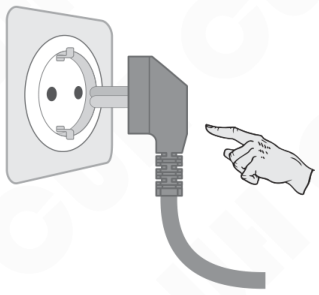

---

## Schritt 5:

- Schalten Sie den Netzschalter des Controllers ein; der Controller zeigt die Startseitenoberfläche an.
- Drücken Sie ⊕ oder ⊖, um den Ausgangsspannungswert auf einen Wert zwischen 30 und 80 einzustellen.

**Hinweis:** Die inverse Darstellung zeigt an, dass der Parameterwert einstellbar ist.

## Schritt 6:

- Drücken Sie auf der Startseitenoberfläche kurz ▼, um in den Einstellmodus der Ausgangsfrequenz zu gelangen.
- Drücken Sie ⊕ oder ⊖, um die Eigenfrequenz des Vibrationsförderers zu finden, die auch Resonanzfrequenz genannt wird.

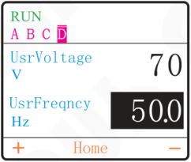

- Die Frequenz, bei der die Vibration ihr Maximum erreicht, ist die Eigenfrequenz des schwingenden Körpers.
- Jeder Vibrator hat seine eigene mechanische Resonanzfrequenz; stellen Sie die Ausgangsfrequenz des Controllers auf diese Frequenz ein, um den besten Betriebszustand zu erreichen.

---

## Schritt 7:

- Nachdem Sie die Eigenfrequenz des Vibrationsförderers gefunden haben, stellen Sie mit ⊕ und ⊖ die Spannung bis zur besten Förderrate ein.

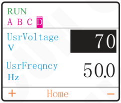

Der Vibrationsförderer sollte nun arbeiten. Weitere Bedienhinweise finden Sie in den folgenden Kapiteln.

---

## Kapitel Ⅳ Kurzbeschreibung der Funktionen

Dieses Kapitel stellt die grundlegenden Parametereinstellungen vor.

### 4.1 Ausgangsspannung

Bei diesem Controller kann die Ausgangsspannung direkt digital am Bedienfeld eingestellt werden. Da der Controller über eine spannungsstabilisierte Ausgangsfunktion verfügt, ist dieser Wert der gleichgerichtete Mittelwert der Spannung und wird nicht von der Eingangsspannung beeinflusst. Die Ausgangsspannung kann auch bei instabiler Netzspannung stabil gehalten werden. Gleichzeitig bietet die direkte Spannungswert-Einstellung dem Benutzer genaue Daten, um den Betrieb der Ausrüstung zu verstehen.

- Schalten Sie den Netzschalter des Controllers ein.
- Der Controller wechselt zum Ausgangsspannungsparameter. Das LCD zeigt den Ausgangsspannungsparameter an, der Standardwert ist 150.
- Drücken Sie ⊕ oder ⊖, um den Parameterwert einzustellen.

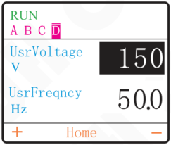

Der Spannungsbereich beträgt 0~220V, die Einstellgenauigkeit 1V.

Der gleichgerichtete Mittelwert der Ausgangsspannung des Controllers kann direkt und digital über das Tastenfeld eingestellt werden. Dank der einzigartigen Spannungsstabilisierungsfunktion schwankt die Ausgangsspannung des Controllers nicht wie die Eingangsspannung, sodass der Vibrator bei instabiler Netzspannung einen stabilen Betrieb aufrechterhalten kann.

---

## 4.2 Ausgangsfrequenz

Der Controller verwendet die Technologie der direkten digitalen Frequenzsynthese (DDS), die eine sehr hohe Frequenzgenauigkeit und -stabilität aufweist und sich nicht mit Zeit und Temperatur ändert.

- Drücken Sie auf der Startseitenoberfläche kurz ▼, um in den Einstellmodus der Ausgangsfrequenz zu gelangen.
- Das LCD zeigt den Frequenzparameter an, der Standardwert ist 50,0.
- Drücken Sie ⊕ oder ⊖, um den Parameterwert einzustellen.

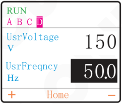

Der Frequenzbereich beträgt 40,0～999,9Hz, die Einstellgenauigkeit 0,1Hz.

---

- Auf der Startseitenoberfläche können Sie durch kurzes Drücken von ◀ und ▶ zu anderen Parametergruppen wechseln.
- In Nicht-Überwachungs-Parametergruppen kehrt der Controller drei Minuten nach Ende der Bedienung automatisch zur Startseitenoberfläche zurück.
- In Überwachungs-Parametergruppen kehrt der Controller zehn Minuten nach Ende der Bedienung automatisch zur Startseitenoberfläche zurück.

---

## 4.3 Sanftanlaufzeit

Um einen plötzlichen Stoß auf die Vibratorspule zu vermeiden, kann der Controller die Ausgangsspannung beim Start allmählich von 0 auf den voreingestellten Wert erhöhen.

**Sanftanlaufzeit:** Die Zeitspanne, die der Controller benötigt, um seine Ausgangsspannung beim Start sanft von 0 auf den voreingestellten Wert zu erhöhen.

- Drücken Sie kurz ▶, um zur Parametergruppe „2 Common“ zu wechseln.
- Drücken Sie kurz ▼, um zum Sanftanlaufparameter zu wechseln; der Standardwert ist 0,5.
- Drücken Sie ⊕ oder ⊖, um den Parameterwert einzustellen.

**RUN**  
A B C **D**

| Parameter | Wert |
|---|---|
| 01.UsrVoltage | 150 V |
| 02.UsrFreqncy | 50.0 Hz |
| 03.SoftStarT | **0.5 s** |
| 04.SoftStopT | 0.0 s |
| 05.MaxVoltage | 220 V |

＋　2Common　－

Der Sanftanlaufbereich beträgt 0,0～10,0s, die Einstellgenauigkeit 0,1s.

## 4.4 Ausgangsschalter

Der berührungsempfindliche Ausgangsschalter am Bedienfeld kann den Ausgang des Controllers einfach und schnell starten oder stoppen.

- Verwenden Sie ⏻ am Controller-Bedienfeld, um das Gerät zum Starten oder Stoppen des Ausgangs zu steuern. Der Bildschirm zeigt das Zeichen „MAN“ an, was den Wechsel in den Stoppzustand bedeutet.

**MAN**  
A B C **D**

| Parameter | Wert |
|---|---|
| UsrVoltage | 150 V |
| UsrFreqncy | **50.0 Hz** |

＋　Home　－

> Dank des berührungsempfindlichen Schalters und der digitalen Signalsteuerungstechnik entsteht kein Funke, der den Kontakt beschädigen könnte. Dadurch wird die Lebensdauer des Controllers und des Vibrators erheblich verlängert.

---

## 4.5 Begrenzung der maximalen Ausgangsspannung

Der Controller kann die maximale Ausgangsspannung einstellen, wodurch verhindert werden kann, dass der Benutzer durch Fehlbedienung übermäßige Spannung ausgibt und die Vibrationsausrüstung beschädigt.

Die Fernsteuerungsspannung überschreitet diesen Wert nicht.

- Rufen Sie die Parametergruppe „2 Common“ auf.
- Drücken Sie kurz ⏷, um zum Parameter für die maximale Spannung zu wechseln; der Standardwert ist 220.
- Drücken Sie ⊕ oder ⊖, um den Parameterwert einzustellen.

**RUN**  
A　B　C　**D**

| Parameter | Wert |
|---|---|
| 01.UsrVoltage | 150 V |
| 02.UsrFreqncy | 50.0 Hz |
| 03.SoftStarT | 0.5 s |
| 04.SoftStopT | 0.0 s |
| 05.MaxVoltage | **220** V |

＋　　2Common　　－

Der Bereich der maximalen Spannung beträgt 0～220V, die Einstellgenauigkeit 1V.

> - In jedem Fall kann und wird die Ausgangsspannung des Controllers den eingestellten Wert dieses Parameters nicht überschreiten.
> - Die werkseitige Standardeinstellung dieses Parameters ist die maximal mögliche Ausgangsspannung des Geräts.

---

## 4.6 Tastatursperre

Nach dem Einstellen der Parameter des Controllers kann die Tastatursperrfunktion alle Tasten am Bedienfeld sperren, um Fehlbedienungen zu vermeiden.

Auch wenn das Gerät aus- und wieder eingeschaltet wird, bleibt der Zustand der Tastatursperre derselbe wie beim letzten Ausschalten.

- Halten Sie ⏻ 2 Sekunden lang gedrückt, um alle Tasten am Bedienfeld zu sperren. Der Bildschirm zeigt das Zeichen „Lock“ an.
- Halten Sie ⏻ erneut 2 Sekunden lang gedrückt, um die Sperre aufzuheben.

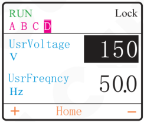

> Der Zustand der Tastatursperre geht bei Stromausfall nicht verloren.

---

## 4.7 Einstellung des Einschalt-Betriebszustands

Um auf plötzliche Stromausfälle unter normalen Bedingungen und die anschließende Wiederversorgung oder besondere Anforderungen an den Einschaltzustand des Controllers reagieren zu können, können Sie mit diesem Parameter den Einschaltzustand des Controllers auf Laufen, Stopp oder Übernahme des Zustands beim letzten Ausschalten einstellen.

- Rufen Sie die Parametergruppe „3 M_output“ auf.
- Drücken Sie kurz ⏷, um zum Einschaltzustandsparameter zu wechseln; der Standardwert ist On.
- Drücken Sie ⊕ oder ⊖, um den Parameterwert einzustellen.

RUN  
A B C D

| Parameter | Wert |
|---|---|
| 04.MainUpDly | 0.0 s |
| 05.MainDnDly | 0.0 s |
| 06.MainMode | Delay |
| 07.MainDirect | Revrs |
| 08.PowerOnSta | On |

＋　3M_output　－

**On:** Zeigt an, dass der Einschaltzustand Ein ist.

**Off:** Zeigt an, dass der Einschaltzustand Aus ist.

**Hold:** Zeigt an, dass der Einschaltzustand dem Zustand beim letzten Ausschalten folgt. (Wenn der Controller beim letzten Ausschalten den Ausgang gestoppt hat, schaltet der Controller beim nächsten Einschalten aus; wenn der Controller beim letzten Ausschalten den Ausgang aktiv hatte, schaltet der Controller beim nächsten Einschalten ein.)

---

## 4.8 Wiederherstellung der Werkseinstellungen

Der Benutzer kann den Controller schnell auf den Werkseinstellungszustand zurücksetzen.

Aufgrund der leistungsstarken Funktionen des Controllers können viele Parameter angepasst werden. Anfänger finden es möglicherweise schwierig, den Controller nach Änderung mehrerer Parameter wieder in den normalen Arbeitszustand zu versetzen. Verwenden Sie diese Funktion, um den gestörten Parameterzustand schnell auf die Werkseinstellung zurückzusetzen.

- Rufen Sie die Parametergruppe „7Save“ auf.
- Drücken Sie kurz ⏷, um zum Parameter RestorALL zu wechseln; der Standardwert ist „None“.
- Drücken Sie kurz ⊕, um den Parameterwert auf „Work“ zu ändern.
- Drücken Sie ⊕ und ⊖ gleichzeitig 2 Sekunden lang; der Controller setzt alle Parameter zurück und startet neu.

RUN  
A B C **D**

| Parameter | Wert |
|---|---|
| 01.ReadALLFrm | None |
| 02.SaveALLTo | None |
| 03.RestorALL | **None** |
| 04.LoadType | None |
| 05.MachineNum | None |

＋　7Save　－

RUN  
A B C **D**

| Parameter | Wert |
|---|---|
| 01.ReadALLFrm | None |
| 02.SaveALLTo | None |
| 03.RestorALL | **Work** |
| 04.LoadType | None |
| 05.MachineNum | None |

＋　7Save　－

---

# Kapitel Ⅴ Sensoren und Signalsteuerung

Der Controller kann durch viele Arten externer Signale und Sensoren gesteuert werden. Dieses Kapitel erläutert hauptsächlich die Verwendungsmethode des intelligenten fotoelektrischen Sensors, der Näherungsschalter-Sensoren und der SPS.

## 5.1 Intelligente fotoelektrische Sensorik

In Kombination mit dem fotoelektrischen Sensor SDVC-S1 kann die Funktion der intelligenten fotoelektrischen Sensorik realisiert werden. Der SDVC-S1-Sensor kann Störungen durch Hintergrundlicht herausfiltern, die die Empfindlichkeit des Controllers beeinflussen. Dadurch kann der Controller zuverlässig ohne manuelle Empfindlichkeitsanpassung arbeiten.

### 5.1.1 Anschluss des intelligenten fotoelektrischen Sensors

**Schritt 1:**

Öffnen Sie die Abdeckplatten des Controllers.

**Schritt 2:**

Verbinden Sie den SDVC-S1-Sensor gemäß Schema mit den Klemmen des Controllers.

> Die Arbeitsentfernung des Sensors kann durch Einstellen des Parameters „PortBLimit“ der Parametergruppe 4PhotoSen angepasst werden; je kleiner der Parameterwert, desto empfindlicher.

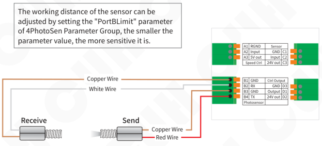

| | | | |
|---|---|---|---|
| A1 | RGND | Sensor | |
| A2 | Input | GND | C1 |
| A3 | 5V out | Input | C2 |
| Speed Ctrl | | 24V out | C3 |

| | | | |
|---|---|---|---|
| B1 | GND | Ctrl Output | |
| B2 | RX | GND | D3 |
| B3 | GND | Output | D1 |
| B4 | TX | 24V out | D2 |
| Photosensor | | | |

**Hinweis:**

Unter den werkseitigen Standardeinstellungen ist die Logikrichtung „PortBDirec“ dieses Sensors normalerweise offen.

---

## 5.1.2 Einschalt- und Ausschaltverzögerung des intelligenten fotoelektrischen Sensors

Bei Verwendung eines Sensors oder einer SPS zum Ein- oder Ausschalten des Hauptausgangs des Controllers kann die Aktion nach dem Geben oder Wiederherstellen des Steuersignals um eine bestimmte Zeit verzögert werden. Die Verzögerungszeit kann über die beiden folgenden Parameter eingestellt werden.

**PortBUpDly:** Die Zeitspanne, die der Controller vom Empfang eines Startsteuersignals bis zur tatsächlichen Ausgabe durchläuft.

- Rufen Sie die Parametergruppe „4PhotoSen“ auf.
- Drücken Sie kurz ⊖⃤, um zur Einschaltverzögerung des Port B zu wechseln; der Standardwert ist 0,2.
- Drücken Sie ⊕ oder ⊖, um den Parameterwert einzustellen.

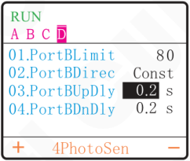

Der Bereich der Einschaltverzögerung von Port B beträgt 0,0～99,9s, die Einstellgenauigkeit 0,1s.

**PortBDnDly:** Die Zeitspanne, die der Controller vom Empfang eines Stoppsteuersignals bis zum tatsächlichen Abschalten des Ausgangs durchläuft.

- Rufen Sie die Parametergruppe „4PhotoSen“ auf.
- Drücken Sie kurz ⊖⃤, um zur Ausschaltverzögerung des Port B zu wechseln; der Standardwert ist 0,2.
- Drücken Sie ⊕ oder ⊖, um den Parameterwert einzustellen.

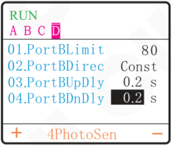

Der Bereich der Ausschaltverzögerung von Port B beträgt 0,0～99,9s, die Einstellgenauigkeit 0,1s.

---

## 5.1.3 Logikrichtung des intelligenten fotoelektrischen Sensors

Unter normalen Umständen empfängt die Empfangsseite kein Lichtsignal und der Controller läuft standardmäßig. In einigen speziellen Anwendungen muss der Controller jedoch gestoppt werden, wenn die Empfangsseite kein Lichtsignal empfängt. Durch Anpassen dieses Parameters kann diese Art von Anwendung realisiert werden.

- Rufen Sie die Parametergruppe „4PhotoSen“ auf.
- Drücken Sie kurz ⏷, um zur Logikrichtung des Port B zu wechseln; die Standardeinstellung ist „Const“.
- Drücken Sie ⊕ oder ⊖, um die Parametereinstellungen anzupassen.

**RUN**  
A B C **D**

| Parameter | Wert |
|---|---|
| 01.PortBLimit | 80 |
| 02.PortBDirec | **Const** |
| 03.PortBUpDly | 0.2 s |
| 04.PortBDnDly | 0.2 s |

＋　4PhotoSen　－

**RUN**  
A B C **D**

| Parameter | Wert |
|---|---|
| 01.PortBLimit | 80 |
| 02.PortBDirec | **Inv** |
| 03.PortBUpDly | 0.2 s |
| 04.PortBDnDly | 0.2 s |

＋　4PhotoSen　－

- Wenn der Parameter „PortBDirec“ auf „Const“ gesetzt ist, d. h. kein Lichtsignal empfangen wird, läuft der Controller.
- Wenn der Parameter „PortBDirec“ auf „Inv“ gesetzt ist, d. h. kein Lichtsignal empfangen wird, stoppt der Controller.

---

## 5.2 Verwendung des Schaltsensors

Der Controller kann mit allen Arten von Sensoren betrieben werden, wie Schaltsensoren, optischen Schaltsensoren und Lichtwellenleiter-Sensoren.

### 5.2.1 Anschluss des NPN-Näherungsschalters

**Schritt 1:**

Öffnen Sie die Abdeckplatten des Controllers.

**Schritt 2:**

Verbinden Sie den NPN-Näherungsschalter gemäß Schema mit den Klemmen des Controllers.

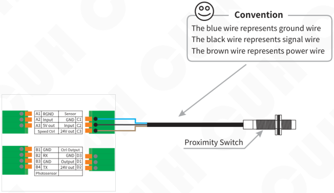

**Konvention**

- Das blaue Kabel steht für das Massekabel
- Das schwarze Kabel steht für das Signalkabel
- Das braune Kabel steht für das Versorgungskabel

Proximity Switch

| | | | |
|---|---|---|---|
| A1 | RGND | Sensor | |
| A2 | Input | GND | C1 |
| A3 | 5V out | Input | C2 |
| Speed Ctrl | | 24V out | C3 |

| | | | |
|---|---|---|---|
| B1 | GND | Ctrl Output | |
| B2 | RX | GND | D3 |
| B3 | GND | Output | D1 |
| B4 | TX | 24V out | D2 |
| Photosensor | | | |

---

## Anschlussmethode des NPN-Durchstrahl-Sensors

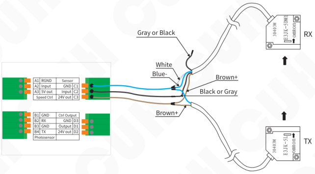

## Anschlussmethode des Durchstrahl-Sensors

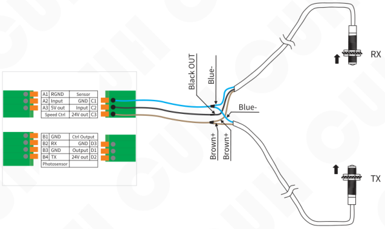

---

## Anschlussmethode des Lichtwellenleiter-Durchstrahl-Sensors

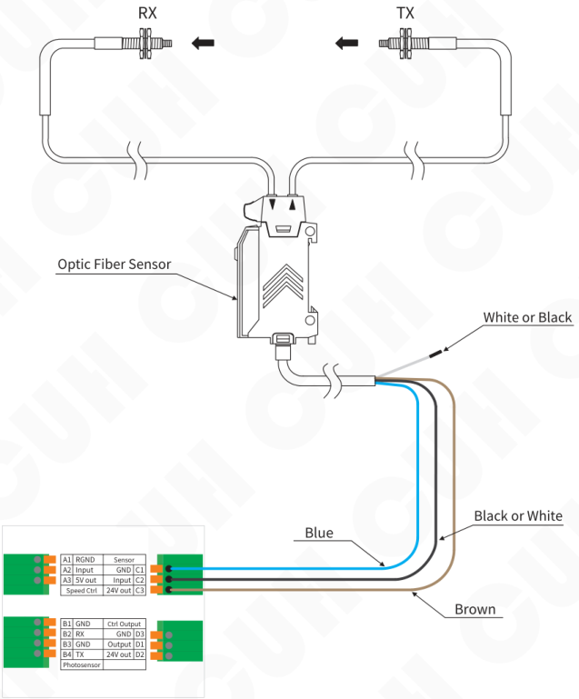

| | | | |
|---|---|---|---|
| A1 | RGND | Sensor | |
| A2 | Input | GND | C1 |
| A3 | 5V out | Input | C2 |
| Speed Ctrl | | 24V out | C3 |

| | | | |
|---|---|---|---|
| B1 | GND | Ctrl Output | |
| B2 | RX | GND | D3 |
| B3 | GND | Output | D1 |
| B4 | TX | 24V out | D2 |
| Photosensor | | | |

## Anschlussmethode des Durchstrahl-Sensors

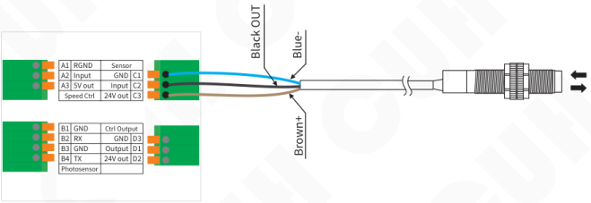

| | | | |
|---|---|---|---|
| A1 | RGND | Sensor | |
| A2 | Input | GND | C1 |
| A3 | 5V out | Input | C2 |
| Speed Ctrl | | 24V out | C3 |

| | | | |
|---|---|---|---|
| B1 | GND | Ctrl Output | |
| B2 | RX | GND | D3 |
| B3 | GND | Output | D1 |
| B4 | TX | 24V out | D2 |
| Photosensor | | | |

Kabelbezeichnung: Black OUT, Blue-, Brown+.

## Anschlussmethode der SPS

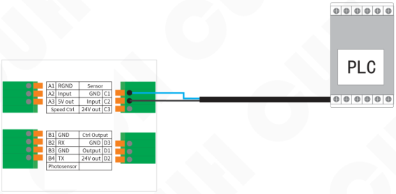

| | | | |
|---|---|---|---|
| A1 | RGND | Sensor | |
| A2 | Input | GND | C1 |
| A3 | 5V out | Input | C2 |
| Speed Ctrl | | 24V out | C3 |

| | | | |
|---|---|---|---|
| B1 | GND | Ctrl Output | |
| B2 | RX | GND | D3 |
| B3 | GND | Output | D1 |
| B4 | TX | 24V out | D2 |
| Photosensor | | | |

> Sie können den Relaisausgang der SPS oder den NPN-Ausgang der SPS verwenden.

---

## 5.2.2 Einschalt- und Ausschaltverzögerung des Schaltsensors

Standardmäßig verwenden der intelligente fotoelektrische Sensor und der Schaltsensor dieselbe Einschalt- und Ausschaltverzögerungszeit. Bediener können die Einschalt- und Ausschaltverzögerungszeit auch unabhängig für den Schaltsensor einstellen.

**PortCUpDly:** Die Zeitspanne, die der Controller vom Empfang eines Startsteuersignals bis zur tatsächlichen Ausgabe durchläuft.

- Rufen Sie die Parametergruppe „5On/Off“ auf.
- Drücken Sie kurz ⏷, um zur Einschaltverzögerung des Port C zu wechseln; der Standardwert ist 0,2.
- Drücken Sie ⊕ oder ⊖, um den Parameterwert einzustellen.

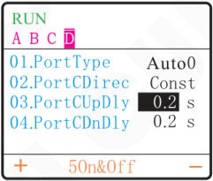

Der Bereich der Einschaltverzögerung von Port C beträgt 0,0～99,9s, die Einstellgenauigkeit 0,1s.

**PortCDnDly:** Die Zeitspanne, die der Controller vom Empfang eines Stoppsteuersignals bis zum tatsächlichen Abschalten des Ausgangs durchläuft.

- Rufen Sie die Parametergruppe „5On/Off“ auf.
- Drücken Sie kurz ⏷, um zur Ausschaltverzögerung des Port C zu wechseln; der Standardwert ist 0,2.
- Drücken Sie ⊕ oder ⊖, um den Parameterwert einzustellen.

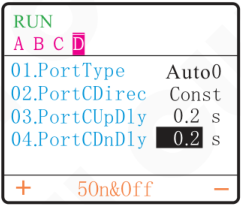

Der Bereich der Ausschaltverzögerung von Port C beträgt 0,0～99,9s, die Einstellgenauigkeit 0,1s.

---

## 5.2.3 Logikrichtung des Schaltsensors

Unter normalen Umständen empfängt der Controller kein Signal vom Schaltsensor und läuft standardmäßig. In einigen speziellen Anwendungen muss der Controller jedoch gestoppt werden, wenn er kein Signal vom Schaltsensor empfängt. Durch Anpassen dieses Parameters kann diese Art von Anwendung realisiert werden.

- Rufen Sie die Parametergruppe „5On/Off“ auf.
- Drücken Sie kurz ⏷, um zur Logikrichtung des Port C zu wechseln; die Standardeinstellung ist „Const“.
- Drücken Sie ⊕ oder ⊖, um die Parametereinstellungen anzupassen.

RUN  
A B C **D**

| Parameter | Wert |
|---|---|
| 01.PortType | Auto0 |
| 02.PortCDirec | **Const** |
| 03.PortCUpDly | 0.2 s |
| 04.PortCDnDly | 0.2 s |

＋　5On&Off　－

RUN  
A B C **D**

| Parameter | Wert |
|---|---|
| 01.PortType | Auto0 |
| 02.PortCDirec | **Inv** |
| 03.PortCUpDly | 0.2 s |
| 04.PortCDnDly | 0.2 s |

＋　5On&Off　－

- Wenn der Parameter „PortCDirec“ auf „Const“ gesetzt ist, d. h. kein Signal empfangen wird, läuft der Controller.
- Wenn der Parameter „PortCDirec“ auf „Inv“ gesetzt ist, d. h. kein Signal empfangen wird, stoppt der Controller.

---

## 5.2.4 Schaltsensor-Typ

Der Anschluss des Schaltsensors unterstützt die Modi NPN, PNP, Auto1 und Auto0 und kann je nach Sensortyp manuell eingestellt werden.

**NPN:** NPN-Schaltsensor.

**PNP:** PNP-Schaltsensor.

**Auto1:** Einmalige Abtastung, d. h., bevor das Sensorsignal ungültig ist, werden die High- und Low-Pegel geändert, um zu prüfen, ob der Anschluss gültig ist. Nachdem ein gültiges Signal gefunden wurde, wird der Sensortyp des Anschlusses bestimmt und nicht mehr abgetastet.

**Auto0:** Kontinuierliche Abtastung, unabhängig vom Sensortyp wird durch Ändern der High- und Low-Pegel stets geprüft, ob am Anschluss ein gültiges Signal anliegt.

- Rufen Sie die Parametergruppe „5On/Off“ auf.
- Wechseln Sie zum Parameter Schaltsensor-Typ von Port C; die Standardeinstellung ist „Auto0“.
- Drücken Sie ⊕ oder ⊖, um die Parametereinstellungen anzupassen.

RUN  
A B C **D**

| Parameter | Einstellung |
|---|---|
| 01.PortType | **Auto0** |
| 02.PortCDirec | Const |
| 03.PortCUpDly | 0.2 s |
| 04.PortCDnDly | 0.2 s |

＋　5On&Off　－

---

## 5.3 Steuerausgang

Der Controller kann ein Niederspannungs-Steuersignal ausgeben, um mit anderen Geräten wie einem Magnetventil, einer SPS oder einem elektrischen Relais zusammenzuarbeiten.

Der Steuerausgangs-Anschluss unterstützt NPN-Ausgang, PNP-Ausgang und Push-Pull-Ausgang. Die Verdrahtungsmethode ist wie folgt.

### NPN-Ausgangs-Verdrahtungsmethode

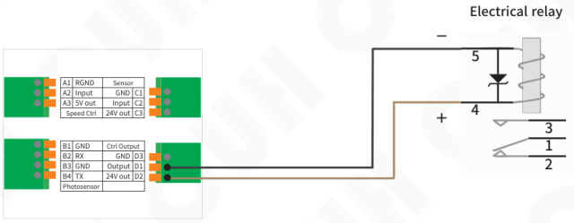

### PNP- oder Push-Pull-Ausgangs-Verdrahtungsmethode

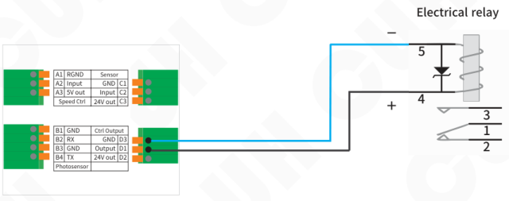

> Wenn Sie ein 24V-Relais anschließen, bestätigen Sie unbedingt die positiven und negativen Pole der Spule, um sicherzustellen, dass sie korrekt angeschlossen sind. Da die Ausgangsstromfähigkeit dieses Anschlusses begrenzt ist, schließt die interne Schutzdiode des Relais nach einem Verpolungsanschluss den Anschluss dieses Controllers kurz und löst den Kurzschlussschutz aus.

---

## 5.4 Fernsteuerung der Geschwindigkeit

Der Controller unterstützt externe Analogsignale zur Steuerung der Ausgangsspannung; das Analogsignal unterstützt Potenziometer, 1~5V-Spannung und 4~20mA-Strom. So kann eine externe Fernsteuerung der Geschwindigkeit einfach über eine SPS, ein DCS oder andere Mittel realisiert werden.

- Wenn der Eingang kleiner als 0,5V ist, ist die Fernsteuerung der Geschwindigkeit unwirksam.
- Wenn der Eingang größer als 0,5V und kleiner als 1V ist, ist die Fernsteuerung der Geschwindigkeit wirksam und die Ausgangsspannung beträgt „MinVoltage“ (Standard: 0V).
- Wenn der Eingang größer als 1V und kleiner als 5V ist, wird die Ausgangsspannung proportional durch das Fernsteuersignal gesteuert (0%~100%), und die maximale Spannung überschreitet nicht „MaxVoltage“ (Standard: 220V).

### Verdrahtungsmethode für Potenziometer-Steuerung

**Empfehlung:** Bitte verwenden Sie ein 1K-Linearpotenziometer.

### Verdrahtungsmethode für 1~5V-Spannungssteuerung

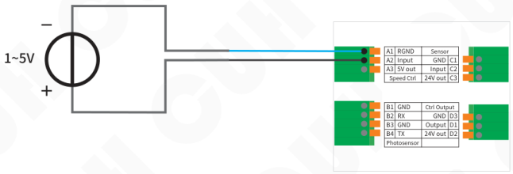

---

## Verdrahtungsmethode für 4~20mA-Stromsteuerung

- Wenn der Eingang kleiner als 2mA ist, ist die Fernsteuerung der Geschwindigkeit unwirksam.
- Wenn der Eingang größer als 2mA und kleiner als 4mA ist, ist die Fernsteuerung der Geschwindigkeit wirksam und die Ausgangsspannung beträgt „MinVoltage“ (Standard: 0V).
- Wenn der Eingang größer als 4mA und kleiner als 20mA ist, wird die Ausgangsspannung proportional durch das Fernsteuersignal gesteuert (0%~100%), und die maximale Spannung überschreitet nicht „MaxVoltage“ (Standard: 220V).

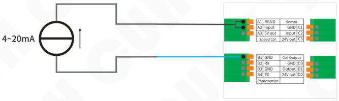

| | | | |
|---|---|---|---|
| A1 | RGND | Sensor | |
| A2 | Input | GND | C1 |
| A3 | 5V out | Input | C2 |
| Speed Ctrl | | 24V out | C3 |

| | | | |
|---|---|---|---|
| B1 | GND | Ctrl Output | |
| B2 | RX | GND | D3 |
| B3 | GND | Output | D1 |
| B4 | TX | 24V out | D2 |
| Photosensor | | | |

---

# Kapitel Ⅵ Ausführliche Funktionsbeschreibung

Dieses Kapitel stellt die detaillierten Funktionen und Einstellungen des Controllers vor.

Drücken Sie auf der Startseitenoberfläche kurz ▶, um die Parametereinstellungsoberfläche aufzurufen. Die Parametereinstellungsoberfläche enthält die folgenden acht Parametergruppen. Durch kurzes Drücken von ◀ oder ▶ wechseln Sie zwischen den verschiedenen Parametergruppen.

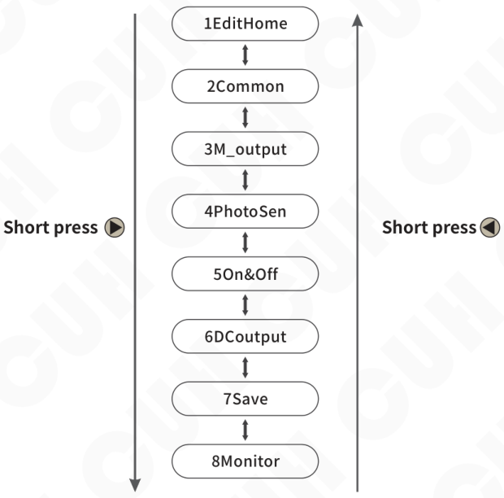

Diagramm der Parametergruppen-Rotation

---

## 6.1 Anpassung der Startseite

Um Benutzern eine effiziente und schnelle Nutzung des Controllers zu ermöglichen, können in der Oberflächen-Parametergruppe benutzerdefinierte Operationen durchgeführt werden. Indem maximal 16 aller Parameter als Überwachungselement in die Oberflächen-Parametergruppe übernommen werden, kann der Benutzer schnelle Operationen auf der Hauptoberfläche durchführen.

Beispiel: Wählen Sie 1. UsrVoltage (P2.01), 2. UsrFreqncy (P2.02), 3. CurrentOut (P8.02), 4. SoftStarT (P2.03), SoftStopT (P2.04); es gibt fünf Parameter auf der Hauptoberfläche. Die Schritte sind wie folgt:

- Drücken Sie auf der Startseitenoberfläche kurz ⏵, um direkt in die Parametergruppe „1EditHome“ zu gelangen.
- Drücken Sie kurz ▲ oder ▼, um zwischen verschiedenen Überwachungselementen zu wechseln.
- Drücken Sie ⊕ oder ⊖, um die jeweils einzustellenden Funktionsbezeichnungen auszuwählen.

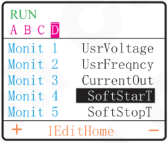

Hinweis: Funktionsbezeichnungen können im Kapitel „Parameterliste“ nachgeschlagen werden.  
Wenn der Wert des Überwachungselements leer ist, bedeutet dies, dass kein Überwachungselement vorhanden ist.

Nach Abschluss der Operation können Benutzer, wenn sie die Parameterwerte für Spannung, Frequenz, Ausgangsstrom, Sanftanlaufzeit und Sanftstoppzeit anpassen müssen, das entsprechende Überwachungselement in der Parametergruppe der Startseite aufrufen und die Parameteranpassung mit ⊕ oder ⊖ abschließen.

---

## 6.2 Allgemeine Parametereinstellungen

Dieses Kapitel stellt hauptsächlich die Einstellung und Anpassung der grundlegenden allgemeinen Parameter des Controllers vor.

### 6.2.1 Spannung

Dieser Controller kann die Ausgangsspannung direkt digital am Bedienfeld einstellen. Diese Funktion kann die durch Netzspannungsschwankungen verursachte Änderung der Fördergeschwindigkeit beseitigen. Die Spannungsregelung kann auch den durch netzfrequenten Wechselstrom verursachten Schwebungseffekt beseitigen.

- Rufen Sie die Parametergruppe „2Common“ auf und suchen Sie die Spannungseinstellparameter.
- Drücken Sie ⊕ oder ⊖, um den Parameterwert einzustellen.

Der Spannungsbereich beträgt 0~220V, der Standardwert ist 150V, die Einstellgenauigkeit 1V.

RUN  
A B C **D**

| Parameter | Wert |
|---|---|
| 01.UsrVoltage | **150** V |
| 02.UsrFreqncy | 50.0 Hz |
| 03.SoftStarT | 0.5 s |
| 04.SoftStopT | 0.0 s |
| 05.MaxVoltage | 220 V |

＋　2Common　－

### 6.2.2 Frequenz

Der Controller hat eine sehr hohe Frequenzgenauigkeit und -stabilität und ändert sich nicht mit Zeit und Temperatur.

- Rufen Sie die Parametergruppe „2Common“ auf und suchen Sie die Frequenzeinstellparameter.
- Drücken Sie ⊕ oder ⊖, um den Parameterwert einzustellen.

Der Frequenzbereich beträgt 40,0~999,9Hz, der Standardwert ist 50,0Hz, die Einstellgenauigkeit 0,1Hz.

RUN  
A B C **D**

| Parameter | Wert |
|---|---|
| 01.UsrVoltage | 150 V |
| 02.UsrFreqncy | **50.0** Hz |
| 03.SoftStarT | 0.5 s |
| 04.SoftStopT | 0.0 s |
| 05.MaxVoltage | 220 V |

＋　2Common　－

**Die anderen Parameter dieser Parametergruppe können gemäß den obigen Schritten angepasst werden.**

---

## 6.2.3 Sanftanlaufzeit/Sanftstoppzeit

**Sanftanlaufzeit:** Die Zeit, die der Controller benötigt, um beim Start aus dem Stillstand die Ausgangsspannung sanft von 0V auf die eingestellte Ausgangsspannung zu erhöhen.

Der Bereich der Sanftanlaufzeit beträgt 0,0~10,0s, der Standardwert ist 0,5s und die Einstellgenauigkeit 0,1s.

**Sanftstoppzeit:** Wenn der Controller den Betrieb stoppt, die Zeit, die die Ausgangsspannung benötigt, um sanft von der eingestellten Ausgangsspannung auf 0V abzufallen.

Der Bereich der Sanftstoppzeit beträgt 0,0~10,0s, der Standardwert ist 0,5s und die Einstellgenauigkeit 0,1s.

Beim Starten oder Stoppen dieses Controllers kann die Ausgangsspannung sanft erhöht oder verringert werden, um zu verhindern, dass die Vibrationsausrüstung durch Stöße beschädigt wird.

## 6.2.4 Maximale Ausgangsspannung/Minimale Ausgangsspannung

**Maximale Ausgangsspannung:** Der maximale Spannungswert, den der Controller ausgibt.

Der Bereich der maximalen Spannung beträgt 0-220V, der Standardwert ist 220V und die Einstellgenauigkeit 1V.

**Minimale Ausgangsspannung:** Der minimale Spannungswert, den der Controller ausgibt.

Der Bereich der minimalen Spannung beträgt 0-220V, der Standardwert ist 0V und die Einstellgenauigkeit 1V.

Dieser Controller kann Grenzwerte für die maximale und minimale Ausgangsspannung festlegen, wodurch verhindert werden kann, dass Benutzer die Vibrationsausrüstung durch versehentlich zu hohe Ausgangsspannung beschädigen.

## 6.2.5 Maximale Ausgangsfrequenz/Minimale Ausgangsfrequenz

**Maximale Ausgangsfrequenz:** Begrenzt den oberen Grenzwert des Parameters „UsrFreqncy“.

Der Bereich der maximalen Ausgangsfrequenz beträgt 40,0~999,9Hz, der Standardwert ist 999,9Hz und die Einstellgenauigkeit 0,1Hz.

**Minimale Ausgangsfrequenz:** Begrenzt den unteren Grenzwert des Parameters „UsrFreqncy“.

Der Bereich der minimalen Ausgangsfrequenz beträgt 40,0~999,9Hz, der Standardwert ist 40,0Hz und die Einstellgenauigkeit 0,1Hz.

---

## 6.2.6 Hintergrundbeleuchtungs-Ausschaltzeit

**Hintergrundbeleuchtungs-Ausschaltzeit:** Das ist die Ausschaltzeit der Hintergrundbeleuchtung. Wenn der Controller über einen bestimmten Zeitraum keine Operation durchführt, schaltet der Controller die Bildschirm-Hintergrundbeleuchtung aus. Durch Drücken einer beliebigen Taste kann die Bildschirm-Hintergrundbeleuchtung wieder eingeschaltet werden.

Der Bereich der Hintergrundbeleuchtungs-Ausschaltzeit beträgt 1-30min, die Standardeinstellung ist On und die Einstellgenauigkeit 1min.

## 6.2.7 Sprache

**Sprache:** Das ist die auf dem Bedienfeld des Controllers angezeigte Sprache. Der Controller verfügt über zwei integrierte Sprachen: Chinesisch und Englisch, sodass Benutzer in verschiedenen Regionen einfach wechseln können. Standard: Chines.

| Parameter | Bedeutung |
|---|---|
| Englis | Englische Oberfläche. |
| Chines | Chinesische Oberfläche. |

---

## 6.3 Ausgangsparameter

Dieses Kapitel dient der Einführung in die Einstellung und Verwendung der Hauptausgangsparameter und der Steuerausgangsparameter des Controllers, um die ideale Ausgabefunktion des Controllers zu erreichen.

### 6.3.1 Hauptausgangsparameter

Diese Zusammenfassung stellt hauptsächlich die Einstellungen der Hauptausgangsparameter des Controllers vor.

- Drücken Sie kurz ⏵, um zur Parametergruppe „3 M_output“ zu wechseln.
- Drücken Sie kurz ⏶ oder ⏷, um die Parameter in der Hauptausgangs-Parametergruppe zu wechseln.
- Drücken Sie ⊕ oder ⊖, um den Parameterwert einzustellen.

RUN  
A　B　C　**D**

| Parameter | Wert |
|---|---|
| 01.MainSourc1 | **PortB** |
| 02.MainSourc2 | PortC |
| 03.MainLogic | Or |
| 04.MainUpDly | 0.0 s |
| 05.MainDnDly | 0.0 s |

＋　3M_output　－

Die anderen Parameter dieser Parametergruppe können gemäß den obigen Schritten angepasst werden.

### 6.3.1.1 Hauptquelle 1/Hauptquelle 2

„MainSourc1“ und „MainSourc2“ beziehen sich auf das „Signal der Hauptquelle 1“ und das „Signal der Hauptlogikquelle 2“; über diese beiden Parameter können Sie das Logikquellensignal des Hauptausgangs einstellen. Die Signale der Hauptquelle 1 und der Hauptquelle 2 durchlaufen zunächst die Beurteilung des Anschluss-Signaltyps, dann die Beurteilung der Logikrichtung und schließlich, nach Durchlaufen der Einschalt- und Ausschaltverzögerung, werden sie zum Ergebnissignal der Hauptausgangs-Logikquelle 1/2.

---

Das Signalflussdiagramm ist wie folgt:

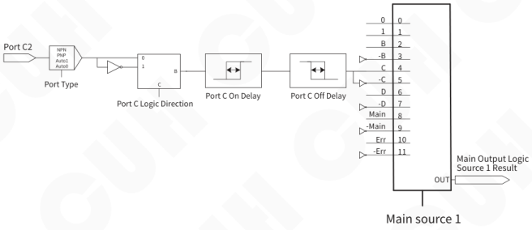

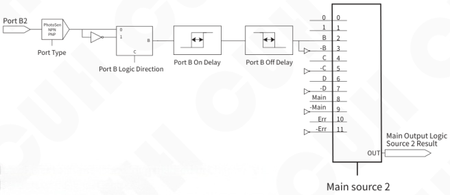

Hinweis: Beachten Sie die Sensor-Verdrahtungsmethode in Kapitel Ⅴ „Sensoren und Signalsteuerung“.

**Abbildung 6.3.1.1**

Hinweis: Der Hauptausgangszustand wird auch dadurch gesteuert, ob sich die Start-Stopp-Taste bzw. der Controller selbst in einem Fehlerzustand befindet. Die Fehlersteuerungsebene der Start-Stopp-Taste oder des Controllers selbst ist höher als das Hauptausgangs-Logiksignal. Das heißt: Wenn die Start-Stopp-Taste auf Stopp gesetzt ist, geht der Controller sofort in den Stoppzustand über; wenn ein Fehler wie Kurzschluss, Übertemperatur, Überstrom usw. auftritt, geht der Controller ebenfalls sofort in den Stoppzustand über. Zu diesem Zeitpunkt kann das Hauptausgangs-Logiksignal den Hauptausgang des Controllers nicht einschalten.

---

## 6.3.1.2 Hauptlogik

Die Ergebnisse von Hauptquelle 1 und Hauptquelle 2 werden vom Logikoperator verarbeitet, durchlaufen dann das Logikrichtungsmodul, dann die Einschalt- und Ausschaltverzögerung des Hauptausgangs, schließlich den Hauptausgangsmodus und dienen zum Ansteuern des Start-Stopp-Zustands des Hauptausgangs.

Das Signalflussdiagramm ist wie folgt:

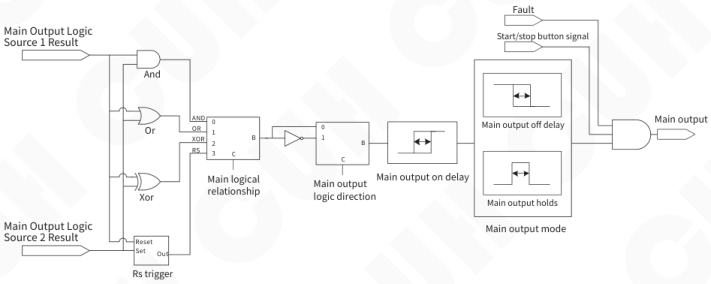

Abbildung 6.3.1.2

Dieser Controller kann die logische Beziehungstabelle zwischen Hauptquelle (Logikquelle) 1 und Hauptquelle 2 wie folgt festlegen. Standard: Or.

| Parameter | Bedeutung |
|---|---|
| And | Logisches AND; die Ausgabe ist ungültig, wenn sowohl Hauptquelle 1 als auch Hauptquelle 2 gültig sind. |
| Or | Logisches OR; die Ausgabe ist ungültig, wenn mindestens eine von Hauptquelle 1 oder Hauptquelle 2 gültig ist. |
| Xor | Logisches XOR; die Ausgabe ist ungültig, wenn Hauptquelle 1 und Hauptquelle 2 in unterschiedlichen Zuständen sind, andernfalls gültig. |
| RS | RS-Flipflop. |

## 6.3.1.3 Einschaltverzögerung/Ausschaltverzögerung des Hauptausgangs

Bei Verwendung anderer externer Signale wie Sensoren zur Steuerung des Hauptausgangszustands des Geräts ist in den meisten Fällen nach dem Geben oder Wiederherstellen des Signals eine Verzögerung erforderlich, bevor die Operation ausgeführt werden kann. Für solche Anwendungen kann dies durch Einstellen der Zeitwerte der Einschalt- und Ausschaltverzögerung erreicht werden. Zum Signalflussdiagramm siehe Abbildung 6.3.1.2.

**Einschaltverzögerung des Hauptausgangs:** Das heißt, die Einschaltverzögerung des Hauptausgangs ist die Verzögerungszeit vom Anlegen eines Steuersignals, das den Controller in den Laufzustand versetzt, bis zum tatsächlichen Start der Ausgabe des Controllers. Die in diesem Zeitraum auftretende Verzögerungszeit wird als Einschaltverzögerung bezeichnet.

**Ausschaltverzögerung des Hauptausgangs:** Das heißt, die Ausschaltverzögerung des Hauptausgangs ist die Verzögerungszeit vom Anlegen eines Steuersignals, das den Controller in den Stoppzustand versetzt, bis zum tatsächlichen Stoppen der Ausgabe des Controllers.

Der Bereich der Einschalt-/Ausschaltverzögerung des Hauptausgangs beträgt 0,0~99,9s, der Standardwert ist 0,0s und die Einstellgenauigkeit 0,1s.

## 6.3.1.4 Hauptmodus

Es stehen 2 Hauptausgangsmodi zur Verfügung: Verzögerungsmodus und Haltemodus. Signalflussdiagramm siehe Abbildung 6.3.1.2. Standard: Delay.

| Parameter | Bedeutung |
|---|---|
| Delay | Bezieht sich auf den Zustand des Hauptausgangs nach der Logikoperation; der Zustand, der den Hauptausgang nach der Einschalt- und Ausschaltverzögerung ansteuert. |
| Hold | Bezieht sich auf den Zustand nach der Logikoperation des Hauptausgangs. Nach der Einschaltverzögerung bleibt der Stoppzustand für die Dauer der Ausschaltverzögerung bestehen und wechselt dann sofort in den Lauf-Ausgabezustand. |

Der Unterschied zwischen den beiden Modi wird in Form eines Zeitdiagramms wie folgt dargestellt, wobei das Eingangssignal eine Auswahl der logischen Beziehung ist.

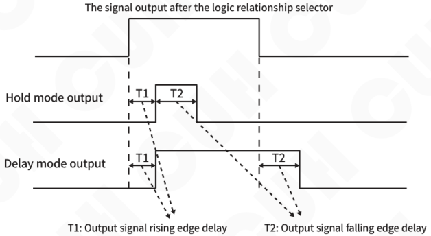

---

## 6.3.1.5 Hauptrichtung

Das heißt die Logikrichtung des Hauptausgangs; die spezifische Ausgaberichtung kann festgelegt werden, nachdem die Signale logisch kombiniert wurden. Zum Signalflussdiagramm siehe Abbildung 6.3.1.2. Standard: Revrs.

| Parameter | Bedeutung |
|---|---|
| Const | Der Zustand wird nach der Logikoperation des Hauptausgangs nicht invertiert. |
| Revrs | Der Zustand wird nach der Logikoperation des Hauptausgangs invertiert. |
| On | Der Zustand bleibt nach der Logikoperation des Hauptausgangs im Laufzustand. |
| Off | Der Zustand ist nach der Logikoperation des Hauptausgangs stets gestoppt. |

## 6.3.1.6 Einschaltzustand

Legt den Betriebszustand des Controllers nach dem Einschalten fest. Standard: On.

| Parameter | Bedeutung |
|---|---|
| On | Nach dem Einschalten des Geräts ist der Status der Schalttaste „Läuft“. |
| Off | Nach dem Einschalten des Geräts ist der Status der Schalttaste „Gestoppt“. |
| Hold | Nach dem Einschalten des Geräts bleibt der Status der Schalttaste derselbe wie vor dem letzten Ausschalten. |

---

## 6.3.2 Parameter des DC-Steuerausgangs

Diese Zusammenfassung stellt hauptsächlich die Einstellungen der Steuerausgangsparameter des Controllers vor.
Das schematische Diagramm des Steuerausgangs-Signalflusses ist wie folgt:

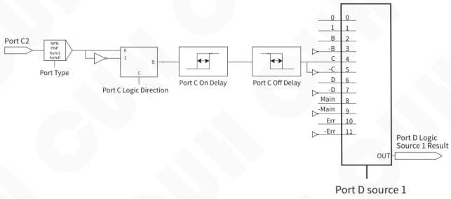

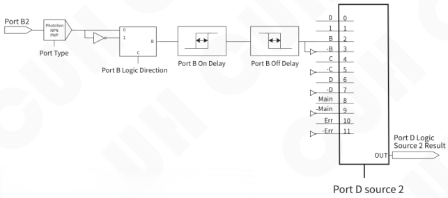

Hinweis: Beachten Sie die Sensor-Verdrahtungsmethode in Kapitel Ⅴ „Sensoren und Signalsteuerung“.

---

Das Ergebnis der Logikquelle 1 von Port D und das Ergebnis der Logikquelle 2 von Port D werden nach der Logikoperation durch die Ausgangsrichtung von Port D geführt, durchlaufen dann die Einschalt- und Ausschaltverzögerung des Port-D-Ausgangs, den Port-D-Modus und schließlich den Port-D-Ausgangstyp und dienen zum Ansteuern des Start-Stopp-Zustands des Steuerausgangs.

Das Signalflussdiagramm ist wie folgt:

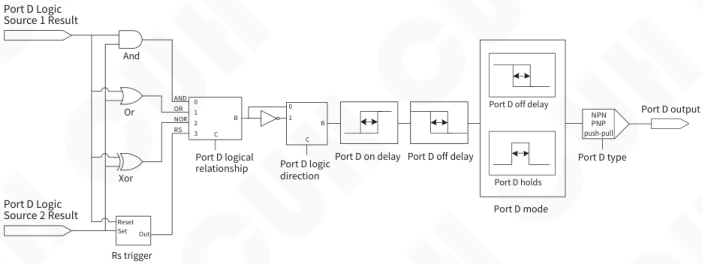

Die Einstellmethode für die Steuerausgangsparameter ist wie folgt:

- Drücken Sie kurz ▶, um zur Parametergruppe „6DCoutput“ zu wechseln.
- Drücken Sie kurz ▲ oder ▼, um die Parameter in der Steuerausgangs-Parametergruppe zu wechseln.
- Drücken Sie ⊕ oder ⊖, um den Parameterwert einzustellen.

**RUN**  
A　B　C　**D**

| Parameter | Wert |
|---|---|
| 01.PortDSour1 | 0 |
| 02.PortDSour2 | Main |
| 03.PortDLogic | Or |
| 04.PortDUpDly | 0.0 s |
| 05.PortDDnDly | 0.0 s |

＋　6DCoutput　－

**Die anderen Parameter dieser Parametergruppe können gemäß den obigen Schritten angepasst werden.**

„PortDSour1“, „PortDSour2“, „PortDLogic“, „PortDDirec“, „PortDUpDly“ und „PortDDnDly“; die oben genannten Parameter können den Einstellungen der Hauptausgangsparameter entnommen werden.

---

## 6.3.2.1 Ausgangsmodus von Port D

Kunden können 4 Steuerausgangsmodi wählen: Verzögerungsmodus, Haltemodus, Cycle1 und Cycle2. Standard: Delay.

| Parameter | Bedeutung |
|---|---|
| Delay | Bezieht sich auf den Zustand des Steuerausgangs nach der Logikoperation; der Zustand, der den Steuerausgang nach der Einschalt- und Ausschaltverzögerung ansteuert. |
| Hold | Bezieht sich auf den Zustand nach der Logikoperation des Steuerausgangs. Nach der Einschaltverzögerung bleibt der Stoppzustand für die Dauer der Ausschaltverzögerung bestehen und wechselt dann sofort in den Lauf-Ausgabezustand. |
| Cycle1/Cycle2 | Die Dauer des High-Pegel-Signals wird durch „PortDUpDly“ festgelegt. Die Dauer des Low-Pegel-Signals wird durch „PortDDnDly“ festgelegt. |

Im Cycle1-Modus kann die Schalttaste die Steuerausgabe nicht stoppen, im Cycle2-Modus kann die Schalttaste die Steuerausgabe stoppen.

Der Unterschied zwischen den vier Modi wird in Form eines Zeitdiagramms wie folgt dargestellt, wobei das Eingangssignal der Signalausgang nach dem Logikbeziehungs-Selektor ist.

## 6.3.2.2 Typ von Port D

Der Ausgang von Port D unterstützt drei Typen: NPN-Ausgang, PNP-Ausgang und Push-Pull-Ausgang. Standard: Ou_P&P (Push-Pull).

| Parameter | Bedeutung |
|---|---|
| Ou_NPN | Wenn das Ausgangssignal von Port D gültig ist, gibt Port D ein Low-Pegel-Signal (0V) aus; wenn es ungültig ist, liegt hohe Impedanz vor. |
| Ou_PNP | Wenn das Ausgangssignal von Port D gültig ist, gibt Port D ein High-Pegel-Signal (24V) aus; wenn es ungültig ist, liegt hohe Impedanz vor. |
| Ou_P&P (Push Pull) | Wenn das Ausgangssignal von Port D gültig ist, gibt Port D ein High-Pegel-Signal (24V) aus. Wenn das Ausgangssignal von Port D ungültig ist, gibt Port D ein Low-Pegel-Signal (0V) aus. |

Das Diagramm ist wie folgt:

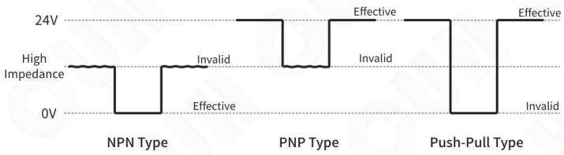

---

## 6.4 Signalsteuerung

Der Controller kann den Status des Materials im Vibrationsförderer über einen externen Sensor beurteilen und die Funktionen „Stopp bei vollem Material“ oder „Stopp bei leerem Material“ des Controllers realisieren. Das Anschluss-Signalflussdiagramm ist wie folgt:

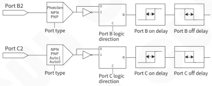

Abbildung 6.4

Die Methode zum Einstellen der Parameter des intelligenten fotoelektrischen Sensors ist wie folgt:

- Drücken Sie kurz ▶, um zur Parametergruppe „4PhotoSen“ zu wechseln.
- Drücken Sie kurz ▲ oder ▼, um die Parameter in der Parametergruppe des intelligenten fotoelektrischen Sensors zu wechseln.
- Drücken Sie ⊕ oder ⊖, um den Parameterwert einzustellen.

**RUN**  
A B C **D**

| Parameter | Wert |
|---|---|
| 01.PortBLimit | 80 |
| 02.PortBDirec | Const |
| 03.PortBUpDly | 0.2 s |
| 04.PortBDnDly | 0.2 s |

＋　4PhotoSen　－

Die Methode zum Einstellen der Parameter des Schaltsensors ist wie folgt:

- Drücken Sie kurz ▶, um zur Parametergruppe „5On&Off“ zu wechseln.
- Drücken Sie kurz ▲ oder ▼, um die Parameter in der Parametergruppe des Schaltsensors zu wechseln.
- Drücken Sie ⊕ oder ⊖, um den Parameterwert einzustellen.

**RUN**  
A B C **D**

| Parameter | Wert |
|---|---|
| 01.PortType | Auto0 |
| 02.PortCDirec | Const |
| 03.PortCUpDly | 0.2 s |
| 04.PortCDnDly | 0.2 s |

＋　5On&Off　－

**Die anderen Parameter dieser Parametergruppe können gemäß den obigen Schritten angepasst werden.**

---

## 6.4.1 Empfindlichkeit von Port B

Der Controller kann den Signaltyp von Port B auf 1~1000 (Empfindlichkeit des intelligenten fotoelektrischen Sensors), „NPN“-Typ und „PNP“-Typ-Schaltsensoren einstellen. Der Standardwert ist 80.

| Parameter | Bedeutung |
|---|---|
| 1~1000 | Port B ist mit Signalen des intelligenten fotoelektrischen Sensors verbunden, Bereich von 1 bis 1000. Je kleiner der Wert, desto schwächer die Intensität des erkannten Lichtsignals. Sende- und Empfangsende können weiter voneinander entfernt angebracht werden. |
| NPN | NPN-Typ-Sensor. |
| PNP | PNP-Typ-Sensor. |

## 6.4.2 Logikrichtung von Port B/Port C

Dieser Parameter wird verwendet, um den Eingangsport B und den Eingangsport C des Controllers auf „Stopp bei vollem Material“ oder „Stopp bei leerem Material“ umzuschalten. Standard: Const.

Wenn bei den werkseitigen Standardeinstellungen am Schalteingangsport B/Port C kein Signal empfangen wird, befindet sich der Controller im Zustand „Läuft“ (d. h. Stopp bei vollem Material). Einige spezielle Anwendungen erfordern, dass sich der Controller im Zustand „Stopp“ befindet (d. h. Stopp bei leerem Material), wenn Port B/Port C kein Signal empfängt. Dies kann durch Ändern dieses Parameters erreicht werden. Zum Signalflussdiagramm siehe Abbildung 6.4.

| Parameter | Bedeutung |
|---|---|
| Const | Wenn kein Steuersignal vorhanden ist, befindet sich der Controller im Laufzustand (Stopp bei vollem Material). |
| Inv | Wenn kein Steuersignal vorhanden ist, befindet sich der Controller im Stoppzustand (Stopp bei leerem Material). |

## 6.4.3 Ein-/Ausschaltverzögerung von Port B und Port C

Die Verzögerungszeit vom Anlegen eines Signals, das den Controller in den Laufzustand versetzt, bis das Signal vom Controller als gültig betrachtet wird, wird als Einschaltverzögerung bezeichnet.

Die Verzögerungszeit vom Anlegen eines Signals, das den Controller in den Stoppzustand versetzt, bis das Signal vom Controller als gültig betrachtet wird, wird als Ausschaltverzögerung bezeichnet.

Zum Signalflussdiagramm siehe Abbildung 6.4.

Der Bereich der Ein-/Ausschaltverzögerung beträgt 0,0～99,9s, der Standardwert ist 0,2s und die Einstellgenauigkeit 0,1s.

**Hinweis:** Wenn Port B und Port C für die Start-/Stopp-Steuerung verwendet werden und der Vorgang nach dem Empfang des Signals um eine bestimmte Zeit verzögert werden muss, um sicherzustellen, dass das Signal stabil ist, kann dies durch Einstellen der Einschalt- und Ausschaltverzögerung erreicht werden.

---

## 6.5 Einstellungen speichern

Dieses Kapitel beschreibt hauptsächlich die Verwendung der Funktionen zur Parameterspeicherung und zum Parameterrückruf des Controllers.

### 6.5.1 Parameterrückruf

Der Controller kann zusätzlich zur Arbeitsgruppe 3 verschiedene Sätze voreingestellter Parameter auslesen, die als „UsrD1“, „UsrD2“ und „UsrD3“ bezeichnet werden. Der Standardwert ist None.

Wenn der Benutzer die Parameter ändert, werden die Parameter des Controllers standardmäßig in der Arbeitsgruppe gespeichert. Beim nächsten Einschalten des Controllers werden die Parameter automatisch aus der Arbeitsgruppe gelesen und die Parameterwerte vor dem letzten Ausschalten wiederhergestellt. Gleichzeitig kann der Benutzer manuell „UsrD1“, „UsrD2“ und „UsrD3“ auswählen, um eine weitere, von den drei Gruppen manuell gespeicherte Datei auszulesen. Die Daten werden an die Arbeitsgruppe im Controller gesendet, sodass der Controller den Arbeitszustand sofort wechseln kann.

| Parameter | Bedeutung |
|---|---|
| None | Ungültig |
| UsrD1 | Vom Benutzer eingestellter Parameter 1 |
| UsrD2 | Vom Benutzer eingestellter Parameter 2 |
| UsrD3 | Vom Benutzer eingestellter Parameter 3 |

### 6.5.2 Einstellungen speichern

Der Controller kann 4 verschiedene Sätze voreingestellter Parameter speichern, die als „Work“, „UsrD1“, „UsrD2“ und „UsrD3“ bezeichnet werden. Der Standardwert ist None.

Wenn der Benutzer die Parameter ändert, werden die Parameter des Controllers standardmäßig automatisch in „Work“ gespeichert. Beim nächsten Einschalten des Controllers werden die Parameter automatisch aus der Arbeitsgruppe gelesen und die Parameterwerte vor dem letzten Ausschalten wiederhergestellt. Der Benutzer kann die Parameter in der Arbeitsgruppe manuell in „UsrD1“, „UsrD2“ und „UsrD3“ speichern.

| Parameter | Bedeutung |
|---|---|
| None | Ungültig |
| Work | Standardarbeitsgruppe |
| UsrD1 | Vom Benutzer eingestellter Parameter 1 |
| UsrD2 | Vom Benutzer eingestellter Parameter 2 |
| UsrD3 | Vom Benutzer eingestellter Parameter 3 |

---

## 6.5.3 Werksreset

Verwenden Sie die Rücksetzparameter, um alle Parameter der Arbeitsgruppe auf die Werkseinstellungen zurückzusetzen. Der Standardwert ist None.

Drücken Sie nach der Auswahl von „Work“ unter „RestorALL“ ⊕ und ⊖ gleichzeitig und halten Sie sie gedrückt; nach mehr als zwei Sekunden wechselt die Anzeigeoberfläche zur Standby-Oberfläche und die Parameter wurden erfolgreich wiederhergestellt.

| Parameter | Bedeutung |
|---|---|
| None | Ungültig |
| Work | Arbeitsgruppenparameter auf die Werkseinstellungen zurücksetzen. (UsrD1, UsrD2 und UsrD3 werden nicht wiederhergestellt) |

## 6.5.4 Typ und Nummer des lokalen Geräts

**Kennung des lokalen Geräts:** Wird verwendet, um die Kennung des Geräts auf der Startseite anzuzeigen.

Die optionalen Werte für die Kennung des lokalen Geräts sind „Circ “, „Line“ und „Soli“. Der Standardwert ist None.

**Identifikationsnummer:** Wird verwendet, um das lokale Gerät zu nummerieren.

Der Bereich der Identifikationsnummer beträgt 1～1000. Der Standardwert ist None.

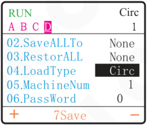

## 6.5.5 Benutzerpasswort

Benutzer können das Parameterpasswort selbst festlegen. Nach der Sperrung kann der Benutzer nur unter „SetWord“ und auf der Startseite arbeiten.

Wenn das vom Benutzer festgelegte „Benutzerpasswort“ ungleich 0 ist, bedeutet dies, dass die erweiterte Parametersperrfunktion aktiviert ist. In diesem Fall muss beim Aufrufen der Parametergruppe auf der Startseite das Passwort eingegeben werden. Nachdem der Benutzer „SetWord“ aufgerufen und ⊕ und ⊖ gleichzeitig länger als 2 Sekunden gedrückt hat, wird das eingegebene Passwort bestätigt. Erst nachdem das Passwort korrekt ist, kann der Benutzer andere Parametergruppen aufrufen.

Der Auswahlbereich des Benutzerpassworts beträgt 0～9999. Der Standardwert ist 0.

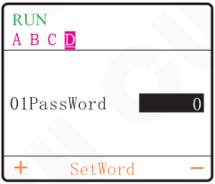

---

## 6.6 Statusüberwachung des Controllers

In der Überwachungs-Parametergruppe können der Betriebszustand des Controllers und die Parameterwerte in Echtzeit abgelesen werden.

Die lesbaren Parametereinträge finden Sie im Kapitel „Parameterliste“, Parametergruppe „8Monitor“.

RUN  
A B C **D**

| | |
|---|---:|
| 01.Temperatur | 50 ℃ |
| 02.CurrentOut | 20 mA |
| 03.Vol_Remote | **0.5 V** |
| 04.Vol_PortB | 100 |
| 05.Vol-PortC | 0.5 V |

＋　8Monitor　－

---

## Kapitel Ⅶ Anhang

### 7.1 Abmessungen

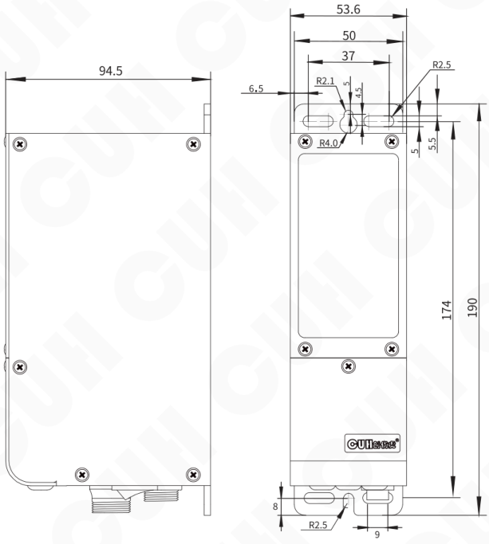

Abmessungen (Einheit: mm)

| Abmessungsbereich | Toleranz |
|---|---|
| 0~3 | ±0.05 |
| 3~10 | ±0.1 |
| 10~30 | ±0.15 |
| 30~80 | ±0.2 |
| 80~180 | ±0.3 |
| >180 | ±0.5 |

Diese Toleranztabelle gilt für alle Produkte dieser Serie.

---

## 7.2 Technische Spezifikationen

| Element | Min | Typisch | Max | Einheit | Hinweis |
|---|---|---|---|---|---|
| Eingangsspannung | 85 | 220 | 250 | V | AC RMS |
| Einstellbarer Ausgangsspannungsbereich | 0 | —— | 220 | V | AC RMS |
| Einstellgenauigkeit der Spannung | | 1 | | V | |
| Einstellbarer Ausgangsstrombereich | 0 | —— | 150 | mA | |
| Ausgangsleistung | 0 | —— | 33 | VA | |
| Ausgangsfrequenz | 40.0 | —— | 999.9 | Hz | |
| Einstellgenauigkeit der Frequenz | | 0.1 | | Hz | |
| Ausgangswellenform | | Sinus | | | |
| Sanftanlaufzeit | 0 | —— | 10.0 | s | Standardwert: 0.5 |
| Bereich der Ein-/Ausschaltverzögerung | 0.0 | —— | 99.9 | s | Standardwert: 0.2 |
| Genauigkeit der Ein-/Ausschaltverzögerung | | 0.1 | | s | |
| Auslösetemperatur des Überhitzungsschutzes | 60 | 65 | 65 | °C | |
| DC-Steuerausgangsstrom | 0 | —— | 350 | mA | |
| DC-Steuerausgangsspannung | 22 | 24 | 26 | V | |
| Analoges Steuersignal | | 1~5 | | V | Spannung der Fernsteuerung der Geschwindigkeit |
| Analoges Steuersignal | | 4~20 | | mA | Strom der Fernsteuerung der Geschwindigkeit |
| Digitales Steuersignal | | 24 | | V | Schaltsignal |
| Einstellmethode | | 7 | | Tasten | |
| Leistungsaufnahme im Standby | —— | —— | 5 | W | |
| Anzeigemethode | | 160*128 | | | Matrixanzeige |
| Schutzart | | IP20 | | | |
| Umgebungstemperatur | 0 | 25 | 40 | °C | Keine Kondensation |
| Umgebungsfeuchtigkeit | 10 | 60 | 85 | % | Keine Kondensation |
| Umgebungstemperatur bei Lagerung | -20 | 25 | 65 | °C | Keine Kondensation |

## 7.3 Referenznormen

**Absolutparameter:**  
Das Überschreiten der Normbedingungen beschädigt den Controller; diese sind strikt einzuhalten.

| Element | GB-Norm | IEC-Norm | Grad | Normanforderung | Hinweis |
|---|---|---|---|---|---|
| Elektrostatische Entladung | GB/T 17626.2-2006 | IEC 61000-4-2:2001 | 4 | ±8 kV | Kontaktentladung |
| | | | 4 | ±15 kV | Luftentladung |
| Elektrischer schneller Transiententest | GB/T 17626.4-2008 | IEC 61000-4-4:2004 | 4 | ±4 kV | |
| Störfestigkeit gegen Wechselanteile der DC-Stromversorgung | GB/T 17626.17-2005 | IEC 61000-4-17:2002 | 4 | 15% | Bewertung A |

> **Warnung**  
> In einer Wohnumgebung kann dieses Produkt Funkstörungen verursachen; in diesem Fall können zusätzliche Abhilfemaßnahmen erforderlich sein.

---

## 7.4 Parameterliste

| | Parameter | Anzeige | Wertebereich/Aufzählung | Standard |
|---|---|---|---|---|
| 1EditHome-Parametergruppe | Überwachungselement 1 | Monit 1 | Parametergruppe 2～Parametergruppe 8 | UsrVoltage |
| | Überwachungselement 2 | Monit 2 | Parametergruppe 2～Parametergruppe 8 | UsrFreqncy |
| | Überwachungselement 3 | Monit 3 | Parametergruppe 2～Parametergruppe 8 | CurrentOut |
| | Überwachungselement 4 | Monit 4 | Parametergruppe 2～Parametergruppe 8 | |
| | Überwachungselement 5 | Monit 5 | Parametergruppe 2～Parametergruppe 8 | |
| | Überwachungselement 6 | Monit 6 | Parametergruppe 2～Parametergruppe 8 | |
| | Überwachungselement 7 | Monit 7 | Parametergruppe 2～Parametergruppe 8 | |
| | Überwachungselement 8 | Monit 8 | Parametergruppe 2～Parametergruppe 8 | |
| | Überwachungselement 9 | Monit 9 | Parametergruppe 2～Parametergruppe 8 | |
| | Überwachungselement 10 | Monit 10 | Parametergruppe 2～Parametergruppe 8 | |
| | Überwachungselement 11 | Monit 11 | Parametergruppe 2～Parametergruppe 8 | |
| | Überwachungselement 12 | Monit 12 | Parametergruppe 2～Parametergruppe 8 | |
| | Überwachungselement 13 | Monit 13 | Parametergruppe 2～Parametergruppe 8 | |
| | Überwachungselement 14 | Monit 14 | Parametergruppe 2～Parametergruppe 8 | |
| | Überwachungselement 15 | Monit 15 | Parametergruppe 2～Parametergruppe 8 | |
| | Überwachungselement 16 | Monit 16 | Parametergruppe 2～Parametergruppe 8 | |
| 2Common-Parametergruppe | Benutzereingestellte Spannung | 01.UsrVoltage | 0~220 V | 150 |
| | Benutzereingestellte Frequenz | 02.UsrFreqncy | 40.0~999.9 Hz | 50.0 |
| | Sanftanlaufzeit | 03.SoftStarT | 0.0~10.0 s | 0.5 |
| | Sanftstoppzeit | 04.SoftStopT | 0.0~10.0 s | 0.0 |
| | Maximale Ausgangsspannung | 05.MaxVoltage | 0~220 V | 220 |
| | Minimale Ausgangsspannung | 06.MinVoltage | 0~220 V | 0 |
| | Maximale Ausgangsfrequenz | 07.MaxFreqncy | 40.0~999.9 Hz | 999.9 |
| | Minimale Ausgangsfrequenz | 08.MinFreqncy | 40.0~999.9 Hz | 40.0 |
| | Hintergrundbeleuchtungs-Ausschaltzeit | 09.Off_time | On, 1~30 Mi | On |
| | Sprache | 10.Language | Chines, Englis | Chines |
| 3M_output-Parametergruppe | Logische Eingangsquelle 1 des Hauptausgangs | 01.MainSourc1 | 0, 1, PortB, -PortB, PortC, -PortC, PortD, -PortD, Main, -Main, Err, -Err | PortB |
| | Logische Eingangsquelle 2 des Hauptausgangs | 02.MainSourc2 | 0, 1, PortB, -PortB, PortC, -PortC, PortD, -PortD, Main, -Main, Err, -Err | PortC |
| | Hauptlogik | 03.MainLogic | And, Or, Xor, RS | Or |
| | Einschaltverzögerung des Hauptausgangs | 04.MainUpDly | 0.0~99.9 s | 0.0 |
| | Ausschaltverzögerung des Hauptausgangs | 05.MainDnDly | 0.0~99.9 s | 0.0 |
| | Hauptausgangsmodus | 06.MainMode | Delay, Hold | Delay |
| | Logikrichtung des Hauptausgangs | 07.MainDirect | Const, Revrs, On, Off | Revrs |
| | Einschaltzustand | 08.PowerOnSta | On, Off, Hold | On |

| | Parameter | Anzeige | Wertebereich/Aufzählung | Standard |
|---|---|---|---|---|
| 4PhotoSen-Parametergruppe | Empfindlichkeit des intelligenten fotoelektrischen Sensors | 01.PortBLimit | PNP, NPN, 1~1000 | 80 |
| 4PhotoSen-Parametergruppe | Logikrichtung von Port B | 02.PortBDirec | Const, Inv | Const |
| 4PhotoSen-Parametergruppe | Einschaltverzögerung von Port B | 03.PortBUpDly | 0.0~99.9 s | 0.2 |
| 4PhotoSen-Parametergruppe | Ausschaltverzögerung von Port B | 04.PortBDnDly | 0.0~99.9 s | 0.2 |
| 5On&Off-Parametergruppe | Schaltsensor-Typ von Port C | 01.PortType | NPN, PNP, Auto1, Auto0 | Auto0 |
| 5On&Off-Parametergruppe | Logikrichtung von Port C | 02.PortCDirec | Const, Inv | Const |
| 5On&Off-Parametergruppe | Einschaltverzögerung von Port C | 03.PortCUpDly | 0.0~99.9 s | 0.2 |
| 5On&Off-Parametergruppe | Ausschaltverzögerung von Port C | 04.PortCDnDly | 0.0~99.9 s | 0.2 |
| 6DCoutput-Parametergruppe | Logische Eingangsquelle 1 von Port D | 01.PortDSour1 | 0, 1, PortB, -PortB, PortC, -PortC, PortD, -PortD, Main, -Main, Err, -Err | 0 |
| 6DCoutput-Parametergruppe | Logische Eingangsquelle 2 von Port D | 02.PortDSour2 | 0, 1, PortB, -PortB, PortC, -PortC, PortD, -PortD, Main, -Main, Err, -Err | Main |
| 6DCoutput-Parametergruppe | Logische Beziehung von Port D | 03.PortDLogic | And, Or, Xor, RS | Or |
| 6DCoutput-Parametergruppe | Einschaltverzögerung von Port D | 04.PortDUpDly | 0.0~99.9 s | 0.0 |
| 6DCoutput-Parametergruppe | Ausschaltverzögerung von Port D | 05.PortDDnDly | 0.0~99.9 s | 0.0 |
| 6DCoutput-Parametergruppe | Ausgangsmodus von Port D | 06.PortDMode | Delay, Hold, Cycle1, Cycle2 | Delay |
| 6DCoutput-Parametergruppe | Logikrichtung von Port D | 07.PortDDirec | Const, Revrs, On, Off | Const |
| 6DCoutput-Parametergruppe | Steuerausgangstyp | 08.PortDType | Ou_NPN, Ou_PNP, Ou_P&P | Ou_NPN |
| 7Save-Parametergruppe | Alle Parameter aus der Benutzergruppe lesen | 01.ReadALLFrm | None, UsrD1, UsrD2, UsrD3 | None |
| 7Save-Parametergruppe | Alle Parameter in der Benutzergruppe speichern | 02.SaveALLTo | None, Work, UsrD1, UsrD2, UsrD3 | None |
| 7Save-Parametergruppe | Wiederherstellung der Werkseinstellungen | 03.RestorALL | None, Work | None |
| 7Save-Parametergruppe | Kennung des lokalen Geräts | 04.LoadType | None, Circ, Line, Soli | None |
| 7Save-Parametergruppe | Identifikationsnummer | 05.MachineNum | None, 1~1000 | None |
| 7Save-Parametergruppe | Benutzerpasswort | 06.PassWord | 0~9999 | 0 |
| 8Monitor-Parametergruppe | Temperatur | 01.Temperatur | -20~85 ℃ | —— |
| 8Monitor-Parametergruppe | Ausgangsstrom | 02.CurrentOut | 0.0~150 mA | —— |
| 8Monitor-Parametergruppe | Signalspannung von Port A | 03.Vol_Remote | 0.0~5.0 V | —— |
| 8Monitor-Parametergruppe | Signalspannung von Port B | 04.Vol_PortB | 0~999 | —— |
| 8Monitor-Parametergruppe | Signalspannung von Port C | 05.Vol-PortC | 0.0~26.0 V | —— |
| 8Monitor-Parametergruppe | Signalspannung von Port D | 06.Vol-PortD | 0.0~26.0 V | —— |
| 8Monitor-Parametergruppe | Echtzeitspannung des 5V-Ports | 07.Vol-5V | 0.0~6.0 V | —— |
| 8Monitor-Parametergruppe | Echtzeitspannung des 24V-Ports | 08.Vol-24V | 0.0~26.0 V | —— |
| 8Monitor-Parametergruppe | Softwareversion der Steuerplatine | 09.Version | 0~99.99 | —— |

| | Parameter | Anzeige | Wertebereich/Aufzählung | Standard |
|---|---|---|---|---|
| SetWord | Passwort | 01PassWord | 0~9999 | 0 |

## 7.5 Ein- und Ausgangsschaltpläne

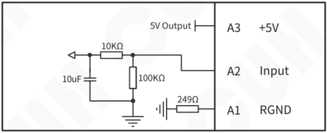

**Fernsteuerung der Geschwindigkeit Port A**

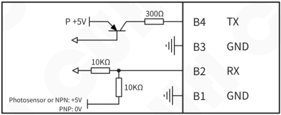

**Intelligenter fotoelektrischer Sensor Port B**

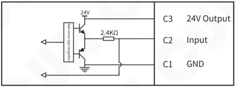

**Schaltsensor Port C**

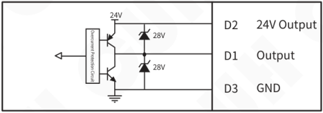

**Steuerausgang Port D**

---

## 7.6 Fehler- und Warnungscodes

| Fehleranzeige | Fehlerbehebung |
|---|---|
| Short | Überprüfen Sie, ob die Hauptausgangsleitung kurzgeschlossen ist, und verdrahten Sie sie neu. |
| MainOrCu | Reduzieren Sie die Ausgangsspannung oder erhöhen Sie die Ausgangsfrequenz. |
| OverHot | Stellen Sie den Controller an einem gut belüfteten und wärmeabführenden Ort auf. |
| OverCold | Stellen Sie den Controller an einem Ort auf, an dem die Umgebungstemperatur über -20℃ liegt. |
| PotDOrCu | Stellen Sie sicher, dass die Last von Port D nicht kurzgeschlossen ist und der Strom 350mA nicht überschreitet; versuchen Sie dann, den Ausgang von Port D neu zu starten. |
| 24VErr | Stellen Sie sicher, dass der 24V-Port nicht kurzgeschlossen ist und der Strom 400mA nicht überschreitet. |
| 5VErr | Stellen Sie sicher, dass die 5V-Versorgung von Port A nicht kurzgeschlossen ist oder keine externe Versorgungsspannung über 5V angeschlossen ist. |
| MainRSEr | Stellen Sie sicher, dass die beiden Eingangssignale des RS-Flipflops nicht gleichzeitig aktiv sind. |
| PotDRSEr | Stellen Sie sicher, dass die beiden Eingangssignale des RS-Flipflops nicht gleichzeitig aktiv sind. |

---

## Kapitel Ⅷ Produktgarantieinformationen

### 8.1 Garantiezeitraum

Der Garantiezeitraum, den das Unternehmen für dieses Produkt gewährt, beträgt 3 Jahre ab dem Datum der Lieferung des Produkts an den vom Käufer bezeichneten Ort.

### 8.2 Garantieumfang

(1) Tritt während des oben genannten Garantiezeitraums ein von unserem Unternehmen verursachter Fehler auf, reparieren wir das Produkt kostenlos. Die folgenden Situationen sind jedoch nicht von der Garantie abgedeckt:

 a. Nichtbeachtung der Bedingungen, die in der Kurzanleitung, der Bedienungsanleitung oder den zwischen dem Käufer und dem Unternehmen ausdrücklich vereinbarten technischen Anforderungen festgelegt sind, unsachgemäße Bedienung oder durch unsachgemäße Verwendung verursachte Fehler.

 b. Der Fehler ist nicht auf einen Produktdefekt, sondern auf die Ausrüstung oder das Softwaredesign des Käufers zurückzuführen.

 c. Fehlfunktionen, die durch Änderungen oder Reparaturen verursacht wurden, die nicht vom Personal des Unternehmens durchgeführt wurden.

 d. Fehler, die durch ordnungsgemäße Wartung oder Austausch von Verschleißteilen gemäß der Kurzanleitung oder Bedienungsanleitung vollständig vermieden werden können.

 e. Nach dem Versand des Produkts aus unserem Unternehmen verursachte Fehler, die auf Faktoren wie unvorhersehbare Veränderungen des technischen Stands zurückzuführen sind.

 f. Bei Fehlern aufgrund von Naturkatastrophen wie Feuer, Erdbeben oder Überschwemmungen oder aufgrund externer Faktoren wie anormaler Spannung übernimmt das Unternehmen keine Garantie.

(2) Der Garantieumfang ist auf die in (1) festgelegten Situationen beschränkt. Für indirekte Verluste (wie Geräteschäden, entgangene Gelegenheiten, Gewinnverluste usw.) oder andere Verluste übernimmt das Unternehmen keine Haftung.

### 8.3 Produkteignung

Der Controller unseres Unternehmens ist für den allgemeinen Einsatz in der Vibrationsförderindustrie ausgelegt und hergestellt. Daher darf dieser Controller unseres Unternehmens nicht für die folgenden Anwendungen verwendet werden und ist für deren Verwendung nicht geeignet.

(1) Einrichtungen mit schwerwiegenden Auswirkungen auf Leben und Eigentum, wie Kernkraftwerke, Flughäfen, Eisenbahnen, Schiffe, motorisierte Geräte und medizinische Geräte.

(2) Öffentliche Versorgungseinrichtungen, einschließlich Strom-, Gas- und Wasserversorgung usw.

(3) Verwendung im Freien unter ähnlichen Bedingungen oder in ähnlichen Umgebungen.

---

Nanjing CUH Science & Technology Co.,Ltd  
https://en.cuhnj.com  
Tel.:+86-25-84730411 / 84730415 / 84730416  
Fax:+86-25-84730426  
E-mail:sales@cuhnj.com  
Add.:Building 2, Xueyan Tech Park, Tuscity,  
No.9 Zhineng Rd, Jiangning, Nanjing, China

Dokument-Nr.: IDP1000542

