## Digitaler frequenzgeregelter piezoelektrischer Vibrationsförderungs-Controller

**Variable Frequency Digital Controller for Piezo Vibratory Feeder**

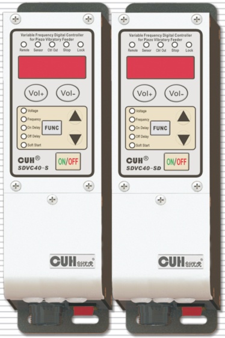

## SDVC40-Serie
Digitaler frequenzgeregelter piezoelektrischer Vibrationsförderungs-Controller　　**SDVC40-Serie**
## Benutzerhandbuch

---

## Vorwort

Vielen Dank, dass Sie sich für einen intelligenten digitalen Vibrationsförderungs-Controller der Marke **CUH** entschieden haben (im Folgenden kurz „Controller“ genannt).

Dieses Benutzerhandbuch enthält Hinweise zur Installation, Inbetriebnahme, Parametereinstellung, Wartung und Fehlerbehebung des Controllers. Bitte lesen Sie dieses Benutzerhandbuch vor der Inbetriebnahme des Controllers sorgfältig durch und bewahren Sie es sicher auf.

### Dieses Benutzerhandbuch gilt für folgende Modelle:

- Digitaler frequenzgeregelter piezoelektrischer Vibrationsförderungs-Controller  
  SDVC40-S (Ausgang 220 V, 150 mA)

- Digitaler frequenzgeregelter piezoelektrischer Vibrationsförderungs-Controller  
  SDVC40-SD (Ausgang 50 V, 600 mA)

---

# Sicherheitshinweise

- Nehmen Sie den Controller niemals unter Spannung ab und berühren Sie in keinem Fall die Kontakte, um Stromschläge oder andere Unfälle zu vermeiden.
- Schließen Sie den Controller niemals an 380 V Wechselspannung an, da dies zu irreparablen Schäden führen kann. (Verwenden Sie bei Bedarf Produkte, die für 380 V Wechselspannung ausgelegt sind.)
- Trennen Sie die Versorgungsspannung des Controllers keinesfalls über ein Relais, eine SPS oder andere Geräte, da sonst die Lebensdauer des Controllers erheblich verkürzt werden kann.
- Der Controller ist für den Betrieb in einer kühlen und trockenen Umgebung ausgelegt. Betreiben Sie ihn niemals im Freien, um Durchnässung oder Sonneneinstrahlung zu vermeiden. Betreiben Sie den Controller nur innerhalb des Temperaturbereichs, den seine elektrischen Eigenschaften erfordern.
- Betreiben Sie den Controller niemals außerhalb seiner ausgelegten Grenzen.
- Betreiben Sie den Controller ausschließlich gemäß diesem Benutzerhandbuch. Für Geräteschäden oder Personenschäden, die durch unsachgemäßen Betrieb verursacht werden, übernehmen wir keine zivil- oder strafrechtliche Haftung.

> **!**
>
> Öffnen Sie niemals das Gehäuse des Controllers, um Stromschläge zu vermeiden. Wenden Sie sich an CUH, wenn der Controller ausfällt.
>
> Versuchen Sie niemals, den Controller umzubauen, da die Halbleiterschaltungen im Inneren des Controllers nicht repariert werden können und keine einstellbaren Teile vorhanden sind.

---

# Betriebs- und Lagerungsumgebung

## Kontrolle vor der Verwendung

Jeder Controller durchläuft vor der Auslieferung eine strenge Qualitätskontrolle und wird stoßgeschützt verpackt.

## Bitte prüfen Sie nach dem Auspacken die folgenden Punkte:

- Ob der Controller äußerlich beschädigt ist
- Ob das Modell des Controllers genau Ihrer Bestellung entspricht

## Betriebsumgebung

Bitte beachten Sie die folgenden Hinweise, um eine bessere Leistung und eine längere Lebensdauer des Controllers zu gewährleisten:

- Gut belüftete Umgebung
- Von Wasser, Dampf, Staub und insbesondere ölhaltigem Staub fernhalten
- Von korrosiven oder entflammbaren Gasen und Flüssigkeiten fernhalten
- Von herumfliegendem Staub und Metallpartikeln fernhalten
- Fest montieren, um Eigenschwingungen zu vermeiden
- Von elektromagnetischen Störungen fernhalten
- Betrieb im Temperaturbereich von 0 °C bis 40 °C
- Für die Verwendung in Höhen bis 2000 m geeignet

---

# Inhaltsverzeichnis

| Inhalt | Seite |
|---|---:|
| **Kapitel Ⅰ Leistungsmerkmale** | 1 |
| **Kapitel Ⅱ Installationsanleitung** | 3 |
| **Kapitel Ⅲ Komponentenbeschreibung** | 7 |
| 3.1 Beschreibung des Bedienfelds | 7 |
| 3.2 Beschreibung der Statusanzeigen | 8 |
| 3.3 Beschreibung der E/A-Schnittstellen | 8 |
| **Kapitel Ⅳ Funktionsbeschreibung** | 9 |
| 4.1 Einstellung der Ausgangsspannung | 9 |
| 4.2 Einstellung der Ausgangsfrequenz | 10 |
| 4.3 Sanftanlauf | 11 |
| 4.4 Ausgangsschalter | 11 |
| 4.5 Begrenzung der maximalen Ausgangsspannung | 12 |
| 4.6 Tastatursperre | 13 |
| 4.7 Einstellung des Einschalt-Betriebszustands | 14 |
| 4.8 Wiederherstellung der Werkseinstellungen | 15 |
| **Kapitel Ⅴ Sensoren und Signalsteuerung** | 16 |
| 5.1 Intelligente fotoelektrische Sensorik | 16 |
| 5.1.1 Anschluss des intelligenten fotoelektrischen Sensors | 16 |
| 5.1.2 Einschalt- und Ausschaltverzögerung des intelligenten fotoelektrischen Sensors | 17 |
| 5.1.3 Logikrichtung des intelligenten fotoelektrischen Sensors | 18 |
| 5.2 Verwendung des NPN-Schaltsensors (Stopp bei vollem Werkstückvorrat) | 19 |
| 5.2.1 Anschluss des NPN-Näherungsschalters | 19 |
| 5.2.2 Anschluss des Durchstrahl-NPN-Sensors | 20 |
| 5.2.3 Anschluss des Durchstrahl-Photoelektrik-Sensors | 20 |
| 5.2.4 Anschluss des Durchstrahl-LWL-Sensors | 21 |
| 5.2.5 Anschluss des Reflexions-Photoelektrik-Sensors | 22 |
| 5.3 Einschalt- und Ausschaltverzögerung des NPN-Schaltsensors | 23 |
| 5.4 Logikrichtung des NPN-Schaltsensors (Stopp bei vollem Werkstückvorrat) | 24 |
| 5.5 Logische Verknüpfung der Steuersignale | 25 |
| 5.6 Anschluss der übergeordneten SPS zur Steuerung des Vibrationsförderungs-Controllers | 26 |
| 5.7 Steuerausgang | 27 |
| 5.7.1 Anschluss des Steuerausgangs | 27 |
| 5.7.2 Logikrichtung des Steuerausgangs | 28 |
| 5.8 Fernsteuerung der Geschwindigkeit | 29 |
| **Kapitel Ⅵ Sicherheitsfunktionen** | 30 |
| 6.1 Automatische Spannungsstabilisierung | 30 |
| 6.2 Kurzschlussschutz | 30 |
| 6.3 Stromüberlastschutz | 30 |
| 6.4 Überhitzungsschutz | 30 |

---

---

## Anhang

- Anhang A: Abmessungen — 31
- Anhang B: Definition der Ausgangsschnittstelle — 32
- Anhang C: Definition der Signalschnittstelle — 32
- Anhang D: Funktionstabelle — 33
- Anhang E: Elektrische Spezifikation — 34
- Anhang F: Fehlerbehebungshinweise und Fehlererklärungen — 35

---

# Kapitel Ⅰ Leistungsmerkmale

Der Controller wurde speziell für die Steuerung von Vibrationsförderern in Automatisierungssystemen entwickelt. In Kombination mit modernster Elektroniktechnologie und durchdachtem Design bietet der Controller die folgenden praktischen und komfortablen Funktionen:

**Frequenzeinstellung:** Der Ausgangsfrequenzbereich reicht von 40,0 Hz bis 400,0 Hz.

**Spannungseinstellung:** SDVC40-S: Ausgangsspannungsbereich von 0 V bis 260 V.  
SDVC40-SD: Ausgangsspannungsbereich von 0,0 V bis 50,0 V.

**Automatische Spannungsstabilisierung:** Der Controller kann Fördergeschwindigkeitsschwankungen aufgrund von Netzspannungsschwankungen eliminieren.

**Sanftanlauf:** Um einen plötzlichen Stoß auf die Werkstücke zu vermeiden, kann der Controller beim Start die Ausgangsspannung sanft von 0 auf den voreingestellten Wert erhöhen.

**Intelligente fotoelektrische Sensorik:** Unser adaptiver intelligenter fotoelektrischer Sensor kann den Controller stoppen, wenn der Werkstückvorrat voll oder leer ist, und ermöglicht die Funktionen Sanftanlaufzeit-Einstellung, Einschaltverzögerung, Ausschaltverzögerung und Einstellung der Logikrichtung.

**Stopp bei vollem Werkstückvorrat:** Ein NPN-Schaltsensor kann den Controller stoppen, wenn der Werkstückvorrat voll ist, und ermöglicht die Funktionen Sanftanlaufzeit-Einstellung, Einschaltverzögerung, Ausschaltverzögerung und Einstellung der Logikrichtung.

**Fernsteuerung der Geschwindigkeit:** Die Ausgangsspannung des Controllers kann über ein externes Potenziometer, eine SPS oder ein Spannungssteuersignal von 1 V bis 5 V gesteuert werden.

**Steuerausgang:** Das über den Transistor ausgegebene Steuerausgangssignal kann ein Magnetventil oder andere externe Geräte mit dem Controller koordinieren.

**Tastatursperre:** Halten Sie die ON/OFF-Taste 2 Sekunden lang gedrückt, um alle Tasten gegen Fehlbedienung zu sperren.

**Begrenzung der maximalen Ausgangsspannung:** Der maximale Ausgangsspannungswert kann voreingestellt werden, um Geräteschäden durch Fehlbedienung zu vermeiden.

**Wiederherstellung der Werkseinstellungen:** Mit dieser Funktion kann der Benutzer alle Parameter auf die Werkseinstellungen zurücksetzen und den Controller zurücksetzen.

---

---

**CUH** legt großen Wert auf Produktqualitätsmanagement und Sicherheitsleistung. Neben den von uns verwendeten hochwertigen Bauteilen und einem strengen Qualitätskontrollsystem hat **CUH** mögliche Unfälle berücksichtigt, die Benutzer erleben könnten, und bietet die folgenden Schutzfunktionen, um die Praxistauglichkeit des Controllers zu maximieren.

**Kurzschlussschutz:** Wenn der Ausgang des Controllers kurzgeschlossen wird, stoppt der Controller seine Ausgabe, bis er neu gestartet wird.

**Stromüberlastschutz:** Der Controller stoppt seine Ausgabe, um die Betriebssicherheit der Geräte zu gewährleisten, wenn der Betriebsstrom seinen Nennwert überschreitet.

**Überhitzungsschutz:** Der Controller stoppt seine Ausgabe, um sich selbst zu schützen, wenn die Betriebstemperatur zu hoch ist.

**CUH**-Controller entsprechen streng der CE-Zertifizierung.

---

## Kapitel Ⅱ Installationsanleitung

### Schritt 1:

Öffnen Sie den Karton und prüfen Sie das äußere Erscheinungsbild des Controllers. Vergewissern Sie sich, dass das Modell des Controllers genau Ihrer Bestellung entspricht.

### Schritt 2:

Verbinden Sie das Ausgangsleistungskabel aus dem Karton mit den Piezoaktoren des Vibrators.

Stecken Sie den Stecker des Ausgangsleistungskabels in die Ausgangsbuchse des Controllers.

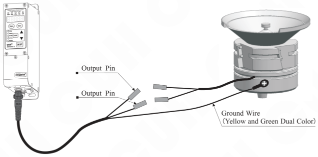

### Hinweis

Vergewissern Sie sich, dass die Piezoaktoren des Vibrators mit den beiden Ausgangspins des Ausgangsleistungskabels verbunden und die Aktoren zuverlässig geerdet sind, da sonst Sicherheitszwischenfälle auftreten können.

---

## Schritt 3:

Schließen Sie das Eingangsleistungskabel an den Controller an und ziehen Sie die Überwurfmutter der Stromversorgung fest.

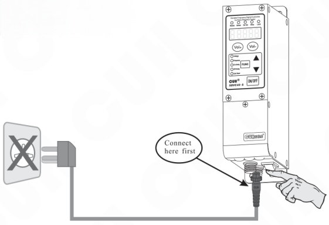

Zuerst hier anschließen

## Schritt 4:

Stecken Sie den Stecker des Eingangsleistungskabels in die Netzsteckdose.

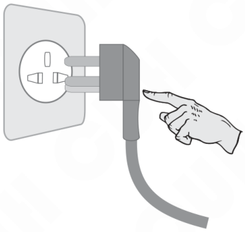

---

## Schritt 5:

Stellen Sie die Ausgangsspannung des Controllers auf einen Wert zwischen 30 und 80 ein (dargestellt durch den Buchstaben U).

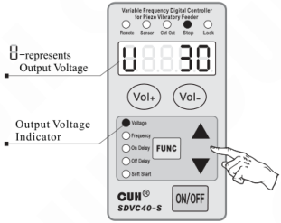

## Schritt 6:

Halten Sie die Taste `FUNC` 2 Sekunden lang gedrückt, um in den Status zur Einstellung der Grundeinstellungen zu gelangen.

Die Anzeigeleuchte für die Ausgangsfrequenz am Bedienfeld leuchtet auf und das LED-Display zeigt den aktuellen Frequenzwert (E). Drücken Sie die Tasten ▲ oder ▼, um den Parameterwert von 400 Hz bis 40 Hz zu verstellen, um die Resonanzfrequenz des Vibrators zu finden, und behalten Sie diesen Wert bei.

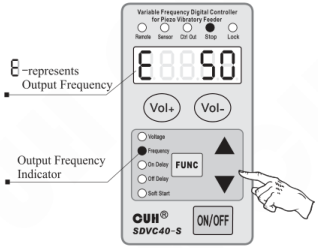

- Die Resonanzfrequenz des Vibrators ist der Frequenzwert, bei dem die maximale Amplitude entsteht.
- Jeder Vibrator hat seine natürliche mechanische Resonanzfrequenz. Stellen Sie die Ausgangsfrequenz des Controllers auf diese Frequenz ein, um optimale Betriebsbedingungen zu gewährleisten.

---

## Schritt 7:

Nachdem Sie die Ausgangsfrequenz des Controllers auf die natürliche mechanische Resonanzfrequenz des Vibrators eingestellt haben, stellen Sie die Ausgangsspannung des Controllers durch Drücken der Tasten **Vol+** oder **Vol-** ein, um die Fördergeschwindigkeit zu ändern.

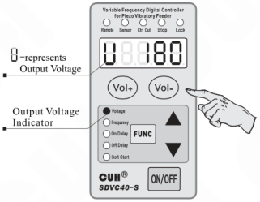

Nach den oben genannten sieben Schritten kann der Controller ordnungsgemäß arbeiten. Bitte beachten Sie die weiteren Kapitel, falls erweiterte Steuerungsfunktionen benötigt werden.

---

# Kapitel Ⅲ Komponentenbeschreibung

## 3.1 Beschreibung des Bedienfelds

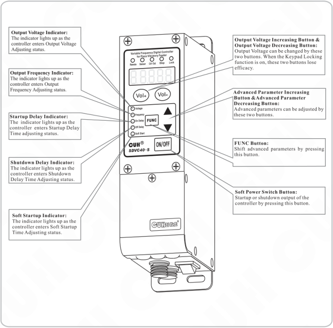

**Anzeigeleuchte Ausgangsspannung:**  
Die Anzeigeleuchte leuchtet auf, wenn der Controller in den Status zur Einstellung der Ausgangsspannung wechselt.

**Anzeigeleuchte Ausgangsfrequenz:**  
Die Anzeigeleuchte leuchtet auf, wenn der Controller in den Status zur Einstellung der Ausgangsfrequenz wechselt.

**Anzeigeleuchte Einschaltverzögerung:**  
Die Anzeigeleuchte leuchtet auf, wenn der Controller in den Status zur Einstellung der Einschaltverzögerung wechselt.

**Anzeigeleuchte Ausschaltverzögerung:**  
Die Anzeigeleuchte leuchtet auf, wenn der Controller in den Status zur Einstellung der Ausschaltverzögerung wechselt.

**Anzeigeleuchte Sanftanlauf:**  
Die Anzeigeleuchte leuchtet auf, wenn der Controller in den Status zur Einstellung der Sanftanlaufzeit wechselt.

**Taste Ausgangsspannung erhöhen & Taste Ausgangsspannung verringern:**  
Die Ausgangsspannung kann mit diesen beiden Tasten geändert werden. Wenn die Tastatursperre aktiv ist, sind diese beiden Tasten ohne Funktion.

**Taste erweiterten Parameter erhöhen & Taste erweiterten Parameter verringern:**  
Erweiterte Parameter können mit diesen beiden Tasten eingestellt werden.

**FUNC-Taste:**  
Mit dieser Taste wechseln Sie zwischen den erweiterten Parametern.

**Sanfttaster (Soft Power Switch):**  
Drücken Sie diese Taste, um den Ausgang des Controllers ein- oder auszuschalten.

---

## 3.2 Beschreibung der Statusanzeigen

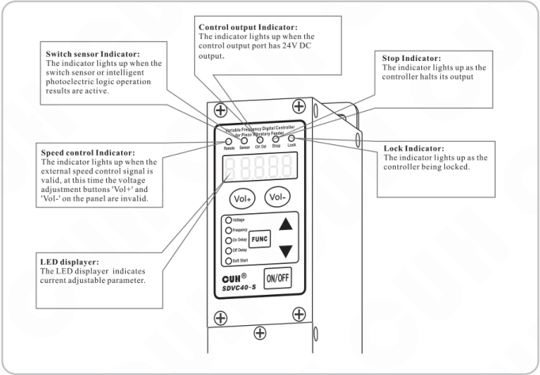

- **Anzeigeleuchte Schaltsensor:** Die Anzeigeleuchte leuchtet auf, wenn der Schaltsensor oder das Ergebnis der logischen Verknüpfung der intelligenten fotoelektrischen Sensorik aktiv ist.
- **Anzeigeleuchte Steuerausgang:** Die Anzeigeleuchte leuchtet auf, wenn der Steuerausgangsanschluss 24 V DC ausgibt.
- **Anzeigeleuchte Stopp:** Die Anzeigeleuchte leuchtet auf, wenn der Controller seine Ausgabe stoppt.
- **Anzeigeleuchte Geschwindigkeitssteuerung:** Die Anzeigeleuchte leuchtet auf, wenn das externe Geschwindigkeitssteuersignal gültig ist; in diesem Fall sind die Spannungseinstelltasten „Vol+“ und „Vol-“ am Bedienfeld unwirksam.
- **Anzeigeleuchte Sperre:** Die Anzeigeleuchte leuchtet auf, wenn der Controller gesperrt ist.
- **LED-Display:** Das LED-Display zeigt den aktuell einstellbaren Parameter an.

## 3.3 Beschreibung der E/A-Schnittstellen

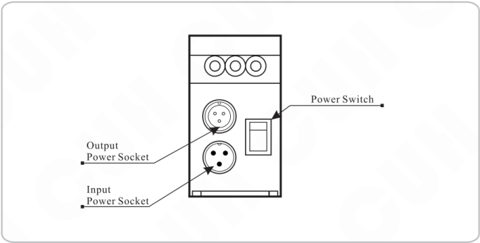

- Netzschalter
- Ausgangsleistungsbuchse
- Eingangsleistungsbuchse

---

# Kapitel Ⅳ Funktionsbeschreibung

## 4.1 Einstellung der Ausgangsspannung

Die Ausgangsspannung kann direkt und digital über das Bedienfeld eingestellt werden. Dank der einzigartigen Spannungsstabilisierungsfunktion schwankt die Ausgangsspannung des Controllers nicht mit der Eingangsspannung, sodass ein Vibrator auch in einer Umgebung mit instabiler Eingangsspannung stabil arbeiten kann.

- Schalten Sie den Netzschalter ein.
- Die Anzeigeleuchte Ausgangsspannung leuchtet auf, während der Controller in den Status zur Einstellung der Ausgangsspannung wechselt; das LED-Display zeigt das Spannungssymbol U und den zuvor eingestellten Spannungswert an.
- Stellen Sie den Wert der Ausgangsspannung durch Drücken der Taste **Vol+** oder **Vol-** ein.

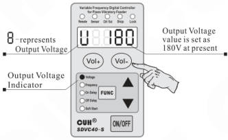

SDVC40-S: Ausgangsspannungsbereich von 0 V bis 260 V  
SDVC40-SD: Ausgangsspannungsbereich von 0,0 V bis 50,0 V

> Die Ausgangsspannung kann in jedem Status zur Einstellung der Grundparameter oder der erweiterten Parameter durch Drücken der Taste **Vol+** oder **Vol-** angepasst werden. Der Controller kehrt nach der Einstellung der Ausgangsspannung in den vorherigen Parameter-Einstellstatus zurück.

---

## 4.2 Einstellung der Ausgangsfrequenz

Der Controller wird mit der DDS-Technologie gefertigt; sein Ausgang besitzt eine hohe Frequenzgenauigkeit und -stabilität, die sich mit der Zeit oder der Temperatur nicht ändert.

- Halten Sie die Taste **FUNC** 2 Sekunden lang gedrückt, um in den Status zur Einstellung der Grundparameter zu gelangen.
- Die Anzeigeleuchte Ausgangsfrequenz am Bedienfeld leuchtet auf; das LED-Display zeigt das Symbol E für die Ausgangsfrequenz und den aktuellen Wert der Ausgangsfrequenz an.
- Drücken Sie die Taste ▲ oder ▼, um den Parameterwert einzustellen.

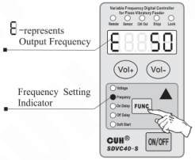

Der Ausgangsfrequenzbereich des Controllers reicht von 40 Hz bis 400 Hz.

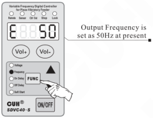

- Die Ausgangsfrequenz (E), die Einschaltverzögerungszeit, die Ausschaltverzögerungszeit und die Sanftanlaufzeit können nach dem Wechsel in den Status zur Einstellung der Grundparameter durch 2 Sekunden langes Drücken der Taste **FUNC** eingestellt werden.
- Der Controller kehrt nach der Einstellung automatisch innerhalb von 1 Minute in den Status zur Einstellung der Ausgangsspannung zurück.
- Halten Sie die Taste **FUNC** erneut 2 Sekunden lang gedrückt, um den Status zur Einstellung der Grundparameter zu verlassen.

---

## 4.3 Sanftanlauf

Um einen plötzlichen Stoß auf die Werkstücke zu vermeiden, kann der Controller beim Start die Ausgangsspannung sanft von 0 auf den voreingestellten Wert erhöhen.

Sanftanlaufzeit (t): Die Zeitspanne, die der Controller beim Start benötigt, um die Ausgangsspannung sanft von 0 auf den voreingestellten Wert zu erhöhen.

- Halten Sie die Taste `FUNC` 2 Sekunden lang gedrückt, um in den Status zur Einstellung der Grundparameter zu gelangen.
- Drücken Sie die Taste `FUNC` wiederholt, bis in den Status zur Einstellung der Sanftanlaufzeit (t) gewechselt wird, während die Anzeigeleuchte Sanftanlauf aufleuchtet.
- Drücken Sie die Taste ▲ oder ▼, um den Parameterwert einzustellen. Die Einheit des Parameters ist Sekunde, die numerische Genauigkeit beträgt 0,1.

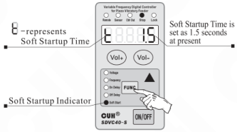

Die einstellbare Sanftanlaufzeit reicht von 0,1 Sekunden bis 9,9 Sekunden.

## 4.4 Ausgangsschalter

Mit dem Sanfttaster am Bedienfeld kann der Ausgang des Controllers schnell und einfach ein- bzw. ausgeschaltet werden.

- Drücken Sie die Taste `ON/OFF`, um den Ausgang des Controllers ein- bzw. auszuschalten. Die Anzeigeleuchte Stopp leuchtet auf, wenn der Ausgang des Controllers ausgeschaltet wird.

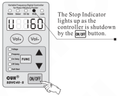

> Dank der Sanfttaster- und Digitalsignal-Steuertechnologie entsteht kein Funke, der den Kontakt beschädigen könnte. Dadurch werden die Lebensdauer des Controllers und des Vibrators erheblich verlängert.

---

## 4.5 Begrenzung der maximalen Ausgangsspannung

Die maximale Ausgangsspannung des Controllers kann eingestellt werden, um Schäden am Vibrator zu vermeiden. Die Funktion Fernsteuerung der Geschwindigkeit wird von diesem Parameter beeinflusst.

- Halten Sie die Tasten `FUNC` und ▲ gleichzeitig 2 Sekunden lang gedrückt, um in den Status zur Einstellung der erweiterten Parameter zu gelangen.
- Drücken Sie die Taste `FUNC` wiederholt, bis in den Status zur Begrenzung der maximalen Ausgangsspannung (h) gewechselt wird.
- Drücken Sie die Taste ▲ oder ▼, um den Parameterwert einzustellen.

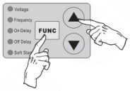

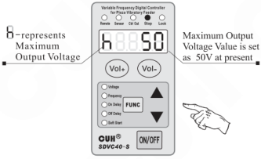

- Der Wert der Ausgangsspannung kann diesen Parameterwert in keinem Fall überschreiten.
- Der Standardwert dieses Parameters ist auf den maximal einstellbaren Wert der Ausgangsspannung gesetzt.

### Verlassen des Status zur Einstellung der erweiterten Parameter

- Der Controller kehrt nach der Einstellung der erweiterten Parameter automatisch innerhalb einer Minute in den Status zur Einstellung der Ausgangsspannung zurück.
- Halten Sie die Tasten `FUNC` und ▲ 2 Sekunden lang gedrückt, um in den Status zur Einstellung der Ausgangsspannung zurückzukehren.
- Halten Sie die Taste `FUNC` 2 Sekunden lang gedrückt, um in den Status zur Einstellung der Grundparameter zurückzukehren.

---

## 4.6 Tastatursperre

Mit der Tastatursperre können alle Tasten am Bedienfeld gesperrt werden, um Fehlbedienungen zu vermeiden.

- Halten Sie die Taste `ON/OFF` 2 Sekunden lang gedrückt, um alle Tasten am Bedienfeld zu sperren, während die Anzeigeleuchte Sperre aufleuchtet.
- Halten Sie die Taste `ON/OFF` im Sperrmodus 2 Sekunden lang gedrückt, um die Tastatursperre aufzuheben.

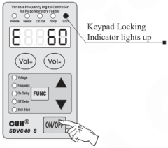

---

## 4.7 Einstellung des Einschalt-Betriebszustands

Um auf plötzliche Stromausfälle im Normalbetrieb und das anschließende Wiedereinschalten oder auf besondere Anforderungen an den Einschaltzustand des Controllers eingehen zu können, kann mit diesem Parameter festgelegt werden, ob der Controller beim Einschalten läuft, stoppt oder den Status des letzten Ausschaltens übernimmt.

- Halten Sie die Tasten **FUNC** und ▲ gleichzeitig 2 Sekunden lang gedrückt, um in den Status zur Einstellung der erweiterten Parameter zu gelangen.
- Drücken Sie die Taste **FUNC** wiederholt, bis in den Status zur Einstellung des Einschalt-Betriebszustands (Γd) gewechselt wird.
- Drücken Sie die Taste ▲ oder ▼, um den Parameterwert einzustellen.

> 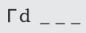 Zeigt an, dass der Einschaltzustand Ein ist.
>
> 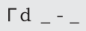 Zeigt an, dass der Einschaltzustand Aus ist.
>
> 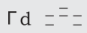 Zeigt an, dass der Einschaltzustand dem Status beim letzten Ausschalten folgt. (Wenn der Controller beim letzten Ausschalten die Ausgabe gestoppt hat, bleibt der Controller beim nächsten Einschalten aus; wenn der Controller beim letzten Ausschalten in Ausgabe war, startet der Controller beim nächsten Einschalten die Ausgabe.)

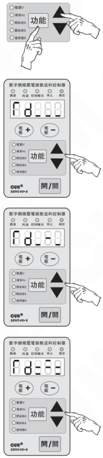

---

## 4.8 Wiederherstellung der Werkseinstellungen

Diese Funktion ermöglicht es dem Bediener, alle Standardeinstellungen der Parameter wiederherzustellen.

Aufgrund des großen Funktionsumfangs des Controllers können viele Parameter eingestellt werden. Um die Situation zu vermeiden, dass der Controller nach zu vielen Änderungen durch einen Anfänger nicht mehr ordnungsgemäß arbeitet, kann der Bediener mit dieser Funktion die Werkseinstellungen des Controllers auf einfache Weise wiederherstellen.

- Halten Sie die Tasten **FUNC** und **▲** gleichzeitig 2 Sekunden lang gedrückt, um in den Status zur Einstellung der erweiterten Parameter zu gelangen.

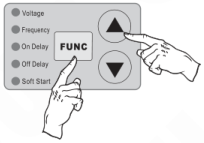

- Drücken Sie die Taste **FUNC** wiederholt, bis 88888 auf dem LED-Display blinkt, und halten Sie dann die Taste **▲** gedrückt, bis ----- angezeigt wird, was bedeutet, dass die Werkseinstellungen erfolgreich wiederhergestellt wurden.

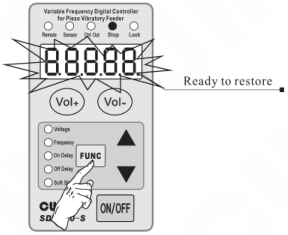

- Nach dem Loslassen der Taste **▲** wechselt der Controller in den Status zur Einstellung der Ausgangsspannung (U). Zu diesem Zeitpunkt wurden alle Parameter auf die Standardwerte zurückgesetzt.

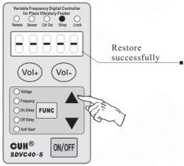

---

# Kapitel Ⅴ Sensoren und Signalsteuerung

Der Controller kann durch viele Arten externer Signale und Sensoren gesteuert werden. Dieses Kapitel erläutert hauptsächlich die Anwendungsmethoden des intelligenten fotoelektrischen Sensors, der Näherungsschalter und der SPS.

## 5.1 Intelligente fotoelektrische Sensorik

In Kombination mit dem fotoelektrischen Sensor SDVC-S1 kann die Funktion der intelligenten fotoelektrischen Sensorik realisiert werden. Der Sensor SDVC-S1 kann Störungen durch Hintergrundlicht herausfiltern, die die Empfindlichkeit des Controllers beeinträchtigen. Dadurch kann der Controller zuverlässig arbeiten, ohne dass die Empfindlichkeit manuell eingestellt werden muss.

### 5.1.1 Anschluss des intelligenten fotoelektrischen Sensors SDVC-S1

**Schritt 1:**

Öffnen Sie die obere Abdeckplatte des Controllers.

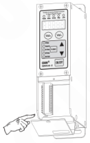

**Schritt 2:**

Schließen Sie den Sensor SDVC-S1 gemäß der Abbildung an die Klemmen des Controllers an.

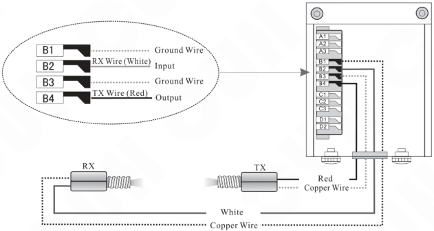

**Hinweis:**

Die standardmäßige Logikrichtung des Sensors ist auf den Zustand „Werkstückvorrat leer“ eingestellt.

---

## 5.1.2 Einschalt- und Ausschaltverzögerung des intelligenten fotoelektrischen Sensors

In den meisten praktischen Anwendungen sollte die Ausgabe des Controllers um eine gewisse Zeit verzögert werden, wenn das Ein- oder Ausschalten des Controllers durch externe Signale gesteuert wird. Die Einstellfunktionen für die Einschaltverzögerung und die Ausschaltverzögerung machen diese Art der Anwendung möglich. Darüber hinaus können Stöße auf die Werkstücke beim Start des Controllers durch die Einstellung der Sanftanlaufzeit vermieden werden.

### Einschaltverzögerung (J)

Die Zeitspanne, die der Controller vom Empfang eines Einschalt-Steuersignals bis zur Ausgabe durchläuft.

- Halten Sie die Taste **FUNC** 2 Sekunden lang gedrückt, um in den Status zur Einstellung der Grundparameter zu gelangen.
- Drücken Sie die Taste **FUNC** wiederholt, bis in den Status zur Einstellung der Einschaltverzögerung (J) gewechselt wird, während die Anzeigeleuchte Einschaltverzögerung am Bedienfeld aufleuchtet.
- Drücken Sie die Taste ▲ oder ▼, um den Parameterwert einzustellen. Die Einheit des Parameters ist die Sekunde, die numerische Genauigkeit beträgt 0,1.

Einstellbereich des Parameters: 0,0 bis 9,9 Sekunden  
Der Standardwert des Parameters beträgt 0,2 Sekunden

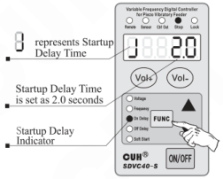

### Ausschaltverzögerung (L)

Die Zeitspanne, die der Controller vom Empfang eines Ausschalt-Steuersignals bis zur Abschaltung der Ausgabe durchläuft.

- Halten Sie die Taste **FUNC** 2 Sekunden lang gedrückt, um in den Status zur Einstellung der Grundparameter zu gelangen.
- Drücken Sie die Taste **FUNC** wiederholt, bis in den Status zur Einstellung der Ausschaltverzögerung (L) gewechselt wird, während die Anzeigeleuchte Ausschaltverzögerung am Bedienfeld aufleuchtet.
- Drücken Sie die Taste ▲ oder ▼, um den Parameterwert einzustellen. Die Einheit des Parameters ist die Sekunde, die numerische Genauigkeit beträgt 0,1.

Einstellbereich des Parameters: 0,0 bis 9,9 Sekunden  
Der Standardwert des Parameters beträgt 0,2 Sekunden

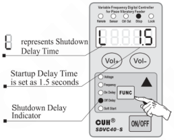

---

## 5.1.3 Logikrichtung des intelligenten fotoelektrischen Sensors

Unter normalen Umständen empfängt der Empfänger kein optisches Signal und der Controller läuft standardmäßig. In einigen speziellen Anwendungen muss der Controller jedoch gestoppt werden, wenn der Empfänger kein optisches Signal empfängt. Durch die Einstellung dieses Parameters kann diese Art der Anwendung realisiert werden.

- Halten Sie die Tasten **FUNC** und ▲ gleichzeitig 2 Sekunden lang gedrückt, um in den Status zur Einstellung der erweiterten Parameter zu gelangen.
- Drücken Sie die Taste **FUNC** wiederholt, bis in den Status zur Einstellung der Logikrichtung des intelligenten fotoelektrischen Sensors gewechselt wird.
- Drücken Sie die Taste ▲ oder ▼, um den Parameterwert einzustellen.

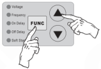

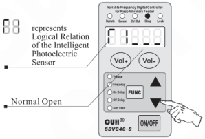

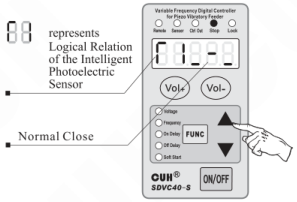

- Wenn die Logikrichtung auf Normal Open eingestellt ist, d. h. es wird kein optisches Signal empfangen, läuft der Controller.
- Wenn die Logikrichtung auf Normal Close eingestellt ist, d. h. es wird kein optisches Signal empfangen, stoppt der Controller.

---

## 5.2 Verwendung des NPN-Schaltsensors (Stopp bei vollem Werkstückvorrat)

Der Controller kann mit allen Arten von Sensoren betrieben werden, z. B. mit Schaltsensoren, optischen Schaltsensoren und LWL-Sensoren.

### 5.2.1 Anschluss des NPN-Näherungsschalters

**Schritt 1:**

Öffnen Sie die obere Abdeckplatte des Controllers.

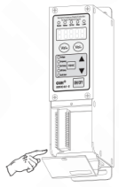

**Schritt 2:**

Schließen Sie den NPN-Näherungsschalter gemäß der Abbildung an die Klemmen des Controllers an.

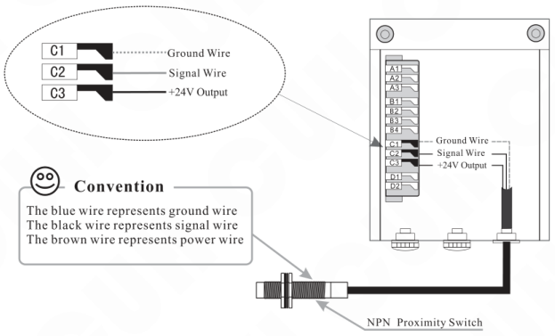

**Konvention**

Der blaue Draht steht für die Erdleitung  
Der schwarze Draht steht für die Signalleitung  
Der braune Draht steht für die Versorgungsleitung

---

### 5.2.2 Anschluss des Durchstrahl-NPN-Sensors

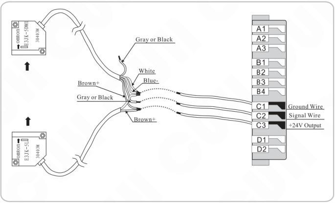

### 5.2.3 Anschluss des Durchstrahl-Photoelektrik-Sensors

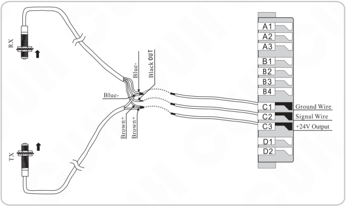

---

## 5.2.4 Anschluss des Durchstrahl-LWL-Sensors

---

## 5.2.5 Anschluss des Reflexions-Photoelektrik-Sensors

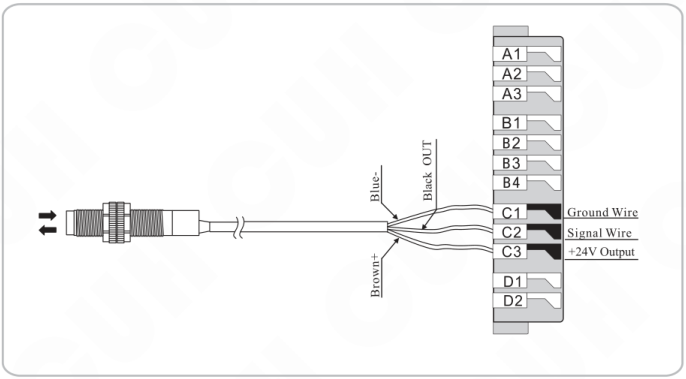

## 5.3 Einschalt- und Ausschaltverzögerung des NPN-Schaltsensors

Standardmäßig verwenden der intelligente fotoelektrische Sensor und der Schaltsensor dieselbe Einschaltverzögerung und Ausschaltverzögerung. Der Bediener kann die Einschaltverzögerung und die Ausschaltverzögerung für den Schaltsensor jedoch auch separat einstellen.

### Einschaltverzögerung (J-)

Die Zeitspanne, die der Controller vom Empfang eines Einschalt-Steuersignals bis zur Ausgabe durchläuft.

- Halten Sie die Tasten **FUNC** und **▲** gleichzeitig 2 Sekunden lang gedrückt, um in den Status zur Einstellung der erweiterten Parameter zu gelangen.
- Drücken Sie die Taste **FUNC** wiederholt, bis in den Status zur Einstellung der Einschaltverzögerung (J- ---) gewechselt wird, während die Anzeigeleuchte Einschaltverzögerung am Bedienfeld aufleuchtet.
- Drücken Sie die Taste **▲** oder **▼**, um den Parameterwert einzustellen. Die Einheit des Parameters ist die Sekunde, die numerische Genauigkeit beträgt 0,1.

Die Einschaltverzögerung ist standardmäßig auf J- --- eingestellt

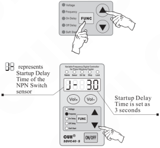

### Ausschaltverzögerung (L-)

Die Zeitspanne, die der Controller vom Empfang eines Ausschalt-Steuersignals bis zur Abschaltung der Ausgabe durchläuft.

- Halten Sie die Tasten **FUNC** und **▲** gleichzeitig 2 Sekunden lang gedrückt, um in den Status zur Einstellung der erweiterten Parameter zu gelangen.
- Drücken Sie die Taste **FUNC** wiederholt, bis in den Status zur Einstellung der Ausschaltverzögerung (L-) gewechselt wird, während die Anzeigeleuchte Ausschaltverzögerung am Bedienfeld aufleuchtet.
- Drücken Sie die Taste **▲** oder **▼**, um den Parameterwert einzustellen. Die Einheit des Parameters ist die Sekunde, die numerische Genauigkeit beträgt 0,1.

Die Ausschaltverzögerung ist standardmäßig auf L- --- eingestellt

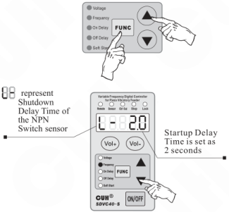

> ➔ Wenn die Werte von J- und L- auf 0 eingestellt werden, entsprechen die Einschalt- und Ausschaltverzögerung des Schaltsensors denen des intelligenten fotoelektrischen Sensors.
>
> ➔ Die Einschalt- und Ausschaltverzögerung des intelligenten fotoelektrischen Sensors werden nicht durch die Parameter J- oder L- beeinflusst.

---

## 5.4 Logikrichtung des NPN-Schaltsensors (Stopp bei vollem Werkstückvorrat)

Unter normalen Umständen empfängt der Controller kein Signal vom NPN-Schaltsensor und läuft standardmäßig. In einigen speziellen Anwendungen muss der Controller jedoch gestoppt werden, wenn er kein Signal vom NPN-Schaltsensor empfängt. Durch die Einstellung dieses Parameters kann diese Art der Anwendung realisiert werden.

- Halten Sie die Tasten **FUNC** und ▲ gleichzeitig 2 Sekunden lang gedrückt, um in den Status zur Einstellung der erweiterten Parameter zu gelangen.
- Drücken Sie die Taste **FUNC** wiederholt, bis in den Status zur Einstellung der Logikrichtung des NPN-Schaltsensors (Γ 2) gewechselt wird.
- Drücken Sie die Taste ▲ oder ▼, um den Parameterwert einzustellen.

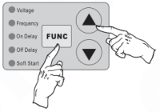

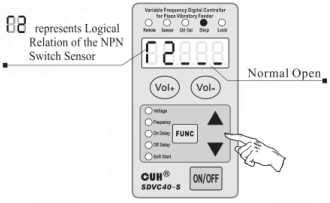

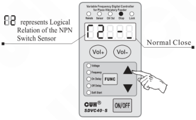

- Wenn die Logikrichtung auf Normal Open eingestellt ist, d. h. es wird kein Signal empfangen, läuft der Controller.
- Wenn die Logikrichtung auf Normal Close eingestellt ist, d. h. es wird kein Signal empfangen, stoppt der Controller.

---

## 5.5 Logische Verknüpfung der Steuersignale

Der Controller kann die logische Verknüpfung des intelligenten fotoelektrischen Sensors und des Schaltsensors festlegen, wenn diese gleichzeitig arbeiten.

- Halten Sie die Tasten **FUNC** und ▲ gleichzeitig 2 Sekunden lang gedrückt, um in den Status zur Einstellung der erweiterten Parameter zu gelangen.
- Drücken Sie die Taste **FUNC** wiederholt, bis in den Status zur Einstellung der logischen Verknüpfung des Steuersignals gewechselt wird.
- Drücken Sie die Taste ▲ oder ▼, um den Parameterwert einzustellen.

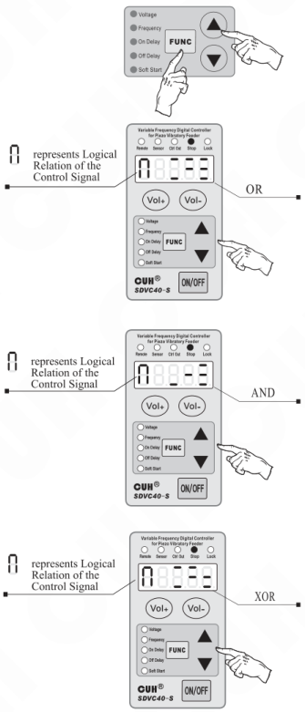

- Logische Verknüpfung AND: Der Controller läuft nur, wenn sowohl der intelligente fotoelektrische Sensor als auch der NPN-Schaltsensor den Controller zum Laufen auffordern.
- Logische Verknüpfung OR: Der Controller läuft, wenn der intelligente fotoelektrische Sensor oder der NPN-Schaltsensor den Controller zum Laufen auffordert.
- Logische Verknüpfung XOR: Der Controller läuft nur, wenn der intelligente fotoelektrische Sensor und der NPN-Schaltsensor das entgegengesetzte Steuersignal ausgeben.

---

## 5.6 Anschluss der übergeordneten SPS zur Steuerung des Vibrationsförderungs-Controllers

### Anschluss der steuernden SPS

### Schritt 1:
Öffnen Sie die obere Abdeckplatte des Controllers.

### Schritt 2:
Schließen Sie die SPS gemäß der Abbildung an die Klemmen des Controllers an.

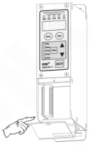

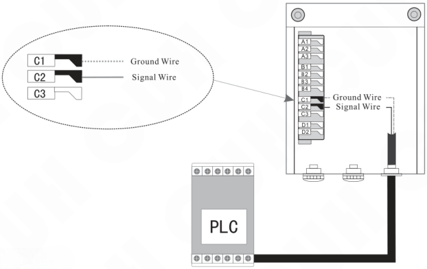

> Der Relaisausgang oder NPN-Ausgang der SPS ist mit dem Controller kompatibel.

---

## 5.7 Steuerausgang

Der Controller kann ein Niederspannungs-Steuersignal ausgeben, um mit anderen Geräten wie einem Magnetventil, einer SPS oder einem elektrischen Relais zusammenzuarbeiten.

### 5.7.1 Anschluss des Steuerausgangs

#### Anschluss des Magnetventils

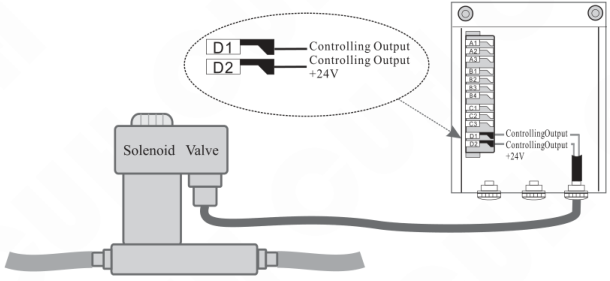

- Der Controller kann ein Magnetventil direkt ansteuern, dessen Nennspannung 24 V und dessen Nennleistung weniger als 4 W beträgt.
- Verwenden Sie für Magnetventile mit hoher Leistung eine externe Stromversorgung.

#### Anschluss des elektrischen Relais

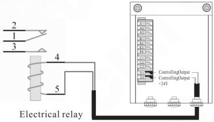

- Der Controller kann ein elektrisches Relais direkt ansteuern, dessen Nennspannung 24 V und dessen Nennleistung weniger als 4 W beträgt.

---

## 5.7.2 Logikrichtung des Steuerausgangs

- Halten Sie die Tasten **FUNC** und ▲ gleichzeitig 2 Sekunden lang gedrückt, um in den Status zur Einstellung der erweiterten Parameter zu gelangen.
- Drücken Sie die Taste **FUNC** wiederholt, bis in den Status zur Einstellung der Logikrichtung des Steuerausgangs (Γ3) gewechselt wird.
- Drücken Sie die Taste ▲ oder ▼, um den Parameterwert einzustellen.

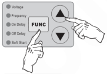

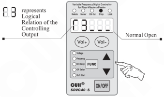

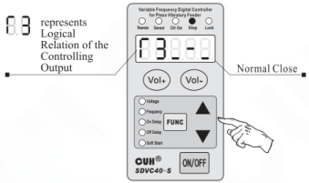

> - Wenn die Logikrichtung auf Normal Open eingestellt ist, arbeitet der Steuerausgang, während der Controller läuft.
> - Wenn die Logikrichtung auf Normal Close eingestellt ist, arbeitet der Steuerausgang nicht, während der Controller läuft.

---

## 5.8 Fernsteuerung der Geschwindigkeit

Die Funktion Fernsteuerung der Geschwindigkeit ermöglicht es dem Bediener, die Ausgangsspannung über ein externes Potenziometer oder ein Steuersignal im Bereich von 1 V bis 5 V zu steuern. Somit kann eine externe Geschwindigkeitsfernsteuerung auf einfache Weise über eine SPS, ein DCS oder andere Mittel realisiert werden.

Die Funktion Fernsteuerung der Geschwindigkeit wird für den Controller wirksam, wenn das Steuersignal 0,5 V überschreitet. Gleichzeitig leuchtet die Anzeigeleuchte Geschwindigkeitssteuerung am Bedienfeld auf und die Spannungseinstelltasten „Vol+“ und „Vol-“ am Bedienfeld verlieren ihre Wirkung. Das LED-Display zeigt die aktuelle Ausgangsspannung an, wenn der Controller im Status zur Einstellung der Ausgangsspannung läuft.

### Anschluss des externen Potenziometers

**Hinweis:** Bitte wählen Sie ein lineares Potenziometer mit einem Widerstand von 1 kΩ.

### Anschluss der SPS

---

## Kapitel Ⅵ Sicherheitsfunktionen

### 6.1 Automatische Spannungsstabilisierung

Die integrierte digitale Spannungsstabilisierungsfunktion kann Fördergeschwindigkeitsschwankungen aufgrund von Netzspannungsschwankungen eliminieren.

### 6.2 Kurzschlussschutz

Wenn der Ausgang des Controllers kurzgeschlossen wird, stoppt der Controller seine Ausgabe, bis er neu gestartet wird.

### 6.3 Stromüberlastschutz

Der Controller stoppt seine Ausgabe, um die Betriebssicherheit der Geräte zu gewährleisten, wenn der Betriebsstrom seinen Nennwert überschreitet.

### 6.4 Überhitzungsschutz

Der Controller stoppt seine Ausgabe, um sich selbst zu schützen, wenn die Betriebstemperatur zu hoch ist.

---

# Anhang

## Anhang A: Abmessungen

Außenabmessungen des Controller-Modells: (Einheit: mm)

---

## Anhang B: Definition der Ausgangsschnittstelle

### Hinweis:

A: Vergewissern Sie sich, dass die Piezoaktoren des Vibrators mit den beiden Ausgangspins der Buchse des Ausgangsleistungskabels verbunden sind und das Gehäuse des Vibrators zuverlässig geerdet ist, da sonst Sicherheitszwischenfälle auftreten können.

B: Stellen Sie nach dem Löten sicher, dass der blanke Bereich mit Isolierband oder Schrumpfschlauch umwickelt ist, bevor er in die Buchse des Ausgangsleistungskabels eingeführt wird, um elektrische Leckströme oder Kurzschlüsse zu vermeiden.

## Anhang C: Definition der Signalschnittstelle

---

## Anhang D: Funktionstabelle

| Controller | Angezeigtes Zeichen | Symbol der Digitalanzeige |
|---|---|---|
| U | Ausgangsspannung |  |
| E | Ausgangsfrequenz |  |
| J | Einschaltverzögerung des intelligenten fotoelektrischen Sensors |  |
| L | Ausschaltverzögerung des intelligenten fotoelektrischen Sensors |  |
| t | Sanftanlauf |  |
| L- | Ausschaltverzögerung des NPN-Schaltsensors |  |
| J- | Einschaltverzögerung des NPN-Schaltsensors |  |
| r1 | Logikrichtung des intelligenten fotoelektrischen Sensors |  |
| r2 | Logikrichtung des NPN-Schaltsensors |  |
| r3 | Logikrichtung des Steuerausgangs |  |
| rd | Einschalt-Betriebszustand |  |
| A | Logische Verknüpfung der Steuersignale |  |
| h | Maximale Ausgangsspannung |  |
| 8.8.8.8.8. | Wiederherstellung der Werkseinstellungen |  |

---

## Anhang E: Elektrische Spezifikation

| Position | Bereich Min. | Bereich Typ. | Bereich Max. | Einheit | Beschreibung |
|---|---|---|---|---|---|
| Eingangsspannung | 85 | 220 | 260 | V | AC RMS |
| Einstellbereich der Ausgangsspannung | 0 | —— | 220 | V | SDVC40-S |
| Einstellbereich der Ausgangsspannung | 0.0 | —— | 50.0 | V | SDVC40-SD |
| Einstellgenauigkeit der Spannung | | 1 | | V | SDVC40-S |
| Einstellgenauigkeit der Spannung | | 0.1 | | V | SDVC40-SD |
| Genauigkeit der Spannungsstabilisierung | 0 | —— | 10 | % | ΔVout/ΔVin |
| Ansprechzeit der Spannungsstabilisierung | 0.0025 | —— | 0.025 | s | die Periode der Ausgangsspannung |
| Einstellbereich des Ausgangsstroms | 0 | —— | 150 | mA | SDVC40-S |
| Einstellbereich des Ausgangsstroms | 0 | —— | 600 | mA | SDVC40-SD |
| Ausgangsleistung | 0 | —— | 33 | VA | SDVC40-S |
| Ausgangsleistung | 0 | —— | 30 | VA | SDVC40-SD |
| Ausgangsfrequenz | 40 | —— | 400 | Hz | |
| Einstellgenauigkeit der Frequenz | | 0.1 | | Hz | |
| Ausgangswellenform | | Sinuswelle | | | |
| Sanftanlaufzeit | 0 | —— | 10 | s | Werkseinstellung: 0.5 |
| Bereich der Ein-/Ausschaltverzögerung | 0 | —— | 20 | s | Werkseinstellung: 0.2 |
| Genauigkeit der Ein-/Ausschaltverzögerung | | 0.1 | | s | |
| Auslösetemperatur des Überhitzungsschutzes | 60 | —— | 65 | °C | |
| Spannung des DC-Steuerausgangs | 22 | 24 | 26 | V | |
| Strom des DC-Steuerausgangs | 0 | —— | 200 | mA | |
| Analoges Steuersignal | | 1-5 | | V | Spannung der Fernsteuerung der Geschwindigkeit |
| Digitales Steuersignal | | 24 | | V | Schaltsignal |
| Einstellmethode | | 6 | | Taste | |
| Leistungsaufnahme im Standby | —— | 4 | —— | W | |
| Anzeigemethode | | 5 | | Digit | LED-Segmentanzeigen |
| Umgebungstemperatur | 0 | 25 | 40 | °C | Ohne Kondensation |
| Umgebungsfeuchtigkeit | 10 | 60 | 85 | % | Ohne Kondensation |

---

## Anhang F: Fehlerbehebungshinweise und Fehlererklärungen

Die folgenden Hinweise können helfen, die auftretenden Probleme zu lösen.

| | | | Symbol der Digitalanzeige |
|---|---|---|---|
| 1 | Keine Anzeige nach dem Einschalten | ◆ Stellen Sie sicher, dass die Steckdose Strom führt ◆ Stellen Sie sicher, dass das Eingangsleistungskabel zuverlässig mit der Steckdose verbunden ist | |
| 2 | Anzeige normal, aber keine Ausgabe | ◆ Stellen Sie sicher, dass das Eingangsleistungskabel und das Ausgangsleistungskabel fest verbunden sind ◆ Stellen Sie sicher, dass der Parameterwert der Ausgangsspannung nicht zu klein ist ◆ Stellen Sie sicher, dass der Controller nicht durch das Steuersignal gestoppt wird ◆ Stellen Sie sicher, dass der Controller nicht durch Parameter gestoppt wird, die auf Normal Close eingestellt sind | |
| 3 | Steuersignal verliert seine Wirkung | ◆ Stellen Sie sicher, dass das Steuersignal korrekt eingegeben wird ◆ Stellen Sie sicher, dass die Erdleitung des Steuersignals korrekt mit dem Controller verbunden ist ◆ Stellen Sie sicher, dass die Logikrichtung des Steuersignals korrekt nach Ihren Erwartungen eingestellt ist | |
| 4 | Schwebungsphänomene | ◆ Vermeiden Sie die Schwingungskopplung zwischen den Vibratoren ◆ Erhöhen Sie die Resonanzfrequenz der Vibratoren | |
| 5 | Anzeige normal, keine Ausgabe, aber ein Geräusch ist hörbar | ◆ Stellen Sie alle Parameter gemäß dieser Anleitung ein | |
| 6 | Err01 | ◆ Ausgang im Kurzschluss; stellen Sie sicher, dass das Ausgangsleistungskabel und die Spule nicht kurzgeschlossen sind |  |
| 7 | Err02 | ◆ Ausgangsüberstrom; reduzieren Sie den Wert der Ausgangsspannung und stellen Sie sicher, dass der Ankerspalt nicht zu groß ist |  |
| 8 | Err03 | ◆ Überhitzung; platzieren Sie den Controller in einer gut belüfteten Umgebung |  |
| 9 | Err04 | ◆ Reserviert, bitte kontaktieren Sie uns |  |
| 10 | Err05 | ◆ Reserviert, bitte kontaktieren Sie uns |  |

---

Nanjing CUH Science & Technology Co.,Ltd  
https://en.cuhnj.com  
Tel.:+86-25-84730411 / 84730415 / 84730416  
Fax:+86-25-84730426  
E-mail:sales@cuhnj.com  
Add.:Building 2, Xueyan Tech Park, Tuscity,  
No.9 Zhineng Rd, Jiangning, Nanjing, China

