## Digitaler frequenzgeregelter intelligenter Controller für piezoelektrische Vibrationsförderer

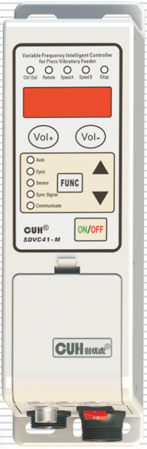

## SDVC41 Series
Digitaler frequenzgeregelter intelligenter Controller für piezoelektrische Vibrationsförderer　 SDVC41 Series
## Benutzerhandbuch

---

## Vorwort

Vielen Dank, dass Sie sich für den CUH Digitaler frequenzgeregelter intelligenter Controller für piezoelektrische Vibrationsförderer entschieden haben.

(im Folgenden kurz „Controller" genannt).

Dieses Handbuch enthält Hinweise zur Installation, Inbetriebnahme, Parametereinstellung, Wartung und Fehlerbehebung des Controllers. Bitte lesen Sie dieses Handbuch vor der Inbetriebnahme des Controllers sorgfältig durch und bewahren Sie es ordnungsgemäß auf.

---

---

## Sicherheitshinweise

1. Stecken Sie die Kabel niemals ein oder aus und berühren Sie niemals die Steckdosen, während der Controller eingeschaltet ist, um Stromschläge oder andere Unfälle zu vermeiden.
2. Schließen Sie den Controller niemals an 380 V AC an, da dies zu irreparablen Schäden führen kann. (Wir bieten Produkte, die für 380 V AC ausgelegt sind.)
3. Schalten Sie den Eingang des Controllers niemals durch Unterbrechen der Stromversorgung ein/aus, da dies die Lebensdauer des Controllers verkürzen kann.
4. Betreiben Sie den Controller niemals außerhalb seiner ausgelegten Grenzen.
5. Bedienen Sie den Controller strikt gemäß diesem Handbuch. Wir übernehmen keine zivil- oder strafrechtliche Haftung, wenn Geräteschäden oder Personenschäden durch unsachgemäße Bedienung verursacht werden.

> Öffnen Sie niemals das Gehäuse des Controllers, um einen Stromschlag zu vermeiden. Kontaktieren Sie CUH, wenn der Controller ausfällt. Versuchen Sie niemals, den Controller selbst zu reparieren, da dies zum Erlöschen der Garantie führt.

---

## Betriebs- und Lagerungsumgebung

### Kontrolle vor der Verwendung

Jeder Controller durchläuft vor der Auslieferung eine strenge Qualitätskontrolle und wird in stoßgeschützter Verpackung versandt. Bitte prüfen Sie nach dem Auspacken die folgenden Punkte:

1. Ob der Controller äußerlich beschädigt ist.
2. Ob das Modell des Controllers Ihrer Bestellung entspricht.

### Betriebsumgebung

Bitte beachten Sie die folgenden Hinweise, um eine bessere Leistung und eine längere Lebensdauer des Controllers zu gewährleisten:

- ⚠ Gut belüftete Umgebung
- ⚠ Von Wasser, Dampf, Staub und insbesondere ölhaltigem Staub fernhalten
- ⚠ Von korrosiven oder entflammbaren Gasen und Flüssigkeiten fernhalten
- ⚠ Von herumfliegendem Staub und Metallpartikeln fernhalten
- ⚠ Fest montieren, um Eigenschwingungen zu vermeiden
- ⚠ Von elektromagnetischen Störungen fernhalten
- ⚠ Umgebungstemperatur von 0~40 °C sicherstellen
- ⚠ Für die Verwendung in Höhen bis 2000 m

---

# Inhaltsverzeichnis

- Kapitel I Merkmale — 1
- Kapitel II Installationsanleitung — 2
- Kapitel III Beschreibung der Komponenten — 4
  - 3.1 Beschreibung der Anzeigen — 4
  - 3.2 Beschreibung der Tasten — 5
  - 3.3 Beschreibung der E/A-Schnittstellen und des Zubehörs — 5
  - 3.4 Beschreibung der Signalsteuerungsanschlüsse — 6
- Kapitel IV Parametereinstellung — 7
  - 4.1 Allgemeine Parameter — 7
  - 4.2 Grundparameter — 7
  - 4.3 Erweiterte Parameter — 8
  - 4.4 Auto-/Sync-Parameter — 9
- Kapitel V Betriebsart — 10
  - 5.1 Manueller Modus — 10
  - 5.2 Auto-Modus — 12
  - 5.3 Halbautomatischer Modus — 18
  - 5.4 Sync-Modus — 20
- Kapitel VI Signalsteuerung — 27
  - 6.1 EIN/AUS-Steuerung von Port C — 27
  - 6.2 EIN/AUS-Steuerung von Port E — 34
  - 6.3 Gemeinsame Parameter von Port C und Port E — 37
  - 6.4 Fernsteuerung der Geschwindigkeit — 39
  - 6.5 Speichern und Ausgeben voreingestellter Geschwindigkeiten — 41
  - 6.6 RS485-Kommunikation — 42
  - 6.7 24-V-DC-Steuerausgang — 43
- Kapitel VII Sicherheitsfunktionen — 45

---

---

Anhang A: Abmessungen ------------------------------------------------------46

Anhang B: Definition der Signalsteuerungsanschlüsse -----------------------------47

Anhang C: Elektrische Spezifikation ---------------------------------------50

Anhang D: Vorschläge zur Fehlerbehebung und Fehlererklärung -51

Controller-Reset -----------------------------------------------------------------52

---

# Kapitel Ⅰ Merkmale

Der Controller ist speziell für die Steuerung von piezoelektrischen Vibrationsförderern in Automatisierungssystemen konzipiert. Kombiniert mit den neuesten elektronischen Technologien und gut durchdacht, bietet der Controller die folgenden praktischen und benutzerfreundlichen Merkmale:

**Last:** Der Controller ist anpassungsfähig an ohmsche Last, induktive Last und insbesondere kapazitive Last wie einen piezoelektrischen Vibrator.

**Auto-FM:** Automatische Ausgangsfrequenzmodulation in Echtzeit, um sicherzustellen, dass der Vibrationsförderer immer mit seiner besten Vibrationsfrequenz arbeitet.

**Automatische Konstantgeschwindigkeitsregelung:** Automatische Ausgangsspannungsanpassung in Echtzeit, um eine konstante voreingestellte Fördergeschwindigkeit unabhängig von Gewichtsänderungen des Fördermaterials im Vibrationsförderer zu gewährleisten.

**Automatische Frequenzmessung :** Automatisches Messen und Ausgeben der besten Vibrationsfrequenz des Vibrationsförderers.

**Automatische Spannungsregelung:** Beseitigt sowohl Fördergeschwindigkeitsschwankungen durch Netzspannungsschwankungen als auch den Schwebungseffekt durch industrielle Wechselstromfrequenz.

**Wellenform-Synchronisation:** Synchronisiert die Ausgangswellenform der Slave-Controller mit der des Master-Controllers auf die gleiche Frequenz und Phase, um den Schwebungseffekt zu vermeiden.

**Fernbedienung EIN/AUS-Steuerung:** Der Controller verfügt über 2 Gruppen von EIN/AUS-Steueranschlüssen. Schaltsensoren oder SPS können angeschlossen werden, um den Controller ein-/auszuschalten. Sanftanlaufzeit, Einschaltverzögerung, Ausschaltverzögerung und logische Verknüpfung der EIN/AUS-Steuerung können ebenfalls eingestellt werden.

**Automatische Erkennung des Schaltsensor-Typs:** Der Controller kann sowohl NPN- als auch PNP-Schaltsensoren erkennen und sich daran anpassen.

**Sanftanlauf:** Um einen plötzlichen Stoß auf das Fördermaterial und den Vibrationsförderer zu vermeiden, kann der Controller beim Start die Ausgangsspannung/Fördergeschwindigkeit sanft von 0 auf den voreingestellten Wert erhöhen.

**Voreingestellte Geschwindigkeiten:** 4 voreingestellte Fördergeschwindigkeiten können gespeichert und durch ein externes Kurzschlusssignal ausgegeben werden.

**Maximal einstellbare Ausgangsspannung:** Die maximal einstellbare Ausgangsspannung kann voreingestellt werden, um den Vibrationsförderer vor Schäden durch hohe Spannung zu schützen.

**Fernsteuerung der Geschwindigkeit:** Die Ausgangsspannung/Fördergeschwindigkeit des Controllers kann über ein externes Potentiometer, eine SPS oder ein 1~5V/4~20mA-Gleichstromsignal ferngesteuert angepasst werden.

**24-V-DC-Steuerausgang:** Der Controller kann 24 V DC Leistung in Verbindung mit der logischen Verknüpfungseinstellung der EIN/AUS-Steuerung ausgeben, um ein Magnetventil, ein elektrisches Relais oder andere externe Geräte anzusteuern.

**Bedienfeldsperre:** Sperren Sie alle Tasten auf dem Bedienfeld, indem Sie die EIN/AUS-Taste 2 Sekunden lang gedrückt halten, um Fehlbedienungen zu verhindern.

**Parametersperre:** Sperren Sie alle Parameter außer Ausgangsspannung/Fördergeschwindigkeit durch ein selbst definiertes Passwort, um unbefugte Bedienung zu verhindern.

**Controller-Reset: Reset** setzt alle Parameter des Controllers auf die Werkseinstellungen zurück.

**RS485-Kommunikation:** Alle Parameter können über RS485-Kommunikationsanschlüsse angepasst werden.

---

## Kapitel Ⅱ Installationsanleitung

### Schritt eins:

Öffnen Sie den Verpackungskarton und prüfen Sie den Controller und das gesamte Zubehör.

### Schritt zwei:

Verbinden Sie die Anschlussklemmen des Ausgangsleistungskabels mit den Elektroden des piezoelektrischen Vibrators.

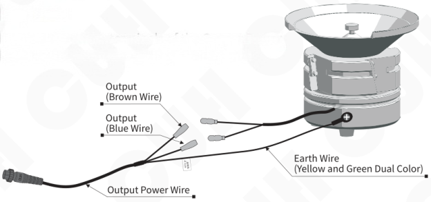

> Hinweis: Stellen Sie sicher, dass die Elektroden des piezoelektrischen Vibrators mit dem Außenleiter und dem Neutralleiter des Ausgangsleistungskabels verbunden sind und das Gehäuse des Förderers zuverlässig geerdet ist, da sonst ein schwerer Unfall auftreten kann.

### Schritt drei:

Verbinden Sie den Stecker des Ausgangsleistungskabels mit der Ausgangsstrom-Buchse des Controllers.

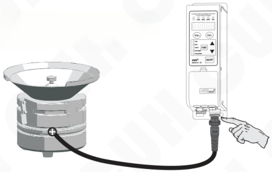

---

## Schritt vier:

Verbinden Sie den Stecker des Eingangsleistungskabels mit der Eingangsstrom-Buchse des Controllers.

Verbinden Sie zuerst die Controllerseite

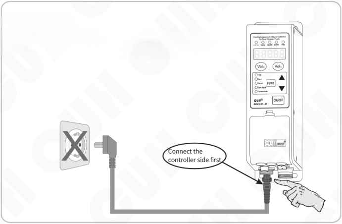

## Schritt fünf:

Verbinden Sie den Stecker des Eingangsleistungskabels mit der Netzsteckdose.

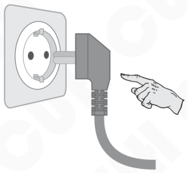

## Kapitel Ⅲ Beschreibung der Komponenten

### 3.1 Beschreibung der Anzeigen

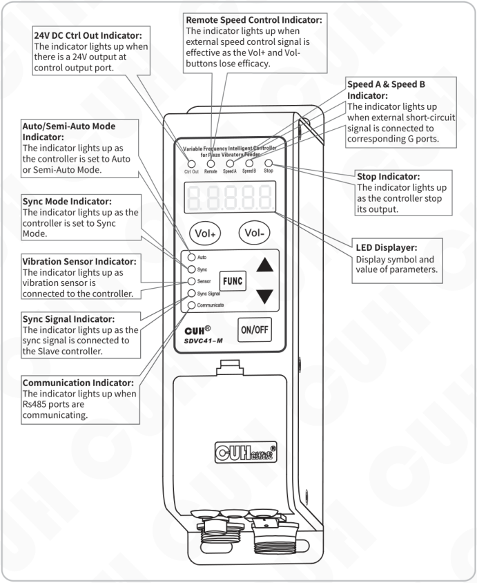

**24-V-DC-Steuerausgang-Anzeige:**  
Die Anzeige leuchtet, wenn am Steuerausgangsanschluss ein 24-V-Ausgang anliegt.

**Fernsteuerungs-Anzeige:**  
Die Anzeige leuchtet, wenn das externe Geschwindigkeitssteuersignal wirksam ist, da die Tasten Vol+ und Vol- dann unwirksam werden.

**Geschwindigkeit-A-&-Geschwindigkeit-B-Anzeige:**  
Die Anzeige leuchtet, wenn ein externes Kurzschlusssignal an den entsprechenden G-Anschluss angeschlossen ist.

**Auto-/Halbautomatischer-Modus-Anzeige:**  
Die Anzeige leuchtet, wenn der Controller auf Auto- oder Halbautomatischen Modus eingestellt ist.

**Stopp-Anzeige:**  
Die Anzeige leuchtet, wenn der Controller seine Ausgabe stoppt.

**Sync-Modus-Anzeige:**  
Die Anzeige leuchtet, wenn der Controller auf Sync-Modus eingestellt ist.

**LED-Anzeige:**  
Zeigt Symbol und Wert der Parameter an.

**Vibrationssensor-Anzeige:**  
Die Anzeige leuchtet, wenn ein Vibrationssensor an den Controller angeschlossen ist.

**Sync-Signal-Anzeige:**  
Die Anzeige leuchtet, wenn das Sync-Signal an den Slave-Controller angeschlossen ist.

**Kommunikations-Anzeige:**  
Die Anzeige leuchtet, wenn die RS485-Anschlüsse kommunizieren.

---

## 3.2 Beschreibung der Tasten

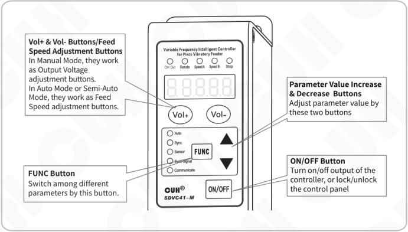

**Tasten Vol+ & Vol-/Tasten zur Einstellung der Fördergeschwindigkeit**  
Im manuellen Modus fungieren sie als Tasten zur Einstellung der Ausgangsspannung.  
Im Auto- oder Halbautomatischen Modus fungieren sie als Tasten zur Einstellung der Fördergeschwindigkeit.

**Tasten zum Erhöhen und Verringern des Parameterwerts**  
Passen Sie den Parameterwert mit diesen beiden Tasten an

**FUNC-Taste**  
Wechseln Sie mit dieser Taste zwischen verschiedenen Parametern.

**EIN/AUS-Taste**  
Ein-/Ausschalten der Ausgabe des Controllers oder Sperren/Entsperren des Bedienfelds

## 3.3 Beschreibung der E/A-Schnittstellen und des Zubehörs

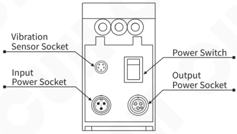

- Vibrationssensor-Buchse
- Eingangsstrom-Buchse
- Netzschalter
- Ausgangsstrom-Buchse

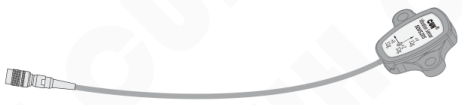

Vibrationssensor

---

## 3.4 Beschreibung der Signalsteuerungsanschlüsse

### Verdrahtungsbeschreibung der Signalsteuerungsanschlüsse

Für die Verdrahtungsbeschreibung der C-Anschlüsse -C1, C2 und C3- siehe Kapitel 6.1.

Für die Verdrahtungsbeschreibung der E-Anschlüsse -E1, E2 und E3- siehe Kapitel 6.2.

Für die Verdrahtungsbeschreibung der A-Anschlüsse -A1, A2, A3 und A4- siehe Kapitel 6.4.

Für die Verdrahtungsbeschreibung der H-Anschlüsse -H1, H2, H3 und H4- siehe Kapitel 5.4.1.

Für die Verdrahtungsbeschreibung der G-Anschlüsse -G1, G2, G3 und G4- siehe Kapitel 6.5.

Für die Verdrahtungsbeschreibung der F-Anschlüsse -F1, F2 und F3- siehe Kapitel 6.6.

Für die Verdrahtungsbeschreibung der D-Anschlüsse -D1 und D2- siehe Kapitel 6.7.

---

# Kapitel Ⅳ Parametereinstellung

Die Parameter des Controllers werden nach verschiedenen Einstellmethoden in 4 Typen unterteilt: Allgemeine Parameter, Grundparameter, Erweiterte Parameter und Auto-/Sync-Parameter.

## 4.1 Allgemeine Parameter

- Drücken Sie die Taste "Vol+" oder "Vol-", um allgemeine Parameter anzupassen.
- Die Tasten "Vol+" und "Vol-" sind ausschließlich für die Anpassung allgemeiner Parameter ausgelegt.
- Allgemeine Parameter können durch Drücken der Taste "Vol+" oder "Vol-" angepasst werden, auch wenn ein anderer Parameter auf dem LED-Bildschirm angezeigt wird. Der Controller kehrt nach der Anpassung des allgemeinen Parameters zum vorherigen Parameter zurück.

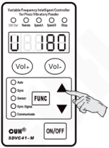

| Allgemeine Parameter | Symbol | Symbolbild | Bereich | Standard |
|---|---|---|---|---|
| Output Voltage | U |  | 20~220 V | 150 |
| Feed Speed | A |  | 0~3200 | 200 |
| Keypad Lock | a |  | \ | Current Voltage Value/Current Feed Speed |

## 4.2 Grundparameter

- Drücken Sie die Taste "FUNC" und halten Sie sie 2 Sekunden lang gedrückt, um den Einstellstatus für Grundparameter aufzurufen.
- Drücken Sie die Taste "FUNC" wiederholt, um zyklisch zwischen verschiedenen Parametern zu wechseln.
- Drücken Sie die Taste ▲ oder ▼, um den Parameterwert anzupassen.
- Drücken Sie die Taste "FUNC" erneut und halten Sie sie 2 Sekunden lang gedrückt, um den Einstellstatus für Grundparameter zu verlassen.

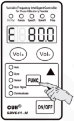

| Allgemeine Parameter | Symbol | Symbolbild | Bereich | Standard |
|---|---|---|---|---|
| Output Frequency | E |  | 40.0~400.0 Hz | 50.0 |
| C Ports On Delay | J | 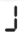 | 0.0~20.0 s | 0.2 |
| C Ports Off Delay | L |  | 0.0~20.0 s | 0.2 |
| Soft Startup Time | t | 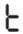 | 0.0~10.0 s | 0.5 |

---

## 4.3 Erweiterte Parameter

- Drücken Sie die Tasten "FUNC" und ▲ gleichzeitig und halten Sie sie 2 Sekunden lang gedrückt, um den Einstellstatus für erweiterte Parameter aufzurufen.
- Drücken Sie die Taste "FUNC" wiederholt, um zyklisch zwischen verschiedenen Parametern zu wechseln.
- Drücken Sie die Taste ▲ oder ▼, um den Parameterwert anzupassen.
- Drücken Sie die Tasten "FUNC" und ▲ erneut gleichzeitig und halten Sie sie 2 Sekunden lang gedrückt, um den Einstellstatus für erweiterte Parameter zu verlassen.

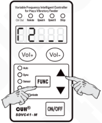

| Allgemeine Parameter | Symbol | Symbolbild | Bereich | Standard |
|---|---|---|---|---|
| E Ports On Delay | J- |  | 0.0~20.0 s | --- |
| E Ports Off Delay | L- |  | 0.0~20.0 s | --- |
| C Ports Logical Relation | Γ2 | 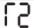 | `___` Positive Logik `_-_` Negative Logik | --- |
| E Ports Logical Relation | Γ7 |  | `___` Positive Logik `_-_` Negative Logik | --- |
| 24V Ctrl Out Logical Relation | Γ3 |  | `___` Positive Logik `_-_` Negative Logik Effect by alarm signal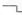 | --- |
| Whether or not output of the controller is controlled by ON/OFF Control Signal | Γ4 | 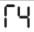 | `___` Relevant, `_-_` Irrelevant | --- |
| Default/Spare logic parameter group switch | Γ8 |  | `___` Default logic parameter group `_-_` Spare logic parameter group `_=_` Key of spare logic parameter setting | --- |
| Switch Sensor Type | ΓA |  | Uto: Auto nPn: NPN type Sensor PnP: PNP type Sensor | Uto |
| Logical Relation of C Ports and E Ports | Π | 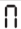 | OR, AND, XOR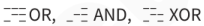 | AND |
| Max Adjustable Output Voltage | h | 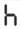 | 20~220 V | 220 |
| Temperature Display | C | 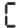 | -10.0~80.0 ℃ | Current Temperature |
| RS485 Modbus Protocol | See figure | 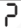 | ASC, rtu | rtu |
| Communication Address | See figure | 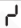 | 1~31 | 1 |
| Communication Baud Rate | See figure |  | 0.3, 1.2, 2.4, 9.6, 19.2, 57.6, 115.2 kbps | 9.6 |
| Parameter Lock Password | See figure | 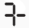 | 0~999 | --- |
| Controller output status after powering on | Γd |  | `___` On, `_-_` Off, Keep | --- |
| Firmware Version | Ur |  | \ | Current Version |
| Controller Reset | 8.8.8.8.8. | 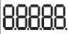 | Ready for Reset Reset Completed 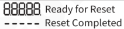 | \ |

---

## 4.4 Auto-/Sync-Parameter

- Drücken Sie die Tasten "FUNC" und ▼ gleichzeitig und halten Sie sie 2 Sekunden lang gedrückt, um den Einstellstatus für Auto-/Sync-Parameter aufzurufen.
- Drücken Sie die Taste "FUNC" wiederholt, um zyklisch zwischen verschiedenen Parametern zu wechseln.
- Drücken Sie die Taste ▲ oder ▼, um den Parameterwert anzupassen.
- Drücken Sie die Tasten "FUNC" und ▼ erneut gleichzeitig und halten Sie sie 2 Sekunden lang gedrückt, um den Einstellstatus für Auto-/Sync-Parameter zu verlassen.

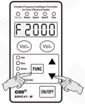

| Allgemeine Parameter | Symbol | Symbolbild | Bereich | Standard |
|---|---|---|---|---|
| Centre Frequency | F |  | 40.0~400.0 Hz | 100.0 |
| Max Offset in Auto FM | n | 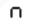 | 0.0~180.0 Hz | 30.0 |
| Output Voltage Adjustment Method | r5 |  | ___Auto _-_Manual | ___ |
| Output Frequency Adjustment Method | r6 | 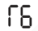 | ___Auto _-_Manual ☰ Sync | ___ |
| Output Frequency Auto Adjustment Index | IF |  | 0~200 | 20 |
| Amplitude Auto Adjustment Index | PA |  | 0~999 | 60 |
| Amplitude Auto Adjustment Index | IA |  | 0~999 | 20 |
| Feed Speed Display | U | 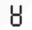 | 0~H | 0 |
| Output Voltage Display | G | 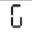 | 20~h V | 150 |
| Voltage Lower Limit | GL |  | 0~220 V | 0 |
| Frequency Lower Limit | e | 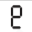 | 40.0~400.0 Hz | 40.0 |
| Max Amplitude Index | P | 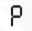 | 0~500 | 500 |
| Max Adjustment Feed Speed | H | 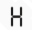 | 0~3200 | 1500 |
| Phase Difference | γ | 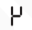 | -180~180 ° | 0 |
| Max Output Voltage in Auto Frequency Measuring Process | b | 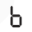 | 20~220 V | 100 |
| Frequency Search Speed | SP |  | 1~5 | 5 |
| Feed Speed Min Adjustment Volume | c | 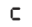 | 1~10 | 1 |
| Vibration Sensor Number | t | 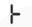 | 0, 1, 2, 3, 4, 203, 204, 205, 206 | 205 |

# KapitelⅤ Betriebsart

Der Controller kann je nach spezifischen Anwendungsanforderungen auf einen der folgenden vier Betriebsarten eingestellt werden.

- **Manueller Modus:** Sowohl Ausgangsspannung als auch Ausgangsfrequenz werden manuell angepasst.
- **Auto-Modus:** Sowohl Ausgangsspannung als auch Ausgangsfrequenz werden basierend auf dem Feedback des Vibrationssensors automatisch angepasst, um eine konstante voreingestellte Fördergeschwindigkeit und die beste Vibrationsfrequenz des Vibrationsförderers zu gewährleisten.
- **Halbautomatischer Modus:** Die Ausgangsspannung wird basierend auf dem Feedback des Vibrationssensors automatisch angepasst, um eine konstante voreingestellte Fördergeschwindigkeit zu gewährleisten. Die Ausgangsfrequenz wird manuell angepasst.
- **Sync-Modus:** In der Sync-Konfiguration, wenn die Ausgangsfrequenz von Controller B immer konstant mit der von Controller A ist, definieren wir Controller A als Master-Controller, Controller B als Slave-Controller und die Betriebsart von Controller B als Sync-Modus.

| Betriebsart | Output Voltage U — Adjustment Method | Output Voltage U — Γ5 Setting | Output Frequency E — Adjustment Method | Output Frequency E — Γ6 Setting | symbol image |
|---|---|---|---|---|---|
| Manueller Modus | Manual | ₋⁻₋ | Manual | ₋⁻₋ | Γ5 / Γ6: 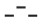 |
| Auto-Modus | Auto | _ _ _ | Auto | _ _ _ | Γ5 / Γ6: 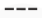 |
| Halbautomatischer Modus | Auto | _ _ _ | Manual | ₋⁻₋ | Γ5: ; Γ6:  |
| Sync-Modus | Manual or Auto | ₋⁻₋ or _ _ _ | Auto Sync with Master Controller |  | Γ5:  or ; Γ6: 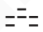 |

## 5.1 Manueller Modus

Im manuellen Modus werden sowohl Ausgangsspannung als auch Ausgangsfrequenz manuell angepasst.

| Betriebsart | Output Voltage U — Adjustment Method | Output Voltage U — Γ5 Setting | Output Frequency E — Adjustment Method | Output Frequency E — Γ6 Setting | symbol image |
|---|---|---|---|---|---|
| Manueller Modus | Manual | ₋⁻₋ | Manual | ₋⁻₋ | Γ5 / Γ6:  |

Um den Betrieb zu vereinfachen, sind die Parameter Γ5 und Γ6 werkseitig auf _ _ _ eingestellt. Bei dieser Einstellung arbeitet der Controller im manuellen Modus, wenn kein Vibrationssensor an den Controller angeschlossen ist, oder im Auto-Modus, wenn ein Vibrationssensor angeschlossen ist.

---

**Hinweis:**

Wenn sowohl Γ5 als auch Γ6 auf _ - _ eingestellt sind, arbeitet der Controller im manuellen Modus, unabhängig davon, ob ein Vibrationssensor an den Controller angeschlossen ist.

Wenn kein Vibrationssensor an den Controller angeschlossen ist, arbeitet der Controller immer im manuellen Modus.

### 5.1.1 Einstellung des Ausgangsspannungsparameters U im manuellen Modus

Der tatsächliche Ausgangsspannungswert des Controllers kann digital und genau auf dem LED-Bildschirm angezeigt werden.

- Schalten Sie den Netzschalter ein, wenn kein Vibrationssensor an den Controller angeschlossen ist.
- Der LED-Bildschirm zeigt den Ausgangsspannungsparameter U und seinen Wert an.
- Passen Sie den U-Wert durch Drücken der Taste "Vol+" oder "Vol-" an.

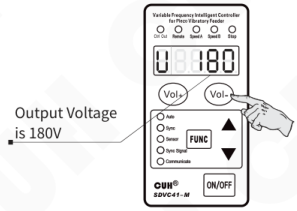

### 5.1.2 Einstellung des Ausgangsfrequenzparameters E im manuellen Modus

Mit Hilfe der DDS-Technologie ist die Ausgangsfrequenz des Controllers unabhängig von Zeit- oder Temperaturänderungen stets stabil und hochpräzise.

- Drücken Sie die Taste "FUNC" und halten Sie sie 2 Sekunden lang gedrückt, um den Einstellstatus für Grundparameter aufzurufen.
- Der LED-Bildschirm zeigt den Ausgangsfrequenzparameter E und seinen Wert an.
- Passen Sie den E-Wert durch Drücken der Taste ▲ oder ▼ an, wenn kein Vibrationssensor an den Controller angeschlossen ist.

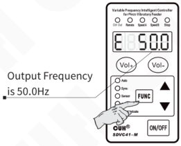

## 5.2 Auto-Modus

Im Auto-Modus muss ein Vibrationssensor an den Controller angeschlossen sein. Ausgangsspannung und Ausgangsfrequenz werden basierend auf dem Feedback des Vibrationssensors automatisch angepasst, um eine konstante voreingestellte Fördergeschwindigkeit und die beste Vibrationsfrequenz zu gewährleisten. Ausgangsspannung und Ausgangsfrequenz können nicht manuell angepasst werden.

Werkseitig gilt: Wenn ein Vibrationssensor angeschlossen ist, arbeitet der Controller im Auto-Modus.

| Betriebsart | Output Voltage U — Adjustment Method | Output Voltage U — Γ5 Setting | Output Frequency E — Adjustment Method | Output Frequency E — Γ6 Setting |
|---|---|---|---|---|
| Auto-Modus | Auto | --- | Auto | --- |

**Hinweis:**

Der Controller arbeitet weiterhin im manuellen Modus, wenn kein Vibrationssensor angeschlossen ist.

### 5.2.1 Installation des Vibrationssensors

#### 5.2.1.1 Anschlussmethode des Vibrationssensors

Verbinden Sie den Stecker des Vibrationssensors mit der Vibrationssensor-Buchse des Controllers.

Installieren Sie den Vibrationssensorkopf fest auf einer sicheren und ebenen Fläche des Vibrationsförderers.

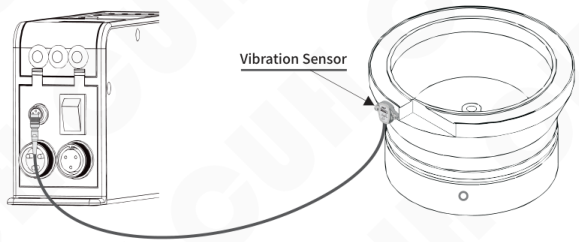

**Hinweis: Bitte stecken Sie den Vibrationssensor nur bei ausgeschaltetem Controller ein oder aus.**

---

## 5.2.1.2 Installation des Vibrationssensors am Vibrator

Befestigen Sie den Vibrationssensor auf der glatten Oberfläche des Vibrators; die Installationsrichtung ist beliebig. Die Installationsmethoden des Vibrationssensors sind unten dargestellt:

- Methode 1: Wie in Abb. 1 dargestellt

  Vorteil: Einfache Installation

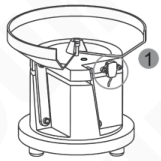

Fig. 1

- Methode 2: Wie in Abb. 2 dargestellt

  Hinweis: Der Vibrationssensor darf nicht durch die FörderSchüssel gedrückt werden.

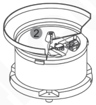

Fig. 2

- Methode 3: Schweißen Sie eine Halterung auf den Vibrator und befestigen Sie den Vibrationssensor an der Halterung. Wie in Abb. 3 dargestellt

  Empfohlene Abmessungen der Halterung des Vibrationssensors sind in Abb. 4 dargestellt.

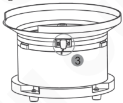

Fig. 3

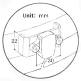

Fig. 4

- Nicht empfohlene Installationsmethode, wie in Abb. 5 und Abb. 6 dargestellt.

  Wenn die Installationsposition nicht geeignet ist, kann der Vibrationssensor die Resonanzfrequenz nicht genau zurückmelden und der Controller sucht ständig nach der Resonanzfrequenz.

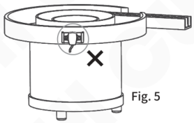

Fig. 5

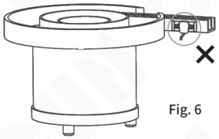

Fig. 6

---

## 5.2.2 Einstellung des Fördergeschwindigkeitsparameters A im Auto-Modus

- Schalten Sie den Netzschalter ein, wenn ein Vibrationssensor an den Controller angeschlossen ist. Die Vibrationssensor-Anzeige leuchtet auf.
- Der LED-Bildschirm zeigt den Fördergeschwindigkeitsparameter A und seinen Wert an.
- Passen Sie den A-Wert durch Drücken der Taste "Vol+" oder "Vol-" auf die gewünschte Fördergeschwindigkeit an.

## 5.2.3 Automatische Frequenzmessung im Auto-Modus

Durch die automatische Frequenzmessung erkennt der Controller die beste Vibrationsfrequenz des Vibrationsförderers und stellt alle zugehörigen Parameter automatisch ein. Der Benutzer muss lediglich den Fördergeschwindigkeitsparameter A einstellen, dann arbeitet der Controller im besten Zustand.

- Drücken Sie die Tasten ▲ und ▼ gleichzeitig und halten Sie sie 3 Sekunden lang gedrückt, wenn ein Vibrationssensor an den Controller angeschlossen ist, um die automatische Frequenzmessung zu starten. Der Ausgangsfrequenzparameter E und sein Wert werden während des Messvorgangs auf dem LED-Bildschirm angezeigt.
- Nach dem Prozess der automatischen Frequenzmessung stellt der Controller automatisch alle zugehörigen Parameter ein, darunter der Mittenfrequenzparameter F, Max Offset in Auto FM Parameter n, Output Frequency Auto Adjustment Index IF, Amplitude Auto Adjustment Index PA, Amplitude Auto Adjustment Index IA, der Phasendifferenzparameter μ, der Parameter Γ5 (Output Voltage Adjustment Method) und der Parameter Γ6 (Output Frequency Adjustment Method) wird auf \_\_\_ eingestellt.

> - Wenn der LED-Bildschirm in dem Moment, in dem der Prozess der automatischen Frequenzmessung startet, Err02 anzeigt, ist dies normal, da der Parameter b zu hoch eingestellt ist.
> - Wenn Sie den Prozess der automatischen Frequenzmessung abbrechen möchten, drücken Sie die EIN/AUS-Taste. Danach kehrt der Controller zum Status vor der automatischen Frequenzmessung zurück.

**Nach der Einstellung der Fördergeschwindigkeit und der automatischen Frequenzmessung arbeitet der Controller im besten Zustand bei der gewünschten Fördergeschwindigkeit.**

---

## 5.2.4 Erläuterung der Auto-/Sync-Parameter

(Bezüglich Einstellmethode, Wertebereich und Einheit der Auto-/Sync-Parameter siehe Abschnitt 4.4.)

### 5.2.4.1 Output Voltage Adjustment Method Parameter Γ5

Wenn der Parameter Γ5 auf `_-_` eingestellt ist, ist der Ausgangsspannungsparameter U sichtbar, während Parameter A ausgeblendet wird. Der Ausgangsspannungsparameter U kann manuell angepasst werden.

Wenn der Parameter Γ5 auf `___` eingestellt und ein Vibrationssensor an den Controller angeschlossen ist, ist der Fördergeschwindigkeitsparameter A sichtbar, während Parameter U ausgeblendet wird. Die Ausgangsspannung wird basierend auf dem Feedback des Vibrationssensors automatisch angepasst, um eine konstante voreingestellte Fördergeschwindigkeit zu gewährleisten.

**Hinweis:**

Wenn kein Vibrationssensor an den Controller angeschlossen ist, bleibt Parameter U auch dann sichtbar und manuell einstellbar, wenn Parameter Γ5 auf `___` eingestellt ist.

### 5.2.4.2 Output Frequency Adjustment Method Parameter Γ6

Wenn der Parameter Γ6 auf `_-_` eingestellt ist, kann der Ausgangsfrequenzparameter E manuell angepasst werden.

Wenn der Parameter Γ6 auf `___` eingestellt und ein Vibrationssensor an den Controller angeschlossen ist, wird der Ausgangsfrequenzparameter E basierend auf dem Feedback des Vibrationssensors automatisch auf die Resonanzfrequenz (beste Vibrationsfrequenz) des Vibrationsförderers angepasst. Die Ausgangsfrequenz kann nicht manuell angepasst werden.

Wenn der Parameter Γ6 auf  eingestellt und das Sync-Signalkabel zwischen Master- und Slave-Controllern angeschlossen ist, ist die Ausgangsfrequenz des Slave-Controllers immer konsistent mit der des Master-Controllers. Die Ausgangsfrequenz des Slave-Controllers kann nicht manuell angepasst werden.

**Hinweis:**

Wenn kein Vibrationssensor an den Controller angeschlossen ist, wird die Ausgangsfrequenz auch dann weiterhin manuell angepasst, wenn Parameter Γ6 auf `___` eingestellt ist.

Wenn Parameter n zu groß eingestellt ist, arbeitet der Vibrationsförderer möglicherweise mit einer ungeeigneten Vibrationsfrequenz.

Wenn Parameter n zu klein eingestellt ist, kann die Flexibilität des Vibrationsförderers beeinträchtigt werden.

### 5.2.4.3 Centre Frequency Parameter F

Die Mittenfrequenz sollte um die Resonanzfrequenz des Vibrationsförderers herum eingestellt werden, damit der Controller die beste Vibrationsfrequenz schneller finden kann.

### 5.2.4.4 Output Frequency Auto Adjustment Index n

Der Auto-FM-Bereich ist (F ±n) Hz.  
Ein empfohlener n-Wert liegt bei etwa 30.0Hz.  
Wenn Parameter n zu groß eingestellt ist, arbeitet der Vibrationsförderer möglicherweise mit einer ungeeigneten Vibrationsfrequenz.  
Wenn Parameter n zu klein eingestellt ist, kann die Flexibilität des Vibrationsförderers beeinträchtigt werden.

---

### 5.2.4.5 Output Frequency Auto Adjustment Index IF

Der Auto-FM-Prozess läuft über einen PID-Algorithmus. "IF" ist ein Frequenzintegrationsindex.

Je größer der Parameter "IF" eingestellt ist, desto schneller wird die Ausgangsfrequenz automatisch moduliert. Ein zu großer "IF"-Wert kann jedoch zu Schwingungen der Ausgangsfrequenz führen.

### 5.2.4.6 Amplitude Auto Adjustment Index PA

Der Controller passt die Ausgangsspannung über einen PID-Algorithmus automatisch an. PA ist ein Geschwindigkeitsverhältnisindex.

Je größer der Parameter PA eingestellt ist, desto schneller wird die Ausgangsspannung automatisch angepasst. Ein zu großer PA-Wert kann jedoch zu Schwingungen der Ausgangsspannung führen.

### 5.2.4.7 Amplitude Auto Adjustment Index IA

Der Controller passt die Ausgangsspannung über einen PID-Algorithmus automatisch an. IA ist ein Geschwindigkeitsintegrationsindex.

Je größer der Parameter IA eingestellt ist, desto schneller wird die Ausgangsspannung automatisch angepasst. Ein zu großer IA-Wert kann jedoch zu Schwingungen der Ausgangsspannung führen.

### 5.2.4.8 Feed Speed Display Parameter 

Der Parameter  dient zur Anzeige der Fördergeschwindigkeit und ist nicht einstellbar.

### 5.2.4.9 Output Voltage Display Parameter G

Der Parameter G dient zur Anzeige der Ausgangsspannung und ist nicht einstellbar.

### 5.2.4.10 Voltage Lower Limit Parameter GL

Der Parameter GL dient zur Alarmausgabe, wenn die Ausgangsspannung niedriger als der GL-Wert ist.

Wenn wahr und Γ3 auf  eingestellt, wird Port D aktiv.

### 5.2.4.11 Frequency Lower Limit Parameter 

Der Parameter  dient zur Alarmausgabe, wenn die Ausgangsfrequenz niedriger als der Wert  ist.

Wenn wahr und Γ3 auf  eingestellt, wird Port D aktiv.

### 5.2.4.12 Max Amplitude Index P

Stellen Sie den Index P ein, um die maximale Amplitude des Vibrationsförderers zu begrenzen.

### 5.2.4.13 Max Adjustable Feed Speed Parameter H

Der Fördergeschwindigkeitsbereich ist 0 bis H. Der Parameter H begrenzt die maximale Fördergeschwindigkeit auf einen bestimmten Wert, um den Vibrationsförderer vor Hochspannung durch Fehlbedienung zu schützen.

Die Fördergeschwindigkeit der Fernsteuerung wird ebenfalls durch diesen Parameter beeinflusst.

### 5.2.4.14 Phase Difference Parameter 

Passen Sie den Parameter  an, um die Phase der Ausgangswelle zu ändern; die Standard-Phasendifferenz ist 0°.

---

### 5.2.4.15 Max Output Voltage in Auto Frequency Measuring Process Parameter b

Die Ausgangsspannung überschreitet im Prozess der automatischen Frequenzmessung nicht den Wert des Parameters b, um den Vibrationsförderer vor Schäden zu schützen.

### 5.2.4.16 Frequency Search Speed Parameter SP

Der Parameter SP repräsentiert die Frequenzsuchgeschwindigkeit. Je höher dieser Wert, desto schneller der Frequenzsuchfortschritt.

### 5.2.4.17 Feed Speed Min Adjustment Volume Parameter c

Der Parameter c repräsentiert das Anpassungsvolumen des Fördergeschwindigkeitsparameters A bei einem Druck auf die Taste Vol+ oder Vol-. Der Parameter c reicht von 1 bis 10.

### 5.2.4.18 Vibration Sensor Number Parameter ├

Der Controller ist anpassungsfähig an 8 verschiedene Vibrationssensor-Modelle. Stellen Sie den Parameter ├ entsprechend dem Sensormodell ein, sodass bei eingestellter Fördergeschwindigkeit der Controller den gleichen Spannungswert ausgibt, unabhängig davon, welches Vibrationssensor-Modell angeschlossen ist.

| Parameter Value | Model | Specification (Acceleration of x axis/y axis/z axis) |
|---|---|---|
| 1 | SDVS20-1 | 16g/16g/16g |
| 2 | SDVS20-2 | 35g/35g/—— |
| 3 | SDVS20-3 | 50g/50g/—— |
| 4 | SDVS20-4 | 70g/70g/—— |
| 203 | SDVS203 | 8g/8g/8g |
| 204 | SDVS204 | 16g/16g/16g |
| 205 | SDVS205 | 32g/32g/32g |
| 206 | SDVS206 | 64g/64g/64g |

---

## 5.3 Halbautomatischer Modus

Im halbautomatischen Modus muss ein Vibrationssensor an den Controller angeschlossen und der Parameter Γ6 auf `_-_` eingestellt sein.

Die Ausgangsspannung wird basierend auf dem Feedback des Vibrationssensors automatisch angepasst, um eine konstante voreingestellte Fördergeschwindigkeit zu gewährleisten. Die Ausgangsfrequenz wird manuell angepasst.

| Betriebsart | Output Voltage U — Adjustment Method | Output Voltage U — Γ5 Setting | Output Frequency E — Adjustment Method | Output Frequency E — Γ6 Setting |
|---|---|---|---|---|
| Halbautomatischer Modus | Auto | `___` | Manual | `_-_` |

**Hinweis:**

Der Controller arbeitet weiterhin im manuellen Modus, wenn kein Vibrationssensor angeschlossen ist.

### 5.3.1 Installation des Vibrationssensors

Gleich wie Abschnitt 5.2.1.

### 5.3.2 Einrichtung des halbautomatischen Modus

- Schalten Sie den Netzschalter ein, wenn ein Vibrationssensor an den Controller angeschlossen ist. Die Vibrationssensor-Anzeige leuchtet auf.
- Drücken Sie die Tasten "FUNC" und ▼ gleichzeitig und halten Sie sie 2 Sekunden lang gedrückt, um den Einstellstatus für Auto-/Sync-Parameter aufzurufen.
- Drücken Sie die Taste "FUNC" wiederholt, um zum Parameter Γ6 (Output Frequency Adjustment Method) zu wechseln.
- Drücken Sie die Taste ▲ oder ▼, um Γ6 auf `_-_` einzustellen.

---

## 5.3.3 Einstellung des Fördergeschwindigkeitsparameters A im halbautomatischen Modus

- Passen Sie den A-Wert durch Drücken der Taste "Vol+" oder "Vol-" auf die gewünschte Fördergeschwindigkeit an.

## 5.3.4 Einstellung des Ausgangsfrequenzparameters E im halbautomatischen Modus

- Drücken Sie die Taste "FUNC" und halten Sie sie 2 Sekunden lang gedrückt, um den Einstellstatus für Grundparameter aufzurufen.
- Der LED-Bildschirm zeigt den Ausgangsfrequenzparameter E und seinen Wert an.
- Passen Sie den E-Wert durch Drücken der Taste ▲ oder ▼ an.

---

## 5.4 Sync-Modus

Im Sync-Modus muss das Sync-Signalkabel zwischen den Master- und Slave-Controllern angeschlossen sein. Die Ausgangsfrequenz des Controllers (Slave-Controller) ist immer konsistent mit der des Master-Controllers. Die Ausgangsspannung des Controllers (Slave-Controller) kann manuell oder automatisch angepasst werden.

| Betriebsart | Output Voltage U — Adjustment Method | Output Voltage U — Γ5 Setting | Output Frequency E — Adjustment Method | Output Frequency E — Γ6 Setting |
|---|---|---|---|---|
| Sync-Modus | Manual or Auto |  | Auto Sync with Master Controller |  |

Der Sync-Modus gilt für die Situation, dass mehr als ein Controller mehrere Vibrationsförderer im Fördersystem steuern, die Ausgaben der Controller nicht synchron sind und sich daher gegenseitig beeinflussen (Schwebungseffekt). Der Sync-Modus ist darauf ausgelegt, den Schwebungseffekt zu eliminieren, da die Ausgangswellenformen von Master- und Slave-Controllern exakt synchron sind.

Controller B ist nicht auf Sync-Modus eingestellt, die Ausgangswellenformen der beiden Controller sind nicht synchron.

Controller B ist auf Sync-Modus eingestellt, die Ausgangswellenformen der beiden Controller sind synchron.

---

## 5.4.1 Anschlussmethode des Sync-Signalkabels zwischen Master- und Slave-Controllern

### Schritt 1:

Öffnen Sie die Abdeckplatten der Signalsteuerungsanschlusskästen beider Controller.

### Schritt 2:

Verbinden Sie das Sync-Signalkabel zwischen Master- und Slave-Controllern gemäß dem untenstehenden Schaltplan.

> Der Slave-Controller stoppt seine Ausgabe, wenn das Sync-Signal instabil oder nicht angeschlossen ist. Und die Sync-Anzeige erlischt.

**Ein Master-Controller kann mehrere Slave-Controller ansteuern.**

---

## 5.4.2 Anwendungen des Sync-Modus

### Sub-Pattern 1

| Controller | Output Voltage U — Adjustment Method | Output Voltage U — Γ5 Setting | Output Frequency E — Adjustment Method | Output Frequency E — Γ6 Setting |
|---|---|---|---|---|
| Master Controller | Manual |  | Manual |  |
| Slave Controller | Manual |  | Auto Sync with Master Controller |  |

Wenn der Γ6-Parameter auf  eingestellt ist, wird seine Ausgangsfrequenz vom Master-Controller gesteuert.

---

## Sub-Pattern 2

| Controller | Output Voltage U — Adjustment Method | Output Voltage U — Γ5 Setting | Output Frequency E — Adjustment Method | Output Frequency E — Γ6 Setting | symbol image |
|---|---|---|---|---|---|
| Master Controller | Auto | --- | Auto | --- | Γ5, Γ6:  |
| Slave Controller | Manual | symbol image | Auto Sync with Master Controller | symbol image | Γ5: ; Γ6:  |

## Sub-Pattern 3

| Controller | Output Voltage U — Adjustment Method | Output Voltage U — Γ5 Setting | Output Frequency E — Adjustment Method | Output Frequency E — Γ6 Setting |  |
|---|---|---|---|---|---|
| Master Controller | Auto | --- | Manual | symbol image | Γ5: ; Γ6:  |
| Slave Controller | Manual | symbol image | Auto Sync with Master Controller | symbol image | Γ5: ; Γ6:  |

## Sub-Pattern 4

| Controller | Output Voltage U — Adjustment Method | Output Voltage U — Γ5 Setting | Output Frequency E — Adjustment Method | Output Frequency E — Γ6 Setting | symbol image |
|---|---|---|---|---|---|
| Master Controller | Manual | See right column Γ5 | Manual | See right column Γ6 | Γ5: ; Γ6:  |
| Slave Controller | Auto | See right column Γ5 | Auto Sync with Master Controller | See right column Γ6 | Γ5: ; Γ6:  |

## Sub-Pattern 5

| Controller | Output Voltage U — Adjustment Method | Output Voltage U — Γ5 Setting | Output Frequency E — Adjustment Method | Output Frequency E — Γ6 Setting | symbol image |
|---|---|---|---|---|---|
| Master Controller | Auto | --- | Auto | --- | Γ5, Γ6:  |
| Slave Controller | Auto | --- | Auto Sync with Master Controller | See graphical symbol image | Γ5: ; Γ6:  |

## Sub-Pattern 6

| Controller | Output Voltage U — Adjustment Method | Output Voltage U — Γ5 Setting | Output Frequency E — Adjustment Method | Output Frequency E — Γ6 Setting | symbol image |
|---|---|---|---|---|---|
| Master Controller | Auto | --- | Manual | See graphical symbol image | Γ5: ; Γ6:  |
| Slave Controller | Auto | --- | Auto Sync with Master Controller | See graphical symbol image | Γ5: ; Γ6:  |

## 5.4.3 Erläuterung einiger erweiterter Parameter

### 5.4.3.1 Max Adjustable Output Voltage Parameter 

Der Ausgangsspannungsbereich ist 0 bis h V. Der Parameter h begrenzt die maximale Ausgangsspannung auf einen bestimmten Wert, um den Vibrationsförderer vor Hochspannung durch Fehlbedienung zu schützen.

Die Spannung der Fernsteuerung wird ebenfalls durch diesen Parameter beeinflusst.

### 5.4.3.2 Temperature Display Parameter 

Zeigt die interne Temperatur des Controllers in Echtzeit an. Nur Lesen.

### 5.4.3.3 Controller Reset Parameter 

Setzen Sie bei Bedarf alle Parameter mit diesem Parameter auf die Werkseinstellungen zurück.

### 5.4.3.4 Parameter Lock Password 

Sperren Sie alle Parameter außer dem Ausgangsspannungsparameter U/ dem Fördergeschwindigkeitsparameter A durch ein selbst definiertes Passwort, um unbefugte Bedienung zu verhindern.

---

# Kapitel Ⅵ Signalsteuerung

Die Signalsteuerung umfasst: EIN/AUS-Steuerung von Port C, EIN/AUS-Steuerung von Port E, Fernsteuerung der Geschwindigkeit, Speichern und Ausgeben voreingestellter Geschwindigkeiten, RS485-Kommunikation und 24-V-DC-Steuerausgang.

## 6.1 EIN/AUS-Steuerung von Port C

Die Ausgabe des Controllers kann über Port C durch jede Art von Schaltsensor oder SPS ein- oder ausgeschaltet werden.

### 6.1.1 Anschlussmethode verschiedener Arten von Schaltsensoren und SPS an Port C

#### 6.1.1.1 Anschlussmethode des Näherungssensors an Port C

**Schritt 1:**

Öffnen Sie die Abdeckungen der Klemmenkästen der Signalsteuerungsanschlüsse des Controllers.

**Schritt 2:**

Schließen Sie den Näherungssensor gemäß der Abbildung an Port C an.

**Konvention**

Das blaue Kabel steht für die Erdungsleitung  
Das schwarze Kabel steht für die Signalleitung  
Das braune Kabel steht für die Stromversorgungsleitung

---

### 6.1.1.2 Anschlussmethode des Durchstrahl-Lichtschranken-Sensors an Port C

---

### 6.1.1.3 Anschlussmethode des photoelektrischen Reflexionssensors an Port C

---

### 6.1.1.4 Anschlussmethode des Durchstrahl-Lichtwellenleiter-Sensors an Port C

---

### 6.1.1.5 Anschlussmethode der SPS an Port C

Anschlussmethode des NPN-Ausgangs der SPS an Port C

Anschlussmethode des PNP-Ausgangs der SPS an Port C

> Hinweis: Relaisausgang, NPN-Ausgang und PNP-Ausgang der SPS – jeder einzelne davon kann den Controller ein-/ausschalten.

## 6.1.2 EIN-Verzögerungsparameter J und AUS-Verzögerungsparameter L von Port C

Wenn Sie möchten, dass der Controller nach Empfang des EIN-Steuersignals von Port C erst nach einer gewissen Zeit mit der Ausgabe beginnt, stellen Sie Parameter J ein.

Wenn Sie möchten, dass der Controller nach Empfang des AUS-Steuersignals von Port C noch eine gewisse Zeit lang weiter ausgibt, stellen Sie Parameter L ein.

### EIN-Verzögerungsparameter J von Port C

Die Zeitdauer vom Empfang des EIN-Steuersignals von Port C bis zum Beginn der Ausgabe.

- Drücken Sie die Taste "FUNC" und halten Sie sie 2 Sekunden lang gedrückt, um den Einstellstatus für Grundparameter aufzurufen.
- Drücken Sie die Taste "FUNC" wiederholt, um zu Parameter J zu wechseln.
- Drücken Sie die Taste ▲ oder ▼, um den Wert J einzustellen. Die Parametereinheit ist Sekunde und die Einstellgenauigkeit beträgt 0,1.

### AUS-Verzögerungsparameter L von Port C

Die Zeitdauer vom Empfang des AUS-Steuersignals von Port C bis zum Abschalten der Ausgabe.

- Drücken Sie die Taste "FUNC" und halten Sie sie 2 Sekunden lang gedrückt, um den Einstellstatus für Grundparameter aufzurufen.
- Drücken Sie die Taste "FUNC" wiederholt, um zu Parameter L zu wechseln.
- Drücken Sie die Taste ▲ oder ▼, um den Wert L einzustellen. Die Parametereinheit ist Sekunde und die Einstellgenauigkeit beträgt 0,1.

---

## 6.1.3 Parameter Γ2 der logischen Verknüpfung der EIN/AUS-Steuerung von Port C

Standardmäßig läuft der Controller, wenn Port C kein Signal empfängt. In einigen anderen Anwendungen muss der Controller jedoch stoppen, wenn Port C kein Signal empfängt.

Stellen Sie Parameter Γ2 ein, um eine der beiden Anforderungen zu erfüllen.

- Drücken Sie die Tasten "FUNC" und ▲ gleichzeitig und halten Sie sie 2 Sekunden lang gedrückt, um den Einstellstatus für erweiterte Parameter aufzurufen.
- Drücken Sie die Taste "FUNC" wiederholt, um zu Parameter Γ2 zu wechseln.
- Drücken Sie die Taste ▲ oder ▼, um die logische Verknüpfung zu ändern.

Parameter Γ2 ist standardmäßig auf `___` eingestellt.

- Wenn Parameter Γ2 auf `___` eingestellt ist, ist die Ausgabe des Controllers eingeschaltet, wenn Port C kein Signal empfängt.
- Wenn Parameter Γ2 auf `_-_` eingestellt ist, ist die Ausgabe des Controllers ausgeschaltet, wenn Port C kein Signal empfängt.

---

## 6.2 EIN/AUS-Steuerung von Port E

Die Ausgabe des Controllers kann über Port E durch jede Art von Schaltsensor oder SPS ein- oder ausgeschaltet werden.

Die EIN/AUS-Steuerung von Port C und die EIN/AUS-Steuerung von Port E sind unabhängig voneinander.

### 6.2.1 Anschlussmethode verschiedener Arten von Schaltsensoren und SPS an Port E

### 6.2.1.1 Anschlussmethode des Näherungssensors an Port E

**Schritt 1:**

Öffnen Sie die Abdeckungen der Klemmenkästen der Signalsteuerungsanschlüsse des Controllers.

**Schritt 2:**

Schließen Sie den Näherungssensor gemäß der Abbildung an Port C an.

**Konvention**

Das blaue Kabel steht für die Erdungsleitung  
Das schwarze Kabel steht für die Signalleitung  
Das braune Kabel steht für die Stromversorgungsleitung

### 6.1.1.2 Die Anschlussmethode anderer Arten von Schaltsensoren und SPS an Port E ähnelt der von Port C

---

## 6.2.2 EIN-Verzögerungsparameter J- und AUS-Verzögerungsparameter L- von Port E

Wenn Sie möchten, dass der Controller nach Empfang des EIN-Steuersignals von Port E erst nach einer gewissen Zeit mit der Ausgabe beginnt, stellen Sie Parameter J- ein.

Wenn Sie möchten, dass der Controller nach Empfang des AUS-Steuersignals von Port E noch eine gewisse Zeit lang weiter ausgibt, stellen Sie Parameter L- ein.

Die EIN/AUS-Verzögerung von Port E entspricht standardmäßig der EIN/AUS-Verzögerung von Port C.
Die EIN/AUS-Verzögerung von Port E kann auch unabhängig durch Einstellen von Parameter J- und Parameter L- festgelegt werden.

### EIN-Verzögerungsparameter J- von Port E

Die Zeitdauer vom Empfang des EIN-Steuersignals von Port E bis zum Beginn der Ausgabe.

- Drücken Sie die Tasten "FUNC" und ▲ gleichzeitig und halten Sie sie 2 Sekunden lang gedrückt, um den Einstellstatus für erweiterte Parameter aufzurufen.
- Drücken Sie die Taste "FUNC", um zu Parameter J- zu wechseln.
- Drücken Sie die Taste ▲ oder ▼, um den Wert J- einzustellen. Die Parametereinheit ist Sekunde und die Einstellgenauigkeit beträgt 0,1.

Parameter J- ist standardmäßig auf \_\_\_ eingestellt, was den gleichen Wert wie bei Parameter J bedeutet.

### AUS-Verzögerungsparameter L- von Port E

Die Zeitdauer vom Empfang des AUS-Steuersignals von Port E bis zum Abschalten der Ausgabe.

- Drücken Sie die Tasten "FUNC" und ▲ gleichzeitig und halten Sie sie 2 Sekunden lang gedrückt, um den Einstellstatus für erweiterte Parameter aufzurufen.
- Drücken Sie die Taste "FUNC", um zu Parameter L- zu wechseln.
- Drücken Sie die Taste ▲ oder ▼, um den Wert L- einzustellen. Die Parametereinheit ist Sekunde und die Einstellgenauigkeit beträgt 0,1.

Parameter L- ist standardmäßig auf \_\_\_ eingestellt, was den gleichen Wert wie bei Parameter L bedeutet.

---

## 6.2.3 Parameter Γ7 der logischen Verknüpfung der EIN/AUS-Steuerung von Port E

Standardmäßig läuft der Controller, wenn Port E kein Signal empfängt. In einigen anderen Anwendungen muss der Controller jedoch stoppen, wenn Port E kein Signal empfängt.

Stellen Sie Parameter Γ7 ein, um eine der beiden Anforderungen zu erfüllen.

- Drücken Sie die Tasten "FUNC" und ▲ gleichzeitig und halten Sie sie 2 Sekunden lang gedrückt, um den Einstellstatus für erweiterte Parameter aufzurufen.
- Drücken Sie die Taste "FUNC" wiederholt, um zu Parameter Γ7 zu wechseln.
- Drücken Sie die Taste ▲ oder ▼, um die logische Verknüpfung zu ändern.

Parameter Γ7 ist standardmäßig auf `___` eingestellt.

> - Wenn Parameter Γ7 auf `___` eingestellt ist, ist die Ausgabe des Controllers eingeschaltet, wenn Port E kein Signal empfängt.
> - Wenn Parameter Γ7 auf `_-_` eingestellt ist, ist die Ausgabe des Controllers ausgeschaltet, wenn Port E kein Signal empfängt.

---

## 6.3 Gemeinsame Parameter von Port C und Port E

### 6.3.1 Parameter Π der logischen Verknüpfung von Port C und Port E

Parameter Π bestimmt die Reaktion des Controllers, wenn sowohl Port C als auch Port E wirksam sind.

- Drücken Sie die Tasten "FUNC" und ▲ gleichzeitig und halten Sie sie 2 Sekunden lang gedrückt, um den Einstellstatus für erweiterte Parameter aufzurufen.
- Drücken Sie die Taste "FUNC" wiederholt, um zu Parameter Π zu wechseln.
- Drücken Sie die Taste ▲ oder ▼, um die logische Verknüpfung zu ändern.

Die standardmäßige logische Verknüpfung ist AND.

**Logische Verknüpfung: AND** 

Die Ausgabe des Controllers ist nur dann EIN, wenn beide Ports den Betrieb des Controllers anfordern.

**Logische Verknüpfung: OR** 

Die Ausgabe des Controllers ist EIN, wenn einer oder beide Ports den Betrieb des Controllers anfordern.

**Logische Verknüpfung: XOR** 

Die Ausgabe des Controllers ist nur dann EIN, wenn einer der Ports den Betrieb des Controllers anfordert und der andere das Stoppen anfordert.

---

## 6.3.2 Parameter ΓA des Schaltsensor-Typs

Der Controller kann den Typ des Schaltsensors, NPN oder PNP, automatisch erkennen.

Benutzer können den Schaltsensor-Typ auch manuell einstellen.

- Drücken Sie die Tasten "FUNC" und ▲ gleichzeitig und halten Sie sie 2 Sekunden lang gedrückt, um den Einstellstatus für erweiterte Parameter aufzurufen.
- Drücken Sie die Taste "FUNC" wiederholt, um zu Parameter ΓA zu wechseln.
- Drücken Sie die Taste ▲ oder ▼, um den Wert ΓA zu ändern.

**Uto:** Automatische Erkennung des Schaltsensor-Typs

**nPn:** Schaltsensor vom Typ NPN

**PnP:** Schaltsensor vom Typ PNP

## 6.3.3 Parameter Γ4: Ob die Ausgabe des Controllers durch das EIN/AUS-Steuersignal gesteuert wird

- Drücken Sie die Tasten "FUNC" und ▲ gleichzeitig und halten Sie sie 2 Sekunden lang gedrückt, um den Einstellstatus für erweiterte Parameter aufzurufen.
- Drücken Sie die Taste "FUNC" wiederholt, um zu Parameter Γ4 zu wechseln.
- Drücken Sie die Taste ▲ oder ▼, um den Wert Γ4 zu ändern.

`___` bedeutet relevant

`_-_` bedeutet nicht relevant

Parameter Γ4 ist standardmäßig auf `___` eingestellt.

---

## 6.4 Fernsteuerung der Geschwindigkeit

Die Ausgangsspannung/Fördergeschwindigkeit kann über ein Potentiometer oder ein 1~5V/4~20mA-Gleichstrom-Steuersignal ferngesteuert werden.

Wenn die Spannung der Fernsteuerung der Geschwindigkeit 0,5 V überschreitet, wird sie für den Controller wirksam, während die Tasten "Vol+" und "Vol-" unwirksam werden.

Während der Fernsteuerung der Geschwindigkeit leuchtet die Fernsteuerungs-Anzeige und der LED-Bildschirm zeigt die Ausgangsspannung/Fördergeschwindigkeit und ihren Wert an.

### Anschlussmethode des Potentiometers für die Fernsteuerung der Geschwindigkeit

**Hinweis:** Bitte wählen Sie ein lineares Potentiometer mit einem Widerstand von 1 KΩ.

---

## Anschlussmethode der SPS für die Fernsteuerung der Geschwindigkeit

| Signal der Fernsteuerung der Geschwindigkeit | Ausgangsspannung/Fördergeschwindigkeit |
|---|---|
| weniger als 0.5V | Gesteuert durch die Tasten Vol+ und Vol- |
| 0.5V-1V | Ausgangsspannung: 20V/Fördergeschwindigkeit: 0 Gesteuert durch das Signal der Fernsteuerung der Geschwindigkeit |
| 1~5V/4~20mA | Ausgangsspannung/Fördergeschwindigkeit wird linear durch das Signal der Fernsteuerung der Geschwindigkeit gesteuert |

## 6.5 Speichern und Ausgeben voreingestellter Geschwindigkeiten

Der Controller kann 4 verschiedene voreingestellte Geschwindigkeiten speichern und ausgeben. Die 4 Arten der EIN/AUS-Kombination der Speed A-Anzeige und der Speed B-Anzeige entsprechen jeweils Geschwindigkeit 1, Geschwindigkeit 2, Geschwindigkeit 3 und Geschwindigkeit 4.

| Voreingestellte Geschwindigkeit | G1- & G2-Ports — Speed A-Anzeige | G1- & G2-Ports — Schalter 1 | G3- & G4-Ports — Speed B-Anzeige | G3- & G4-Ports — Schalter 2 |
|---|---|---|---|---|
| Geschwindigkeit 1 | EIN | Geschlossen | AUS | Offen |
| Geschwindigkeit 2 | AUS | Offen | EIN | Geschlossen |
| Geschwindigkeit 3 | EIN | Geschlossen | EIN | Geschlossen |
| Geschwindigkeit 4 | AUS | Offen | AUS | Offen |

### Anschlussmethode der voreingestellten Geschwindigkeiten

### Speichern voreingestellter Geschwindigkeiten

- Nehmen Sie das Speichern von Geschwindigkeit 1 als Beispiel:
- Schließen Sie S1, die Speed A-Anzeige leuchtet auf; öffnen Sie S2, die Speed B-Anzeige erlischt.

So stellen Sie die gewünschte Fördergeschwindigkeit ein:

Im manuellen Modus stellen Sie den Ausgangsspannungsparameter U und den Ausgangsfrequenzparameter E ein.

Im Auto-Modus stellen Sie den Fördergeschwindigkeitsparameter A ein.

Im halbautomatischen Modus stellen Sie den Fördergeschwindigkeitsparameter A und den Ausgangsfrequenzparameter E ein.

- Geschwindigkeit 1 wird automatisch gespeichert.

### Ausgeben voreingestellter Geschwindigkeiten

- Nehmen Sie die Ausgabe von Geschwindigkeit 1 als Beispiel:
- Schließen Sie S1 erneut, die Speed A-Anzeige leuchtet auf; öffnen Sie S2 erneut, die Speed B-Anzeige erlischt.

Der Controller gibt Geschwindigkeit 1 sofort aus.

---

## 6.6 RS485-Kommunikation

Alle Parameter des Controllers können über die RS485-Kommunikationsanschlüsse ferngesteuert angepasst werden.

### 6.6.1 Adressparameter der RS485-Kommunikation 

Der Parameter  repräsentiert die ID-Nummer des Controllers in der RS485-Kommunikation.  
Der Bereich des Parameters: 1 bis 31.  
Stellen Sie sicher, dass die Kommunikationsadressen aller Controller im selben Netzwerk unterschiedlich sind, um die Controller voneinander zu unterscheiden.

- Drücken Sie die Tasten "FUNC" und ▲ gleichzeitig und halten Sie sie 2 Sekunden lang gedrückt, um den Einstellstatus für erweiterte Parameter aufzurufen.
- Drücken Sie die Taste "FUNC" wiederholt, um zu Parameter  zu wechseln.
- Drücken Sie die Taste ▲ oder ▼, um den Wert  zu ändern.

### 6.6.2 Baudraten-Parameter der RS485-Kommunikation 

Die Baudrate der RS485-Kommunikation kann sein: 3, 12, 24, 96, 192, 576 oder 1152.  
Einheit: 0,1 Kbps.  
Standardwert: 9,6 Kbps.  
Controller im selben Netzwerk sollten dieselbe Baudrate verwenden.

- Drücken Sie die Tasten "FUNC" und ▲ gleichzeitig und halten Sie sie 2 Sekunden lang gedrückt, um den Einstellstatus für erweiterte Parameter aufzurufen.
- Drücken Sie die Taste "FUNC" wiederholt, um zu Parameter  zu wechseln.
- Drücken Sie die Taste ▲ oder ▼, um den Wert  zu ändern.

### 6.6.3 RS485-Kommunikationsprotokoll

Das RS485-Kommunikationsprotokoll ist in der Download-Spalte unserer offiziellen Website verfügbar: **www.cuh-controller.com**

Hinweis: Aufgrund der begrenzten Anzahl an Löschvorgängen des nichtflüchtigen Speichers des Controllers muss der 485-Speicherbefehl nach dem Ändern der Parameter manuell ausgeführt werden, um zu vermeiden, dass Speicherbefehle häufig über das Programm gesendet werden.

---

## 6.7 24-V-DC-Steuerausgang

Der Controller kann 24V-DC-Steuerleistung ausgeben, um ein Magnetventil, ein elektrisches Relais oder eine SPS usw. in Abstimmung mit der EIN/AUS-Steuerung von Port C/Port E anzusteuern.

Die Ctrl Output-Anzeige auf der Frontplatte leuchtet auf, wenn zwischen D1 und D2 ein 24V-Signal ausgegeben wird.

### 6.7.1 Anschlussmethode des 24-V-DC-Steuerausgangs

Anschluss an ein Magnetventil:

- Der Controller kann ein Magnetventil mit einer Nennspannung von 24V und einer Nennleistung von bis zu 4W ansteuern.

Anschluss an ein elektrisches Relais:

- Der Controller kann ein elektrisches Relais mit einer Nennspannung von 24V und einer Nennleistung von bis zu 4W ansteuern.

Hinweis: Bitte schließen Sie den Plus- und Minuspol des Relais oder Magnetventils korrekt an: D2 wird mit dem Pluspol verbunden, D1 mit dem Minuspol. Ein Vertauschen der Anschlüsse kann einen Kurzschluss und Schäden am Steuerausgang verursachen.

---

## 6.7.2 Logische Verknüpfung des 24-V-DC-Steuerausgangs

- Drücken Sie die Tasten "FUNC" und ▲ gleichzeitig und halten Sie sie 2 Sekunden lang gedrückt, um den Einstellstatus für erweiterte Parameter aufzurufen.
- Drücken Sie die Taste "FUNC" wiederholt, um zu Parameter Γ3 zu wechseln.
- Drücken Sie die Taste ▲ oder ▼, um die logische Verknüpfung zu ändern.

- Wenn Parameter Γ3 auf `___` eingestellt ist, ist der 24-V-DC-Steuerausgang eingeschaltet, wenn die Ausgabe des Controllers eingeschaltet ist.
- Wenn Parameter Γ3 auf `_-_` eingestellt ist, ist der 24-V-DC-Steuerausgang ausgeschaltet, wenn die Ausgabe des Controllers eingeschaltet ist.

---

## Kapitel Ⅶ Sicherheitsfunktionen

### Automatische Spannungsregelung

Beseitigt sowohl Fördergeschwindigkeitsschwankungen durch Netzspannungsschwankungen als auch den Schwebungseffekt durch industrielle Wechselstromfrequenz.

### Kurzschlussschutz

Wenn die Ausgabe des Controllers kurzgeschlossen wird, stoppt der Controller seine Ausgabe und zeigt Err01 auf dem LED-Bildschirm an, bis er neu gestartet wird.

### Überstromschutz

Wenn der Ausgangsstrom durch Fehlbedienung seinen Nennwert überschreitet, stoppt der Controller seine Ausgabe, um die Betriebssicherheit zu gewährleisten, und zeigt Err02 auf dem LED-Bildschirm an.

### Überhitzungsschutz

Wenn die Innentemperatur des Controllers 65°C überschreitet, stoppt der Controller seine Ausgabe zum Selbstschutz und zeigt Err02 auf dem LED-Bildschirm an, bis die Innentemperatur unter 60°C fällt.

### Überlastschutz

Wenn ein Vibrationssensor an den Controller angeschlossen ist und die Vibrationsamplitude die Einstellung des maximalen Amplitudenindex überschreitet, reduziert der Controller seine Ausgabe, um den Vibrationsförderer zu schützen.

### Überspannungsschutz

Wenn die Eingangsspannung viel höher als der Nenneingangsspannungsbereich ist, wird die Sicherung im Controller durchgebrannt, um den Controller vor weiteren Schäden zu schützen. Bitte kontaktieren Sie uns für eine Reparatur.

---

## Anhang A: Abmessungen

SDVC41-M Einheit: mm

## Anhang B: Definition der Signalsteuerungsanschlüsse

### Port A: Fernsteuerung der Geschwindigkeit

### Port C: EIN/AUS-Steuerung

### Port D: 24-V-DC-Steuerausgang

---

## Port E: EIN/AUS-Steuerung

| Port | Signal |
|---|---|
| E1 | GND |
| E2 | Input |
| E3 | +24V |

## Port F: RS485-Kommunikationsschnittstelle

| Port | Signal |
|---|---|
| F2 | A+ |
| F3 | GND |
| F4 | B- |

## Port G: Geschwindigkeitsvorwahl

| Port | Signal |
|---|---|
| G1 | GND |
| G2 | Input |
| G5 | +24V |
| G4 | Input |
| G3 | GND |

---

## Port H: Synchronisation

---

## Anhang C: Elektrische Spezifikation

| Element | Bereich: Min. | Bereich: Typisch | Bereich: Max. | Einheit | Hinweis |
|---|---|---|---|---|---|
| Eingangsspannung | 85 | 220 | 250 | V | AC RMS |
| Einstellbarer Ausgangsspannungsbereich | 20 | —— | 220 | V | |
| Spannungseinstellgenauigkeit | | 1 | | V | |
| Spannungsregelgenauigkeit | 0 | —— | 10 | % | ΔVout/ΔVin |
| Reaktionszeit der Spannungsregelung | 0.0025 | —— | 0.025 | s | die Periode der Ausgangsspannung |
| Einstellbarer Ausgangsstrombereich | 0 | —— | 300 | mA | |
| Ausgangsleistung | 0 | —— | 66 | VA | |
| Ausgangsfrequenz | 40 | —— | 400 | Hz | |
| Frequenzeinstellgenauigkeit | | 0.1 | | Hz | |
| Ausgangswellenform | | Sinus | | | |
| Sanftanlaufzeit | 0 | —— | 10 | s | Standardwert: 0.5 |
| Bereich der EIN/AUS-Verzögerungszeit | 0 | —— | 20 | s | Standardwert: 0.2 |
| Genauigkeit der EIN/AUS-Verzögerungszeit | | 0.1 | | s | |
| Auslösetemperatur des Überhitzungsschutzes | 60 | 65 | 65 | °C | |
| Digitale Kommunikation | | ModBUS485-Kommunikation | | | |
| DC-Steuerausgangsstrom | 0 | —— | 200 | mA | |
| DC-Steuerausgangsspannung | 22 | 24 | 26 | V | |
| Analoges Steuersignal | | 1~5/4~20 | | V/mA | Signal der Fernsteuerung der Geschwindigkeit |
| Digitales Steuersignal | | 24 | | V | Schaltsignal |
| Einstellmethode | | 6 | | Taste | |
| Standby-Leistungsaufnahme | —— | 3 | —— | W | |
| Anzeigemethode | | 5 | | Digit | LED |
| Umgebungstemperatur | 0 | 25 | 40 | °C | Keine Kondensation |
| Umgebungsfeuchtigkeit | 10 | 60 | 85 | % | Keine Kondensation |
| Lagerumgebungstemperatur | -20 | 25 | 65 | °C | Keine Kondensation |

## Anhang D: Vorschläge zur Fehlerbehebung und Fehlererklärungen

| Fehlerphänomen | Vorschläge zur Fehlerbehebung | Symbolbild |
|---|---|---|
| Keine Anzeige auf dem LED-Bildschirm nach dem Einschalten | ● Stellen Sie sicher, dass die Netzsteckdose Strom führt. ● Stellen Sie sicher, dass das Eingangsleistungskabel zuverlässig angeschlossen ist. | |
| LED-Bildschirm zeigt normal an, aber der Vibrationsförderer hat keine Ausgabe oder kein Geräusch | ● Stellen Sie sicher, dass das Ausgangsleistungskabel zuverlässig angeschlossen ist. ● Stellen Sie sicher, dass die Ausgangsspannung nicht zu niedrig ist. ● Stellen Sie sicher, dass der Controller nicht durch die EIN/AUS-Taste gestoppt wurde, wenn die Stopp-Anzeige leuchtet. ● Stellen Sie sicher, dass der Controller nicht durch das EIN/AUS-Steuersignal gestoppt wurde, wenn die Stopp-Anzeige leuchtet. ● Stellen Sie sicher, dass der Controller nicht durch die Einstellung von Parameter Γ2 oder Γ7 gestoppt wurde, wenn die Stopp-Anzeige leuchtet. ● Setzen Sie den Controller zurück. | |
| EIN/AUS-Steuerung funktioniert nicht | ● Stellen Sie sicher, dass das EIN/AUS-Steuersignal korrekt am Controller angeschlossen ist. ● Stellen Sie sicher, dass die Parameter Γ2, Γ7 und Π entsprechend Ihrer Steuerungserwartung korrekt eingestellt sind. ● Setzen Sie den Controller zurück. | |
| Schwebungseffekt | ● Verbinden Sie das Sync-Signalkabel zwischen den Controllern und stellen Sie den Slave-Controller auf Sync-Modus ein. | |
| LED-Bildschirm zeigt normal an, Geräusche sind vom Vibrationsförderer zu hören, aber keine Ausgabe | ● Stellen Sie sicher, dass die Ausgangsfrequenz nicht weit von der Resonanzfrequenz des Vibrationsförderers entfernt ist. ● Setzen Sie den Controller zurück. | |
| LED-Bildschirm zeigt Err01 an | **Kurzschlussschutz** ● Stellen Sie sicher, dass das Ausgangsleistungskabel und der Vibrator-Elektromagnet nicht kurzgeschlossen sind. ● Trennen Sie das Ausgangsleistungskabel vom Controller und schalten Sie den Netzschalter erneut ein. Wenn Err01 weiterhin auf dem LED-Bildschirm angezeigt wird, kontaktieren Sie uns für eine Reparatur. |  |
| LED-Bildschirm zeigt Err02 an | **Überstromschutz** ● Reduzieren Sie die Ausgangsspannung des Controllers. ● Stellen Sie sicher, dass der Ankerspalt des Vibrator-Elektromagneten nicht zu groß ist. |  |
| LED-Bildschirm zeigt Err03 an | **Überhitzungsschutz** ● Stellen Sie den Controller an einen gut belüfteten Ort. |  |
| LED-Bildschirm zeigt Err04 an | ● Reserviert, kontaktieren Sie uns für eine Reparatur. |  |
| LED-Bildschirm zeigt Err05 an | ● Reserviert, kontaktieren Sie uns für eine Reparatur. |  |
| LED-Bildschirm zeigt Err06 an | ● Reserviert, kontaktieren Sie uns für eine Reparatur. |  |

## Controller-Reset

**Schritt 1:** Drücken Sie die Tasten "FUNC" und ▲ gleichzeitig und halten Sie sie 2 Sekunden lang gedrückt, um den Einstellstatus für erweiterte Parameter aufzurufen.

**Schritt 2:** Drücken Sie die Taste "FUNC" 16-mal, um zum Parameter  zu wechseln, der auf dem LED-Bildschirm blinkt.

**Schritt 3:** Drücken Sie die Taste ▲ und halten Sie sie gedrückt, bis  auf dem LED-Bildschirm angezeigt wird.

**Schritt 4:** Lassen Sie die Taste ▲ los, um den Controller-Reset abzuschließen; auf dem LED-Bildschirm wird U150 angezeigt.

---

Nanjing CUH Science & Technology Co.,Ltd  
https://en.cuhnj.com  
Tel.:+86-25-84730411 / 84730415 / 84730416  
Fax:+86-25-84730426  
E-mail:sales@cuhnj.com  
Add.:Building 2, Xueyan Tech Park, Tuscity,  
No.9 Zhineng Rd, Jiangning, Nanjing, China

Dokument-Nr.: IDP1000544

