<div align="center">

**Automatischer Hochfrequenz-Piezo-Controller**

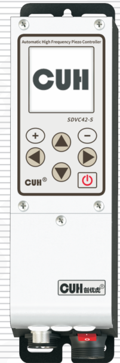

## SDVC42-S
Automatischer Hochfrequenz-Piezo-Controller　SDVC42-S
# Benutzerhandbuch

</div>

　　　　　　　　　　　　　　　　　　　　　　

---

## Urheberrechtserklärung

Nanjing CUH Science & Technology CO., Ltd. behält sich alle Rechte vor.

Alle in diesem Benutzerhandbuch enthaltenen Informationen sind das Wissen unseres Unternehmens und durch das Urheberrechtsgesetz und andere einschlägige Gesetze geschützt. CUH genießt und behält sich alle durch das Urheberrechtsgesetz und andere Gesetze übertragenen Rechte vor. Ohne schriftliche Zustimmung von CUH darf dieses Benutzerhandbuch weder ganz noch teilweise kopiert, übersetzt, nachgeahmt oder anderweitig verwendet werden.

## Haftungsausschluss

Alle Inhalte dieses Benutzerhandbuchs beschreiben lediglich die Verwendungsmethode der von unserem Unternehmen hergestellten Produkte und werden gemäß dem bestehenden Stand der Technik und dem Ihnen bei der Nutzung bereitgestellten Zustand beschrieben. Sie tragen die entsprechenden Risiken bei der Nutzung dieses Produkts. Soweit gesetzlich nicht vorgeschrieben, übernimmt das Unternehmen keine ausdrückliche oder stillschweigende Haftung für das Produkt aufgrund dieses Benutzerhandbuchs, einschließlich, aber nicht beschränkt auf Personenschäden, Sachschäden, entgangene Gewinne usw.

Sie sind sich der oben genannten Risiken klar bewusst und stimmen zu, dass das Unternehmen – außer bei gesetzlicher Verpflichtung – nicht für direkte oder indirekte Schäden oder Verluste an Ihnen haftet（einschließlich, aber nicht beschränkt auf materielle Verluste an Personal, Eigentum, Daten usw. und immaterielle Verluste an Reputation, Chancen usw.）

Das Unternehmen behält sich das Recht vor, die in diesem Benutzerhandbuch geltenden Produkte ohne vorherige oder nachträgliche Ankündigung zu ändern.

---


---

# Vorwort

Vielen Dank, dass Sie sich für den CUH SDVC42-S Automatischer Hochfrequenz-Piezo-Controller entschieden haben.（Im Folgenden als „Controller" bezeichnet.）Diese Controller-Serie verwendet hochwertige Komponenten und neueste Elektroniktechnologie und ist mit leistungsstarken digitalen Signalprozessoren sorgfältig konstruiert.

Dieses Handbuch beschreibt die grundlegende Bedienung, die funktionale technische Beschreibung und typische Anwendungsbeispiele dieses Produkts. Es bietet Benutzern relevante Informationen zur Installation und Inbetriebnahme, Parametereinstellung, Fehlerdiagnose, Fehlerbehebung und routinemäßigen Wartung des Controllers. Um die korrekte Installation und Nutzung dieses Controllers sicherzustellen, lesen Sie dieses Benutzerhandbuch bitte sorgfältig vor der Installation und bewahren Sie es sicher auf.

Bitte beachten Sie unbedingt die folgenden Symbole, die Sie auf Vorsichtsmaßnahmen gegen Personenschäden und Produktschäden hinweisen.

| Symbol | Beschreibung |
|---|---|
| ⚠ Gefahr | Nichtbeachtung dieses Punktes<br>führt zu Personenschäden oder Tod. |
| ⚠ Warnung | Nichtbeachtung dieses Punktes<br>kann zu Personenschäden oder Tod führen. |
| ⚠ Vorsicht | Nichtbeachtung dieses Punktes<br>kann zu mittelschweren oder leichten Personenschäden führen. |
| Hinweis | Nichtbeachtung dieses Punktes<br>führt zur Beschädigung des Produkts und zu Sachschäden. |
| Wichtig | Zeigt Vorsichtsmaßnahmen und Nutzungsbeschränkungen an,<br>die während der Nutzung beachtet werden müssen. |

**Dieses Handbuch gilt für folgende Controller-Modelle:**

◆ Automatischer Hochfrequenz-Piezo-Controller  SDVC42-S (150mA)

---


---

# Sicherheit und Vorsichtsmaßnahmen

1. **Gefahr** Dieses Produkt dient ausschließlich zum Antrieb piezoelektrischer Vibrationsfördergeräte. Verwenden Sie dieses Produkt nicht zum Schutz des menschlichen Körpers oder von Körperteilen.

2. **Gefahr** Dieses Produkt ist nicht als explosionsgeschütztes Produkt konzipiert. Verwenden Sie es nicht in explosionsgefährdeten Bereichen und/oder explosionsgefährdeten Gasumgebungen.

3. **Warnung** Dieses Produkt wird über das Wechselstromnetz versorgt. Legen Sie keine Wechselspannung über 250Vac an. Eine zu hohe Eingangsspannung, z. B. 300Vac, kann das Produkt zur Explosion oder zum Brand bringen und schwere Sicherheitsunfälle verursachen.

4. **Warnung** Dieses Produkt wird über das Netzkabel geerdet. Stellen Sie sicher, dass die Stromversorgungseinrichtungen für den Controller ordnungsgemäß geerdet sind, andernfalls kann das Controller-Gehäuse unter Spannung stehen und einen Stromschlag verursachen.

5. **Warnung** Legen Sie keine Wechselstromversorgung an den Ausgang dieses Controllers an, da dies den Controller beschädigt.

6. **Warnung** Stecken Sie keine Kabel unter Spannung ein oder aus und berühren Sie nicht die Kontakte der Verdrahtungsklemmen im Verdrahtungsabteil, um Stromschläge zu vermeiden.

7. **Hinweis** Vermeiden Sie es, den Ausgang dieses Produkts durch Abschalten der Stromversorgung über Relais und ähnliche Geräte zu steuern, da dies die Lebensdauer des Controllers erheblich verkürzt.

8. **Hinweis** Der Controller ist für den Betrieb in einer kühlen und trockenen Umgebung konzipiert. Betreiben Sie den Controller niemals im Freien, um Nässe und direkte Sonneneinstrahlung zu vermeiden. Betreiben Sie den Controller innerhalb der spezifizierten elektrischen Kennwerte.

9. **Wichtig** Befestigen Sie dieses Produkt unbedingt auf einer soliden, zuverlässig geerdeten Plattform, die von Vibrationsgeräten entfernt ist.

10. **Wichtig** Betreiben Sie den Controller niemals unter Bedingungen, die über seine konstruktiven Grenzwerte hinausgehen.

11. **Wichtig** Betreiben Sie den Controller strikt gemäß diesem Handbuch. Wir übernehmen keine zivil- oder strafrechtliche Haftung, wenn Geräteschäden oder Personenschäden durch unsachgemäße Bedienung verursacht werden.

12. **Wichtig** Öffnen Sie niemals das Controller-Gehäuse, um Stromschläge zu vermeiden. Kontaktieren Sie CUH, wenn der Controller defekt ist. Versuchen Sie niemals, den Controller selbst zu reparieren, da dies zum Garantieverlust führen kann.

---


---

# Betriebs- und Lagerungsumgebung

## Inspektion vor der Verwendung

Jeder Controller wird vor der Auslieferung einer strengen Qualitätskontrolle unterzogen und mit stoßsicherer Verpackung geliefert. Bitte prüfen Sie nach dem Auspacken folgende Punkte:

1. Ob der Controller während des Transports beschädigt wurde.
2. Ob das Controller-Modell dem von Ihnen bestellten entspricht.

## Betriebsbedingungen

Bitte beachten Sie die folgenden Hinweise, um eine optimale Leistung und längere Lebensdauer des Controllers zu gewährleisten:

- [!] Gut belüftete Umgebung
- [!] Fernhalten von Wasser, Dampf, Staub und insbesondere ölhaltigem Staub
- [!] Fernhalten von korrosiven oder brennbaren Gasen und Flüssigkeiten
- [!] Fernhalten von Schwebstaub und Metallpartikeln
- [!] Fest befestigen, um Eigen­vibrationen zu vermeiden
- [!] Fernhalten von elektromagnetischen Störungen
- [!] Umgebungstemperatur 0~40 ℃ sicherstellen
- [!] Nur für den Einsatz bis 2000 m Höhe

---


# Inhaltsverzeichnis

**Kapitel Ⅰ Hinweise vor der Inbetriebnahme** -------------------------------------------------- 1

1.1 Paketinhalt prüfen ----------------------------------------------------------- 1

1.2 Herstellerschild-Erläuterung ----------------------------------------------- 2

1.3 Nutzungsbedingungen des Controllers ------------------------------------------------------ 2

1.4 Hinweise -------------------------------------------------------------------------- 3

**Kapitel Ⅱ Produkteinführung** ---------------------------------------------------- 4

2.1 Produkteinführung ------------------------------------------------------------- 4

2.2 Tastenfeld und I/O-Anschlüsse ------------------------------------------------------------- 5

2.3 Installationsanleitung für den Vibrationssensor --------------------------------------------- 6

2.4 Beschreibung der Startseitenparameter -------------------------------------------------- 7

2.5 Definition der Signalsteueranschlüsse -------------------------------------------------- 7

2.6 Tastenfeldbedienung ----------------------------------------------------------------- 8

2.7 Drehdiagramm der Bedienoberfläche -------------------------------------------- 8

**Kapitel Ⅲ Stromverkabelung und Grundbedienung** --------------------------------------- 9

3.1 Stromverkabelung --------------------------------------------------------------------- 9

3.2 Grundbedienung ------------------------------------------------------------------ 11

**Kapitel Ⅳ Detaillierte Funktionsbeschreibung** ----------------------------------------- 13

4.1 Allgemeine Parametereinstellungen ------------------------------------------------------- 14

4.1.1 Spannung -------------------------------------------------------------------------- 14

4.1.2 Frequenz ------------------------------------------------------------------------ 14

4.1.3 Fördergeschwindigkeit -------------------------------------------------------------------- 15

4.1.4 Sanftanlaufzeit/Sanftstoppzeit -------------------------------------------------- 15

4.1.5 Maximale Spannung/Maximaler Strom ------------------------------------------------ 15

4.1.6 Maximale Ausgangsfrequenz/Minimale Ausgangsfrequenz ------------------------------ 15

4.1.7 Lasterkennung ------------------------------------------------------------------- 16

4.1.8 Materialmangelalarm ------------------------------------------------------------------- 16

4.1.9 Abschaltalarm ------------------------------------------------------------------- 16

4.1.10 Hintergrundbeleuchtungshelligkeit ---------------------------------------------------------- 16

4.1.11 Hintergrundbeleuchtung aus ------------------------------------------------------------------- 17

4.1.12 Sprache ------------------------------------------------------------------------ 17

4.2 Automatische Resonanzfrequenzsuche --------------------------------------------- 17

4.2.1 Frequenzsuch-Oberfläche ----------------------------------------------------- 17

---


4.3 Konstante Fördergeschwindigkeit ---------------------------------------------------------------- 18

4.3.1 Zentralfrequenz --------------------------------------------------------------- 18

4.3.2 Frequenzversatz ---------------------------------------------------------------- 18

4.3.3 Frequenzintegration ----------------------------------------------------------- 18

4.3.4 Amplitudenintegration ----------------------------------------------------------- 19

4.3.5 Amplitudenverhältnis ----------------------------------------------------------------- 19

4.3.6 Autophase ---------------------------------------------------------------------- 19

4.3.7 Frequenzsuchprozess-Spannung -------------------------------------------- 19

4.3.8 Frequenzsuchprozess-Amplitude ------------------------------------------ 19

4.3.9 Maximale Fördergeschwindigkeit ------------------------------------------------------------- 19

4.3.10 Slave-Controller Phasenversatz ------------------------------------------------- 19

4.3.11 Ausgangsspannungs-Steuerungsmodus ------------------------------------ 20

4.3.12 Ausgangsfrequenz-Steuerungsmodus -------------------------------------- 20

4.3.13 Synchronisationsquelle -------------------------------------------------------- 20

4.3.14 Vibrationssensor-Typ ---------------------------------------------------------- 20

4.3.15 Automatische Resonanzfrequenz-Suchgeschwindigkeit ----------------------- 20

4.4 Ausgangsparameter ------------------------------------------------------------------ 21

4.4.1 Haupteingangsparameter ------------------------------------------------------ 21

4.4.2 DC-Steuerungsausgangsparameter ------------------------------------------------ 28

4.5 Signalsteuerung --------------------------------------------------------------------- 30

4.5.1 Sensortyp ----------------------------------------------------------------- 30

4.5.2 C-Port/E-Port-Logik --------------------------------------------------------- 31

4.5.3 C-Port Ein/Aus-Verzögerung und E-Port Ein/Aus-Verzögerung ------------------------------- 31

4.5.4 Geschwindigkeit A Logik/Geschwindigkeit B Logik ------------------------------------------------ 32

4.5.5 Geschwindigkeit A Ein/Aus-Verzögerung und Geschwindigkeit B Ein/Aus-Verzögerung ------------------------------ 32

4.6 Materialzählung --------------------------------------------------------- 33

4.6.1 Materialzählung (oder Geschwindigkeit A/B) ---------------------------------- 33

4.6.2 Zielmenge ------------------------------------------------------------- 34

4.6.3 Endgeschwindigkeit -------------------------------------------------------------- 34

4.6.4 Endgeschwindigkeitsmenge ----------------------------------------------------- 35

4.6.5 Zählwert auf 0 zurücksetzen --------------------------------------------------- 35

4.6.6 RS-Priorität ----------------------------------------------------------------- 35

---


---

4.7 Einstellungen speichern ---------------------------------------------------------------- 36

4.7.1 Einstellungen abrufen ------------------------------------------------------ 36

4.7.2 Einstellungen speichern ---------------------------------------------------------- 36

4.7.3 Werkseinstellungen wiederherstellen -------------------------------------------------------- 37

4.7.4 Einstellungen kopieren ---------------------------------------------------------- 37

4.7.5 Benutzerpasswort ---------------------------------------------------------- 37

4.7.6 Passwort eingeben --------------------------------------------------------- 37

4.8 RS485-Kommunikation ---------------------------------------------------------- 38

4.8.1 Kommunikationstyp ---------------------------------------------------- 38

4.8.2 Baudrate -------------------------------------------------------------- 39

4.8.3 Slave-Controller-Adresse ---------------------------------------------- 39

4.8.4 Portwiderstand/Synchronwiderstand -------------------------------- 39

4.9 CUHBus-DS® Vernetzung -------------------------------------------------------- 40

4.9.1 Gerätevernetzung ----------------------------------------------------- 41

4.9.2 Synchronisationsfunktion ---------------------------------------------------------- 45

4.9.3 Signalteilung --------------------------------------------------------- 51

4.9.4 Datensicherung ------------------------------------------------------------ 53

4.9.5 Fernsteuerungsdaten --------------------------------------------------- 54

4.10 Controller-Statusüberwachung ------------------------------------------------ 54

4.11 Fehlerprotokoll ------------------------------------------------------------------- 55

4.12 Startseite anpassen ---------------------------------------------------------- 55

## Kapitel Ⅴ Typische Anwendungen ---------------------------------------------- 56

5.1 Wie hält man zwei Vibrationsförderer auf derselben Frequenz? ------------ 56

5.2 Wie schaltet man Controller B über einen an Controller A angeschlossenen Sensor ein/aus? ------ 57

5.3 Wie schaltet man zwei Controller gleichzeitig ein/aus? --------------------------- 58

## Kapitel Ⅵ Häufig gestellte Fragen ---------------------------------------- 59

6.1 Keine Anzeige beim Einschalten ----------------------------------------------------- 59

6.2 Keine Vibration, kein Geräusch, Controller-Anzeige normal ---------------------------- 59

6.3 Steuersignal funktioniert nicht ------------------------------------------------- 59

6.4 Keine Vibration, normales Geräusch, Controller-Anzeige normal --------------------- 59

6.5 Instabile Resonanzfrequenzverfolgung ---------------------------------------- 59

6.6 Langsame Geschwindigkeitskorrektur bei konstanter Fördergeschwindigkeit ------------------------- 60

---


---

6.7 Controller schnell auf Werkseinstellungen zurücksetzen ---------------------------60

**Kapitel Ⅶ Anhang** ----------------------------------------------------------------61

7.1 Abmessungen -----------------------------------------------------------------------------61

7.2 Technische Spezifikationen -------------------------------------------------------------62

7.3 Referenzstandard -------------------------------------------------------------------63

7.4 Parameterliste -------------------------------------------------------------------------64

7.4.1 Schnittstellen-Parametergruppe -----------------------------------------------64

7.4.2 Allgemeine Parametergruppe ------------------------------------------------65

7.4.3 Hauptausgangs-Parametergruppe -------------------------------------------66

7.4.4 Konstantgeschwindigkeits-Parametergruppe -----------------------------------------67

7.4.5 Signaleingangs-Parametergruppe -------------------------------------------68

7.4.6 DC-Steuerungsausgangs-Parametergruppe ---------------------------------------69

7.4.7 Zähl-Parametergruppe ------------------------------------------70

7.4.8 Kommunikations-Parametergruppe --------------------------------------71

7.4.9 Speicher-Parametergruppe ------------------------------------------------------72

7.4.10 Überwachungs-Parametergruppe -------------------------------------------73

7.4.11 Anhangsliste -------------------------------------------------------------75

7.5 Ein- und Ausgangsschaltpläne ------------------------------------------------76

7.6 Fehlercode ------------------------------------------------------------------------------78

7.7 Warnungscode --------------------------------------------------------------------------79

**Kapitel Ⅷ Produktgarantieinformationen** ----------------------------------------80

8.1 Garantiezeitraum -----------------------------------------------------------------------80

8.2 Garantieumfang -------------------------------------------------------------------80

8.3 Produktverwendung -------------------------------------------------------------------80

---


# Kapitel Ⅰ Hinweise vor der Inbetriebnahme

Dieses Kapitel führt in die Produktverpackung, das Controller-Erscheinungsbild und die Herstellerschildinformationen ein.

## 1.1 Paketinhalt prüfen

Bitte prüfen Sie vor der Verwendung die Vollständigkeit des Controllers und des Zubehörs. Falls das Produkt defekt oder beschädigt ist oder Zubehör fehlt, kontaktieren Sie bitte unser Unternehmen.

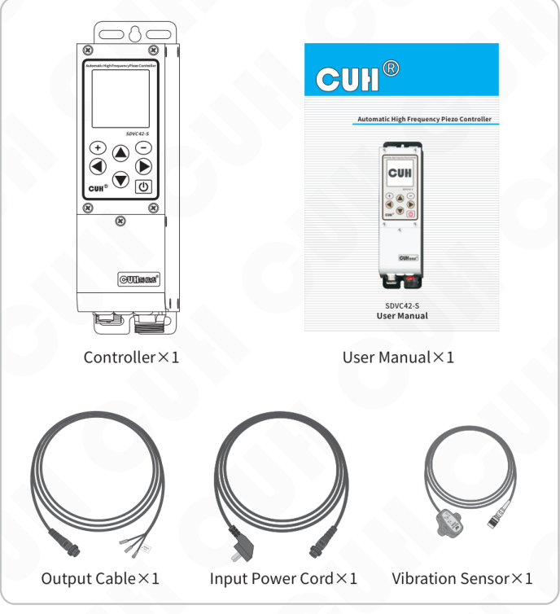

Paketinhalt:

| Artikel | Menge |
|---|---:|
| Controller | ×1 |
| Benutzerhandbuch | ×1 |
| Ausgangskabel | ×1 |
| Eingangsnetzkabel | ×1 |
| Vibrationssensor | ×1 |

---


---

## 1.2 Herstellerschild-Erläuterung

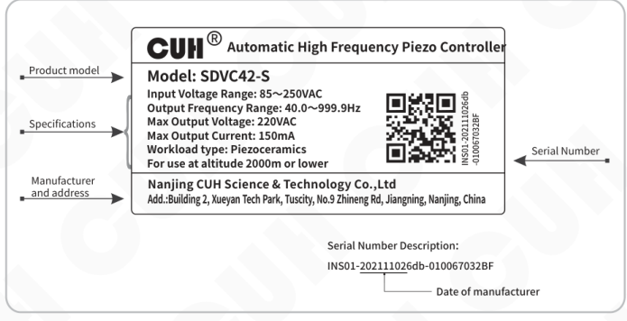

Herstellerschild-Informationen:

- **Produktmodell:** SDVC42-S
- **Spezifikationen:**
  - Eingangsspannungsbereich: 85~250VAC
  - Ausgangsfrequenzbereich: 40,0~999,9Hz
  - Max. Ausgangsspannung: 220VAC
  - Max. Ausgangsstrom: 150mA
  - Lasttyp: Piezokeramik
  - Nur für den Einsatz bis 2000 m Höhe
- **Hersteller und Adresse:**
  - Nanjing CUH Science & Technology Co.,Ltd
  - Add.: Building 2, Xueyan Tech Park, Tuscity, No.9 Zhineng Rd, Jiangning, Nanjing, China
- **Seriennummer-Beschreibung:** INS01-202111026db-010067032BF

## 1.3 Nutzungsbedingungen des Controllers

Der Controller wird mit AC 85V~250V versorgt und über den Netzstecker mit dem Schutzleiter verbunden. Bitte verwenden Sie ein Standard-Stromnetz und stellen Sie sicher, dass der Schutzleiter korrekt angeschlossen ist.

> ⚠️ **Warnung**  Schließen Sie den Controller niemals an 380V Wechselstrom an, da dies irreversible schwere Schäden am Controller verursachen kann, einschließlich Explosion, Brand und anderen Sicherheitsunfällen.

> ⚠️ **Warnung**  Stellen Sie sicher, dass die Versorgungsseite zuverlässig geerdet ist. Das Metallgehäuse des Controllers ist direkt mit dem Schutzleiter verbunden. Eine mangelhafte Erdung kann dazu führen, dass das Controller-Gehäuse unter Spannung steht und einen Stromschlag verursacht.

> **Hinweis**  Bei längerem Betrieb entsteht Wärme, die zu einem Temperaturanstieg des Gehäuses führt. Bitte installieren Sie den Controller in einer gut belüfteten Umgebung und befestigen Sie ihn sicher, entfernt von Vibrationsquellen.

> **Hinweis**  Dieses Produkt ist ein Controller zum Antrieb von piezoelektrischen Vibrationsförderern.

---


---

## 1.4 Hinweise

◆ Das Benutzerhandbuch umfasst ca. 28.000 Wörter und die Lektüre dauert voraussichtlich etwa eine Stunde.

◆ Bitte lesen Sie dieses Handbuch vor der Verwendung sorgfältig durch, um Schäden am Controller durch unsachgemäße Bedienung zu vermeiden.

◆ Benutzer können über das Handbuchverzeichnis schnell die relevanten Funktionen und Bedienungsmethoden des Controllers finden.

◆ Die Unterkapitelüberschriften und der hervorgehobene Text im Text sind die tatsächlichen Anzeige-Parameterbezeichnungen des Controllers, z. B. Spannung.

◆ Benutzer können auf „Kapitel Ⅴ Typische Anwendungen" verweisen, um schnell mit diesem Controller zu beginnen.

◆ Benutzer können Funktions-Tag-Codes schnell im Abschnitt „7.4 Parameterliste" nachschlagen.

◆ Gleichzeitiges Drücken von ⊕ und ⊖ bedeutet Bestätigung.

◆

---


# Kapitel Ⅱ Produkteinführung

Der Hauptinhalt dieses Kapitels umfasst eine kurze Einführung und die Hauptmerkmale dieses Produkts.

## 2.1 Produkteinführung

Die SDVC42-S-Serie Automatischer Hochfrequenz-Piezo-Controller ist ein speziell für hochwertige Fördersysteme entwickeltes Produkt.

Einzigartige Leistung wird durch den Einsatz neuester Elektroniktechnologie und Signalverarbeitungsmethoden erreicht. Zu den besonderen Merkmalen gehören:

- Über CUHBus-DS® Kommunikation wird die Synchronisation, Sicherung und Wiederherstellung von Fernsteuerungsspannung, Frequenz, Phase und anderen Parametern für jeden Controller realisiert.
- Signale von anderen Controller-Ports können über CUHBus-DS® Kommunikation zur Logiksteuerung verwendet werden.
- Die Materialmangel-Alarmfunktion kann ohne zusätzliche Sensoren realisiert werden.
- Über den Vibrationsförderer können auswählbare Tonhinweise ausgegeben werden.
- Erweiterung des Ausgangsfrequenzbereichs auf 40,0Hz~999,9Hz.
- Der analoge Drehzahlsteuerungsport unterstützt die Modi 0~5V, 1~5V, 0~10V, 4~20mA und andere.
- Ausgestattet mit Zählfunktion, einschließlich Zählverzögerung und Zählstopp.
- Die verbesserte Konstantamplituden-Frequenzsuche stellt sicher, dass zwei Vibrationsförderer mit geringem Abstand während des Frequenzsuchvorgangs nicht kollidieren.
- Unterstützt die Protokolle RS485 Modbus ASCII und RS485 Modbus RTU.
- Software-Upgrade über die RS485-Schnittstelle möglich.
- Verwendet ein LCD-Display mit 128×128 Auflösung und unterstützt drei Sprachen: Chinesisch, Englisch und Deutsch.
- Erkennt Laststrommerkmale zur Unterstützung der Fehlerdiagnose.
- Der Fehlercode kann die letzten 64 Fehlerprotokolle speichern.


## 2.2 Tastenfeld und I/O-Anschlüsse

### Erklärung der Anzeige und Tasten

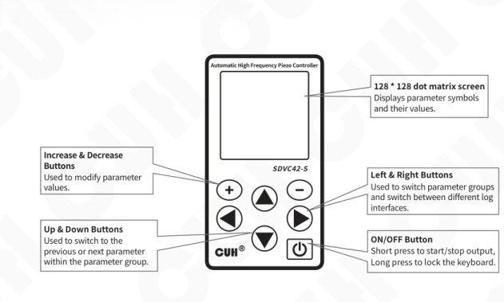

| Komponente | Erklärung |
|---|---|
| Auf- & Ab-Tasten | Zur Änderung von Parameterwerten. |
| Hoch- & Runter-Tasten | Zum Wechseln zum vorherigen oder nächsten Parameter innerhalb der Parametergruppe. |
| Links- & Rechts-Tasten | Zum Wechseln zwischen Parametergruppen und zum Umschalten zwischen verschiedenen Protokollschnittstellen. |
| 128×128 Punktmatrix-Display | Zeigt Parametersymbole und deren Werte an. |
| Ein/Aus-Taste | Kurz drücken zum Starten/Stoppen der Ausgabe, lang drücken zum Sperren der Tastatur. |

### Erklärung der Außenteile

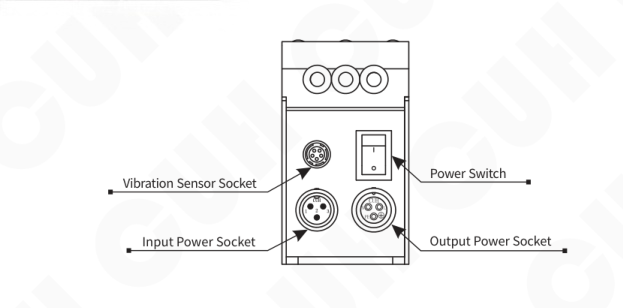

| Außenteil | Beschriftung im Diagramm |
|---|---|
| Vibrationssensor-Buchse | Vibrationssensor-Buchse |
| Eingangsstrom-Buchse | Eingangsstrom-Buchse |
| Netzschalter | Netzschalter |
| Ausgangsstrom-Buchse | Ausgangsstrom-Buchse |


## 2.3 Installationsanleitung für den Vibrationssensor

Befestigen Sie den Vibrationssensor an der glatten Oberfläche des Vibrators. Die Installationsrichtung ist beliebig. Die Installationsmethoden des Vibrationssensors sind wie folgt dargestellt:

- **Methode 1:** Wie in Abb. 2.3.1 gezeigt  
  Vorteil: Einfache Installation

  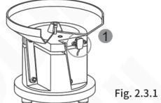

- **Methode 2:** Wie in Abb. 2.3.2 gezeigt  
  Hinweis: Lassen Sie den Vibrationssensor nicht durch die Förderschale gedrückt werden.

  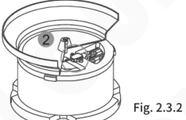

- **Methode 3:** Schweißen Sie eine Halterung an den Vibrator und befestigen Sie den Vibrationssensor an der Halterung. Wie in Abb. 2.3.3 gezeigt.  
  Empfohlene Maße der Halterung siehe Abb. 2.3.4.

  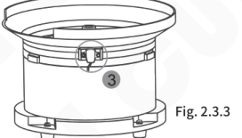

  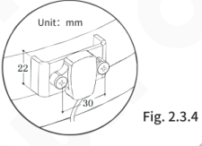

- **Nicht empfohlene Installationsmethode,** wie in Abb. 2.3.5 und Abb. 2.3.6 gezeigt.  
  Wenn der Installationsort nicht geeignet ist, kann der Vibrationssensor die Resonanzfrequenz nicht korrekt zurückmelden und der Controller führt dauerhaft die Resonanzfrequenzsuche aus.

  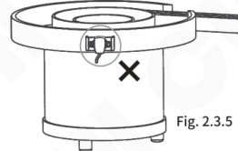

  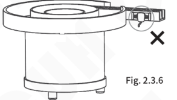


## 2.4 Beschreibung der Startseitenparameter

Der Controller kann den Hauptausgangsstatus, den Tastatursperrstatus, den Portstatus, Überwachungsparameter und den Schnittstellennamen auf der Startseite anzeigen. Beim Portstatus bedeutet ein hervorgehobenes **X**, dass der Port gültig ist. **X** bedeutet, dass der Port bei niedrigem Pegel gültig ist, und **X** bedeutet, dass der Port bei hohem Pegel gültig ist.

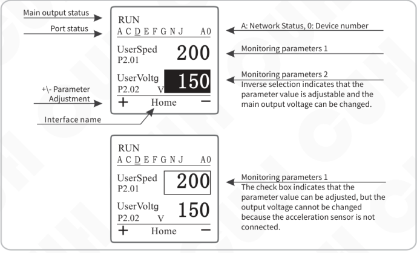

| Startseitenelement | Gezeigtes Beispiel | Beschreibung |
|---|---|---|
| Hauptausgangsstatus | `RUN` | Zeigt den aktuellen Hauptausgangsstatus an. |
| Portstatus | `A C D E F G N J    A0` | Zeigt die Portzustände an. `A`: Netzwerkstatus; `0`: Gerätenummer. |
| Überwachungsparameter 1 | `UserSped` / `P2.01` / `200` | Auf der Startseite angezeigter Überwachungsparameterwert. |
| Überwachungsparameter 2 | `UserVoltg` / `P2.02` / `150` | Inverse Auswahl zeigt an, dass der Parameterwert einstellbar ist und die Hauptausgangsspannung geändert werden kann. |
| Überwachungsparameter 1 | `UserSped` / `P2.01` / `200` in einem Kontrollkästchen | Das Kontrollkästchen zeigt an, dass der Parameterwert einstellbar ist, aber die Ausgangsspannung nicht geändert werden kann, da der Beschleunigungssensor nicht angeschlossen ist. |
| +/- Parameteranpassung | `+` / `-` | Parameteranpassungs-Bedienelemente. |
| Schnittstellenname | `Home` | Aktueller Schnittstellenname. |

## 2.5 Definition der Signalsteueranschlüsse

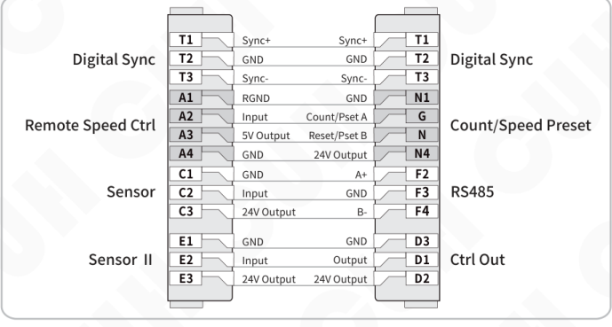

| Linke Funktion | Linker Anschluss | Linke Definition | Rechte Definition | Rechter Anschluss | Rechte Funktion |
|---|---:|---|---|---:|---|
| Digital Sync | T1 | Sync+ | Sync+ | T1 | Digital Sync |
| Digital Sync | T2 | GND | GND | T2 | Digital Sync |
| Digital Sync | T3 | Sync- | Sync- | T3 | Digital Sync |
| Remote Speed Ctrl | A1 | RGND | GND | N1 | Count/Speed Preset |
| Remote Speed Ctrl | A2 | Input | Count/Pset A | G | Count/Speed Preset |
| Remote Speed Ctrl | A3 | 5V Output | Reset/Pset B | N | Count/Speed Preset |
| Remote Speed Ctrl | A4 | GND | 24V Output | N4 | Count/Speed Preset |
| Sensor | C1 | GND | A+ | F2 | RS485 |
| Sensor | C2 | Input | GND | F3 | RS485 |
| Sensor | C3 | 24V Output | B- | F4 | RS485 |
| Sensor Ⅱ | E1 | GND | GND | D3 | Ctrl Out |
| Sensor Ⅱ | E2 | Input | Output | D1 | Ctrl Out |
| Sensor Ⅱ | E3 | 24V Output | 24V Output | D2 | Ctrl Out |


## 2.6 Tastenfeldbedienung

 a. Dieser Controller verwendet ein 128×128 Punktmatrix-Display zur Anzeige der Parameterinhalte.

 b. Je nach Drückdauer der Tasten werden die Tastenaktionen in Kurzes Drücken, Langes Drücken, Beschleunigung Stufe 1 und Beschleunigung Stufe 2 unterteilt.

 [Kurzes Drücken]: Mehr als 0,1 Sekunden, aber weniger als 0,5 Sekunden drücken.

 [Langes Drücken]: Mehr als 2 Sekunden drücken.

 [Beschleunigung Stufe 1]: Mehr als 0,5 Sekunden, aber weniger als 2 Sekunden drücken.

 [Beschleunigung Stufe 2]: Mehr als 2 Sekunden drücken.

 c. <kbd>⊕</kbd> und <kbd>⊖</kbd> dienen hauptsächlich zur Änderung von Parameterwerten.

 d. Wechseln Sie zwischen oberen und unteren Parametergruppen in der Parametereinstellungs-Oberfläche durch kurzes Drücken von ◀ oder ▶.

 e. Wechseln Sie zwischen oberen und unteren Parametern dieser Gruppe in der Parametereinstellungs-Oberfläche durch kurzes Drücken von ▲ oder ▼.

 f. Kurzes Drücken von <kbd>⏻</kbd> zum Starten/Stoppen der Hauptausgabe, langes Drücken von <kbd>⏻</kbd> zum Sperren/Entsperren der Tastatur.

 g. Zugang zu verschiedenen Parametergruppen über die folgenden Tastenkombinationen:

 Langes Drücken von ▲+▼, Frequenzsuch-Oberfläche aufrufen oder verlassen.

 Langes Drücken von ▲+◀, Parametereinstellungs-Oberfläche aufrufen oder verlassen.

 Langes Drücken von ▲+▶, Protokollschnittstelle aufrufen oder verlassen.

## 2.7 Drehdiagramm der Bedienoberfläche

Unter beliebiger Schnittstelle, langes Drücken von <kbd>▲+▶</kbd> öffnet die **Protokollschnittstelle**, erneutes langes Drücken verlässt zur **Hauptschnittstelle**

Unter beliebiger Schnittstelle, langes Drücken von <kbd>▲+▼</kbd> öffnet die **Frequenzsuch-Oberfläche**, kurzes Drücken der Stopp-Taste verlässt zur **Hauptschnittstelle**

Unter beliebiger Schnittstelle, langes Drücken von <kbd>▲+◀</kbd> öffnet die **Parametereinstellungs-Oberfläche**, erneutes langes Drücken verlässt zur **Hauptschnittstelle**

Unter beliebiger Schnittstelle, bei keiner Aktion für mehr als 5 Minuten, Wechsel zur **Standby-Oberfläche** und Drücken einer beliebigen Taste zurück zur **Hauptschnittstelle**


# Kapitel Ⅲ Stromverkabelung und Grundbedienung

## 3.1 Stromverkabelung

**Schritt eins:**

Öffnen Sie die Verpackungskiste und prüfen Sie den Controller und sämtliches Zubehör.

**Schritt zwei:**

Verbinden Sie die Verdrahtungsklemmen des Ausgangsstromkabels mit den Elektroden des Piezo-Vibrators.

Richten Sie die Kerbe am Luftfahrtstecker des Ausgangskabels an der Dreiecksmarkierung an der Ausgangsbuchse des Controllers aus und ziehen Sie die Mutter nach korrektem Anschluss des Ausgangskabels fest.

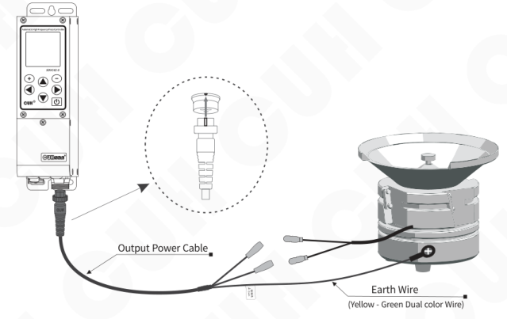

**Hinweis**

Stellen Sie sicher, dass die Elektroden des Piezo-Vibrators mit den beiden Ausgangspins des Ausgangsstromkabels verbunden sind und dass das Metallgehäuse des Vibrators zuverlässig geerdet ist.


---

### Schritt drei:

Verbinden Sie den Stecker des Eingangsstromkabels  
mit der Eingangsstrombuchse des Controllers.

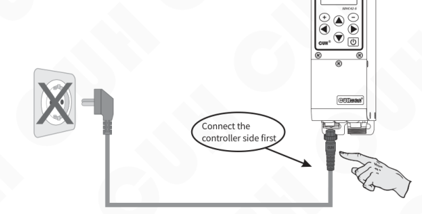

### Schritt vier:

Nachdem Sie sich vergewissert haben, dass der Schalter in der Aus-Position ist, stecken Sie den  
Stecker des Eingangsstromkabels in die Netzsteckdose.


---


## 3.2 Grundbedienung

### Schritt fünf:

Schalten Sie den Netzschalter des Controllers ein, der Controller zeigt die Hauptschnittstelle an.

```text
RUN
A C D E F G N J      A0
──────────────────────
UserSped            200
P2.01

EffectCu              0
P10.05      A
+        Home        −
```

### Schritt sechs:

Der Vibrationsförderer beginnt zu arbeiten. Stellen Sie die Frequenz- und Spannungsparameterwerte in der Parametergruppe „2 Common" ein, um die passende Fördergeschwindigkeit zu wählen.

» Langes Drücken von ▲ und ◀ öffnet die Parametereinstellungs-Oberfläche, kurzes Drücken von ▶ wechselt zur Parametergruppe „2 Common".

» Kurzes Drücken von ▲ oder ▼ positioniert den Cursor auf dem Spannungsparameterwert.

» Drücken Sie ⊕ oder ⊖ um den Parameterwert anzupassen.

» Kurzes Drücken von ▲ oder ▼ positioniert den Cursor auf dem Frequenzparameterwert.

» Drücken Sie ⊕ oder ⊖ um den Parameterwert anzupassen.

```text
RUN
A C D E F G N J      A0
──────────────────────
01.UserSped       200
02.UsrVoltg       150 V
03.UsrFrqnc      50.0 Hz
04.SoftStar       0.5 S
05.SoftStop       0.5 S
+       2Common     −
```

☺

- Die Frequenz, bei der die Vibration ihr Maximum erreicht, ist die Eigenfrequenz des Schwingkörpers.
- Jeder Vibrator hat seine mechanische Resonanzfrequenz. Stellen Sie die Ausgangsfrequenz des Controllers auf diese Frequenz ein, um den besten Arbeitszustand zu erreichen.


---

### Schritt sieben:

Benutzer können zusätzlich den Beschleunigungssensor anschließen, um die automatische Frequenzsuche des Controllers zu realisieren. (Hinweis: Der Benutzer muss die Materialien in der Vibrationsplatte nicht leeren.)

Nehmen Sie den Sensor, verbinden Sie den Sensorstecker mit dem Controller und ziehen Sie die Mutter fest, und befestigen Sie den Sensorkörper korrekt an der Vibrationsplatte (siehe Kapitel 2.3).

### Schritt acht:

» Langes Drücken von ▲ und ▼ öffnet die Frequenzsuch-Oberfläche.

» Zu diesem Zeitpunkt zeigt das Display die Amplitudenkurve der Vibrationsplatte während des Frequenzsuchprozesses (drei Phasen) an und zeigt synchron die Ausgangsspannung, den Strom und die Beschleunigungswerte an.

» Nach Abschluss der Frequenzsuche zeigt der Controller „Save" an, was bedeutet, dass die Frequenzsuche erfolgreich war und die Zentralfrequenz gespeichert wurde. Der Controller kehrt automatisch zur Startseite zurück.

» Benutzer können die Fördergeschwindigkeit des Vibrationsförderers über ⊕ oder ⊖ weiter anpassen.

| Beispiele für die Frequenzsuch-Anzeige | |
|---|---|
| 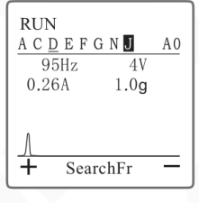 | 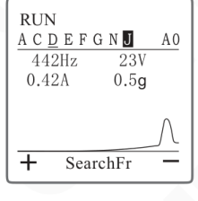 |
| 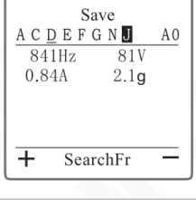 | 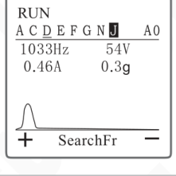 |

---


# Kapitel IV Detaillierte Funktionsbeschreibung

Dieses Kapitel stellt die detaillierten Funktionen und Einstellungen des Controllers vor.  
Langes Drücken von ▲ und ◀ öffnet auf jeder Schnittstelle die Parametereinstellungs-Oberfläche.  
Die Parametereinstellungs-Oberfläche umfasst die folgenden zehn Parametergruppen.  
Durch kurzes Drücken von ◀ oder ▶ wechseln Sie zwischen verschiedenen Parametergruppen.

```text
                         ┌──────────────┐
                         │ 1EditHome    │
                         └──────────────┘
                                ↕
                         ┌──────────────┐
                         │ 2Common      │
                         └──────────────┘
                                ↕
                         ┌──────────────┐
                         │ 3M_output    │
                         └──────────────┘
                                ↕
                         ┌──────────────┐
                         │ 4Stabilize   │
                         └──────────────┘
                                ↕
Kurzes Drücken ▶     ↓     ┌──────────────┐      ↑     Kurzes Drücken ▶
                         │ 5On&Off      │
                         └──────────────┘
                                ↕
                         ┌──────────────┐
                         │ 6DCoutput    │
                         └──────────────┘
                                ↕
                         ┌──────────────┐
                         │ 7Counter     │
                         └──────────────┘
                                ↕
                         ┌──────────────┐
                         │ 8Comm        │
                         └──────────────┘
                                ↕
                         ┌──────────────┐
                         │ 9Save        │
                         └──────────────┘
                                ↕
                         ┌──────────────┐
                         │ 10Monitor    │
                         └──────────────┘
```

Parametergruppen-Drehdiagramm

---


---

## 4.1 Allgemeine Parametereinstellungen

Dieses Kapitel führt hauptsächlich in die Einstellung und Anpassung der grundlegenden allgemeinen Parameter des Controllers ein.

### 4.1.1 Spannung

Dieser Controller kann die Ausgangsspannung direkt digital auf dem Panel einstellen. Da der Controller eine Spannungstabilisierungsfunktion besitzt, ist dieser Wert der Spannungsgleichrichtungsmittelwert und wird nicht durch die Eingangsspannung beeinflusst. Die Ausgangsspannung kann auch in Situationen mit instabiler Netzspannung stabil gehalten werden. Gleichzeitig bietet die direkte Spannungswerteinstellung auch genaue Daten für Benutzer, um den Betrieb der Ausrüstung zu verstehen.

> » Wechseln Sie zur allgemeinen Parametergruppe und finden Sie die Spannungseinstellungsparameter.  
> » Drücken Sie `+` oder `−` um den Parameterwert anzupassen.  
>
> Der Spannungsbereich ist 0~220V, Standardwert ist 150V, die Einstellgenauigkeit beträgt 1V.
>
> ```text
> RUN
> A C D E F G N J    A0
> 01.UserSped       200
> 02.UsrVoltg       150 V
> 03.UsrFrqnc       50.0 Hz
> 04.SoftStar       0.5 S
> 05.SoftStop       0.5 S
> +     2Common     −
> ```

### 4.1.2 Frequenz

Der Controller verwendet die direkte digitale Frequenzsynthese-Technologie (DDS), die eine sehr hohe Frequenzgenauigkeit und -stabilität bietet und sich nicht mit Zeit und Temperatur ändert.

> » Wechseln Sie zur allgemeinen Parametergruppe und finden Sie die Frequenzeinstellungsparameter.  
> » Drücken Sie `+` oder `−` um den Parameterwert anzupassen.  
>
> Der Frequenzbereich ist 40,0~999,9Hz, Standardwert ist 50,0Hz, die Einstellgenauigkeit beträgt 0,1Hz.
>
> ```text
> RUN
> A C D E F G N J    A0
> 01.UserSped       200
> 02.UsrVoltg       150 V
> 03.UsrFrqnc       50.0 Hz
> 04.SoftStar       0.5 S
> 05.SoftStop       0.5 S
> +     2Common     −
> ```

Die anderen Parameter dieser Parametergruppe können nach den obigen Schritten angepasst werden.

---


---

### 4.1.3 Fördergeschwindigkeit

**Fördergeschwindigkeit:** Die Vorschubgeschwindigkeit des Materials im Vibrationsförderer. Wenn der Controller mit dem Beschleunigungssensor verbunden ist und der Parameter „Spannungsmodus" auf „automatisch" eingestellt ist, kann die Materialvorschubgeschwindigkeit über den Fördergeschwindigkeitsparameter eingestellt werden, und die Vibrationsplatte arbeitet stabil bei der eingestellten Fördergeschwindigkeit.

Der Fördergeschwindigkeitsbereich ist 0~3200, Standardwert ist 200 und die Einstellgenauigkeit beträgt 1.

### 4.1.4 Sanftanlaufzeit/Sanftstoppzeit

**Sanftanlaufzeit:** Die Zeit, die der Controller benötigt, um die Ausgangsspannung beim Start aus dem Stoppzustand sanft von 0V auf die eingestellte Ausgangsspannung zu erhöhen.

Der Sanftanlaufzeitbereich ist 0,0~40,0s, Standardwert ist 0,5 Sekunden und die Einstellgenauigkeit beträgt 0,1 Sekunden.

**Sanftstoppzeit:** Wenn der Controller den Betrieb stoppt, die Zeit, die die Ausgangsspannung benötigt, um sanft von der eingestellten Ausgangsspannung auf 0V abzufallen.

Der Sanftstoppzeitbereich ist 0,0~40,0s, Standardwert ist 0,5 Sekunden und die Einstellgenauigkeit beträgt 0,1 Sekunden.

Wenn dieser Controller startet oder stoppt, kann die Ausgangsspannung sanft erhöht oder gesenkt werden, um zu verhindern, dass Vibrationsgeräte durch Stöße beschädigt werden.

### 4.1.5 Maximale Spannung/Maximaler Strom

**Maximale Spannung:** Der maximale Ausgangsspannungswert des Controllers.

Der maximale Spannungsbereich ist 0~220V, Standardwert ist 220V und die Einstellgenauigkeit beträgt 1V.

**Maximaler Strom:** Der maximale Ausgangsstromwert des Controllers.

Der maximale Strombereich ist 0~150mA, Standardwert ist 150mA und die Einstellgenauigkeit beträgt 1mA.

Dieser Controller kann maximale Ausgangsspannungs- und maximale Ausgangsstrom-Grenzwerte einstellen, die verhindern können, dass Benutzer die Vibrationsausrüstung durch versehentliches Ausgeben von zu hoher Spannung oder zu hohem Strom beschädigen.

### 4.1.6 Maximale Ausgangsfrequenz/Minimale Ausgangsfrequenz

**Maximale Ausgangsfrequenz:** Begrenzt den oberen Grenzwert des „Frequenz"-Parameters. Die obere Frequenzgrenze während der Frequenzsuche wird ebenfalls durch diesen Parameterwert begrenzt.

Der maximale Ausgangsfrequenzbereich ist 40,0~999,9Hz, Standardwert ist 999,9Hz und die Einstellgenauigkeit beträgt 0,1Hz.

**Minimale Ausgangsfrequenz:** Begrenzt den unteren Grenzwert des „Frequenz"-Parameters. Die untere Frequenzgrenze während der Frequenzsuche wird ebenfalls durch diesen Parameterwert begrenzt.

Der minimale Ausgangsfrequenzbereich ist 40,0~999,9Hz, Standardwert ist 40,0Hz und die Einstellgenauigkeit beträgt 0,1Hz.

**Hinweis:** Die Differenz zwischen der maximalen Ausgangsfrequenz und der minimalen Ausgangsfrequenz darf nicht weniger als 50,0Hz betragen.

---


### 4.1.7 Lasterkennung

Der Controller kann die Kapazität und den Widerstandswert erkennen. Nach Verwendung der Lasterkennungsfunktion können Benutzer die gemessenen lastbezogenen Werte in der Überwachungsparametergruppe anzeigen. Standardmäßig Keine.

### 4.1.8 Materialmangelalarm

Wenn der Controller mit einem Beschleunigungssensor verbunden ist und die Parameter „Spannungsmodus" und „Frequenzmodus" beide auf „automatisch" eingestellt sind, wird die Materialmangel-Alarmfunktion aktiviert. Benutzer können den Parameter „Materialmangelalarm" in der Überwachungsparametergruppe finden, wenn der Vibrationsförderer leer oder mit wenig Material gefüllt ist. Gleichzeitig können Sie durch langes Drücken von ⊕ und ⊖ den Messwert des „Materialmangelalarms" in der Überwachungsparametergruppe aufzeichnen und anhand des Messwerts den Alarmwert des „Materialmangelalarms" einstellen. Sie können den Alarmwert auch über ⊕ oder ⊖ weiter anpassen.

Wenn der Controller erkennt, dass der Messwert des Vibrationsförderers unter dem Alarmwert liegt, wird die Alarmfunktion ausgelöst.

Der Materialmangelalarm-Bereich ist 0~3000, Standardwert ist 0 und die Einstellgenauigkeit beträgt 1.

Hinweis: Benutzer können Alarmsignale als Hauptausgangs- oder D-Port-Ausgangs-Quellsignale verwenden, um verschiedene Ausgangszustände des Controllers anzusteuern.

### 4.1.9 Abschaltalarm

**Abschaltalarm:** Wenn der Controller die Ausgabe stoppt, gibt der Controller über den Vibrationsförderer verschiedene Alarmtöne aus, um dem Benutzer in lauten Umgebungen eine Abschaltwarnung zu melden. Optional drei Töne oder ungültig (kein Ton). Standardmäßig Keine.

| Parameter | Bedeutung |
|---|---|
| None | Ungültig |
| Sound 1 | Vibrationsplatte austreiben, um Ton 1 Alarmton auszugeben |
| Sound 2 | Vibrationsplatte austreiben, um Ton 2 Alarmton auszugeben |
| Sound 3 | Vibrationsplatte austreiben, um Ton 3 Alarmton auszugeben |

### 4.1.10 Hintergrundbeleuchtungshelligkeit

**Hintergrundbeleuchtungshelligkeit:** Dies ist die Hintergrundbeleuchtungshelligkeit des Controller-Displays. Die Hintergrundbeleuchtungshelligkeit des Displays kann an verschiedene Umgebungslichtbedingungen angepasst werden.

Der Hintergrundbeleuchtungshelligkeitsbereich ist 20~100, Standardwert ist 100 und die Einstellgenauigkeit beträgt 1.


### 4.1.11 Hintergrundbeleuchtung aus

**Hintergrundbeleuchtung aus:** Dies ist die Abschaltzeit der Hintergrundbeleuchtung. Wenn der Controller für einen bestimmten Zeitraum keine Bedienung ausführt, schaltet der Controller die Bildschirmhintergrundbeleuchtung aus. Die Bildschirmhintergrundbeleuchtung kann durch Drücken einer beliebigen Taste wieder eingeschaltet werden.

Der Hintergrundbeleuchtungs-Abschaltbereich ist 1-30min, Standardwert ist 5min und die Einstellgenauigkeit beträgt 1min. Wenn auf 31 eingestellt, bedeutet dies dauerhaft hell.

### 4.1.12 Sprache

**Sprache:** Dies ist die auf dem Controller-Bedienpanel angezeigte Sprache. Der Controller hat drei integrierte Sprachen: Chinesisch, Englisch und Deutsch, was Benutzern in verschiedenen Regionen das Umschalten erleichtert. Standard Englisch.

| Parameter | Bedeutung |
|---|---|
| Englis | Englische Oberfläche |
| Chines | Chinesische Oberfläche |
| German | Deutsche Oberfläche |

## 4.2 Automatische Resonanzfrequenzsuche

Dieses Kapitel stellt vor, wie die Resonanzfrequenz der Vibrationsplatte in der Frequenzsuch-Oberfläche dieses Produkts schnell lokalisiert werden kann und der Betrieb der Vibrationsplatte realisiert wird.

### 4.2.1 Frequenzsuch-Oberfläche

Wenn der Beschleunigungssensor korrekt an die Vibrationsplatte angeschlossen ist und sowohl der „Spannungsmodus" als auch der „Frequenzmodus" auf „Auto" eingestellt sind. Sie können den Resonanzfrequenzwert des Vibrationsförderers schnell lokalisieren, indem Sie die Frequenzsuch-Oberfläche aufrufen.

Siehe den achten Schritt in Kapitel 3.2 für die Bedienungsschritte.


## 4.3 Konstante Fördergeschwindigkeit

Dieses Kapitel stellt hauptsächlich vor, wie die relevanten Parameter des Controllers eingestellt werden und die Funktionen des Controllers für einen reibungslosen Betrieb aufrechterhalten werden.

### 4.3.1 Zentralfrequenz

Der Frequenzbereich, den der Controller automatisch anpassen kann, ist „Zentralfrequenz" ± „Frequenzversatz". Die Zentralfrequenz sollte nahe am Resonanzpunkt des Vibrationsgeräts eingestellt werden, damit der Controller bei automatischer Frequenzanpassung so schnell wie möglich den besten Arbeitspunkt erreichen kann.

- Langes Drücken von ▲ und ◀ öffnet die Parametereinstellungs-Oberfläche, kurzes Drücken von ▶ wechselt zur Parametergruppe „4 Stabilize".
- Kurzes Drücken von ▲ oder ▼ wechselt zum Zentralfrequenz-Parameter.
- Drücken Sie ⊕ oder ⊖ um den Parameterwert anzupassen.

```text
RUN
A C D E F G N J     A0
01.AutFCent 100.0 Hz
02.AutFRang  30.0 Hz
03.AutFIntg     20
04.AutAIntg    300
05.AutAProp    500
+   4Stabilize   −
```

Der Zentralfrequenzbereich ist 40,0~999,9Hz, Standardwert ist 100,0Hz und die Einstellgenauigkeit beträgt 0,1Hz.

Die anderen Parameter dieser Parametergruppe können nach den obigen Schritten angepasst werden.

### 4.3.2 Frequenzversatz

Der Frequenzbereich, den der Controller automatisch anpassen kann, ist „Zentralfrequenz" ± „Frequenzversatz". Dies dient zur Definition eines relativ kleinen automatischen Frequenzsuchbereichs. Der allgemeine Frequenzversatzwert beträgt etwa 30,0Hz. Wenn er zu groß ist, kann das Vibrationsgerät an einem ungeeigneten Arbeitspunkt arbeiten, und wenn er zu klein ist, kann die Anpassungsfähigkeit des Vibrationsgeräts eingeschränkt werden.

Der Frequenzversatzbereich ist 0,0~180,0Hz, Standardwert ist 30,0Hz und die Einstellgenauigkeit beträgt 0,1Hz.

### 4.3.3 Frequenzintegration

Der Controller passt über den PID-Algorithmus automatisch die Ausgangsfrequenz an. Je größer dieser Wert ist, desto schneller kann der Controller die Ausgangsfrequenz anpassen. Wenn er jedoch zu groß ist, kann dies zu Oszillationen der Ausgangsfrequenz führen.

Der Frequenzintegrationsbereich ist 0-2000, Standardwert ist 20 und die Einstellgenauigkeit beträgt 1.

---


---

### 4.3.4 Amplitudenintegration

Der Controller passt über die PID-Regelung automatisch die Ausgangsspannung an. Je größer dieser Wert ist, desto schneller kann der Controller die Ausgangsspannung anpassen und die Oszillationsamplitude und -frequenz der Ausgangsspannung reduzieren. Wenn er jedoch zu groß ist, wird die Oszillationsamplitude der Ausgangsspannung größer.

Der Amplitudenintegrationsbereich ist 0~9999, Standardwert ist 300 und die Einstellgenauigkeit beträgt 1.

### 4.3.5 Amplitudenverhältnis

Der Controller passt über die PID-Regelung automatisch die Ausgangsspannung an. Je größer dieser Wert ist, desto schneller kann der Controller die Ausgangsspannung anpassen. Wenn er jedoch zu groß ist, führt dies zu häufigen Oszillationen der Ausgangsspannung.

Der Amplitudenverhältnisbereich ist 0~9999, Standardwert ist 500 und die Einstellgenauigkeit beträgt 1.

### 4.3.6 Autophase

Dieser Parameter kann die Phasendifferenz zwischen dem Ausgangsstrom-Wellenform und dem Beschleunigungssignal des Beschleunigungssensors ändern.

Der Autophase-Bereich ist -180°~180°, Standardwert ist 0° und die Einstellgenauigkeit beträgt 1°.

### 4.3.7 Frequenzsuchprozess-Spannung

Stellt die maximale Ausgangsspannung des Controllers während der automatischen Frequenzsuche ein, sodass die tatsächliche Ausgangsspannung der Vibrationsplatte die eingestellte Frequenzsuchspannung nicht überschreitet.

Der Frequenzsuchspannungsbereich ist 20~220V, Standardwert ist 100V und die Einstellgenauigkeit beträgt 1V.

### 4.3.8 Frequenzsuchprozess-Amplitude

Die maximale Amplitude des Controllers überschreitet diesen Wert während der automatischen Frequenzsuche nicht, um die Sicherheit des Vibrationsgeräts zu schützen.

Der Frequenzsuchamplitudenbereich ist 0~3200, Standardwert ist 200 und die Einstellgenauigkeit beträgt 1.

### 4.3.9 Maximale Fördergeschwindigkeit

Stellen Sie diesen Parameter ein, um die maximal einstellbare Fördergeschwindigkeit zu begrenzen und zu verhindern, dass Benutzer versehentlich zu hohe Spannung ausgeben und das Vibrationsgerät beschädigen. Bei Verwendung der Fernsteuerungsgeschwindigkeitsregelung wird die Obergrenze der Fördergeschwindigkeit ebenfalls durch diesen Parameter beeinflusst.

Der maximale Fördergeschwindigkeitsbereich ist 0-4000, Standardwert ist 3200 und die Einstellgenauigkeit beträgt 1.

### 4.3.10 Slave-Controller Phasenversatz

Manuelle Phase bedeutet, dass die Phase der Slave-Controller-Ausgangswellenform manuell auf eine feste Phasenabweichung vom Synchronisationssignal des Master-Controllers eingestellt werden kann.

Der manuelle Phasenbereich ist -180°~180°, Standardwert ist 0°, die Einstellgenauigkeit beträgt 1°.

---


## 4.3.11 Ausgangsspannungs-Steuerungsmodus

Dieser Parameter dient zum Umschalten des Spannungsausgangsmodus des Controllers, um verschiedene Steuerungsformen für den Ausgang zu erreichen. Standard ist Auto.

| Parameter | Bedeutung |
|---|---|
| Manuel | Die Ausgangsspannung wird durch den „Spannungs"-Parameterwert oder durch den DC-Analogeingang der Fernsteuerungsgeschwindigkeitsregelung gesteuert. |
| Auto | Wenn der Beschleunigungssensor korrekt an den Controller angeschlossen ist, passt der Controller die Ausgangsspannung automatisch basierend auf den Rückmeldedaten des Vibrationssensors an, um sicherzustellen, dass die Fördergeschwindigkeit des Vibrationsgeräts stabil am „Fördergeschwindigkeits"-Wert bleibt. |

## 4.3.12 Ausgangsfrequenz-Steuerungsmodus

Dieser Parameter dient zum Umschalten des Frequenzausgangsmodus des Controllers. Standard ist Auto.

| Parameter | Bedeutung |
|---|---|
| Manuel | Die Ausgangsfrequenz wird durch den „Frequenz"-Parameterwert gesteuert |
| Auto | Wenn der Beschleunigungssensor korrekt an den Controller angeschlossen ist, passt der Controller die Ausgangsfrequenz automatisch basierend auf den Rückmeldedaten des Vibrationssensors an, sodass die Vibrationsfrequenz an der optimalen Arbeitsfrequenz des Vibrationsgeräts liegt |
| SynV | Frequenzsynchronisation, Phasensynchronisation Vibrationssensor |
| SynE | Frequenzsynchronisation, Phasensynchronisation Hauptausgangsstrom |

## 4.3.13 Synchronisationsquelle

Wenn der Benutzer den Frequenzmodus auf manuell oder automatisch einstellt, dient dieser Parameter zur Auswahl der Synchronisationssignalquelle des Geräts. Standardmäßig Keine.

| Parameter | Bedeutung |
|---|---|
| None | Nicht synchronisiert |
| PhaseV | Synchronisation Vibrationssensor-Phase |
| PhaseE | Synchronisation Hauptausgangsstrom-Phase |

## 4.3.14 Vibrationssensor-Typ

Der Controller unterstützt Vibrationssensoren mit verschiedenen Messbereichen. Bei gleicher Fördergeschwindigkeit variiert die Ausgangsspannung von Vibrationssensoren verschiedener Messbereiche für den Controller. Benutzer sollten diesen Parameter entsprechend dem tatsächlichen Vibrationssensor-Modell einstellen. Standard 205.

| Parameter | Entsprechendes Modell | Spezifikation X-Achse/Y-Achse/Z-Achse Beschleunigung |
|---|---|---|
| 20-1 | 16g | 16g/16g/16g |
| 20-2 | 35g | 35g/35g/—— |
| 20-3 | 50g | 50g/50g/—— |
| 20-4 | 70g | 70g/70g/—— |
| 203 | 8g | 8g/8g/8g |
| 204 | 16g | 16g/16g/16g |
| 205 | 32g | 32g/32g/32g |
| 206 | 64g | 64g/64g/64g |

## 4.3.15 Automatische Resonanzfrequenz-Suchgeschwindigkeit

Der Controller unterstützt 6 Frequenzsuchgeschwindigkeiten, von langsam bis schnell, von 0 bis 5. Die Standard-Suchgeschwindigkeit ist 3.


## 4.4 Ausgangsparameter

Dieses Kapitel dient zur Einführung der Einstellung und Verwendung der Hauptausgangsparameter und Steuerausgangsparameter des Controllers, um die ideale Ausgangsfunktion des Controllers zu erreichen.

### 4.4.1 Haupteingangsparameter

Diese Zusammenfassung stellt hauptsächlich die Haupteingangsparametereinstellungen des Controllers vor.

- Langes Drücken von ▲ und ◀ öffnet die Parametereinstellungs-Oberfläche, kurzes Drücken von ▶ wechselt zur Parametergruppe „3 M_output".
- Kurzes Drücken von ▲ oder ▼ wechselt die Parameter in der Hauptausgangs-Parametergruppe.
- Drücken Sie ⊕ oder ⊖ um den Parameterwert anzupassen.

```text
RUN
A C D E F G N J     A0
01.MainLogc        On
02.MainSor1        In_PtC
03.MainSor1        In_PtE
04.MainUpDy        0.2 S
05.MainDnDy        0.2 S
+   3M_output      -
```

Die anderen Parameter dieser Parametergruppe können nach den obigen Schritten angepasst werden.

### 4.4.1.1 Hauptquelle 1/Hauptquelle 2

„Hauptquelle 1" und „Hauptquelle 2" beziehen sich auf das „Hauptlogikquelle 1 Signal" und das „Hauptlogikquelle 2 Signal". Über diese beiden Parameter können Sie das Hauptausgangs-Logikquellsignal einstellen. Hauptquelle 1 und Hauptquelle 2 sind logisch. Das Signal durchläuft zuerst die Portsignaltyp-Beurteilung, dann die Logikrichtungs-Beurteilung und schließlich nach Ein-Verzögerung und Aus-Verzögerung wird es zum Hauptausgangs-Logikquelle 1/2-Ergebnissignal.


Das Signalflussdiagramm ist wie folgt:

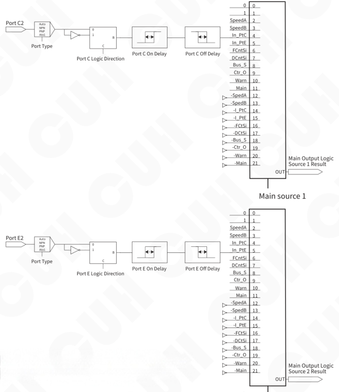

Für die Signalauswahloptionen der Hauptquelle ½  
siehe Kapitel 7.4.11 Anhang.

**Abbildung 4.4.1.1**

Hinweis: Der Hauptausgangszustand wird auch durch die Start/Stopp-Taste oder ob der Controller selbst in einem Fehlerzustand ist gesteuert. Die Fehlersteuerungsebene der Start-Stopp-Taste oder des Controllers selbst ist höher als das Hauptausgangs-Logiksignal. Das heißt: Wenn die Start-Stopp-Taste auf Stopp eingestellt ist, wechselt der Controller sofort in den Stoppzustand; bei einem Fehler wie Kurzschluss, Übertemperatur, Überstrom usw. wechselt der Controller ebenfalls sofort in den Stoppzustand. Zu diesem Zeitpunkt kann das Hauptausgangs-Logiksignal den Hauptausgang des Controllers nicht einschalten.


## 4.4.1.2 Hauptlogik

Hauptausgangs-Logikquelle1-Ergebnis und Hauptausgangs-Logikquelle 2-Verbindung Nachdem die Logikoperation durch die Hauptausgangslogik durchgeführt wurde, durchläuft sie die Hauptausgangsrichtung, dann die Hauptausgangs-Ein-Verzögerung und Aus-Verzögerung, und schließlich den Hauptausgangsmodus, und wird zur Ansteuerung des Hauptausgangs-Start/Stopp-Zustands verwendet.

Das Signalflussdiagramm ist wie folgt:

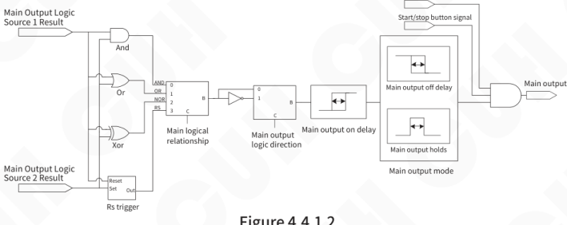

**Abbildung 4.4.1.2**

Dieser Controller kann die logische Beziehungstabelle zwischen Haupt-(Logik-)Quelle 1 und Hauptquelle 2 wie folgt einstellen. Standard Or.

| Parameter | Bedeutung |
|---|---|
| And | Logisches UND, Ausgang gültig wenn sowohl Hauptquelle 1 als auch Hauptquelle 2 gültig sind |
| Or | Logisches ODER, Ausgang gültig wenn mindestens eine von Hauptquelle 1 oder Hauptquelle 2 gültig ist |
| Xor | Logisches XOR, gültig wenn Hauptquelle 1 und Hauptquelle 2 in verschiedenen Zuständen sind, sonst ungültig |
| RS | RS-Flipflop |

## 4.4.1.3 Hauptrichtung

Das ist die Hauptausgangs-Logikrichtung. Die spezifische Ausgangsrichtung kann nach der logischen Verknüpfung der Signale eingestellt werden. Für das Signalflussdiagramm siehe Abbildung 4.4.1.2. Standard Const.

| Parameter | Bedeutung |
|---|---|
| Const | Der Zustand nach der Hauptausgangs-Logikoperation wird nicht invertiert, Standard ist der Normalzustand |
| Inv | Der Zustand wird nach der Hauptausgangs-Logikoperation invertiert |
| On | Der Zustand bleibt nach der Hauptausgangs-Logikoperation im Laufmodus |
| Off | Der Zustand ist nach der Hauptausgangs-Logikoperation immer gestoppt |


### 4.4.1.4 Haupt-Ein-Verzögerung/Haupt-Aus-Verzögerung

Bei Verwendung anderer externer Signale wie Sensoren zur Steuerung des Hauptausgangszustands des Geräts ist in den meisten Fällen eine Verzögerung erforderlich, nachdem das Signal gegeben oder das Signal wiederhergestellt wurde, bevor die Operation ausgeführt werden kann. Für solche Anwendungen kann dies durch Einstellung der Zeitwerte der Ein-Verzögerung und Aus-Verzögerung erreicht werden. Für das Signalflussdiagramm siehe Abbildung 4.4.1.2.

**Haupt-Ein-Verzögerung:** Das ist die Hauptausgangs-Ein-Verzögerung, die Verzögerungszeit, die von der Anwendung eines Steuersignals, das den Controller in den Laufzustand versetzt, bis zum tatsächlichen Start der Controller-Ausgabe erlebt wird. Die während dieses Zeitraums erlebte Verzögerungszeit wird als Ein-Verzögerung bezeichnet.

**Haupt-Abschaltverzögerung:** Das ist die Hauptausgangs-Aus-Verzögerung, beginnend mit der Anwendung eines Steuersignals, das den Controller in den Stoppzustand versetzt, bis zum tatsächlichen Stoppen der Controller-Ausgabe. Die während dieses Zeitraums erlebte Verzögerungszeit wird als Aus-Verzögerung bezeichnet.

Der Haupt-Ein/Aus-Verzögerungsbereich ist 0,0~99,9s, Standardwert ist 0,2s und die Einstellgenauigkeit beträgt 0,1s.

### 4.4.1.5 Hauptmodus

Es sind 2 Hauptausgangsmodi verfügbar: Verzögerungsmodus und Haltemodus. Signalflussdiagramm siehe Abbildung 4.4.1.2. Standard Delay.

| Parameter | Bedeutung |
|---|---|
| Delay | Bezieht sich auf den Zustand des Hauptausgangs nach der Logikoperation, den Zustand der Ansteuerung des Hauptausgangs nach Ein-Verzögerung und Aus-Verzögerung |
| Hold | Bezieht sich auf den Zustand nach der Hauptausgangs-Logikoperation. Nach der Ein-Verzögerung bleibt der Laufzustand für die Aus-Verzögerungszeit erhalten und wechselt dann sofort in den Stopp-Ausgangszustand |

Der Unterschied zwischen den beiden Modi wird in Form eines Zeitdiagramms wie folgt ausgedrückt, wobei das Eingangssignal eine logische Beziehungsauswahl ist.

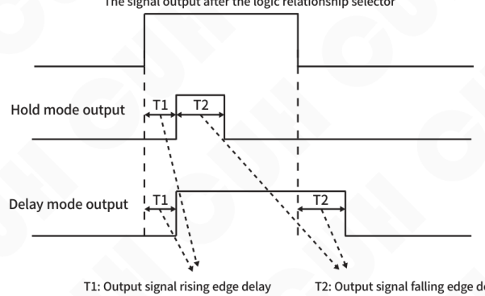


## 4.4.1.6 Einschaltzustand

Stellen Sie den Betriebsstatus des Controllers nach dem Einschalten ein. Standard On.

| Parameter | Bedeutung |
|---|---|
| On | Nach dem Einschalten des Geräts ist der Status des Schalterschlüssels „laufend" |
| Off | Nach dem Einschalten des Geräts ist der Status des Schalterschlüssels „gestoppt" |
| Keep | Nach dem Einschalten des Geräts bleibt der Status des Schalterschlüssels derselbe wie vor dem letzten Abschalten |

## 4.4.1.7 Fernsteuerungsquelle

Die Ausgangsspannung und Fördergeschwindigkeit des Controllers können über Panelparameter geändert oder direkt über die Größe des Fernsteuerungsquellen-Eingangssignals gesteuert werden. Optionale Steuerungsverfahren umfassen: Panel, 0-20mA DC-Eingang, 1-5V DC-Eingang, 0-5V DC-Eingang, 0-10V DC-Eingang sowie digitales Synchronisations-Bussignal. Standard ist Panel.

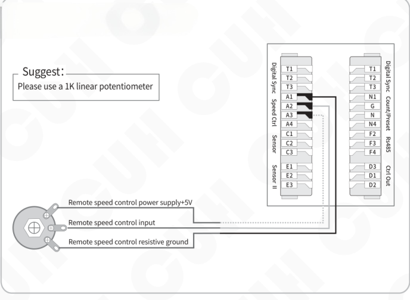


---

### PLC-Steueranschluss (1~5V/0~5V/0~10V DC-Eingang)

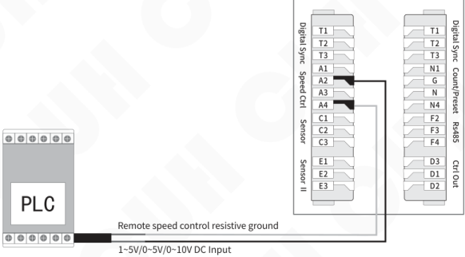

### PLC-Steueranschluss (4~20mA DC-Eingang)

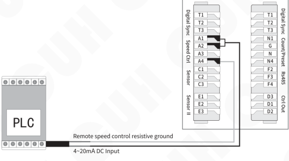

---


| Fernsteuerungssignal | Fernsteuerungssignal | Ausgangsspannung/Fördergeschwindigkeit |
|---|---|---|
| Panel |  | Ausgangsspannung und Fördergeschwindigkeit werden nicht durch Fernsteuerungssignal gesteuert |
| 20mA | &lt;2mA | Wenn der Spannungsmodus Manuell ist, Ausgangsspannung = 0<br>Wenn der Spannungsmodus Auto ist, Fördergeschwindigkeit = 0<br>LCD zeigt die Fehlermeldung „Fernsteuerung Unterspannung" an |
| 20mA | 2mA~4mA | Ausgangsspannung = 0, Fördergeschwindigkeit = 0 |
| 20mA | 4mA~20mA | Proportional gesteuert durch Fernsteuerungssignal（0%~100%）<br>Wenn der Spannungsmodus Manuell ist, Ausgangsspannung = (Eingangsstrom - 4mA)/16 × Max. Ausgangsspannung<br>Wenn der Spannungsmodus Auto ist, Fördergeschwindigkeit = (Eingangsstrom - 4mA)/16 × Max. Fördergeschwindigkeit |
| 1~5V | Unter 0,5V | Ausgangsspannung = 0, Fördergeschwindigkeit = 0<br>LCD zeigt die Fehlermeldung „Fernsteuerung Unterspannung" an |
| 1~5V | 0,5V~1V | Ausgangsspannung = 0, Fördergeschwindigkeit = 0 |
| 1~5V | 1V~5V | Proportional gesteuert durch Fernsteuerungssignal（0%~100%）<br>Wenn der Spannungsmodus Manuell ist, Ausgangsspannung = (Eingangsspannung - 1V)/4 × Max. Ausgangsspannung<br>Wenn der Spannungsmodus Auto ist, Fördergeschwindigkeit = (Eingangsspannung - 1V)/4 × Max. Fördergeschwindigkeit |
| 0~5V | 0V~5V | Proportional gesteuert durch Fernsteuerungssignal（0%~100%）<br>Wenn der Spannungsmodus Manuell ist, Ausgangsspannung = Eingangsspannung/5 × Max. Ausgangsspannung<br>Wenn der Spannungsmodus Auto ist, Fördergeschwindigkeit = Eingangsspannung/5 × Max. Fördergeschwindigkeit |
| 0~10V | 0V~10V | Proportional gesteuert durch Fernsteuerungssignal（0%~100%）<br>Wenn der Spannungsmodus Manuell ist, Ausgangsspannung = Eingangsspannung/10 × Max. Ausgangsspannung<br>Wenn der Spannungsmodus Auto ist, Fördergeschwindigkeit = Eingangsspannung/10 × Max. Fördergeschwindigkeit |
| DigSym | Digital Sync | Die Spannung des Fernsteuerungssignals ist die Fernsteuerungs-Eingangsspannung eines bestimmten Geräts am Bus（spezifiziert durch Fernsteuerungs-Synchronisationsparameter）<br>Proportional gesteuert durch das Fernsteuerungs-Eingangsspannungssignal eines bestimmten Geräts am Bus, mit einem Spannungsbereich von 0% bis 100%.<br>Wenn der Spannungsmodus Manuell ist, Ausgangsspannung = Eingangsspannung/10 × Max. Ausgangsspannung<br>Wenn der Spannungsmodus Auto ist, Fördergeschwindigkeit = Eingangsspannung/10 × Max. Fördergeschwindigkeit |

### 4.4.1.8 Fernsteuerungskoeffizient

Wenn die Fernsteuerungsquelle anders als „Panel" und „Sync" ausgewählt ist, kann der Fernsteuerungskoeffizient verwendet werden, um die Steuerungsgröße des Fernsteuerungs-Eingangssignals zu verstärken oder zu reduzieren.

Der Fernsteuerungskoeffizientbereich ist 0,5~2,0, Standardwert ist 1,0 und die Einstellgenauigkeit beträgt 0,1.

Beispiel: Der Fernsteuerungskoeffizient ist 0,5, wenn das Fernsteuerungs-Eingangssignal 2V ist, beträgt die äquivalente Fernsteuerungs-Eingangsspannung des Controllers 2V × 0,5 = 1V.


---

## 4.4.2 DC-Steuerungsausgangsparameter

Diese Zusammenfassung stellt hauptsächlich die Steuerungsausgangs-Parametereinstellungen des Controllers vor. Das schematische Diagramm des Steuerungsausgangs-Signalflusses ist wie folgt:

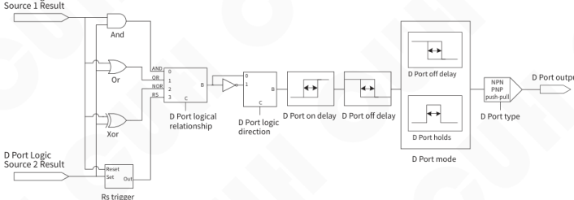

Die Methode zur Einstellung der Steuerungsausgangsparameter ist wie folgt:

> » Langes Drücken von ▲ und ◀ öffnet die Parametereinstellungs-Oberfläche, kurzes Drücken von ▶ wechselt zur Parametergruppe „6 DC output".
>
> » Kurzes Drücken von ▲ oder ▼ wechselt die Parameter in der Steuerungsausgangs-Parametergruppe.
>
> » Drücken Sie ⊕ oder ⊖ um den Parameterwert anzupassen.
>
> ```text
> RUN
> A C D E F G N J      T0
> 01.PotDLogc        Or
> 02.PotDSor1      In_PtC
> 03.PotDSor2      In_PtE
> 04.PortDDir       Const
> 05.PtDUpDly       0.2 S
> +   6DCoutput        −
> ```

Die anderen Parameter dieser Parametergruppe können nach den obigen Schritten angepasst werden.

„D-Port-Quelle 1", „D-Port-Quelle 2", „D-Port-Logik", „D-Port-Richtung", „D-Ein-Verzögerung"

„D-Aus-Verzögerung" und „D-Port-Modus", die obigen Parameter können sich auf die Hauptausgangsparametereinstellungen beziehen.

---


## 4.4.2.1 D-Port-Typ

Der D-Port-Ausgang kann drei Typen unterstützen: NPN-Ausgang, PNP-Ausgang und Push-Pull-Ausgang.  
Standard Ou_P&P (Push-Pull).

| Parameter | Bedeutung |
|---|---|
| Ou_NPN | Wenn das Ausgangssignal von Port D gültig ist, gibt Port D ein Niedrigpegel-Signal (0V) aus, und wenn ungültig, ist es hochohmig |
| Ou_PNP | Wenn das Ausgangssignal von Port D gültig ist, gibt Port D ein Hochpegel-Signal (24V) aus, und wenn ungültig, ist es hochohmig |
| Ou_P&P<br>(Push Pull) | Wenn das Ausgangssignal von Port D gültig ist, gibt Port D ein Hochpegel-Signal (24V) aus.<br>Wenn das Ausgangssignal von Port D ungültig ist, gibt Port D ein Niedrigpegel-Signal (0V) aus |

Das Diagramm ist wie folgt:

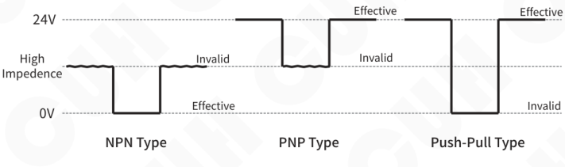


## 4.5 Signalsteuerung

Der Controller kann über einen externen Sensor den Zustand des Materials im Vibrationsförderer beurteilen und „Stopp bei Materialvoll" oder „Stopp bei Materialleer" des Controllers realisieren. Das Port-Signalflussdiagramm ist wie folgt:

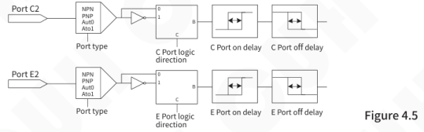

Die Methode zur Einstellung der Signaleingangsparameter ist wie folgt:

- Langes Drücken von ▲ und ◀ öffnet die Parametereinstellungs-Oberfläche, kurzes Drücken von ▶ wechselt zur Parametergruppe „5On&Off".
- Kurzes Drücken von ▲ oder ▼ wechselt die Parameter in der Signaleingangs-Parametergruppe.
- Drücken Sie ⊕ oder ⊖ um den Parameterwert anzupassen.

```text
RUN
A C D E F G N J        A0
01.PortType        Auto
02.PortCDir        Const
03.PtCUpDly        0.2 S
04.PtCDnDly        0.2 S
05.PortEDir        Const
+   5On&Off        −
```

Die anderen Parameter dieser Parametergruppe können nach den obigen Schritten angepasst werden.

### 4.5.1 Sensortyp

Der Controller kann den Typ des Schaltersensors auf „Auto", „NPN", „PNP" oder „Ato1" einstellen, oder er kann je nach Sensortyp manuell eingestellt werden.

| Parameter | Bedeutung |
|---|---|
| Auto | Unabhängig vom Sensortyp wird immer erkannt, ob der Portzugang durch Wechsel von Hoch- und Niedrigpegelsignalen gültig ist. Werkseinstellung ist automatische Erkennung |
| NPN | NPN-Typ Sensor |
| PNP | PNP-Typ Sensor |
| Ato1 | Bevor das Sensorsignal ungültig ist, wird erkannt, ob der Port durch Wechsel von Hoch- und Niedrigpegelsignalen gültig ist. Nach Erkennung eines gültigen Signals wird der Port-Sensortyp festgelegt und nicht mehr gescannt |


### 4.5.2 C-Port/E-Port-Logik

Dieser Parameter dient zum Umschalten des Controller-Eingangsports C und Eingangsports E auf „Abschaltung bei Materialvoll" oder „Abschaltung bei Materialleer".

Wenn der Schalter-Eingangsport C/Port E unter Werkseinstellungen kein Signal empfängt, befindet sich der Controller im Zustand „Laufend" (d. h. Abschaltung bei Materialvoll). Einige spezielle Anwendungen erfordern, dass sich der Controller im Zustand „Stopp" befindet (d. h. Materialleer-Abschaltung), wenn Port C/Port E kein Signal empfängt. Dies kann durch Änderung dieses Parameters erreicht werden. Siehe Abbildung 4.5 für das Signalflussdiagramm.

| Parameter | Bedeutung |
|---|---|
| Const | Wenn kein Steuersignal vorhanden ist, befindet sich der Controller im Laufzustand (Stopp bei Materialvoll) |
| Inv | Wenn kein Steuersignal vorhanden ist, befindet sich der Controller im Stoppzustand (Stopp bei Materialleer) |

### 4.5.3 C-Port Ein/Aus-Verzögerung und E-Port Ein/Aus-Verzögerung

Die Verzögerungszeit von der Anwendung eines Signals, das den Controller in den Laufzustand versetzt, bis das Signal vom Controller als gültig betrachtet wird, wird als Ein-Verzögerung bezeichnet.

Die Verzögerungszeit von der Anwendung eines Signals, das den Controller in den Stoppzustand versetzt, bis das Signal vom Controller als gültig betrachtet wird, wird als Aus-Verzögerung bezeichnet.

Für das Signalflussdiagramm siehe Abbildung 4.5.

Der Ein/Aus-Verzögerungsbereich ist 0,0~99,9s, Standardwert ist 0,2s und die Einstellgenauigkeit beträgt 0,1s.

**Hinweis:** Bei Verwendung von Port C und E zur Start/Stopp-Steuerung kann, wenn nach dem Empfang des Signals eine Verzögerung erforderlich ist, um sicherzustellen, dass das Signal stabil ist, dies durch Einstellung der Ein-Verzögerung und Aus-Verzögerung erreicht werden.


## 4.5.4 Geschwindigkeit A Logik/Geschwindigkeit B Logik

Das Signalflussdiagramm ist wie folgt:

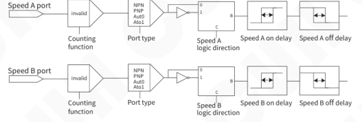

**Abbildung 4.5.4**

Dieser Parameter dient zum Umschalten des gültigen Status der Eingangsports für Controller-Geschwindigkeit A und Geschwindigkeit B. Dieser Parameter muss in der Materialvoll-Parametergruppe eingestellt werden. Standard ist Const.

| Parameter | Bedeutung |
|---|---|
| Const | Wenn kein Steuersignal vorhanden ist, sind Controller-Geschwindigkeit A und Geschwindigkeit B ungültig |
| Inv | Wenn kein Steuersignal vorhanden ist, sind Controller-Geschwindigkeit A und Geschwindigkeit B wirksam |

## 4.5.5 Geschwindigkeit A Ein/Aus-Verzögerung und Geschwindigkeit B Ein/Aus-Verzögerung

Von der Anwendung eines gültigen Signals am Geschwindigkeit A/B-Port zur Einstellung der aktiven Geschwindigkeit wird diese Zeitspanne als Ein-Verzögerung bezeichnet.

Von der Anwendung eines ungültigen Signals am Geschwindigkeit A/B-Port zur Deaktivierung der Geschwindigkeit wird diese Zeitspanne als Aus-Verzögerung bezeichnet.

Für das Signalflussdiagramm siehe Abbildung 4.5.4.

Der Geschwindigkeit A&B Ein/Aus-Verzögerungsbereich ist 0,0~99,9s, Standardwert ist 0,2s und die Einstellgenauigkeit beträgt 0,1s.


## 4.6 Materialzählung

Dieser Controller hat eine integrierte Zählfunktion, die Zähl-Impulse zählen und automatisch abbremsen oder stoppen kann, wenn die Anzahl der Impulse die eingestellte Gesamtzahl erreicht. Er verfügt auch über spezielle Funktionen wie Super-Entprellung und Endverzögerung zur Verhinderung von Überlauf. Das Signalflussdiagramm ist wie folgt:

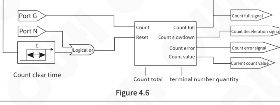

> » Langes Drücken von ▲ und ◀ öffnet die Parametereinstellungs-Oberfläche, kurzes Drücken von ▶ wechselt zur Parametergruppe „7Counter".
>
> » Kurzes Drücken von ▲ oder ▼ wechselt die Parameter in der Zähl-Parametergruppe.
>
> » Drücken Sie ⊕ oder ⊖ um den Parameterwert anzupassen.

```text
RUN
A C D E F G N J     A0
01.TotaCout       10
02.PrcntTrm       50 %
03.CotAhead        3
04.CotRstTm       0.0 S
05.CotPotSe       None
+     7Counter     −
```

Die anderen Parameter dieser Parametergruppe können nach den obigen Schritten angepasst werden.

### 4.6.1 Materialzählung (oder Geschwindigkeit A/B)

Dieser Parameter dient zum Aktivieren und Deaktivieren der Zählfunktion.

Standard ist None, d. h. die Zählfunktion ist ausgeschaltet und die Geschwindigkeit A/B-Funktion ist zu diesem Zeitpunkt aktiviert.

Wenn der Zählfunktionsparameter gültig (aktiviert) ist, fungieren Geschwindigkeit A und Geschwindigkeit B als Geschwindigkeit A/B-Steuerung, und der Controller kann weitere Operationen für die Zählfunktion ausführen. Für das Signalflussdiagramm siehe Abbildung 4.6.

| Parameter | Bedeutung |
|---|---|
| None | Zählfunktion ausschalten und Geschwindigkeit A/B-Funktion aktivieren |
| Valid | Geschwindigkeit A-Port als Zählport verwenden und Geschwindigkeit B-Port als Zähllösch-Port verwenden |


## 4.6.2 Zielmenge

Nachdem der „aktuelle Zählwert" die Grenze erreicht hat, ist das Zählvoll-Signal gültig, bis der Zähler zurückgesetzt wird. Nach dem Eintritt in den Zählvoll-Zustand wird die Zählung fortgesetzt, wenn weiterhin Zähl-Impulse gesendet werden, aber das Zählvoll-Signal bleibt gültig. Für das Signalflussdiagramm siehe Abbildung 4.6.

Der Gesamtzahlbereich ist 0~9999, Standardwert ist 10 und die Einstellgenauigkeit beträgt 1.

## 4.6.3 Endgeschwindigkeit

**Endgeschwindigkeit** bedeutet, dass wenn die Zählung in den Endverzögerungszustand eintritt, die Fördergeschwindigkeit und Spannung des Controllers auf den Prozentsatz der Anfangsgeschwindigkeit und -spannung abfallen, siehe Abbildung 4.6.3.

Wenn die Zählzahl sich der Gesamtzahl nähert, ist der Zählprozess fast abgeschlossen. Um zu verhindern, dass die Hochgeschwindigkeitsbewegung des Materials nicht rechtzeitig stoppen kann und einen Zählüberlauf verursacht, reduziert der Controller die Geschwindigkeit automatisch auf die eingestellte Endgeschwindigkeit (das Zählverzögerungssignal ist gültig), wenn die verbleibende Anzahl unter der Endanzahl liegt. Wenn der Zählwert die Gesamtzahl erreicht (das Zählvoll-Signal ist gültig), stoppt der Controller sofort die Ausgabe, und der Förderer kann eine präzise Zählsteuerung erreichen.

Der Endgeschwindigkeitsbereich ist 0~100%, Standardwert ist 50% und die Einstellgenauigkeit beträgt 1%.

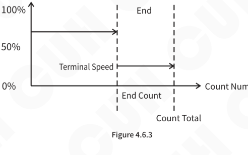


## 4.6.4 Endgeschwindigkeitsmenge

Anzahl der Endabschnitte: Bezieht sich auf die Gesamtzahl der Distanzzählungen. Nach Erreichen der „Endanzahl" wechselt der Controller in den Zählverzögerungsmodus.

Im Geschwindigkeitszustand fallen die Fördergeschwindigkeit und Spannung auf die Endgeschwindigkeit und Endspannung ab. Wenn der Wert der „Endsegmentanzahl" 0 ist, bedeutet dies, dass die Endverzögerungsfunktion nicht verwendet wird. Für das Signalflussdiagramm siehe Abbildung 4.6.

Die Endsegmentanzahl-Bereich ist 0 bis 9999, Standardwert ist 3 und die Einstellgenauigkeit beträgt 1.

## 4.6.5 Zählwert auf 0 zurücksetzen

Wenn die Zählung voll ist, löscht der Controller den Zählwert automatisch nach der „Zähllösch"-Zeitverzögerung. Wenn der „Zähllösch"-Wert 0,0s ist, bedeutet dies, dass die verzögerte automatische Zählrücksetzung deaktiviert ist.

Der Zähl-Rücksetzbereich ist 0,0~999,9s, Standardwert ist 0,0s und die Einstellgenauigkeit beträgt 0,1s.

## 4.6.6 RS-Priorität

Dient zur Einstellung der RS-Trigger-Portpriorität. Standard Same.

| Parameter | Bedeutung |
|---|---|
| Same | Der R-Port und der S-Port haben die gleiche Priorität. Wenn Signale an den R- und S-Ports vorhanden sind, meldet der Controller eine Warnung „Haupt-RS-Fehler" oder „Steuer-RS-Fehler" |
| Reset | Reset-Priorität. Wenn Signale an den R- und S-Ports vorhanden sind, hat das R-Port-Signal Vorrang, d. h. das Rücksetzsignal hat Priorität |
| Set | Set-Priorität. Wenn Signale an den R- und S-Ports vorhanden sind, hat das S-Port-Signal Vorrang, d. h. das Setzsignal hat Priorität |
| Revers | Wenn Signale an den R- und S-Ports vorhanden sind, wird das aktuelle Logikausgangsergebnis invertiert |


## 4.7 Einstellungen speichern

Dieses Kapitel stellt hauptsächlich vor, wie die Parameterspeicher- und Rückrufparameter-Funktionen des Controllers verwendet werden.

### 4.7.1 Einstellungen abrufen

Der Controller kann 3 verschiedene Sätze von voreingestellten Parametern neben der Arbeitsgruppe auslesen, benannt als „Benutzer 1", „Benutzer 2" und „Benutzer 3".

Wenn der Benutzer die Parameter ändert, werden die Controller-Parameter standardmäßig in der Arbeitsgruppe gespeichert. Wenn der Controller wieder eingeschaltet wird, werden die Parameter automatisch aus der Arbeitsgruppe gelesen und die Parameterwerte vor dem letzten Abschalten wiederhergestellt. Gleichzeitig können Benutzer manuell aus „UsrD1", „UsrD2", „UsrD3" auswählen, um eine andere manuell gespeicherte Datei der drei Gruppen auszulesen. Die Daten werden an die Arbeitsgruppe im Controller gesendet, wodurch der Controller den Arbeitsstatus sofort umschalten kann.

| Parameter | Bedeutung |
|---|---|
| None | Ungültig |
| UsrD1 | Benutzerdefinierte Parameter 1 |
| UsrD2 | Benutzerdefinierte Parameter 2 |
| UsrD3 | Benutzerdefinierte Parameter 3 |

### 4.7.2 Einstellungen speichern

Der Controller kann 4 verschiedene Sätze von voreingestellten Parametern speichern, benannt als „Work", „UsrD1", „UsrD2", „UsrD3".

Wenn der Benutzer die Parameter ändert, werden die Controller-Parameter standardmäßig automatisch in „Work" gespeichert. Wenn der Controller wieder eingeschaltet wird, werden die Parameter automatisch aus der Arbeitsgruppe gelesen und die Parameterwerte vor dem letzten Abschalten wiederhergestellt. Benutzer können Parameter in der Arbeitsgruppe manuell in „UsrD1", „UsrD2", „UsrD3" speichern.

| Parameter | Bedeutung |
|---|---|
| None | Ungültig |
| Work | Standard-Arbeitsgruppe |
| UsrD1 | Benutzerdefinierte Parameter 1 |
| UsrD2 | Benutzerdefinierte Parameter 2 |
| UsrD3 | Benutzerdefinierte Parameter 3 |


---

### 4.7.3 Werkseinstellungen wiederherstellen

Verwenden Sie Rücksetzparameter, um alle Arbeitsgruppenparameter auf die Werkseinstellungen wiederherzustellen.

Nach Auswahl von „RWork" in „Rücksetzparameter" drücken Sie ⊕ und ⊖ gleichzeitig für mehr als zwei Sekunden, die Anzeige wechselt zur Standby-Oberfläche und die Parameter werden erfolgreich wiederhergestellt.

| Parameter | Bedeutung |
|---|---|
| None | Ungültig |
| Rwork | Arbeitsgruppenparameter auf Werkseinstellungen wiederherstellen. (Benutzer 1, Benutzer 2 und Benutzer 3 werden nicht wiederhergestellt) |

### 4.7.4 Einstellungen kopieren

Der Controller kann die Parametergruppe dieses Controllers durch die Daten der zwei Controller im Netzwerk ersetzen, die er gesichert hat, um die Parameter der zwei Controller schnell zu kopieren.

Wählen Sie die ID-Nummer des zu kopierenden Controllers, um die Funktion zum Kopieren der Controller-Daten zu realisieren. Der Auswahlbereich der Kopierparameter ist 1~8.

### 4.7.5 Benutzerpasswort

Benutzer können das Parameterpasswort selbst festlegen. Nach der Sperrung kann der Benutzer nur unter der „Überwachungsparametergruppe" und „Startseite" arbeiten.

Wenn der Benutzer das „Benutzerpasswort" auf einen Wert ungleich 0 einstellt, bedeutet dies, dass die erweiterte Parametersperrfunktion aktiviert ist. Zu diesem Zeitpunkt müssen Sie das Passwort eingeben, wenn Sie die Parametergruppe auf der Startseite aufrufen. Nachdem der Benutzer „Passwort eingeben" ausgewählt und ▶ + ▲ drückt, wenn „Passwort eingeben" und „Benutzerpasswort" unterschiedlich sind, kann der Benutzer nur auf die Überwachungsparametergruppe zugreifen. Erst nach korrektem Passwort kann der Benutzer auf andere Parametergruppen zugreifen.

Der Auswahlbereich des Benutzerpassworts ist 0~9999.

### 4.7.6 Passwort eingeben

Wenn „Passwort eingeben" und „Benutzerpasswort" unterschiedlich sind, kann der Benutzer nur unter „Startseite" und „Überwachungsparametergruppe" arbeiten. Erst nach korrektem Passwort kann der Benutzer auf andere Parametergruppen zugreifen.

Der Auswahlbereich für die Passworteingabe ist 0~9999.

---


## 4.8 RS485-Kommunikation

Dieser Controller unterstützt RS485-Kommunikation. Nach dem Modbus-Protokollmodus ASCII und RTU-Typ können alle Parameter und der Status des Controllers ferngesteuert geändert und gelesen werden.

Das lokale RS485-Kommunikationsprotokoll „SDVC42-S Serie 485 Registeradressentabelle" kann aus dem Downloadbereich unserer Website heruntergeladen werden: www.cuhnj.com.

> » Langes Drücken von ▲ und ◀ öffnet die Parametereinstellungs-Oberfläche, kurzes Drücken von ▶ wechselt zur Parametergruppe „8Comm".
>
> » Kurzes Drücken von ▲ oder ▼ wechselt die Parameter in der Kommunikations-Parametergruppe.
>
> » Drücken Sie ⊕ oder ⊖ um den Parameterwert anzupassen.
>
> ```text
> RUN
> A C D E F G N J     A0
> 01.485type       RTU
> 02.BaudRate    115.2 K
> 03.485SlvID      1
> 04.Enab485R    None
> 05.DigSynAd      1
> +     8Comm       -
> ```

Die anderen Parameter dieser Parametergruppe können nach den obigen Schritten angepasst werden.

### 4.8.1 Kommunikationstyp

RS485-Kommunikationstyp-Auswahl, Modbus ASCII-Typ und Modbus RTU-Typ. Standard RTU.

| Parameter | Bedeutung |
|---|---|
| ASCⅡ | Modbus ASCII-Typ |
| RTU | Modbus RTU-Typ |


## 4.8.2 Baudrate

Verschiedene RS485-Kommunikationsbaudraten-Optionen. Standard ist 115,2K.

| Parameter | Bedeutung |
|---|---|
| 0.3K | 0,3 Kbps |
| 1.2K | 1,2 Kbps |
| 2.4K | 2,4 Kbps |
| 9.6K | 9,6 Kbps |
| 19.2K | 19,2 Kbps |
| 57.6K | 57,6 Kbps |
| 115.2K | 115,2 Kbps |

## 4.8.3 Slave-Controller-Adresse

Stellen Sie die Slave-Adressnummer in der RS485-Kommunikation ein.

Der Slave-Nummernbereich ist 1 bis 31. Standard 1.

## 4.8.4 Portwiderstand/Synchronwiderstand

Der RS485-Kommunikationsport/Digitalsynchronisationsport enthält eine Anpasswiderstandsfunktion (120Ω). Standard ist None.

| Parameter | Bedeutung |
|---|---|
| None | Anpasswiderstand (120Ω) nicht verwenden |
| Valid | Anpasswiderstand (120Ω) verwenden |


## 4.9 CUHBus-DS® Vernetzung

Der SDVC42-S Controller verwendet den LAN-Bus (CUHBus-DS®) seriellen Kommunikationsprotokoll-Busprotokoll. Er erreicht die Vernetzung von bis zu 8 Geräten im selben Netzwerk. Nach der Vernetzung können folgende Funktionen zwischen den Controllern implementiert werden:

**Synchronisationsfunktionen:** Die Frequenz, Phase, Fernsteuerungsgeschwindigkeitsregelung und andere Parameter eines beliebigen Controllers im Netzwerk können mit der Ausgabe eines beliebigen anderen Controllers im Netzwerk konsistent sein oder davon abweichen.

**Signalteilung:** Jedes Statussignal eines beliebigen Controllers im Netzwerk kann als Signaleingangsquelle eines beliebigen anderen Controllers geteilt werden. Ermöglicht jedem Controller im Netzwerk, reichhaltigere Signalquellen neben dem lokalen Gerät zu haben und diese nach logischen Operationen auszugeben, um komplexere Controller-Betriebslogik am Benutzerstandort zu implementieren.

**Datensicherung:** Die Daten eines beliebigen Controllers im Netzwerk werden auf den anderen zwei Controllern im Netzwerk gesichert. Jeder Controller im Netzwerk kann durch Ersatz und Beitritt perfekt ersetzt werden, und die Daten des ersetzten Controllers können zum Weiterbetrieb verwendet werden.

> ☺
>
> **Dieses Netzwerksystem hat folgende Eigenschaften:**
>
> - Einfache Erweiterung, neue Geräte können schnell zum Netzwerk hinzugefügt werden.
> - Das Netzwerk ist gleichwertig, mit einem Satz gleichwertiger CUHBus-DS® Kommunikationsanschlüsse links und rechts zur Erleichterung der Benutzerverbindung.
> - Das Gerät unterstützt Hot-Swapping, und die Controller-Erweiterung kann ohne Abschaltung während des stabilen Betriebs des Controllersystems hinzugefügt oder gelöscht werden.


## 4.9.1 Gerätevernetzung

Dieses Kapitel stellt hauptsächlich die schnelle Vernetzung zwischen mehreren Controllern vor, wie ein neuer Controller zum bestehenden Netzwerk hinzugefügt wird und wie der Controller im Netzwerk gelöscht wird.

### 4.9.1.1 Gerätevernetzung

Ein einzelner Controller ist ein Netzwerk für sich. Wenn die CUHBus-DS® Signalleitungen der Controller korrekt verbunden sind und einfache Operationen durchgeführt werden, können mehrere Geräte ein neues digitales Synchronkommunikations-Netzwerk bilden.

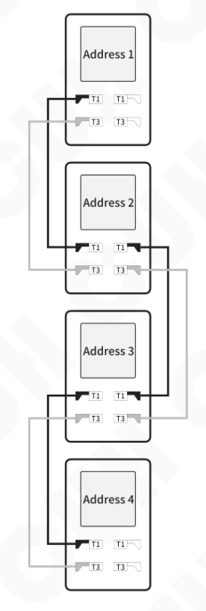


---

**Schritte:**

1. Verbinden Sie alle Controller-T1-Signale miteinander und alle T3-Signale miteinander, wie in der obigen Abbildung gezeigt.

2. Wenn das neue Gerät eingeschaltet wird, tritt der neue Controller automatisch in die „Kommunikations-Parametergruppe" ein.

3. Stellen Sie in der Kommunikations-Parametergruppe die lokale digitale Synchronkommunikations-Gerätenummer ein, „DigSynAd" ist ein beliebiger Wert [1~8]. Sie müssen es nicht einstellen, das Programm generiert automatisch eine Nummer.

4. Stellen Sie in der Kommunikations-Parametergruppe den Parameterwert von „EnNetwok" auf „Expand" ein und drücken Sie dann ⊕ und ⊖ gleichzeitig halten, bestätigen.

5. Nach erfolgreichem Hinzufügen ändert sich der Parameterwert des neuen Geräts „EnNetwok" automatisch auf „Online", was bedeutet, dass das neue Gerät erfolgreich hinzugefügt wurde.

Benutzer können durch Überprüfung der Gerätevernetzungs-Statusparameter prüfen, ob das Netzwerk korrekt vernetzt wurde, sowie die Gesamtzahl der Geräte im Netzwerk und die Anzahl der Online-Geräte überprüfen.

Hinweis: Nur das Verbinden der CUHBus-DS® Signalleitung ohne Durchführung der Einstellungen gilt nicht als Beitritt zum Netzwerk.

**Ansicht-Bestätigungsmethode:**

1. In der Überwachungsparametergruppe zeigt der Wert des Parameters „DevicNum" [1~8] die Gesamtzahl der Geräte im Netzwerk an.

2. In der Überwachungsparametergruppe zeigt der Wert des Parameters „OnlinNum" [1~8] an, wie viele Controller derzeit im Netzwerk online sind.

**Synchronwiderstand:**

Der CUHBus-DS® Kommunikationsport enthält eine Anpasswiderstandsfunktion (120Ω), die ungültig oder gültig ist.

| Parameter | Bedeutung |
|---|---|
| None | Anpasswiderstand (120Ω) nicht verwenden |
| Valid | Anpasswiderstand (120Ω) verwenden |

---


---

## 4.9.1.2 Gerätebeitritt

Benutzer können die folgenden Erweiterungs- und Hinzufügeschritte befolgen, um einen neuen Controller zum bestehenden Netzwerk hinzuzufügen.

Der neue Controller nach dem Beitritt kann das Signal eines beliebigen Controllers im Netzwerk aufrufen und als Controller-Signalquelle für jeden anderen Controller im Netzwerk fungieren. Bereicherung der Systemsigmalquellen.

**Schritte:**

1. Verbinden Sie die CUHBus-DS® T1- und T3-Schnittstellen des neuen Geräts mit dem ursprünglichen vollständigen Netzwerk, die Ports unterstützen Hot-Swapping.
2. Wenn das neue Gerät eingeschaltet wird, tritt der neue Controller automatisch in die „Kommunikations-Parametergruppe" ein.
3. Stellen Sie in der Kommunikations-Parametergruppe die lokale digitale Synchronkommunikations-Gerätenummer ein, „DigSynAd" ist ein beliebiger Wert [1~8]. Sie müssen es nicht einstellen, das Programm generiert automatisch eine Nummer.
4. Stellen Sie in der Kommunikations-Parametergruppe den Parameterwert von „EnNetwok" auf „Expand" ein und drücken Sie dann ⊕ und ⊖ gleichzeitig halten, bestätigen.
5. Nach erfolgreichem Hinzufügen ändert sich der Parameterwert des neuen Geräts „EnNetwok" automatisch auf „Online", was bedeutet, dass das neue Gerät erfolgreich hinzugefügt wurde.

Benutzer können durch Überprüfung der Gerätevernetzungs-Statusparameter prüfen, ob das Netzwerk korrekt vernetzt wurde, sowie die Gesamtzahl der Geräte im Netzwerk und die Anzahl der Online-Geräte überprüfen.

Hinweis: Nur das Verbinden der CUHBus-DS® Signalleitung ohne Durchführung der Einstellungen gilt nicht als Beitritt zum Netzwerk.

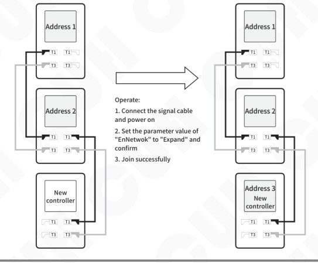

---


---

### 4.9.1.3 Geräteentfernung

Wenn Sie einen Controller dauerhaft aus dem Netzwerk entfernen müssen, verwenden Sie die Funktion „Controller aus Netzwerk entfernen". Das Löschen eines Controllers im Netzwerk kann von jedem Controller im Netzwerk aus gestartet werden. Die verbleibenden Controller nach dem Löschen reorganisieren sich zu einem vollständigen neuen Netzwerk.

Wenn der Controller jedoch direkt entfernt wird (einschließlich Stromausfall), ohne den Controller zu löschen, werden die Daten des Controllers weiterhin im Netzwerk aufbewahrt. Zu diesem Zeitpunkt befindet sich das Netzwerk in einem degradierten Zustand und neue Controller können nicht hinzugefügt werden. Es muss manuell über den Controller gelöscht werden, um die Integrität des Netzwerks aufrechtzuerhalten und die Erweiterung und das Hinzufügen neuer Controller abzuschließen.

**Schritte zum Löschen eines Controllers:**

1. Rufen Sie die „Kommunikations-Parametergruppe" über einen beliebigen Controller im Netzwerk auf.
2. Ändern Sie den Wert des „DeltDevi"-Parameters auf die Adresse des zu löschenden Netzwerkgeräts.
3. Nach Änderung des Werts langes Drücken von ⊕ und ⊖, Löschen des Geräts bestätigen.
4. Nach Abschluss des Löschvorgangs ändert sich der „DeltDevi"-Parameterwert auf einen nicht auswählbaren Wert, was bedeutet, dass das Gerät erfolgreich gelöscht wurde.
5. Überprüfen Sie zu diesem Zeitpunkt den neuen Netzwerkstatus auf dem Bedienungsgerät und bestätigen Sie die Anzahl der neuen Netzwerksteuerungen.

Beispiel: Löschen des Adresse 3 Controllers aus dem Netzwerk.

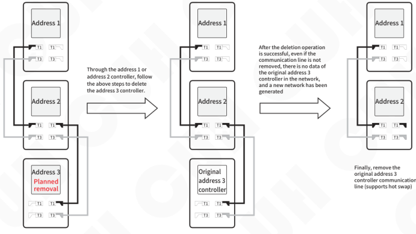

---


---

## 4.9.2 Synchronisationsfunktion

Die Frequenz, Phase oder ferngesteuerte Geschwindigkeit eines beliebigen Controllers im Netzwerk kann einem anderen Master-Controller konsistent oder mit einer bestimmten Abweichung folgen. Mehrere Controller können sich jedoch nicht gegenseitig folgen, da sonst ihre Ausgaben instabil werden.

Beispiel 1: Adresse 3 Controller folgt der Ausgangsfrequenz des Adresse 1 Controllers, sodass die beiden von ihnen angetriebenen Vibrationsförderer mit derselben Frequenz laufen.

Beispiel 2: Wenn der Adresse 3 Controller bereits der Ausgangsfrequenz des Adresse 1 Controllers folgt, kann der Adresse 1 Controller nicht so eingestellt werden, dass er der Ausgangsfrequenz des Adresse 3 Controllers folgt. Das heißt, die Controller können sich nicht gegenseitig folgen.

➢ **Frequenzsynchronisation**

Die Methode zur Einstellung der Frequenzsynchronisation ist wie folgt:

1. Die Controller, die eine Frequenzsynchronisation benötigen, bilden dasselbe digitale Synchronkommunikations-Netzwerk. Siehe das Kapitel „Gerätevernetzung".

2. Stellen Sie den „FrqncSyn"-Parameterwert in der Kommunikations-Parametergruppe des frequenzsynchronisierten Controllers auf die „Digital Sync"-Adressnummer des synchronisierten Controllers ein.

3. Wechseln Sie zum frequenzsynchronisierten Controller zur Konstantgeschwindigkeits-Parametergruppe und stellen Sie „FrqncMod" auf „SynV" oder „SynE" ein.

➢ **Fernsteuerungsgeschwindigkeits-Synchronisation**

Die Methode zur Einstellung der Fernsteuerungsgeschwindigkeits-Synchronisation ist wie folgt:

1. Die Controller, die eine Fernsteuerungssynchronisation benötigen, bilden dasselbe digitale Synchronkommunikations-Netzwerk. Siehe das Kapitel „Gerätevernetzung".

2. Stellen Sie den „RemotSyn"-Parameterwert in der Kommunikations-Parametergruppe des fernsteuerungssynchronisierten Controllers auf die „Digital Sync"-Adressnummer des synchronisierten Controllers ein.

3. Stellen Sie den „CtrlSour"-Parameterwert in der Hauptausgangs-Parametergruppe auf „DigSym" ein.

➢ **Master/Slave-Arbeitsmodus**

Benutzer können den Controller je nach Anwendungsanforderungen in einem der folgenden zwei Betriebsmodi betreiben:

Hauptmodus: wobei ein Controller unabhängig eine Last-Vibrationsplatte steuert.

Slave-Modus: Wenn zwei oder mehr Controller synchron arbeiten müssen, wird ein Controller als Master-Controller verwendet und arbeitet im Hauptmodus als Frequenzreferenz. Alle anderen Controller arbeiten im Slave-Modus als Slave-Controller und arbeiten synchron mit dem Master-Controller.

---


## Hauptmodus

Der im Hauptmodus arbeitende Controller, nachfolgend als Master-Controller bezeichnet, ändert die Parameter in der Konstantgeschwindigkeits-Parametergruppe. Die Parameter „Spannungsmodus" und „Frequenzmodus" können den Controller auf den entsprechenden Arbeitsmodus einstellen. Der Spannungsmodus und Frequenzmodus haben folgende Kombinationen:

| Arbeitsmodus | Spannung<br>Steuerungsmethode | Frequenz<br>Steuerungsmethode | Vibrationssensor erforderlich |
|---|---|---|---|
| Voll Manuell | Manuel | Manuel | Nein |
| Voll Automatisch | Auto | Auto | Ja |
| Spannung Automatisch | Auto | Manuel | Ja |
| Frequenz Automatisch | Manuel | Auto | Ja |

■ **Voll-manueller Modus**

In diesem Modus werden die Ausgangsspannung und Ausgangsfrequenz des Controllers manuell eingestellt.

**Hinweis:** Auch wenn der Parameter „Spannungsmodus" oder „Frequenzmodus" auf „Auto" eingestellt ist, arbeitet der Controller weiterhin im voll-manuellen Modus, wenn der Vibrationssensor nicht angeschlossen ist.

■ **Voll-automatischer Modus**

Der Controller passt die Ausgangsspannung und Ausgangsfrequenz automatisch basierend auf den vom Vibrationssensor zurückgemeldeten Daten an, um sicherzustellen, dass die Fördergeschwindigkeit des Vibrationsgeräts stabil nahe dem „Fördergeschwindigkeits"-Sollwert bleibt und die Vibrationsfrequenz an der optimalen Betriebsfrequenz des Vibrationsgeräts liegt. Die Ausgangsspannung und Ausgangsfrequenz werden nicht durch die Parameter „Spannung" und „Frequenz" gesteuert.

**Hinweis:** Die Werkseinstellung des Controllers ist der voll-automatische Modus, aber wenn der Vibrationssensor nicht korrekt eingesteckt ist, bleibt der Controller weiterhin im voll-manuellen Zustand. Der Controller wechselt erst in den voll-automatischen Zustand, wenn der Vibrationssensor korrekt eingesteckt ist.

■ **Spannungsautomatischer Modus**

In diesem Modus passt der Controller die Ausgangsspannung automatisch basierend auf den vom Vibrationssensor zurückgemeldeten Daten an, um sicherzustellen, dass die Fördergeschwindigkeit des Vibrationsgeräts stabil am Sollwert bleibt. Die Ausgangsfrequenz wird manuell vom Benutzer eingestellt. Der Controller muss mit einem Vibrationssensor verbunden sein, damit dieser Modus ordnungsgemäß funktioniert.

■ **Frequenzautomatischer Modus**

In diesem Modus passt der Controller die Ausgangsfrequenz automatisch basierend auf den vom Vibrationssensor zurückgemeldeten Daten an, sodass die Vibrationsfrequenz an der optimalen Betriebsfrequenz des Vibrationsgeräts liegt, und die Ausgangsspannung wird manuell eingestellt. Der Controller muss mit einem Vibrationssensor verbunden sein, damit dieser Modus ordnungsgemäß funktioniert.


## Slave-Modus

Wenn mehrere Controller vernetzt sind, kann jeder beliebige den Slave-Modus auswählen. In diesem Modus ist die Ausgangsfrequenz des Slave-Controllers immer streng konsistent mit der Ausgangsfrequenz des Master-Controllers. Der im Slave-Modus arbeitende Controller wird nachfolgend als Slave-Controller bezeichnet.

Der Frequenzsynchronisationsmodus wird in Situationen verwendet, in denen mehrere Controller in einem Fördersystem vorhanden sind und ihre Ausgangsfrequenzen und Phasen synchronisiert werden müssen. Durch den Synchronisationsmodus können Master- und Slave-Controller vollständig synchrone Wellenformen ausgeben, wodurch gegenseitige Störungen zwischen den Controller-Ausgängen eliminiert werden.

Wenn Controller M im Master-Modus und Controller S im Slave-Modus (Synchronisationsmodus) arbeitet, sind die Ausgangswellenformen der beiden Controller vollständig synchronisiert. Wie unten gezeigt:

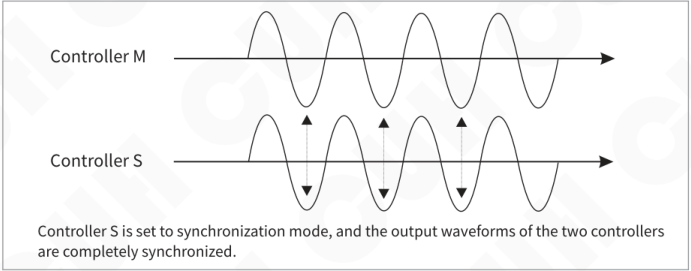

Wenn Controller S nicht auf den Slave-Modus (SynV- oder SynE-Modus) eingestellt ist, sind die Ausgangswellenformen der beiden Controller nicht synchronisiert. Wie unten gezeigt:

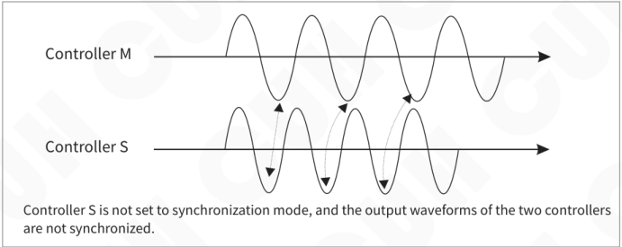


Für mechanische Geräte, die eine präzise Ausrichtung erfordern, können zwei oder mehr Vibrationsgeräte physikalisch konsistente Phasen benötigen, aber jedes Gerät hat eine andere Resonanzfrequenz. Durch Einstellung des Frequenzmodus auf „SynV" kann der Controller die Phasen jedes Geräts automatisch an die Vibrationsbedingungen anpassen, um Konsistenz zu erreichen. Wenn der Frequenzmodus „SynE" ist, stellt der Benutzer den Phasenkompensationswert manuell ein.

Ändern Sie die Parameter „Spannungsmodus" und „Frequenzmodus" in der Konstantgeschwindigkeits-Parametergruppe, um den Controller auf den entsprechenden „Arbeitsmodus" einzustellen. Der Spannungsmodus und Frequenzmodus haben folgende Kombinationen:

| Arbeitsmodus | Spannungsmethode | Frequenzmethode | Phasensteuerung | Vibrationssensor erforderlich |
|---|---|---|---|---|
| Spannung automatisch<br>Phase automatisch | Auto | SynV | Auto | Ja |
| Spannung automatisch<br>Phase manuell | Auto | SynE | Manuelle Einstellung | Ja |
| Spannung manuell<br>Phase automatisch | Manuel | SynV | Auto | Ja |
| Spannung manuell<br>Phase manuell | Manuel | SynE | Manuelle Einstellung | Nein |

☺

**Hinweis:**

1. Auch wenn die Parameter „Spannungsmodus" und „Frequenzmodus" auf „Auto" und „SynV" eingestellt sind, arbeitet der Controller ohne angeschlossenen Vibrationssensor weiterhin im manuellen Spannungs- und manuellen Phasenzustand.

2. Automatische Spannung bezieht sich auf einen Slave-Controller mit angeschlossenem Vibrationssensor, der die Ausgangsspannung automatisch anpasst, um die Fördergeschwindigkeit nahe dem benutzerdefinierten Wert zu stabilisieren.

3. Automatische Phase bedeutet, dass der Slave-Controller mit angeschlossenem Vibrationssensor die Phase der Ausgangswellenform basierend auf dem Rückmeldesignal des Sensors automatisch korrigiert, sodass das Synchronisationssignal des Slave-Controllers und des Master-Controllers phasengleich sind.

4. Manuelle Phase bezieht sich auf die Phase der Slave-Controller-Ausgangswellenform, die manuell auf eine feste Phasenabweichung von der Master-Controller-Ausgangswellenform eingestellt werden kann.


## Verbindungsmethode der Synchronisationssignalleitung zwischen Master- und Slave-Controllern

Verbinden Sie einfach die Master- und Slave-Controller mit demselben digitalen Synchronkommunikations-Netzwerk und vernetzen Sie sie dann. Stellen Sie den „Frequenzsynchronisation"-Parameterwert in der Kommunikations-Parametergruppe des Slave-Controllers auf die „Digital Sync"-Adressnummer des Master-Controllers ein. Ändern Sie dann den „Frequenzmodus" in der Konstantgeschwindigkeits-Parametergruppe auf „Synchronvibration" oder „Synchronstrom".

### Anwendungsszenarien, bei denen sowohl Master- als auch Slave-Controller mit Vibrationssensoren verbunden sind

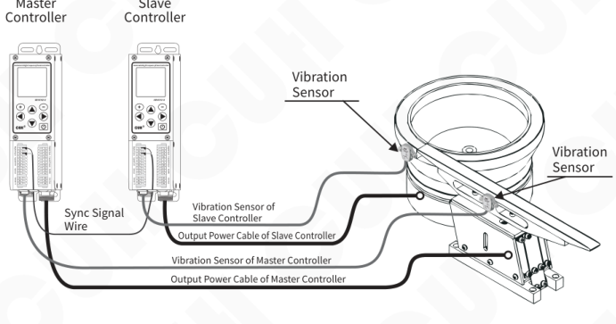

1. Wenn der Slave-Controller im manuellen Spannungs- und manuellen Phasenmodus arbeitet, muss der Slave-Controller nicht mit einem Vibrationssensor verbunden sein.

2. Wenn der Master-Controller im voll-manuellen Modus arbeitet, muss der Master-Controller nicht mit einem Vibrationssensor verbunden sein.


---

■ **Auto-Spannung Auto-Phase-Modus**

In diesem Modus muss der Controller mit einem Vibrationssensor verbunden sein. Der Controller passt die Ausgangsspannung automatisch basierend auf den vom Vibrationssensor zurückgemeldeten Daten an, um sicherzustellen, dass die Fördergeschwindigkeit des Vibrationsgeräts stabil am Sollwert bleibt. Die Frequenz und Phase der Ausgangswellenform sind konsistent mit dem Master-Controller, oder eine Phasendifferenz, eingestellt durch den Parameter „Auto Phase".

■ **Auto-Spannung Manuell-Phase-Modus**

In diesem Modus muss der Controller mit einem Vibrationssensor verbunden sein. Der Controller passt die Ausgangsspannung automatisch basierend auf den vom Vibrationssensor zurückgemeldeten Daten an, um sicherzustellen, dass die Fördergeschwindigkeit des Vibrationsgeräts stabil am Sollwert bleibt. Die Ausgangsfrequenz ist konsistent mit dem Master-Controller. Die Ausgangswellenform unterscheidet sich von der Master-Controller-Ausgangswellenform um einen festen Phasendifferenzwert, der durch den Parameter „Manuelle Phase" eingestellt wird.

■ **Manuell-Spannung Auto-Phase-Modus**

In diesem Modus muss der Controller mit einem Vibrationssensor verbunden sein. Die Ausgangsspannung des Controllers wird manuell eingestellt. Die Frequenz und Phase der Ausgangswellenform sind konsistent mit dem Master-Controller, oder eine Phasendifferenz, eingestellt durch den Parameter „Auto Phase".

■ **Manuell-Spannung Manuell-Phase-Modus**

In diesem Modus wird die Ausgangsspannung des Controllers manuell eingestellt, und die Ausgangsfrequenz ist konsistent mit dem Master-Controller. Die Ausgangswellenform unterscheidet sich von der Master-Controller-Ausgangswellenform um einen festen Phasendifferenzwert, der durch den Parameter „Manuelle Phase" eingestellt wird.

> ☺
>
> 1. Der automatische Phasenmodus erfordert die Einstellung des „Frequenzmodus"-Parameterwerts des Slave-Controllers auf „SynV".
>
> 2. Der manuelle Phasenmodus erfordert die Einstellung des „Frequenzmodus"-Parameterwerts des Slave-Controllers auf „SynE".

---


---

## 4.9.3 Signalteilung

Nach der Vernetzung des Geräts kann der Controller jedes Signal von jedem anderen Controller im Netzwerk aufrufen, um eine reichhaltigere Signalaufruf-Schnittstelle zu erreichen.

Die Signalquelle eines Controllers im Netzwerk kann aus jedem Port eines beliebigen Controllers im Netzwerk ausgewählt werden. Und kann durch UND-, ODER-, XOR- oder RS-Logikoperation komplexe Logiksteuerung realisieren.

Bedienungsschritte zum Aufrufen anderer Signalquellen vom Hauptausgang des Controllers:

➢ **Wählen Sie den Controller, der Netzwerksignale benötigt, rufen Sie die Hauptausgangsgruppe auf und führen Sie folgende Einstellungen durch:**

1. Stellen Sie den „MainSor1"-Parameter oder den „MainSor2"-Parameter auf „Bus" ein.
2. Stellen Sie den „MainLogc"-Parameter auf eine der Optionen „And", „Or", „Xor" und „RS" ein.
3. Stellen Sie den „MainDire"-Parameter dieses Controllers auf eine der Optionen „Const", „Inv", „On" oder „Off" ein.
4. Stellen Sie die „MainUpDy"- und „MainDnDy"-Zeit dieses Controllers ein.
5. Stellen Sie den „MainMode"-Parameter dieses Controllers auf eine der Optionen „Delay" oder „Hold" ein.

➢ **Wechseln Sie zur Kommunikationsgruppe und führen Sie folgende Einstellungen durch:**

6. Stellen Sie „BSigMID1" dieses Controllers auf die Adresse des zu folgenden Controllers ein (die Controllernummer kann über die digitale Synchronisation abgefragt werden).
7. Stellen Sie „BSigMID2" dieses Controllers auf die Adresse des zu folgenden Controllers ein.
8. Stellen Sie die spezifische Statusbit-Nummer von „BSigM_B1" dieses Controllers ein. Sie müssen die „Statusbits" des gefolgten Controllers überprüfen. 1~16", wählen Sie die für das Gerät benötigte Statusbit-Sequenznummer.
9. Stellen Sie die spezifische Statusbit-Nummer von „BSigM_B2" dieses Controllers ein. Sie müssen die „Statusbits" des gefolgten Controllers überprüfen. 1~16", wählen Sie die für das Gerät benötigte Statusbit-Sequenznummer.

Jeder Controller kann 16 seiner eigenen Status an den Bus senden, die über „Statusbit 1" ~ „Statusbit 16" unabhängig eingestellt werden können, und „Statusbit 1" ~ „Statusbit 16" entsprechen standardmäßig den ersten 16 Bits des Kapitels „7.4.11 Anhang".

Jeder Controller kann das Signal am Bus aufrufen (standardmäßig). Für Bedeutung und Details siehe das Kapitel „7.4.11 Anhang".

---


---

Beispiel: Nach der Vernetzung ruft der Adresse 3 Controller die Adresse 1 Controller-C-Port-Signale und Adresse 2 Controller-C-Port-Signale auf, führt eine logische ODER-Operation durch, und wenn ein Signal als gültig erkannt wird, stoppt der Hauptausgang des Adresse 3 Controllers.

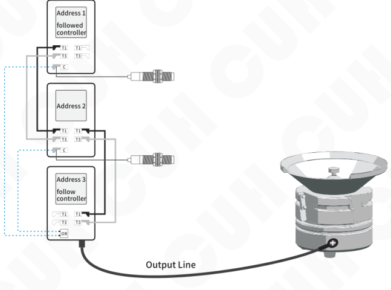

Bedienungsschritte:

1. Stellen Sie die Hauptausgangs-Parametergruppe des Controllers an Adresse 3 ein. „MainSor1" ist „bus" und „MainSor2" ist „bus".
2. Stellen Sie den „MainLogc"-Parameter des Adresse 3 Controllers auf „And" ein.
3. Stellen Sie den „MainDire"-Parameter (Hauptausgangsrichtung) des Adresse 3 Controllers auf „Const" ein.
4. Stellen Sie die „MainUpDy"- und „MainDnDy"-Zeit des Adresse 3 Controllers auf den erforderlichen Zeitwert ein. Standard ist 0,2 Sekunden.
5. Stellen Sie den „MainMode" (Hauptausgangsmodus) des Adresse 3 Controllers auf „Delay" ein.
6. Stellen Sie „BSigMID1" in der „Kommunikations-Parametergruppe" des Adresse 3 Controllers auf „1" ein (Adresse 1 Controller spezifizieren).
7. Stellen Sie „BSigMID2" des Adresse 3 Controllers auf „2" ein (Adresse 2 Controller spezifizieren).
8. Stellen Sie „BSigM_B1" des Adresse 3 Controllers auf „4" ein (C-Port-Signal spezifizieren).
9. Stellen Sie „BSigM_B2" des Adresse 3 Controllers auf „4" ein (C-Port-Signal spezifizieren).
10. Die Einstellung ist abgeschlossen. Für die Steuerausgangseinstellungen von Port D des Controllers siehe die Hauptausgangseinstellungen des Controllers.

---


## 4.9.4 Datensicherung

Wenn alle Controller vernetzt sind, können alle Controller im Netzwerk die Daten der jeweils anderen sichern. Jeder Controller sichert die anderen zwei Controller im Netzwerk. Wenn ein Controller im ursprünglichen Netzwerk ausfällt, können Benutzer den ausgefallenen Controller schnell durch einen neuen Controller ersetzen. Alle Parameter des neuen Controllers werden mit denen des Controllers vor dem Austausch übereinstimmen.

Wenn weniger als 3 nummerierte benachbarte Controller im Netzwerk ausfallen, kann der Ersatzvorgang erfolgreich sein. Wenn jedoch mehr als 3 oder mehr nummerierte Controller ausfallen, können nicht alle Maschinendaten wiederhergestellt werden.

- Schritte zum Ersatz des neuen Controllers als Ersatzgerät:

1. Schalten Sie das zu ersetzende Gerät aus und entfernen Sie das CUHBus-DS® Kommunikationskabel.
2. Verbinden Sie die CUHBus-DS® Schnittstelle des neuen Geräts mit dem ursprünglichen Netzwerk.
3. Wenn das neue Gerät eingeschaltet wird, tritt der neu angeschlossene Controller automatisch in die „Kommunikations-Parametergruppe" ein.
4. Stellen Sie den Parameter „DigSynAd" (Lokale digitale Synchronisationsadresse) ein. Da dieses Netzwerk unvollständig ist, zeigt der Wert dieses Parameters nur die Gerätenummer an, die ersetzt werden muss.
5. Stellen Sie den Wert des Parameters „EnNetwok" auf „Replace" ein und drücken Sie dann ⊕ und ⊖ gleichzeitig halten, bestätigen.
6. Nach erfolgreichem Ersatz ändert sich der Parameterwert des neuen Geräts „EnNetwok" automatisch auf „Online".

Beispiel 1: Das ursprüngliche Netzwerk besteht aus Adresse 1, Adresse 2 und Adresse 3 Controllern. Da Adresse 3 ausfällt, muss das ursprüngliche Gerät durch ein neues Gerät ersetzt und alle Einstellungen des ursprünglichen Geräts wiederhergestellt werden.

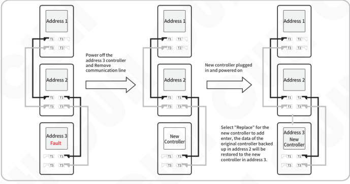

Beispiel 2: Es gibt vier Controller mit den Adressen 1, 2, 3 und 4 im Netzwerk. Unter ihnen sind die Controller an den Adressen 2, 3 und 4 im Netzwerk ausgefallen. Da jedoch jedes Gerät im Netzwerk Daten von bis zu zwei Controllern sichert, kann der Controller an Adresse 4 die Datenwiederherstellung nicht abschließen. Für die Ersatzeinstellungen der Controller an den Adressen 2 und 3 siehe den obigen Fall.

Beispiel 3: Es gibt ursprünglich fünf Geräte mit den Adressen 1, 2, 3, 4 und 5 im Netzwerk. Unter ihnen sind die Adressen 1, 2 und 4 fehlerhaft (drei nicht aufeinanderfolgende Einheiten). Sie können von Adresse 5 die Adressen 1 und 2 Controller-Daten wiederherstellen und von Adresse 3 die Adresse 4 Controller-Daten wiederherstellen, wodurch alle ausgefallenen Controller-Daten wiederhergestellt werden. Für den Controller-Ersatz siehe den obigen Fall.


## 4.9.5 Fernsteuerungsdaten

Benutzer können Datenquellen an das Synchronisationsnetzwerk senden und manuelle Spannung, Fernsteuerungsspannung, manuelle Geschwindigkeit und Fernsteuerungsgeschwindigkeit auswählen.

| Parameter | Bedeutung |
|---|---|
| ManVol | Manuelle Spannung bezieht sich auf die vom Benutzerpanel eingestellte Spannung |
| RemVol | Fernsteuerungsspannung bezieht sich auf die über den Ferngeschwindigkeitsregelungsport eingestellte Spannung |
| ManSpd | Manuelle Geschwindigkeit bezieht sich auf die vom Benutzerpanel eingestellte Fördergeschwindigkeit |
| RemSpd | Fernsteuerungsgeschwindigkeit bezieht sich auf die über den Ferngeschwindigkeitsregelungsport eingestellte Fördergeschwindigkeit |

## 4.10 Controller-Statusüberwachung

In der Überwachungsparametergruppe können der Controller-Betriebsstatus und die Parameterwerte in Echtzeit gelesen werden.

Für lesbare Parametereinträge siehe das Kapitel „Parameterliste", Parametergruppe 10, Überwachungsparametergruppe.

```text
RUN
A C D E F G N J      A0
01.Voltage       150 V
02.Frequenc     50.0 Hz
03.SpeedNow        0
04.VoltgOut     19.8 V
05.EffectCu     0.00 A
+   10Monitor      −
```


---

## 4.11 Fehlerprotokoll

Der Controller kann 64 Sätze von Protokollen im Kreis aufzeichnen, um die spätere Anzeige des Zeitpunkts, zu dem das Problem auftrat, und spezifischer Informationen zu erleichtern. In jeder Schnittstelle öffnet langes Drücken von ▲ und ▶ die Protokollschnittstellen-Gruppe, die wie folgt angezeigt wird:

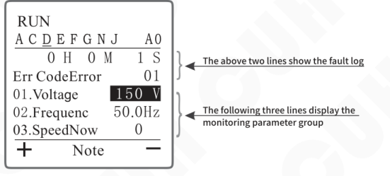

Angezeigte Inhalte:

    RUN
    A C D E F G N J        A0
            0 H   0 M   1 S
    Err CodeError          01
    01.Voltage           150 V
    02.Frequenc          50.0Hz
    03.SpeedNow             0
    +        Note          −

- Die oberen zwei Zeilen zeigen das Fehlerprotokoll.
- Die folgenden drei Zeilen zeigen die Überwachungsparametergruppe.

## 4.12 Startseite anpassen

Um Benutzern die effiziente und schnelle Verwendung des Controllers zu ermöglichen, können Benutzer in der Schnittstellenparametergruppe Anpassungsoperationen durchführen. Indem höchstens 16 aller Parameter als Überwachungselement in der Schnittstellenparametergruppe platziert werden, kann der Benutzer schnelle Operationen auf der Hauptschnittstelle durchführen.

Beispiel: Wählen Sie 1. UsrVoltg (P2.02), 2. UsrFrqnc (P2.03), 3. UserSped (P2.01), 4. SoftStar (P2.04), SoftStop (P2.05), es gibt fünf Parameter in der Hauptschnittstelle. Die Schritte sind wie folgt:

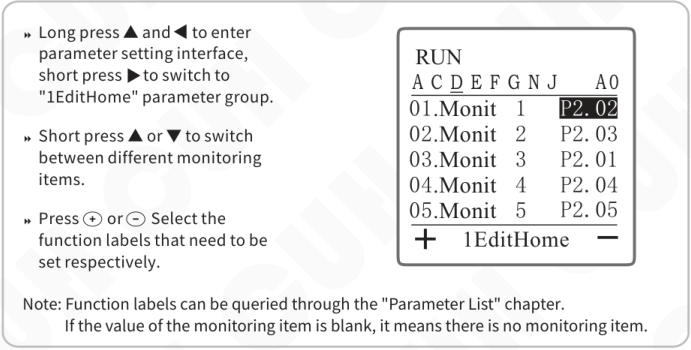

Schritte:

- Langes Drücken von ▲ und ◀ öffnet die Parametereinstellungs-Oberfläche, kurzes Drücken von ▶ wechselt zur Parametergruppe „1EditHome".
- Kurzes Drücken von ▲ oder ▼ wechselt zwischen verschiedenen Überwachungselementen.
- Drücken Sie ⊕ oder ⊖ um die Funktionsetiketten auszuwählen, die jeweils eingestellt werden müssen.

Angezeigte Inhalte:

    RUN
    A C D E F G N J      A0
    01.Monit  1      P2.02
    02.Monit  2      P2.03
    03.Monit  3      P2.01
    04.Monit  4      P2.04
    05.Monit  5      P2.05
    +     1EditHome     −

Hinweis: Funktionsetiketten können über das Kapitel „Parameterliste" abgefragt werden.  
Wenn der Wert des Überwachungselements leer ist, bedeutet dies, dass kein Überwachungselement vorhanden ist.

Nach Abschluss der Bedienung kann der Benutzer, wenn er die Parameterwerte von Spannung, Frequenz, Fördergeschwindigkeit, Sanftanlaufzeit und Sanftstoppzeit anpassen muss, das spezifische Überwachungselement in der Parametergruppe der „Home"-Schnittstelle aufrufen und über ⊕ oder ⊖ die Parameteranpassung abschließen.

---


# Kapitel Ⅴ Typische Anwendungen

## 5.1 Wie hält man zwei Vibrationsförderer auf derselben Frequenz?

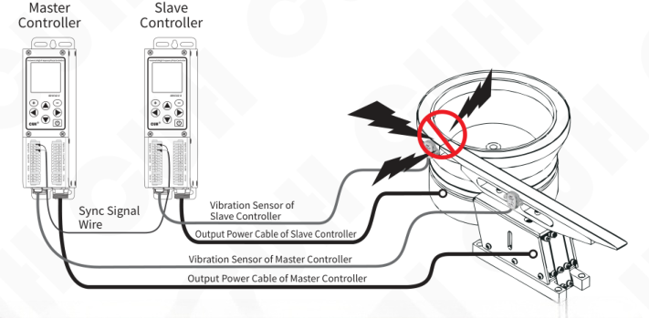

Dieser Abschnitt stellt vor, wie zwei SDVC42-S Controller vernetzt werden und realisiert, dass ein Direktvibrator und ein Rundvibrator mit derselben Frequenz betrieben werden, um Kollisionen zwischen den Platten aufgrund unterschiedlicher Betriebsfrequenzen zu vermeiden.

1. Der Controller schließt das Netzkabel und das Ausgangskabel korrekt an.

2. Nehmen Sie den Sensor des gefolgten Controllers, verbinden Sie den Sensorstecker mit dem Controller und ziehen Sie die Mutter fest, und befestigen Sie den Sensorkörper korrekt an der Vibrationsplatte (siehe „2.3 Installationsanleitung für den Vibrationssensor")

3. Öffnen Sie die Geräteverkabelungsabdeckung, verbinden Sie alle Controller-T1-Signale miteinander und alle T3-Signale miteinander.

4. Nachdem die beiden Geräte eingeschaltet wurden, tritt einer der Controller automatisch in die „Kommunikations-Parametergruppe" ein.

5. In der Controller-Kommunikations-Parametergruppe generiert das Programm automatisch eine digitale Synchronkommunikations-Gerätenummer. „Digital Sync" ist ein beliebiger Wert [1~8]. Benutzer können diesen Wert auch selbst ändern.

6. Stellen Sie in der Kommunikations-Parametergruppe den „EnNetwok"-Parameter auf „Expand" ein und drücken Sie dann ⊕ und ⊖ gleichzeitig halten, bestätigen.

7. Nachdem der Folgecontroller erfolgreich hinzugefügt wurde, ändert sich der Parameterwert von „EnNetwok" automatisch auf „Online", was die erfolgreiche Vernetzung bedeutet.

8. Benutzer drücken ▲ und ◀ halten, um die Parametereinstellungs-Oberfläche aufzurufen, durch kurzes Drücken von ◀ oder ▶ zur Kommunikations-Parametergruppe wechseln, die digitale Synchronisationsadresse jedes Controllers anzeigen und notieren.

9. Stellen Sie den „FrqncSyn"-Parameterwert des folgenden Controllers in der Kommunikations-Parametergruppe auf die „DigSynAd"-Adressnummer des gefolgten Controllers ein.

Nach Abschluss der obigen Einstellungen kann ein Controller einem anderen Controller folgen, um mit derselben Frequenz auszugeben.


## 5.2 Wie schaltet man Controller B über einen an Controller A angeschlossenen Sensor ein/aus?

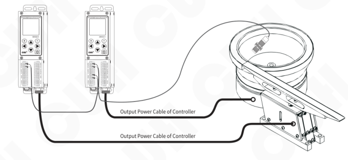

Dieser Abschnitt stellt die Vernetzung von zwei SDVC42-S Controllern vor und realisiert, dass der Hauptausgang des gesteuerten Controllers durch das C-Port-Signal eines anderen Hauptsteuercontrollers gesteuert wird, sodass der Controller auch ohne direkt angeschlossenen Sensor über das vernetzte Signal betrieben werden kann. Die Signalquellen des Controllers werden dadurch stark erweitert.

1. Der Controller schließt das Netzkabel und das Ausgangskabel korrekt an.

2. Öffnen Sie die Geräteverkabelungsabdeckung, verbinden Sie alle Controller-T1-Signale miteinander und alle T3-Signale miteinander.

3. Nachdem die beiden Geräte eingeschaltet wurden, tritt einer der Controller automatisch in die „Kommunikations-Parametergruppe" ein.

4. In der Controller-Kommunikations-Parametergruppe generiert das Programm automatisch eine digitale Synchronkommunikations-Gerätenummer, „Digital Sync" ist ein beliebiger Wert [1~8]. Benutzer können diesen Wert auch selbst ändern.

5. Benutzer drücken ▲ und ◀ halten, um die Parametereinstellungs-Oberfläche aufzurufen, durch kurzes Drücken von ◀ oder ▶ zur Kommunikations-Parametergruppe wechseln, die digitale Synchronisationsadresse jedes Controllers anzeigen und notieren.

6. Der gesteuerte Controller wechselt nach der obigen Methode zur Hauptausgangs-Parametergruppe und die Parameter werden wie folgt eingestellt:

   „MainSor1" ist „Bus", „MainSor2" ist „Bus", „MainLogc" ist „And", „MainDire" ist „Const", „MainUpDy" und „MainDnDy" werden auf den erforderlichen Zeitwert eingestellt, Standard ist 0,2 Sekunden, „MainMode" wird auf „Delay" eingestellt.

7. Der gesteuerte Controller wechselt nach der obigen Methode zur Kommunikations-Parametergruppe und die Parameter werden wie folgt eingestellt:

   „BSigMID1" wird auf „X" eingestellt (X: ist die digitale Synchronisations-Bitnummer des Controllers, der das Signal aufrufen muss), „BSigM_B1" wird auf „4" eingestellt (Material-Eingangsport C Signal), „BSigM_B2" wird auf „0" eingestellt (0 bedeutet ungültiges Signal).

Nach Abschluss der obigen Einstellungen wird der Ausgang eines Controllers durch das C-Port-Signal eines anderen Controllers gesteuert.


---

## 5.3 Wie schaltet man zwei Controller gleichzeitig ein/aus?

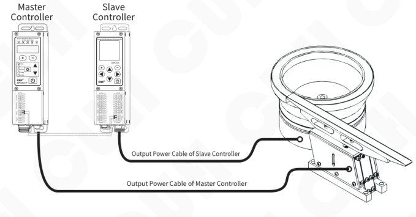

Dieser Abschnitt stellt einen Direktvibrationscontroller (mit SDVC311) und einen Scheibencontroller (mit SDVC42-S) vor, die synchron starten und stoppen. Verschiedene Controller-Serien können ebenfalls die Funktion des synchronen Startens und Stoppens erfüllen.

1. Der Controller schließt das Netzkabel und das Ausgangskabel korrekt an.

2. Öffnen Sie die Geräteverkabelungsabdeckung, verbinden Sie D1 des SDVC42-S mit C2 des SDVC311 und verbinden Sie D3 des SDVC42-S mit C1 des SDVC311.

3. Nachdem die beiden Geräte eingeschaltet wurden, drücken Sie ▲ und ◀ halten, um die Parametereinstellungs-Oberfläche aufzurufen, durch kurzes Drücken von ◀ oder ▶ zur Steuerausgangs-Parametergruppe wechseln.

4. Stellen Sie in der Steuerausgangs-Parametergruppe die Parameter wie folgt ein:

„PotDLogc" wird auf „Or" eingestellt, „PotDSor1" wird auf „Main" eingestellt, „PotDType" wird auf „Ou_PNP" eingestellt, andere Standardwerte bleiben unverändert.

Damit sind die Einstellungen abgeschlossen, um einen Direktvibrationscontroller (mit SDVC311) und einen Vibrationsförderer-Controller (mit SDVC42-S) synchronisiert starten und stoppen zu lassen.

---


# Kapitel Ⅵ Häufig gestellte Fragen

## 6.1 Keine Anzeige beim Einschalten

Lösung:

◆ Prüfen Sie, ob die Steckdose Strom führt.

◆ Prüfen Sie, ob der Netzstecker zuverlässig mit der Steckdose verbunden ist.

## 6.2 Keine Vibration, kein Geräusch, Controller-Anzeige normal

Lösung:

◆ Prüfen Sie, ob das Ausgangsstromkabel korrekt mit dem Controller und dem Vibrationsförderer verbunden ist.

◆ Prüfen Sie, ob die Parameterwerteinstellungen für Ausgangsspannung und Ausgangsfrequenz des Controllers angemessen sind.

◆ Prüfen Sie, ob der Controller durch ein Steuersignal gestoppt wurde.

◆ Prüfen Sie, ob der Controller durch eine Parameterlogik-Abschaltung gestoppt wurde.

## 6.3 Steuersignal funktioniert nicht

Lösung:

◆ Prüfen Sie, ob das Steuersignal zuverlässig angeschlossen ist.

◆ Prüfen Sie, ob die Erdungsleitung des Steuersignals mit dem GND-Port des Controllers verbunden ist.

◆ Prüfen Sie, ob die Steuersignallogik korrekt eingestellt ist.

## 6.4 Keine Vibration, normales Geräusch, Controller-Anzeige normal

Lösung:

◆ Passen Sie die Parametereinstellungen gemäß diesem Benutzerhandbuch an.

## 6.5 Instabile Resonanzfrequenzverfolgung

Lösung:

◆ Erhöhen Sie den Frequenzintegrationswert angemessen, aber beachten Sie, dass ein zu hoher Wert zu Oszillationen der Ausgangsfrequenz führen kann.


---

## 6.6 Langsame Geschwindigkeitskorrektur bei konstanter Fördergeschwindigkeit

Lösung:

◆ Passen Sie den Amplitudenintegrationswert angemessen an, aber beachten Sie, dass bei zu hohem Wert die Oszillationsamplitude der Ausgangsspannung größer wird.

## 6.7 Controller schnell auf Werkseinstellungen zurücksetzen

Aufgrund der leistungsstarken Funktionen dieses Controllers gibt es eine große Anzahl von Steuerparametern, die vom Benutzer eingestellt werden können. Für Anfänger kann der normale Arbeitszustand des Controllers nach mehreren Einstellungsänderungen möglicherweise nicht wiederhergestellt werden. Verwenden Sie diese Funktion, um den chaotischen Parameterstatus schnell auf die Werkseinstellungen zurückzusetzen.

Lösung:

◆ Langes Drücken von ▲ und ◀ öffnet die Parametereinstellungs-Oberfläche, kurzes Drücken von ◀ oder ▶ wechselt zur Speicher-Parametergruppe.

◆ Wechseln Sie zum Parameter „Werkseinstellungen wiederherstellen" und wählen Sie die Arbeitsgruppenparameter. Drücken Sie ⊕ und ⊖ gleichzeitig für mehr als zwei Sekunden, um zur Standby-Oberfläche zu wechseln. Zu diesem Zeitpunkt werden alle Parameter in der Arbeitsgruppe auf die Werkseinstellungen zurückgesetzt (Benutzer 1, Benutzer 2 und Benutzer 3 Einstellungen bleiben unverändert).

Wenn der Benutzer zuvor Parameter in „Benutzer 1", „Benutzer 2" oder „Benutzer 3" gespeichert hat, können die Benutzereinstellungen ebenfalls wiederhergestellt werden.

---


# Kapitel Ⅶ Anhang

## 7.1 Abmessungen

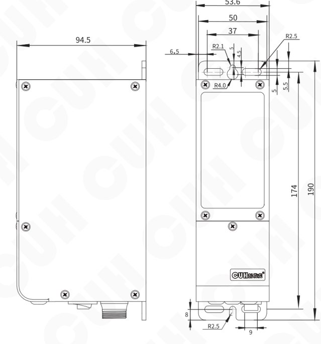

**Abmessungen（Einheit: mm）**

| Abmessungsbereich | Toleranz |
|---|---|
| 0~3 | ±0,05 |
| 3~10 | ±0,1 |
| 10~30 | ±0,15 |
| 30~80 | ±0,2 |
| 80~180 | ±0,3 |
| >180 | ±0,5 |

Diese Toleranztabelle gilt für alle Produkte dieser Serie.


## 7.2 Technische Spezifikationen

| Artikel | Min | Typisch | Max | Einheit | Hinweis |
|---|---:|---:|---:|---|---|
| Eingangsspannung | 85 | 220 | 250 | V | AC RMS |
| Einstellbarer Ausgangsspannungsbereich | 0 | —— | 220 | V | AC RMS |
| Spannungseinstellgenauigkeit |  | 1 |  | V |  |
| Spannungsregelungsgenauigkeit | 0 | —— | 10 | % | ΔVout/ΔVin |
| Einstellbarer Ausgangsstrombereich | 0 | —— | 150 | mA |  |
| Ausgangsleistung | 0 | —— | 33 | VA |  |
| Ausgangsfrequenz | 40,0 | —— | 999,9 | Hz |  |
| Frequenzeinstellgenauigkeit |  | 0,1 |  | Hz |  |
| Ausgangswellenform |  | Sinus |  |  |  |
| Sanftanlaufzeit | 0 | —— | 40,0 | s | Standardwert: 0,5 |
| Ein/Aus-Verzögerungszeitbereich | 0,0 | —— | 99,9 | s | Standardwert: 0,2 |
| Ein/Aus-Verzögerungszeitgenauigkeit |  | 0,1 |  | s |  |
| Überhitzungsschutz-Auslösetemperatur | 60 | 65 | 65 | ℃ |  |
| Synchronkommunikation |  | CUHBus-DS® |  |  |  |
| Digitalkommunikation |  | ModBUS485/Digital Sync |  |  |  |
| DC-Steuerungsausgangsstrom | 0 | —— | 350 | mA |  |
| DC-Steuerungsausgangsspannung | 22 | 24 | 26 | V |  |
| Analoges Steuersignal |  | 1~5/0~5/0~10 |  | V | Ferngeschwindigkeitsregelungsspannung |
| Analoges Steuersignal |  | 4~20 |  | mA | Ferngeschwindigkeitsregelungsstrom |
| Digitales Steuersignal |  | 24 |  | V | Schaltsignal |
| Einstellungsmethode |  | 7 |  | Taste |  |
| Standby-Stromverbrauch | —— | —— | 5 | W |  |
| Anzeigemethode |  | 128×128 |  |  | Matrix-Display |
| Schutzart |  | IP20 |  |  |  |
| Umgebungstemperatur | 0 | 25 | 40 | ℃ |  |
| Umgebungsfeuchtigkeit | 10 | 60 | 85 | % | Keine Kondensation |
| Lagerumgebungstemperatur | -20 | 25 | 65 | ℃ |  |


## 7.3 Referenzstandard

**Absolute Parameter:**  
Überschreitungen des obigen Standards beschädigen den Controller, strikt einhalten.

| Artikel | GB-Standard | IEC-Standard | Klasse | Standardanforderung | Hinweis |
|---|---|---|---|---|---|
| Elektrostatische<br>Entladung | GB/T 17626.2-2006 | IEC 61000-4-2:2001 | 4 | ±8 kV | Kontakt<br>Entladung |
|  |  |  | 4 | ±15 kV | Luftentladung |
| Elektrischer schneller<br>transienter Test | GB/T 17626.4-2008 | IEC 61000-4-4:2004 | 4 | ±4 kV |  |
| DC-Stromleitung<br>Wellen-Immunität | GB/T 17626.17-2005 | IEC 61000-4-17:2002 | 4 | 15% | Bewertung A |

> **Warnung**  
> In einer Wohnumgebung kann dieses Produkt Funkstörungen verursachen, in diesem Fall können ergänzende Minderungsmaßnahmen erforderlich sein.


## 7.4 Parameterliste

### 7.4.1 Schnittstellen-Parametergruppe

| Funktion | Parameter | Anzeige | Wertebereich/Aufzählungselement | Standardwert |
|---|---|---|---|---|
| P1.01 | Überwachungsprojekt 1 | 01.Monit1 | Parametergruppe 2~Parametergruppe 10 | P2.01 |
| P1.02 | Überwachungsprojekt 2 | 02.Monit2 | Parametergruppe 2~Parametergruppe 10 | P10.05 |
| P1.03 | Überwachungsprojekt 3 | 03.Monit3 | Parametergruppe 2~Parametergruppe 10 | P2.02 |
| P1.04 | Überwachungsprojekt 4 | 04.Monit4 | Parametergruppe 2~Parametergruppe 10 | P2.03 |
| P1.05 | Überwachungsprojekt 5 | 05.Monit5 | Parametergruppe 2~Parametergruppe 10 |  |
| P1.06 | Überwachungsprojekt 6 | 06.Monit6 | Parametergruppe 2~Parametergruppe 10 |  |
| P1.07 | Überwachungsprojekt 7 | 07.Monit7 | Parametergruppe 2~Parametergruppe 10 |  |
| P1.08 | Überwachungsprojekt 8 | 08.Monit8 | Parametergruppe 2~Parametergruppe 10 |  |
| P1.09 | Überwachungsprojekt 9 | 09.Monit9 | Parametergruppe 2~Parametergruppe 10 |  |
| P1.10 | Überwachungsprojekt 10 | 10.Monit10 | Parametergruppe 2~Parametergruppe 10 |  |
| P1.11 | Überwachungsprojekt 11 | 11.Monit11 | Parametergruppe 2~Parametergruppe 10 |  |
| P1.12 | Überwachungsprojekt 12 | 12.Monit12 | Parametergruppe 2~Parametergruppe 10 |  |
| P1.13 | Überwachungsprojekt 13 | 13.Monit13 | Parametergruppe 2~Parametergruppe 10 |  |
| P1.14 | Überwachungsprojekt 14 | 14.Monit14 | Parametergruppe 2~Parametergruppe 10 |  |
| P1.15 | Überwachungsprojekt 15 | 15.Monit15 | Parametergruppe 2~Parametergruppe 10 |  |
| P1.16 | Überwachungsprojekt 16 | 16.Monit16 | Parametergruppe 2~Parametergruppe 10 |  |


## 7.4.2 Allgemeine Parametergruppe

| Funktion | Parameter | Anzeige | Wertebereich/Aufzählungselement | Standardwert |
|---|---|---|---|---|
| P2.01 | Benutzer-Fördergeschwindigkeit | 01.UserSped | 0~3200 | 200 |
| P2.02 | Benutzer-Spannung | 02.UsrVoltg | 0~220 V | 150 |
| P2.03 | Benutzer-Frequenz | 03.UsrFrqnc | 40,0~999,9 Hz | 50,0 |
| P2.04 | Sanftanlaufzeit | 04.SoftStar | 0,0~40,0 s | 0,5 |
| P2.05 | Sanftstoppzeit | 05.SoftStop | 0,0~40,0 s | 0,5 |
| P2.06 | Maximale Ausgangsspannung | 06.MaxVoltg | 0~220 V | 220 |
| P2.07 | Maximaler Ausgangsstrom | 07.MaxCurre | 0~150 mA | 150 |
| P2.08 | Maximale Ausgangsfrequenz | 08.MaxFre | 40,0~999,9 Hz | 999,9 |
| P2.09 | Minimale Ausgangsfrequenz | 09.MiniFre | 40,0~999,9 Hz | 40,0 |
| P2.10 | Lasterkennung | 10.Measure | None, Valid | None |
| P2.11 | Materialmangelalarm | 11.LowAlrm | 0~3000 | 0 |
| P2.12 | Abschaltalarm | 12.AlrmShut | None, Sound1, Sound2, Sound3 | None |
| P2.13 | Hintergrundbeleuchtungshelligkeit | 13.Brightne | 20~100 | 100 |
| P2.14 | Hintergrundbeleuchtung-Ausschaltzeit | 14.Off_time | 1~30 Min, 31(dauerhaft beleuchtet) | 5 |
| P2.15 | Sprache | 15.Language | Englis, Chines, German | Englis |


## 7.4.3 Hauptausgangs-Parametergruppe

| Funktion | Parameter | Anzeige | Wertebereich/Aufzählungselement | Standardwert |
|---|---|---|---|---|
| P3.01 | Hauptausgangs-Portlogik | 01.MainLogc | And, Or, Xor, RS | Or |
| P3.02 | Hauptausgangs-Portlogik<br>Eingangsquelle 1 | 02.MainSor1 | Siehe Anhang 7.4.11 | In_PtC |
| P3.03 | Hauptausgangs-Portlogik<br>Eingangsquelle 2 | 03.MainSor2 | Siehe Anhang 7.4.11 | In_PtE |
| P3.04 | Hauptausgangs-Steigverzögerung | 04.MainUpDy | 0,0~99,9 s | 0,2 |
| P3.05 | Hauptausgangs-Fallverzögerung | 05.MainDnDy | 0,0~99,9 s | 0,2 |
| P3.06 | Hauptausgangs-Logik<br>Richtung | 06.MainDire | Const, Inv, On, Off | Const |
| P3.07 | Hauptausgangsmodus | 07.MainMode | Delay, Hold | Delay |
| P3.08 | Einschaltstatus | 08.PowOnSta | On, Off, Keep | On |
| P3.09 | Fernsteuerungsquelle | 09.CtrlSour | Panel, 20mA, 1-5V, 0-5V, 0-10V, DigSym | Panel |
| P3.10 | Fernsteuerungskoeffizient | 10.CtrlCoef | 0,5~2,0 | 1,0 |


---

## 7.4.4 Konstantgeschwindigkeits-Parametergruppe

| Funktion | Parameter | Anzeige | Wertebereich/Aufzählungselement | Standardwert |
|---|---|---|---|---|
| P4.01 | Automatische Frequenz<br>Zentralfrequenz | 01.AutFCent | 40,0~999,9 Hz | 100,0 |
| P4.02 | Automatische Frequenz<br>Einstellbereich | 02.AutFRang | 0,0~180,0 Hz | 30,0 |
| P4.03 | Automatische Frequenz<br>Einstellintegral | 03.AutFIntg | 0~2000 | 20 |
| P4.04 | Automatische Amplitude<br>Einstellintegral | 04.AutAIntg | 0~9999 | 300 |
| P4.05 | Automatische Amplitude<br>Einstellproportion | 05.AutAProp | 0~9999 | 500 |
| P4.06 | Automatische Phase | 06.AutoPhas | -180~180 ° | 0 |
| P4.07 | Automatische Suchfrequenz<br>Spannung Max | 07.AutSrhVM | 20~220 V | 100 |
| P4.08 | Automatische Suchfrequenz<br>Amplitude Max | 08.AutSrhAM | 0~3200 | 200 |
| P4.09 | Automatische Suchfrequenz<br>Geschwindigkeit Max | 09.AutSpedM | 0~4000 | 3200 |
| P4.10 | Benutzereinstellung Phase | 10.UserPhas | -180~180 ° | 0 |
| P4.11 | Spannungsmodus | 11.VoltgMod | Manuel, Auto | Auto |
| P4.12 | Frequenzmodus | 12.FrqncMod | Manuel, Auto, SynV, SynE | Auto |
| P4.13 | Synchronisationsquelle | 13.SynSourc | None, PhaseV, PhaseE | None |
| P4.14 | Beschleunigungssensor-Typ | 14.AcSnsrTp | 20-1, 20-2, 20-3, 20-4, 203, 204, 205, 206 | 205 |
| P4.15 | Frequenzsuchgeschwindigkeit | 15.SrhSpeed | 0~5 | 3 |

---


## 7.4.5 Signaleingangs-Parametergruppe

| Funktion | Parameter | Anzeige | Wertebereich/Aufzählungselement | Standardwert |
|---|---|---|---|---|
| P5.01 | Schaltersensor-Typ | 01.PortType | Auto, NPN, PNP, Ato1 (automatische Erkennung einmalig) | Auto |
| P5.02 | Port C Logikrichtung | 02.PortCDir | Const, Inv | Const |
| P5.03 | Port C Steigverzögerung | 03.PtCUpDly | 0,0~99,9 s | 0,2 |
| P5.04 | Port C Fallverzögerung | 04.PtCDnDly | 0,0~99,9 s | 0,2 |
| P5.05 | Port E Logikrichtung | 05.PortEDir | Const, Inv | Const |
| P5.06 | Port E Steigverzögerung | 06.PtEUpDly | 0,0~99,9 s | 0,2 |
| P5.07 | Port E Fallverzögerung | 07.PtEDnDly | 0,0~99,9 s | 0,2 |
| P5.08 | Geschwindigkeit A Logikrichtung | 08.SpedADir | Const, Inv | Const |
| P5.09 | Geschwindigkeit A Steigverzögerung | 09.SpdAUpDy | 0,0~99,9 s | 0,2 |
| P5.10 | Geschwindigkeit A Fallverzögerung | 10.SpdADnDy | 0,0~99,9 s | 0,2 |
| P5.11 | Geschwindigkeit B Logikrichtung | 11.SpedBDir | Const, Inv | Const |
| P5.12 | Geschwindigkeit B Steigverzögerung | 12.SpdBUpDy | 0,0~99,9 s | 0,2 |
| P5.13 | Geschwindigkeit B Fallverzögerung | 13.SpdBDnDy | 0,0~99,9 s | 0,2 |


## 7.4.6 DC-Steuerungsausgangs-Parametergruppe

| Funktion | Parameter | Anzeige | Wertebereich/Aufzählungselement | Standardwert |
|---|---|---|---|---|
| P6.01 | Port D Logische Beziehung | 01.PotDLogc | And, Or, Xor, RS | Or |
| P6.02 | Port D Logik-Eingangsquelle 1 | 02.PotDSor1 | Siehe Anhang 7.4.11 | In_PtC |
| P6.03 | Port D Logik-Eingangsquelle 2 | 03.PotDSor2 | Siehe Anhang 7.4.11 | In_PtE |
| P6.04 | Port D Logische Richtung | 04.PortDDir | Const, Inv, On, Off | Const |
| P6.05 | Port D Steigverzögerung | 05.PtDUpDly | 0,0~99,9 s | 0,2 |
| P6.06 | Port D Fallverzögerung | 06.PtDDnDly | 0,0~99,9 s | 0,2 |
| P6.07 | Port D Ausgangstyp | 07.PotDType | Ou_PNP, Ou_NPN, Ou_P&P (Push Pull) | Ou_P&P |
| P6.08 | Port D Ausgangsmodus | 08.PotDMode | Delay, Hold | Delay |


---

## 7.4.7 Zähl-Parametergruppe

| Funktion | Parameter | Anzeige | Wertebereich/Aufzählungselement | Standardwert |
|---|---|---|---|---|
| P7.01 | Gesamtzählung | 01.TotaCout | 0~9999 | 10 |
| P7.02 | Endvorschub-Prozentsatz | 02.PrcntTrm | 0~100 % | 50 |
| P7.03 | Vor dem Zählende | 03.CotAhead | 0~9999 | 3 |
| P7.04 | Zählungs-Auto-Reset-Zeit | 04.CotRstTm | 0,0~999,9 s | 0,0 |
| P7.05 | Zählportauswahl | 05.CotPotSe | None, Valid | None |
| P7.06 | RS-Trigger-Port-Priorität | 06.RSPriori | Same, Reset, Set, Revers | Same |

---


## 7.4.8 Kommunikations-Parametergruppe

| Funktion | Parameter | Anzeige | Wertebereich/Aufzählungselement | Standardwert |
|---|---|---|---|---|
| P8.01 | 485BUS Kommunikationstyp | 01.485type | ASCII, RTU | RTU |
| P8.02 | 485 Kommunikationsbaudrate | 02.BaudRate | 0,3, 1,2, 2,4, 9,6, 19,2, 57,6, 115,2 Kbps | 115,2 |
| P8.03 | 485 Kommunikations-Slave-Identifikationsnummer | 03.485SlvID | 1~31 | 1 |
| P8.04 | Widerstand des 485 Kommunikationsports aktivieren | 04.Enab485R | None, Valid | None |
| P8.05 | Lokale digitale Synchronisationsadresse | 05.DigSynAd | 1~8 |  |
| P8.06 | Widerstand des digitalen Synchronisations-Kommunikationsports aktivieren | 06.EnabSynR | None, Valid | None |
| P8.07 | Bus-Signaladresse der Hauptausgangs-Port-Logik-Eingangsquelle 1 | 07.BSigMID1 | 1~8 |  |
| P8.08 | Bus-Signaladresse der Hauptausgangs-Port-Logik-Eingangsquelle 2 | 08.BSigMID2 | 1~8 |  |
| P8.09 | Bus-Signaladresse der Port D Logik-Eingangsquelle 1 | 09.BSgD_ID1 | 1~8 |  |
| P8.10 | Bus-Signaladresse der Port D Logik-Eingangsquelle 2 | 10.BSgD_ID2 | 1~8 |  |
| P8.11 | Bus-Signal-Bitadresse der Hauptausgangs-Port-Logik-Eingangsquelle 1 | 11.BSigM_B1 | 1~16 | 5 |
| P8.12 | Bus-Signal-Bitadresse der Hauptausgangs-Port-Logik-Eingangsquelle 2 | 12.BSigM_B2 | 1~16 | 6 |
| P8.13 | Bus-Signal-Bitadresse der Port D Logik-Eingangsquelle 1 | 13.BSigD_B1 | 1~16 | 5 |
| P8.14 | Bus-Signal-Bitadresse der Port D Logik-Eingangsquelle 2 | 14.BSigD_B2 | 1~16 | 6 |
| P8.15 | Lokales Bus-Signal-Bitadresse 1 Signal | 15.LBSig_B1 | Siehe Anhang 7.4.11 | 0 |
| P8.16 | Lokales Bus-Signal-Bitadresse 2 Signal | 16.LBSig_B2 | Siehe Anhang 7.4.11 | 1 |
| P8.17 | Lokales Bus-Signal-Bitadresse 3 Signal | 17.LBSig_B3 | Siehe Anhang 7.4.11 | SpeedA |
| P8.18 | Lokales Bus-Signal-Bitadresse 4 Signal | 18.LBSig_B4 | Siehe Anhang 7.4.11 | SpeedB |
| P8.19 | Lokales Bus-Signal-Bitadresse 5 Signal | 19.LBSig_B5 | Siehe Anhang 7.4.11 | In_PtC |
| P8.20 | Lokales Bus-Signal-Bitadresse 6 Signal | 20.LBSig_B6 | Siehe Anhang 7.4.11 | In_PtE |
| P8.21 | Lokales Bus-Signal-Bitadresse 7 Signal | 21.LBSig_B7 | Siehe Anhang 7.4.11 | FCntSi |
| P8.22 | Lokales Bus-Signal-Bitadresse 8 Signal | 22.LBSig_B8 | Siehe Anhang 7.4.11 | DCntSi |
| P8.23 | Lokales Bus-Signal-Bitadresse 9 Signal | 23.LBSig_B9 | Siehe Anhang 7.4.11 | Ctr_O |
| P8.24 | Lokales Bus-Signal-Bitadresse 10 Signal | 24.LBSigB10 | Siehe Anhang 7.4.11 | Warn |
| P8.25 | Lokales Bus-Signal-Bitadresse 11 Signal | 25.LBSigB11 | Siehe Anhang 7.4.11 | Main |
| P8.26 | Lokales Bus-Signal-Bitadresse 12 Signal | 26.LBSigB12 | Siehe Anhang 7.4.11 | -SpeedA |
| P8.27 | Lokales Bus-Signal-Bitadresse 13 Signal | 27.LBSigB13 | Siehe Anhang 7.4.11 | -SpeedB |
| P8.28 | Lokales Bus-Signal-Bitadresse 14 Signal | 28.LBSigB14 | Siehe Anhang 7.4.11 | -In_PtC |
| P8.29 | Lokales Bus-Signal-Bitadresse 15 Signal | 29.LBSigB15 | Siehe Anhang 7.4.11 | -In_PtE |
| P8.30 | Lokales Bus-Signal-Bitadresse 16 Signal | 30.LBSigB16 | Siehe Anhang 7.4.11 | -FCtSi |
| P8.31 | Netzwerkfunktion hinzufügen aktivieren | 31.EnNetwok | Online, Offlin, Expand, Replace |  |
| P8.32 | Netzwerkgeräte-Nummer entfernen | 32.DeltDevi | 1~8 |  |
| P8.33 | Lokale Frequenzsynchronisationsnummer | 33.FrqncSyn | 1~8 |  |
| P8.34 | Lokale Ferngeschwindigkeitsregelungs-Synchronisationsnummer | 34.RemotSyn | 1~8 |  |
| P8.35 | Fernsteuerungsdaten | 35.RemotDat | ManVol, RemVol, ManSpd, RemSpd | ManVol |


## 7.4.9 Speicher-Parametergruppe

| Funktion | Parameter | Anzeige | Wertebereich/Aufzählungselement | Standardwert |
|---|---|---|---|---|
| P9.01 | Alle Parameter aus der<br>Benutzergruppe lesen | 01.ReadALLF | None, UsrD1, UsrD2, UsrD3 | None |
| P9.02 | Alle Parameter in die<br>Benutzergruppe speichern | 02.SaveALLT | None, Work, UsrD1, UsrD2, UsrD3 | None |
| P9.03 | Werkseinstellungen<br>wiederherstellen | 03.RestorAL | None, RWork (Standard-Arbeitsgruppe) | None |
| P9.04 | Lokale Daten mit dem Backup<br>der lokalen Daten am Bus<br>wiederherstellen | 04.RDatFrBs | 1~8 |  |
| P9.05 | Benutzerpasswort | 05.PassWord | 0~9999 | 0 |
| P9.06 | Passwort setzen | 06.SetWord | 0~9999 | 0 |


## 7.4.10 Überwachungs-Parametergruppe

| Funktion | Parameter | Anzeige | Wertebereich/Aufzählungselement | Standardwert |
|---|---|---|---|---|
| P10.01 | Ausgangsspannung | 01.Voltage | 0~220 V |  |
| P10.02 | Ausgangsfrequenz | 02.Frequenc | 40,0~999,9 Hz |  |
| P10.03 | Aktuell gemessene Fördergeschwindigkeit | 03.SpeedNow | 0~4000 |  |
| P10.04 | Aktuelle Ausgangsspannung | 04.VoltgOut | 0,0~250,0 V |  |
| P10.05 | Effektivstrom | 05.EffectCu | 0~999 mA |  |
| P10.06 | Strommaximum | 06.CurrentM | 0~999 mA |  |
| P10.07 | Wirkleistung | 07.PowActiv | 0,0~999,9 W |  |
| P10.08 | Blindleistung | 08.PowReact | 0,0~999,9 Var |  |
| P10.09 | Temperatur | 09.Temperat | -20,0~85,0 ℃ |  |
| P10.10 | Kapazitätswert | 10.Capacitance | 0,0~9,999 uF |  |
| P10.11 | Widerstandswert | 11.Resistan | 0,0~999,9 Ω |  |
| P10.12 | Externe Synchronisationsfrequenz | 12.SynchrFr | 40,0~999,9 Hz |  |
| P10.13 | Aktuelle Zählzahl | 13.CoutNumb | 0~999 |  |
| P10.14 | Gesamte harmonische Verzerrung der Ausgangsspannung | 14.VolTHD | 0,0~100,0 % |  |
| P10.15 | Gesamte harmonische Verzerrung des Ausgangsstroms | 15.CurTHD | 0,0~100,0 % |  |
| P10.16 | Port C Eingangssignal-Status | 16.Sig-PotC | 0~1 |  |
| P10.17 | Port E Eingangssignal-Status | 17.Sig-PotE | 0~1 |  |
| P10.18 | Port D Ausgangsstatus | 18.Sig-PotD | 0~1 |  |
| P10.19 | Port G Eingangssignal-Status | 19.Sig-PotG | 0~1 |  |
| P10.20 | Port N Eingangssignal-Status | 20.Sig-PotN | 0~1 |  |
| P10.21 | Hauptausgangsstatus | 21.Sig-Main | 0~1 |  |
| P10.22 | Port C Eingangsspannung | 22.Vol-PotC | 0,0~26,0 V |  |
| P10.23 | Port E Eingangsspannung | 23.Vol-PotE | 0,0~26,0 V |  |
| P10.24 | Port D Ausgangsspannung | 24.Vol-PotD | 0,0~26,0 V |  |
| P10.25 | Port G Eingangsspannung | 25.Vol-PotG | 0,0~26,0 V |  |
| P10.26 | Port N Eingangsspannung | 26.Vol-PotN | 0,0~26,0 V |  |
| P10.27 | Fernsteuerungs-Eingangsspannung | 27.Vol-Remo | 0,0~10,0 V |  |
| P10.28 | 24V Versorgungsspannung | 28.Vol-24V | 0,0~26,0 V |  |
| P10.29 | 5V Versorgungsspannung | 29.Vol-5V | 0,0~6,0 V |  |
| P10.30 | DC-Busspannung | 30.Vol-Bus | 0,0~28,0 V |  |
| P10.31 | Durchschnittliche Ausgangsspannung | 31.OUT-avg | 0~220 V |  |
| P10.32 | Effektivwert der Eingangsspannung | 32.Vol-Inpt | 0,0~280,0 V |  |
| P10.33 | Automatische Phase Rest | 33.PhaseRem | -180~180 ° |  |
| P10.34 | Automatische Sensorüberlastung | 34.Overload | 0~1 |  |
| P10.35 | Beschleunigung | 35.Accelera | 0~64 g |  |
| P10.36 | Gerätenummer | 36.DevicNum | 1~8 Einheiten |  |
| P10.37 | Online-Nummer | 37.OnlinNum | 1~8 Einheiten |  |
| P10.38 | Materialmangel-Alarm | 38.LowAlarm | 0~3000 |  |
| P10.39 | Betriebsstunden | 39.WorkHour | 0~9999 (Einheit: 8h) |  |


| Funktion | Parameter | Anzeige | Wertebereich/Aufzählungselement | Standardwert |
|---|---|---|---|---|
| P10.40 | Amplitude X | 40.Amp-X | 0~9999 um |  |
| P10.41 | Amplitude Y | 41.Amp-Y | 0~9999 um |  |
| P10.42 | Amplitude Z | 42.Amp-Z | 0~9999 um |  |
| P10.43 | Amplitude Summe | 43.Amp-Sum | 0~9999 um |  |
| P10.44 | Firmware-Versionsnummer Haupt | 44.Vr-Main | 0~9999 |  |
| P10.45 | Firmware-Versionsnummer Slave | 45.Vr-Slave | 0~9999 |  |

---


---

## 7.4.11 Anhangsliste

Die Signalquellendefinitionsliste ist wie folgt:

| Seriennummer | Bedeutung | Anzeige |
|---:|---|---|
| 0 | 0 | 0 |
| 1 | 1 | 1 |
| 2 | Geschwindigkeit A Port | SpeedA |
| 3 | Geschwindigkeit B Port | SpeedB |
| 4 | Eingangsport C | In_PtC |
| 5 | Eingangsport E | In_PtE |
| 6 | Zählvoll-Signal | FCntSi |
| 7 | Verzögerungszähl-Signal | DCntSi |
| 8 | Bus-Signal | Bus_S |
| 9 | Steuerausgang | Ctr_O |
| 10 | Warnung | Warn |
| 11 | Hauptausgang | Main |
| 12 | Invertierter Geschwindigkeit A Port | -SpedA |
| 13 | Invertierter Geschwindigkeit B Port | -SpedB |
| 14 | Invertierter Eingangsport C | -I_PtC |
| 15 | Invertierter Eingangsport E | -I_PtE |
| 16 | Invertiertes Zählvoll-Signal | -FCtSi |
| 17 | Invertiertes Verzögerungszähl-Signal | -DCtSi |
| 18 | Invertiertes Bus-Signal | -Bus_S |
| 19 | Invertierter Steuerausgang | -Ctr_O |
| 20 | Invertierte Warnung | -Warn |
| 21 | Invertierter Hauptausgang | -Main |

Die Gerätevernetzungs-Status-Vergleichstabelle ist wie folgt:

**Gerätevernetzungs-Status-Vergleichstabelle**

| Anzeige | Gerätevernetzungsstatus |
|---|---|
| A | Alle Netzwerkgeräte sind online |
| B | Mindestens ein Netzwerkgerät ist offline |
| C | Dieses Gerät ist kein Gerät in diesem Netzwerk |
| D | Gerät wird gelöscht |
| E | Erweiterung zum Beitritt von Geräten |
| F | Wettbewerbs-Netzwerksteuerung |
| R | Ersatz-Beitrittsgerät |
| S | Dieses Gerät ist vom Netzwerk getrennt |

---


## 7.5 Ein- und Ausgangsschaltpläne

### Ferngeschwindigkeitsregelungs-Port A

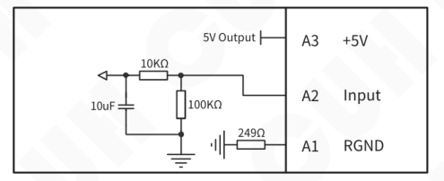

| Anschluss | Definition |
|---|---|
| A3 | +5V |
| A2 | Input |
| A1 | RGND |

### Schaltsensor-Port C


| Anschluss | Definition |
|---|---|
| C3 | 24V Output |
| C2 | Input |
| C1 | GND |

### Schaltsensor-Port E

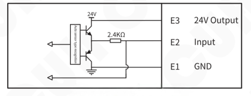

| Anschluss | Definition |
|---|---|
| E3 | 24V Output |
| E2 | Input |
| E1 | GND |

### Steuerausgangs-Port D

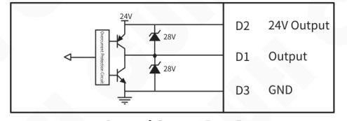

| Anschluss | Definition |
|---|---|
| D2 | 24V Output |
| D1 | Output |
| D3 | GND |


### 485 Kommunikations-Port F

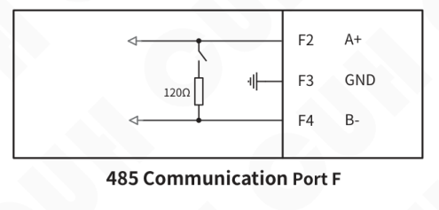

| Anschluss | Signal |
|---|---|
| F2 | A+ |
| F3 | GND |
| F4 | B- |

Interner Abschluss: 120Ω.

### Zähl-/Geschwindigkeitsvoreinstellungs-Port N

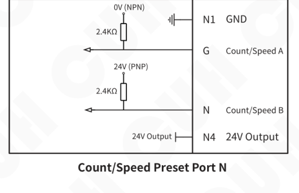

| Anschluss | Signal |
|---|---|
| N1 | GND |
| G | Count/Speed A |
| N | Count/Speed B |
| N4 | 24V Output |

Eingangsreferenzen: 0V (NPN), 24V (PNP), 2,4kΩ Pull-Widerstände.

### Digital Sync Port T


| Anschluss | Signal |
|---|---|
| T1 | Sync+ |
| T2 | GND |
| T3 | Sync- |

Interner Abschluss: 120Ω.


---

## 7.6 Fehlercode

Die Fehlerdiagnose dieses Controllers ist in Fehlercodes und Warnungscodes unterteilt. Und zeigt jeden Code nacheinander an.

**Fehlercode:** Es ist erforderlich, die Maschine sofort zu stoppen und zu warten, bis der Fehler verschwunden ist, bevor die Anzeige gelöscht wird.

**Warnungscode:** Kein Abschalten erforderlich. Warten Sie, bis das Warnzeichen verschwindet, bevor die Anzeige gelöscht wird.

### Fehlercode-Tabelle

| Fehlercode | Anzeige | Bedeutung | Ausschlussmethode |
|---|---|---|---|
| Error01 | Short | Kurzschluss | Bestätigen Sie, ob die Hauptausgangsleitung kurzgeschlossen ist, und verkabeln Sie sie neu |
| Error02 | OvrCurrt | Überstrom | Reduzieren Sie die Ausgangsspannung oder erhöhen Sie die Ausgangsfrequenz |
| Error03 | OverHot | Überhitzung | Platzieren Sie den Controller an einem gut belüfteten und wärmeableitenden Ort |
| Error04 | UndrCool | Unterkühlung | Platzieren Sie den Controller an einem Ort, an dem die Umgebungstemperatur höher als -20℃ ist |
| Error05 | CommErr | Kommunikationsfehler | Kontaktieren Sie den technischen Support des Unternehmens |
| Error06 | TSnerErr | Temperatursensorfehler | Kontaktieren Sie den technischen Support des Unternehmens |
| Error07 | OverVolt | Überspannung | Die Eingangsnetzspannung darf 250V Effektivwert nicht überschreiten |
| Error08 | UndrVolt | Unterspannung | Die Eingangsnetzspannung darf nicht unter 85V Effektivwert liegen |
| Error09 | LoadErr | Lasttrennung | Prüfen Sie, ob die Ausgangsleitung korrekt mit der Vibrationsplatte verbunden ist |
| Error10 | Send_Seed | Seed-Senden fehlgeschlagen | Kontaktieren Sie den technischen Support des Unternehmens |
| Error11 | Send_Exit | Der Befehl zum Verlassen des Bootvorgangs konnte nicht ausgeführt werden | Kontaktieren Sie den technischen Support des Unternehmens |
| Error14 | SynchEr0 | CUHBus-DS® Bus hat 2 oder mehr Hosts | 1. Wenn ein Alarm auftritt, setzen Sie das Gerät offline und dann wieder online.<br>2. Nach dem Ausschalten des neu hinzugefügten Geräts verbinden Sie das CUHBus-DS® Kabel mit dem Netzwerkgerät. |
| Error15 | SynchEr1 | Busfehler | Bestätigen Sie, ob die CUHBus-DS® Kommunikationsleitung korrekt verbunden ist, und organisieren Sie das Netzwerk korrekt |
| Error16 | SynchEr2 | Synchronisationsgerät ist nicht online | Synchronisationskommunikationsnetzwerk, Frequenzsynchronisationsgerät oder Fernsteuerungssynchronisationsgerät ist nicht online |

---


## 7.7 Warnungscode

Warnungscode-Tabelle

| Warnungscode | Anzeige | Bedeutung | Ausschlussmethode |
|---|---|---|---|
| Warn01 | Saturate | Ausgangssättigung | Reduzieren Sie die Ausgangsspannung |
| Warn02 | decline | Zählverzögerung | Zählverzögerungszustand |
| Warn03 | CND | Zählende | Zählendstatus |
| Warn04 | FrqncyLo | Ausgangsfrequenz zu niedrig | Erhöhen Sie den Frequenzversatz-Parameterwert |
| Warn05 | FrqncyHi | Ausgangsfrequenz zu hoch | Erhöhen Sie den Frequenzversatz-Parameterwert |
| Warn06 | LoMAlarm | Materialmangel | Reduzieren Sie den Materialmangelalarm-Parameterwert oder fügen Sie Material zum Materialtablett hinzu |
| Warn07 | PortDErr | Port D Ausgangsüberstrom | Reduzieren Sie die Ausgangsport-Steuerungslast |
| Warn08 | RemotLow | Fernsteuerungs-Eingangsspannung/-strom zu niedrig | Erhöhen Sie die Fernsteuerungs-Eingangsspannung oder den Strom |
| Warn09 | MRSErr | Hauptausgangs-RS-Logikfehler | Wenn die Ausgangslogik ein RS-Flipflop ist, können Hauptquelle 1 und Hauptquelle 2 Signale nicht gleichzeitig gültig sein |
| Warn10 | 24VErr | 24V Fehler | Schließen Sie keine 24V externe Stromversorgung an den Controller-Ausgangsport an |
| Warn11 | 5VErr | 5V Fehler | Schließen Sie keine 5V externe Stromversorgung an den Controller-Ausgangsport an |
| Warn12 | CtrlRSErr | Steuerausgangs-RS-Logikfehler | Wenn die Logik von Port D ein RS-Flipflop ist, können D-Port-Quelle 1 und D-Port-Quelle 2 Signale nicht gleichzeitig gültig sein |
| Warn13 | OverLoad | Beschleunigungssensor-Überlastung | Ersetzen Sie den Beschleunigungssensor durch einen geeigneten Bereich |
| Warn14 | AcceleEr | Beschleunigungssensor-Ausfall | Der Sensor ist beschädigt, ersetzen Sie ihn durch einen neuen |
| Warn15 | EEPErr | Fehler beim Speichern der Parameter | Bestätigen Sie, dass die CUHBus-DS® Kommunikationsleitung ordnungsgemäß angeschlossen ist und die Vernetzung korrekt abgeschlossen wurde. |


---

# Kapitel Ⅷ Produktgarantieinformationen

## 8.1 Garantiezeitraum

Der Garantiezeitraum, den das Unternehmen für dieses Produkt bereitstellt, beträgt 3 Jahre ab dem Datum der Lieferung des Produkts an den vom Käufer bestimmten Standort.

## 8.2 Garantieumfang

(1) Wenn während des oben genannten Garantiezeitraums ein von unserem Unternehmen verursachter Fehler auftritt, reparieren wir das Produkt kostenlos. Die folgenden Situationen sind jedoch nicht durch die Garantie abgedeckt:

&nbsp;&nbsp;&nbsp;&nbsp;a. Nichteinhaltung der im einfachen Handbuch, Benutzerhandbuch oder den technischen Anforderungen, die zwischen dem Käufer und dem Unternehmen spezifisch vereinbart wurden, festgelegten Bedingungen, unsachgemäße Bedienung oder durch unsachgemäßen Gebrauch verursachter Fehler.

&nbsp;&nbsp;&nbsp;&nbsp;b. Der Fehler ist nicht auf einen Produktdefekt zurückzuführen, sondern auf das Design der Ausrüstung oder Software des Käufers.

&nbsp;&nbsp;&nbsp;&nbsp;c. Fehlfunktionen, die durch Änderungen oder Reparaturen verursacht wurden, die nicht vom Personal des Unternehmens durchgeführt wurden.

&nbsp;&nbsp;&nbsp;&nbsp;d. Der Fehler, der durch korrekte Wartung oder den Austausch von Verschleißteilen gemäß der einfachen Bedienungsanleitung oder dem Benutzerhandbuch vollständig vermieden werden kann.

&nbsp;&nbsp;&nbsp;&nbsp;e. Nachdem das Produkt unser Unternehmen verlassen hat, wird er durch Faktoren wie unvorhergesehene Veränderungen des wissenschaftlichen und technologischen Niveaus verursacht.

&nbsp;&nbsp;&nbsp;&nbsp;f. Aufgrund von Naturkatastrophen wie Brand, Erdbeben, Überschwemmung oder externen Faktoren wie abnormaler Spannungsausfall ist das Unternehmen nicht für die Garantie verantwortlich.

(2) Der Garantieumfang ist auf die in (1) festgelegte Situation beschränkt. Indirekte Verluste (wie Geräteschäden, Chancen, entgangener Gewinn usw.) oder andere Verluste – das Unternehmen übernimmt keine Verantwortung.

## 8.3 Produktverwendung

Der Controller unseres Unternehmens ist für den allgemeinen Einsatz in der Vibrationsförderindustrie konzipiert und produziert. Daher darf der Controller unseres Unternehmens nicht für die folgenden Anwendungen verwendet werden und ist für deren Einsatz nicht geeignet.

(1) Einrichtungen, die schwerwiegende Auswirkungen auf Leben und Eigentum haben, wie Kernkraftwerke, Flughäfen, Eisenbahnen, Schiffe, motorisierte Geräte und medizinische Geräte.

(2) Öffentliche Versorgungseinrichtungen, einschließlich Strom, Gas, Wasserversorgung usw.

(3) Außeneinsatz unter ähnlichen Bedingungen oder Umgebungen.

---


Nanjing CUH Science & Technology Co.,Ltd  
https://en.cuhnj.com  
Tel.:+86-25-84730411 / 84730415 / 84730416  
Fax:+86-25-84730426  
E-mail:sales@cuhnj.com  
Add.:Building 2, Xueyan Tech Park, Tuscity,  
No.9 Zhineng Rd, Jiangning, Nanjing, China

Dokument-Nr.: IDP1000480


