Automatischer Hochfrequenz-Piezo-Controller                          SDVC42-SD


<div align="center">

**Automatischer Hochfrequenz-Piezo-Controller**

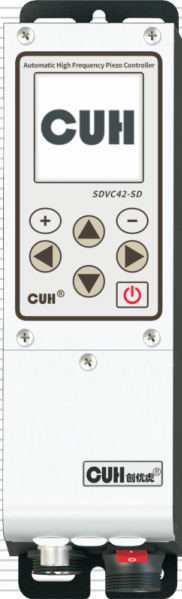

## SDVC42-SD

# Benutzerhandbuch

</div>


---

## Urheberrechtserklärung

Nanjing CUH Science & Technology CO., Ltd. behält sich alle Rechte vor.

Alle in diesem Benutzerhandbuch enthaltenen Informationen sind das Wissen unseres Unternehmens und durch das Urheberrechtsgesetz und andere einschlägige Gesetze geschützt. CUH genießt und behält sich alle durch das Urheberrechtsgesetz und andere Gesetze conferred Rechte vor. Ohne schriftliche Zustimmung von CUH darf dieses Benutzerhandbuch weder ganz noch teilweise kopiert, übersetzt, nachgeahmt oder anderweitig verwendet werden.

## Haftungsausschluss

Alle Inhalte dieses Benutzerhandbuchs beschreiben lediglich die Verwendungsmethode der von unserem Unternehmen hergestellten Produkte und werden gemäß dem bestehenden Stand der Technik und dem Ihnen bei der Nutzung bereitgestellten Zustand beschrieben. Sie tragen die entsprechenden Risiken bei der Nutzung dieses Produkts. Soweit gesetzlich nicht vorgeschrieben, übernimmt das Unternehmen keine ausdrückliche oder stillschweigende Haftung für das Produkt aufgrund dieses Benutzerhandbuchs, einschließlich, aber nicht beschränkt auf Personenschäden, Sachschäden, entgangene Gewinne usw.

Sie sind sich der oben genannten Risiken klar bewusst und stimmen zu, dass das Unternehmen – außer bei gesetzlicher Verpflichtung – nicht für direkte oder indirekte Schäden oder Verluste an Ihnen haftet（einschließlich, aber nicht beschränkt auf materielle Verluste an Personal, Eigentum, Daten usw. und immaterielle Verluste an Reputation, Chancen usw.）

Das Unternehmen behält sich das Recht vor, die in diesem Benutzerhandbuch geltenden Produkte ohne vorherige oder nachträgliche Ankündigung zu ändern.

---


---

# Vorwort

Vielen Dank, dass Sie sich für den CUH SDVC42-SD Automatischer Hochfrequenz-Piezo-Controller entschieden haben.（Im Folgenden als „Controller" bezeichnet.）Diese Controller-Serie verwendet hochwertige Komponenten und neueste Elektroniktechnologie und ist mit leistungsstarken digitalen Signalprozessoren sorgfältig konstruiert.

Dieses Handbuch beschreibt die grundlegende Bedienung, die funktionale technische Beschreibung und typische Anwendungsbeispiele dieses Produkts. Es bietet Benutzern relevante Informationen zur Installation und Inbetriebnahme, Parametereinstellung, Fehlerdiagnose, Fehlerbehebung und routinemäßigen Wartung des Controllers. Um die korrekte Installation und Nutzung dieses Controllers sicherzustellen, lesen Sie dieses Benutzerhandbuch bitte sorgfältig vor der Installation und bewahren Sie es sicher auf.

Bitte beachten Sie unbedingt die folgenden Symbole, die Sie auf Vorsichtsmaßnahmen gegen Personenschäden und Produktschäden hinweisen.

| Symbol | Beschreibung |
|---|---|
| ⚠ Gefahr | Nichtbeachtung dieses Punktes<br>führt zu Personenschäden oder Tod. |
| ⚠ Warnung | Nichtbeachtung dieses Punktes<br>kann zu Personenschäden oder Tod führen. |
| ⚠ Vorsicht | Nichtbeachtung dieses Punktes<br>kann zu mittelschweren oder leichten Personenschäden führen. |
| Hinweis | Nichtbeachtung dieses Punktes<br>führt zur Beschädigung des Produkts und zu Sachschäden. |
| Wichtig | Zeigt Vorsichtsmaßnahmen und Nutzungsbeschränkungen an,<br>die während der Nutzung beachtet werden müssen. |

**Dieses Handbuch gilt für folgende Controller-Modelle:**

◆ Automatischer Hochfrequenz-Piezo-Controller  SDVC42-SD (600mA)

---


---

# Sicherheit und Vorsichtsmaßnahmen

1. **Gefahr** Dieses Produkt dient ausschließlich zum Antrieb piezoelektrischer Vibrationsfördergeräte. Verwenden Sie dieses Produkt nicht zum Schutz des menschlichen Körpers oder von Körperteilen.

2. **Gefahr** Dieses Produkt ist nicht als explosionsgeschütztes Produkt konzipiert. Verwenden Sie es nicht in explosionsgefährdeten Bereichen und/oder explosionsgefährdeten Gasumgebungen.

3. **Warnung** Dieses Produkt wird über das Wechselstromnetz versorgt. Legen Sie keine Wechselspannung über 250Vac an. Eine zu hohe Eingangsspannung, z. B. 300Vac, kann das Produkt zur Explosion oder zum Brand bringen und schwere Sicherheitsunfälle verursachen.

4. **Warnung** Dieses Produkt wird über das Netzkabel geerdet. Stellen Sie sicher, dass die Stromversorgungseinrichtungen für den Controller ordnungsgemäß geerdet sind, andernfalls kann das Controller-Gehäuse unter Spannung stehen und einen Stromschlag verursachen.

5. **Warnung** Legen Sie keine Wechselstromversorgung an den Ausgang dieses Controllers an, da dies den Controller beschädigt.

6. **Warnung** Stecken Sie keine Kabel unter Spannung ein oder aus und berühren Sie nicht die Kontakte der Verdrahtungsklemmen im Verdrahtungsabteil, um Stromschläge zu vermeiden.

7. **Hinweis** Vermeiden Sie es, den Ausgang dieses Produkts durch Abschalten der Stromversorgung über Relais und ähnliche Geräte zu steuern, da dies die Lebensdauer des Controllers erheblich verkürzt.

8. **Hinweis** Der Controller ist für den Betrieb in einer kühlen und trockenen Umgebung konzipiert. Betreiben Sie den Controller niemals im Freien, um Nässe und direkte Sonneneinstrahlung zu vermeiden. Betreiben Sie den Controller innerhalb der spezifizierten elektrischen Kennwerte.

9. **Wichtig** Befestigen Sie dieses Produkt unbedingt auf einer soliden, zuverlässig geerdeten Plattform, die von Vibrationsgeräten entfernt ist.

10. **Wichtig** Betreiben Sie den Controller niemals unter Bedingungen, die über seine konstruktiven Grenzwerte hinausgehen.

11. **Wichtig** Betreiben Sie den Controller strikt gemäß diesem Handbuch. Wir übernehmen keine zivil- oder strafrechtliche Haftung, wenn Geräteschäden oder Personenschäden durch unsachgemäße Bedienung verursacht werden.

12. **Wichtig** Öffnen Sie niemals das Controller-Gehäuse, um Stromschläge zu vermeiden. Kontaktieren Sie CUH, wenn der Controller defekt ist. Versuchen Sie niemals, den Controller selbst zu reparieren, da dies zum Garantieverlust führen kann.

---


---

# Betriebs- und Lagerungsumgebung

## Inspektion vor der Verwendung

Jeder Controller wird vor der Auslieferung einer strengen Qualitätskontrolle unterzogen und mit stoßsicherer Verpackung geliefert. Bitte prüfen Sie nach dem Auspacken folgende Punkte:

1. Ob der Controller während des Transports beschädigt wurde.
2. Ob das Controller-Modell dem von Ihnen bestellten entspricht.

## Betriebsbedingungen

Bitte beachten Sie die folgenden Hinweise, um eine optimale Leistung und längere Lebensdauer des Controllers zu gewährleisten:

- [!] Gut belüftete Umgebung
- [!] Fernhalten von Wasser, Dampf, Staub und insbesondere ölhaltigem Staub
- [!] Fernhalten von korrosiven oder brennbaren Gasen und Flüssigkeiten
- [!] Fernhalten von Schwebstaub und Metallpartikeln
- [!] Fest befestigen, um Eigen­vibrationen zu vermeiden
- [!] Fernhalten von elektromagnetischen Störungen
- [!] Umgebungstemperatur 0~40 ℃ sicherstellen
- [!] Nur für den Einsatz bis 2000 m Höhe

---


---


# Inhaltsverzeichnis

**Kapitel Ⅰ Hinweise vor der Inbetriebnahme** -------------------------------------------------- 1

1.1 Paketinhalt prüfen ----------------------------------------------------------- 1

1.2 Herstellerschild-Erläuterung ----------------------------------------------- 2

1.3 Nutzungsbedingungen des Controllers ------------------------------------------------------ 2

1.4 Hinweise -------------------------------------------------------------------------- 3

**Kapitel Ⅱ Produkteinführung** ---------------------------------------------------- 4

2.1 Produkteinführung ------------------------------------------------------------- 4

2.2 Tastenfeld und I/O-Anschlüsse ------------------------------------------------------------- 5

2.3 Installationsanleitung für den Vibrationssensor --------------------------------------------- 6

2.4 Beschreibung der Startseitenparameter -------------------------------------------------- 7

2.5 Definition der Signalsteueranschlüsse -------------------------------------------------- 7

2.6 Tastenfeldbedienung ----------------------------------------------------------------- 8

2.7 Drehdiagramm der Bedienoberfläche -------------------------------------------- 8

**Kapitel Ⅲ Stromverkabelung und Grundbedienung** --------------------------------------- 9

3.1 Stromverkabelung --------------------------------------------------------------------- 9

3.2 Grundbedienung ------------------------------------------------------------------ 11

**Kapitel Ⅳ Detaillierte Funktionsbeschreibung** ----------------------------------------- 13

4.1 Allgemeine Parametereinstellungen ------------------------------------------------------- 14

4.1.1 Spannung -------------------------------------------------------------------------- 14

4.1.2 Frequenz ------------------------------------------------------------------------ 14

4.1.3 Fördergeschwindigkeit -------------------------------------------------------------------- 15

4.1.4 Sanftanlaufzeit/Sanftstoppzeit -------------------------------------------------- 15

4.1.5 Maximale Spannung/Maximaler Strom ------------------------------------------------ 15

4.1.6 Maximale Ausgangsfrequenz/Minimale Ausgangsfrequenz ------------------------------ 15

4.1.7 Lasterkennung ------------------------------------------------------------------- 16

4.1.8 Materialmangelalarm ------------------------------------------------------------------- 16

4.1.9 Abschaltalarm ------------------------------------------------------------------- 16

4.1.10 Hintergrundbeleuchtungshelligkeit ---------------------------------------------------------- 16

4.1.11 Hintergrundbeleuchtung aus ------------------------------------------------------------------- 17

4.1.12 Sprache ------------------------------------------------------------------------ 17

4.2 Automatische Resonanzfrequenzsuche --------------------------------------------- 17

4.2.1 Frequenzsuch-Oberfläche ----------------------------------------------------- 17

---


4.3 Konstante Fördergeschwindigkeit ---------------------------------------------------------------- 18

4.3.1 Zentralfrequenz --------------------------------------------------------------- 18

4.3.2 Frequenzversatz ---------------------------------------------------------------- 18

4.3.3 Frequenzintegration ----------------------------------------------------------- 18

4.3.4 Amplitudenintegration ----------------------------------------------------------- 19

4.3.5 Amplitudenverhältnis ----------------------------------------------------------------- 19

4.3.6 Autophase ---------------------------------------------------------------------- 19

4.3.7 Frequenzsuchprozess-Spannung -------------------------------------------- 19

4.3.8 Frequenzsuchprozess-Amplitude ------------------------------------------ 19

4.3.9 Maximale Fördergeschwindigkeit ------------------------------------------------------------- 19

4.3.10 Slave-Controller Phasenversatz ------------------------------------------------- 19

4.3.11 Ausgangsspannungs-Steuerungsmodus --------------------------------------------------- 20

4.3.12 Ausgangsfrequenz-Steuerungsmodus ------------------------------------------------- 20

4.3.13 Synchronisationsquelle -------------------------------------------------------------------- 20

4.3.14 Vibrationssensor-Typ --------------------------------------------------------- 20

4.3.15 Automatische Resonanzfrequenz-Suchgeschwindigkeit ----------------------------------------- 20

4.4 Ausgangsparameter ----------------------------------------------------------------- 21

4.4.1 Haupteingangsparameter --------------------------------------------------------- 21

4.4.2 DC-Steuerungsausgangsparameter --------------------------------------------------- 28

4.5 Signalsteuerung -------------------------------------------------------------------- 30

4.5.1 Sensortyp --------------------------------------------------------------------- 30

4.5.2 C-Port/E-Port-Logik ------------------------------------------------------------ 31

4.5.3 C-Port Ein/Aus-Verzögerung und E-Port Ein/Aus-Verzögerung ----------------------------------- 31

4.5.4 Geschwindigkeit A Logik/Geschwindigkeit B Logik ---------------------------------------------------- 32

4.5.5 Geschwindigkeit A Ein/Aus-Verzögerung und Geschwindigkeit B Ein/Aus-Verzögerung --------------------------------- 32

4.6 Materialzählung -------------------------------------------------------- 33

4.6.1 Materialzählung (oder Geschwindigkeit A/B) -------------------------------------- 33

4.6.2 Zielmenge ----------------------------------------------------------------- 34

4.6.3 Endgeschwindigkeit ------------------------------------------------------------------ 34

4.6.4 Endgeschwindigkeitsmenge -------------------------------------------------------- 35

4.6.5 Zählwert auf 0 zurücksetzen ------------------------------------------------------ 35

4.6.6 RS-Priorität --------------------------------------------------------------------- 35

---


4.7 Einstellungen speichern ---------------------------------------------------------------- 36

&nbsp;&nbsp;&nbsp;&nbsp;4.7.1 Einstellungen abrufen -------------------------------------------------------- 36

&nbsp;&nbsp;&nbsp;&nbsp;4.7.2 Einstellungen speichern ----------------------------------------------------------- 36

&nbsp;&nbsp;&nbsp;&nbsp;4.7.3 Werkseinstellungen wiederherstellen --------------------------------------------------------- 37

&nbsp;&nbsp;&nbsp;&nbsp;4.7.4 Einstellungen kopieren ----------------------------------------------------------- 37

&nbsp;&nbsp;&nbsp;&nbsp;4.7.5 Benutzerpasswort ---------------------------------------------------------- 37

&nbsp;&nbsp;&nbsp;&nbsp;4.7.6 Passwort eingeben --------------------------------------------------------- 37

4.8 RS485-Kommunikation ---------------------------------------------------------- 38

&nbsp;&nbsp;&nbsp;&nbsp;4.8.1 Kommunikationstyp ----------------------------------------------------- 38

&nbsp;&nbsp;&nbsp;&nbsp;4.8.2 Baudrate --------------------------------------------------------------- 39

&nbsp;&nbsp;&nbsp;&nbsp;4.8.3 Slave-Controller-Adresse ------------------------------------------------ 39

&nbsp;&nbsp;&nbsp;&nbsp;4.8.4 Portwiderstand/Synchronwiderstand ---------------------------------- 39

4.9 CUHBus-DS® Vernetzung -------------------------------------------------------- 40

&nbsp;&nbsp;&nbsp;&nbsp;4.9.1 Gerätevernetzung ------------------------------------------------------- 41

&nbsp;&nbsp;&nbsp;&nbsp;4.9.2 Synchronisationsfunktion ----------------------------------------------------------- 45

&nbsp;&nbsp;&nbsp;&nbsp;4.9.3 Signalteilung ---------------------------------------------------------- 51

&nbsp;&nbsp;&nbsp;&nbsp;4.9.4 Datensicherung ------------------------------------------------------------ 53

&nbsp;&nbsp;&nbsp;&nbsp;4.9.5 Fernsteuerungsdaten ---------------------------------------------------- 54

4.10 Controller-Statusüberwachung ------------------------------------------------ 54

4.11 Fehlerprotokoll ------------------------------------------------------------------- 55

4.12 Startseite anpassen ---------------------------------------------------------- 55

## Kapitel Ⅴ Typische Anwendungen --------------------------------------------- 56

5.1 Wie hält man zwei Vibrationsförderer auf derselben Frequenz? ----------- 56

5.2 Wie schaltet man Controller B über einen an Controller A angeschlossenen Sensor ein/aus? ----- 57

5.3 Wie schaltet man zwei Controller gleichzeitig ein/aus? -------------------------- 58

## Kapitel Ⅵ Häufig gestellte Fragen -------------------------------------- 59

6.1 Keine Anzeige beim Einschalten ----------------------------------------------------- 59

6.2 Keine Vibration, kein Geräusch, Controller-Anzeige normal ---------------------------- 59

6.3 Steuersignal funktioniert nicht ------------------------------------------------- 59

6.4 Keine Vibration, normales Geräusch, Controller-Anzeige normal --------------------- 59

6.5 Instabile Resonanzfrequenzverfolgung ---------------------------------------- 59

6.6 Langsame Geschwindigkeitskorrektur bei konstanter Fördergeschwindigkeit ------------------------ 60


---

6.7 Controller schnell auf Werkseinstellungen zurücksetzen -------------------------60

**Kapitel Ⅶ Anhang** ---------------------------------------------------------------------61

7.1 Abmessungen -------------------------------------------------------------------------------61

7.2 Technische Spezifikationen ---------------------------------------------------------------62

7.3 Referenzstandard ---------------------------------------------------------------------63

7.4 Parameterliste --------------------------------------------------------------------------64

&nbsp;&nbsp;&nbsp;&nbsp;7.4.1 Schnittstellen-Parametergruppe -----------------------------------------------------64

&nbsp;&nbsp;&nbsp;&nbsp;7.4.2 Allgemeine Parametergruppe -----------------------------------------------------65

&nbsp;&nbsp;&nbsp;&nbsp;7.4.3 Hauptausgangs-Parametergruppe ------------------------------------------------66

&nbsp;&nbsp;&nbsp;&nbsp;7.4.4 Konstantgeschwindigkeits-Parametergruppe -----------------------------------------------67

&nbsp;&nbsp;&nbsp;&nbsp;7.4.5 Signaleingangs-Parametergruppe -------------------------------------------------68

&nbsp;&nbsp;&nbsp;&nbsp;7.4.6 Steuerungsausgangs-Parametergruppe ---------------------------------------------69

&nbsp;&nbsp;&nbsp;&nbsp;7.4.7 Zähl-Parametergruppe ------------------------------------------------70

&nbsp;&nbsp;&nbsp;&nbsp;7.4.8 Kommunikations-Parametergruppe -------------------------------------------71

&nbsp;&nbsp;&nbsp;&nbsp;7.4.9 Speicher-Parametergruppe --------------------------------------------------------------72

&nbsp;&nbsp;&nbsp;&nbsp;7.4.10 Überwachungs-Parametergruppe -------------------------------------------------73

&nbsp;&nbsp;&nbsp;&nbsp;7.4.11 Anhangsliste ----------------------------------------------------------------------75

7.5 Ein- und Ausgangsschaltpläne -----------------------------------------------------76

7.6 Fehlercode --------------------------------------------------------------------------------78

7.7 Warnungscode ----------------------------------------------------------------------------79

**Kapitel Ⅷ Produktgarantieinformationen** -------------------------------------80

8.1 Garantiezeitraum -------------------------------------------------------------------------80

8.2 Garantieumfang ----------------------------------------------------------------------80

8.3 Produktverwendung ----------------------------------------------------------------------80

---


# Kapitel Ⅰ Hinweise vor der Inbetriebnahme

Dieses Kapitel beschreibt den Verpackungsinhalt, die Controller-Erscheinungsbeschreibung und die Herstellerschild-Informationen.

## 1.1 Paketinhalt prüfen

Bitte prüfen Sie vor der Verwendung die Vollständigkeit des Controllers und Zubehörs. Wenn das Produkt defekt oder beschädigt ist oder Zubehör fehlt, kontaktieren Sie bitte unser Unternehmen.

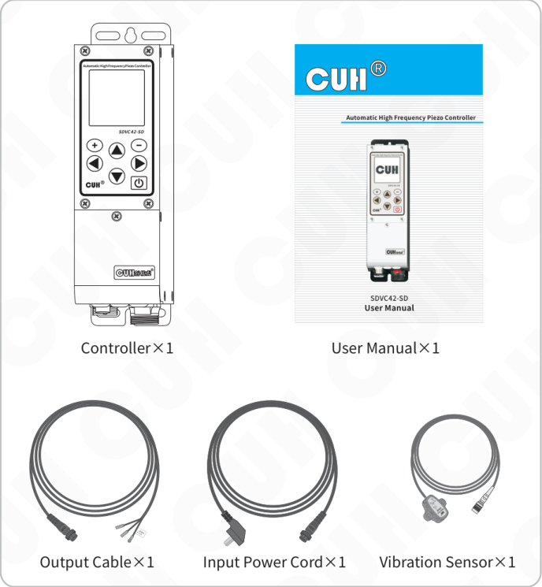

- Controller×1
- Benutzerhandbuch×1
- Ausgangskabel×1
- Eingangs-Netzkabel×1
- Vibrationssensor×1


## 1.2 Herstellerschild-Erläuterung

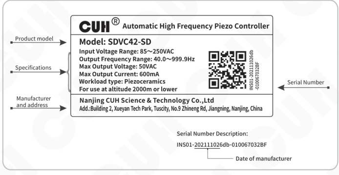

## 1.3 Nutzungsbedingungen des Controllers

Der Controller wird über Wechselstrom 85V~250V versorgt und über den Stecker des Netzkabels mit einer Schutzleitung verbunden. Bitte verwenden Sie eine Standard-Netzstromversorgung und stellen Sie sicher, dass die Schutzleitung korrekt angeschlossen ist.

**Warnung** Schließen Sie den Controller niemals an eine 380V-Wechselstromversorgung an, da dies zu irreversiblen schweren Schäden am Controller führen und Explosion, Brand und andere Sicherheitsunfälle verursachen kann.

**Warnung** Stellen Sie sicher, dass die Versorgungsseite zuverlässig geerdet ist. Das Metallgehäuse des Controllers ist direkt mit der Schutzleitung verbunden. Eine mangelhafte Erdung kann dazu führen, dass das Controller-Gehäuse unter Spannung steht und einen Stromschlag verursacht.

**Hinweis** Bei längerem Betrieb entsteht Wärme, die die Gehäusetemperatur erhöht. Installieren Sie den Controller in einer gut belüfteten Umgebung und befestigen Sie ihn sicher, entfernt von Vibrationsquellen.

**Hinweis** Dieses Produkt ist ein Controller zum Antrieb von piezoelektrischen Vibrationsförderern.

---


---

## 1.4 Hinweise

Das Benutzerhandbuch ist ca. 28.000 Wörter lang und die Lektüre dauert voraussichtlich etwa eine Stunde.

◆ Bitte lesen Sie dieses Handbuch sorgfältig vor der Verwendung, um Schäden am Controller durch unsachgemäße Bedienung zu vermeiden.

◆ Benutzer können über das Handbuchverzeichnis schnell die relevanten Funktionen und Bedienungsmethoden des Controllers finden.

◆ Die Unterkapitelüberschriften und der hervorgehobene Text im Text entsprechen den tatsächlichen Anzeige-Parameterwerten des Controllers, z. B. Spannung.

◆ Benutzer können auf „Kapitel Ⅴ Typische Anwendungen" verweisen, um schnell mit diesem Controller vertraut zu werden.

◆ Benutzer können Funktions-Tag-Codes im Abschnitt „7.4 Parameterliste" schnell nachschlagen.

◆ Gleichzeitiges Drücken von ⊕ und ⊖ bedeutet Bestätigung.

---


---

# Kapitel Ⅱ Produkteinführung

Der Hauptinhalt dieses Kapitels umfasst eine kurze Einführung und die Hauptmerkmale dieses Produkts.

## 2.1 Produkteinführung

Die SDVC42-SD-Serie Automatischer Hochfrequenz-Piezo-Controller ist ein speziell für High-End-Fördersysteme entwickeltes Produkt.

Einzigartige Leistung wird durch den Einsatz neuester Elektroniktechnologie und Signalverarbeitungsmethoden geboten. Zu den besonderen Merkmalen gehören:

- Über CUHBus-DS® Kommunikation werden Synchronisation, Sicherung und Wiederherstellung der Fernsteuerung von Spannung, Frequenz, Phase und anderen Parametern für jeden Controller realisiert.
- Signale anderer Controller-Ports können über CUHBus-DS® Kommunikation zur Logiksteuerung verwendet werden.
- Die Materialmangel-Alarmfunktion kann ohne zusätzliche Sensoren realisiert werden.
- Wählbare Tonhinweise können über den Vibrationsförderer ausgegeben werden.
- Erweiterung der Ausgangsfrequenz auf 40,0Hz~999,9Hz.
- Der analoge Geschwindigkeitssteuerport unterstützt die Modi 0~5V, 1~5V, 0~10V, 4~20mA und andere.
- Ausgestattet mit Zählfunktion, einschließlich Zählverzögerung und Zählstopp.
- Die verbesserte konstante Amplitudenfrequenzsuche stellt sicher, dass zwei Vibrationsförderer mit geringem Abstand während des Frequenzsuchvorgangs nicht kollidieren.
- Unterstützt die Protokolle RS485 Modbus ASCII und RS485 Modbus RTU.
- Software-Upgrade kann über die RS485-Schnittstelle durchgeführt werden.
- Ausgestattet mit einem 128×128-LCD-Display, unterstützt drei Sprachen: Chinesisch, Englisch und Deutsch.
- Erkennung der Laststromkennwerte zur Unterstützung der Fehlerdiagnose.
- Der Fehlercode kann die neuesten 64 Fehlerprotokolle speichern.

---


## 2.2 Tastenfeld und I/O-Anschlüsse

### Erklärung der Anzeige und Tasten

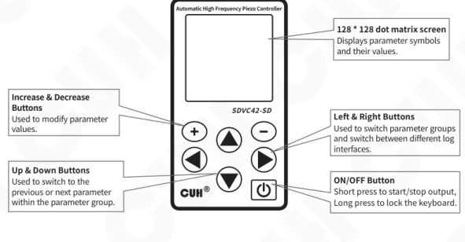

| Anzeige / Taste | Erklärung |
|---|---|
| Auf- & Ab-Tasten | Zur Änderung von Parameterwerten. |
| Hoch- & Runter-Tasten | Zum Wechseln zum vorherigen oder nächsten Parameter innerhalb der Parametergruppe. |
| Links- & Rechts-Tasten | Zum Wechseln der Parametergruppen und zum Umschalten zwischen verschiedenen Protokoll-Oberflächen. |
| 128×128 Punktmatrix-Bildschirm | Zeigt Parametersymbole und deren Werte an. |
| EIN/AUS-Taste | Kurz drücken zum Starten/Stoppen der Ausgabe, lang drücken zum Sperren der Tastatur. |

### Erklärung der Außenteile

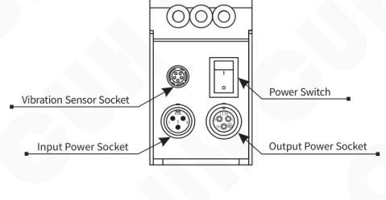

| Außenteil |
|---|
| Vibrationssensor-Buchse |
| Eingangsstrom-Buchse |
| Netzschalter |
| Ausgangsleistungs-Buchse |

---


## 2.3 Installationsanleitung für den Vibrationssensor

Befestigen Sie den Vibrationssensor auf der glatten Oberfläche des Vibrators. Die Installationsrichtung ist beliebig. Die Installationsmethoden sind wie folgt:

- Methode 1: Wie in Abb. 2.3.1 gezeigt  
  Vorteil: Einfache Installation

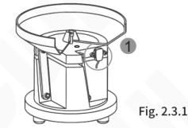

- Methode 2: Wie in Abb. 2.3.2 gezeigt  
  Hinweis: Lassen Sie den Vibrationssensor nicht von der Förderschale einklemmen.

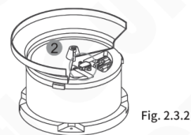

- Methode 3: Schweißen Sie eine Halterung am Vibrator an und befestigen Sie den Vibrationssensor auf der Halterung. Wie in Abb. 2.3.3 gezeigt  
  Empfohlene Abmessungen der Halterung wie in Abb. 2.3.4 gezeigt.

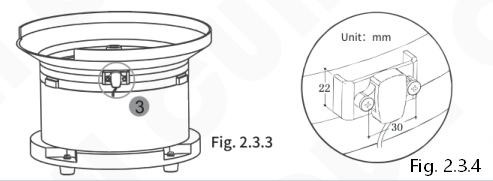

- Nicht empfoffene Installationsmethoden, wie in Abb. 2.3.5 und Abb. 2.3.6 gezeigt.  
  Wenn der Installationsort ungeeignet ist, kann der Vibrationssensor die Resonanzfrequenz nicht genau zurückmelden und der Controller führt dauerhaft eine Resonanzfrequenzsuche aus.

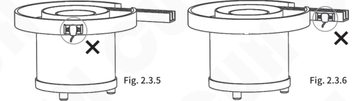


## 2.4 Beschreibung der Startseitenparameter

Der Controller kann den Hauptausgangsstatus, den Tastatursperrstatus, den Portstatus, die Überwachungsparameter und den Oberflächennamen auf der Startseite anzeigen. Im Portstatus bedeutet hervorgehobenes X, dass der Port aktiv ist. <u>X</u> zeigt an, dass der Port bei niedrigem Pegel aktiv ist, und X̅ zeigt an, dass der Port bei hohem Pegel aktiv ist.

### Anzeigebespiele der Startseite

**Beispiel 1**

```text
RUN
A C D E F G N J    A0

UserSped           50
P2.01

UserVoltg          20.0
P2.02              V

+       Home       -
```


**Beispiel 2**

```text
RUN
A C D E F G N J    A0

UserSped           [50]
P2.01

UserVoltg          20.0
P2.02              V

+       Home       -
```

[50] Das Kontrollkästchen zeigt an, dass der Parameterwert einstellbar ist, aber die Ausgangsspannung nicht geändert werden kann, da der Beschleunigungssensor nicht angeschlossen ist. 

## 2.5 Definition der Signalsteueranschlüsse

| Linke Funktionsgruppe | Linker Anschluss | Linke Definition | Rechte Definition | Rechter Anschluss | Rechte Funktionsgruppe |
|---|---:|---|---|---:|---|
| Digitale Synchronisation | T1 | Sync+ | Sync+ | T1 | Digitale Synchronisation |
| Digitale Synchronisation | T2 | GND | GND | T2 | Digitale Synchronisation |
| Digitale Synchronisation | T3 | Sync- | Sync- | T3 | Digitale Synchronisation |
| Fernsteuerung Geschw. | A1 | RGND | GND | N1 | Zählung/Geschw.-Voreinst. |
| Fernsteuerung Geschw. | A2 | Eingang | Zählung/Pset A | G | Zählung/Geschw.-Voreinst. |
| Fernsteuerung Geschw. | A3 | 5V Ausgang | Reset/Pset B | N | Zählung/Geschw.-Voreinst. |
| Fernsteuerung Geschw. | A4 | GND | 24V Ausgang | N4 | Zählung/Geschw.-Voreinst. |
| Sensor | C1 | GND | A+ | F2 | RS485 |
| Sensor | C2 | Eingang | GND | F3 | RS485 |
| Sensor | C3 | 24V Ausgang | B- | F4 | RS485 |
| Sensor Ⅱ | E1 | GND | GND | D3 | Steuerungsausgang |
| Sensor Ⅱ | E2 | Eingang | Ausgang | D1 | Steuerungsausgang |
| Sensor Ⅱ | E3 | 24V Ausgang | 24V Ausgang | D2 | Steuerungsausgang |


---

## 2.6 Tastenfeldbedienung

 a. Dieser Controller verwendet einen 128×128 Punktmatrix-Bildschirm zur Anzeige der Parameterinhalte.

 b. Je nach Dauer des Tastendrucks werden die Tastenaktionen unterteilt in: Kurzdruck, Langdruck, Beschleunigung Stufe 1 und Beschleunigung Stufe 2.

 [Kurzdruck]: Länger als 0,1 Sekunden, aber weniger als 0,5 Sekunden drücken.

 [Langdruck]: Länger als 2 Sekunden drücken.

 [Beschleunigung Stufe 1]: Länger als 0,5 Sekunden, aber weniger als 2 Sekunden drücken.

 [Beschleunigung Stufe 2]: Länger als 2 Sekunden drücken.

 c. ⊕ und ⊖ dienen hauptsächlich zur Änderung von Parameterwerten.

 d. Wechseln Sie zwischen den oberen und unteren Parametergruppen in der Parametereinstellungs-Oberfläche durch Kurzes Drücken von ◀ oder ▶.

 e. Wechseln Sie zwischen den oberen und unteren Parametern dieser Gruppe in der Parametereinstellungs-Oberfläche durch Kurzes Drücken von ▲ oder ▼.

 f. Kurzes Drücken von ⏻ startet/stoppt die Hauptausgabe, langes Drücken von ⏻ sperrt/entsperrt die Tastatur.

 g. Zugriff auf verschiedene Parametergruppen durch folgende Tastenkombinationen:

 Langes Drücken von ▲+▼: Betreten oder Verlassen der Frequenzsuch-Oberfläche.

 Langes Drücken von ▲+◀: Betreten oder Verlassen der Parametereinstellungs-Oberfläche.

 Langes Drücken von ▲+▶: Betreten oder Verlassen der Protokoll-Oberfläche.

## 2.7 Drehdiagramm der Bedienoberfläche

Auf jeder Oberfläche: Langes Drücken von **▲+▶** öffnet die **Protokoll-Oberfläche**, erneutes langes Drücken verlässt zur **Hauptoberfläche**

Auf jeder Oberfläche: Langes Drücken von **▲+▼** öffnet die **Frequenzsuch-Oberfläche**, Kurzes Drücken der Stopp-Taste verlässt zur **Hauptoberfläche**

Auf jeder Oberfläche: Langes Drücken von **▲+◀** öffnet die **Parametereinstellungs-Oberfläche**, erneutes langes Drücken verlässt zur **Hauptoberfläche**

Auf jeder Oberfläche: Bei keiner Aktion für mehr als 5 Minuten wird die **Standby-Oberfläche** aktiviert, Drücken einer beliebigen Taste kehrt zur **Hauptoberfläche** zurück

---


---

# Kapitel Ⅲ Stromverkabelung und Grundbedienung

## 3.1 Stromverkabelung

**Schritt Eins:**

Öffnen Sie die Verpackungskiste und prüfen Sie den Controller und alles Zubehör.

**Schritt Zwei:**

Verbinden Sie die Verdrahtungsklemmen des Ausgangskabels mit den Elektroden des Piezo-Vibrators.

Richten Sie die Kerbe am Luftfahrtstecker des Ausgangskabels an der Dreiecksmarkierung an der Ausgangsbuchse des Controllers aus und ziehen Sie die Mutter nach korrektem Anschluss fest.

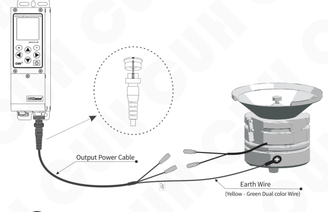

**Hinweis**

Stellen Sie sicher, dass die Elektroden des Piezo-Vibrators an die beiden Ausgangspins des Ausgangskabels angeschlossen sind und das Metallgehäuse des Vibrators zuverlässig geerdet ist.

---


### Schritt Drei:

Verbinden Sie den Stecker des Eingangskabels mit der Eingangsstrom-Buchse des Controllers.

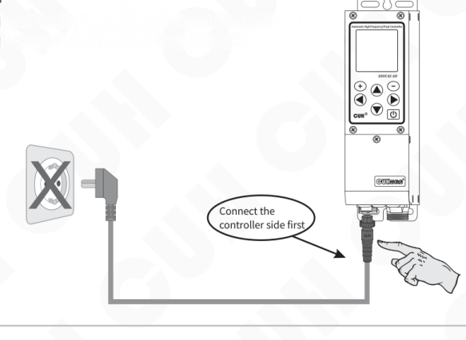

### Schritt Vier:

Nachdem Sie sich vergewissert haben, dass der Schalter in der AUS-Position ist, stecken Sie den Stecker des Eingangskabels in die Netzsteckdose.

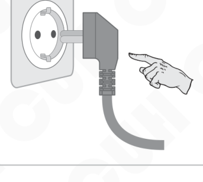


## 3.2 Grundbedienung

### Schritt Fünf:

Schalten Sie den Netzschalter des Controllers ein. Der Controller zeigt die Hauptoberfläche an.

```text
RUN
A C D E F G N J    A0

UserSped              50
P2.01

EffectCu            0.00
P10.05   A

+     Home      −
```

### Schritt Sechs:

Der Vibrationsförderer beginnt zu arbeiten. Passen Sie die Frequenz- und Spannungsparameter in der Parametergruppe „2 Allgemein" an, um die geeignete Fördergeschwindigkeit zu wählen.

- » Langes Drücken von ▲ und ◀ öffnet die Parametereinstellungs-Oberfläche, Kurzes Drücken von ▶ wechselt zur Parametergruppe „2 Allgemein".
- » Kurzes Drücken von ▲ oder ▼ platziert den Cursor auf dem Spannungs-Parameterwert.
- » Drücken Sie ⊕ oder ⊖ um den Parameterwert anzupassen.
- » Kurzes Drücken von ▲ oder ▼ platziert den Cursor auf dem Frequenz-Parameterwert.
- » Drücken Sie ⊕ oder ⊖ um den Parameterwert anzupassen.

```text
RUN
A C D E F G N J    A0

01.UserSped        50
02.UsrVoltg        20.0 V
03.UsrFrqnc        50.0 Hz
04.SoftStar         0.5 S
05.SoftStop         0.5 S

+     2Common    −
```

☺

- Die Frequenz, bei der die Vibration ihr Maximum erreicht, ist die Eigenfrequenz des Schwingkörpers.
- Jeder Vibrator hat seine mechanische Resonanzfrequenz. Passen Sie die Ausgangsfrequenz des Controllers an diese Frequenz an, um den optimalen Arbeitszustand zu erreichen.


---

### Schritt Sieben:

Kunden können zusätzlich den Beschleunigungssensor anschließen, um die automatische Frequenzsuche des Controllers zu realisieren.（Hinweis: Der Benutzer muss die Materialien in der Vibrationsplatte nicht leeren.）

Nehmen Sie den Sensor, verbinden Sie den Sensorstecker mit dem Controller und ziehen Sie die Mutter fest. Befestigen Sie den Sensorkörper korrekt auf der Vibrationsplatte（siehe Kapitel 2.3）

### Schritt Acht:

- Langes Drücken von ▲ und ▼ öffnet die Frequenzsuch-Oberfläche.

- Zu diesem Zeitpunkt zeigt der Bildschirm die Amplitudenkurve der Vibrationsplatte während des Frequenzsuchvorgangs（drei Phasen）und synchron die Ausgangsspannung, den Strom und die Beschleunigungswerte an.

  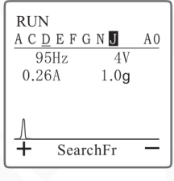

  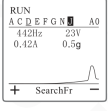

  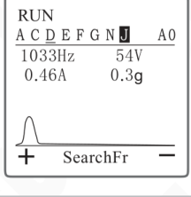

- Nach Abschluss der Frequenzsuche zeigt der Controller „Save" an, was bedeutet, dass die Frequenzsuche erfolgreich war und die Zentralfrequenz gespeichert wurde. Der Controller kehrt automatisch zur Startseite zurück.

  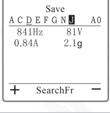

- Benutzer können die Fördergeschwindigkeit des Vibrationsförderers weiter über ⊕ oder ⊖ anpassen.

---


# Kapitel Ⅳ Detaillierte Funktionsbeschreibung

Dieses Kapitel beschreibt die detaillierten Funktionen und Einstellungen des Controllers.

Langes Drücken von ▲ und ◀ auf einer beliebigen Oberfläche öffnet die Parametereinstellungs-Oberfläche.  
Die Parametereinstellungs-Oberfläche umfasst die folgenden zehn Parametergruppen.  
Durch Kurzes Drücken von ◀ oder ▶ wechseln Sie zwischen den verschiedenen Parametergruppen.

## Drehdiagramm der Parametergruppen

| Nr. | Parametergruppe |
|---:|---|
| 1 | EditHome |
| 2 | Common |
| 3 | M_output |
| 4 | Stabilize |
| 5 | On&Off |
| 6 | DCoutput |
| 7 | Counter |
| 8 | Comm |
| 9 | Save |
| 10 | Monitor |

Richtungsanmerkungen im Diagramm:

- Linke Seite: **Kurzes Drücken ▶**, vertikaler Pfeil nach unten.
- Rechte Seite: **Kurzes Drücken ▶**, vertikaler Pfeil nach oben.
- Benachbarte Parametergruppen sind durch Auf-/Ab-Pfeile verbunden.


## 4.1 Allgemeine Parametereinstellungen

Dieses Kapitel beschreibt hauptsächlich die Einstellung und Anpassung der grundlegenden allgemeinen Parameter des Controllers.

### 4.1.1 Spannung

Dieser Controller kann die Ausgangsspannung direkt digital auf dem Panel einstellen. Da der Controller eine spannungsstabilisierende Ausgangsfunktion besitzt, ist dieser Wert der Spannungs-Gleichrichtmittelwert und wird nicht durch die Eingangsspannung beeinflusst. Die Ausgangsspannung bleibt auch bei instabiler Netzspannung stabil. Gleichzeitig bietet die direkte Spannungseinstellung genaue Daten für die Beurteilung des Betriebszustands.

» Treten Sie in die allgemeine Parametergruppe ein und suchen Sie die Spannungs-Einstellparameter.

» Drücken Sie ⊕ oder ⊖ um den Parameterwert anzupassen.

Der Spannungsbereich beträgt 0,0~50,0V, Standardwert 20,0V, Einstellgenauigkeit 0,1V.

```text
RUN
A C D E F G N J    A0
01.UserSped        50
02.UsrVoltg        20.0 V
03.UsrFrqnc        50.0 Hz
04.SoftStar        0.5 S
05.SoftStop        0.5 S
+     2Common     −
```

### 4.1.2 Frequenz

Der Controller verwendet die direkte digitale Frequenzsynthese-Technologie (DDS), die eine sehr hohe Frequenzgenauigkeit und -stabilität bietet und sich nicht mit Zeit und Temperatur ändert.

» Treten Sie in die allgemeine Parametergruppe ein und suchen Sie die Frequenz-Einstellparameter.

» Drücken Sie ⊕ oder ⊖ um den Parameterwert anzupassen.

Der Frequenzbereich beträgt 40,0~999,9Hz, Standardwert 50,0Hz, Einstellgenauigkeit 0,1Hz.

```text
RUN
A C D E F G N J    A0
01.UserSped        50
02.UsrVoltg        20.0 V
03.UsrFrqnc        50.0 Hz
04.SoftStar        0.5 S
05.SoftStop        0.5 S
+     2Common     −
```

Die übrigen Parameter dieser Parametergruppe können nach den obigen Schritten angepasst werden.


---

### 4.1.3 Fördergeschwindigkeit

**Fördergeschwindigkeit:** Die Vorschubgeschwindigkeit des Materials im Vibrationsförderer. Wenn der Controller mit dem Beschleunigungssensor verbunden ist und der Parameterwert „Spannungsmodus" auf „Automatisch" steht, kann die Materialvorschubgeschwindigkeit über den Fördergeschwindigkeitsparameter angepasst werden, und die Vibrationsplatte arbeitet stabil bei der eingestellten Fördergeschwindigkeit.

Der Fördergeschwindigkeitsbereich beträgt 0~3200, Standardwert 50, Einstellgenauigkeit 1.

### 4.1.4 Sanftanlaufzeit/Sanftstoppzeit

**Sanftanlaufzeit:** Die benötigte Zeit, damit der Controller die Ausgangsspannung beim Start aus dem Stoppzustand sanft von 0V auf die eingestellte Ausgangsspannung erhöht.

Der Sanftanlaufzeitbereich beträgt 0,0~40,0s, Standardwert 0,5 Sekunden, Einstellgenauigkeit 0,1 Sekunden.

**Sanftstoppzeit:** Wenn der Controller stoppt, die Zeit, die benötigt wird, damit die Ausgangsspannung sanft von der eingestellten Ausgangsspannung auf 0V abfällt.

Der Sanftstoppzeitbereich beträgt 0,0~40,0s, Standardwert 0,5 Sekunden, Einstellgenauigkeit 0,1 Sekunden.

Beim Starten oder Stoppen dieses Controllers wird die Ausgangsspannung sanft erhöht bzw. gesenkt, um zu verhindern, dass die Vibrationsausrüstung durch Stöße beschädigt wird.

### 4.1.5 Maximale Spannung/Maximaler Strom

**Maximale Spannung:** Der maximale Ausgangsspannungswert des Controllers.

Der maximale Spannungsbereich beträgt 0,0~50,0V, Standardwert 50,0V, Einstellgenauigkeit 0,1V.

**Maximaler Strom:** Der maximale Ausgangsstromwert des Controllers.

Der maximale Strombereich beträgt 0~600mA, Standardwert 600mA, Einstellgenauigkeit 1mA.

Dieser Controller kann maximale Ausgangsspannungs- und maximale Ausgangsstrom-Grenzwerte einstellen, die verhindern, dass der Benutzer durch versehentlich zu hohe Ausgangsspannung oder -strom die Vibrationsausrüstung beschädigt.

### 4.1.6 Maximale Ausgangsfrequenz/Minimale Ausgangsfrequenz

**Maximale Ausgangsfrequenz:** Begrenzt den oberen Grenzwert des Parameters „Frequenz". Auch die obere Frequenzgrenze während der Frequenzsuche wird durch diesen Parameterwert begrenzt.

Der maximale Ausgangsfrequenzbereich beträgt 40,0~999,9Hz, Standardwert 999,9Hz, Einstellgenauigkeit 0,1Hz.

**Minimale Ausgangsfrequenz:** Begrenzt den unteren Grenzwert des Parameters „Frequenz". Auch die untere Frequenzgrenze während der Frequenzsuche wird durch diesen Parameterwert begrenzt.

Der minimale Ausgangsfrequenzbereich beträgt 40,0~999,9Hz, Standardwert 40,0Hz, Einstellgenauigkeit 0,1Hz.

**Hinweis:** Die Differenz zwischen maximaler und minimaler Ausgangsfrequenz darf nicht kleiner als 50,0Hz sein.

---


---

### 4.1.7 Lasterkennung

Der Controller kann die Kapazität und den Widerstandswert erfassen. Nach Verwendung der Lasterkennungsfunktion können Benutzer die gemessenen lastbezogenen Werte in der Überwachungsparametergruppe einsehen. Standardmäßig keine.

### 4.1.8 Materialmangelalarm

Wenn der Controller mit einem Beschleunigungssensor verbunden ist und die Parameterwerte „Spannungsmodus" und „Frequenzmodus" beide auf „Automatisch" stehen, wird die Materialmangel-Alarmfunktion aktiviert. Benutzer finden den Parameter „Materialmangelalarm" in der Überwachungsparametergruppe, wenn der Vibrationsförderer leer oder mit wenig Material gefüllt ist. Gleichzeitig können Benutzer durch langes Drücken von ⊕ und ⊖ den Messwert des „Materialmangelalarms" in der Überwachungsparametergruppe aufzeichnen und anhand des Messwerts den Alarmwert einstellen. Der Alarmwert kann weiter über ⊕ oder ⊖ angepasst werden.

Wenn der Controller erkennt, dass der Messwert des Vibrationsförderers unter dem Alarmwert liegt, wird die Alarmfunktion ausgelöst.

Der Materialmangel-Alarmbereich beträgt 0~3000, Standardwert 0, Einstellgenauigkeit 1.

Hinweis: Benutzer können Alarmsignale als Hauptausgangs- oder D-Port-Ausgangs-Quellsignale verwenden, um verschiedene Ausgangszustände des Controllers zu steuern.

### 4.1.9 Abschaltalarm

**Abschaltalarm:** Wenn der Controller die Ausgabe stoppt, erzeugt der Controller verschiedene Alarmtöne, indem er den Vibrationsförderer antreibt, um dem Benutzer in lauten Umgebungen eine Abschaltwarnung zu geben. Optional drei Soundeffekte oder deaktiviert（kein Ton）. Standardmäßig keine.

| Parameter | Bedeutung |
|---|---|
| Keine | Deaktiviert |
| Sound 1 | Vibrationsplatte gibt Soundeffekt 1 Alarmton aus |
| Sound 2 | Vibrationsplatte gibt Soundeffekt 2 Alarmton aus |
| Sound 3 | Vibrationsplatte gibt Soundeffekt 3 Alarmton aus |

### 4.1.10 Hintergrundbeleuchtungshelligkeit

**Hintergrundbeleuchtungshelligkeit:** Das ist die Hintergrundbeleuchtungshelligkeit des Controller-Displays. Die Helligkeit kann an verschiedene Umgebungslichtbedingungen angepasst werden.

Der Helligkeitsbereich beträgt 20~100, Standardwert 100, Einstellgenauigkeit 1.

---


### 4.1.11 Hintergrundbeleuchtung aus

**Hintergrundbeleuchtung aus:** Das ist die Ausschaltdauer der Hintergrundbeleuchtung. Wenn am Controller für eine bestimmte Zeit keine Bedienung erfolgt, schaltet der Controller die Bildschirmanzeige aus. Die Hintergrundbeleuchtung kann durch Drücken einer beliebigen Taste wieder aktiviert werden.

Der Ausschaltdauer-Bereich beträgt 1-30min, Standardwert 5min, Einstellgenauigkeit 1min. Bei Einstellung auf 31 bedeutet dies dauerhaft hell.

### 4.1.12 Sprache

**Sprache:** Das ist die Anzeigesprache des Controller-Bedienpanels. Der Controller hat drei integrierte Sprachen: Chinesisch, Englisch und Deutsch, um Benutzern in verschiedenen Regionen das Umschalten zu erleichtern. Standardmäßig Englisch.

| Parameter | Bedeutung |
|---|---|
| Englis | Englische Oberfläche |
| Chines | Chinesische Oberfläche |
| German | Deutsche Oberfläche |

## 4.2 Automatische Resonanzfrequenzsuche

Dieses Kapitel beschreibt, wie in der Frequenzsuch-Oberfläche dieses Produkts die Resonanzfrequenz der Vibrationsplatte schnell gefunden und der Betrieb der Vibrationsplatte realisiert wird.

### 4.2.1 Frequenzsuch-Oberfläche

Wenn der Beschleunigungssensor korrekt an die Vibrationsplatte angeschlossen ist und sowohl „Spannungsmodus" als auch „Frequenzmodus" auf „Auto" eingestellt sind, können Sie durch Betreten der Frequenzsuch-Oberfläche den Resonanzfrequenzwert des Vibrationsförderers schnell ermitteln.

Die Bedienungsschritte finden Sie im achten Schritt in Kapitel 3.2.


---

## 4.3 Konstante Fördergeschwindigkeit

Dieses Kapitel beschreibt hauptsächlich, wie die relevanten Parameter des Controllers eingestellt und die Funktionen des Controllers für einen reibungslosen Betrieb aufrechterhalten werden.

### 4.3.1 Zentralfrequenz

Der Frequenzbereich, den der Controller automatisch anpassen kann, ist „Zentralfrequenz" ± „Frequenzversatz". Die Zentralfrequenz sollte in der Nähe des Resonanzpunkts der Vibrationsausrüstung eingestellt werden, damit der Controller bei automatischer Frequenzanpassung so schnell wie möglich den optimalen Arbeitspunkt findet.

- » Langes Drücken von ▲ und ◀ öffnet die Parametereinstellungs-Oberfläche, Kurzes Drücken von ▶ wechselt zur Parametergruppe „4 Stabilize".
- » Kurzes Drücken von ▲ oder ▼ wechselt zum Zentralfrequenz-Parameter.
- » Drücken Sie ⊕ oder ⊖ um den Parameterwert anzupassen.

```text
RUN
A C D E F G N J     A0
01.AutFCent 100.0 Hz
02.AutFRang  30.0 Hz
03.AutFIntg      20
04.AutAIntg     300
05.AutAProp     500
+     4Stabilize     −
```

Der Zentralfrequenzbereich beträgt 40,0~999,9Hz, Standardwert 100,0Hz, Einstellgenauigkeit 0,1Hz.

**Die übrigen Parameter dieser Parametergruppe können nach den obigen Schritten angepasst werden.**

### 4.3.2 Frequenzversatz

Der Frequenzbereich, den der Controller automatisch anpassen kann, ist „Zentralfrequenz" ± „Frequenzversatz". Damit wird ein relativ kleiner automatischer Frequenzsuchbereich definiert. Der allgemeine Frequenzversatz beträgt ca. 30,0Hz. Ist er zu groß, kann die Vibrationsausrüstung an einem ungeeigneten Arbeitspunkt arbeiten; ist er zu klein, kann die Anpassungsfähigkeit der Vibrationsausrüstung eingeschränkt sein.

Der Frequenzversatzbereich beträgt 0,0~180,0Hz, Standardwert 30,0Hz, Einstellgenauigkeit 0,1Hz.

### 4.3.3 Frequenzintegration

Der Controller passt über einen PID-Algorithmus die Ausgangsfrequenz automatisch an. Je größer dieser Wert ist, desto schneller kann der Controller die Ausgangsfrequenz anpassen. Ist er jedoch zu groß, kann dies zu Oszillationen der Ausgangsfrequenz führen.

Der Frequenzintegrationsbereich beträgt 0-2000, Standardwert 20, Einstellgenauigkeit 1.

---


---

### 4.3.4 Amplitudenintegration

Der Controller passt über PID-Steuerung die Ausgangsspannung automatisch an. Je größer dieser Wert ist, desto schneller kann der Controller die Ausgangsspannung anpassen und die Oszillationsamplitude und -frequenz der Ausgangsspannung reduzieren. Ist er jedoch zu groß, wird die Oszillationsamplitude der Ausgangsspannung größer.

Der Amplitudenintegrationsbereich beträgt 0~9999, Standardwert 300, Einstellgenauigkeit 1.

### 4.3.5 Amplitudenverhältnis

Der Controller passt über PID-Steuerung die Ausgangsspannung automatisch an. Je größer dieser Wert ist, desto schneller kann der Controller die Ausgangsspannung anpassen. Ist er jedoch zu groß, führt dies zu häufigen Oszillationen der Ausgangsspannung.

Der Amplitudenverhältnisbereich beträgt 0~9999, Standardwert 500, Einstellgenauigkeit 1.

### 4.3.6 Autophase

Dieser Parameter kann die Phasendifferenz zwischen dem Ausgangsstromwellenform und dem Beschleunigungssignal des Beschleunigungssensors ändern.

Der Autophasenbereich beträgt -180°~180°, Standardwert 0°, Einstellgenauigkeit 1°.

### 4.3.7 Frequenzsuchprozess-Spannung

Einstellung der maximalen Ausgangsspannung des Controllers während der automatischen Frequenzsuche, sodass die tatsächliche Ausgangsspannung der Vibrationsplatte die eingestellte Suchspannung nicht überschreitet.

Der Suchspannungsbereich beträgt 0,0~30,0V, Standardwert 20,0V, Einstellgenauigkeit 0,1V.

### 4.3.8 Frequenzsuchprozess-Amplitude

Die maximale Amplitude des Controllers überschreitet während der automatischen Frequenzsuche diesen Wert nicht, um die Sicherheit der Vibrationsausrüstung zu gewährleisten.

Der Suchamplitudenbereich beträgt 0~3200, Standardwert 200, Einstellgenauigkeit 1.

### 4.3.9 Maximale Fördergeschwindigkeit

Dieser Parameter begrenzt die maximal einstellbare Fördergeschwindigkeit, um zu verhindern, dass der Benutzer durch versehentlich zu hohe Ausgangsspannung die Vibrationsausrüstung beschädigt. Bei Verwendung der Fernsteuerung wird die Obergrenze der Fördergeschwindigkeit ebenfalls durch diesen Parameter beeinflusst.

Der maximale Fördergeschwindigkeitsbereich beträgt 0-4000, Standardwert 3200, Einstellgenauigkeit 1.

### 4.3.10 Slave-Controller Phasenversatz

Manuelle Phase bedeutet, dass die Phase der Slave-Controller-Ausgangswellenform manuell so eingestellt werden kann, dass sie eine feste Phasenabweichung vom Synchronisationssignal des Master-Controllers aufweist.

Der manuelle Phasenbereich beträgt -180°~180°, Standardwert 0°, Einstellgenauigkeit 1°.

---


---

## 4.3.11 Ausgangsspannungs-Steuerungsmodus

Dieser Parameter schaltet den Spannungsausgangsmodus des Controllers um, um verschiedene Steuerungsformen für den Ausgang zu erreichen. Standardmäßig Auto.

| Parameter | Bedeutung |
|---|---|
| Manuel | Die Ausgangsspannung wird durch den „Spannung"-Parameterwert oder durch den DC-Analogeingang der Fernsteuerung gesteuert. |
| Auto | Wenn der Beschleunigungssensor korrekt an den Controller angeschlossen ist, passt der Controller die Ausgangsspannung automatisch basierend auf den Rückmeldedaten des Vibrationssensors an, sodass die Fördergeschwindigkeit der Vibrationsausrüstung stabil am „Fördergeschwindigkeit"-Wert bleibt. |

## 4.3.12 Ausgangsfrequenz-Steuerungsmodus

Dieser Parameter schaltet den Frequenzausgangsmodus des Controllers um. Standardmäßig Auto.

| Parameter | Bedeutung |
|---|---|
| Manuel | Die Ausgangsfrequenz wird durch den „Frequenz"-Parameterwert gesteuert |
| Auto | Wenn der Beschleunigungssensor korrekt an den Controller angeschlossen ist, passt der Controller die Ausgangsfrequenz automatisch basierend auf den Rückmeldedaten des Vibrationssensors an, sodass die Vibrationsfrequenz auf der optimalen Arbeitsfrequenz der Vibrationsausrüstung liegt |
| SynV | Frequenzsynchronisation, Phasensynchronisation Vibrationssensor |
| SynE | Frequenzsynchronisation, Phasensynchronisation Hauptausgangsstrom |

## 4.3.13 Synchronisationsquelle

Wenn der Benutzer den Frequenzmodus auf manuell oder automatisch einstellt, dient dieser Parameter zur Auswahl der Synchronisationssignalquelle des Geräts. Standardmäßig keine.

| Parameter | Bedeutung |
|---|---|
| Keine | Nicht synchronisiert |
| PhaseV | Synchronisation Vibrationssensor-Phase |
| PhaseE | Synchronisation Hauptausgangsstrom-Phase |

## 4.3.14 Vibrationssensor-Typ

Der Controller unterstützt Vibrationssensoren mit verschiedenen Messbereichen. Bei gleicher Fördergeschwindigkeit variiert die Ausgangsspannung des Controllers je nach Vibrationssensor-Typ. Benutzer sollten diesen Parameter entsprechend dem tatsächlichen Vibrationssensor-Modell einstellen. Standard 205.

| Parameter | Modell | Spezifikation X-/Y-/Z-Achse Beschleunigung |
|---|---|---|
| 20-1 | 16g | 16g/16g/16g |
| 20-2 | 35g | 35g/35g/—— |
| 20-3 | 50g | 50g/50g/—— |
| 20-4 | 70g | 70g/70g/—— |
| 203 | 8g | 8g/8g/8g |
| 204 | 16g | 16g/16g/16g |
| 205 | 32g | 32g/32g/32g |
| 206 | 64g | 64g/64g/64g |

## 4.3.15 Automatische Resonanzfrequenz-Suchgeschwindigkeit

Der Controller unterstützt 6 Suchgeschwindigkeiten, von langsam bis schnell, von 0 bis 5. Die Standard-Suchgeschwindigkeit ist 3.

---


## 4.4 Ausgangsparameter

Dieses Kapitel beschreibt die Einstellung und Verwendung der Hauptausgangsparameter und Steuerausgangsparameter des Controllers, um die ideale Ausgangsfunktion zu erreichen.

## 4.4.1 Haupteingangsparameter

Diese Übersicht beschreibt hauptsächlich die Einstellung der Hauptausgangsparameter des Controllers.

> » Langes Drücken von ▲ und ◀ öffnet die Parametereinstellungs-Oberfläche, Kurzes Drücken von ▶ wechselt zur Parametergruppe „3 M_output".
>
> » Kurzes Drücken von ▲ oder ▼ wechselt die Parameter in der Hauptausgangsparametergruppe.
>
> » Drücken Sie ⊕ oder ⊖ um den Parameterwert anzupassen.
>
> ```text
> RUN
> A C D E F G N J    A0
> 01.MainLogc        On
> 02.MainSor1     In_PtC
> 03.MainSor1     In_PtE
> 04.MainUpDy      0.2 S
> 05.MainDnDy      0.2 S
> +   3M_output       -
> ```

Die übrigen Parameter dieser Parametergruppe können nach den obigen Schritten angepasst werden.

### 4.4.1.1 Hauptquelle 1/Hauptquelle 2

„Hauptquelle 1" und „Hauptquelle 2" beziehen sich auf das „Hauptlogik-Quellsignal 1" und das „Hauptlogik-Quellsignal 2". Über diese beiden Parameter können Sie das Hauptausgangs-Logikquellsignal einstellen. Hauptquelle 1 und Hauptquelle 2 sind UND-verknüpft. Das Signal durchläuft zuerst die Port-Signaltyp-Beurteilung, dann die Logikrichtungs-Beurteilung und nach Ein-/Ausschaltverzögerung wird es zum Hauptausgangs-Logikquellsignal 1/2-Ergebnis.


Das Signalflussdiagramm ist wie folgt:

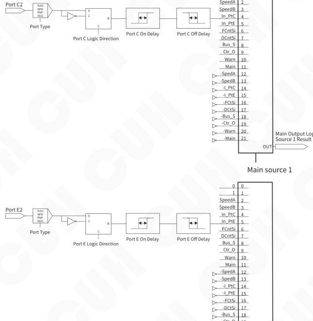

Für die Signalquellenoptionen von Hauptquelle 1/2,  
siehe Kapitel 7.4.11 Anhang.

**Abbildung 4.4.1.1**

Hinweis: Der Hauptausgangszustand wird auch durch den Start/Stopp-Taster und den Fehlerzustand des Controllers gesteuert. Die Fehlersteuerungsebene des Start-Stopp-Tasters oder des Controllers selbst hat höhere Priorität als das Hauptausgangs-Logiksignal. Das heißt: Wenn der Start-Stopp-Taster auf Stopp gesetzt ist, geht der Controller sofort in den Stoppzustand; bei Fehlern wie Kurzschluss, Übertemperatur, Überstrom usw. geht der Controller ebenfalls sofort in den Stoppzustand. In diesem Fall kann das Hauptausgangs-Logiksignal den Hauptausgang des Controllers nicht einschalten.


---

### 4.4.1.2 Hauptlogik

Das Ergebnis der Hauptausgangs-Logikquelle 1 und der Hauptausgangs-Logikquelle 2 wird nach der Logikoperation durch die Hauptausgangslogik geführt, durchläuft dann die Hauptausgangsrichtung, dann die Hauptausgangs-Ein-/Ausschaltverzögerung und schließlich den Hauptausgangsmodus, und wird zum Steuern des Hauptausgangs-Start/Stopp-Zustands verwendet.

Das Signalflussdiagramm ist wie folgt:

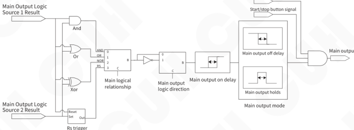

**Abbildung 4.4.1.2**

Dieser Controller kann die logische Beziehungstabelle zwischen Haupt-(logik-)quelle 1 und Hauptquelle 2 wie folgt einstellen. Standard Oder.

| Parameter | Bedeutung |
|---|---|
| Und | Logisches UND, Ausgang aktiv wenn sowohl Hauptquelle 1 als auch Hauptquelle 2 aktiv sind |
| Oder | Logisches ODER, Ausgang aktiv wenn mindestens eine von Hauptquelle 1 oder Hauptquelle 2 aktiv ist |
| Xor | Logisches XOR, Ausgang aktiv wenn Hauptquelle 1 und Hauptquelle 2 unterschiedliche Zustände haben, sonst inaktiv |
| RS | RS-Flipflop |

### 4.4.1.3 Hauptrichtung

Das ist die Hauptausgangs-Logikrichtung. Die spezifische Ausgangsrichtung kann nach der logischen Verknüpfung der Signale eingestellt werden. Für das Signalflussdiagramm siehe Abbildung 4.4.1.2. Standard Const.

| Parameter | Bedeutung |
|---|---|
| Const | Der Zustand nach der Hauptausgangs-Logikoperation wird nicht invertiert, Standard Normalzustand |
| Inv | Der Zustand wird nach der Hauptausgangs-Logikoperation invertiert |
| On | Der Zustand bleibt nach der Hauptausgangs-Logikoperation auf Laufend |
| Off | Der Zustand bleibt nach der Hauptausgangs-Logikoperation auf Gestoppt |

---


### 4.4.1.4 Haupt-Einschaltverzögerung/Haupt-Ausschaltverzögerung

Bei Verwendung anderer externer Signale wie Sensoren zur Steuerung des Hauptausgangszustands des Geräts ist in den meisten Fällen eine Verzögerung nach Signalgebung oder Signalwiederherstellung erforderlich, bevor die Operation ausgeführt werden kann. Für solche Anwendungen kann dies durch Einstellung der Zeitwerte der Ein- und Ausschaltverzögerung realisiert werden. Für das Signalflussdiagramm siehe Abbildung 4.4.1.2.

**Haupt-Einschaltverzögerung:** Das ist die Hauptausgangs-Einschaltverzögerung – die Verzögerungszeit vom Anlegen eines Steuersignals, das den Controller in den Laufendzustand versetzt, bis zum tatsächlichen Starten des Controller-Ausgangs.

**Haupt-Ausschaltverzögerung:** Das ist die Hauptausgangs-Ausschaltverzögerung – die Verzögerungszeit vom Anlegen eines Steuersignals, das den Controller in den Stoppzustand versetzt, bis zum tatsächlichen Stoppen des Controller-Ausgangs.

Der Haupt-Ein-/Ausschaltverzögerungsbereich beträgt 0,0~99,9s, Standardwert 0,2s, Einstellgenauigkeit 0,1s.

### 4.4.1.5 Hauptmodus

Es stehen 2 Hauptausgangsmodi zur Verfügung: Verzögerungsmodus und Haltemodus. Signalflussdiagramm siehe Abbildung 4.4.1.2. Standard Delay.

| Parameter | Bedeutung |
|---|---|
| Delay | Bezieht sich auf den Zustand des Hauptausgangs nach der Logikoperation, den Zustand des Hauptausgangs nach Ein- und Ausschaltverzögerung |
| Hold | Bezieht sich auf den Zustand nach der Hauptausgangs-Logikoperation. Nach der Einschaltverzögerung bleibt der Laufendzustand für die Ausschaltverzögerungszeit erhalten und wechselt dann sofort zum Stopp-Ausgangszustand |

Der Unterschied zwischen den beiden Modi wird in Form eines Zeitdiagramms wie folgt dargestellt, wobei das Eingangssignal eine logische Beziehungs-Auswahl ist.

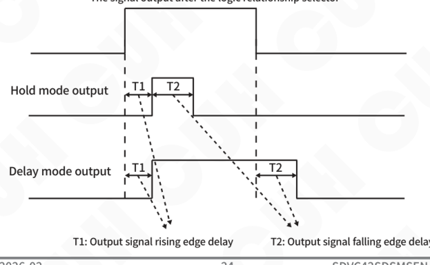


## 4.4.1.6 Einschalzzustand

Einstellung des Betriebsstatus des Controllers nach dem Einschalten. Standard On.

| Parameter | Bedeutung |
|---|---|
| On | Nach dem Einschalten des Geräts ist der Status der Schaltertaste auf Laufend |
| Off | Nach dem Einschalten des Geräts ist der Status der Schaltertaste auf Gestoppt |
| Keep | Nach dem Einschalten des Geräts bleibt der Status der Schaltertaste derselbe wie vor dem letzten Ausschalten |

## 4.4.1.7 Fernsteuerungsquelle

Die Ausgangsspannung und Fördergeschwindigkeit des Controllers können über Panel-Parameter geändert oder direkt über die Größe des Fernsteuerungs-Eingangssignals gesteuert werden. Verfügbare Steuerungsarten: Panel, 0-20mA DC-Eingang, 1-5V DC-Eingang, 0-5V DC-Eingang, 0-10V DC-Eingang sowie digitales Synchronisations-Bussignal. Standard Panel.

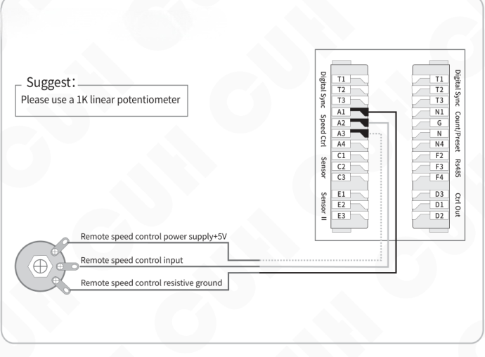


---

### PLC-Steuerungsverbindung (1~5V/0~5V/0~10V DC-Eingang)

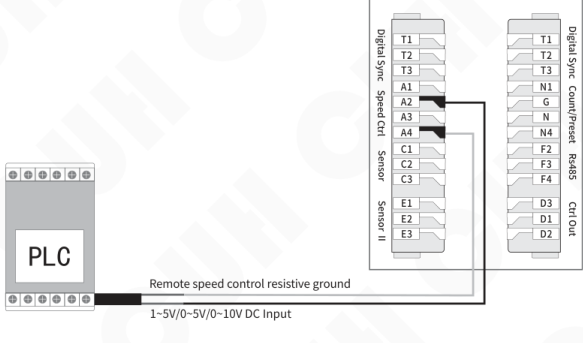

- Fernsteuerung Geschwindigkeitssteuerung Widerstandsmasse
- 1~5V/0~5V/0~10V DC-Eingang

### PLC-Steuerungsverbindung (4~20mA DC-Eingang)

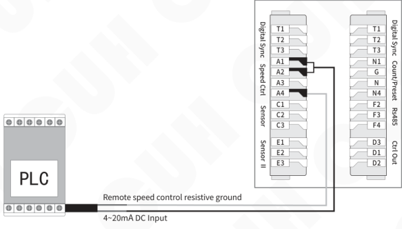

- Fernsteuerung Geschwindigkeitssteuerung Widerstandsmasse
- 4~20mA DC-Eingang

---


| Fernsteuersignal | Fernsteuersignal | Ausgangsspannung/Fördergeschwindigkeit |
|---|---|---|
| Panel |  | Ausgangsspannung und Fördergeschwindigkeit werden nicht durch Fernsteuersignal gesteuert |
| 20mA | <2mA | Wenn Spannungsmodus Manuell: Ausgangsspannung = 0<br>Wenn Spannungsmodus Auto: Fördergeschwindigkeit = 0<br>LCD zeigt Fehlermeldung „Fernsteuerung Unterspannung" |
|  | 2mA~4mA | Ausgangsspannung = 0, Fördergeschwindigkeit = 0 |
|  | 4mA~20mA | Proportional gesteuert durch Fernsteuersignal (0%~100%)<br>Spannungsmodus Manuell: Ausgangsspannung = (Eingangsstrom - 4mA)/16 × Max. Ausgangsspannung<br>Spannungsmodus Auto: Fördergeschwindigkeit = (Eingangsstrom - 4mA)/16 × Max. Fördergeschwindigkeit |
| 1~5V | Unter 0,5V | Ausgangsspannung = 0, Fördergeschwindigkeit = 0<br>LCD zeigt Fehlermeldung „Fernsteuerung Unterspannung" |
|  | 0,5V~1V | Ausgangsspannung = 0, Fördergeschwindigkeit = 0 |
|  | 1V~5V | Proportional gesteuert durch Fernsteuersignal (0%~100%)<br>Spannungsmodus Manuell: Ausgangsspannung = (Eingangsspannung - 1V)/4 × Max. Ausgangsspannung<br>Spannungsmodus Auto: Fördergeschwindigkeit = (Eingangsspannung - 1V)/4 × Max. Fördergeschwindigkeit |
| 0~5V | 0V~5V | Proportional gesteuert durch Fernsteuersignal (0%~100%)<br>Spannungsmodus Manuell: Ausgangsspannung = Eingangsspannung/5 × Max. Ausgangsspannung<br>Spannungsmodus Auto: Fördergeschwindigkeit = Eingangsspannung/5 × Max. Fördergeschwindigkeit |
| 0~10V | 0V~10V | Proportional gesteuert durch Fernsteuersignal (0%~100%)<br>Spannungsmodus Manuell: Ausgangsspannung = Eingangsspannung/10 × Max. Ausgangsspannung<br>Spannungsmodus Auto: Fördergeschwindigkeit = Eingangsspannung/10 × Max. Fördergeschwindigkeit |
| DigSym | Digitale Synchronisation | Die Spannung des Fernsteuersignals ist die Fernsteuerungs-Eingangsspannung eines bestimmten Geräts am Bus (über Fernsteuerungs-Synchronisationsparameter festgelegt)<br>Proportional gesteuert durch das Fernsteuerungs-Eingangsspannungssignal eines bestimmten Geräts am Bus, Spannungsbereich 0% bis 100%.<br>Spannungsmodus Manuell: Ausgangsspannung = Eingangsspannung/10 × Max. Ausgangsspannung<br>Spannungsmodus Auto: Fördergeschwindigkeit = Eingangsspannung/10 × Max. Fördergeschwindigkeit |

### 4.4.1.8 Fernsteuerungskoeffizient

Wenn die Fernsteuerungsquelle auf etwas anderes als „Panel" und „Sync" eingestellt ist, kann der Fernsteuerungskoeffizient verwendet werden, um die Steuerungsgröße des Fernsteuerungs-Eingangssignals zu verstärken oder zu reduzieren.

Der Fernsteuerungskoeffizientbereich beträgt 0,5~2,0, Standardwert 1,0, Einstellgenauigkeit 0,1.

Beispiel: Der Fernsteuerungskoeffizient beträgt 0,5, das Fernsteuerungs-Eingangssignal ist 2V. In diesem Fall beträgt die äquivalente Fernsteuerungs-Eingangsspannung des Controllers 2V × 0,5 = 1V.


---

## 4.4.2 DC-Steuerungsausgangsparameter

Diese Übersicht beschreibt hauptsächlich die Einstellung der Steuerungsausgangsparameter. Das schematische Diagramm des Steuerungsausgangs-Signalflusses ist wie folgt:

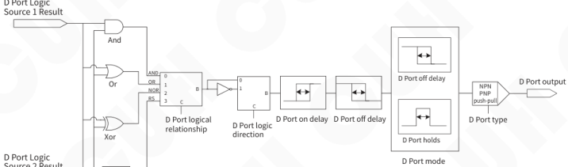

Die Methode zur Einstellung der Steuerungsausgangsparameter ist wie folgt:

> » Langes Drücken von ▲ und ◀ öffnet die Parametereinstellungs-Oberfläche, Kurzes Drücken von ▶ wechselt zur Parametergruppe „6 DC output".
>
> » Kurzes Drücken von ▲ oder ▼ wechselt die Parameter in der Steuerungsausgangsparametergruppe.
>
> » Drücken Sie ⊕ oder ⊖ um den Parameterwert anzupassen.

```text
RUN
A C D E F G N J    T0
01.PotDLogc        Or
02.PotDSor1        In_PtC
03.PotDSor2        In_PtE
04.PortDDir        Const
05.PtDUpDly        0.2 S
+     6DCoutput     −
```

Die übrigen Parameter dieser Parametergruppe können nach den obigen Schritten angepasst werden.

„D-Port-Quelle 1", „D-Port-Quelle 2", „D-Port-Logik", „D-Port-Richtung", „D-Einschaltverzögerung", „D-Ausschaltverzögerung" und „D-Port-Modus" – diese Parameter können auf die Hauptausgangsparametereinstellungen verweisen.

---


---

## 4.4.2.1 D-Port-Typ

Der D-Port-Ausgang unterstützt drei Typen: NPN-Ausgang, PNP-Ausgang und Push-Pull-Ausgang.  
Standard Ou_P&P（Push-Pull）.

| Parameter | Bedeutung |
|---|---|
| Ou_NPN | Wenn das Ausgangssignal von Port D aktiv ist, gibt Port D ein Low-Pegel-Signal (0V) aus, bei Inaktivität hochohmig |
| Ou_PNP | Wenn das Ausgangssignal von Port D aktiv ist, gibt Port D ein High-Pegel-Signal (24V) aus, bei Inaktivität hochohmig |
| Ou_P&P<br>(Push Pull) | Wenn das Ausgangssignal von Port D aktiv ist, gibt Port D ein High-Pegel-Signal (24V) aus. Wenn das Ausgangssignal von Port D inaktiv ist, gibt Port D ein Low-Pegel-Signal (0V) aus |

Das Diagramm ist wie folgt:

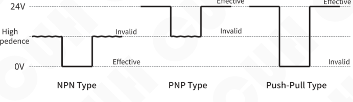

---


## 4.5 Signalsteuerung

Der Controller kann über einen externen Sensor den Materialstatus im Vibrationsförderer beurteilen und „Stopp bei voll" oder „Stopp bei leer" realisieren. Das Port-Signalflussdiagramm ist wie folgt:

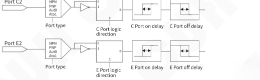

**Abbildung 4.5**

Die Methode zur Einstellung der Signaleingangsparameter ist wie folgt:

- Langes Drücken von ▲ und ◀ öffnet die Parametereinstellungs-Oberfläche, Kurzes Drücken von ▶ wechselt zur Parametergruppe „5On&Off".
- Kurzes Drücken von ▲ oder ▼ wechselt die Parameter in der Signaleingangsparametergruppe.
- Drücken Sie ＋ oder － um den Parameterwert anzupassen.

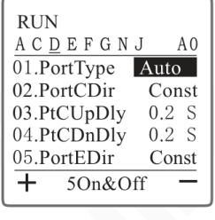

Die übrigen Parameter dieser Parametergruppe können nach den obigen Schritten angepasst werden.

### 4.5.1 Sensortyp

Der Controller kann den Typ des Schaltsensors auf „Auto", „NPN", „PNP" oder „Ato1" einstellen, oder manuell je nach Sensortyp.

| Parameter | Bedeutung |
|---|---|
| Auto | Unabhängig vom Sensortyp wird immer durch Wechsel von High- und Low-Pegelsignal erkannt, ob der Portzugang aktiv ist. Werkseitige Standardeinstellung ist automatische Erkennung |
| NPN | NPN-Typ Sensor |
| PNP | PNP-Typ Sensor |
| Ato1 | Bevor das Sensorsignal inaktiv ist, wird durch Wechsel von High- und Low-Pegel erkannt, ob der Port aktiv ist. Nach Erkennung eines aktiven Signals wird der Port-Sensortyp bestimmt und nicht mehr gescannt |


### 4.5.2 C-Port/E-Port-Logik

Dieser Parameter schaltet den Controller-Eingangsport C und Eingangsport E zwischen „Stopp bei Material voll" und „Stopp bei Material leer" um.

Wenn die Schalteingänge C/E unter Werkseinstellungen kein Signal empfangen, befindet sich der Controller im Zustand „Laufend"（d. h. Stopp bei Material voll）. Einige spezielle Anwendungen erfordern, dass der Controller im Zustand „Gestoppt"（d. h. Stopp bei Material leer）ist, wenn Port C/E kein Signal empfängt. Dies kann durch Änderung dieses Parameters erreicht werden. Für das Signalflussdiagramm siehe Abbildung 4.5.

| Parameter | Bedeutung |
|---|---|
| Const | Ohne Steuersignal befindet sich der Controller im Laufendzustand（Stopp bei Material voll）|
| Inv | Ohne Steuersignal befindet sich der Controller im Stoppzustand（Stopp bei Material leer）|

### 4.5.3 C-Port Ein/Aus-Verzögerung und E-Port Ein/Aus-Verzögerung

Die Verzögerungszeit vom Anlegen eines Signals, das den Controller in den Laufendzustand versetzt, bis das Signal vom Controller als gültig betrachtet wird, nennt man Einschaltverzögerung.

Die Verzögerungszeit vom Anlegen eines Signals, das den Controller in den Stoppzustand versetzt, bis das Signal vom Controller als gültig betrachtet wird, nennt man Ausschaltverzögerung.

Für das Signalflussdiagramm siehe Abbildung 4.5.

Der Ein-/Ausschaltverzögerungsbereich beträgt 0,0~99,9s, Standardwert 0,2s, Einstellgenauigkeit 0,1s.

**Hinweis:** Bei Verwendung der Ports C, E zur Start/Stopp-Steuerung kann durch Einstellung der Ein- und Ausschaltverzögerung eine gewisse Wartezeit nach Signalempfang festgelegt werden, um sicherzustellen, dass das Signal stabil ist.


## 4.5.4 Geschwindigkeit A Logik/Geschwindigkeit B Logik

Das Signalflussdiagramm ist wie folgt:

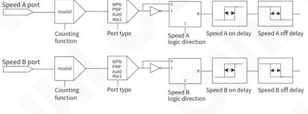

**Abbildung 4.5.4**

Dieser Parameter schaltet den gültigen Status der Eingänge für Geschwindigkeit A und Geschwindigkeit B des Controllers um. Dieser Parameter muss in der Material-Voll-Parametergruppe eingestellt werden. Standard ist Const.

| Parameter | Bedeutung |
|---|---|
| Const | Ohne Steuersignal sind Geschwindigkeit A und B des Controllers inaktiv |
| Inv | Ohne Steuersignal sind Geschwindigkeit A und B des Controllers aktiv |

## 4.5.5 Geschwindigkeit A Ein/Aus-Verzögerung und Geschwindigkeit B Ein/Aus-Verzögerung

Vom Anlegen eines gültigen Signals am Geschwindigkeit A/B-Port bis zur Aktivierung der eingestellten Geschwindigkeit wird diese Zeitspanne Einschaltverzögerung genannt.

Vom Anlegen eines ungültigen Signals am Geschwindigkeit A/B-Port bis zur Deaktivierung der eingestellten Geschwindigkeit wird diese Zeitspanne Ausschaltverzögerung genannt.

Für das Signalflussdiagramm siehe Abbildung 4.5.4.

Der Geschwindigkeit A&B Ein-/Ausschaltverzögerungsbereich beträgt 0,0~99,9s, Standardwert 0,2s, Einstellgenauigkeit 0,1s.


## 4.6 Materialzählung

Dieser Controller verfügt über eine integrierte Zählfunktion, die Zählimpulse zählen und bei Erreichen der eingestellten Gesamtzahl automatisch abbremsen oder stoppen kann. Außerdem verfügt er über spezielle Funktionen wie Super-Entstörung und Endverzögerung zur Vermeidung von Überschwingern. Das Signalflussdiagramm ist wie folgt:

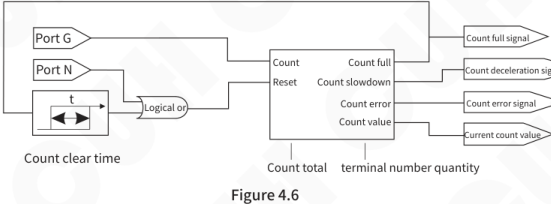

**Abbildung 4.6**

- Langes Drücken von ▲ und ◀ öffnet die Parametereinstellungs-Oberfläche, Kurzes Drücken von ▶ wechselt zur Parametergruppe „7Counter".
- Kurzes Drücken von ▲ oder ▼ wechselt die Parameter in der Zählparametergruppe.
- Drücken Sie ⊕ oder ⊖ um den Parameterwert anzupassen.

Beispieloberfläche:

```text
RUN
A C D E F G N J      A0
01.TotaCout      10
02.PrcntTrm      50 %
03.CotAhead       3
04.CotRstTm     0.0 S
05.CotPotSe    None
+   7Counter      −
```

Die übrigen Parameter dieser Parametergruppe können nach den obigen Schritten angepasst werden.

### 4.6.1 Materialzählung (oder Geschwindigkeit A/B)

Dieser Parameter aktiviert und deaktiviert die Zählfunktion.

Standard ist Keine, d. h. die Zählfunktion ist ausgeschaltet und die Geschwindigkeit A/B-Funktion ist aktiviert.

Wenn der Zählfunktionsparameter gültig（aktiviert）ist, fungieren Geschwindigkeit A und Geschwindigkeit B als Geschwindigkeit A/B-Steuerung. Der Controller kann weitere Operationen für die Zählfunktion ausführen. Für das Signalflussdiagramm siehe Abbildung 4.6.

| Parameter | Bedeutung |
|---|---|
| Keine | Zählfunktion ausschalten und Geschwindigkeit A/B-Funktion aktivieren |
| Gültig | Geschwindigkeit A-Port als Zählport verwenden, Geschwindigkeit B-Port als Zähl-Löschport verwenden |

---


---

## 4.6.2 Zielmenge

Nachdem der „Aktuelle Zählwert" die Grenze erreicht hat, ist das Zähl-Voll-Signal aktiv, bis der Zähler zurückgesetzt wird. Nach dem Eintritt in den Zähl-Voll-Zustand wird bei fortgesetzter Zählung weitergezählt, aber das Zähl-Voll-Signal bleibt aktiv. Für das Signalflussdiagramm siehe Abbildung 4.6.

Der Gesamtzahlbereich beträgt 0~9999, Standardwert 10, Einstellgenauigkeit 1.

## 4.6.3 Endgeschwindigkeit

**Endgeschwindigkeit** bedeutet, dass wenn die Zählung in den Endverzögerungszustand eintritt, die Fördergeschwindigkeit und Spannung des Controllers auf den Prozentsatz der Anfangsgeschwindigkeit und -spannung abfallen, siehe Abbildung 4.6.3.

Wenn die Zählzahl sich der Gesamtzahl nähert, ist der Zählprozess fast abgeschlossen. Um zu verhindern, dass das Material sich mit hoher Geschwindigkeit bewegt und nicht rechtzeitig stoppen kann, was zu einem Zählüberschreiten führt, reduziert der Controller automatisch die Geschwindigkeit auf die eingestellte Endgeschwindigkeit（Zählverzögerungssignal aktiv）, wenn die verbleibende Anzahl kleiner als die Endanzahl ist. Wenn der Zählwert die Gesamtzahl erreicht（Zähl-Voll-Signal aktiv）, stoppt der Controller sofort die Ausgabe und der Förderer kann eine präzise Zählsteuerung erreichen.

Der Endgeschwindigkeitsbereich beträgt 0~100%, Standardwert 50%, Einstellgenauigkeit 1%.

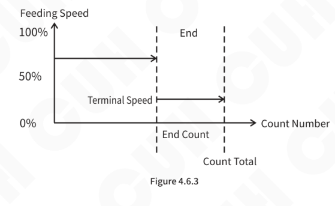

---


---

### 4.6.4 Endgeschwindigkeitsmenge

Anzahl der Endstücke: Bezieht sich auf die Gesamtzahl der Distanzzählungen. Nach Erreichen der „Endanzahl" wechselt der Controller in den Zählverzögerungsmodus.

Im Geschwindigkeitszustand fallen Fördergeschwindigkeit und Spannung auf Endgeschwindigkeit und Endspannung ab. Wenn der Wert der „Endstückzahl" 0 ist, bedeutet dies, dass die Endverzögerungsfunktion nicht verwendet wird. Für das Signalflussdiagramm siehe Abbildung 4.6.

Der Endstückzahlbereich beträgt 0 bis 9999, Standardwert 3, Einstellgenauigkeit 1.

### 4.6.5 Zählwert auf 0 zurücksetzen

Wenn die Zählung voll ist, löscht der Controller den Zählwert automatisch nach der „Zähl-Lösch"-Zeitverzögerung. Wenn der „Zähl-Lösch"-Wert 0,0s ist, bedeutet dies, dass die automatische Zählwert-Zurücksetzung deaktiviert ist.

Der Zähl-Zurücksetzungszeitbereich beträgt 0,0~999,9s, Standardwert 0,0s, Einstellgenauigkeit 0,1s.

### 4.6.6 RS-Priorität

Dient zur Einstellung der RS-Flipflop-Portpriorität. Standard Same.

| Parameter | Bedeutung |
|---|---|
| Same | R-Port und S-Port haben die gleiche Priorität. Bei Signalen an beiden Ports meldet der Controller die Warnung „Haupt-RS-Fehler" oder „Steuer-RS-Fehler" |
| Reset | Reset-Priorität. Bei Signalen an beiden Ports hat das R-Port-Signal Priorität, d. h. das Reset-Signal hat Vorrang |
| Set | Set-Priorität. Bei Signalen an beiden Ports hat das S-Port-Signal Priorität, d. h. das Set-Signal hat Vorrang |
| Revers | Bei Signalen an beiden Ports wird das aktuelle Logikausgangsergebnis invertiert |

---


## 4.7 Einstellungen speichern

Dieses Kapitel beschreibt hauptsächlich die Nutzung der Parameterspeicher- und Callback-Parameter-Funktionen des Controllers.

### 4.7.1 Einstellungen abrufen

Der Controller kann neben der Arbeitsgruppe 3 verschiedene Sätze von voreingestellten Parametern auslesen, genannt „Benutzer 1", „Benutzer 2" und „Benutzer 3".

Wenn der Benutzer Parameter ändert, werden die Controller-Parameter standardmäßig in der Arbeitsgruppe gespeichert. Beim erneuten Einschalten des Controllers werden die Parameter automatisch aus der Arbeitsgruppe gelesen und die Parameterwerte vor dem letzten Ausschalten wiederhergestellt. Gleichzeitig können Benutzer manuell aus „UsrD1", „UsrD2", „UsrD3" auswählen, um eine weitere manuell gespeicherte Datei zu lesen. Die Daten werden an die Arbeitsgruppe im Controller gesendet, sodass der Controller sofort den Arbeitsstatus wechseln kann.

| Parameter | Bedeutung |
|---|---|
| Keine | Ungültig |
| UsrD1 | Benutzereinstellung Parameter 1 |
| UsrD2 | Benutzereinstellung Parameter 2 |
| UsrD3 | Benutzereinstellung Parameter 3 |

### 4.7.2 Einstellungen speichern

Der Controller kann 4 verschiedene Sätze von voreingestellten Parametern speichern, genannt „Work", „UsrD1", „UsrD2", „UsrD3".

Wenn der Benutzer Parameter ändert, werden die Controller-Parameter automatisch in „Work" gespeichert. Beim erneuten Einschalten werden die Parameter automatisch aus der Arbeitsgruppe gelesen und die Parameterwerte vor dem letzten Ausschalten wiederhergestellt. Benutzer können Parameter der Arbeitsgruppe manuell in „UsrD1", „UsrD2", „UsrD3" speichern.

| Parameter | Bedeutung |
|---|---|
| Keine | Ungültig |
| Work | Standard-Arbeitsgruppe |
| UsrD1 | Benutzereinstellung Parameter 1 |
| UsrD2 | Benutzereinstellung Parameter 2 |
| UsrD3 | Benutzereinstellung Parameter 3 |


## 4.7.3 Werkseinstellungen wiederherstellen

Verwenden Sie die Reset-Parameter, um alle Arbeitsgruppenparameter auf die Werkseinstellungen zurückzusetzen.

Nach Auswahl von „RWork" in „Reset-Parameter", drücken Sie ⊕ und ⊖ gleichzeitig und halten Sie sie länger als zwei Sekunden. Die Anzeige wechselt zur Standby-Oberfläche und die Parameter wurden erfolgreich wiederhergestellt.

| Parameter | Bedeutung |
|---|---|
| Keine | Ungültig |
| Rwork | Arbeitsgruppenparameter auf Werkseinstellungen wiederherstellen.（Benutzer 1, Benutzer 2 und Benutzer 3 werden nicht zurückgesetzt）|

## 4.7.4 Einstellungen kopieren

Der Controller kann die Parametergruppe dieses Controllers durch die Daten der beiden Controller im Netzwerk ersetzen, die er gesichert hat, um die Parameter der beiden Controller schnell zu kopieren.

Wählen Sie die ID-Nummer des zu kopierenden Controllers, um die Funktion zum Kopieren der Controller-Daten zu realisieren. Der Auswahlbereich der Kopierparameter ist 1~8.

## 4.7.5 Benutzerpasswort

Benutzer können das Parameterpasswort selbst festlegen. Nach der Sperrung kann der Benutzer nur unter der „Überwachungsparametergruppe" und der „Startseite" arbeiten.

Wenn der Benutzer den „Benutzerpasswort"-Wert auf ungleich 0 setzt, ist die erweiterte Parametersperrfunktion aktiviert. In diesem Fall muss beim Betreten der Parametergruppe auf der Startseite das Passwort eingegeben werden. Wenn der Benutzer „Passwort eingeben" drückt und ▶ + ▲, und „Passwort eingeben" und „Benutzerpasswort" unterschiedlich sind, kann der Benutzer nur die Überwachungsparametergruppe betreten. Nur bei korrektem Passwort kann der Benutzer andere Parametergruppen betreten.

Der Auswahlbereich für das Benutzerpasswort beträgt 0~9999.

## 4.7.6 Passwort eingeben

Wenn „Passwort eingeben" und „Benutzerpasswort" unterschiedlich sind, kann der Benutzer nur unter „Startseite" und „Überwachungsparametergruppe" arbeiten. Nur bei korrektem Passwort kann der Benutzer andere Parametergruppen betreten.

Der Auswahlbereich für das einzugebende Passwort beträgt 0~9999.


## 4.8 RS485-Kommunikation

Dieser Controller unterstützt RS485-Kommunikation. Gemäß dem Modbus-Protokollmodus ASCII und RTU können alle Parameter und der Status des Controllers ferngesteuert geändert und gelesen werden.

Das lokale RS485-Kommunikationsprotokoll „SDVC42-SD Serie 485 Register-Adresstabelle" kann aus dem Downloadbereich unserer Website heruntergeladen werden: www.cuhnj.com.

» Langes Drücken von ▲ und ◀ öffnet die Parametereinstellungs-Oberfläche, Kurzes Drücken von ▶ wechselt zur Parametergruppe „8Comm".

» Kurzes Drücken von ▲ oder ▼ wechselt die Parameter in der Kommunikationsparametergruppe.

» Drücken Sie ⊕ oder ⊖ um den Parameterwert anzupassen.

```text
RUN
A C D E F G N J    A0
01.485type       RTU
02.BaudRate    115.2 K
03.485SlvID       1
04.Enab485R     None
05.DigSynAd       1
+      8Comm      −
```

Die übrigen Parameter dieser Parametergruppe können nach den obigen Schritten angepasst werden.

## 4.8.1 Kommunikationstyp

RS485-Kommunikationstyp-Auswahl: Modbus ASCII-Typ und Modbus RTU-Typ. Standard RTU.

| Parameter | Bedeutung |
|---|---|
| ASCⅡ | Modbus ASCII-Typ |
| RTU | Modbus RTU-Typ |


---

## 4.8.2 Baudrate

Verschiedene RS485-Kommunikationsbaudraten-Optionen. Standard 115,2K.

| Parameter | Bedeutung |
|---|---|
| 0,3K | 0,3 Kbps |
| 1,2K | 1,2 Kbps |
| 2,4K | 2,4 Kbps |
| 9,6K | 9,6 Kbps |
| 19,2K | 19,2 Kbps |
| 57,6K | 57,6 Kbps |
| 115,2K | 115,2 Kbps |

## 4.8.3 Slave-Controller-Adresse

Einstellung der Slave-Adressnummer in der RS485-Kommunikation.

Der Slave-Nummernbereich ist 1 bis 31. Standard 1.

## 4.8.4 Portwiderstand/Synchronwiderstand

Der RS485-Kommunikationsport/Digitalsynchronport enthält eine Anpasswiderstandfunktion（120Ω）. Standard ist Keine.

| Parameter | Bedeutung |
|---|---|
| Keine | Anpasswiderstand（120Ω）nicht verwenden |
| Gültig | Anpasswiderstand（120Ω）verwenden |

---


---

## 4.9 CUHBus-DS® Vernetzung

Der SDVC42-SD Controller verwendet den LAN-Bus（CUHBus-DS®）Seriellen-Kommunikationsprotokoll-Busprotokoll. Er ermöglicht die Vernetzung von bis zu 8 Geräten im selben Netzwerk. Nach der Vernetzung können folgende Funktionen realisiert werden:

**Synchronisationsfunktionen:** Frequenz, Phase, Fernsteuerungs-Geschwindigkeitsregelung und andere Parameter eines beliebigen Controllers im Netzwerk können mit dem Ausgang eines beliebigen anderen Controllers im Netzwerk konsistent oder davon abweichend sein.

**Signalteilung:** Jeder Statussignal eines beliebigen Controllers im Netzwerk kann als Signal-Eingangsquelle eines beliebigen anderen Controllers geteilt werden. Ermöglicht jedem Controller im Netzwerk, neben dem lokalen Gerät über reichhaltigere Signalquellen zu verfügen und diese nach logischen Operationen auszugeben, um komplexere Controller-Betriebslogik am Standort des Benutzers zu implementieren.

**Datensicherung:** Die Daten jedes Controllers im Netzwerk werden auf zwei weiteren Controllern im Netzwerk gesichert. Jeder Controller im Netzwerk kann durch Austausch und Beitritt perfekt ersetzt werden, und die Daten des ersetzten Controllers können zum Weiterbetrieb verwendet werden.

> ☺
>
> **Dieses Netzwerksystem hat folgende Eigenschaften:**
>
> - Einfache Erweiterung, neue Geräte können schnell zum Netzwerk hinzugefügt werden.
> - Das Netzwerk ist gleichwertig, mit einem Satz gleichwertiger CUHBus-DS® Kommunikationsterminals links und rechts zur einfachen Benutzeranbindung.
> - Das Gerät unterstützt Hot-Swapping. Controller-Erweiterungen können während des stabilen Betriebs des Controllersystems ohne Abschaltung hinzugefügt oder entfernt werden.

---


## 4.9.1 Gerätevernetzung

Dieses Kapitel beschreibt hauptsächlich die schnelle Vernetzung mehrerer Controller, das Hinzufügen eines neuen Controllers zu einem bestehenden Netzwerk und das Löschen von Controllern im Netzwerk.

### 4.9.1.1 Gerätevernetzung

Ein einzelner Controller bildet ein eigenes Netzwerk. Wenn die CUHBus-DS® Signalleitungen der Controller korrekt verbunden und einfache Operationen durchgeführt werden, können mehrere Geräte ein neues digitales Synchron-Kommunikationsnetzwerk bilden.

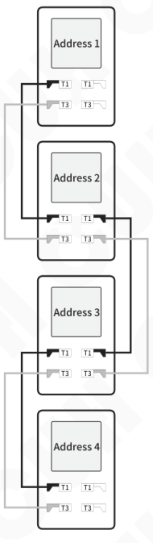

---


---

**Schritte:**

1. Verbinden Sie alle Controller-T1-Signale miteinander und alle T3-Signale miteinander, wie in der obigen Abbildung gezeigt.

2. Beim Einschalten des neuen Geräts wechselt der neue Controller automatisch zur „Kommunikationsparametergruppe".

3. Stellen Sie in der Kommunikationsparametergruppe die lokale digitale Synchronisations-Kommunikationsgerätenummer ein. „DigSynAd" ist ein beliebiger Wert [1~8]. Sie müssen ihn nicht einstellen, das Programm generiert automatisch eine Nummer.

4. Setzen Sie in der Kommunikationsparametergruppe den Parameterwert „EnNetwok " auf „Expand" und drücken Sie dann ⊕ und ⊖ gleichzeitig zur Bestätigung.

5. Nach erfolgreichem Hinzufügen ändert sich der Parameterwert „EnNetwok " des neuen Geräts automatisch auf „Online", was bedeutet, dass das neue Gerät erfolgreich hinzugefügt wurde.

Benutzer können durch Überprüfung der Gerätevernetzungs-Statusparameter prüfen, ob das Netzwerk korrekt vernetzt wurde, sowie die Gesamtzahl der Geräte im Netzwerk und die Anzahl der Online-Geräte überprüfen.

Hinweis: Nur das Verbinden der CUHBus-DS® Signalleitung ohne Durchführung der Einstellungen gilt nicht als Beitritt zum Netzwerk.

**Überprüfungsmethode:**

1. In der Überwachungsparametergruppe zeigt der Wert des Parameters „DevicNum" [1~8] die Gesamtzahl der Geräte im Netzwerk an.

2. In der Überwachungsparametergruppe zeigt der Wert des Parameters „OnlinNum" [1~8] an, wie viele Controller derzeit im Netzwerk online sind.

**Synchronwiderstand:**

Der CUHBus-DS® Kommunikationsport enthält eine Anpasswiderstandfunktion（120Ω）, die ungültig oder gültig sein kann.

| Parameter | Bedeutung |
|---|---|
| Keine | Anpasswiderstand（120Ω）nicht verwenden |
| Gültig | Anpasswiderstand（120Ω）verwenden |

---


## 4.9.1.2 Gerätebeitritt

Benutzer können die folgenden Erweiterungs- und Hinzufügeschritte befolgen, um einen neuen Controller zu einem bestehenden Netzwerk hinzuzufügen.

Der neue Controller nach dem Beitritt kann das Signal eines beliebigen Controllers im Netzwerk abrufen und als Signalquelle für jeden anderen Controller im Netzwerk fungieren. Bereicherung der Systemsignalquellen.

**Schritte:**

1. Verbinden Sie die CUHBus-DS® T1- und T3-Schnittstellen des neuen Geräts mit dem bestehenden vollständigen Netzwerk. Die Ports unterstützen Hot-Swapping.
2. Beim Einschalten des neuen Geräts wechselt der neue Controller automatisch zur „Kommunikationsparametergruppe".
3. Stellen Sie in der Kommunikationsparametergruppe die lokale digitale Synchronisations-Kommunikationsgerätenummer ein. „DigSynAd" ist ein beliebiger Wert [1~8].
4. Setzen Sie in der Kommunikationsparametergruppe den Parameterwert „EnNetwok " auf „Expand" und drücken Sie dann ⊕ und ⊖ gleichzeitig zur Bestätigung.
5. Nach erfolgreichem Hinzufügen ändert sich der Parameterwert „EnNetwok " des neuen Geräts automatisch auf „Online".

Benutzer können die korrekte Vernetzung überprüfen sowie die Gesamtzahl der Geräte und die Anzahl der Online-Geräte überprüfen.

Hinweis: Nur das Verbinden der CUHBus-DS® Signalleitung ohne Durchführung der Einstellungen gilt nicht als Beitritt zum Netzwerk.

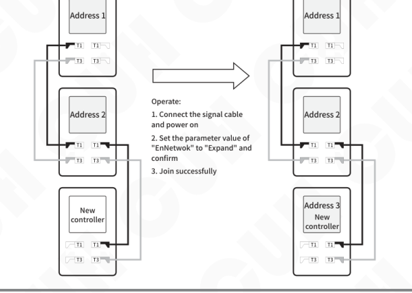


---

### 4.9.1.3 Geräteentfernung

Wenn ein Controller dauerhaft aus dem Netzwerk entfernt werden soll, verwenden Sie die Funktion „Controller aus Netzwerk entfernen". Das Löschen eines Controllers im Netzwerk kann von jedem Controller im Netzwerk aus initiiert werden. Die verbleibenden Controller reorganisieren sich nach dem Löschen zu einem vollständigen neuen Netzwerk.

Wenn der Controller jedoch direkt entfernt wird（einschließlich Stromausfall）, ohne den Controller zu löschen, bleiben die Daten des Controllers weiterhin im Netzwerk erhalten. In diesem Fall befindet sich das Netzwerk in einem degradierten Zustand und es können keine neuen Controller hinzugefügt werden. Es muss manuell über den Controller gelöscht werden, um die Integrität des Netzwerks aufrechtzuerhalten und die Erweiterung und das Hinzufügen neuer Controller zu ermöglichen.

**Schritte zum Löschen eines Controllers:**

1. Betreten Sie die „Kommunikationsparametergruppe" über einen beliebigen Controller im Netzwerk.
2. Ändern Sie den Wert des „DeltDevi"-Parameters auf die Adresse des zu löschenden Netzwerkgeräts.
3. Nach der Wertänderung drücken Sie lange ⊕ und ⊖ zur Bestätigung des Löschens.
4. Nach Abschluss des Löschvorgangs ändert sich der „DeltDevi"-Parameterwert auf einen nicht auswählbaren Wert, was bedeutet, dass das Gerät erfolgreich gelöscht wurde.
5. Überprüfen Sie nun den neuen Netzwerkstatus am bedienenden Gerät und bestätigen Sie die Anzahl der neuen Netzwerksteuerungen.

Beispiel: Löschen des Adresse-3-Controllers aus dem Netzwerk.

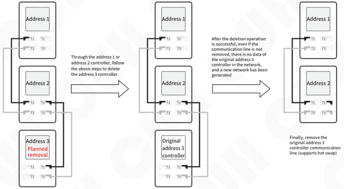

---


## 4.9.2 Synchronisationsfunktion

Die Frequenz, Phase oder ferngesteuerte Geschwindigkeit eines beliebigen Controllers im Netzwerk kann einem anderen Master-Controller konsistent oder mit bestimmter Abweichung folgen. Allerdings können sich mehrere Controller nicht gegenseitig folgen, da sonst ihre Ausgaben instabil werden.

Beispiel 1: Controller Adresse 3 folgt der Ausgangsfrequenz von Controller Adresse 1, sodass die beiden von ihnen angetriebenen Vibrationsförderer mit derselben Frequenz laufen.

Beispiel 2: Wenn Controller Adresse 3 bereits der Ausgangsfrequenz von Controller Adresse 1 folgt, kann Controller Adresse 1 nicht so eingestellt werden, dass er der Ausgangsfrequenz von Controller Adresse 3 folgt. Die Controller können sich also nicht gegenseitig folgen.

➢ **Frequenzsynchronisation**

Die Methode zur Einstellung der Frequenzsynchronisation ist wie folgt:

1. Die Controller, die frequenzsynchronisiert werden sollen, bilden dasselbe digitale Synchron-Kommunikationsnetzwerk. Siehe Kapitel „Gerätevernetzung".

2. Setzen Sie den „FrqncSyn"-Parameterwert in der Kommunikationsparametergruppe des frequenzsynchronisierten Controllers auf die „Digital Sync"-Adressnummer des synchronisierten Controllers.

3. Wechseln Sie zum frequenzsynchronisierten Controller zur Konstantgeschwindigkeits-Parametergruppe und setzen Sie „FrqncMod" auf „SynV" oder „SynE".

➢ **Fernsteuerungs-Geschwindigkeitssynchronisation**

Die Methode zur Einstellung der Fernsteuerungs-Geschwindigkeitssynchronisation ist wie folgt:

1. Die Controller, die fernsteuerungssynchronisiert werden sollen, bilden dasselbe digitale Synchron-Kommunikationsnetzwerk. Siehe Kapitel „Gerätevernetzung".

2. Setzen Sie den „RemotSyn"-Parameterwert in der Kommunikationsparametergruppe des fernsteuerungssynchronisierten Controllers auf die „Digital Sync"-Adressnummer des synchronisierten Controllers.

3. Setzen Sie den „CtrlSour"-Parameterwert in der Hauptausgangsparametergruppe auf „DigSym".

➢ **Master/Slave-Arbeitsmodus**

Benutzer können den Controller je nach Anwendungsanforderungen in einem der folgenden zwei Betriebsmodi betreiben:

Hauptmodus: Ein Controller steuert unabhängig eine Last-Vibrationsplatte.

Slave-Modus: Wenn zwei oder mehr Controller synchron arbeiten müssen, wird ein Controller als Master-Controller verwendet und arbeitet im Hauptmodus als Frequenzreferenz. Alle anderen Controller arbeiten im Slave-Modus, fungieren als Slave-Controller und arbeiten synchron mit dem Master-Controller.


## Hauptmodus

Der im Hauptmodus arbeitende Controller, im Folgenden als Master-Controller bezeichnet, ändert die Parameter in der Konstantgeschwindigkeits-Parametergruppe. Die Parameter „Spannungsmodus" und „Frequenzmodus" können den Controller auf den entsprechenden Arbeitsmodus einstellen. Spannung und Frequenz haben folgende Kombinationen:

| Arbeitsmodus | Spannungs-<br>Steuerungsmethode | Frequenz-<br>Steuerungsmethode | Vibrationssensor erforderlich |
|---|---|---|---|
| Voll Manuell | Manuel | Manuel | Nein |
| Voll Automatisch | Auto | Auto | Ja |
| Spannung Automatisch | Auto | Manuel | Ja |
| Frequenz Automatisch | Manuel | Auto | Ja |

■ **Voll manuell**

In diesem Modus werden die Ausgangsspannung und Ausgangsfrequenz des Controllers manuell eingestellt.

**Hinweis:** Auch wenn der Parameter „Spannungsmodus" oder „Frequenzmodus" auf „Auto" eingestellt ist, arbeitet der Controller weiterhin im voll manuellen Modus, wenn der Vibrationssensor nicht angeschlossen ist.

■ **Voll automatischer Modus**

Der Controller passt die Ausgangsspannung und Ausgangsfrequenz automatisch basierend auf den vom Vibrationssensor zurückgemeldeten Daten an, sodass die Fördergeschwindigkeit der Vibrationsausrüstung stabil nahe dem eingestellten „Fördergeschwindigkeit"-Wert bleibt und die Vibrationsfrequenz auf der optimalen Betriebsfrequenz der Vibrationsausrüstung liegt. Die Ausgangsspannung und Ausgangsfrequenz werden nicht durch die Parameter „Spannung" und „Frequenz" gesteuert.

**Hinweis:** Die werkseitige Standardeinstellung des Controllers ist der voll automatische Modus. Wenn der Vibrationssensor jedoch nicht korrekt eingesteckt ist, bleibt der Controller im voll manuellen Zustand. Der Controller wechselt erst in den voll automatischen Zustand, wenn der Vibrationssensor korrekt eingesteckt ist.

■ **Spannung automatischer Modus**

In diesem Modus passt der Controller die Ausgangsspannung automatisch basierend auf den vom Vibrationssensor zurückgemeldeten Daten an, sodass die Fördergeschwindigkeit der Vibrationsausrüstung stabil am Sollwert bleibt. Die Ausgangsfrequenz wird manuell vom Benutzer eingestellt. Der Controller muss mit einem Vibrationssensor verbunden sein, damit dieser Modus ordnungsgemäß funktioniert.

■ **Frequenz automatischer Modus**

In diesem Modus passt der Controller die Ausgangsfrequenz automatisch basierend auf den vom Vibrationssensor zurückgemeldeten Daten an, sodass die Vibrationsfrequenz auf der optimalen Betriebsfrequenz der Vibrationsausrüstung liegt. Die Ausgangsspannung wird manuell eingestellt. Der Controller muss mit einem Vibrationssensor verbunden sein, damit dieser Modus ordnungsgemäß funktioniert.


---

## Slave-Modus

Wenn mehrere Controller vernetzt sind, kann jeder von ihnen den Slave-Modus wählen. In diesem Modus ist die Ausgangsfrequenz des Slave-Controllers immer streng konsistent mit der Ausgangsfrequenz des Master-Controllers. Der im Slave-Modus arbeitende Controller wird im Folgenden als Slave-Controller bezeichnet.

Der Frequenzsynchronisationsmodus wird verwendet, wenn mehrere Controller in einem Fördersystem vorhanden sind und deren Ausgangsfrequenzen und Phasen synchronisiert werden müssen. Durch den Synchronisationsmodus können Master- und Slave-Controller vollständig synchrone Wellenformen ausgeben, wodurch gegenseitige Störungen zwischen den Controller-Ausgaben beseitigt werden.

Wenn Controller M im Master-Modus und Controller S im Slave-Modus（Synchronisationsmodus）arbeitet, sind die Ausgangswellenformen der beiden Controller vollständig synchronisiert. Wie unten gezeigt:

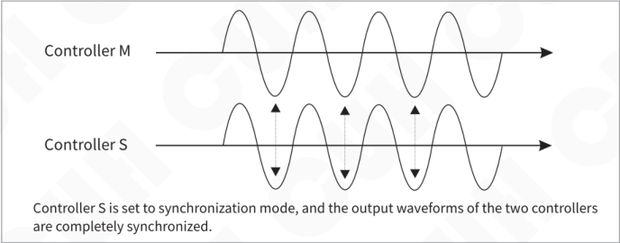

Wenn Controller S nicht auf Slave-Modus（SynV oder SynE Modus）eingestellt ist, sind die Ausgangswellenformen der beiden Controller nicht synchronisiert. Wie unten gezeigt:

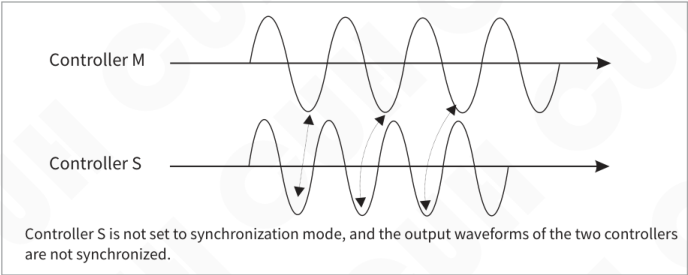

---


Für mechanische Geräte, die eine präzise Ausrichtung erfordern, können zwei oder mehr Vibrationsgeräte physikalisch konsistente Phasen benötigen, aber jedes Gerät hat eine andere Resonanzfrequenz. Durch Einstellung des Frequenzmodus auf „SynV" kann der Controller automatisch die Phasen jedes Geräts entsprechend den Vibrationsbedingungen anpassen, um Konsistenz zu erreichen. Wenn der Frequenzmodus „SynE" ist, stellt der Benutzer den Phasenkompensationswert manuell ein.

Ändern Sie die Parameter „Spannungsmodus" und „Frequenzmodus" in der Konstantgeschwindigkeits-Parametergruppe, um den Controller auf den entsprechenden „Arbeitsmodus" einzustellen. Spannung und Frequenz haben folgende Kombinationen:

| Arbeitsmodus | Spannungsmethode | Frequenzmethode | Phasensteuerung | Vibrationssensor erforderlich |
|---|---|---|---|---|
| Automatische Spannung<br>Automatische Phase | Auto | SynV | Auto | Ja |
| Automatische Spannung<br>Manuelle Phase | Auto | SynE | Manuelle Einstellung | Ja |
| Manuelle Spannung<br>Automatische Phase | Manuel | SynV | Auto | Ja |
| Manuelle Spannung<br>Manuelle Phase | Manuel | SynE | Manuelle Einstellung | Nein |

> **Hinweis:**
>
> 1. Auch wenn die Parameter „Spannungsmodus" und „Frequenzmodus" auf „Auto" und „SynV" eingestellt sind, arbeitet der Controller weiterhin im manuellen Spannungs- und manuellen Phasenzustand, wenn der Vibrationssensor nicht angeschlossen ist.
>
> 2. Automatische Spannung bedeutet, dass ein mit einem Vibrationssensor verbundener Slave-Controller die Ausgangsspannung automatisch anpasst, um die Fördergeschwindigkeit nahe dem vom Benutzer eingestellten Wert zu stabilisieren.
>
> 3. Automatische Phase bedeutet, dass der mit dem Vibrationssensor verbundene Slave-Controller die Phase der Ausgangswellenform basierend auf dem Rückmeldesignal des Sensors automatisch korrigiert, sodass das vom Slave-Controller ausgegebene Synchronisationssignal und das Master-Controller-Signal phasengleich sind.
>
> 4. Manuelle Phase bezieht sich auf die Phase der Slave-Controller-Ausgangswellenform, die manuell so eingestellt werden kann, dass sie eine feste Phasenabweichung von der Master-Controller-Ausgangswellenform aufweist.


---

## Verbindungsmethode des Synchronisationssignalkabels zwischen Master- und Slave-Controllern

Verbinden Sie einfach die Master- und Slave-Controller mit demselben digitalen Synchron-Kommunikationsnetzwerk und vernetzen Sie sie. Setzen Sie den „Frequenzsynchronisations"-Parameterwert in der Kommunikationsparametergruppe des Slave-Controllers auf die „Digitale Synchronisation"-Adressnummer des Master-Controllers. Ändern Sie dann den „Frequenzmodus" in der Konstantgeschwindigkeits-Parametergruppe auf „Synchrone Vibration" oder „Synchrone Elektrik".

### Anwendungsszenarien, bei denen sowohl Master- als auch Slave-Controller mit Vibrationssensoren verbunden sind

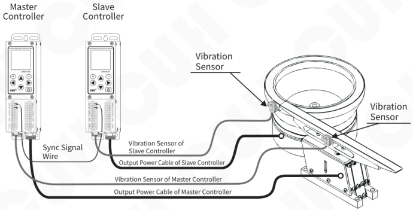

🙂

1. Wenn der Slave-Controller im manuellen Spannungs-/manuellen Phasenmodus arbeitet, muss am Slave-Controller kein Vibrationssensor angeschlossen werden.

2. Wenn der Master-Controller im voll manuellen Modus arbeitet, muss am Master-Controller kein Vibrationssensor angeschlossen werden.

---


■ **Auto-Spannung Auto-Phase Modus**

In diesem Modus muss der Controller mit einem Vibrationssensor verbunden sein. Der Controller passt die Ausgangsspannung automatisch basierend auf den vom Vibrationssensor zurückgemeldeten Daten an, sodass die Fördergeschwindigkeit der Vibrationsausrüstung stabil am Sollwert bleibt. Frequenz und Phase der Ausgangswellenform sind konsistent mit dem Master-Controller oder mit einer Phasendifferenz, eingestellt über den Parameter „Auto Phase".

■ **Auto-Spannung Manuelle Phase Modus**

In diesem Modus muss der Controller mit einem Vibrationssensor verbunden sein. Der Controller passt die Ausgangsspannung automatisch basierend auf den vom Vibrationssensor zurückgemeldeten Daten an. Die Ausgangsfrequenz ist konsistent mit dem Master-Controller. Die Ausgangswellenform unterscheidet sich von der Master-Controller-Ausgangswellenform um einen festen Phasendifferenzwert, der über den Parameter „Manual Phase" eingestellt wird.

■ **Manuelle Spannung Auto-Phase Modus**

In diesem Modus muss der Controller mit einem Vibrationssensor verbunden sein. Die Ausgangsspannung des Controllers wird manuell eingestellt. Frequenz und Phase der Ausgangswellenform sind konsistent mit dem Master-Controller oder mit einer Phasendifferenz, eingestellt über den Parameter „Auto Phase".

■ **Manuelle Spannung Manuelle Phase Modus**

In diesem Modus wird die Ausgangsspannung des Controllers manuell eingestellt und die Ausgangsfrequenz ist konsistent mit dem Master-Controller. Die Ausgangswellenform unterscheidet sich von der Master-Controller-Ausgangswellenform um einen festen Phasendifferenzwert, der über den Parameter „Manual Phase" eingestellt wird.

> 🙂
>
> 1. Der automatische Phasenmodus erfordert die Einstellung des „Frequenzmodus"-Parameterwerts des Slave-Controllers auf „SynV".
>
> 2. Der manuelle Phasenmodus erfordert die Einstellung des „Frequenzmodus"-Parameterwerts des Slave-Controllers auf „SynE".


## 4.9.3 Signalteilung

Nach der Vernetzung kann der Controller jedes Signal von jedem anderen Controller im Netzwerk abrufen, um eine reichhaltigere Signal-Quellport-Auswahl zu erreichen.

Die Signalquelle eines Controllers im Netzwerk kann jeden Port eines beliebigen Controllers im Netzwerk auswählen. Und kann durch UND-, ODER-, XOR- oder RS-Logikoperation komplexe Logiksteuerungen realisieren.

Bedienungsschritte zum Abrufen anderer Signalquellen für den Hauptausgang des Controllers:

➢ **Wählen Sie den Controller, der Netzwerk-Signale beziehen soll, betreten Sie die Hauptausgangsgruppe und führen Sie folgende Einstellungen durch:**

1. Setzen Sie den „MainSor1"-Parameter oder den „MainSor2"-Parameter auf „Bus".
2. Setzen Sie den „MainLogc"-Parameter auf einen der Werte „And", „Or", „Xor" oder „RS".
3. Setzen Sie den „MainDire"-Parameter dieses Controllers auf einen der Werte „Const", „Inv", „On" oder „Off".
4. Stellen Sie die „MainUpDy"- und „MainDnDy"-Zeiten dieses Controllers ein.
5. Setzen Sie den „MainMode"-Parameter dieses Controllers auf „Delay" oder „Hold".

➢ **Wechseln Sie zur Kommunikationsgruppe und führen Sie folgende Einstellungen durch:**

6. Setzen Sie „BSigMID1" dieses Controllers auf die Adresse des gefolgten Controllers（die Controllernummer kann über die digitale Synchronisation abgefragt werden）.
7. Setzen Sie „BSigMID2" dieses Controllers auf die Adresse des gefolgten Controllers.
8. Setzen Sie die spezifische Statusbitnummer von „BSigM_B1" dieses Controllers. Sie müssen die „Statusbits" des gefolgten Controllers prüfen. 1~16, wählen Sie die für dieses Gerät erforderliche Statusbit-Sequenznummer.
9. Setzen Sie die spezifische Statusbitnummer von „BSigM_B2" dieses Controllers.

Jeder Controller kann 16 seiner eigenen Status an den Bus senden, die über „Statusbit 1"~„Statusbit 16" unabhängig eingestellt werden können. „Statusbit 1"~„Statusbit 16" entsprechen standardmäßig den ersten 16 Bits des Kapitels „7.4.11 Anhang".

Jeder Controller kann das Signal am Bus abrufen（standardmäßig）. Für Bedeutung und Details siehe Kapitel „7.4.11 Anhang".


Beispiel: Nach der Vernetzung ruft der Adresse-3-Controller die C-Port-Signale der Controller Adresse 1 und Adresse 2 ab, führt eine logische ODER-Verknüpfung durch, und wenn ein beliebiges Signal als aktiv erkannt wird, stoppt der Hauptausgang des Adresse-3-Controllers.

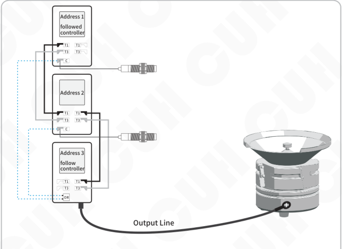

Bedienungsschritte:

1. Setzen Sie in der Hauptausgangsparametergruppe des Adresse-3-Controllers „MainSor1" auf „Bus" und „MainSor2" auf „Bus".
2. Setzen Sie den „MainLogc"-Parameter des Adresse-3-Controllers auf „And".
3. Setzen Sie den „MainDire"（Hauptausgangsrichtung）-Parameter des Adresse-3-Controllers auf „Const".
4. Stellen Sie die „MainUpDy"- und „MainDnDy"-Zeiten des Adresse-3-Controllers auf den gewünschten Zeitwert ein. Standard ist 0,2 Sekunden.
5. Setzen Sie „MainMode"（Hauptausgangsmodus）des Adresse-3-Controllers auf „Delay".
6. Setzen Sie „BSigMID1" in der „Kommunikationsparametergruppe" des Adresse-3-Controllers auf „1"（Adresse-1-Controller festlegen）.
7. Setzen Sie „BSigMID2" des Adresse-3-Controllers auf „2"（Adresse-2-Controller festlegen）.
8. Setzen Sie „BSigM_B1" des Adresse-3-Controllers auf „4"（C-Port-Signal festlegen）.
9. Setzen Sie „BSigM_B2" des Adresse-3-Controllers auf „4"（C-Port-Signal festlegen）.
10. Die Einstellung ist abgeschlossen. Für die Steuerungsausgangseinstellungen von Port D siehe die Hauptausgangseinstellungen des Controllers.


---

## 4.9.4 Datensicherung

Wenn alle Controller vernetzt sind, können alle Controller im Netzwerk die Daten der jeweils anderen sichern. Jeder Controller sichert zwei andere Controller im Netzwerk. Wenn ein Controller im ursprünglichen Netzwerk ausfällt, können Benutzer den ausgefallenen Controller schnell durch einen neuen Controller ersetzen. Alle Parameter des neuen Controllers stimmen mit denen des Controllers vor dem Austausch überein.

Wenn weniger als 3 nummerierte benachbarte Controller im Netzwerk ausfallen, kann die Ersatzoperation erfolgreich sein. Wenn jedoch mehr als 3 oder mehr nummerierte Controller ausfallen, können nicht alle Gerätedaten wiederhergestellt werden.

➢ **Schritte für den neuen Controller als Ersatzgerät im Netzwerk:**

1. Schalten Sie das zu ersetzende Gerät aus und entfernen Sie das CUHBus-DS® Kommunikationskabel.
2. Verbinden Sie die CUHBus-DS® Schnittstelle des neuen Geräts mit dem bestehenden Netzwerk.
3. Beim Einschalten des neuen Geräts wechselt der neu beitretende Controller automatisch zur „Kommunikationsparametergruppe".
4. Stellen Sie den Parameter „DigSynAd"（Lokale digitale Synchronisationsadresse）ein. Da dieses Netzwerk unvollständig ist, zeigt dieser Parameter nur die Gerätenummer an, die ersetzt werden muss.
5. Setzen Sie den Parameterwert „EnNetwok " auf „Replace" und drücken Sie dann ⊕ und ⊖ gleichzeitig zur Bestätigung.
6. Nach erfolgreichem Austausch ändert sich der Parameterwert „EnNetwok " des neuen Geräts automatisch auf „Online".

Beispiel 1: Das ursprüngliche Netzwerk besteht aus den Controllern Adresse 1, Adresse 2 und Adresse 3. Da Adresse 3 ausfällt, muss das ursprüngliche Gerät durch ein neues Gerät ersetzt und alle Einstellungen des ursprünglichen Geräts wiederhergestellt werden.

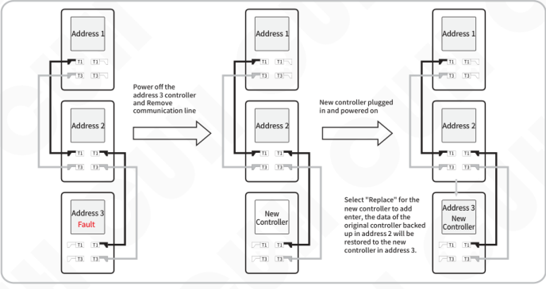

Beispiel 2: Im Netzwerk befinden sich vier Controller mit den Adressen 1, 2, 3 und 4. Davon sind die Controller an den Adressen 2, 3 und 4 ausgefallen. Da jedoch jedes Gerät im Netzwerk Daten von maximal zwei Controllern sichert, kann der Controller an Adresse 4 die Datenwiederherstellung nicht durchführen.

Beispiel 3: Im Netzwerk befinden sich ursprünglich fünf Geräte mit den Adressen 1, 2, 3, 4 und 5. Davon sind die Adressen 1, 2 und 4 defekt（drei nicht aufeinanderfolgende Geräte）.

---


## 4.9.5 Fernsteuerungsdaten

Benutzer können wählen, welche Datenquellen an das Synchronisationsnetzwerk gesendet werden: manuelle Spannung, Fernsteuerungsspannung, manuelle Geschwindigkeit und Fernsteuerungsgeschwindigkeit.

| Parameter | Bedeutung |
|---|---|
| ManVol | Manuelle Spannung bezieht sich auf die vom Benutzerpanel eingestellte Spannung |
| RemVol | Fernsteuerungsspannung bezieht sich auf die über den Fernsteuerungsport eingestellte Spannung |
| ManSpd | Manuelle Geschwindigkeit bezieht sich auf die vom Benutzerpanel eingestellte Fördergeschwindigkeit |
| RemSpd | Fernsteuerungsgeschwindigkeit bezieht sich auf die über den Fernsteuerungsport eingestellte Fördergeschwindigkeit |

## 4.10 Controller-Statusüberwachung

In der Überwachungsparametergruppe können der Betriebsstatus und die Parameterwerte des Controllers in Echtzeit gelesen werden.

Für die lesbaren Parametereinträge siehe Kapitel „Parameterliste", Parametergruppe 10, Überwachungsparametergruppe.

```text
┌──────────────────────┐
│ RUN                  │
│ A C D E F G N J   A0 │
│ 01.Voltage     20.0 V│
│ 02.Frequenc    50.0 Hz│
│ 03.SpeedNow       0  │
│ 04.VoltgOut   223.8 V│
│ 05.EffectCu    0.00 A│
│ +   10Monitor     −  │
└──────────────────────┘
```


## 4.11 Fehlerprotokoll

Der Controller kann 64 Protokollsätze in einer Schleife aufzeichnen, um die spätere Anzeige der Zeit des Problemzeitpunkts und spezifischer Informationen zu erleichtern. Auf jeder Oberfläche: Langes Drücken von ▲ und ▶ öffnet die Protokoll-Oberflächengruppe, die wie folgt angezeigt wird:

```text
RUN
A C D E F G N J        A0
-------------------------
        0 H   0 M     1 S
Err CodeError          01
01.Voltage        [20.0] V
02.Frequenc        50.0Hz
03.SpeedNow             0
-------------------------
+          Note          −
```

- Die oberen zwei Zeilen zeigen das Fehlerprotokoll
- Die unteren drei Zeilen zeigen die Überwachungsparametergruppe

## 4.12 Startseite anpassen

Um Benutzern eine effiziente und schnelle Nutzung des Controllers zu ermöglichen, können Benutzer in der Oberflächenparametergruppe Anpassungen vornehmen. Durch Extraktion von maximal 16 aller Parameter als Überwachungsposten in der Oberflächenparametergruppe kann der Benutzer Schnelloperationen auf der Hauptoberfläche durchführen.

Beispiel: Wählen Sie 1. UsrVoltg（P2.02）, 2. UsrFrqnc（P2.03）, 3. UserSped（P2.01）, 4. SoftStar（P2.04）, SoftStop（P2.05）— es gibt fünf Parameter auf der Hauptoberfläche. Die Schritte sind wie folgt:

- » Langes Drücken von ▲ und ◀ öffnet die Parametereinstellungs-Oberfläche, Kurzes Drücken von ▶ wechselt zur Parametergruppe „1EditHome".
- » Kurzes Drücken von ▲ oder ▼ wechselt zwischen verschiedenen Überwachungsposten.
- » Drücken Sie ⊕ oder ⊖ um die Funktionsetiketten auszuwählen, die eingestellt werden sollen.

```text
RUN
A C D E F G N J        A0
01.Monit  1       [P2.02]
02.Monit  2        P2.03
03.Monit  3        P2.01
04.Monit  4        P2.04
05.Monit  5        P2.05
+       1EditHome       −
```

Hinweis: Funktionsetiketten können über das Kapitel „Parameterliste" abgefragt werden.  
Wenn der Wert des Überwachungspostens leer ist, bedeutet dies, dass kein Überwachungsposten vorhanden ist.

Nach Abschluss der Bedienung können Benutzer, die die Parameterwerte von Spannung, Frequenz, Fördergeschwindigkeit, Sanftanlaufzeit und Sanftstoppzeit anpassen möchten, den spezifischen Überwachungsposten in der Parametergruppe der „Home"-Oberfläche betreten und über ⊕ oder ⊖ die Parameteranpassung durchführen.

---


# Kapitel Ⅴ Typische Anwendungen

## 5.1 Wie hält man zwei Vibrationsförderer auf derselben Frequenz?

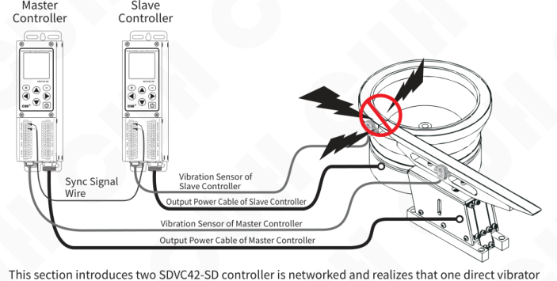

Dieser Abschnitt beschreibt die Vernetzung zweier SDVC42-SD Controller und die Realisierung, dass ein Direktvibrator und ein Rundvibrator mit derselben Frequenz arbeiten, um Kollisionen zwischen den Platten durch unterschiedliche Betriebsfrequenzen zu vermeiden.

1. Der Controller wird korrekt mit Stromkabel und Ausgangskabel verbunden.
2. Nehmen Sie den Sensor des gefolgten Controllers, verbinden Sie den Sensorstecker mit dem Controller und ziehen Sie die Mutter fest. Befestigen Sie den Sensorkörper korrekt auf der Vibrationsplatte（siehe „2.3 Installationsanleitung für den Vibrationssensor"）
3. Öffnen Sie die Verdrahtungskammerabdeckung, verbinden Sie alle Controller-T1-Signale miteinander und alle T3-Signale miteinander.
4. Nach dem Einschalten der beiden Geräte wechselt einer der Controller automatisch zur „Kommunikationsparametergruppe".
5. In der Kommunikationsparametergruppe des Controllers generiert das Programm automatisch eine digitale Synchronisations-Kommunikationsgerätenummer. „Digitale Synchronisation" ist ein beliebiger Wert [1~8]. Benutzer können diesen Wert auch ändern.
6. Setzen Sie in der Kommunikationsparametergruppe den „EnNetwok "-Parameter auf „Expand" und drücken Sie dann ⊕ und ⊖ gleichzeitig zur Bestätigung.
7. Nach erfolgreichem Hinzufügen des Folgenden ändert sich der Parameterwert „EnNetwok" automatisch auf „Online", was die erfolgreiche Vernetzung anzeigt.
8. Der Benutzer drückt ▲ und ◀ hält, betritt die Parametereinstellungs-Oberfläche durch Kurzes Drücken von ◀ oder ▶ und wechselt zur Kommunikationsparametergruppe, sieht und notiert die digitale Synchronisationsadresse jedes Controllers.
9. Setzen Sie den „FrqncSyn"-Parameterwert des folgenden Controllers in der Kommunikationsparametergruppe auf die „DigSynAd"-Adressnummer des gefolgten Controllers.

Nach Abschluss der obigen Einstellungen kann ein Controller einem anderen Controller folgen, um mit derselben Frequenz auszugeben.


## 5.2 Wie schaltet man Controller B über einen an Controller A angeschlossenen Sensor ein/aus?

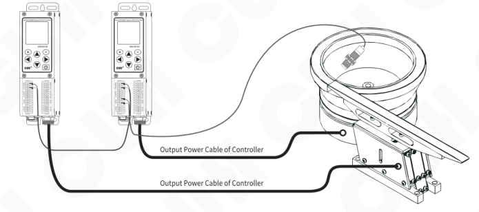

Dieser Abschnitt beschreibt die Vernetzung zweier SDVC42-SD Controller und die Realisierung, dass der Hauptausgang des gesteuerten Controllers durch das C-Port-Signal des steuernden Controllers gesteuert wird, sodass der Controller auch ohne direkt angeschlossenen Sensor über das vernetzte Signal betrieben werden kann. Die Signalquellen des Controllers werden erheblich erweitert.

1. Der Controller wird korrekt mit Stromkabel und Ausgangskabel verbunden.

2. Öffnen Sie die Verdrahtungskammerabdeckung, verbinden Sie alle Controller-T1-Signale miteinander und alle T3-Signale miteinander.

3. Nach dem Einschalten der beiden Geräte wechselt einer der Controller automatisch zur „Kommunikationsparametergruppe".

4. In der Kommunikationsparametergruppe generiert das Programm automatisch eine digitale Synchronisations-Kommunikationsgerätenummer. „Digitale Synchronisation" ist ein beliebiger Wert [1~8].

5. Der Benutzer drückt ▲ und ◀ hält, wechselt zur Kommunikationsparametergruppe, sieht und notiert die digitale Synchronisationsadresse jedes Controllers.

6. Der gesteuerte Controller wechselt zur Hauptausgangsparametergruppe und setzt die Parameter wie folgt:

   „MainSor1" auf „Bus", „MainSor2" auf „Bus", „MainLogc" auf „And", „MainDire" auf „Const", „MainUpDy" und „MainDnDy" auf den gewünschten Zeitwert（Standard 0,2 Sekunden）, „MainMode" auf „Delay".

7. Der gesteuerte Controller wechselt zur Kommunikationsparametergruppe und setzt die Parameter wie folgt:

   „BSigMID1" auf „X"（X: ist die digitale Synchronisationsbitnummer des Controllers, dessen Signal abgerufen werden soll）, „BSigM_B1" auf „4"（Material-Eingangs-Port-C-Signal）, „BSigM_B2" auf „0"（0 bedeutet ungültiges Signal）.

Nach Abschluss der obigen Einstellungen wird der Ausgang eines Controllers durch das C-Port-Signal eines anderen Controllers gesteuert.


---

## 5.3 Wie schaltet man zwei Controller gleichzeitig ein/aus?

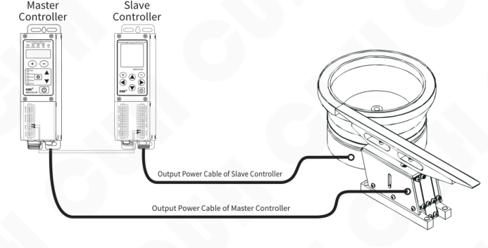

Dieser Abschnitt beschreibt die synchrone Start- und Stopp-Funktion eines Direktvibrationscontrollers（mit SDVC311）und eines Scheibencontrollers（mit SDVC42-SD）. Auch Controller verschiedener Serien können die synchrone Start/Stopp-Funktion ausführen.

1. Der Controller wird korrekt mit Stromkabel und Ausgangskabel verbunden.

2. Öffnen Sie die Verdrahtungskammerabdeckung, verbinden Sie D1 des SDVC42-SD mit C2 des SDVC311 und D3 des SDVC42-SD mit C1 des SDVC311.

3. Nach dem Einschalten der beiden Geräte drücken Sie ▲ und ◀ hält, wechseln Sie zur Steuerungsausgangsparametergruppe.

4. Stellen Sie in der Steuerungsausgangsparametergruppe die Parameter wie folgt ein:

„PotDLogc" auf „Or", „PotDSor1" auf „Main", „PotDType" auf „Ou_PNP", andere Standardwerte beibehalten.

Damit ist die Einstellung für die synchrone Start/Stopp-Funktion eines Direktvibrationscontrollers（mit SDVC311）und eines Vibrationsförderer-Controllers（mit SDVC42-SD）abgeschlossen.

---


# Kapitel Ⅵ Häufig gestellte Fragen

## 6.1 Keine Anzeige beim Einschalten

Lösung:

◆ Prüfen Sie, ob die Steckdose Strom führt.

◆ Prüfen Sie, ob der Netzstecker zuverlässig mit der Steckdose verbunden ist.

## 6.2 Keine Vibration, kein Geräusch, Controller-Anzeige normal

Lösung:

◆ Prüfen Sie, ob das Ausgangskabel korrekt mit dem Controller und dem Vibrationsförderer verbunden ist.

◆ Prüfen Sie, ob die Parameterwerte für Ausgangsspannung und Ausgangsfrequenz des Controllers angemessen sind.

◆ Prüfen Sie, ob der Controller durch ein Steuersignal gestoppt wurde.

◆ Prüfen Sie, ob der Controller durch eine Parameter-Logik-Abschaltung gestoppt wurde.

## 6.3 Steuersignal funktioniert nicht

Lösung:

◆ Prüfen Sie, ob das Steuersignal zuverlässig verbunden ist.

◆ Prüfen Sie, ob die Masseleitung des Steuersignals am GND-Port des Controllers angeschlossen ist.

◆ Prüfen Sie, ob die Steuersignallogik korrekt eingestellt ist.

## 6.4 Keine Vibration, normales Geräusch, Controller-Anzeige normal

Lösung:

◆ Passen Sie die Parametereinstellungen gemäß diesem Benutzerhandbuch an.

## 6.5 Instabile Resonanzfrequenzverfolgung

Lösung:

◆ Erhöhen Sie den Frequenzintegralwert angemessen, aber beachten Sie, dass ein zu hoher Wert zu Oszillationen der Ausgangsfrequenz führen kann.


---

## 6.6 Langsame Geschwindigkeitskorrektur bei konstanter Fördergeschwindigkeit

Lösung:

◆ Passen Sie den Amplitudenintegralwert angemessen an, aber beachten Sie, dass ein zu hoher Wert die Oszillationsamplitude der Ausgangsspannung vergrößert.

## 6.7 Controller schnell auf Werkseinstellungen zurücksetzen

Aufgrund der umfangreichen Funktionen dieses Controllers gibt es zahlreiche Steuerparameter, die vom Benutzer eingestellt werden können. Für Anfänger kann der normale Arbeitszustand des Controllers nach mehreren Einstellungsänderungen möglicherweise nicht wiederhergestellt werden. Verwenden Sie diese Funktion, um den chaotischen Parameterstatus schnell auf die Werkseinstellungen zurückzusetzen.

Lösung:

◆ Langes Drücken von ▲ und ◀ öffnet die Parametereinstellungs-Oberfläche, Kurzes Drücken von ◀ oder ▶ wechselt zur Speicherparametergruppe.

◆ Wechseln Sie zum Wiederherstellungsparameter und wählen Sie die Arbeitsgruppenparameter. Drücken Sie ⊕ und ⊖ gleichzeitig und halten Sie sie länger als zwei Sekunden, bis die Anzeige zur Standby-Oberfläche wechselt. Zu diesem Zeitpunkt sind alle Parameter der Arbeitsgruppe auf die Werkseinstellungen zurückgesetzt（Benutzer 1, Benutzer 2 und Benutzer 3 Einstellungen bleiben unverändert）.

Wenn der Benutzer zuvor Parameter in „Benutzer 1", „Benutzer 2" oder „Benutzer 3" gespeichert hat, können auch die Benutzereinstellungen wiederhergestellt werden.

---


# Kapitel Ⅶ Anhang

## 7.1 Abmessungen

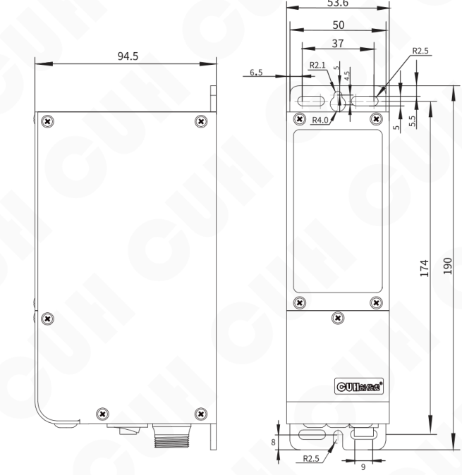

**Abmessungen（Einheit: mm）**

| Abmessungsbereich | Toleranz |
|---|---|
| 0~3 | ±0,05 |
| 3~10 | ±0,1 |
| 10~30 | ±0,15 |
| 30~80 | ±0,2 |
| 80~180 | ±0,3 |
| >180 | ±0,5 |

Diese Toleranztabelle gilt für alle Produkte dieser Serie.


## 7.2 Technische Spezifikationen

| Position | Min | Typisch | Max | Einheit | Hinweis |
|---|---:|---:|---:|---|---|
| Eingangsspannung | 85 | 220 | 250 | V | AC RMS |
| Einstellbarer Ausgangsspannungsbereich | 0,0 | —— | 50,0 | V | AC RMS |
| Spannungseinstellgenauigkeit |  | 0,1 |  | V |  |
| Spannungsregelungsgenauigkeit | 0 | —— | 10 | % | ΔVout/ΔVin |
| Einstellbarer Ausgangsstrombereich | 0 | —— | 600 | mA |  |
| Ausgangsleistung | 0 | —— | 30 | VA |  |
| Ausgangsfrequenz | 40,0 | —— | 999,9 | Hz |  |
| Frequenzeinstellgenauigkeit |  | 0,1 |  | Hz |  |
| Ausgangswellenform |  | Sinus |  |  |  |
| Sanftanlaufzeit | 0 | —— | 40,0 | s | Standardwert: 0,5 |
| Ein-/Ausschaltverzögerungszeitbereich | 0,0 | —— | 99,9 | s | Standardwert: 0,2 |
| Ein-/Ausschaltverzögerungszeit-Genauigkeit |  | 0,1 |  | s |  |
| Übertemperaturschutz-Auslösetemperatur | 60 | 65 | 65 | °C |  |
| Synchronkommunikation |  | CUHBus-DS® |  |  |  |
| Digitalkommunikation |  | ModBUS485/Digital Sync |  |  |  |
| DC-Steuerungsausgangsstrom | 0 | —— | 350 | mA |  |
| DC-Steuerungsausgangsspannung | 22 | 24 | 26 | V |  |
| Analogsteuersignal |  | 1~5/0~5/0~10 |  | V | Fernsteuerungsspannung |
| Analogsteuersignal |  | 4~20 |  | mA | Fernsteuerungsstrom |
| Digitalsteuersignal |  | 24 |  | V | Schaltsignal |
| Einstellungsmethode |  | 7 |  | Taste |  |
| Standby-Leistungsaufnahme | —— | —— | 5 | W |  |
| Anzeigemethode |  | 128×128 |  |  | Matrix-Anzeige |
| Schutzart |  | IP20 |  |  |  |
| Umgebungstemperatur | 0 | 25 | 40 | °C |  |
| Umgebungsfeuchtigkeit | 10 | 60 | 85 | % | Keine Kondensation |
| Lagerumgebungstemperatur | -20 | 25 | 65 | °C |  |


## 7.3 Referenzstandard

**Absolute Parameter:**  
Überschreitungen des Standards beschädigen den Controller. Halten Sie sich strikt daran.

| Position | GB-Standard | IEC-Standard | Klasse | Standardanforderung | Hinweis |
|---|---|---|---|---|---|
| Elektrostatische<br>Entladung | GB/T 17626.2-2006 | IEC 61000-4-2:2001 | 4 | ±8 kV | Kontaktentladung |
|  |  |  | 4 | ±15 kV | Luftentladung |
| Elektrische schnelle<br>transiente Prüfung | GB/T 17626.4-2008 | IEC 61000-4-4:2004 | 4 | ±4 kV |  |
| DC-Stromleitung<br>Störfestigkeit | GB/T 17626.17-2005 | IEC 61000-4-17:2002 | 4 | 15% | Bewertung A |

> **Warnung**  
> In einer Wohnumgebung kann dieses Produkt Funkstörungen verursachen, in welchem Fall zusätzliche Maßnahmen zur Störungsbehebung erforderlich sein können.


---

## 7.4 Parameterliste

### 7.4.1 Schnittstellen-Parametergruppe

| Funktion | Parameter | Anzeige | Wertebereich/Enumerationspunkt | Standardwert |
|---|---|---|---|---|
| P1.01 | Überwachungsprojekt 1 | 01.Monit1 | Parametergruppe 2~Parametergruppe 10 | P2.01 |
| P1.02 | Überwachungsprojekt 2 | 02.Monit2 | Parametergruppe 2~Parametergruppe 10 | P10.05 |
| P1.03 | Überwachungsprojekt 3 | 03.Monit3 | Parametergruppe 2~Parametergruppe 10 | P2.02 |
| P1.04 | Überwachungsprojekt 4 | 04.Monit4 | Parametergruppe 2~Parametergruppe 10 | P2.03 |
| P1.05 | Überwachungsprojekt 5 | 05.Monit5 | Parametergruppe 2~Parametergruppe 10 |  |
| P1.06 | Überwachungsprojekt 6 | 06.Monit6 | Parametergruppe 2~Parametergruppe 10 |  |
| P1.07 | Überwachungsprojekt 7 | 07.Monit7 | Parametergruppe 2~Parametergruppe 10 |  |
| P1.08 | Überwachungsprojekt 8 | 08.Monit8 | Parametergruppe 2~Parametergruppe 10 |  |
| P1.09 | Überwachungsprojekt 9 | 09.Monit9 | Parametergruppe 2~Parametergruppe 10 |  |
| P1.10 | Überwachungsprojekt 10 | 10.Monit10 | Parametergruppe 2~Parametergruppe 10 |  |
| P1.11 | Überwachungsprojekt 11 | 11.Monit11 | Parametergruppe 2~Parametergruppe 10 |  |
| P1.12 | Überwachungsprojekt 12 | 12.Monit12 | Parametergruppe 2~Parametergruppe 10 |  |
| P1.13 | Überwachungsprojekt 13 | 13.Monit13 | Parametergruppe 2~Parametergruppe 10 |  |
| P1.14 | Überwachungsprojekt 14 | 14.Monit14 | Parametergruppe 2~Parametergruppe 10 |  |
| P1.15 | Überwachungsprojekt 15 | 15.Monit15 | Parametergruppe 2~Parametergruppe 10 |  |
| P1.16 | Überwachungsprojekt 16 | 16.Monit16 | Parametergruppe 2~Parametergruppe 10 |  |

---


## 7.4.2 Allgemeine Parametergruppe

| Funktion | Parameter | Anzeige | Wertebereich/Enumerationspunkt | Standardwert |
|---|---|---|---|---|
| P2.01 | Benutzer-Fördergeschwindigkeit | 01.UserSped | 0~3200 | 50 |
| P2.02 | Benutzer-Spannung | 02.UsrVoltg | 0,0~50,0 V | 20,0 |
| P2.03 | Benutzer-Frequenz | 03.UsrFrqnc | 40,0~999,9 Hz | 50,0 |
| P2.04 | Sanftanlaufzeit | 04.SoftStar | 0,0~40,0 s | 0,5 |
| P2.05 | Sanftstoppzeit | 05.SoftStop | 0,0~40,0 s | 0,5 |
| P2.06 | Maximale Ausgangsspannung | 06.MaxVoltg | 0,0~50,0 V | 50,0 |
| P2.07 | Maximaler Ausgangsstrom | 07.MaxCurre | 0~600 mA | 600 |
| P2.08 | Maximale Ausgangsfrequenz | 08.MaxFre | 40,0~999,9 Hz | 999,9 |
| P2.09 | Minimale Ausgangsfrequenz | 09.MiniFre | 40,0~999,9 Hz | 40,0 |
| P2.10 | Lasterkennung | 10.Measure | Keine, Gültig | Keine |
| P2.11 | Materialmangelalarm | 11.LowAlrm | 0~3000 | 0 |
| P2.12 | Abschaltalarm | 12.AlrmShut | Keine, Sound1, Sound2, Sound3 | Keine |
| P2.13 | Hintergrundbeleuchtungshelligkeit | 13.Brightne | 20~100 | 100 |
| P2.14 | Hintergrundbeleuchtung-Ausschaltzeit | 14.Off_time | 1~30 Min, 31(dauerhaft hell) | 5 |
| P2.15 | Sprache | 15.Language | Englis, Chines, German | Englis |


---

## 7.4.3 Hauptausgangs-Parametergruppe

| Funktion | Parameter | Anzeige | Wertebereich/Enumerationspunkt | Standardwert |
|---|---|---|---|---|
| P3.01 | Hauptausgangs-Portlogik | 01.MainLogc | And, Or, Xor, RS | Or |
| P3.02 | Hauptausgangs-Portlogik<br>Eingangsquelle 1 | 02.MainSor1 | Siehe Anhang 7.4.11 | In_PtC |
| P3.03 | Hauptausgangs-Portlogik<br>Eingangsquelle 2 | 03.MainSor2 | Siehe Anhang 7.4.11 | In_PtE |
| P3.04 | Hauptausgangs-Steigverzögerung | 04.MainUpDy | 0,0~99,9 s | 0,2 |
| P3.05 | Hauptausgangs-Fallverzögerung | 05.MainDnDy | 0,0~99,9 s | 0,2 |
| P3.06 | Hauptausgangs-Logikrichtung | 06.MainDire | Const, Inv, On, Off | Const |
| P3.07 | Hauptausgangsmodus | 07.MainMode | Delay, Hold | Delay |
| P3.08 | Einschalzzustand | 08.PowOnSta | On, Off, Keep | On |
| P3.09 | Fernsteuerungsquelle | 09.CtrlSour | Panel, 20mA, 1-5V, 0-5V, 0-10V, DigSym | Panel |
| P3.10 | Fernsteuerungskoeffizient | 10.CtrlCoef | 0,5~2,0 | 1,0 |

---


## 7.4.4 Konstantgeschwindigkeits-Parametergruppe

| Funktion | Parameter | Anzeige | Wertebereich/Enumerationspunkt | Standardwert |
|---|---|---|---|---|
| P4.01 | Automatische Frequenz-<br>Zentralfrequenz | 01.AutFCent | 40,0~999,9 Hz | 100,0 |
| P4.02 | Automatische Frequenz-<br>Einstellbereich | 02.AutFRang | 0,0~180,0 Hz | 30,0 |
| P4.03 | Automatische Frequenz-<br>Einstellintegral | 03.AutFIntg | 0~2000 | 20 |
| P4.04 | Automatische Amplituden-<br>Einstellintegral | 04.AutAIntg | 0~9999 | 300 |
| P4.05 | Automatische Amplituden-<br>Einstellproportion | 05.AutAProp | 0~9999 | 500 |
| P4.06 | Autophase | 06.AutoPhas | -180~180 ° | 0 |
| P4.07 | Automatische Suchfrequenz-<br>Spannung Max | 07.AutSrhVM | 0,0~30,0 V | 20,0 |
| P4.08 | Automatische Suchfrequenz-<br>Amplitude Max | 08.AutSrhAM | 0~3200 | 200 |
| P4.09 | Automatische Suchfrequenz-<br>Geschwindigkeit Max | 09.AutSpedM | 0~4000 | 3200 |
| P4.10 | Benutzereinstellung Phase | 10.UserPhas | -180~180 ° | 0 |
| P4.11 | Spannungsmodus | 11.VoltgMod | Manuel, Auto | Auto |
| P4.12 | Frequenzmodus | 12.FrqncMod | Manuel, Auto, SynV, SynE | Auto |
| P4.13 | Synchronisationsquelle | 13.SynSourc | Keine, PhaseV, PhaseE | Keine |
| P4.14 | Beschleunigungssensor-Typ | 14.AcSnsrTp | 20-1, 20-2, 20-3, 20-4, 203, 204, 205, 206 | 205 |
| P4.15 | Frequenzsuchgeschwindigkeit | 15.SrhSpeed | 0~5 | 3 |


## 7.4.5 Signaleingangs-Parametergruppe

| Funktion | Parameter | Anzeige | Wertebereich/Enumerationspunkt | Standardwert |
|---|---|---|---|---|
| P5.01 | Schaltsensor-Typ | 01.PortType | Auto, NPN, PNP, Ato1（einmalige automatische Erkennung）| Auto |
| P5.02 | Port C Logikrichtung | 02.PortCDir | Const, Inv | Const |
| P5.03 | Port C Steigverzögerung | 03.PtCUpDly | 0,0~99,9 s | 0,2 |
| P5.04 | Port C Fallverzögerung | 04.PtCDnDly | 0,0~99,9 s | 0,2 |
| P5.05 | Port E Logikrichtung | 05.PortEDir | Const, Inv | Const |
| P5.06 | Port E Steigverzögerung | 06.PtEUpDly | 0,0~99,9 s | 0,2 |
| P5.07 | Port E Fallverzögerung | 07.PtEDnDly | 0,0~99,9 s | 0,2 |
| P5.08 | Geschwindigkeit A Logikrichtung | 08.SpedADir | Const, Inv | Const |
| P5.09 | Geschwindigkeit A Steigverzögerung | 09.SpdAUpDy | 0,0~99,9 s | 0,2 |
| P5.10 | Geschwindigkeit A Fallverzögerung | 10.SpdADnDy | 0,0~99,9 s | 0,2 |
| P5.11 | Geschwindigkeit B Logikrichtung | 11.SpedBDir | Const, Inv | Const |
| P5.12 | Geschwindigkeit B Steigverzögerung | 12.SpdBUpDy | 0,0~99,9 s | 0,2 |
| P5.13 | Geschwindigkeit B Fallverzögerung | 13.SpdBDnDy | 0,0~99,9 s | 0,2 |


## 7.4.6 DC-Steuerungsausgangs-Parametergruppe

| Funktion | Parameter | Anzeige | Wertebereich/Enumerationspunkt | Standardwert |
|---|---|---|---|---|
| P6.01 | Port D Logische Beziehung | 01.PotDLogc | And, Or, Xor, RS | Or |
| P6.02 | Port D Logik-Eingangsquelle 1 | 02.PotDSor1 | Siehe Anhang 7.4.11 | In_PtC |
| P6.03 | Port D Logik-Eingangsquelle 2 | 03.PotDSor2 | Siehe Anhang 7.4.11 | In_PtE |
| P6.04 | Port D Logikrichtung | 04.PortDDir | Const, Inv, On, Off | Const |
| P6.05 | Port D Steigverzögerung | 05.PtDUpDly | 0,0~99,9 s | 0,2 |
| P6.06 | Port D Fallverzögerung | 06.PtDDnDly | 0,0~99,9 s | 0,2 |
| P6.07 | Port D Ausgangstyp | 07.PotDType | Ou_PNP, Ou_NPN, Ou_P&P（Push Pull）| Ou_P&P |
| P6.08 | Port D Ausgangsmodus | 08.PotDMode | Delay, Hold | Delay |


## 7.4.7 Zähl-Parametergruppe

| Funktion | Parameter | Anzeige | Wertebereich/Enumerationspunkt | Standardwert |
|---|---|---|---|---|
| P7.01 | Gesamtzahl | 01.TotaCout | 0~9999 | 10 |
| P7.02 | Endförderrate-Prozentsatz | 02.PrcntTrm | 0~100 % | 50 |
| P7.03 | Vor Zählende | 03.CotAhead | 0~9999 | 3 |
| P7.04 | Zählautomatik-Resetzeit | 04.CotRstTm | 0,0~999,9 s | 0,0 |
| P7.05 | Zählport-Auswahl | 05.CotPotSe | Keine, Gültig | Keine |
| P7.06 | RS-Trigger-Port-Priorität | 06.RSPriori | Same, Reset, Set, Revers | Same |


## 7.4.8 Kommunikations-Parametergruppe

| Funktion | Parameter | Anzeige | Wertebereich/Enumerationspunkt | Standardwert |
|---|---|---|---|---|
| P8.01 | 485-BUS Kommunikationstyp | 01.485type | ASCII, RTU | RTU |
| P8.02 | 485 Kommunikationsbaudrate | 02.BaudRate | 0,3, 1,2, 2,4, 9,6, 19,2, 57,6, 115,2 Kbps | 115,2 |
| P8.03 | 485 Kommunikations-Slave-ID | 03.485SlvID | 1~31 | 1 |
| P8.04 | 485-Kommunikationsport-Widerstand aktivieren | 04.Enab485R | Keine, Gültig | Keine |
| P8.05 | Lokale digitale Synchronisationsadresse | 05.DigSynAd | 1~8 |  |
| P8.06 | Digitale Synchronisations-Kommunikationsport-Widerstand aktivieren | 06.EnabSynR | Keine, Gültig | Keine |
| P8.07 | Bussignaladresse der Hauptausgangs-Portlogik Eingangsquelle 1 | 07.BSigMID1 | 1~8 |  |
| P8.08 | Bussignaladresse der Hauptausgangs-Portlogik Eingangsquelle 2 | 08.BSigMID2 | 1~8 |  |
| P8.09 | Bussignaladresse der Port D Logik Eingangsquelle 1 | 09.BSgD_ID1 | 1~8 |  |
| P8.10 | Bussignaladresse der Port D Logik Eingangsquelle 2 | 10.BSgD_ID2 | 1~8 |  |
| P8.11 | Bussignal-Bitadresse der Hauptausgangs-Portlogik Eingangsquelle 1 | 11.BSigM_B1 | 1~16 | 5 |
| P8.12 | Bussignal-Bitadresse der Hauptausgangs-Portlogik Eingangsquelle 2 | 12.BSigM_B2 | 1~16 | 6 |
| P8.13 | Bussignal-Bitadresse der Port D Logik Eingangsquelle 1 | 13.BSigD_B1 | 1~16 | 5 |
| P8.14 | Bussignal-Bitadresse der Port D Logik Eingangsquelle 2 | 14.BSigD_B2 | 1~16 | 6 |
| P8.15 | Lokale Bussignal-Bitadresse 1 Signal | 15.LBSig_B1 | Siehe Anhang 7.4.11 | 0 |
| P8.16 | Lokale Bussignal-Bitadresse 2 Signal | 16.LBSig_B2 | Siehe Anhang 7.4.11 | 1 |
| P8.17 | Lokale Bussignal-Bitadresse 3 Signal | 17.LBSig_B3 | Siehe Anhang 7.4.11 | SpeedA |
| P8.18 | Lokale Bussignal-Bitadresse 4 Signal | 18.LBSig_B4 | Siehe Anhang 7.4.11 | SpeedB |
| P8.19 | Lokale Bussignal-Bitadresse 5 Signal | 19.LBSig_B5 | Siehe Anhang 7.4.11 | In_PtC |
| P8.20 | Lokale Bussignal-Bitadresse 6 Signal | 20.LBSig_B6 | Siehe Anhang 7.4.11 | In_PtE |
| P8.21 | Lokale Bussignal-Bitadresse 7 Signal | 21.LBSig_B7 | Siehe Anhang 7.4.11 | FCntSi |
| P8.22 | Lokale Bussignal-Bitadresse 8 Signal | 22.LBSig_B8 | Siehe Anhang 7.4.11 | DCntSi |
| P8.23 | Lokale Bussignal-Bitadresse 9 Signal | 23.LBSig_B9 | Siehe Anhang 7.4.11 | Ctr_O |
| P8.24 | Lokale Bussignal-Bitadresse 10 Signal | 24.LBSigB10 | Siehe Anhang 7.4.11 | Warn |
| P8.25 | Lokale Bussignal-Bitadresse 11 Signal | 25.LBSigB11 | Siehe Anhang 7.4.11 | Main |
| P8.26 | Lokale Bussignal-Bitadresse 12 Signal | 26.LBSigB12 | Siehe Anhang 7.4.11 | -SpeedA |
| P8.27 | Lokale Bussignal-Bitadresse 13 Signal | 27.LBSigB13 | Siehe Anhang 7.4.11 | -SpeedB |
| P8.28 | Lokale Bussignal-Bitadresse 14 Signal | 28.LBSigB14 | Siehe Anhang 7.4.11 | -In_PtC |
| P8.29 | Lokale Bussignal-Bitadresse 15 Signal | 29.LBSigB15 | Siehe Anhang 7.4.11 | -In_PtE |
| P8.30 | Lokale Bussignal-Bitadresse 16 Signal | 30.LBSigB16 | Siehe Anhang 7.4.11 | -FCtSi |
| P8.31 | Netzwerk-Beitrittsfunktion aktivieren | 31.EnNetwok | Online, Offlin, Expand, Replace |  |
| P8.32 | Netzwerkgerät-Nummer entfernen | 32.DeltDevi | 1~8 |  |
| P8.33 | Lokale Frequenzsynchronisationsnummer | 33.FrqncSyn | 1~8 |  |
| P8.34 | Lokale Fernsteuerungs-Geschwindigkeitsregelung-Synchronisationsnummer | 34.RemotSyn | 1~8 |  |
| P8.35 | Fernsteuerungsdaten | 35.RemotDat | ManVol, RemVol, ManSpd, RemSpd | ManVol |


---

## 7.4.9 Speicher-Parametergruppe

| Funktion | Parameter | Anzeige | Wertebereich/Enumerationspunkt | Standardwert |
|---|---|---|---|---|
| P9.01 | Alle Parameter aus der<br>Benutzergruppe lesen | 01.ReadALLF | Keine, UsrD1, UsrD2, UsrD3 | Keine |
| P9.02 | Alle Parameter in die<br>Benutzergruppe speichern | 02.SaveALLT | Keine, Work, UsrD1, UsrD2, UsrD3 | Keine |
| P9.03 | Werkseinstellungen wiederherstellen | 03.RestorAL | Keine, RWork（Standard-Arbeitsgruppe）| Keine |
| P9.04 | Bus-Datensicherung zur<br>Wiederherstellung lokaler Daten | 04.RDatFrBs | 1~8 |  |
| P9.05 | Benutzerpasswort | 05.PassWord | 0~9999 | 0 |
| P9.06 | Passwort setzen | 06.SetWord | 0~9999 | 0 |

---


## 7.4.10 Überwachungs-Parametergruppe

| Funktion | Parameter | Anzeige | Wertebereich/Enumerationspunkt | Standardwert |
|---|---|---|---|---|
| P10.01 | Ausgangsspannung | 01.Voltage | 0,0~50,0 V |  |
| P10.02 | Ausgangsfrequenz | 02.Frequenc | 40,0~999,9 Hz |  |
| P10.03 | Aktuelle Fördergeschwindigkeit | 03.SpeedNow | 0~4000 |  |
| P10.04 | Aktuelle Ausgangsspannung | 04.VoltgOut | 0,0~60,0 V |  |
| P10.05 | Effektivstromwert | 05.EffectCu | 0~999 mA |  |
| P10.06 | Strommaximum | 06.CurrentM | 0~999 mA |  |
| P10.07 | Wirkleistung | 07.PowActiv | 0,0~999,9 W |  |
| P10.08 | Blindleistung | 08.PowReact | 0,0~999,9 Var |  |
| P10.09 | Temperatur | 09.Temperat | -20,0~85,0 ℃ |  |
| P10.10 | Kapazitätswert | 10.Capacitance | 0,0~9,999 uF |  |
| P10.11 | Widerstandswert | 11.Resistan | 0,0~999,9 Ω |  |
| P10.12 | Externe Synchronisationsfrequenz | 12.SynchrFr | 40,0~999,9 Hz |  |
| P10.13 | Aktuelle Zählernummer | 13.CoutNumb | 0~9999 |  |
| P10.14 | Gesamte harmonische Verzerrung der Ausgangsspannung | 14.VolTHD | 0,0~100,0 % |  |
| P10.15 | Gesamte harmonische Verzerrung des Ausgangsstroms | 15.CurTHD | 0,0~100,0 % |  |
| P10.16 | Port C Eingangs-Signalstatus | 16.Sig-PotC | 0~1 |  |
| P10.17 | Port E Eingangs-Signalstatus | 17.Sig-PotE | 0~1 |  |
| P10.18 | Port D Ausgangsstatus | 18.Sig-PotD | 0~1 |  |
| P10.19 | Port G Eingangs-Signalstatus | 19.Sig-PotG | 0~1 |  |
| P10.20 | Port N Eingangs-Signalstatus | 20.Sig-PotN | 0~1 |  |
| P10.21 | Hauptausgangsstatus | 21.Sig-Main | 0~1 |  |
| P10.22 | Port C Eingangsspannung | 22.Vol-PotC | 0,0~26,0 V |  |
| P10.23 | Port E Eingangsspannung | 23.Vol-PotE | 0,0~26,0 V |  |
| P10.24 | Port D Ausgangsspannung | 24.Vol-PotD | 0,0~26,0 V |  |
| P10.25 | Port G Eingangsspannung | 25.Vol-PotG | 0,0~26,0 V |  |
| P10.26 | Port N Eingangsspannung | 26.Vol-PotN | 0,0~26,0 V |  |
| P10.27 | Fernsteuerungs-Eingangsspannung | 27.Vol-Remo | 0,0~10,0 V |  |
| P10.28 | 24V Versorgungsspannung | 28.Vol-24V | 0,0~26,0 V |  |
| P10.29 | 5V Versorgungsspannung | 29.Vol-5V | 0,0~6,0 V |  |
| P10.30 | DC-Busspannung | 30.Vol-Bus | 0,0~28,0 V |  |
| P10.31 | Durchschnittliche Ausgangsspannung | 31.OUT-avg | 0,0~86,0 V |  |
| P10.32 | Effektivwert der Eingangsspannung | 32.Vol-Inpt | 0,0~280,0 V |  |
| P10.33 | Autophase-Rest | 33.PhaseRem | -180~180 ° |  |
| P10.34 | Sensor-Überlastung | 34.Overload | 0~1 |  |
| P10.35 | Beschleunigung | 35.Accelera | 0~64 g |  |
| P10.36 | Gerätenummer | 36.DevicNum | 1~8 Einheiten |  |
| P10.37 | Online-Anzahl | 37.OnlinNum | 1~8 Einheiten |  |
| P10.38 | Materialmangelalarm | 38.LowAlarm | 0~3000 |  |
| P10.39 | Betriebsstunden | 39.WorkHour | 0~9999（Einheit: 8h）|  |


| Funktion | Parameter | Anzeige | Wertebereich/Enumerationspunkt | Standardwert |
|---|---|---|---|---|
| P10.40 | Amplitude X | 40.Amp-X | 0~9999 um |  |
| P10.41 | Amplitude Y | 41.Amp-Y | 0~9999 um |  |
| P10.42 | Amplitude Z | 42.Amp-Z | 0~9999 um |  |
| P10.43 | Amplitude Summe | 43.Amp-Sum | 0~9999 um |  |
| P10.44 | Firmware-Versionsnummer Master | 44.Vr-Main | 0~9999 |  |
| P10.45 | Firmware-Versionsnummer Slave | 45.Vr-Slave | 0~9999 |  |


## 7.4.11 Anhangsliste

Die Signalquellendefinitionsliste ist wie folgt:

| Seriennummer | Bedeutung | Anzeige |
|---:|---|---|
| 0 | 0 | 0 |
| 1 | 1 | 1 |
| 2 | Geschwindigkeit A Port | SpeedA |
| 3 | Geschwindigkeit B Port | SpeedB |
| 4 | Eingangs-Port C | In_PtC |
| 5 | Eingangs-Port E | In_PtE |
| 6 | Vollzähl-SSignal | FCntSi |
| 7 | Verzögerungszähl-Signal | DCntSi |
| 8 | Bussignal | Bus_S |
| 9 | Steuerungsausgang | Ctr_O |
| 10 | Warnung | Warn |
| 11 | Hauptausgang | Main |
| 12 | Invertiert Geschwindigkeit A Port | -SpedA |
| 13 | Invertiert Geschwindigkeit B Port | -SpedB |
| 14 | Invertiert Eingangs-Port C | -I_PtC |
| 15 | Invertiert Eingangs-Port E | -I_PtE |
| 16 | Invertiert Vollzähl-Signal | -FCtSi |
| 17 | Invertiert Verzögerungszähl-Signal | -DCtSi |
| 18 | Invertiert Bussignal | -Bus_S |
| 19 | Invertiert Steuerungsausgang | -Ctr_O |
| 20 | Invertiert Warnung | -Warn |
| 21 | Invertiert Hauptausgang | -Main |

Die Gerätevernetzungs-Statusvergleichstabelle ist wie folgt:

**Gerätevernetzungs-Statusvergleichstabelle**

| Anzeige | Gerätevernetzungsstatus |
|---|---|
| A | Alle Netzwerkgeräte sind online |
| B | Mindestens ein Netzwerkgerät ist offline |
| C | Dieses Gerät ist kein Gerät in diesem Netzwerk |
| D | Gerät wird gelöscht |
| E | Erweiterung zum Beitreten |
| F | Wettbewerbsfähige Netzwerksteuerung |
| R | Ersatzbeitritt |
| S | Dieses Gerät ist vom Netzwerk getrennt |


## 7.5 Ein- und Ausgangsschaltpläne

### Fernsteuerungs-Geschwindigkeitssteuerport A

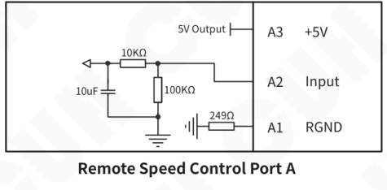

| Anschluss | Funktion |
|---|---|
| A3 | +5V / 5V Ausgang |
| A2 | Eingang |
| A1 | RGND |

Sichtbare Bauteilbeschriftungen: 10uF, 10KΩ, 100KΩ, 249Ω.

### Schaltsensor-Port C

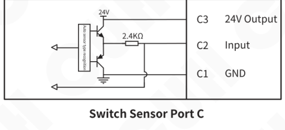

| Anschluss | Funktion |
|---|---|
| C3 | 24V Ausgang |
| C2 | Eingang |
| C1 | GND |

Sichtbare Beschriftungen: 24V, 2,4KΩ, Automatische Sensortyperkennung.

### Schaltsensor-Port E

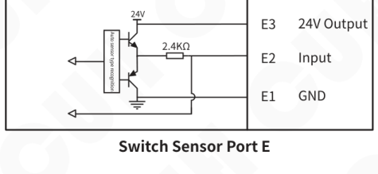

| Anschluss | Funktion |
|---|---|
| E3 | 24V Ausgang |
| E2 | Eingang |
| E1 | GND |

Sichtbare Beschriftungen: 24V, 2,4KΩ, Automatische Sensortyperkennung.

### Steuerungsausgang-Port D

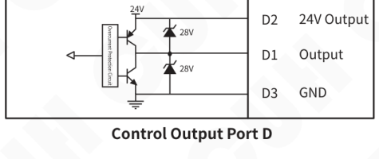

| Anschluss | Funktion |
|---|---|
| D2 | 24V Ausgang |
| D1 | Ausgang |
| D3 | GND |

Sichtbare Beschriftungen: 24V, 28V, 28V, Überstromschutzschaltung.


#### 485 Kommunikationsport F

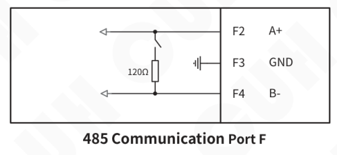

| Anschluss | Signal |
|---|---|
| F2 | A+ |
| F3 | GND |
| F4 | B- |

#### Zähl-/Geschwindigkeitsvoreinstellport N

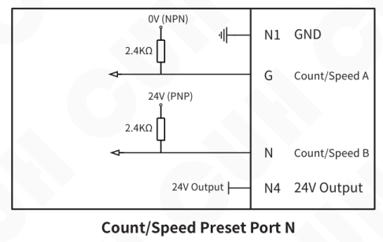

| Anschluss | Signal |
|---|---|
| N1 | GND |
| G | Zählung/Geschwindigkeit A |
| N | Zählung/Geschwindigkeit B |
| N4 | 24V Ausgang |

#### Digitalsynchronport T

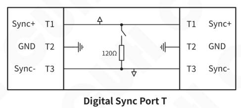

| Anschluss | Signal |
|---|---|
| T1 | Sync+ |
| T2 | GND |
| T3 | Sync- |


---

## 7.6 Fehlercode

Die Fehlerdiagnose dieses Controllers ist in Fehlercodes und Warnungscodes unterteilt. Und zeigt jeden Code nacheinander an.

**Fehlercode:** Das Gerät muss sofort gestoppt werden und es muss gewartet werden, bis der Fehler verschwindet, bevor die Anzeige gelöscht wird.

**Warnungscode:** Kein Stopp erforderlich. Warten Sie, bis die Warnung verschwindet, bevor die Anzeige gelöscht wird.

### Fehlercode-Tabelle

| Fehlercode | Anzeige | Bedeutung | Behebungsmethode |
|---|---|---|---|
| Error01 | Short | Kurzschluss | Prüfen Sie, ob die Hauptausgangsleitung kurzgeschlossen ist, und verkabeln Sie sie neu |
| Error02 | OvrCurrt | Überstrom | Reduzieren Sie die Ausgangsspannung oder erhöhen Sie die Ausgangsfrequenz |
| Error03 | OverHot | Überhitzung | Stellen Sie den Controller an einen gut belüfteten und wärmeableitenden Ort |
| Error04 | UndrCool | Unterkühlung | Stellen Sie den Controller an einen Ort mit einer Umgebungstemperatur über -20℃ |
| Error05 | CommErr | Kommunikationsfehler | Kontaktieren Sie den technischen Support des Unternehmens |
| Error06 | TSnerErr | Temperatursensorfehler | Kontaktieren Sie den technischen Support des Unternehmens |
| Error07 | OverVolt | Überspannung | Die Eingangsnetzspannung darf 250V Effektivwert nicht überschreiten |
| Error08 | UndrVolt | Unterspannung | Die Eingangsnetzspannung darf 85V Effektivwert nicht unterschreiten |
| Error09 | LoadErr | Lasttrennung | Prüfen Sie, ob die Ausgangsleitung korrekt mit der Vibrationsplatte verbunden ist |
| Error10 | Send_Seed | Seed-Senden fehlgeschlagen | Kontaktieren Sie den technischen Support des Unternehmens |
| Error11 | Send_Exit | Boot-Leave-Befehl fehlgeschlagen | Kontaktieren Sie den technischen Support des Unternehmens |
| Error14 | SynchEr0 | CUHBus-DS® Bus hat 2 oder mehr Hosts | 1. Wenn ein Alarm auftritt, setzen Sie das Gerät offline und dann wieder online.<br>2. Nach dem Ausschalten des neu hinzugefügten Geräts verbinden Sie das CUHBus-DS® Kabel mit dem Netzwerkgerät. |
| Error15 | SynchEr1 | Busfehler | Prüfen Sie, ob die CUHBus-DS® Kommunikationsleitung korrekt verbunden ist, und organisieren Sie das Netzwerk korrekt |
| Error16 | SynchEr2 | Synchronisationsgerät nicht online | Synchronisationskommunikationsnetzwerk, Frequenzsynchronisationsgerät oder Fernsteuerungs-Synchronisationsgerät nicht online |

---


## 7.7 Warnungscode

### Warnungscode-Tabelle

| Warnungscode | Anzeige | Bedeutung | Behebungsmethode |
|---|---|---|---|
| Warn01 | Saturate | Ausgangssättigung | Reduzieren Sie die Ausgangsspannung |
| Warn02 | decline | Zählverzögerung | Zählverzögerungszustand |
| Warn03 | CND | Zählende | Zählendstatus |
| Warn04 | FrqncyLo | Ausgangsfrequenz zu niedrig | Erhöhen Sie den Frequenzversatz-Parameterwert |
| Warn05 | FrqncyHi | Ausgangsfrequenz zu hoch | Erhöhen Sie den Frequenzversatz-Parameterwert |
| Warn06 | LoMAlarm | Materialmangel | Reduzieren Sie den Materialmangelalarm-Parameterwert oder fügen Sie Material in die Materialschale ein |
| Warn07 | PortDErr | Port D Ausgangsüberstrom | Reduzieren Sie die Steuerungslast des Ausgangsports |
| Warn08 | RemotLow | Fernsteuerungs-Eingangsspannung/-strom zu niedrig | Erhöhen Sie die Fernsteuerungs-Eingangsspannung oder den Strom |
| Warn09 | MRSErr | Hauptausgangs-RS-Logikfehler | Wenn die Ausgangslogik ein RS-Flipflop ist, dürfen die Signale von Hauptquelle 1 und Hauptquelle 2 nicht gleichzeitig aktiv sein |
| Warn10 | 24VErr | 24V Fehler | Schließen Sie keine 24V-externe Stromversorgung an den Controller-Ausgangsport an |
| Warn11 | 5VErr | 5V Fehler | Schließen Sie keine 5V-externe Stromversorgung an den Controller-Ausgangsport an |
| Warn12 | CtrlRSErr | Steuerungsausgangs-RS-Logikfehler | Wenn die Logik von Port D ein RS-Flipflop ist, dürfen die Signale von D-Port-Quelle 1 und D-Port-Quelle 2 nicht gleichzeitig aktiv sein |
| Warn13 | OverLoad | Beschleunigungssensor-Überlastung | Ersetzen Sie den Beschleunigungssensor durch einen mit geeignetem Messbereich |
| Warn14 | AcceleEr | Beschleunigungssensor-Ausfall | Der Sensor ist beschädigt, ersetzen Sie ihn durch einen neuen |
| Warn15 | EEPErr | Fehler beim Speichern der Parameter | Stellen Sie sicher, dass die CUHBus-DS® Kommunikationsleitung korrekt verbunden ist und die Vernetzung korrekt abgeschlossen wurde |


---

# Kapitel Ⅷ Produktgarantieinformationen

## 8.1 Garantiezeitraum

Der Garantiezeitraum, den das Unternehmen für dieses Produkt bietet, beträgt 3 Jahre ab dem Datum der Lieferung des Produkts an den vom Käufer bestimmten Ort.

## 8.2 Garantieumfang

(1) Wenn während des oben genannten Garantiezeitraums ein von unserem Unternehmen verursachter Fehler auftritt, reparieren wir das Produkt kostenlos. Die folgenden Situationen sind jedoch nicht durch die Garantie abgedeckt:

&nbsp;&nbsp;&nbsp;&nbsp;a. Nichteinhaltung der im einfachen Handbuch, Benutzerhandbuch oder den zwischen dem Käufer und dem Unternehmen speziell vereinbarten technischen Anforderungen festgelegten Bedingungen, unsachgemäße Bedienung oder durch unsachgemäßen Gebrauch verursachte Fehler.

&nbsp;&nbsp;&nbsp;&nbsp;b. Der Fehler ist nicht auf einen Produktdefekt zurückzuführen, sondern auf das Gerät oder die Softwarekonstruktion des Käufers.

&nbsp;&nbsp;&nbsp;&nbsp;c. Durch nicht vom Unternehmen durchgeführte Änderungen oder Reparaturen verursachte Fehlfunktionen.

&nbsp;&nbsp;&nbsp;&nbsp;d. Fehler, die durch korrekte Wartung oder Austausch von Verschleißteilen gemäß der einfachen Bedienungsanleitung oder dem Benutzerhandbuch vollständig vermieden werden können.

&nbsp;&nbsp;&nbsp;&nbsp;e. Nach dem Versand des Produkts von unserem Unternehmen verursachte Fehler durch Faktoren wie unvorhergesehene Änderungen des Wissenschafts- und Technologieniveaus.

&nbsp;&nbsp;&nbsp;&nbsp;f. Durch Naturkatastrophen wie Feuer, Erdbeben, Überschwemmungen oder externe Faktoren wie abnormale Spannungsausfälle ist das Unternehmen nicht für die Garantie verantwortlich.

(2) Der Garantieumfang beschränkt sich auf die in (1) festgelegte Situation. Für indirekte Verluste（wie Geräteschäden, entgangene Chancen, Gewinnverluste usw.）oder sonstige Verluste übernimmt das Unternehmen keine Haftung.

## 8.3 Produktverwendung

Die Controller unseres Unternehmens sind für den allgemeinen Einsatz in der Vibrationsförderindustrie konzipiert und produziert. Daher darf dieser Controller unseres Unternehmens nicht für die folgenden Anwendungen verwendet werden und ist dafür nicht geeignet.

(1) Einrichtungen mit schwerwiegenden Auswirkungen auf Leben und Eigentum, wie Kernkraftwerke, Flughäfen, Eisenbahnen, Schiffe, motorisierte Geräte und medizinische Geräte.

(2) Versorgungsbetriebe, einschließlich Strom, Gas, Wasserversorgung usw.

(3) Außeneinsatz unter ähnlichen Bedingungen oder Umgebungen.

---


Nanjing CUH Science & Technology Co.,Ltd  
https://en.cuhnj.com  
Tel.:+86-25-84730411 / 84730415 / 84730416  
Fax:+86-25-84730426  
E-Mail:sales@cuhnj.com  
Adresse:Building 2, Xueyan Tech Park, Tuscity,  
No.9 Zhineng Rd, Jiangning, Nanjing, China

Dokumentennr.: IDP1000448


