## Digital Three Phase Asynchronous Motor Controller

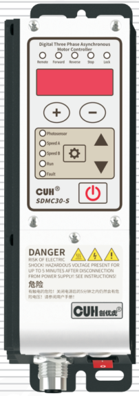

## SDMC30-S

## User Manual

---

## Copyright Statement

Nanjing CUH Science & Technology CO., Ltd. reserves all rights.

All information contained in this user manual is the knowledge of our company and is protected by copyright law and other related laws. CUH enjoys and reserves all rights conferred by copyright law and other laws. Without the written consent of CUH, part or all of this user manual shall not be copied, translated, imitated or otherwise utilized.

## Disclaimer

All contents of this user manual only describe the use method of related products produced by our company, and are described according to the existing technology and the state provided to you when you use it. You must bear the relevant risks when you use this product. Except as required by law, the company does not have any express or implied responsibility for the product due to this user manual, including but not limited to personal injury, property damage, loss of opportunity, etc.

You clearly understand the above risks and agree that, except as mandated by law, the company is not responsible for any direct or indirect damage or loss to you (including but not limited to tangible loss of personnel, property, data, etc. and intangible loss of reputation, opportunity, etc.)

The company reserves the right to modify the products applicable in this user manual without prior or subsequent notice.

---

# Preface

Thank you for choosing CUH SDMC30 series digital three phase asynchronous motor controller. (The controller for short in the following text). This series of controllers uses high-quality components and incorporates the latest electronic technology, and is carefully designed with high-performance digital signal processors.

This manual introduces the basic operation method, functional technical description and typical application examples of this product. Provide users with relevant information on installation and debugging, parameter setting, abnormal diagnosis, troubleshooting and routine maintenance of the controller. In order to ensure the correct installation and use of this controller, please read this user manual carefully before installation and keep it properly.

Be sure to read the following symbols to alert you to precautions against personal injury and product damage.

|  |  |
|---|---|
| ⚠ Danger | Non-observance of this item will result in personal injury or death. |
| ⚠ Warn | Non-observance of this item may result in personal injury or death. |
| ⚠ Careful | Non-observance of this item may result in moderate or minor injury to persons. |
| Notice | Non-observance of this item will result in damage to the product and property damage. |
| ❗ Essential | Indicates precautions and usage restrictions that must be observed during use. |

**This manual is suitable for the following models of controllers:**

- Digital Three Phase Asynchronous Motor Controller SDMC30-S

  (Input single-phase 85~250VAC, output three-phase 0~220Vrmn/0.2kW)

---

# Operating and Storage Environment

## Inspection Before Using

Every controller will go through rigorous quality inspection before delivery and is packed with crash-proof packaging, Please check the following items after unpacking:

1. Whether the controller is damaged during transportation.
2. Whether the model of the controller is that you ordered.

## Runtime Environment

Please follow the notes below to ensure the better performance and longer lifetime of the controller:

- ⚠ Well-ventilated environment
- ⚠ Keep away from water, stream, dust and especially oily dust
- ⚠ Keep away from the corrosive or flammable gas and liquid
- ⚠ Keep away from floating dust and metal particles
- ⚠ Firmly fixed to avoid self vibration
- ⚠ Keep away from electromagnetic interference
- ⚠ Ensure ambient temperature is 0~40 ℃
- ⚠ For use at altitude 2000m or lower

---

# Contents

**Chapter Ⅰ Before Use — 1**

- 1.1 Check the Package Contents — 1
- 1.2 Indicators and Buttons Description — 2
- 1.3 External Parts Description — 3
- 1.4 Signal Ports Description — 3
- 1.5 Nameplate Description — 4

**Chapter Ⅱ Product Introduction — 5**

- 2.1 Product Introduction — 5

**Chapter Ⅲ Installation Guide — 6**

- 3.1 Controller Usage Conditions — 6
- 3.2 Operation Method of Buttons — 6
- 3.3 Install and Use — 7

**Chapter Ⅳ Basic Function Description — 11**

- 4.1 Set Frequency — 11
- 4.2 Forward and Reverse Running — 12
- 4.3 Emergency Stop — 13
- 4.4 Soft Start Time — 14
- 4.5 Soft Closing Time/DC Braking — 14
- 4.6 Keyboard Lock — 15
- 4.7 Restore Default Settings — 16

**Chapter Ⅴ Advanced Function Description — 17**

- 5.1 Motor Start/Stop and Direction Control — 17
- 5.2 Motor Rotation Direction Exchange and Prohibition of Reverse Rotation — 18
- 5.3 Motor Emergency Stop — 19
- 5.4 Motor V/F Curve Setting — 21
- 5.5 Motor Overpower Protection — 22

---

# Chapter Ⅰ Before Use

This chapter introduces product package contents, controller appearance description and controller nameplate information.

## 1.1 Check the Package Contents

Before using, please check the integrity of the controller and accessories. If you find that the product is defective or damaged, missing accessories, etc., please contact our company.

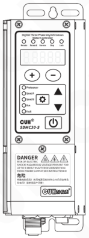

Controller×1

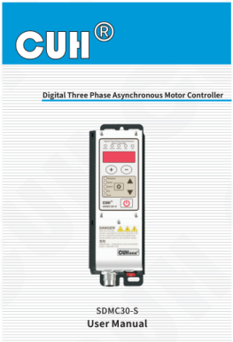

User Manual×1

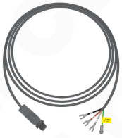

Output Cable×1

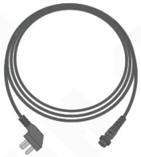

Input Power Cord×1

---

## 1.2 Indicators and Buttons Description

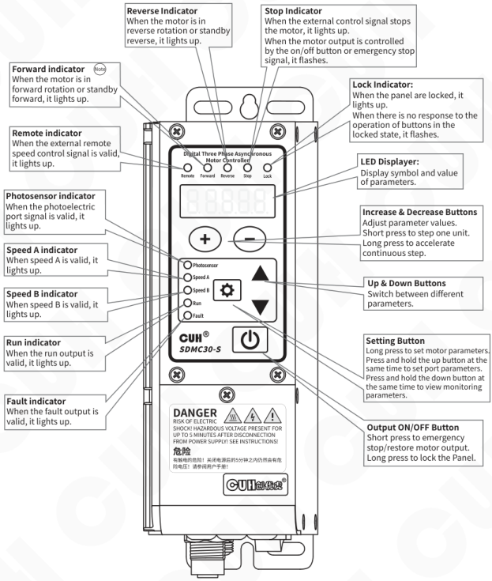

### Indicators

- **Reverse Indicator**  
  When the motor is in reverse rotation or standby reverse, it lights up.
- **Forward indicator** (Note)  
  When the motor is in forward rotation or standby forward, it lights up.
- **Remote indicator**  
  When the external remote speed control signal is valid, it lights up.
- **Photosensor indicator**  
  When the photoelectric port signal is valid, it lights up.
- **Speed A indicator**  
  When speed A is valid, it lights up.
- **Speed B indicator**  
  When speed B is valid, it lights up.
- **Run indicator**  
  When the run output is valid, it lights up.
- **Fault indicator**  
  When the fault output is valid, it lights up.
- **Stop Indicator**  
  When the external control signal stops the motor, it lights up.  
  When the motor output is controlled by the on/off button or emergency stop signal, it flashes.
- **Lock Indicator:**  
  When the panel are locked, it lights up.  
  When there is no response to the operation of buttons in the locked state, it flashes.

### Display and Buttons

- **LED Displayer:**  
  Display symbol and value of parameters.
- **Increase & Decrease Buttons**  
  Adjust parameter values.  
  Short press to step one unit.  
  Long press to accelerate continuous step.
- **Up & Down Buttons**  
  Switch between different parameters.
- **Setting Button**  
  Long press to set motor parameters.  
  Press and hold the up button at the same time to set port parameters.  
  Press and hold the down button at the same time to view monitoring parameters.
- **Output ON/OFF Button**  
  Short press to emergency stop/restore motor output.  
  Long press to lock the Panel.

### Panel Warning

**DANGER**  
RISK OF ELECTRIC SHOCK! HAZARDOUS VOLTAGE PRESENT FOR UP TO 5 MINUTES AFTER DISCONNECTION FROM POWER SUPPLY! SEE INSTRUCTIONS!

### Note

1. Definition: Forward rotation direction: refers to the direction of rotation when observing the needle from the side of the terminal line according to the motor drive motor. IEC60034-8 determines the direction of rotation of the motor.
2. When any two-phase wiring is exchanged, the motor will rotate counterclockwise, that is, the forward and reverse directions are exchanged.

---

## 1.3 External Parts Description

> ⚠️ **Danger**
>
> When installing the output cord, align the PE pin direction and insert the plug, do not forcibly insert without confirming th direction.
>
> If inserted in the wrong direction, the motor housing will be left with high voltage, **which can lead to death or serious injury.**

> ⚠️ **Danger**
>
> 1. This product belongs to protection class I and the three-prong plug of the power cord is used for protective grounding. Please ensure that the connected socket is securely grounded.
> 2. In the absence of a safety ground connection or in the event of a faulty connection, a high voltage is left on the controller housing, and contact with the controller **can result in death or serious injury.**

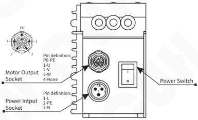

**Motor Output Socket**

Pin definition:
- PE-PE
- 1-U
- 2-V
- 3-W
- 4-None

**Power Intput Socket**

Pin definition:
- 1-L
- 2-PE
- 3-N

**Power Switch**

## 1.4 Signal Ports Description

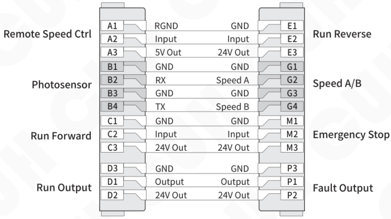

| Function | Pin | Definition | Definition | Pin | Function |
|---|---|---|---|---|---|
| Remote Speed Ctrl | A1 | RGND | GND | E1 | Run Reverse |
| | A2 | Input | Input | E2 | |
| | A3 | 5V Out | 24V Out | E3 | |
| Photosensor | B1 | GND | GND | G1 | Speed A/B |
| | B2 | RX | Speed A | G2 | |
| | B3 | GND | GND | G3 | |
| | B4 | TX | Speed B | G4 | |
| Run Forward | C1 | GND | GND | M1 | Emergency Stop |
| | C2 | Input | Input | M2 | |
| | C3 | 24V Out | 24V Out | M3 | |
| Run Output | D3 | GND | GND | P3 | Fault Output |
| | D1 | Output | Output | P1 | |
| | D2 | 24V Out | 24V Out | P2 | |

---

## 1.5 Nameplate Description

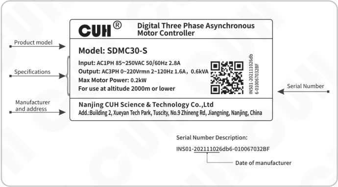

**CUH® — Digital Three Phase Asynchronous Motor Controller**

- **Product model**
  - Model: SDMC30-S
- **Specifications**
  - Input: AC1PH 85~250VAC 50/60Hz 2.8A
  - Output: AC3PH 0~220Vrmn 2~120Hz 1.6A，0.6kVA
  - Max Motor Power: 0.2kW
  - For use at altitude 2000m or lower
- **Manufacturer and address**
  - Nanjing CUH Science & Technology Co.,Ltd
  - Add.:Building 2, Xueyan Tech Park, Tuscity, No.9 Zhineng Rd, Jiangning, Nanjing, China
- **Serial Number**
  - INS01-202111026db6-010067032BF

**Serial Number Description:**

INS01-202111026db6-010067032BF

- 20211102 → Date of manufacturer

---

## Chapter Ⅱ Product Introduction

The main content of this chapter includes a brief introduction and main features of this product.

### 2.1 Product Introduction

The SDMC30 series of digital three-phase asynchronous motor controllers are compact and silent all-solid-state fanless inverter controllers that offer unique performance by employing the latest electronic technology and careful design. Ideal for industrial environment applications, its features include:

- The space vector pulse width modulation (SVPWM) three-phase pure sine wave output mode realizes the performance of high efficiency and low noise of the motor.
- The V/F curve can be customized to suit different types of load applications of the motor.
- The photoelectric port supports photoelectric sensors, NPN, and PNP switch sensors.
- The run output and fault output are used to indicate the operation and fault status of the controller.
- The output port supports NPN, PNP, and push-pull modes.
- The anti-stall function prevents the motor from stalling due to overload during acceleration, deceleration, and operation.
- The DC braking function can quickly brake to stop the motor from rotating during shutdown or emergency stop.
- Supports comprehensive motor protection functions such as overload/overcurrent/stall/lack of phase.
- The panel brightness adjustment function supports 32 levels of brightness adjustment.
- The reverse rotation prohibition function can lock the motor from reverse rotation.
- Emergency stop function, you can choose safe torque off, safe brake control, and Class 1 safety stop.
- Ready Signal Function: Output a modulated signal or a valid signal through the intelligent optoelectronics B4 transmission port to indicate that the controller is in the ready state. When the controller encounters an error, the ready signal becomes invalid.
- The remote control function supports 1~5V, 0~5V, 0~10V, 4~20mA selection.
- The remote control coefficient function can amplify the control effect of the remote control voltage by 1 time or reduce it by 1 time.
- The speed AB function supports two switch signals to control up to four motor speeds.
- Rich control signal sources, logical relationships, switching delays, and output modes can realize complex applications.
- Rich monitoring functions can monitor temperature, output frequency, output power, and signal port voltage.
- The complete protection functions also include: short-circuit protection of motor output, overload protection of controller, over-heating and over-cooling protection, power supply under-voltage/over-voltage protection, short-circuit protection of running output and fault output, short-circuit protection of 24V output, and short-circuit protection of 5V output of speed regulation.

---

# Chapter Ⅲ Installation Guide

This chapter introduces the necessary conditions for the use of the controller and how to install and connect it correctly.

## 3.1 Controller Usage Conditions

The controller is powered by AC 220V, and the protective ground connection is made through the plug of the power cord. Please provide 220V, 50Hz/60Hz mains power supply and distribution facilities that meet the standard and ensure that the protective ground wire is correctly connected.

**⚠ Warn** Never connect the controller to 380V AC power, this will cause irreversible serious damage to the controller, possibly resulting in explosion, fire and other safety incidents.

**⚠ Warn** Ensure that the power supply side is reliably grounded. The metal casing of the controller is directly connected to the protective grounding wire. Poor grounding will cause the controller casing to be electrified and cause an electric shock accident.

**Notice** Long time running will generate heat and cause the temperature of the casing to rise. Please install the controller in a well-ventilated environment and fix it well, away from vibration sources.

**Notice** The motor output port of this product is formed by rectifying and inverting the mains power, and there is no isolation link in the middle. Therefore, the output pole cannot be connected to the protective ground. When connecting the motor, ensure that there is basic insulation between the motor coil and the housing. Otherwise, it will cause electric leakage, which may cause electric shock and damage to the controller.

## 3.2 Operation Method of Buttons

This controller uses 5-digit digital display parameter symbols, and 10 red indicators show the status of the controller or signal port.

This controller adopts 6-button operation, and the operation method is as follows:

 a. The button action is divided into short press and long press (first-level acceleration, second-level acceleration) according to the pressing time.

 b. Short press to define the pressing time greater than 0.1 and less than 2 seconds, and long press to define the pressing time greater than 2 seconds.

 c. ⊕ and ⊖ are used to adjust parameter values, ▼ and ▲ are used to select different parameters.

 d. Short press ⏻ to emergency stop motor output, long press to lock/unlock the Panel.

 e. Long press ⚙ to enter/exit the motor parameter interface.

 f. Long press ⚙ and ▲ to enter/exit the port parameter interface.

 g. Long press ⚙ and ▼ to enter/exit the monitoring parameter interface. Press ⊕ and ⊖ in this interface to temporarily adjust the setting frequency.

---

## 3.3 Install and Use

### Step One:

Open the packing box and check the controller and all accessories.

### Step Two:

Take out the output cord, connect the output cord terminal block to the binding post of the motor, and select the triangle or star wiring according to the nameplate of the motor. And confirm that the yellow and green ground wire is reliably connected with the metal housing of the motor.

### Triangular Wiring

When the controller is connected to the △230V/Y 400V motor, triangle wiring is adopted.

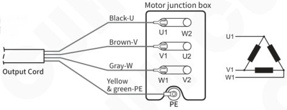

### Star Wiring

When the controller is connected to a △120V/Y 230V motor, star wiring is adopted.

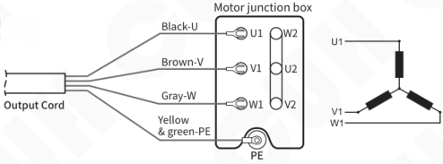

### Note

- According to the IEC60446 regulations:
  1. Black L1, brown L2 and gray L3 are preferentially used for AC phase conductors.
  2. The protective conductor PE must be identified with a yellow-green two-color combination.
- This controller outputs three-phase 220V line voltage, which is suitable for 220~240V delta connection motor or 220~240V star connection motor. If a 380V radial motor is connected, there will be a severe drop in torque.

### ⚠ Danger

Be sure to make sure that the motor housing is reliably connected to the PE wire. Failure to do so will result in the enclosure being electrified, which may result in death or serious injury.

### ⚠ Warn

Please connect the motor terminal blocks in the order of UVW, if the order is incorrect, the motor may reverse and cause mechanical hazards.

---

## Step Three:

Connect the output plug to the controller motor output socket and tighten the nut.

Then take out the power cord, insert the aviation plug of the power cord into the controller power input socket, and tighten the nut of the plug.

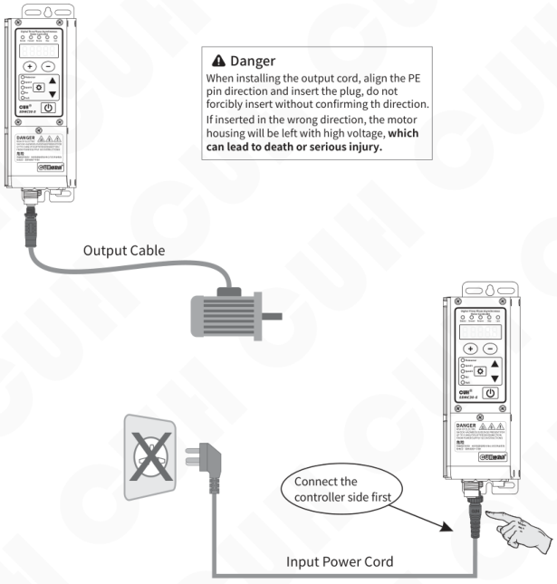

> ⚠ **Danger**
>
> When installing the output cord, align the PE pin direction and insert the plug, do not forcibly insert without confirming th direction.
>
> If inserted in the wrong direction, the motor housing will be left with high voltage, **which can lead to death or serious injury.**

> ⚠ **Danger**
>
> In order to prevent electric shock, do not wiring when the power is turned on, be sure to cut off the power of the machine and carry out the wiring operation after 5 minutes after the digital tube display is turned off. If not done properly, **there is a risk of death or serious injury.**

---

### Step Four:

After confirming that the switch is in the off position, connect the plug of the Input Power Cable to the mains jack.

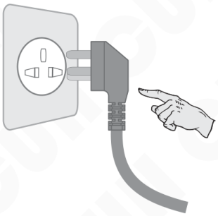

### Step Five:

Turn on the power switch, at this time, the set frequency "F 50.0" should be displayed, and the forward and stop indicators are on. The motor does not rotate at this time.

F means Set Frequency

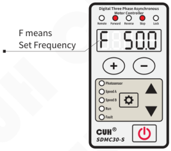

---

## Step Six:

Connect the forward control signal or reverse control signal to the controller, at this time, the controller stop light goes out, the run light lights up, and the motor gradually accelerates to 50Hz frequency.

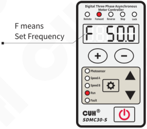

## Step Seven:

Use ⊕ and ⊖ adjust the frequency to the maximum optimal motor speed.

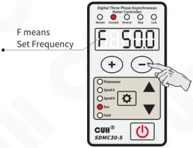

---

## Chapter Ⅳ Basic Function Description

This chapter introduces how to use the basic functions of this product.

### 4.1 Set Frequency

This controller can set the output frequency digitally directly on the panel. Because it uses direct digital frequency synthesis technology (DDS), it has very high frequency accuracy and stability and does not change with changes in time and temperature.

- Turn on the power switch of the controller.
- The controller enters standby parameter set frequency F, forward and stop indicators on the controller are light up, and the LED display Parameter F and its value.
- Press ⊕ or ⊖ to adjust the parameter value.

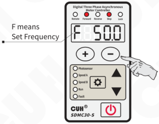

The set frequency range is 2.0~120.0Hz

> - The range in which the set frequency F can be set is limited by the minimum frequency "r" and the maximum frequency "y".

---

## 4.2 Forward and Reverse Running

This controller has a forward running port C and a reverse running port E, when the port signal is invalid, the motor will not run, and the stop indicator light will be lit.

When the forward running port C signal is valid, the motor is running forward, and the stop indicator is off, the forward indicator is lit, and the run indicator is lit.

- Press ⚙ and hold for 2 seconds to enter the motor parameter interface.
- Use ▲ and ▼ to switch to forward start/stop control source 1 adjust state "P1".
- Press ⊕ or ⊖ to adjust the parameter value. The default setting for this parameter is C.

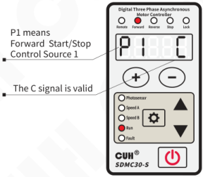

When the reverse running port E signal is valid, the motor is running reverse, and the stop indicator is off, the reverse indicator is lit, and the run indicator is lit.

- Press ⚙ and hold for 2 seconds to enter the motor parameter interface.
- Use ▲ and ▼ to switch to reverse control source 1 adjust state "Π1".
- Press ⊕ or ⊖ to adjust the parameter value. The default setting for this parameter is E.

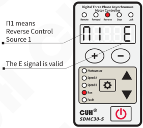

Note:

1. When the signals of the forward and reverse running ports are valid, the controller will report the error Er15 forward and reverse conflict, and the motor will not run.
2. If the wiring is carried out according to the motor wiring instructions, according to the definition of the rotation direction of the motor in IEC60034-8, the forward rotation direction refers to the clockwise rotation observed from the side of the motor drive.

---

## 4.3 Emergency Stop

In an emergency state, the controller can enter the emergency stop state to quickly stop the motor operation. It can enter the emergency stop state by pressing the panel power button or triggering the emergency stop port signal to be valid. At this time, the stop indicator flashes and Ar02 emergency stop is displayed.

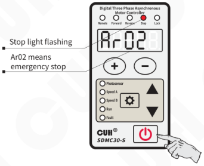

- The emergency stop state entered by pressing the power button on the panel can be released by pressing the power button again.
- The emergency stop state is effectively entered by triggering the emergency stop port signal. In addition to removing the emergency stop port signal, you also need to press the panel power button to release the emergency stop state.

> The emergency stop mode can be selected through parameter Sq: safe torque off, safe brake control and class 1 safe stop. For detailed functions, please refer to the advanced function description.

---

## 4.4 Soft Start Time

When this controller starts from a stopped state, the motor output frequency can be increased gently to the set frequency to prevent impact on the motor and operating equipment.

Soft start time (t): When the motor starts from a stopped state, the time required for the controller output frequency to smoothly increase from the lowest frequency to the set frequency is called the soft start time.

- Press ⚙ and hold for 2 seconds to enter the motor parameter interface.
- Use ▲ and ▼ to switch to soft start time adjust state "t".
- Press ⊕ or ⊖ to adjust the parameter value.

The soft start time range is 0.0~99.9 seconds

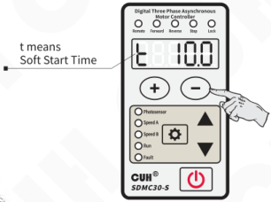

## 4.5 Soft Closing Time/DC Braking

When the controller stops from the running state, the motor output frequency can be gently reduced to the lowest frequency to prevent impact on the motor and operating equipment.

Soft closing time (): When the motor stops from the running state, the time required for the controller output frequency to smoothly decrease from the set frequency to the lowest frequency is called the soft closing time.

- Press ⚙ and hold for 2 seconds to enter the motor parameter interface.
- Use ▲ and ▼ to switch to soft closing time adjust state "[[vcrop:22:2]]".
- Press ⊕ or ⊖ to adjust the parameter value.

The soft closing time range is 0.0~99.9 seconds  
The DC braking time range is -0.0~-99.9 seconds

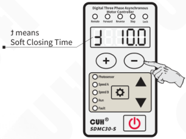

---

## 4.6 Keyboard Lock

When the parameters of the controller are set, the keyboard lock function can lock all buttons on the panel to avoid misoperation.

Even if it is turned off and then turned on again, the state of the keyboard lock remains the state it was in the last time it was turned off.

- Press ⏻ and hold for 2 seconds to lock all buttons on the panel. The lock indicator lights up.
- Press ⏻ and hold for 2 seconds again to unlock.

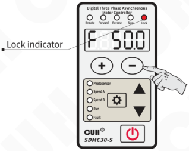

> When the controller is locked, the operation button is unresponsive and the lock indicator flashes.

---

## 4.7 Restore Default Settings

User can quickly restore the controller to the factory default state.

Due to the powerful functions of the controller, many parameters can be adjusted. For beginners, it may not be able to restore the normal working state of the controller after several settings and modifications. Use this function to quickly restore the disordered parameter state to the factory default setting.

- Long press ⚙ and ▲ simultaneously to enter the port parameter interface.

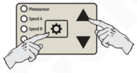

- Short press ▲ to switch to the full flashing on the LED displayer, that is the parameter of "Default Settings Restore". And then press ⊕ and hold until the controller displays "-----", indicating that the controller has been restored.

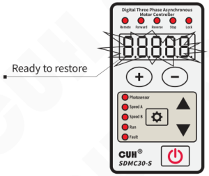

- Release ⊕, after the controller displays "CUH", then enter the normal standby interface. By this time, all parameters have been restored to the factory default settings.

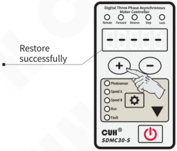

> Before the user performs a factory reset, he needs to press ⏻ to put the controller in an emergency stop state, at which point the stop light flashes.

---

## Chapter Ⅳ Advanced Function Description

This chapter mainly introduces how to use the advanced functions of this product.

### 5.1 Motor Start/Stop and Direction Control

This controller is designed with a forward and a reverse start/stop signal to control the start/stop and direction of the motor. The forward start/stop signal has 2 signal sources and a logic calculation unit, so does the reverse signal. These two signals can be selected to control the start/stop, as well as forward/reverse of the motor. See the figure below for specific logical relationships.

Forward and reverse start/stop control sources include respectively: 0, 1, b, -b, C, -C, E, -E, SA, -SA, Sb, -Sb, ES, -ES, od, -od, oP, -oP.

The logical relationship include: And, or, Xor, RS triggers.

There are two values for the forward and reverse control modes:

- **Fr=0 means:** the forward start/stop signal is used to control the forward start and stop, so does the reverse signal
- **Fr=1 means:** the forward start/ stop signal is used to control start and stop, but the reverse signal is used to control the direction.

Note: When Fr=0 and the forward and reverse signals are both valid at the same time, Er15 forward/reverse conflict is triggered and the motor stops running.

---

## 5.2 Motor Rotation Direction Exchange and Prohibition of Reverse Rotation

In practical applications, if it is necessary to change the direction of rotation of the motor or prohibit the motor from running in a certain direction due to mechanical system limitations or wiring reasons, the parameter Ph (Phase) can be used for direction exchanging.

- **When Ph=Abc,** it means the standard direction, that is, forward rotation is clockwise when viewed from the motor drive end.
- **When Ph=Acb,** it means the direction is exchanged, that is, forward rotation is counterclockwise when viewed from the motor drive end.
- **When Ph=A.b.c.,** it means that the standard direction is forbidden to reverse, that is, the motor can only rotate clockwise, when the reversal command appears, it does not respond and displays the Ar08 forbidden reversal warning.
- **When Ph=A.c.b.,** it means that the direction exchange prohibits forward rotation, that is, the motor can only rotate counterclockwise, and does not respond when the forward rotation command appears, and displays the Ar08 prohibiting reversal warning.

The figure below shows a motor in a clockwise direction, with the shaft rotating clockwise from the drive end and the observation direction from the drive end to the non-drive end.

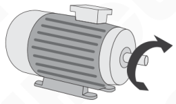

The figure below shows a motor in a counterclockwise direction, with the shaft rotating counterclockwise from the drive end.

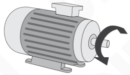

---

## 5.3 Motor Emergency Stop

This controller can make the motor emergency stop, this stop source can be effectively activated by pressing the power button on the panel or the external emergency stop switch.

The emergency stop source can select different signal sources, by default is the emergency stop port signal. The panel power button is always an effective emergency stop source.

Depending on the emergency stop mode, the Sq parameter can select different strategies for emergency stops:

- **Sq=Sto,** the controller immediately cuts off the power supply to the motor, and the motor decelerates and stops according to inertia.
- **Sq=Sbc,** the motor stops for DC braking, and the braking time is determined by the soft closing time. The fault output port outputs an emergency stop state and is not controlled by the signal source, and a safety brake relay must be used.
- **Sq=SS1,** the motor decelerates or brakes to stop according to the action defined by the soft closing time.

### Emergency stop switch connection method

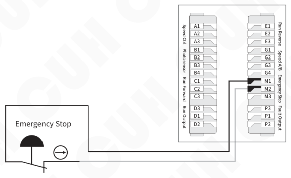

---

### Sto: Safe torque off

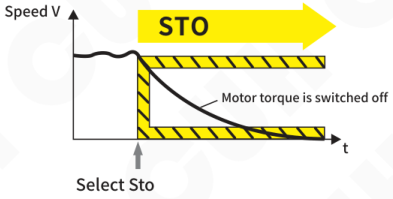

### Sbc: Safety brake control

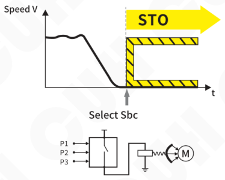

### SS1: Class 1 safety stop

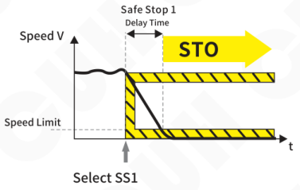

---

## 5.4 Motor V/F Curve Setting

This controller can customize the V/F curve to adapt to different motor load.

It is defined by the maximum frequency y, the rated frequency b, the rated voltage h, the intermediate frequency n, the intermediate voltage o, the lowest frequency r, and the minimum voltage u.

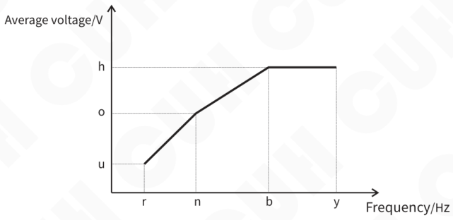

**Note:** Due to the inductive nature of the motor load, the output line voltages are calibrated to the rectified average value Vrmn in order to maintain the current in the linear section of the V/F curve. In general, the RMS value Vrms of the standard sine wave is 1.11 times that of the rectified average Vrmn.

---

**Diagram of motor power exceeding upper limit protection**

The controller monitors the electric power of the motor in real time. When the power exceeds the value of the motor's rated electric power Po multiply the power excess coefficient rc, it triggers the motor power over limit protection Er02P. The motor's electronic overheat integrator goes directly into saturation. The controller will reduce the output frequency until the output power drops to the power defined by the power derating coefficient rL. At this time, the integrator is reset. When the reset is completed, it returns to the set frequency running and restarts a new protection cycle.

---

## 5.6 Motor Speed Remote Control

In addition to setting the frequency through the panel, this controller can also control the output frequency through external analog signals. The analog signal supports potentiometer, 1~5V, 4~20mA, 0~5V, 0~10V signals, which can be set by parameter remote control source A.

- **A=PAd:** Indicates that the set frequency is only controlled by the panel buttons.
- **A=1-5V:** Indicates that the external input 1-5V setting frequency is between the minimum frequency r and the maximum frequency y. When the voltage is 0-0.5V, the remote control is invalid and the set frequency is controlled by the panel. The remote control is valid when at 0.5-1V, but the controller will not operate.
- **A=0-5V:** Indicates that the external input 0-5V, setting frequency is between the minimum frequency r and the maximum frequency y.
- **A=0-10:** Indicates that the external input 0-10V, setting frequency is between the minimum frequency r and the maximum frequency y.

This controller is also designed with a remote control coefficient c parameter to amplify or reduce the effect of the remote control voltage, which can be adjusted in the range of 0.5~2.0. When set to 0.5, it means that the effect of remote control of the set frequency by adjusting voltage value is reduced by half, that is, it can only remotely raise up to half of the maximum frequency y. When set to 2.0, it means that the effect of the remote control voltage controlling the output voltage is doubled. That is, the set frequency has reached y when the remote control voltage reaches only half. If the remote control voltage is increased further, the output voltage cannot be increased anymore.

### Potentiometer control connection method

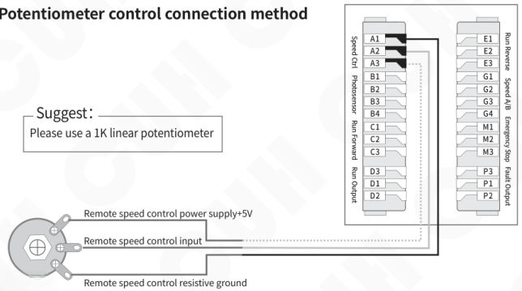

When the potentiometer is connected, the remote indicator lights up, the frequency setting from the panel is invalid at this time.

---

## 1~5V voltage control connection method

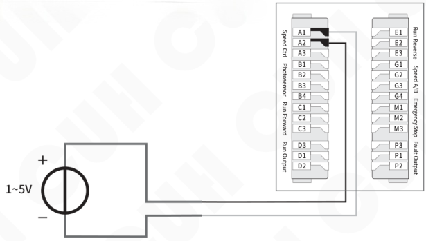

## 4~20mA current control connection method

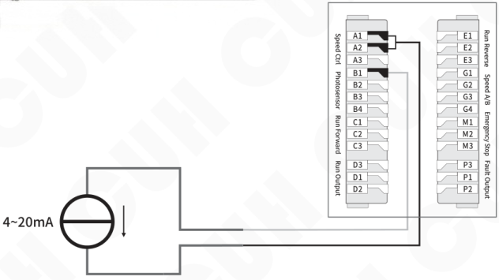

1. Select A=1-5V, support potentiometer, 1~5V, 4~20mA input.
2. When selecting 0~5V or 0~10V, the wiring method is the same as 1-5V.

---

## 5.7 Motor Speed Digital Preset

The speed preset function is a function that directly selects a predetermined speed through external or internal control signals. It constitutes a control system with up to four speeds.

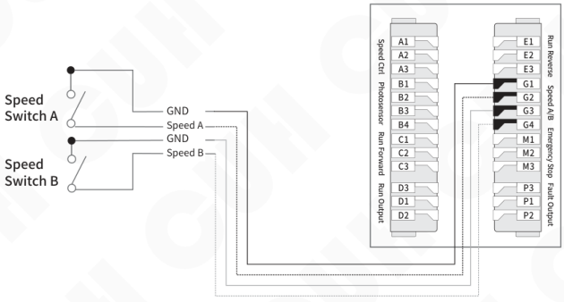

By default, the speed preset source 1 selects the external speed A port SA, and the speed preset source 2 selects the external speed B port Sb. According to the application scenario, the signal source can be modified to switch among different speeds.

Each speed preset source has a corresponding indicator on the panel, which lights up when the source is active. The combination of the two indicator states has 4 states (AB both off, A on B off, A off B on, AB both on).

Through the combination of signals, the controller will enter the corresponding speed preset state, and the set frequency of the controller can be adjusted by ⊕ and ⊖. This frequency will be automatically memorized, and the speed preset control signal setting controller will be switched to the set frequency value of the memory immediately after entering this state at any time.

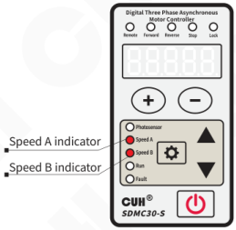

---

## 5.8 Switch Sensor

The controller is designed with four switching sensor interfaces: forward and reverse operation, speed AB and emergency stop. These interfaces can support NPN, PNP, Ut1, Ut0 modes, and can be set via parameter of switch sensor type ΓA.

- **The Ut1 mode is a single scan,** that is, before the sensor signal is invalid, the high and low levels are changed to detect whether the port is valid. After finding a valid signal, the port sensor type is determined and no longer scans.
- **The Ut0 mode is continuous scanning,** regardless of the sensor type, it always detects whether the port is connected to a valid signal by changing the high and low levels.

The switching delay of each switching quantity can also be set by the corresponding parameters, see the parameter table for details.

### Switch sensor connection method

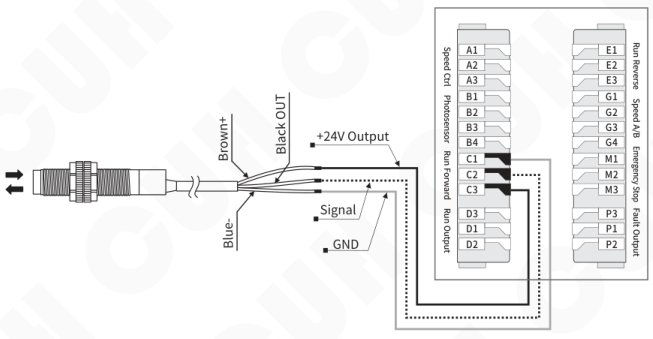

---

## 5.9 Intelligent Photoelectric Sensor Port

The intelligent photoelectric port of this controller supports photoelectric through-beam or reflective sensors composed of light-emitting diodes and phototriodes, and can also be set to support NPN or PNP switching sensors through the intelligent photoelectric sensitivity parameter P.

### Photoelectric sensor connection method

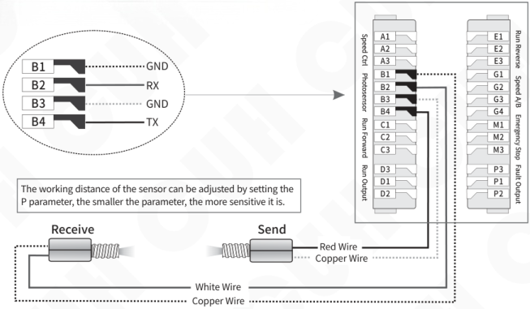

The working distance of the sensor can be adjusted by setting the P parameter, the smaller the parameter, the more sensitive it is.

### Switch sensor connection method

Set the NPN or PNP type by parameter P

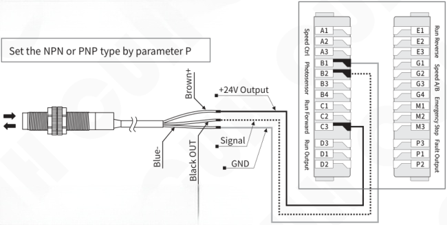

**Note:**

When P value is nPn or PnP, B4 outputs a 10mA valid signal.

From 2 to 1000, B4 outputs a 10mA modulated signal with a frequency of about 200Hz.

When the controller encounters an error, B4 does not output. This is the ready signal function.

---

## 5.10 Running Output/Fault Output Port

The running output and fault output ports can support NPN output, PNP output and push-pull output. In which:

- The NPN output is valid as a low level, and the output is invalid as a high-impedance state.
- The PNP output is valid as a high level, and the output is invalid as a high-impedance state.
- The push-pull output is valid as a high level, and invalid as a low level.

### 5.10.1 Wiring Method of Running Output/Fault Output

**NPN output connection method**

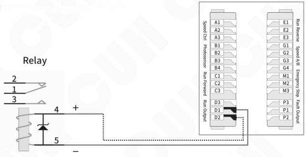

**PNP or push-pull output connection method**

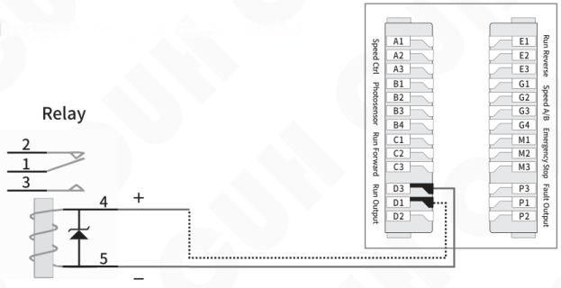

> If connecting a 24V relay, be sure to confirm the positive and negative poles of the coil to make sure they are connected correctly. Because the output current capability of this port is 350mA, the internal protection diode of the relay will short-circuit the port of this controller after being reversed, triggering the short-circuit protection Er07d/P.

---

## 5.10.2 Signal Source and Logic Diagram of Running Output/Fault Output

The control of the running output/fault output is the result of the logical relationship between the two sources, and the following sources can be selected from the list of sources.

Signal source meaning list:

| Signal Source | Meaning |
|---|---|
| 0 | Invalid signal |
| 1 | Valid signal |
| b | Intelligent photoelectric port signal |
| -b | Intelligent photoelectric port signal inversion |
| C | Forward running port signal |
| -C | Forward running port signal inversion |
| E | Reverse running port signal |
| -E | Reverse running port signal inversion |
| SA | Speed A port signal |
| -SA | Speed A port signal inversion |
| Sb | Speed B port signal |
| -Sb | Speed B port signal inversion |
| ES | Emergency stop port signal |
| -ES | Emergency stop port signal inversion |
| od | Run output port signal |
| -od | Run output port signal inversion |
| oP | Fault output port signal |
| -oP | Fault output port signal inversion |
| oq | Motor output signal |
| -oq | Motor output signal inversion |
| Er | Any fault signal |
| -Er | Any fault signal inversion |
| Ar | Any warning signal |
| -Ar | Any warning signal inversion |

---

## Running Output/Fault Output logic diagram:

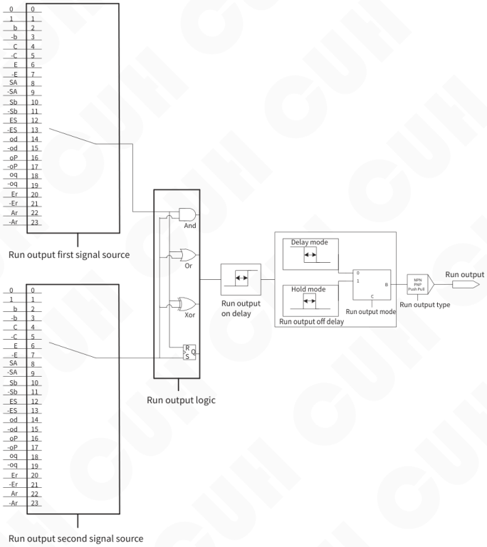

Note: The logic diagram of fault output is consistent with the logic diagram of run output.

---

## 5.10.3 Mode Description of Running Output/Fault Output

There are 2 modes available for run output/fault output: delay mode, hold mode.

**Delay mode:** means that after the signal driving the running output/fault output changes from valid to invalid, the running output/fault output turns off after a period of off delay time.

**Hold mode:** means that after the signal driving the running output/fault output becomes valid, the running output/fault output remains open during the off delay time, and turns off after the off delay time is exceeded.

The difference between the two modes is expressed in the form of a timing diagram as follows, where the input signal is the signal output after the logic relationship selector.

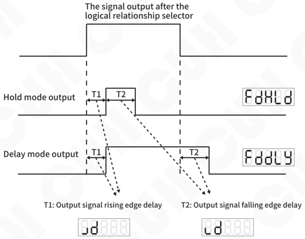

---

## 5.11 Power On and Running Status

The power on running status setting function allows you to specify the status of the power button after power on. By adjusting the running status parameter PS.

- **PS=run,** indicating that the power button of the controller is running after power on.
- **PS=stP,** indicates that the power button of the controller is in the stop state after power on.
- **PS=FoL,** indicates that the power button of the controller is in the state of last power-off after power-on.

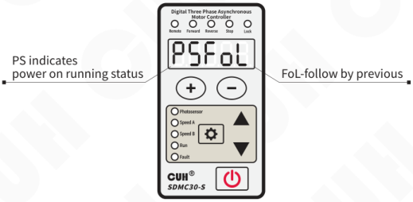

> FoL represents the status before the controller is powered off.
>
> If the controller is in the emergency stop state with the stop light flashing before the power is turned off, it will remain in this state when the power is turned on again.

---

## 5.12 Panel Brightness Adjustment

This controller uses a new digital display driver chip, which supports users to adjust the display brightness value between 1 and 32 through the parameter LED.

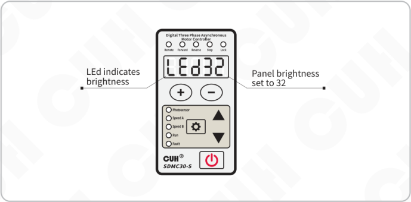

# Chapter IV Technical Specifications

## 6.1 Dimensions　(unit: mm)

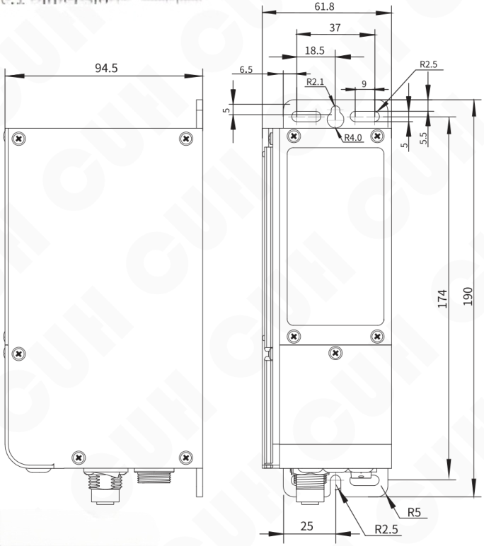

| Dimensions range | tolerance |
|---|---|
| 0~3 | ±0.05 |
| 3~10 | ±0.1 |
| 10~30 | ±0.15 |
| 30~80 | ±0.2 |
| 80~180 | ±0.3 |
| >180 | ±0.5 |

> **！Essential**
>
> Please be sure to fix the product On a solid platform as necessary, and fix the upper and lower mounting holes of the controller. Please install it away from the grounding of the vibrating equipment.

This tolerance table is applicable to all products in this series.

---

## 6.2 Technical Specifications

| Item | Min | Typical | Max | Unit | Note |
|---|---|---|---|---|---|
| Input Voltage | 85 | 220 | 250 | V | 50/60Hz AC RMS |
| Output Line Voltage | 0 | 200 | 220 | Vrmn | Rectified average |
| RMS Input Current | —— | —— | 2.8 | A | |
| Input Current Peak | —— | —— | 8.0 | A | |
| Output Current Adjustment Range | 0 | —— | 1.6 | A | Rectified average |
| Output Capacity | 0 | —— | 600 | VA | |
| Output Frequency | 2.0 | —— | 120.0 | Hz | |
| Frequency Adjustment Accuracy | | 0.1 | | Hz | |
| Output Waveform | | Vector Sine | | | |
| Applicable Motor Power | —— | —— | 0.2 | kW | 1/4HP |
| Overheat Protection Trigger Temperature | —— | 65 | —— | °C | 60°C return to normal |
| DC Control Output Current | 0 | —— | 350 | mA | |
| 24V Output Current | —— | —— | 700 | mA | |
| DC Control Output Voltage | 22 | 24 | 26 | V | |
| Analog Control Signal | | 4~20 / 1~5、0~5、0~10 | | mA / V | Controlled by parameter A |
| Digital Control Signal | | 24 | | V | Switching Signal |
| Adjustment Method | | 6 | | Button | |
| Standby Power Consumption | —— | 3 | —— | W | |
| Display Method | | 5 | | Digit | LED |
| Weight | | 830 | | g | Without Accessory |
| Dimensions | | 190\*61.8\*94.5 ( L\*W\*H ) | | mm | |
| Ingress Protection Level | | IP20 | | | |
| Ambient Temperature | -10 | 25 | 40 | °C | No Condensation |
| Ambient Humidity | 10 | 60 | 85 | % | No Condensation |
| Storage Ambient Temperature | -20 | 25 | 85 | °C | No Condensation |
| Applicable Altitude | | <2000 | | m | |

# Chapter Ⅶ Appendix

## 7.1 Parameter Table

| Parameter | Definition | Symbol | symbol image | Range | Default |
|---|---|---|---|---|---|
| Standby Parameter | Set Frequency | F |  | 2.0~120.0 (Hz) (limited by r and y) | 50.0 |
| Motor Parameter — Long press ⚙ | Forward Start/Stop Control Source 1 | F1 |  | 0, 1, b, -b, C, -C, E, -E, SA, -SA, Sb, -Sb, ES, -ES, od, -od, oP, -oP | C |
| Motor Parameter | Forward Start/Stop Control Source 2 | F2 | 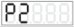 | 0, 1, b, -b, C, -C, E, -E, SA, -SA, Sb, -Sb, ES, -ES, od, -od, oP, -oP | -b |
| Motor Parameter | Forward Start/Stop Logic Relationship | FA |  | And, or, Xor, rS | And |
| Motor Parameter | Reverse Control Source 1 | A1 | 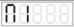 | 0, 1, b, -b, C, -C, E, -E, SA, -SA, Sb, -Sb, ES, -ES, od, -od, oP, -oP | E |
| Motor Parameter | Reverse Control Source 2 | A2 |  | 0, 1, b, -b, C, -C, E, -E, SA, -SA, Sb, -Sb, ES, -ES, od, -od, oP, -oP | -b |
| Motor Parameter | Reverse Logic Relationship | AA |  | And, or, Xor, rS | And |
| Motor Parameter | Forward and Reverse Control Mode | Fr |  | 0 (Forward control source is used to start and stop forward rotation, and reverse control source is used to control reverse rotation start and stop) 1 (Forward control source is used to control start and stop, reverse control source is used to control forward and reverse) | 0 |
| Motor Parameter | Emergency Stop Source | Eq |  | 0, 1, b, -b, C, -C, E, -E, SA, -SA, Sb, -Sb, ES, -ES, od, -od, oP, -oP, oq, -oq, Er, -Er, Ar, -Ar | ES |
| Motor Parameter | Emergency Stop Type | Sq |  | Sto: Safe torque off, Sbc: Safety brake control, SS1: Category 1 safety stop　(Note1) | Sto |
| Motor Parameter | Soft Start Time | t |  | 0.0~99.9 (s) | 10.0 |
| Motor Parameter | Soft Closing Time | d |  | DC Braking Time: -0.0~-99.9 (s) Soft Closing Time: 0.0~99.9 (s) | 10.0 |
| Motor Parameter | Maximum Frequency | y |  | 2.0~120.0 (Hz) | 50.0 |
| Motor Parameter | Rated Frequency | b |  | 45.0~65.0 (Hz) | 50.0 |
| Motor Parameter | Rated Voltage | h |  | 70~220 (Vrmn) | 200 |
| Motor Parameter | Intermediate Frequency | n |  | r~b (Hz) | 10.0 |
| Motor Parameter | Intermediate Voltage | o |  | u~h (Vrmn) | 40 |
| Motor Parameter | Lowest Frequency | r |  | 2.0~n (Hz) | 2.0 |
| Motor Parameter | Lowest Voltage | u |  | 0~o (Vrmn) | 8 |
| Motor Parameter | Motor Rated Electrical Power | Pn |  | 0.01~0.20 (kW) | 0.20 |
| Motor Parameter | Power Excess Factor | rc |  | 100~150 (%) | 150 |
| Motor Parameter | Braking Current Coefficient | cb |  | 10~150 (%) | 100 |
| Motor Parameter | Electric Power Overheating Threshold | oL |  | 0~90 (times*seconds) Remarks: If the rated electric power of the motor is exceeded and does not exceed the upper limit of the motor power, if the integral per second exceeds this setting, it will enter the electronic overheating protection state. | 30 |
| Motor Parameter | Power Derating Factor | rL |  | 0~90(%) 0 means shutdown, 90 means reducing to 90% of rated power. | 0 |
| Motor Parameter | Rotation Direction Exchange (Note2) | Ph |  | Abc: standard direction, Acb: direction exchange, A.b.c.: Reversal of the standard direction is forbidden (only forward), A.c.b.: Direction swapping prohibits forward rotation (only reversal) | AbC |
| Motor Parameter | Power On Running Status | PS |  | run: run, stp: stop, FoL: save the last time | FoL |

**Port Parameter**  
Long press ⚙ and ▲

| Definition | Symbol | symbol image | Range | Default |
|---|---|---|---|---|
| Intelligent Photoelectric Sensitivity | P |  | nPn, PnP, 2~1000 | nPn |
| Intelligent Photoelectric On Delay | J |  | 0.0~99.9 (s) | 0.2 |
| Intelligent Photoelectric Off Delay | L |  | 0.0~99.9 (s) | 0.2 |
| Switch Sensor Type | rA |  | nPn, PnP, Ut1: Single scan, Ut0: Continuous scan | Ut0 |
| Forward Running On Delay | JC |  | 0.0~99.9 (s) | 0.2 |
| Forward Running Off Delay | LC |  | 0.0~99.9 (s) | 0.2 |
| Reverse Running On Delay | JE |  | 0.0~99.9 (s) | 0.2 |
| Reverse Running Off Delay | LE |  | 0.0~99.9 (s) | 0.2 |
| Speed A/B On Delay | JG |  | 0.0~99.9 (s) | 0.2 |
| Speed A/B Off Delay | LG |  | 0.0~99.9 (s) | 0.2 |
| Emergency Stop On Delay | JJ |  | 0.0~99.9 (s) | 0.2 |
| Emergency Stop Off Delay | LL |  | 0.0~99.9 (s) | 0.2 |
| Speed Preset Source 1 | S1 |  | 0, 1, b, -b, C, -C, E, -E, SA, -SA, Sb, -Sb, ES, -ES, od, -od, oP, -oP, oq, -oq, Er, -Er, Ar, -Ar | SA |
| Speed Preset Source 2 | S2 |  | 0, 1, b, -b, C, -C, E, -E, SA, -SA, Sb, -Sb, ES, -ES, od, -od, oP, -oP, oq, -oq, Er, -Er, Ar, -Ar | Sb |
| Run Output Signal Source 1 | Ed |  | 0, 1, b, -b, C, -C, E, -E, SA, -SA, Sb, -Sb, ES, -ES, od, -od, oP, -oP, oq, -oq, Er, -Er, Ar, -Ar | oq |
| Run Output Signal Source 2 | td |  | 0, 1, b, -b, C, -C, E, -E, SA, -SA, Sb, -Sb, ES, -ES, od, -od, oP, -oP, oq, -oq, Er, -Er, Ar, -Ar | 0 |
| Run Output Logic Relationship | Ad |  | And, or, Xor, rS | or |
| Run Output On Delay | Jd |  | 0.0~99.9 (s) | 0.0 |
| Run Output Off Delay | Ld |  | 0.0~99.9 (s) | 0.0 |
| Run Output Mode | Fd |  | dLy (delay mode), HLd (hold mode) | dLy |
| Run Output Logic Direction | Sd |  | `---` Inphase, `-﹉-` inverted, on (normally open), oFF (normally close) | `---` |
| Run Output Type | rd |  | nPn, PnP, PSP (push-pull) | nPn |
| Fault Output Signal Source 1 | EP |  | 0, 1, b, -b, C, -C, E, -E, SA, -SA, Sb, -Sb, ES, -ES, od, -od, oP, -oP, oq, -oq, Er, -Er, Ar, -Ar | Er (error signal) |
| Fault Output Signal Source 2 | 2P |  | 0, 1, b, -b, C, -C, E, -E, SA, -SA, Sb, -Sb, ES, -ES, od, -od, oP, -oP, oq, -oq, Er, -Er, Ar, -Ar | Ar (warn signal) |
| Fault Output Logic Relationship | AP |  | And, or, Xor, rS | or |
| Fault Output On Delay | JP |  | 0.0~99.9 (s) | 0.0 |
| Fault Output Off Delay | LP |  | 0.0~99.9 (s) | 0.0 |
| Fault Output Mode | FP |  | dLy (delay mode), HLd (hold mode) | dLy |
| Fault Output Logic Direction | SP |  | `---` Inphase, `-﹉-` inverted, on (normally open), oFF (normally close) | `---` |
| Fault Output Type | rP |  | nPn, PnP, PSP (push-pull) | nPn |

Logic Direction display symbols:

| | Definition | Symbol | symbol image | Range | Default |
|---|---|---|---|---|---|
| Port Parameter | Remote Control Source | A |  | Pad (controlled by buttons), 1-5V, 0-5V, 0-10 | 1-5V |
| Port Parameter | Remote Control Coefficient | r |  | 0.50~2.00 | 1.00 |
| Port Parameter | Panel Brightness | LEd |  | 1~32 | 16 |
| Port Parameter | Default Settings Restore | 8.8.8.8.8. |  | —— | —— |
| Monitoring Parameter Long press ⚙ and ▼ | controller Temperature | C |  | -20.0~85.0 (℃) | —— |
| Monitoring Parameter | Output Frequency | E |  | 2.0~120.0 (Hz) | —— |
| Monitoring Parameter | System Active Power (controller + motor) | qP |  | 0.00~0.40 (kW) | —— |
| Monitoring Parameter | Bus Current | AC |  | 0.00~3.50 (A) | —— |
| Monitoring Parameter | Output Voltage | dU |  | 0~250 (V) | —— |
| Monitoring Parameter | Bus Voltage | PU |  | 0~400 (V) | —— |
| Monitoring Parameter | 24V Output Voltage | nU |  | 0.0~28.0 (V) | —— |
| Monitoring Parameter | Remote Control Port Voltage | AU |  | 0.0~10.0 (V) | —— |
| Monitoring Parameter | Intelligent Photoelectric Signal Voltage | bU |  | 0~999 | —— |
| Monitoring Parameter | Forward Signal Voltage | tU |  | 0.0~28.0 (V) | —— |
| Monitoring Parameter | Run Output Port Voltage | dU |  | 0.0~28.0 (V) | —— |
| Monitoring Parameter | Invert Signal Voltage | EU |  | 0.0~28.0 (V) | —— |
| Monitoring Parameter | Speed A Port Voltage | SA |  | 0.0~28.0 (V) | —— |
| Monitoring Parameter | Speed B Port Voltage | Sb |  | 0.0~28.0 (V) | —— |
| Monitoring Parameter | Emergency Stop Port Voltage | SU |  | 0.0~28.0 (V) | —— |
| Monitoring Parameter | Fault Output Port Voltage | FU |  | 0.0~28.0 (V) | —— |
| Monitoring Parameter | Control Board Version | uc |  | —— | —— |
| Monitoring Parameter | Power Board Version | uq |  | —— | —— |

Note 1: When STo, the controller immediately cuts off the power supply to the motor, and the motor decelerates and stops according to inertia.

When Sbc, the motor brakes to stop by DC braking, and the braking time is confirmed by the soft closing time. The fault output port outputs an emergency stop state, which is not controlled by the signal source, and must use a safety brake relay.

When SS1, the motor decelerates or brakes to stop according to the action defined by the soft closing time.

Note 2: According to IEC60034-8, the standard direction is defined as: the clockwise direction is observed from the side of the motor drive, and this parameter does not affect the state of the forward and reverse indicators.

---

## 7.2 Input and Output Circuit Diagrams

**Remote Speed Control Port A**

**Intelligent Photosensor Port B**

**Run Output Port D/Fault Output Port P**

---

| Port | Function |
|---|---|
| C3/E3/M3 | 24V Output |
| C2/E2/M2/G2/G4 | Input |
| C1/E1/M1/G1/G3 | GND |

**Forward Running Port C/Reverse Running Port E/**  
**Emergency Stop Port M/Speed Preset Port G**

---

## 7.3 Error Code

| Error Code | Meaning | Occurrence Conditions | Controller Response | Troubleshooting Methods |
|---|---|---|---|---|
| Er01 | Main output short circuit | Short circuit output phase-to-phase or phase-to-PE | Stop the main output, short press ON/OFF button to clear. | ◆ Short-circuit the output switch or switch off the output switch twice, then power on again. |
| Er02H | Motor electronics overheating | Motor exceeds electrical power overheating threshold | Stop and automatic restart or run at decrease power rating according to Power Derating Factor setting. | ◆ Appropriately reduce the motor operating frequency setting. |
| Er02P | Motor power exceeds limit | The output power exceeds the power excess coefficient | Stop and automatic restart or run at decrease power rating according to Power Derating Factor setting. | ◆ Appropriately reduce the motor operating frequency setting. |
| Er03L | Undercooling | The controller temperature is lower than -20°C | Stop the main output. The output is automatically started when the temperature returns to normal. | ◆ Avoid activating the controller in extremely cold temperatures. |
| Er03H | Overheat | The controller temperature is higher than 65°C | Stop the main output. The output is automatically started when the temperature returns to normal. | ◆ Install this controller in a well-ventilated environment. |
| Er04L | Undervoltage | The average bus voltage is lower than 77V | Stop the main output. The output is automatically restored when the power supply voltage is normal. | ◆ Make sure the input voltage is between 85V~250V. |
| Er04H | Overvoltage | The average bus voltage is higher than 390V | Stop the main output. The output is automatically restored when the power supply voltage is normal. | ◆ Make sure the input voltage is between 85V~250V. |
| Er05 | Internal communication abnormality | No response received from the power board for 2 consecutive seconds | Stop the main output. Automatically eliminated when communication is restored | ◆ Make sure that the 24V power port is not connected to any external power supply or contact our technical support. |
| Er06 | Temperature sensor abnormality | Unable to read temperature | Stop the main output and try to read the temperature for 2 seconds. | ◆ Contact our technical support. |
| Er07d/P | run/fault output port short circuit | Output current exceeds 350mA or short circuit | Run/fault output off within 5ms, Try restarting the output after 2 seconds. | ◆ Make sure the load is not short-circuited and the current does not exceed 350mA |
| Er10 | 24V output short circuit | The output 24V is short-circuited or over-current over 700mA | Stop the 24V output and power on again to restart the output. | ◆ Make sure the 24V output is not shorted or the output exceeds 700mA. |
| Er11 | 5V output abnormality | 5V output exceeds ±10% range | The remote speed control fails, it can be automatically resumed | ◆ Make sure the 5V output has not been shorted or connected to an external voltage. |
| Er12 | 24V voltage abnormality | Check whether the internal 24V voltage between 22~26V | Control output port gives high impedance, it can be automatically resumed | ◆ Make sure that the 24V power output port or control output port is not connected to any external power supply |
| Er13 | Input Missing Phase (3-phase input models only) | The three-phase power input is out of phase | Stop the main output | ◆ Power off to eliminate the lack of phase of the input and then power it back on. |
| Er14 | Output Missing phase | Output phase current unbalance of more than 50% | Stop the main output | ◆ Power-off eliminates the lack of phase of the output and then power it back on. |
| Er15 | Forward and reverse conflicts | Forward and reverse signals are given at the same time | The main output is stopped, it will be automatically resumed after the conflict is removed | ◆ Make sure that the forward and reverse signals are not given at the same time. |

## Chapter Ⅷ Product Warranty Information

### 8.1 Warranty Period

The warranty period provided by the company for this product is 3 years from the date of delivery of the product to the location designated by the purchaser.

### 8.2 Warranty Coverage

(1) If there is a failure caused by our company during the above warranty period, we will repair the product free of charge. However, The following situations are not covered by the warranty:

a. Failure to comply with the conditions specified in the simple manual, user manual or technical requirements specifically agreed between the purchaser and the company, improper operation, or failure caused by improper use.

b. Failure is not due to a product defect, but to the purchaser's equipment or software design.

c. Malfunctions caused by modifications or repairs not performed by the company's personnel.

d. The failure that can be totally avoided by correct maintenance or replacement of wearing parts according to the simple operation guide or user manual.

e. After the product is shipped from our company, it is caused by factors such as unforeseen changes in the level of science and technology failure.

f. Due to natural disasters such as fire, earthquake, flood, or external factors such as abnormal voltage failure, the company is not responsible for the warranty.

(2) The scope of warranty is limited to the situation stipulated in (1)，Indirect losses (such as equipment damage, opportunities, loss of profit, etc.) or other losses, the company do not bear any responsibility.

### 8.3 Product Suitability

The controller of our company is designed and produced for general use in the motor control industry. Therefore, this controller of our company shall not be used for the following applications and is not suitable for its use.

(1) Facilities that have a serious impact on life and property, such as nuclear power plants, airports, railways, ships, motorized devices and medical equipment.

(2) Public utilities, including electricity, gas, water supply, etc.

(3) Outdoor use in similar conditions or environments.

---

Nanjing CUH Science & Technology Co.,Ltd  
https://en.cuhnj.com  
Tel.:+86-25-84730411 / 84730415 / 84730416  
Fax:+86-25-84730426  
E-mail:sales@cuhnj.com  
Add.:Building 2, Xueyan Tech Park, Tuscity,  
No.9 Zhineng Rd, Jiangning, Nanjing, China

Document No.: IDP1000330

