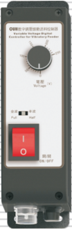
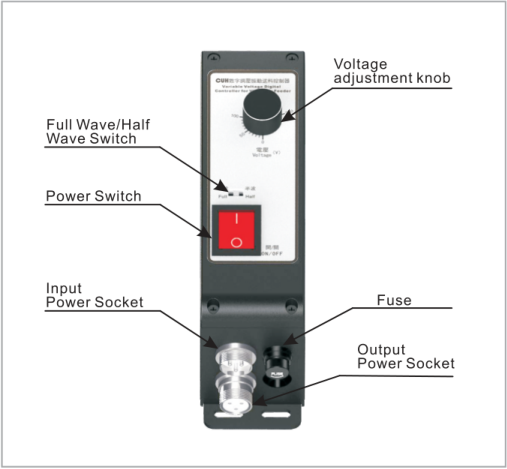
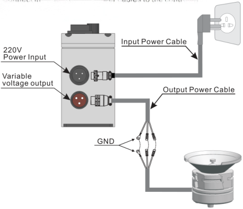
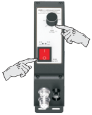

## Variable Voltage Digital Controller for Vibratory Feeder

Model: SDVC11-M

## Overview:

## Wiring:

Step 1:

Connect input and output power cables to the controller according to the drawing.

### Step 2:
Rotate the voltage adjustment knob to set output voltage.

### Step 3:
Turn on the power switch.  
The power indicator lights up.

## Full Wave/Half Wave Switch:

Output waveform/output frequency can be switched

If the mains frequency is 50/60Hz, output frequency will be 100/120Hz when set the switch as shown in Figure (1)

If the mains frequency is 50/60Hz, output frequency will be 50/60Hz when set the switch as shown in Figure (2)

## Features:

**Automatic Voltage Regulation:** The internal digital voltage regulation circuit can reduce feed speed variation caused by mains voltage fluctuation.

**Soft Start:** The controller will gently increase output voltage from 0 to the preset value when power on to avoid sudden shake.

**Linear Voltage Control:** Rotation angle of the voltage adjustment knob is linear with output voltage of the controller.

**Overheat Protection:** If internal temperature of the controller gets too high, the controller will stop its output to protect itself.

**Overcurrent Protection:** If output current exceeds its rated value, the controller will stop its output to protect itself and the load.

**Fuse-Short Circuit Protection:** If output of the controller is short-circuited, the fuse inside will be blown to protect the controller and the load.

Optimized Circuit Design to ensure stability and long service life.

## Specifications:

| Item | Range: Min | Range: Typical | Range: Max | Unit | Description |
|---|---|---|---|---|---|
| Input Voltage | 150 | 220 | 260 | V | AC RMS |
| Adjustable Output Voltage Range | 35 | —— | Vin-10 | V | Half Wave |
| Adjustable Output Voltage Range | 45 | —— | Vin-5 | V | Full Wave |
| Response Time of Voltage Regulation | 0 | 0.01 | 0.02 | s | |
| Adjustable Output Current Range | 0.1 | —— | 5 | A | |
| Output Power | 22 | —— | 1100 | VA | |
| Output Frequency | 45 | 50/60 | 65 | Hz | Half Wave |
| Output Frequency | 90 | 100/120 | 130 | Hz | Full Wave |
| Output Waveform | | Phase cut sine | | | |
| Soft Start Time | 0.5 | 0.65 | 0.7 | s | |
| Overheat Protection Trigger Temperature | 58 | 60 | 66 | °C | |
| Fuse Capacity | | 6.3 | | A | |
| Ambient Temperature | 0 | 25 | 40 | °C | No Condensation |
| Ambient Humidity | 10 | 60 | 85 | % | No Condensation |

## Dimension and Weight:

Dimensions:154*53.6*109.3(L*W*H, mm)  
Weight:430g (without accessory)

Nanjing CUH Science & Technology Co.,Ltd  
https://en.cuhnj.com  
Tel.:+86-25-84730411 / 84730415 / 84730416  
Fax:+86-25-84730426  
E-mail:sales@cuhnj.com  
Add.:Building 2, Xueyan Tech Park, Tuscity,  
No.9 Zhineng Rd, Jiangning, Nanjing, China

Document NO. : SDVC11MSMEN_1.01

