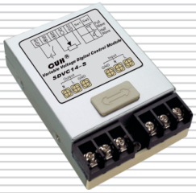
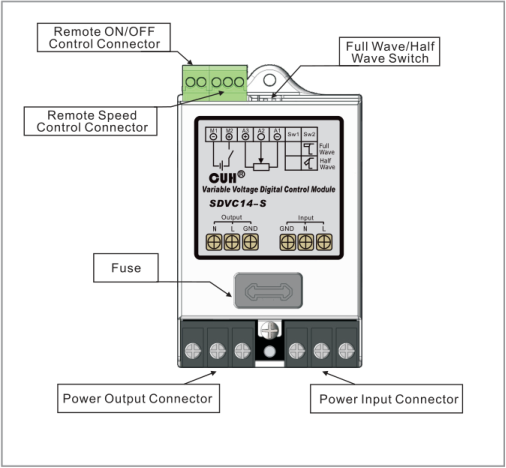
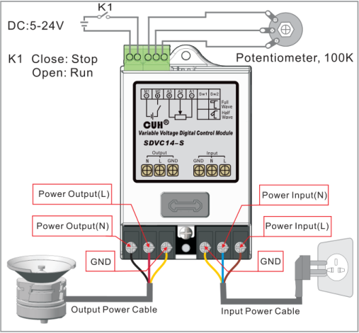
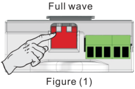
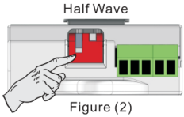

CUH

# Variable Voltage Digital Control Module for Vibratory Feeder

Model: SDVC14-S

## Overview:

## Wiring:

## Full Wave/Half Wave Switch:

Output waveform/output frequency can be switched

If the mains frequency is 50/60Hz, output frequency will be 100/120Hz when set the switch as shown in Figure (1)

If the mains frequency is 50/60Hz, output frequency will be 50/60Hz when set the switch as shown in Figure (2)

## Features:

1) Automatic Voltage Regulation: The internal digital voltage regulation circuit can reduce feed speed variation caused by mains voltage fluctuation.

2) Soft Start: The controller will gently increase output voltage from 0 to the preset value when power on to avoid sudden shake.

3) Linear Voltage Control: Rotation angle of the external potentiometer is linear with output voltage of the control module.

4) Signal Control Connectors: The control module has Remote ON/OFF Control and Remote Speed Control connectors.

5) Optimized Circuit Design to ensure stability and long service life.

6) Overheat Protection: If internal temperature of the control module gets too high, the control module will stop its output to protect itself.

7) Overcurrent Protection: If output current exceeds its rated value, the control module will stop its output to protect itself and the load.

8) Fuse-Short Circuit Protection: If output of the control module is short-circuited, the fuse inside will be blown to protect the control module and the load.

## Specifications:

| Item | Range: Min | Range: Typical | Range: Max | Unit | Description |
|---|---|---|---|---|---|
| Input Voltage | 150 | 220 | 260 | V | AC RMS |
| Adjustable Output Voltage Range | 35 | —— | Vin-10 | V | Half Wave |
| | 45 | —— | Vin-5 | | Full Wave |
| Response Time of Voltage Regulation | 0 | 0.01 | 0.02 | s | |
| Adjustable Output Current Range | 0.1 | —— | 4 | A | |
| Output Power | 22 | —— | 880 | VA | |
| Output Frequency | 45 | 50/60 | 65 | Hz | Half Wave |
| | 90 | 100/120 | 130 | Hz | Full Wave |
| Output Waveform | | Phase cut sine | | | |
| Soft Start Time | 0.5 | 0.65 | 0.7 | s | |
| Overheat Protection Trigger Temperature | 58 | 60 | 66 | ℃ | |
| Remote On/Off Control Voltage | 5 | —— | 24 | V | |
| Fuse Capacity | | 6.3 | | A | |
| Ambient Temperature | 0 | 25 | 40 | ℃ | No Condensation |
| Ambient Humidity | 10 | 60 | 85 | % | |

## Dimension and Weight:

Dimension: 102(L)mm X 63(W)mm X 27(H)mm  
Weight: 92g

Nanjing CUH Science & Technology Co.,Ltd  
https://en.cuhnj.com  
Tel.:+86-25-84730411 / 84730415 / 84730416  
Fax:+86-25-84730426  
E-mail:sales@cuhnj.com  
Add.:Building 2, Xueyan Tech Park, Tuscity,  
No.9 Zhineng Rd, Jiangning, Nanjing, China

Document NO. : SDVC14SSMSEN_1.04

