## Variable Voltage Digital Controller for Vibratory Feeder

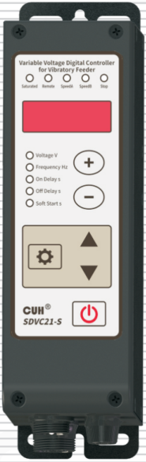

## SDVC21-S

## User Manual

---

## Copyright Statement

Nanjing CUH Science & Technology CO., Ltd. reserves all rights.

All information contained in this user manual is the knowledge of our company and is protected by copyright law and other related laws. CUH enjoys and reserves all rights conferred by copyright law and other laws. Without the written consent of CUH, part or all of this user manual shall not be copied, translated, imitated or otherwise utilized.

## Disclaimer

All contents of this user manual only describe the use method of related products produced by our company, and are described according to the existing technology and the state provided to you when you use it. You must bear the relevant risks when you use this product. Except as required by law, the company does not have any express or implied responsibility for the product due to this user manual, including but not limited to personal injury, property damage, loss of opportunity, etc.

You clearly understand the above risks and agree that, except as mandated by law, the company is not responsible for any direct or indirect damage or loss to you (including but not limited to tangible loss of personnel, property, data, etc. and intangible loss of reputation, opportunity, etc.)

The company reserves the right to modify the products applicable in this user manual without prior or subsequent notice.

---

## Preface

Thank you for choosing CUH SDVC21-S digital voltage modulation vibration feeding controller. (The controller for short in the following text). This series of controllers uses high-quality components and incorporates the latest electronic technology, and is carefully designed with high-performance digital signal processors.

This manual introduces the basic operation method, functional technical description and typical application examples of this product. Provide users with relevant information on installation and debugging, parameter setting, abnormal diagnosis, troubleshooting and routine maintenance of the controller. In order to ensure the correct installation and use of this controller, please read this user manual carefully before installation and keep it properly.

Be sure to read the following symbols to alert you to precautions against personal injury and product damage.

| | |
|---|---|
| ⚠ Danger | Non-observance of this item will result in personal injury or death. |
| ⚠ Warn | Non-observance of this item may result in personal injury or death. |
| ⚠ Careful | Non-observance of this item may result in moderate or minor injury to persons. |
| Notice | Non-observance of this item will result in damage to the product and property damage. |
| ❗ Essential | Indicates precautions and usage restrictions that must be observed during use. |

**This manual is suitable for the following models of controllers:**

- Variable Voltage Digital Controller for Vibratory Feeder　SDVC21-S (5A)

---

## Safety and Precautions

1. **⚠ Danger** This product is only used to drive electromagnet-based vibratory feeding equipment, do not use this product for the purpose of protecting the human body or parts of the human body, etc.

2. **⚠ Danger** This product is not intended to be used as an explosion-proof product, do not use it in hazardous locations and/or potentially explosive gas environment.

3. **⚠ Warn** This product is powered by AC mains, please do not apply AC voltage exceeding 260Vac. Excessive input voltage, such as 380Vac, may cause the product to explode or catch fire, resulting in serious safety accidents.

4. **⚠ Warn** This product is grounded through the power cord. Please ensure that the power distribution facilities for the controller are well grounded, otherwise the controller shell may be charged, resulting in an electric shock accident.

5. **⚠ Warn** Do not input AC power to the output of this controller, it will damage the controller.

6. **⚠ Warn** Do not plug and unplug the wiring with points or touch the contact of each wiring terminal in the wiring compartment to prevent electric shock.

7. **Notice** Please avoid controlling the output of this product by cutting off the power supply through relays and other devices, which will seriously reduce the life of the controller.

8. **Notice** The controller is designed to work in a cool and dry environment. Never run the controller outside to avoid soaking and insolation. Operate the controller within the temperature specified electrical characteristic.

9. **❗ Essential** Be sure to fix this product on a solid platform that is reliably grounded and away from vibrating equipment.

10. **❗ Essential** Never operate the controller under the condition that beyond its designed limits.

11. **❗ Essential** Operate the controller in accordance with this instruction book strictly. we will not assume any civil or criminal liability if the equipment damage or personal injury is caused by incorrect operation.

12. **❗ Essential** Never open the controller shell to avoid electric shock. Contact CUH if the controller break down. Never try to repair the controller yourself which may caused void warranty.

---

## Operating and Storage Environment

### Inspection Before Using

Every controller will go through rigorous quality inspection before delivery and is packed with crash-proof packaging, Please check the following items after unpacking:

1. Whether the controller is damaged during transportation.
2. Whether the model of the controller is that you ordered.

### Runtime Environment

Please follow the notes below to ensure the better performance and longer lifetime of the controller:

- ⚠ Well-ventilated environment
- ⚠ Keep away from water, stream, dust and especially oily dust
- ⚠ Keep away from the corrosive or flammable gas and liquid
- ⚠ Keep away from floating dust and metal particles
- ⚠ Firmly fixed to avoid self vibration
- ⚠ Keep away from electromagnetic interference
- ⚠ Ensure ambient temperature is 0~40 ℃
- ⚠ For use at altitude 2000m or lower

---

# Contents

- **Chapter Ⅰ Before Use — 1**
  - 1.1 Check the Package Contents — 1
  - 1.2 Indicators, Buttons and External Parts Explanation — 2
  - 1.3 Wiring Ports Explanation — 3
  - 1.4 Nameplate Explanation — 3
- **Chapter Ⅱ Features — 4**
- **Chapter Ⅲ Installation Guide — 6**
  - 3.1 Controller Usage Conditions — 6
  - 3.2 Operation Method of Buttons — 6
  - 3.3 Install and Use — 7
- **Chapter Ⅳ Basic Function Description — 9**
  - 4.1 Output Voltage — 9
  - 4.2 Output Frequency — 10
  - 4.3 Soft Startup Time — 11
  - 4.4 Output Switch — 11
  - 4.5 Maximum Output Voltage Limit — 12
  - 4.6 Keypad Lock — 12
  - 4.7 Restore Default Settings — 13
- **Chapter Ⅴ Sensors and Signal Control — 14**
  - 5.1 Intelligent Photoelectric Sensing — 14
    - 5.1.1 Wiring Method of the Intelligent Photoelectric Sensor — 14
    - 5.1.2 On/Off Delay of the Intelligent Photoelectric Sensor — 15
    - 5.1.3 Logical Direction Setting of the Intelligent Photoelectric Sensor — 16
  - 5.2 Using Method of the NPN Switch Sensor — 17
    - 5.2.1 Wiring Method of the NPN Switch Sensor — 17
    - 5.2.2 On/Off Delay of the NPN Switch Sensor — 18
    - 5.2.3 Logical Direction Setting of the NPN Switch Sensor — 19
  - 5.3 Using Method of the 2nd NPN Switch Sensor — 20
    - 5.3.1 Wiring Method of the 2nd NPN Switch Sensor — 20
    - 5.3.2 On/Off Delay of the 2nd NPN Switch Sensor — 21
    - 5.3.3 Logical Direction Setting of the 2nd NPN Switch Sensor — 22
  - 5.4 Logical Relation Setting of the Control Signal — 23
  - 5.5 Control Output — 24
    - 5.5.1 Wiring Method of Control Output — 24
    - 5.5.2 Logical Direction Setting of the Controlling Output — 26
  - 5.6 Remote Speed Control — 27
  - 5.7 Preset Speed Switch — 28
- **Chapter Ⅵ Security Functions — 29**
  - 6.1 Automatic Digital Voltage Stabilizing — 29
  - 6.2 Short-Circuit Protection — 29
  - 6.3 Current Overload Protection — 29
  - 6.4 Overheat Protection — 29
- **Chapter Ⅶ Technical Specifications — 30**
  - 7.1 Dimensions — 30
  - 7.2 Technical Specifications — 31
  - 7.3 Reference Standard — 32
  - 7.4 Parameter Table — 33
  - 7.5 Troubleshooting Suggestions and Error Explanations — 34
- **Chapter Ⅷ Product Warranty Information — 35**
  - 8.1 Warranty Period — 35
  - 8.2 Warranty Coverage — 35
  - 8.3 Product Suitability — 35

---

# Chapter Ⅰ Before Use

This chapter introduces product package contents, controller appearance description and controller nameplate information.

## 1.1 Check the Package Contents

Before using, please check the integrity of the controller and accessories. If you find that the product is defective or damaged, missing accessories, etc., please contact our company.

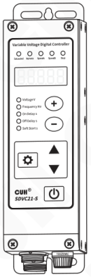

Controller×1

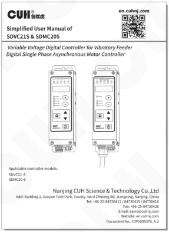

User Manual×1

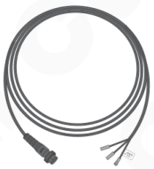

Output Cable×1

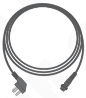

Input Power Cord×1

---

## 1.2 Indicators, Buttons and External Parts Explanation

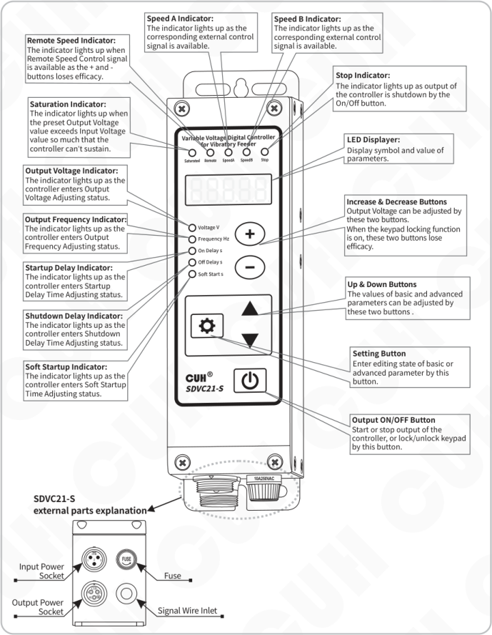

### Indicators and Display

**Remote Speed Indicator:**  
The indicator lights up when Remote Speed Control signal is available as the + and - buttons loses efficacy.

**Speed A Indicator:**  
The indicator lights up as the corresponding external control signal is available.

**Speed B Indicator:**  
The indicator lights up as the corresponding external control signal is available.

**Stop Indicator:**  
The indicator lights up as output of the controller is shutdown by the On/Off button.

**Saturation Indicator:**  
The indicator lights up when the preset Output Voltage value exceeds Input Voltage value so much that the controller can’t sustain.

**LED Displayer:**  
Display symbol and value of parameters.

**Output Voltage Indicator:**  
The indicator lights up as the controller enters Output Voltage Adjusting status.

**Output Frequency Indicator:**  
The indicator lights up as the controller enters Output Frequency Adjusting status.

**Startup Delay Indicator:**  
The indicator lights up as the controller enters Startup Delay Time Adjusting status.

**Shutdown Delay Indicator:**  
The indicator lights up as the controller enters Shutdown Delay Time Adjusting status.

**Soft Startup Indicator:**  
The indicator lights up as the controller enters Soft Startup Time Adjusting status.

### Buttons

**Increase & Decrease Buttons**  
Output Voltage can be adjusted by these two buttons.  
When the keypad locking function is on, these two buttons lose efficacy.

**Up & Down Buttons**  
The values of basic and advanced parameters can be adjusted by these two buttons .

**Setting Button**  
Enter editing state of basic or advanced parameter by this button.

**Output ON/OFF Button**  
Start or stop output of the controller, or lock/unlock keypad by this button.

### SDVC21-S external parts explanation

- Input Power Socket
- Output Power Socket
- Fuse
- Signal Wire Inlet

---

## 1.3 Wiring Ports Explanation

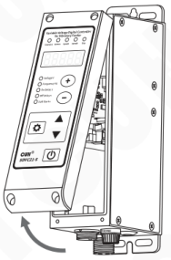

**Step 1:** Remove the screws on the four corners of the panel.

**Step 2:** Open the panel upwards, the wiring port is in the back of the panel.

| Wiring port | Terminal | Signal |
|---|---|---|
| SensorⅡ | A1 | GND |
| SensorⅡ | A2 | Input |
| SensorⅡ | A3 | +24V |
| Preset | B1 | GND |
| Preset | B2 | Pset A |
| Preset | B3 | GND |
| Preset | B4 | Pset B |
| Ctrl Out | C1 | Output |
| Ctrl Out | C2 | +24V |
| SensorⅠ | D1 | GND |
| SensorⅠ | D2 | Input |
| SensorⅠ | D3 | +24V |
| Photosensor | E1 | GND |
| Photosensor | E2 | Rx |
| Photosensor | E3 | GND |
| Photosensor | E4 | Tx |
| Speed Ctrl | F1 | +5V |
| Speed Ctrl | F2 | Input |
| Speed Ctrl | F3 | RGND |

## 1.4 Nameplate Explanation

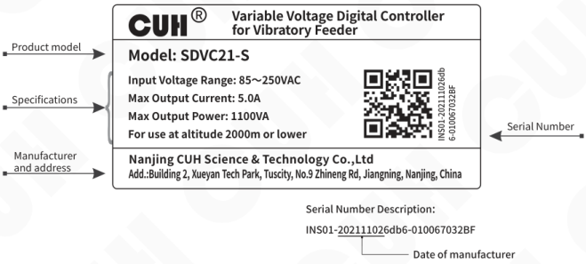

CUH® — **Variable Voltage Digital Controller for Vibratory Feeder**

**Product model**

Model: SDVC21-S

**Specifications**

- Input Voltage Range: 85～250VAC
- Max Output Current: 5.0A
- Max Output Power: 1100VA
- For use at altitude 2000m or lower

**Manufacturer and address**

Nanjing CUH Science & Technology Co.,Ltd

Add.:Building 2, Xueyan Tech Park, Tuscity, No.9 Zhineng Rd, Jiangning, Nanjing, China

**Serial Number**

INS01-202111026db6-010067032BF

**Serial Number Description:**

INS01-**20211102**6db6-010067032BF

Date of manufacturer: **20211102**

---

## Chapter Ⅱ Features

The controller is specially designed for controlling vibratory feeder in the automation systems. Combined with the latest electronic technology and elaborate design, the controller provides the following convenient and practical features:

**Automatic Voltage Stabilizing:** The controller can eliminate feeding speed variation caused by mains voltage fluctuation.

**Soft Startup:** In order to avoid sudden shock to the work pieces, the controller can gently increase output voltage from 0 to the pre-set value when startup.

**Switch Sensor:** NPN switch sensor or PLC can be connected to turn on/off the controller.

**Controlling Output:** The Controlling Output signal outgoing from the transistor can coordinate a solenoid or other external devices with the controller.

### The Following Features Can be Customized:

**Dual Control Signals Input:** Dual control signals input of Work-pieces-Full and Work-pieces-Empty could from the logical control relation of AND, OR, NOT, XOR, and all the others .

**Output Voltage Preset Function:** Up to four preset output voltage values can be chosen by external control signals.

**Intelligent Photoelectric Sensing:** Our adaptive Intelligent Photoelectric Sensor can help to stall the controller when work-pieces are full or work-pieces are empty and to fulfill the functions of Soft Startup Time Setting, On Delay, Off Delay, and Logical Relation Adjusting.

**Remote Speed Control:** Output Voltage of the controller can be controlled by an external potentiometer, a PLC, or a 1~5V/4~20mA DC signal.

---

CUH attaches great importance to the product quality management and safety performance. Apart form the high-quality components we use and rigorous quality control system, CUH has taken account of possible accidents users may encounter and provides the following protective functions to maximum the controller's practicability.

**Fuse-Short Circuit Protection:** If output of the controller is short-circuited, the fuse inside will be blown to protect the controller and the load.

**Current Overload Protection:** The controller will halt its output to ensure equipments' operating safety when operation current exceeds its rated value.

**Overheat Protection:** The controller will halt its output to protect itself when operation temperature is too high.

**Overvoltage Protection:** If input voltage is too high, power supply of the controller will be shutdown automatically to protect itself.

CUH controllers are strictly compliant with CE certification.

---

# Chapter Ⅲ Installation Guide

This chapter introduces the necessary conditions for the use of the controller and how to install and connect it correctly.

## 3.1 Controller Usage Conditions

The controller is powered by AC 110/220V, and the protective ground connection is made through the plug of the power cord. Please provide 110V or 220V, 50Hz/60Hz mains power supply and distribution facilities that meet the standard and ensure that the protective ground wire is correctly connected.

**⚠ Warn** Never connect the controller to 380V AC power, this will cause irreversible serious damage to the controller, possibly resulting in explosion, fire and other safety incidents.

**⚠ Warn** Ensure that the power supply side is reliably grounded. The metal casing of the controller is directly connected to the protective grounding wire. Poor grounding will cause the controller casing to be electrified and cause an electric shock accident.

**Notice** Long time running will generate heat and cause the temperature of the casing to rise. Please install the controller in a well-ventilated environment and fix it well, away from vibration sources.

**Notice** The output of this product is formed by the rectification and inversion of the mains supply, and there is no isolation between its input and output. Therefore, the output poles cannot be connected to the protective ground. When connecting the electromagnet, it is necessary to ensure that the electromagnet coil and the casing have basic insulation capability. Otherwise, leakage of electricity may occur, which may cause electric shock and damage to the controller.

**Notice** This product is a controller used to drive the electromagnet. It must not be connected to a piezoelectric vibratory feeder.

## 3.2 Operation Method of Buttons

a. Short press ⊕ or ⊖ button to adjust the Output Voltage of the controller at any LED Interface.

b. Enter or exit the Basic Parameters Interface by long press ⚙ button, and switch among the basic parameters by short press ⚙ button, and adjust parameter's value by short press ▼ or ▲ button.

c. Enter or exit the Advanced Parameters Interface by long press ⚙ and ▲ button, and switch among the advanced parameters by short press ⚙ button, and adjust parameter's value by short press ▼ or ▲ button.

d. Short press ⏻ button to start or stop output of controller, and long press ⏻ button to lock or unlock keypad.

e. At LED interface of default setting restore parameter, Long press ▲ button until  is displayed on the LED to restore factory settings, or long press ▼ button until  is displayed on the LED to switch to modern parameter interface.

f. SDVC21S defaults to the traditional parameter interface.

---

## 3.3 Install and Use

### Step One:

Open the packing box and check the controller and all accessories.

### Step Two:

Connect the wiring terminals of the Output Power Cable to the vibrator's electromagnetic coil.

Align the notch on the aviation plug of the output cable with the triangle mark on the output socket of the controller, and then tighten the nut after connecting the output cable correctly.

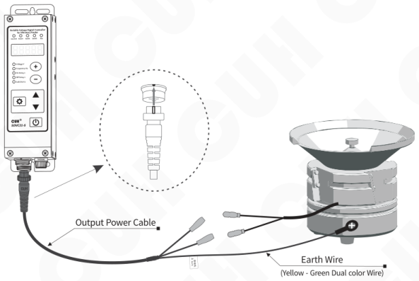

### Note

1. Make sure the vibrator's electromagnetic coils are connected to the two output pins of the Output Power Cable, and the vibrator's metal shell is reliably grounding.
2. It is forbidden to connect piezoelectric loads to the power output, otherwise it may cause an electric shock safety accident!

---

### Step Three:

Connect the Connector of the Input Power Cable to the Input Power Socket of the controller.

Connect the controller side first.

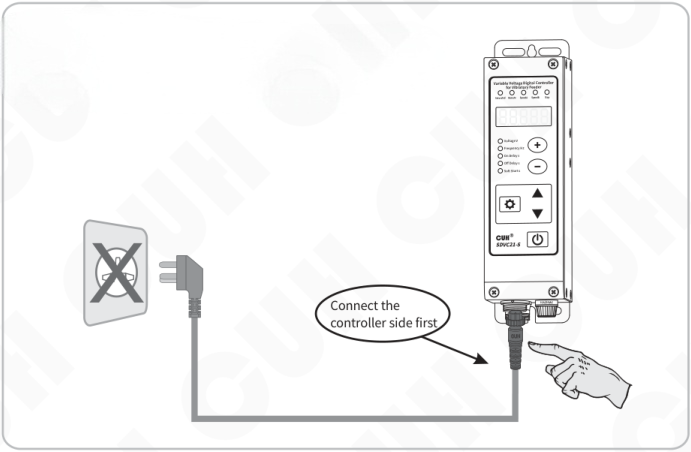

### Step Four:

Connect the plug of the Input Power Cable to the mains jack.

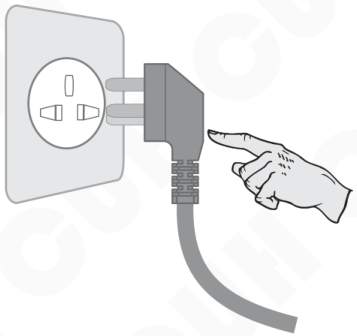

---

## Chapter Ⅳ Basic Function Description

### 4.1 Output Voltage

Output voltage can be set directly and digitally through the keypad. Benefit from the unique voltage stabilizing function, output voltage of the controller won't fluctuate as the input voltage does, so that the vibrator can maintain stable operation in case of unstable grid voltage.

- Turn on the power switch of the controller.
- The controller enters the output voltage parameter. The voltage indicator lights up, and the LED display output voltage parameter U and the default value 150.
- Press ⊕ or ⊖ to adjust the parameter value.

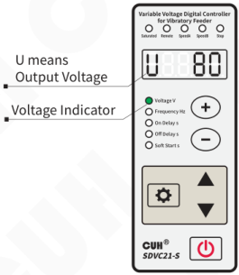

- Output Voltage value of the controller can not exceed Input Voltage value. If Output Voltage value is set too close to Input Voltage value, the controller fails to stabilize its voltage output and the Saturation Indicator lights up.
- If Output Voltage value is set too close to 0, the controller fails to stabilize its voltage output and the Saturation Indicator lights up.

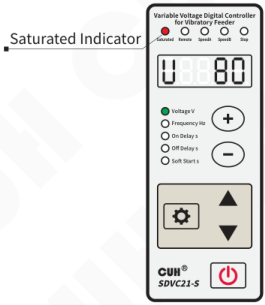

---

## 4.2 Output Frequency

The controller can choose to output frequency at the mains' or the mains' double.

- Press ⚙ and hold for 2 seconds to enter the basic parameter interface.
- The LED displays the output frequency parameter "E" and the frequency indicator lights up.
- Press ▼ or ▲ to adjust the parameter value.

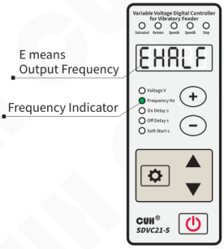

- If the mains frequency is at 50Hz, when the E parameter is adjusted to HALF, Output Frequency of the controller is at 50Hz, when the E parameter is adjusted to FULL, Output Frequency of the controller is at 100Hz.
- If the mains frequency is at 60Hz, when the E parameter is adjusted to HALF, Output Frequency of the controller is at 60Hz, when the E parameter is adjusted to FULL, Output Frequency of the controller is at 120Hz.

---

## 4.3 Soft Startup Time

In order to avoid sudden shock to the vibrator coil, the controller can gradually increase output voltage from 0 to the preset value when startup.

**Soft Startup Time ( t ):** The period of time it takes for the controller to smoothly rise its output voltage from 0 to the preset value when startup.

- Press ⚙ and hold for 2 seconds to enter the basic parameter interface.
- Short press ⚙ to switch to soft startup parameter "t" and the soft start indicator lights up.
- Press ▲ or ▼ to adjust the parameter value.

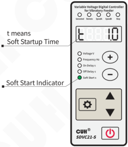

## 4.4 Output Switch

The ⏻ on the panel can easily and quickly start or stop the output of the controller.

- Using ⏻ on the controller panel, you can control start or stop. The stop indicator lights up as output of the controller is turned off.

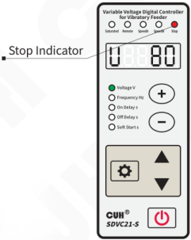

> Due to the soft-touch switch and digital signal control technology, no spark will generate to spoil the contact. As a result, life-span of the controller and the vibrator will be extended greatly.

---

## 4.5 Maximum Output Voltage Limit

Maximum output voltage of the controller can be set to prevent damage to the vibrator.

Remote speed control function is affected by this parameter.

- Long press ⚙ and ▲ simultaneously to enter the advanced parameter interface.
- Short press ⚙ to switch to Parameter h.
- Press ▲ or ▼ to adjust the parameter value.

Default value of the Maximum output voltage is 250V.

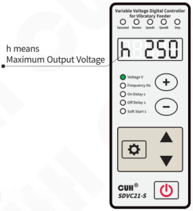

## 4.6 Keypad Lock

- Press ⏻ and hold for 2 seconds to lock all buttons on the panel as the LED displays a.
- Press ⏻ and hold for 2 seconds again to unlock the keypad.

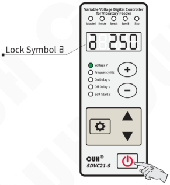

> The ⏻ button will not be affected by the keypad lock function.

---

## 4.7 Restore Default Settings

User can quickly restore the controller to the factory default state.

Due to the powerful functions of the controller, many parameters can be adjusted. For beginners, it may not be able to restore the normal working state of the controller after several settings and modifications. Use this function to quickly restore the disordered parameter state to the factory default setting.

- Long press ⚙ and ▲ simultaneously to enter the advanced parameter interface.
- Short press ⚙ to switch to the full flashing on the LED displayer, that is, the parameter of "Default Setting Restore". And then press ▲ and hold until the controller displays "-----", indicating that the controller has been restored.

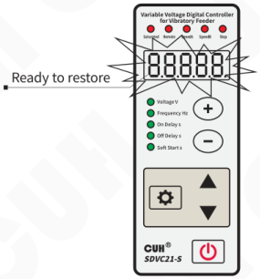

- Release ▲, after the controller displays "CUH", then enter the output voltage adjustment state "U". By this time, all parameters have been restored to the factory default settings.

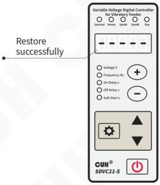

---

# Chapter Ⅴ Sensors and Signal Control

The controller can be controlled by many kinds of external signals and sensors. This chapter mainly elaborates using method of the Intelligent Photoelectric Sensor, the NPN Switch Sensors and the PLC.

## 5.1 Intelligent Photoelectric Sensing

Combined with the SDVC-S1 Photoelectric Sensor the function of Intelligent Photoelectric Sensing can be achieved. The SDVC-S1 sensor can filter the interference of background light impacting on the sensitivity of the controller. As a result, the controller can work reliably without manual sensitivity adjustment.

### 5.1.1 Wiring Method of the Intelligent Photoelectric Sensor

**Photoelectric sensor connection method**

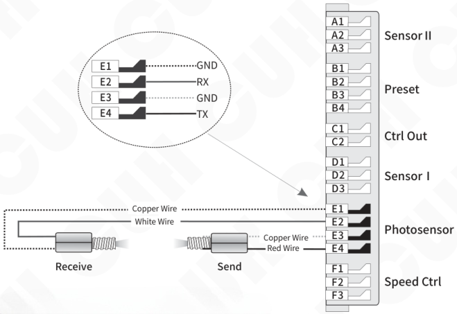

The working distance of the sensor can be adjusted by setting the P parameter, the smaller the parameter, the more sensitive it is.

Notice: Default logical relation of the sensor is set as work-pieces are empty.

---

## 5.1.2 On/Off Delay of the Intelligent Photoelectric Sensor

In most actual applications, the output of the controller should be delayed for a period of time when on/off the controller is controlled by external signals. On/Off delay time adjusting function made this kind of application possible. Furthermore, shocks to the work pieces as the controller starts up can be eliminated by adjusting Soft Startup Time.

### On Delay ( J )

The period of time the controller goes through from receiving a startup control signal to actually outputting.

- Press ⚙ and hold for 2 seconds to enter the basic parameter interface.
- Short press ⚙ to switch to on delay parameter "J" and the on delay indicator lights up.
- Press ▲ or ▼ to adjust the parameter value.

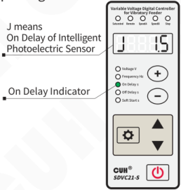

Adjustable range of the parameter is from0.0 to 9.9 seconds  
Default value of the parameter is 0.2seconds

### Off Delay ( L )

The period of time the controller goes through from receiving a shutdown control signal to actually cutting off output.

- Press ⚙ and hold for 2 seconds to enter the basic parameter interface.
- Short press ⚙ to switch to off delay parameter "L" and the off delay indicator lights up.
- Press ▲ or ▼ to adjust the parameter value.

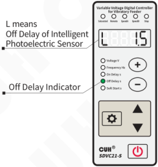

Adjustable range of the parameter is from0.0 to 9.9 seconds  
Default value of the parameter is 0.2seconds

---

### 5.1.3 Logical Direction Setting of the Intelligent Photoelectric Sensor

Under normal circumstances, the receiving end receives no optical signal, and the controller runs by default. But in some special applications the controller needs to be stopped when the receiving end receives no optical signal. Adjusting this parameter can fulfill this kind of application.

- Long press ⚙ and ▲ simultaneously to enter the advanced parameter interface.
- Short press ⚙ to switch to Parameter Γ1.
- Press ▲ or ▼ to adjust the parameter value.

Γ1 means Logical Direction of the Intelligent Photoelectric Sensor

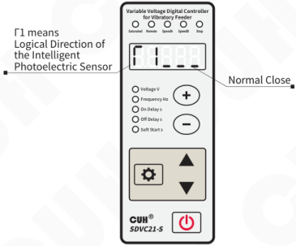

Parameter Γ1 is set to `___` by default

- When Parameter Γ1 is set to `___`, namely no optical signal received, the controller runs.
- When Parameter Γ1 is set to `_-_`, namely no optical signal received, the controller stops.

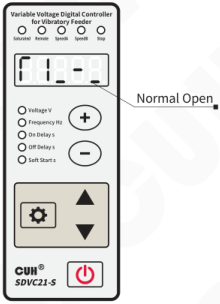

---

## 5.2 Using Method of the NPN Switch Sensor

The controller can operate with many kinds of sensors, such as switch sensors, optical switch sensors and fiber optic sensors.

### 5.2.1 Wiring Method of the NPN Switch Sensor

**Switch sensor connection method**

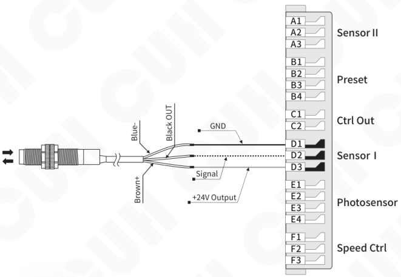

**Convention**

- The blue wire represents ground wire
- The black wire represents signal wire
- The brown wire represents power wire

---

## 5.2.2 On/Off Delay of the NPN Switch Sensor

By default, intelligent photoelectric sensor and switch sensor share the same on delay time and off delay time. Operators can also set on delay time and off delay time independently for the switch sensor.

### On Delay ( J- )

The period of time the controller goes through from receiving a startup control signal to outputting.

- Long press ⚙ and ▲ simultaneously to enter the advanced parameter interface.
- Short press ⚙ to switch to Parameter J-.
- Press ▲ or ▼ to adjust the parameter value.

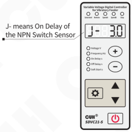

Adjustable range of the parameter is from0.0 to 9.9 seconds, Default value of the parameter is ---

The independent on delay of the NPN switch sensor will be closed when the parameter value is adjusted to 0

### Off Delay ( L- )

The period of time the controller goes through from receiving a shutdown control signal to cutting off output.

- Long press ⚙ and ▲ simultaneously to enter the advanced parameter interface.
- Short press ⚙ to switch to Parameter L-.
- Press ▲ or ▼ to adjust the parameter value.

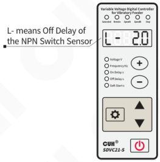

Adjustable range of the parameter is from0.0 to 9.9 seconds, Default value of the parameter is ---

The independent off delay of the NPN switch sensor will be closed when the parameter value is adjusted to 0

- When J- and L- values are adjusted to 0, on delay time and off delay time of the switch sensor will be the same with on delay time and off delay time of the intelligent photoelectric sensor.
- On delay time and off delay time of the Intelligent Photoelectric Sensor will not affected by the parameter of J- and L-.

---

## 5.2.3 Logical Direction Setting of the NPN Switch Sensor

Under normal circumstances, the controller receives no signal from the NPN Switch Sensor and runs by default. But in some special applications the controller needs to be stopped when receives no signal from the NPN Switch Sensor. Adjusting this parameter can fulfill this kind of application.

- Long press ⚙ and ▲ simultaneously to enter the advanced parameter interface.
- Short press ⚙ to switch to Parameter Γ2.
- Press ▲ or ▼ to adjust the parameter value.

Γ2 means Logical Direction of the NPN Switch Sensor.

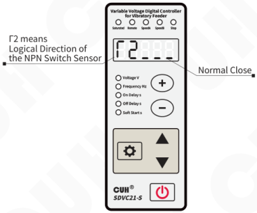

Parameter Γ2 is set to `___` by default.

- When Parameter Γ2 is set to `___`, namely no signal received, the controller runs.
- When Parameter Γ2 is set to `_-_`, namely no signal received, the controller stops.

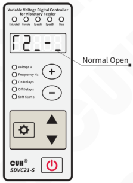

---

## 5.3 Using Method of the 2ⁿᵈ NPN Switch Sensor

The controller allows three sensors connecting to it, one Intelligent Photoelectric Sensor and two NPN Switch Sensors. The functions of Halt when work-pieces are full and Halt when work-pieces are empty can work with the help of these sensors.

### 5.3.1 Wiring Method of the 2ⁿᵈ NPN Switch Sensor

**Switch sensor connection method**

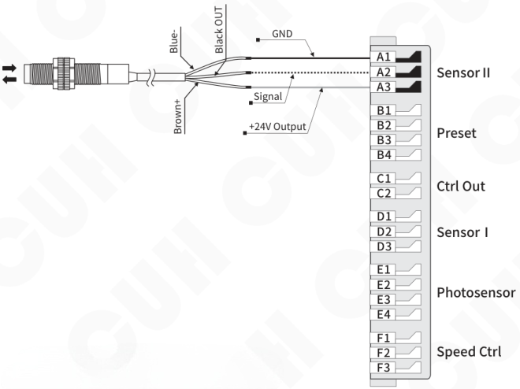

**Convention**

The blue wire represents ground wire  
The black wire represents signal wire  
The brown wire represents power wire

---

## 5.3.2 On/Off Delay of the 2ⁿᵈ NPN Switch Sensor

By default, intelligent photoelectric sensor and the two NPN switch sensor share the same on delay time and off delay time. Operators can also set on delay time and off delay time independently for the 2ⁿᵈ NPN switch sensor.

### On Delay (J_)

The period of time the controller goes through from receiving a startup control signal to outputting.

- Long press ⚙ and ▲ simultaneously to enter the advanced parameter interface.
- Short press ⚙ to switch to Parameter J_.
- Press ▲ or ▼ to adjust the parameter value.

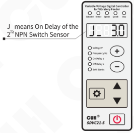

Adjustable range of the parameter is from0.0 to 9.9 seconds, Default value of the parameter is ---

The independent on delay of the 2ⁿᵈ NPN switch sensor will be closed when the parameter value is adjusted to 0

### Off Delay (L_)

The period of time the controller goes through from receiving a shutdown control signal to cutting off output.

- Long press ⚙ and ▲ simultaneously to enter the advanced parameter interface.
- Short press ⚙ to switch to Parameter L_.
- Press ▲ or ▼ to adjust the parameter value.

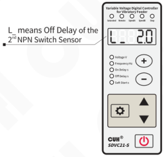

Adjustable range of the parameter is from0.0 to 9.9 seconds, Default value of the parameter is ---

The independent off delay of the 2ⁿᵈ NPN switch sensor will be closed when the parameter value is adjusted to 0

---

- When J_ and L_ values are adjusted to 0, on delay time and off delay time of the 2ⁿᵈ NPN switch sensor will be the same with on delay time and off delay time of the intelligent photoelectric sensor.
- On delay time and off delay time of the Intelligent Photoelectric Sensor will not affected by the parameter of J_ and L_.

---

## 5.3.3 Logical Direction Setting of the 2ⁿᵈ NPN Switch Sensor

Under normal circumstances, the controller receives no signal from the 2ⁿᵈ NPN Switch Sensor and runs by default. But in some special applications the controller needs to be stopped when receives no signal from the 2ⁿᵈ NPN Switch Sensor. Adjusting this parameter can fulfill this kind of application.

- Long press ⚙ and ▲ simultaneously to enter the advanced parameter interface.
- Short press ⚙ to switch to Parameter Γ4.
- Press ▲ or ▼ to adjust the parameter value.

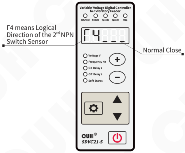

Γ4 means Logical Direction of the 2ⁿᵈ NPN Switch Sensor.

Normal Close

Parameter Γ4 is set to `___` by default

- When Parameter Γ4 is set to `___`, namely no signal received, the controller runs.
- When Parameter Γ4 is set to `_-_`, namely no signal received, the controller stops.

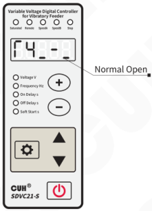

Normal Open

---

## 5.4 Logical Relation Setting of the Control Signal

The controller can set the logical relation of the Intelligent Photoelectric Sensor and the Switch Sensor when they work simultaneously.

- Long press ⚙ and ▲ simultaneously to enter the advanced parameter interface.
- Short press ⚙ to switch to Parameter Π.
- Press ▲ or ▼ to adjust the parameter value.

Π means Logical Relation of the Control Signal

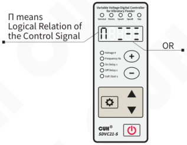

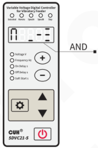

Default Logical Relation is AND

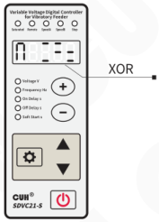

### Logical Relation: AND 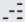:

The controller runs only when both the Intelligent Photoelectric Sensor and the NPN Switch Sensor ask the controller to.

### Logical Relation: OR 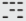:

The controller runs when the Intelligent Photoelectric Sensor or the NPN Switch Sensor asks the controller to.

### Logical Relation: XOR 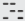:

The controller runs only when the Intelligent Photoelectric Sensor and the NPN Switch Sensor output the opposite control signal.

---

## 5.5 Control Output

The controller can output low-voltage controlling signal to cooperate with other devices such as a solenoid valve, a PLC or an electrical relay.

### 5.5.1 Wiring Method of Control Output

**Connection method of the PLC**

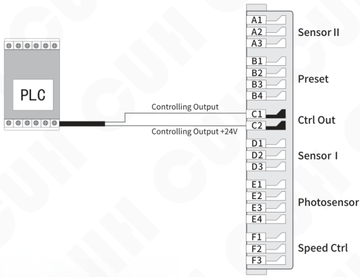

> Relay output or NPN output of the PLC is compatible with the controller.

Parameter setting methods are the same with that of the switch sensor.

---

## Connection method of the solenoid valve

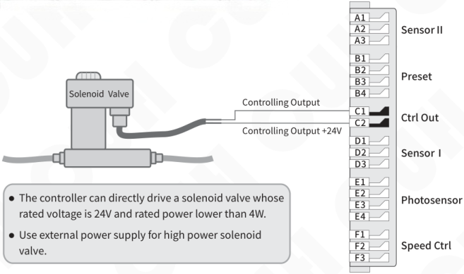

- The controller can directly drive a solenoid valve whose rated voltage is 24V and rated power lower than 4W.
- Use external power supply for high power solenoid valve.

## Connection method of the electrical relay

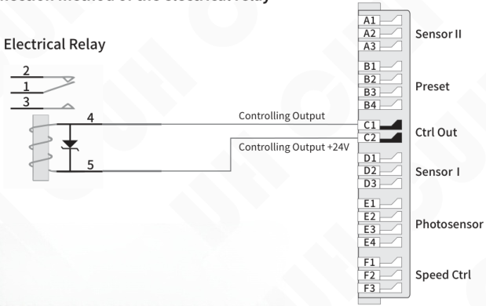

- The controller can directly drive an electrical relay whose rated voltage is 24V and rated power lower than 4W.

---

## 5.5.2 Logical Direction Setting of the Controlling Output

- Long press ⚙ and ▲ simultaneously to enter the advanced parameter interface.
- Short press ⚙ to switch to Parameter Γ3.
- Press ▲ or ▼ to adjust the parameter value.

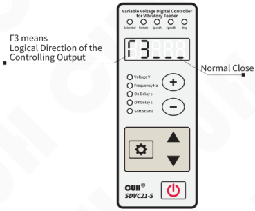

Parameter Γ3 is set to `___` by default

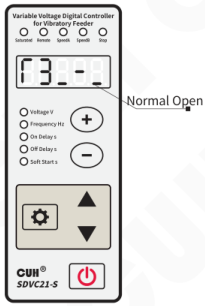

- When Parameter Γ3 is set to `___`, the controlling output works as the controller runs.
- When Parameter Γ3 is set to `_-_`, the controlling output doesn't works as the controller runs.

---

## 5.6 Remote Speed Control

The function of Remote Speed Control allows the operator to control the Output Voltage by an external potentiometer, 1~5V voltage or 4~20mA current. Thus, external remote speed control can be easily achieved by a PLC, a DCS or some other devices.

### Connection method of the external potentiometer

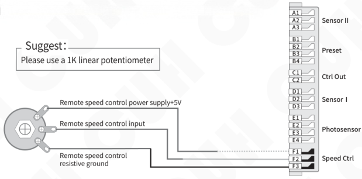

### Connection method of the PLC

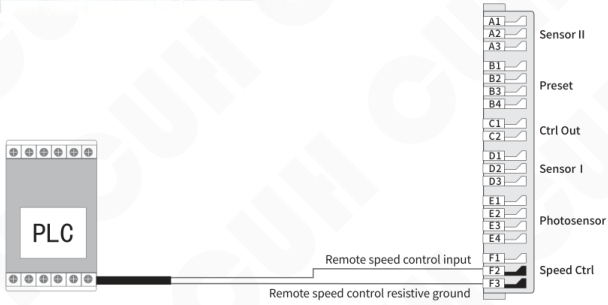

> When the remote speed control signal takes effect, the speed control indicator lights on, at the same time regulating the voltage on the panel will fail.

---

## 5.7 Preset Speed Switch

The function of Preset Speed Switch can choose the preset speed by means of external control signals, such as a PLC, a PC, sensors or other signal sources to build up a multi-speed feeding control system.

The controller has two speed preset switch control signals, which control speed switch A and speed switch B, both of which are active low.

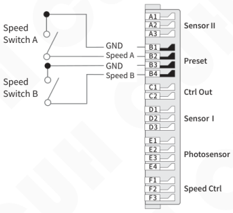

The status of each control line is displayed by corresponding indicator lights on the panel. When a valid signal is applied to the control line, the corresponding indicator lights up.

The combination of the on-off states of the two indicators has 4 states (A is on and B is off, A is off and B is on, AB is all on, and AB is all off).

By selecting the control signal, the controller will enter the corresponding preset speed. At this time, the output voltage of the controller can be adjusted by ⊕ or ⊖. The voltage will be automatically recorded. Any time the preset speed control signal sets the controller into this state, it will switch to this voltage immediately.

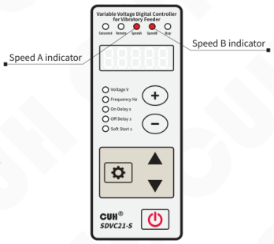

State when both control lines have valid signals applied.

---

## Chapter Ⅵ Security Functions

### 6.1 Automatic Digital Voltage Stabilizing

The internal digital voltage stabilizing function of the controller can stabilize feeding speed regardless of mains voltage fluctuation.

### 6.2 Short-Circuit Protection

If output is short-circuited, the controller will halt its output and display Err01 until restarting the controller.

### 6.3 Current Overload Protection

The controller will halt its output if output current exceeds rated current caused by faulty operation and display Err02 to protect the controller and customer equipments.

### 6.4 Overheat Protection

The controller will halt its output if operation temperature exceeds 65°C and display Err03 to protect the controller until operation temperature drops to 60°C.

---

## Chapter Ⅶ Technical Specifications

### 7.1 Dimensions

Dimensions (unit: mm)

| Dimensions range | tolerance |
|---|---|
| 0~3 | ±0.05 |
| 3~10 | ±0.1 |
| 10~30 | ±0.15 |
| 30~80 | ±0.2 |
| 80~180 | ±0.3 |
| >180 | ±0.5 |

This tolerance table is applicable to all products in this series.

---

## 7.2 Technical Specifications

| Item | Min | Typical | Max | Unit | Note |
|---|---|---|---|---|---|
| Input Voltage | 85 | 220 | 250 | V | AC RMS |
| Adjustable Output Voltage Range | 35 | —— | Vin-10 | V | Half Wave |
| Adjustable Output Voltage Range | 45 | —— | Vin-5 | V | Full Wave |
| Voltage Adjustment Accuracy | | 1 | | V | |
| Voltage Regulation Accuracy | —— | —— | 30 | V | Vset = 150V △Vin+ = 70V |
| Voltage Regulation Response Time | 0 | 0.01 | 0.02 | s | |
| Adjustable Output Current Range | 0 | —— | 5 | A | |
| Output Power | 0 | —— | 1100 | VA | |
| Output Frequency | 45 | 50/60 | 65 | Hz | Half Wave |
| Output Frequency | 90 | 100/120 | 130 | Hz | Full Wave |
| Output Waveform | | Phase Angle Control | | | |
| Soft Start Time | 0 | —— | 9.9 | s | Default value: 1.0 |
| On/Off Delay Time Range | 0 | —— | 9.9 | s | Default value: 0.2 |
| On/Off Delay Time Accuracy | | 0.1 | | s | |
| Overheat Protection Trigger Temperature | 58 | 60 | 66 | °C | |
| DC Control Output Voltage | 22 | 24 | 26 | V | |
| DC Control Output Current | 0 | —— | 400 | mA | |
| Analog Control Signal | | 1~5/4~20 | | V/mA | Remote Speed Control signal |
| Digital Control Signal | | 24 | | V | Switching Signal |
| Adjustment Method | | 6 | | Button | |
| Fuse Capacity | | 6.3 | | A | |
| Standby Power Consumption | —— | 2 | —— | W | |
| Display Method | | 5 | | Digit | LED |
| Ambient Temperature | 0 | 25 | 40 | °C | No Condensation |
| Ambient Humidity | 10 | 60 | 85 | % | No Condensation |
| Storage Ambient Temperature | -20 | 25 | 85 | °C | No Condensation |

## 7.3 Reference Standard

**Absolute Parameters:**  
Above the standard will damage the controller, obey it strictly.

| Item | GB Standard | IEC Standard | Grade | Standard Requirement | Note |
|---|---|---|---|---|---|
| Electrostatic Discharge | GB/T 17626.2-2006 | IEC 61000-4-2:2001 | 4 | ±8 kV | Contact Discharge |
| | | | 4 | ±15 kV | Air Discharge |
| Electrical Fast Transient Test | GB/T 17626.4-2008 | IEC 61000-4-4:2004 | 4 | ±4 kV | |
| DC Power Line Wave Immunity | GB/T 17626.17-2005 | IEC 61000-4-17:2002 | 4 | 15% | Rating A |

> **Warning**  
> In a residential environment, this product may cause radio interference in which case supplementary mitigation measures may be required.

---

## 7.4 Parameter Table

| | Definition | Symbol | symbol image | Range | Default |
|---|---|---|---|---|---|
| Common parameter | Output Voltage | U |  | 0~250 V | 150 |
| Basic Parameter | Output Frequency | E |  | FULL，HALF | FULL |
| Basic Parameter | On Delay of the Intelligent Photoelectric Sensor | J |  | 0.0~9.9 s | 0.2 |
| Basic Parameter | Off Delay of the Intelligent Photoelectric Sensor | L |  | 0.0~9.9 s | 0.2 |
| Basic Parameter | Soft Startup | t |  | 0.0~9.9 s | 1.0 |
| Advanced Parameter | On Delay of the NPN Switch Sensor | J- |  | 0.0~9.9 s | --- same as J |
| Advanced Parameter | Off Delay of the NPN Switch Sensor | L- |  | 0.0~9.9 s | --- same as L |
| Advanced Parameter | On Delay of the second NPN Switch Sensor | J_ |  | 0.0~9.9 s | --- same as J |
| Advanced Parameter | Off Delay of the second NPN Switch Sensor | L_ |  | 0.0~9.9 s | --- same as L |
| Advanced Parameter | Logical Direction of the Intelligent Photoelectric Sensor | F1 |  | Normal Close, Normal Open  | ___ |
| Advanced Parameter | Logical Direction of the NPN Switch Sensor | F2 |  | Normal Close, Normal Open [[vcrop:41:17]] | ___ |
| Advanced Parameter | Logical Direction of the Controlling Output | F3 |  | Normal Close, Normal Open [[vcrop:41:17]] | ___ |
| Advanced Parameter | Logical Direction of the second NPN Switch Sensor | F4 |  | Normal Close, Normal Open [[vcrop:41:17]] | ___ |
| Advanced Parameter | Logical Relation of the Control Signal | A |  | or, And, Hor  |  |
| Advanced Parameter | Maximum Output Voltage | h |  | 0~250 V | 220 |
| Advanced Parameter | Intelligent photoelectric sensor sensitivity | P |  | 0~1000 | 80 |
| Advanced Parameter | Default Settings Restore | 8.8.8.8.8. |  | —— | —— |

## 7.5 Troubleshooting Suggestions and Error Explanations

| Error Code | Definition | Troubleshooting Methods | symbol image |
|---|---|---|---|
| No display after power on | | Make sure the power outlet is live Make sure the Input power Cable is reliably connected to the power outlet? | |
| Display normally, but no output | | Make sure the Output Cable is reliably connected to the vibrator. Make sure the output voltage is not small. Make sure the Stop Indicator is not light up. Please check whether Normal Close of parameter has been set, causing controller output to stop. | |
| Control signal loses effectiveness | | Make sure the control signal is correctly inputted. Make sure the ground wire of the control signal is correctly connected to the controller. Make sure the Logical Relation of the control signals is set correctly as your expectation. | |
| Beat phenomena | | Avoid vibration coupling among the vibrators. Heighten the resonant frequency of the vibrators. | |
| Display normally, no output, but sound can be heard | | Adjust all parameters as this book instructed. | |
| Err01 | Short Circuit | Make sure the Output Power Cable and the coil are not shorted out. |  |
| Err02 | Over Current | Reduce output voltage appropriately, then restart the output. |  |
| Err03 | Over Heat | Install the controller in a well-ventilated environment. |  |
| Err04 | | Reserved, please contact CUH |  |
| Err05 | | Reserved, please contact CUH |  |

## Chapter Ⅷ Product Warranty Information

### 8.1 Warranty Period

The warranty period provided by the company for this product is 3 years from the date of delivery of the product to the location designated by the purchaser.

### 8.2 Warranty Coverage

(1) If there is a failure caused by our company during the above warranty period, we will repair the product free of charge. However, The following situations are not covered by the warranty:

a. Failure to comply with the conditions specified in the simple manual, user manual or technical requirements specifically agreed between the purchaser and the company, improper operation, or failure caused by improper use.

b. Failure is not due to a product defect, but to the purchaser's equipment or software design.

c. Malfunctions caused by modifications or repairs not performed by the company's personnel.

d. The failure that can be totally avoided by correct maintenance or replacement of wearing parts according to the simple operation guide or user manual.

e. After the product is shipped from our company, it is caused by factors such as unforeseen changes in the level of science and technology failure.

f. Due to natural disasters such as fire, earthquake, flood, or external factors such as abnormal voltage failure, the company is not responsible for the warranty.

(2) The scope of warranty is limited to the situation stipulated in (1)，Indirect losses (such as equipment damage, opportunities, loss of profit, etc.) or other losses, the company do not bear any responsibility.

### 8.3 Product Suitability

The controller of our company is designed and produced for general use in the vibratory feeding industry. Therefore, this controller of our company shall not be used for the following applications and is not suitable for its use.

(1) Facilities that have a serious impact on life and property, such as nuclear power plants, airports, railways, ships, motorized devices and medical equipment.

(2) Public utilities, including electricity, gas, water supply, etc.

(3) Outdoor use in similar conditions or environments.

---

Nanjing CUH Science & Technology Co.,Ltd  
https://en.cuhnj.com  
Tel.:+86-25-84730411 / 84730415 / 84730416  
Fax:+86-25-84730426  
E-mail:sales@cuhnj.com  
Add.:Building 2, Xueyan Tech Park, Tuscity,  
No.9 Zhineng Rd, Jiangning, Nanjing, China

Document No.: IDP1000378

