# Variable Voltage Digital Controller for Vibratory Feeder

**IP67**

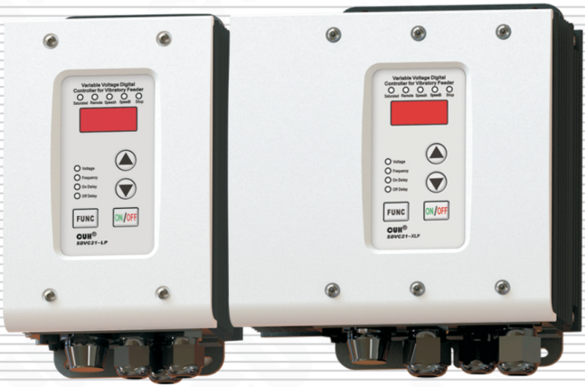

## Instruction Book of SDVC21P Series

**Variable Voltage Digital Controller for Vibratory Feeder**

---

## Preface

Thank you for choosing CUH Digital Vibratory Feeder Controllers. (The controller for short in the following text)

This instruction book includes notes for installing, debugging, parameter setting, maintaining and trouble shooting of the controller. Please read this instruction book carefully before operating the controller and keep it properly.

### This instruction book applies to the following model:

➔Intelligent Digital Voltage Stabilizing Vibratory Feeder Controller SDVC21-LP  
➔Intelligent Digital Voltage Stabilizing Vibratory Feeder Controller SDVC21-XLP

---

---

## Notice

- Never hot swap nor touch the contacts in any case to avoid electric shock or other accidents.
- Never switch the input of the controller by way of cutting off power supply through a relay or other devices, otherwise service life of the controller may reduced severely.
- Don't open the shell without authorization, otherwise its water-proof, oil-proof and dust-proof may be failure.
- Never operate the controller under the condition that beyond its designed limits.
- Operate the controller in accordance with this instruction book strictly. We will not assume any civil or criminal liability if the equipment damage or personal injury is caused by incorrect operation.

> **!**
>
> Never open the controller shell to avoid electric shock. Contact CUH if the controller breaks down.
>
> Never try to revamp the controller since the solid state circuit boards inside the controller can not be repaired, and there's no adjustable part.

---

# Operating Environment

## Inspections Before Using

Every controller will go through rigorous quality inspection before delivery and is packed with crash-proof packaging.

## Please Check the Following Items After Unpacking:

- Whether the controller is damaged in appearance
- Whether model of the controller are exactly what you ordered

## Runtime Environment

Please follow the notes below to ensure better performance and longer lifetime of the controller

- Well-ventilated environment
- Keep away from the corrosive and flammability gas and liquid
- Firmly fixed to avoid vibration
- Keep away from electromagnetic interference
- Operating within the temperature range of 0 °C to 40 °C
- For use at altiude 2000m or lower

---

# Contents

| Section | Page |
|---|---:|
| Chapter I　Features | 1 |
| Chapter II　Installation Guide | 3 |
| Chapter III　Components Descriptions | 4 |
| Chapter IV　Function Descriptions | 6 |
| 4.1 Output Voltage Setting | 6 |
| 4.2 Output Frequency Setting | 7 |
| 4.3 Frequency Display Character parameter Setting | 7 |
| 4.4 Soft Startup Time Setting | 8 |
| 4.5 Output Switch | 8 |
| 4.6 Maximum Output Voltage Restriction | 9 |
| 4.7 Default Settings Restoration | 10 |
| Chapter V　Sensors and Signal Control | 11 |
| 5.1 Intelligent Photoelectric Sensing | 11 |
| 5.2 Using Method of the Switch Sensor | 15 |
| 5.3 Using Method of the 2ⁿᵈ Switch Sensor | 18 |
| 5.4 Logical Relation Setting of the Control Signal | 21 |
| 5.5 Controlling Output | 22 |
| 5.6 Remote Speed Control | 26 |
| 5.7 Preset Speed Switch | 27 |
| Chapter VI　Security Functions | 28 |
| 6.1 Automatic Digital Voltage Stabilizing | 28 |
| 6.2 Short-Circuit Protection | 28 |
| 6.3 Current Overload Protection | 28 |
| 6.4 Overheat Protection | 28 |
| 6.5 Ambient temperature derating curve (only applied for SDVC21-XLP) | 28 |

## Appendix

| Section | Page |
|---|---:|
| Appendix A: Dimensions | 29 |
| Appendix B: Output Interface Definition | 31 |
| Appendix C: Signal Interface Definition | 31 |
| Appendix D: LED Displayed Characters Definition | 34 |
| Appendix E: Electrical Specification | 35 |
| Appendix F: Trouble Shooting Tips and Error Explanations | 36 |
| Appendix G: Absolute Parameters | 37 |

---

# ChapterⅠ Features

The controller is specially designed for controlling vibratory feeder in the automation systems. Combined with the latest electronic technology and elaborate design, the controller provides the following convenient and practical features:

**Protection Level:** IP67, This controller can work in the environment which are wet, oil pollution or dust.

**Ultra Wide Operating Voltage Range:** This controller's input voltage range is from AC 85V to 440V.

**Automatic Voltage Stabilizing:** The controller can eliminate feeding speed variation caused by mains voltage fluctuation.

**Voltage Adjusting:** Output voltage ranges from 0V to 440V.

**Soft Startup:** In order to avoid sudden shock to the work pieces, the controller can gently increase output voltage from 0 to the pre-set value when startup.

**Soft Startup Time Setting:** Soft Startup Time can be set exactly in digital numbers.

**Halt when Work-pieces are full:** A switch sensor can help to halt the controller when work-pieces are full and to fulfill the functions of Soft Startup Time Setting, Startup Delay, Shutdown Delay, and Logical Relation Adjusting.

**Controlling Output:** The Controlling Output signal outgoing from the transistor can coordinate a solenoid or other external devices with the controller.

**Overheat Protection:** The controller will halt its output to protect itself when operation temperature is too high.

**Current Overload Protection:** The controller will halt its output to ensure operating safety of the equipment when operation current exceeds its rated value.

## The Following Features Can be Customized:

**Dual Control Signals Input:** Dual control signals input of Work-pieces-Full and Work-piece-Empty could form the logical control relation of AND, OR, NOT, XOR, and all the others.

**Output Voltage Preset Function:** Up to four preset output voltage values can be chosen by external control signals.

**Intelligent Photoelectric Sensing:** Our adaptive Intelligent Photoelectric Sensor can help to stall the controller when work-pieces are full or work-pieces are empty and to fulfill the functions of Inching Startup Time Setting, Startup Delay, Shutdown Delay, and Logical Relation Adjusting.

**Remote Speed Control:** Output voltage of the controller can be controlled by an external potentiometer, a PLC, or a voltage control signal ranging form 1V to 5V.

---

---

**CUH** attaches great importance to the product quality management and safety performance. Apart form the high-quality components we use and rigorous quality control system, **CUH** has taken account of possible accidents users may encounter and provides the following protective functions to maximum the controller's practicability.

**Short-Circuit Protection:** If output of the controller is short-circuited, the controller will halt its output until restarted.

**Current Overload Protection:** The controller will halt its output to ensure equipments' operating safety when operation current exceeds its rated value.

**Overheat Protection:** The controller will halt its output to protect itself when operation temperature is too high.

**CUH** controllers are strictly compliant with CE certification.

---

# Chapter Ⅱ Installation Guide

## Step One:

Open the packing box and connect the Output Power Cable to the vibrator's electromagnetic coils.

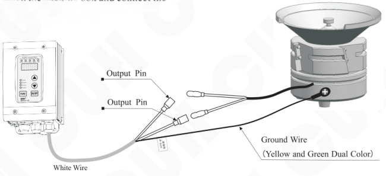

**⚠ Note:**

Make sure the vibrator's electromagnetic coils is connected to the two output pins of the Output Power Cable and the electromagnetic coils is reliably grounded otherwise series security incident may occur.

## Step Two:

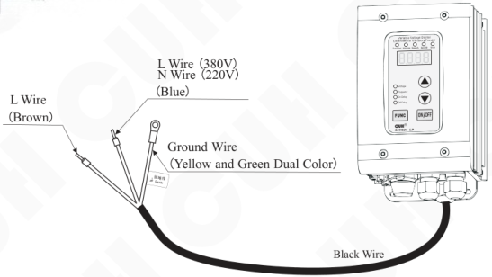

---

# Chapter III Components Descriptions

There are 4 buttons on the control panel including the `FUNC` button to shift among different functions, the ▲ button to increase the parameter value, the ▼ button to decrease the parameter value and the `ON/OFF` button.

## Keyboard Description

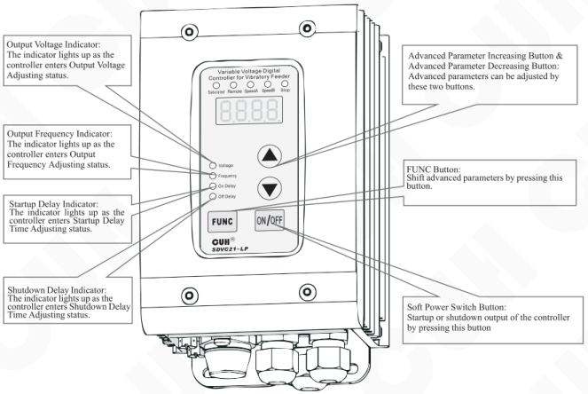

- **Output Voltage Indicator:** The indicator lights up as the controller enters Output Voltage Adjusting status.
- **Output Frequency Indicator:** The indicator lights up as the controller enters Output Frequency Adjusting status.
- **Startup Delay Indicator:** The indicator lights up as the controller enters Startup Delay Time Adjusting status.
- **Shutdown Delay Indicator:** The indicator lights up as the controller enters Shutdown Delay Time Adjusting status.
- **Advanced Parameter Increasing Button & Advanced Parameter Decreasing Button:** Advanced parameters can be adjusted by these two buttons.
- **FUNC Button:** Shift advanced parameters by pressing this button.
- **Soft Power Switch Button:** Startup or shutdown output of the controller by pressing this button

---

## Descriptions of the Status Indicators

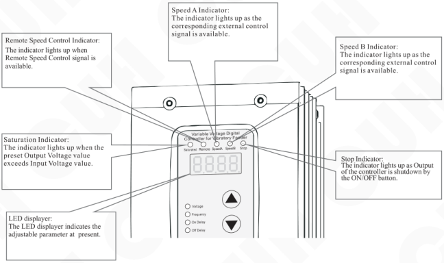

- **Remote Speed Control Indicator:** The indicator lights up when Remote Speed Control signal is available.
- **Speed A Indicator:** The indicator lights up as the corresponding external control signal is available.
- **Speed B Indicator:** The indicator lights up as the corresponding external control signal is available.
- **Saturation Indicator:** The indicator lights up when the preset Output Voltage value exceeds Input Voltage value.
- **Stop Indicator:** The indicator lights up as Output of the controller is shutdown by the ON/OFF button.
- **LED displayer:** The LED displayer indicates the adjustable parameter at present.

## I/O Interface Descriptions

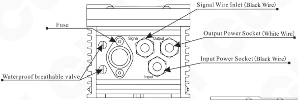

**SDVC21-LP (10A)**

- Fuse
- Waterproof breathable valve
- Signal Wire Inlet (Black Wire)
- Output Power Socket (White Wire)
- Input Power Socket (Black Wire)

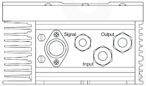

**SDVC21-XLP (25A)**

Note: When used in high oil pollution environments, it is necessary to regularly check the surface of the waterproof and breathable valve to prevent the exhaust hole of the waterproof and breathable valve from being blocked by oil pollution.

---

## Chapter Ⅳ Function Descriptions

### 4.1 Output Voltage Setting

The output voltage can be set directly and digitally through the control panel. Benefit from the unique voltage stabilizing function, output voltage of the controller won't fluctuate as the input voltage does. So that a vibrator can work stably in unstable input voltage environment.

- Turn on the controller by connecting Input power cable.
- The Output Voltage Indicator lights up as the controller enters Output Voltage Adjusting status when the LED displays the voltage symbol H and the previously set voltage value.
- Adjust the Output Voltage value by pressing the ▲ or ▼ button.

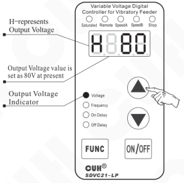

- Output Voltage value of the controller can not exceed Input Voltage value. If Output Voltage value is set close to Input Voltage value, the controller fails to stabilize its voltage output and the Saturation Indicator lights up.
- If Output Voltage value is set too close to zero, the controller fails to stabilize its voltage output and the Saturation Indicator lights up.

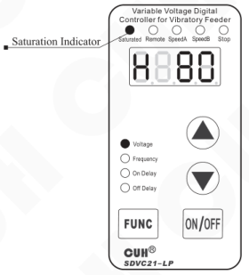

---

## 4.2 Output Frequency Setting

For SDVC21-LP, there are two output frequencies to choose from, Full Wave-Doubled input frequency value and Half Wave -input frequency value.

For SDVC21-XLP, there are four output frequencies to choose from, full wave, half wave, one third of full wave and one quarter of full wave.

- Press the **FUNC** button repeatedly until Shifting to the Output Frequency Adjusting status (E) as the Output Frequency Indicator lights up.
- Press the ▲ or ▼ button to adjust the output frequency.

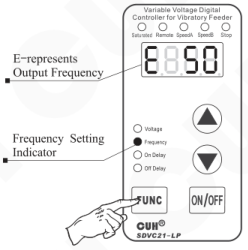

> The displayed characters of the output frequency value can be set through the Frequency Display Character parameter.Please refer to section 4.3.

## 4.3 Frequency Display Character parameter Setting

- Press the **FUNC** and hold for two seconds to enter the Advanced parameters setting interface.
- Press the **FUNC** button repeatedly to switch to the “ΓE” parameter which defines frequency display character.
- Press ▲ or ▼ to adjust this parameter value.

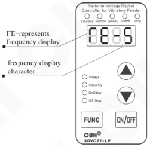

> When the “ΓE” parameter is set to “-5”, the displayed characters will be 100, 50, 33 or 25.  
> When the “ΓE” parameter is set to “-6”, the displayed characters will be 120, 60, 40 or 30.  
> When the “ΓE” parameter is set to “-E”, the displayed characters will be “FUL”, “HAF”, “trd” or “Foh”.

---

## 4.4 Soft Startup Time Setting

In order to avoid sudden shock to the work pieces, the controller can gently increase Output Voltage from 0 to the pre-set value when startup.

Soft Startup Time (t): The period of time it takes for the controller to gently increase Output Voltage from 0 to the pre-set value when startup.

- Press the **FUNC** button and hold for 2 seconds to enter the Advanced Parameters Adjusting status.
- Press the **FUNC** button repeatedly until Shifting to the Soft Startup Time djusting status (t) as the Soft Startup Indicator lights up.
- Press ▲ or ▼ button to adjust the parameter value. The parameter unit is second, and the numerical precision is 0.1.

*Adjustable Soft Startup Time ranges from 0.0 second to 9.9 seconds.*

*Default value of the Soft Startup Time parameter is 1 second.*

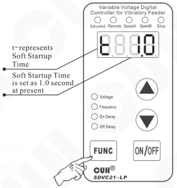

## 4.5 Output Switch

The soft-touch Output Switch Button on the panel can turn on/off the controller's output quickly and easily.

- Press the **ON/OFF** button to turn on/off the controller's output. The Stop Indicator lights up as output of the controller is turned off.

> Due to the soft-touch switch and digital signal control technology, no spark will generate to spoil the contact. As a result, life-span of the controller and the vibrator will be extended greatly.

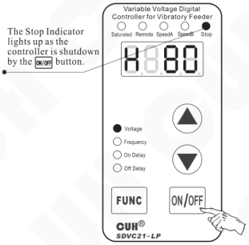

---

## 4.6 Maximum Output Voltage Restriction

Maximum Output Voltage of the controller can be set to prevent damage to the vibrator. Remote Speed Control function is affected by this parameter.

- Press the **FUNC** button and hold for 2 seconds to enter the Advanced Parameters Adjusting status.
- Press the **FUNC** button repeatedly until shifting to the Maximum Output Voltage Restriction status (h).
- Press the ▲ or ▼ button to adjust the parameter value.

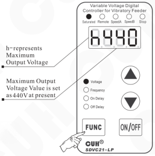

*Default value of the Maximum Output Voltage is 380V*

---

## 4.7 Default Settings Restoration

This function allows the operator to restore all default parameter settings.

Due to the abundant functions of the controller, many parameters can be adjusted. In order to avoid the circumstance that after too many times modification by a beginner, the controller can not work properly, this function allows the operator to restore default settings to the controller in an easy way.

- Press the **FUNC** button and hold for 2 seconds to enter the Advanced Parameters Adjusting status.
- Press the **FUNC** button repeatedly until full screen is flashing, and then press the ▲ button and hold until “----” is displayed which means default settings have been restored.
- After releasing the ▲ button, the controller enters Output Voltage Adjusting status (H). By this time, all parameters have been restored to default values.

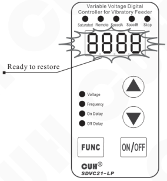

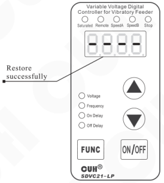

---

# Chapter V Sensors and Signal Control

The controller can be controlled by many kinds of external signals and sensors. This chapter mainly elaborates using method of the Intelligent Photoelectric Sensor, the Switch Sensors and the PLC.

## 5.1 Intelligent Photoelectric Sensing

Combined with the SDVC-S1 Photoelectric Sensor the function of Intelligent Photoelectric Sensing can be achieved. The SDVC-S1 sensor can filter the interference of background light impacting on the sensitivity of the controller. As a result, the controller can work reliably without manual sensitivity adjustment.

### 5.1.1 Connection Method of the SDVC-S1 Intelligent Photoelectric Sensor

Connect the SDVC-S1 sensor to the terminals of the controller according to the diagram

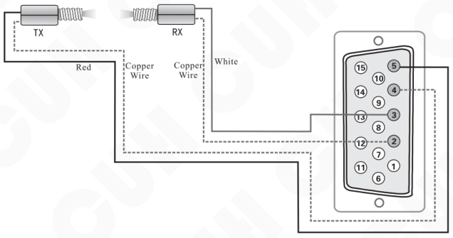

*Notice:*  
*Default logical relation of the sensor is set as work-pieces are empty*

---

## 5.1.2 Startup Delay Time and Shutdown Delay Time Adjusting of the Intelligent Photoelectric Sensor

In most actual applications, the output of the controller should be delayed for a period of time when Startup or Shutdown of the controller is controlled by external signals. Startup Delay Time and Shutdown Delay Time Adjusting function made this kind of application possible. Furthermore, shocks to the work pieces as the controller starts up can be eliminated by adjusting Soft Startup Time.

### Startup Delay (J)

The period of time the controller goes through from receiving a startup control signal to outputting.

- Press the **FUNC** button repeatedly until shifting to the Startup Delay Time Adjusting status (J) as the Startup Delay Time Indicator on the panel lights up.
- Adjust the parameter by pressing the ▲ or ▼ button. The parameter unit is second, and the numerical precision is 0.1.

*Adjustable range of the parameter is from 0.0 to 9.9 seconds*  
*Default value of the parameter is 0.2 seconds*

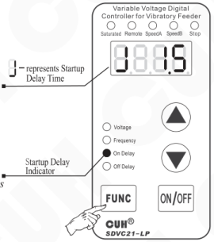

### Shutdown Delay (L)

The period of time the controller goes through from receiving a shutdown control signal to cutting off output.

- Press the **FUNC** button repeatedly until shifting to the Shutdown Delay Time Adjusting status (L) as the Shutdown Delay Time Indicator on the panel lights up.
- Adjust the parameter by pressing the ▲ or ▼ button. The parameter unit is second, and the numerical precision is 0.1.

*Adjustable range of the parameter is from 0.0 to 9.9 seconds*  
*Default value of the parameter is 0.2 seconds*

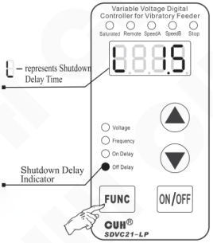

---

### 5.1.3 Logical Relation Adjusting of the Intelligent Photoelectric Sensor

Under normal circumstances, the receiving end of the Intelligent Photoelectric Sensor receives no optical signal, and the controller runs by default. But in some special applications the controller needs to be stopped when the receiving end receives no optical signal. Adjusting this parameter can fulfill these kind of applications.

- Press the **FUNC** button and hold for 2 seconds to enter the Advanced Parameters Adjusting status.
- Press the **FUNC** button repeatedly until Shifting to the Logical Relation Adjusting status of the Intelligent Photoelectric Sensor.
- Adjust the parameter by pressing the ▲ or ▼ button.

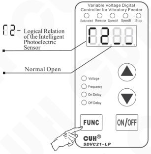

- When Logical Relation is set as Normal Open, namely no optical signal received, the controller runs.
- When Logical Relation is set as Normal Close, namely no optical signal received, the controller stops.

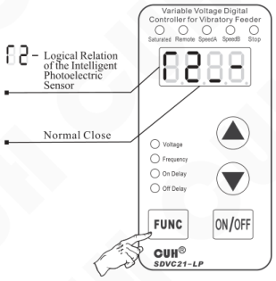

*The parameter is set as Normal Open by default*

---

## 5.1.4 The CUH Intelligent Photoelectric Sensor Sensitivity Parameter Setting

Parameter P means the sensitivity of the CUH intelligent photoelectric sensor, i.e. sensing distance of the CUH intelligent photoelectric sensor.

The smaller parameter P value is, the more sensitive the sensor will be and the longer distance it can receive.

- Press the **FUNC** and hold for two seconds to enter the Advanced parameters setting interface.
- Press the **FUNC** button repeatedly for entering to the Intelligent Photoelectric Sensitivity adjustment parameter interface. The LED symbol of this parameter is “P”.
- Press ▲ or ▼ to adjust this parameter value.

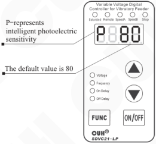

The parameter value range is from 0 to 999, and the default value is 80.

---

## 5.2 Using Method of the Switch Sensor

The controller can operate with many kinds of sensors such as switch sensors, optical switch sensors and fiber optic sensors.

### 5.2.1 Connection Method of the Switch Sensor

Connect the Proximity Switch Sensor to the terminals of the controller according to the diagram.

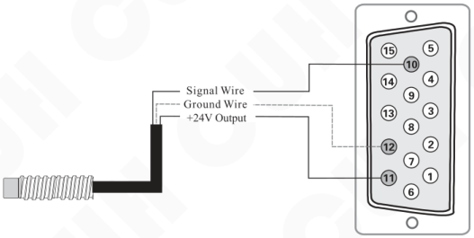

### Convention

The blue wire represents ground wire  
The black wire represents signal wire  
The brown wire represents power wire.

---

## 5.2.2 Startup Delay Time and Shutdown Delay Time Setting of the Switch Sensor

By default, Intelligent Photoelectric Sensor and Switch Sensor share the same Startup Delay Time and Shutdown Delay Time. Operators can also set Startup Delay Time and Shutdown Delay Time of the Switch Sensor independently.

### Startup Delay (J-)

The period of time the controller goes through from receiving a startup control signal to outputting.

- Press the **FUNC** button and hold for 2 seconds to enter the Advanced Parameters Adjusting status.
- Press the **FUNC** button repeatedly until shifting to the Startup Delay Time Adjusting status (`J---`).
- Adjust the parameter by pressing the ▲ or ▼ button. The parameter unit is second, and the numerical precision is 0.1.

*Adjustable range of the parameter is from 0.0 to 9.9 seconds*  
*Default value of the parameter is J---*  
*The independent Startup Delay of the Switch Sensor will be closed when the parameter value is adjusted to 0*

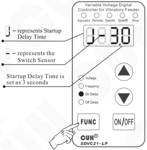

### Shutdown Delay (L-)

The period of time the controller goes through from receiving a shutdown control signal to cutting off output.

- Press the **FUNC** button and hold for 2 seconds to enter the Advanced Parameters Adjusting status.
- Press the **FUNC** button repeatedly until shifting to the Shutdown Delay Time Adjusting status (`L---`).
- Adjust the parameter by pressing the ▲ or ▼ button. The parameter unit is second, and the numerical precision is 0.1.

*Adjustable range of the parameter is from 0.0 to 9.9 seconds*  
*Default value of the parameter is L---*  
*The independent Shutdown Delay of the Switch Sensor will be closed when the parameter value is adjusted to 0*

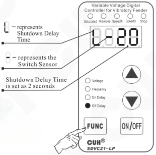

> ➔ When J- and L- values are adjusted to 0, Startup Delay Time and Shutdown Delay Time of the Switch Sensor will be the same with Startup Delay Time and Shutdown Delay Time of the Intelligent Photoelectric Sensor.
>
> ➔ Startup Delay Time and Shutdown Delay Time of the Intelligent Photoelectric Sensor will not affected by the parameter of J- or L-.

---

## 5.2.3 Logical Relation Setting of the Switch Sensor (Halt when work-pieces are full)

Under normal circumstances, the controller receives no signal from the Switch Sensor and runs by default. But in some special applications the controller needs to be stopped when receives no signal from the Switch Sensor. Adjusting this parameter can fulfill these kind of applications.

- Press the **FUNC** button and hold for 2 seconds to enter the Advanced Parameters Adjusting status.
- Press the **FUNC** button repeatedly until Shifting to the Logical Relation Adjusting status of the Switch Sensor (Γ1).
- Adjust the parameter by pressing the ▲ or ▼ button.

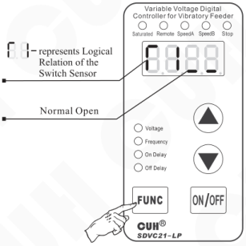

> ➔ When Logical Relation is set as Normal Open, namely no signal received, the controller runs.
>
> ➔ When Logical Relation is set as Normal Close, namely no signal received, the controller stops.

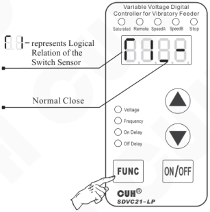

*The parameter is set as Normal Open by default*

---

## 5.3 Using Method of the 2nd Switch Sensor

The controller allows three sensors connecting to it, one Intelligent Photoelectric Sensor and two Switch Sensors. The functions of Halt when work-pieces are full and Halt when work-pieces are empty can work with the help of these sensors.

### 5.3.1 Connection Method of the 2nd Switch Sensor

Connect the 2nd Proximity Switch Sensor to the terminals of the controller according to the diagram.

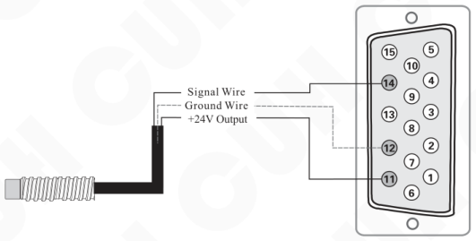

**Commonly**

The blue wire represents ground wire  
The black wire represents signal wire  
The brown wire represents power wire

---

### 5.3.2 Startup Delay Time and Shutdown Delay Time Setting of the 2ⁿᵈ Switch Sensor

By default, Intelligent Photoelectric Sensor and the two Switch Sensors share the same Startup Delay Time and Shutdown Delay Time. Operators can also set Startup Delay Time and Shutdown Delay Time independently for the 2ⁿᵈ Switch Sensor.

**Startup Delay (J_):** The period of time the controller goes through from receiving a startup control signal to outputting.

- Press the **FUNC** button and hold for 2 seconds to enter the Advanced Parameters Adjusting status.
- Press the **FUNC** button repeatedly until shifting to the Startup Delay Time Adjusting status (`J_--`)
- Adjust the parameter by pressing the ▲ or ▼ button. The parameter unit is second, and the numerical precision is 0.1.

*Adjustable range of the parameter is from 0.0 to 9.9 seconds*  
*Default value of the parameter is `J_--`*  
*The independent Startup Delay of the 2ⁿᵈ Switch Sensor will be closed when the parameter value is adjusted to 0*

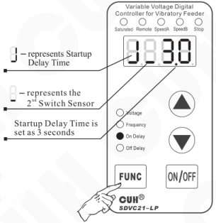

**Shutdown Delay (L_):** The period of time the controller goes through from receiving a shutdown control signal to cutting off output.

- Press the **FUNC** button and hold for 2 seconds to enter the Advanced Parameters Adjusting status.
- Press the **FUNC** button repeatedly until shifting to the Shutdown Delay Time Adjusting status (`L_--`).
- Adjust the parameter by pressing the ▲ or ▼ button. The parameter unit is second, and the numerical precision is 0.1.

*Adjustable range of the parameter is from 0.0 to 9.9 seconds*  
*Default value of the parameter is `L_--`*  
*The independent Shutdown Delay of the 2ⁿᵈ Switch Sensor will be closed when the parameter value is adjusted to 0*

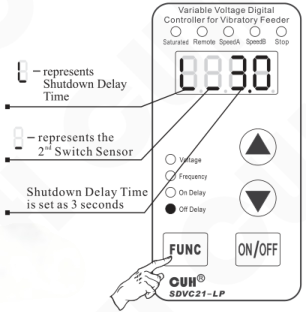

- When J_ and L_ values are adjusted to 0, Startup Delay Time and Shutdown Delay Time of the 2ⁿᵈ Switch Sensor will be the same with Startup Delay Time and Shutdown Delay Time of the Intelligent Photoelectric Sensor.
- Startup Delay Time and Shutdown Delay Time of the Intelligent Photoelectric Sensor will not affected by the parameter of J_ or L_.

---

## 5.3.3 Logical Relation Setting of the 2ⁿᵈ Switch Sensor (Halt when work-pieces are full)

Under normal circumstances, the controller receives no signal from the 2ⁿᵈ Switch Sensor and runs by default. But in some special applications the controller needs to be stopped when receives no signal from the 2ⁿᵈ Switch Sensor. Adjusting this parameter can fulfill these kind of applications.

- Press the **FUNC** button and hold for 2 seconds to enter the Advanced Parameters Adjusting status.
- Press the **FUNC** button repeatedly until shifting to the Logical Relation Adjusting status of the 2ⁿᵈ Switch Sensor (Γ3)
- Adjust the parameter by pressing the ▲ or ▼ button.

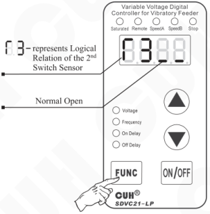

> - When Logical Relation is set as Normal Open, namely no signal received, the controller runs.
> - When Logical Relation is set as Normal Close, namely no signal received, the controller stops.

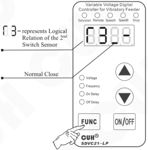

*The parameter is set as Normal Open by default*

---

## 5.4 Logical Relation Setting of the Control Signal

The controller can set the logical relation of the Intelligent Photoelectric Sensor and the Switch Sensor when they work simultaneously.

- Press the **FUNC** button and hold for 2 seconds to enter the Advanced Parameters Adjusting status.
- Press the **FUNC** button repeatedly until shifting to the Logical Relation Adjusting status of the Control Signal (Π).
- Adjust the parameter by pressing the ▲ or ▼ button.

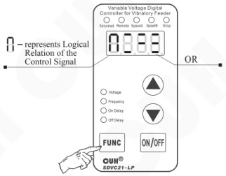

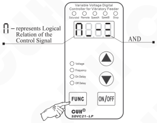

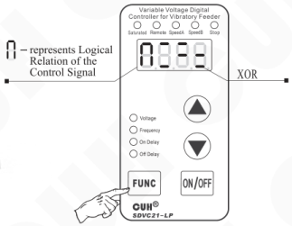

- **Logical relation AND:** The controller runs only when both the Intelligent Photoelectric Sensor and the Switch Sensor asks the controller to.
- **Logical relation OR:** The controller runs when the Intelligent Photoelectric Sensor or the Switch Sensor asks the controller to.
- **Logical relation XOR:** The controller runs only when the Intelligent Photoelectric Sensor and the Switch Sensor output the opposite control signal.

*Logical relation of the parameter is set as AND by default.*

---

## 5.5 Controlling Output

The controller can output low-voltage controlling signal to cooperate with other devices such as a solenoid valve, a PLC or an electrical relay.

### 5.5.1 Connection Method of the Controlling Output

**Connection method of the controlled PLC**

Connect signal wire and ground wire of the controller to the terminals of the controller according to the diagram.

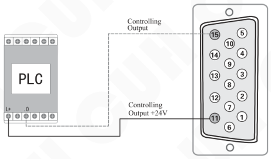

> Relay type or source type of output port of PLC can be connected to the controller and the voltage specification of output port is 24V.

---

### 5.5.2 Connection Method of the Controlled Solenoid Valve

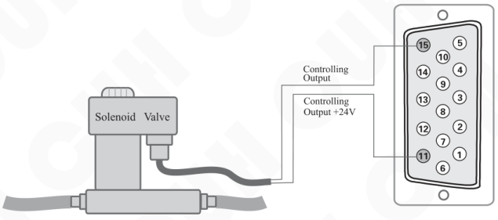

➔ The controller can directly drive a solenoid valve whose rated voltage is 24V and rated power lower than 4W.

### 5.5.3 Connection Method of the Electrical Relay

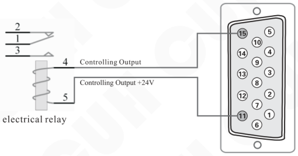

➔ The controller can directly drive an electrical relay whose rated voltage is 24V and rated power lower than 4W.

---

## 5.5.4 Logical Relation Setting of the Controlling Output

- Press the **FUNC** button and hold for 2 seconds to enter the Advanced Parameters Adjusting status.
- Press the **FUNC** button repeatedly until shifting to the Logical Relation Adjusting status of the Controlling Output (Γ4).
- Adjust the parameter by pressing the ▲ or ▼ button.

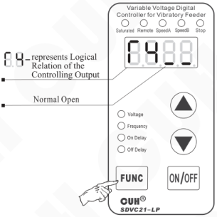

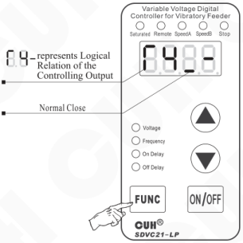

> - When Logical Relation is set as Normal Open, the Controlling Output works as the controller runs.
> - When Logical Relation is set as Normal Close, the Controlling Output doesn't work as the controller runs.

---

## 5.5.5 Parameter Setting of Allocating the Control Signals to the Output of the Controller or DC Output for Controlling Separately

- Press the **FUNC** and hold for two seconds to enter the Advanced parameters setting interface.
- Press the **FUNC** button repeatedly for entering to the adjustment parameter interface. The LED symbol of this parameter is “Γ5”.
- Press ▲ or ▼ to adjust this parameter value.

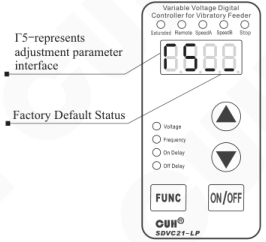

- When the Γ5 is set to “”, the output to the vibrator and the DC output are all controlled by the ON/OFF button on the control panel and the logical operation result of the CUH intelligent photoelectric sensor and two switch sensors.
- When the Γ5 is set to “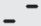”, the output to the vibrator is controlled by ON/OFF button on the control panel. The DC output is controlled by the logical operation result of the CUH intelligent photoelectric sensor and two switch sensors.
- When the Γ5 is set to “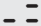”, the output to the vibrator is controlled by ON/OFF button on the control panel and controlled by logical operation result of two switch sensors. The DC output is controlled by the CUH intelligent photoelectric sensor.
- When the Γ5 is set to “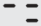”, output to the vibrator is controlled by ON/OFF button on the control panel and the CUH intelligent photoelectric sensor. The DC output is controlled by the logical operation result of two switch sensors.

---

## 5.6 Remote Speed Control

The function of Remote Speed Control allows the operator to control the Output Voltage by an external potentiometer or a control signal ranging from 1V to 5V. Thus, external remote speed control can be easily achieved by a PLC, a DCS or some other devices.

Remote Speed Control function becomes effective to the controller when the controlling signal exceeds 0.5V. Meanwhile, Remote Speed Control Indicator on the panel lights up and the ▲ and ▼ buttons lose effectiveness. The LED displayer shows current Output Voltage if the controller is running in the Output Voltage Adjusting status.

There are linear relationship between 1~5 V controlling voltage and 0~440V Output Voltage

### Connection method of the external potentiometer

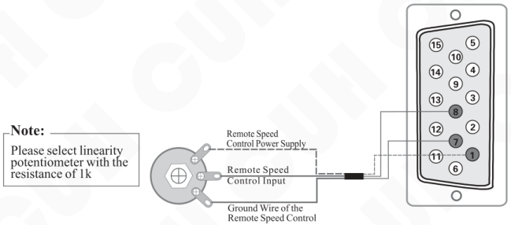

### Connection method of the PLC

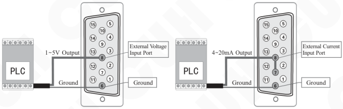

## 5.7 Preset Speed Switch

The function of Preset Speed Switch can choose the preset speed by means of external control signals, such as a PLC, a PC, sensors or other signal sources to build up a multi-speed feeding control system.

The controller supports two remote speed control switch. The Speed A switch and the Speed B switch are both Low Level effective.

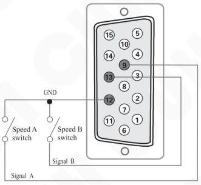

Each speed control switch has a corresponding indicator on the panel. When the controller receives an effective signal, the corresponding indicator will light up.

The two indicators indicate 4 statuses. (A lights up and B goes out, A goes out and B lights up, both light up, both go out). The diagram to the right shows the status that both speed control switches are given effective signals.

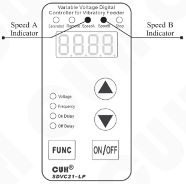

By means of speed control switches, the controller shifts to the corresponding speed. The output voltage corresponding to the speed can be adjusted by pressing ▲ or ▼ button. And the adjusted voltage will be stored automatically. As soon as the speed control signal is received, the controller outputs the corresponding voltage immediately.

---

## Chapter VI Security Functions

### 6.1 Automatic Digital Voltage Stabilizing

The internal digital voltage stabilizing function of the controller can stabilize feeding speed regardless of mains voltage fluctuation.

### 6.2 Short-Circuit Protection

If output is short-circuited, the controller will halt its output and display Err02 until restarting the controller.

### 6.3 Current Overload Protection

The controller will halt its output if output current exceeds rated current caused by faulty operation and display Err02 to protect the controller and customer equipments.

### 6.4 Overheat Protection

The controller will halt its output if operation temperature exceeds 65⁰C and display Err03 to protect the controller until operation temperature drops to 60⁰C.

### 6.5 Ambient temperature derating curve (only applied for SDVC21-XLP)

Under the condition of air nature convection, when the ambient temperature rises, due to the limitation of the heat dissipation capacity of the controller, the controller can't continuously output 25A current. Refer to the derating curve as below for using.

If you want the controller can continuously output 25A current, please provide better cooling conditions.

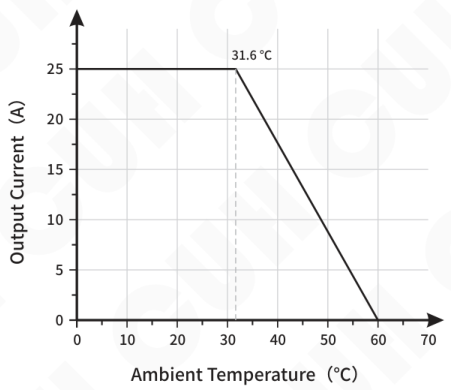

---

## Appendix A: Dimensions (mm)

### SDVC21-LP

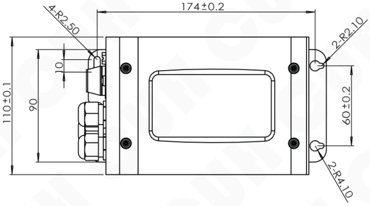

---

## SDVC21-XLP

---

## Appendix B: Output Interface Definition

### Cross Section View:

**⚠ Notice:**

A: Make sure the electromagnetic coils of the vibrator is connected to the two output pins of the Output Power Cable socket and the shell of the vibrator is reliably earthed, otherwise series security incident may occur.

B: After welding, make sure the blank area is enswathed by insulating tape or heat-shrinkable tube before insert it into the Output Power Cable socket to avoid electrical leakage or short-circuit.

## Appendix C: Signal Interface Definition

![15-pin signal interface definition diagram. 1: Remote Speed Control (+5V); 2: Photosensor (GND); 3: Photosensor Rx; 4: Photosensor (GND); 5: Photosensor Tx; 6: Remote Speed Control (GND); 7: RGND; 8: Remote Speed Control (Input); 9: Pset A (Low voltage level is valid); 10: Switch Sensor Input (NPN type: Low voltage level is valid; PNP type: High voltage level is valid); 11: Control Output (+24V); 12: Control Output (GND); 13: Pset B (Low voltage level is valid); 14: Switch Sensor II Input (NPN type: Low voltage level is valid; PNP type: High voltage level is valid); 15: Control Output.](assets/images/cuh.sdvc21-lp.manual.v0.0/page-0037-vcrop-02.png)

---

## Port A: Remote Speed Control

| Port | Pin | Signal |
|---|---|---|
| A3 | ① | +5V |
| A2 | ⑧ | Input |
| A1 | ⑦ | RGND |

## Port B: Intelligent Photosensor

| Port | Pin | Signal |
|---|---|---|
| B4 | ⑤ | Tx |
| B3 | ④ | GND |
| B2 | ③ | Rx |
| B1 | ② | GND |

## Port C: Switch Sensor

| Port | Pin | Signal |
|---|---|---|
| C1 | ⑫ | GND |
| C2 | ⑩ | Input |
| C3 | ⑪ | +24V |

## Port D: Control Output

| Port | Pin | Signal |
|---|---|---|
| D1 | ⑮ | Output |
| D2 | ⑪ | +24V |
| D3 | ⑫ | GND |

---

## Port E: Switch Sensor II

| Port | DB pin | Signal |
|---|---|---|
| E1 | ⑫ | GND |
| E2 | ⑭ | Input |
| E3 | ⑪ | +24V |

## Port G: Speeds Preset

| Port | DB pin | Signal |
|---|---|---|
| G1 | ⑫ | GND |
| G2 | ⑨ | Pset A |
| G3 | ⑫ | GND |
| G4 | ⑬ | Pset B |

## Port I: 24V DC Power

| Port | DB pin | Signal |
|---|---|---|
| I1 | ⑫ | GND |
| I2 | ⑪ | +24V |

Note: the numbers in the circle represent the pins of DB plug.

---

## Appendix D: LED Displayed Characters Definition

| Displayed Character | Definition | Symbol Image |
|---|---|---|
| H | Output Voltage |  |
| E | Output Frequency |  |
| t | Soft Startup |  |
| J | Startup Delay Time of the Intelligent Photoelectric Sensor |  |
| J- | Startup Delay Time of the Switch Sensor |  |
| J_ | Startup Delay Time of the 2ⁿᵈ Switch Sensor |  |
| L | Shutdown Delay Time of the Intelligent Photoelectric Sensor |  |
| L- | Shutdown Delay Time of the Switch Sensor |  |
| L_ | Shutdown Delay Time of the 2ⁿᵈ Switch Sensor |  |
| Γ1 | Logical Relation of the Switch Sensor |  |
| Γ2 | Logical Relation of the Intelligent Photoelectric Sensor |  |
| Γ3 | Logical Relation of the 2ⁿᵈ Switch Sensor |  |
| Γ4 | Logical Relation of the Controlling Output |  |
| Γ5 | Parameter Setting of Allocating the Control Signals to the Output of the Controller or DC Output for Controlling Separately |  |
| ΓE | Frequency Display Character parameter setting |  |
| h | Maximum Output Voltage |  |
| A | Logical Relation of the Control Signal |  |
| P | The CUH intelligent photoelectric sensor sensitivity parameter setting |  |
| 8.8.8.8. | Default Settings Restore |  |
| ---- | Default Settings Restore Successful |  |
| Err | Error Information |  |

## Appendix E: Electrical Specification

| Item | Range: Min | Range: Typical | Range: Max | Unit | Description |
|---|---|---|---|---|---|
| Input Voltage | 85 | 380 | 440 | V | AC RMS |
| Adjustable Output Voltage Range | 35 | —— | Vin-10 | V | Half Wave |
| Adjustable Output Voltage Range | 45 | —— | Vin-5 | V | Full Wave |
| Voltage Adjustment Accuracy | | 1 | | V | |
| Response Time of Voltage Regulation | 0 | 0.01 | 0.02 | s | |
| Adjustable Output Current Range | 0 | —— | 10 | A | SDVC21-LP |
| Adjustable Output Current Range | 0 | —— | 25 | A | SDVC21-XLP |
| Output Power | 0 | —— | 3800 | VA | SDVC21-LP |
| Output Power | 0 | —— | 9500 | VA | SDVC21-XLP |
| Output Frequency | 90 | 100/120 | 130 | Hz | Full Wave |
| Output Frequency | 45 | 50/60 | 65 | Hz | Half Wave |
| Output Frequency | 30 | 33/40 | 43 | Hz | 1/3 full wave SDVC21-XLP |
| Output Frequency | 22 | 25/30 | 32 | Hz | 1/4 full wave SDVC21-XLP |
| Output Waveform | | Phase cut sine | | | |
| Soft Start Time | 0.0 | —— | 9.9 | s | Factory Default Value:0.5 |
| On/Off Delay Time Range | 0.0 | —— | 9.9 | s | Factory Default Value:0.2 |
| On/Off Delay Time Accuracy | | 0.1 | | s | |
| Overheat Protection Trigger Temperature | 58 | 60 | 66 | ℃ | |
| DC Control Output Voltage | 22 | 24 | 26 | V | |
| DC Control Output Current | 0 | —— | 200 | mA | |
| Analog Control Signal | | 1-5 | | V | Remote speed Control Voltage |
| Digital Control Signal | | 24 | | V | Switching Signal |
| Adjustment Method | | 4 | | Button | |
| Fuse Capacity | | 16 | | A | SDVC21-LP |
| Fuse Capacity | | 30 | | A | SDVC21-XLP |
| Standby Power Consumption | —— | 4 | —— | W | |
| Display Method | | 4 | | Digit | LED Digital Tubes |
| Ingress Protection Level | | IP67 | | | |
| Weight | | 4600 | | g | SDVC21-LP |
| Weight | | 5800 | | g | SDVC21-XLP |
| Ambient Temperature | 0 | 25 | 40 | ℃ | |

---

## Appendix F: Trouble Shooting Tips and Error Explanations

The following tips can help to solve the problems you may encounter

| | | | Symbol Image |
|---|---|---|---|
| 1 | No display after power on | ➔Make sure the power outlet is live ➔Make sure the Input Power Cable is reliably connected to the power outlet | |
| 2 | Displays normally, but no output | ➔Make sure the Input Power Cable and Output Power Cable are firmly connected ➔Make sure the Output Voltage parameter value is not too small ➔Make sure the controller is not stopped by the control signal ➔Make sure the controller is not stopped by the parameters that are set as normal off | |
| 3 | Control signal loses effectiveness | ➔Make sure the control signal is correctly inputted ➔Make sure the ground wire of the control signal is correctly connected to the controller ➔Make sure the Logical Relation of the control signal is set correctly as you expectation | |
| 4 | Displays normally, no output, but sound can be heard | ➔Adjust all parameters as this book instructed | |
| 5 | Err2 | ➔Output Over Current. Make sure the specifications of the vibrator don't exceed the limits of controller. ➔Output in short-circuit. Make sure the Output Power Cable and Output Power Aviation Connector are not shorted. ➔Make sure the Output Power Cable is connected reliably between controller and the vibrator. ➔Make sure the controller is reliably grounded. |  |
| 6 | Err3 | ➔Overheat, Place the controller in well ventilated environment |  |

## Appendix G: Absolute Parameters

Absolute Parameters:
Above the standard will damage the controller, obey it strictly.

| Item | GB Standard | IEC Standard | Standard Requirement | Reached Level of CUH Product | Note |
|---|---|---|---|---|---|
| Electrostatic Discharge | GB/T 17626.2-2006 | IEC 61000-4-2:2001 | 4 kV | ±8 kV | Contact Discharge |
| | | | 4 kV | ±15 kV | Air Discharge |
| Electrical Fast Transient Test | GB/T 17626.4-2008 | IEC 61000-4-4:2004 | 4 kV | ±4 kV | Direct Couple |
| Electrical Surge | GB/T 17626.5-2008 | IEC 61000-4-5:2005 | 4 kV | ±4 kV | Line-Line Couple |
| | | | 4 kV | ±4 kV | Line-Earth Couple |

---

Nanjing CUH Science & Technology Co.,Ltd  
https://en.cuhnj.com  
Tel.:+86-25-84730411 / 84730415 / 84730416  
Fax:+86-25-84730426  
E-mail:sales@cuhnj.com  
Add.:Building 2, Xueyan Tech Park, Tuscity,  
No.9 Zhineng Rd, Jiangning, Nanjing, China

Document No.: IDP1000415

