## Variable Frequency Digital Controller for Vibratory Feeder

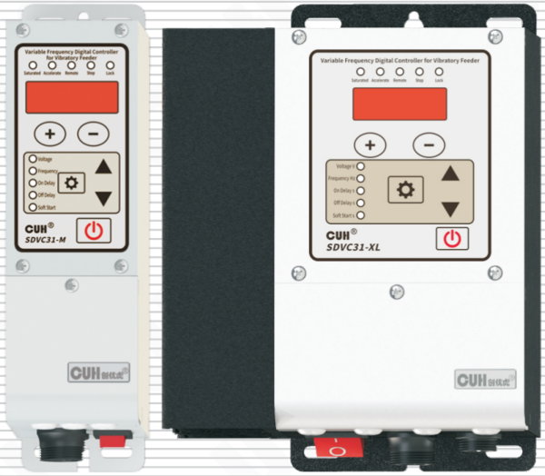

## SDVC31 Series
Variable Frequency Digital Controller for Vibratory Feeder — SDVC31 Series
**User Manual**

---

## Copyright Statement

Nanjing CUH Science & Technology CO., Ltd. reserves all rights.

All information contained in this user manual is the knowledge of our company and is protected by copyright law and other related laws. CUH enjoys and reserves all rights conferred by copyright law and other laws. Without the written consent of CUH, part or all of this user manual shall not be copied, translated, imitated or otherwise utilized.

## Disclaimer

All contents of this user manual only describe the use method of related products produced by our company, and are described according to the existing technology and the state provided to you when you use it. You must bear the relevant risks when you use this product. Except as required by law, the company does not have any express or implied responsibility for the product due to this user manual, including but not limited to personal injury, property damage, loss of opportunity, etc.

You clearly understand the above risks and agree that, except as mandated by law, the company is not responsible for any direct or indirect damage or loss to you (including but not limited to tangible loss of personnel, property, data, etc. and intangible loss of reputation, opportunity, etc.)

The company reserves the right to modify the products applicable in this user manual without prior or subsequent notice.

---

# Preface

Thank you for choosing CUH SDVC31 series digital frequency modulation vibration feeding controller. (The controller for short in the following text). This series of controllers uses high-quality components and incorporates the latest electronic technology, and is carefully designed with high-performance digital signal processors.

This manual introduces the basic operation method, functional technical description and typical application examples of this product. Provide users with relevant information on installation and debugging, parameter setting, abnormal diagnosis, troubleshooting and routine maintenance of the controller. In order to ensure the correct installation and use of this controller, please read this user manual carefully before installation and keep it properly.

Be sure to read the following symbols to alert you to precautions against personal injury and product damage.

| | |
|---|---|
| ⚠ Danger | Non-observance of this item will result in personal injury or death. |
| ⚠ Warn | Non-observance of this item may result in personal injury or death. |
| ⚠ Careful | Non-observance of this item may result in moderate or minor injury to persons. |
| Notice | Non-observance of this item will result in damage to the product and property damage. |
| ❗ Essential | Indicates precautions and usage restrictions that must be observed during use. |

**This manual is suitable for the following models of controllers:**

- Digital FM Vibration Feeding Controller SDVC31-S (1.5A)
- Digital FM Vibration Feeding Controller SDVC31-M (3.0A)
- Digital FM Vibration Feeding Controller SDVC31-L (4.5A)
- Digital FM Vibration Feeding Controller SDVC31-XL (6.0A)

---

## Safety and Precautions

1. **⚠ Danger** This product is only used to drive electromagnet-based vibratory feeding equipment, do not use this product for the purpose of protecting the human body or parts of the human body, etc.

2. **⚠ Danger** This product is not intended to be used as an explosion-proof product, do not use it in hazardous locations and/or potentially explosive gas environment.

3. **⚠ Warn** This product is powered by AC mains, please do not apply AC voltage exceeding 260Vac. Excessive input voltage, such as 380Vac, may cause the product to explode or catch fire, resulting in serious safety accidents.

4. **⚠ Warn** This product is grounded through the power cord. Please ensure that the power distribution facilities for the controller are well grounded, otherwise the controller shell may be charged, resulting in an electric shock accident.

5. **⚠ Warn** Do not input AC power to the output of this controller, it will damage the controller.

6. **⚠ Warn** Do not plug and unplug the wiring with points or touch the contact of each wiring terminal in the wiring compartment to prevent electric shock.

7. **Notice** Please avoid controlling the output of this product by cutting off the power supply through relays and other devices, which will seriously reduce the life of the controller.

8. **Notice** The controller is designed to work in a cool and dry environment. Never run the controller outside to avoid soaking and insolation. Operate the controller within the temperature specified electrical characteristic.

9. **❗ Essential** Be sure to fix this product on a solid platform that is reliably grounded and away from vibrating equipment.

10. **❗ Essential** Never operate the controller under the condition that beyond its designed limits.

11. **❗ Essential** Operate the controller in accordance with this instruction book strictly. we will not assume any civil or criminal liability if the equipment damage or personal injury is caused by incorrect operation.

12. **❗ Essential** Never open the controller shell to avoid electric shock. Contact CUH if the controller break down. Never try to repair the controller yourself which may caused void warranty.

---

# Operating and Storage Environment

## Inspection Before Using

Every controller will go through rigorous quality inspection before delivery and is packed with crash-proof packaging, Please check the following items after unpacking:

1. Whether the controller is damaged during transportation.
2. Whether the model of the controller is that you ordered.

## Runtime Environment

Please follow the notes below to ensure the better performance and longer lifetime of the controller:

- ⚠ Well-ventilated environment
- ⚠ Keep away from water, stream, dust and especially oily dust
- ⚠ Keep away from the corrosive or flammable gas and liquid
- ⚠ Keep away from floating dust and metal particles
- ⚠ Firmly fixed to avoid self vibration
- ⚠ Keep away from electromagnetic interference
- ⚠ Ensure ambient temperature is 0~40 ℃
- ⚠ For use at altitude 2000m or lower

---

# Contents

- **Chapter Ⅰ Before Use — 1**
  - 1.1 Check the Package Contents — 1
  - 1.2 Indicators and Buttons Explanation — 2
  - 1.3 External Parts Explanation — 3
  - 1.4 Wiring Ports Explanation — 4
  - 1.5 Nameplate Explanation — 4
- **Chapter Ⅱ Features — 5**
- **Chapter Ⅲ Installation Guide — 7**
  - 3.1 Controller Usage Conditions — 7
  - 3.2 Operation Method of Buttons — 7
  - 3.3 Install and Use — 8
- **Chapter Ⅳ Basic Function Description — 12**
  - 4.1 Output Voltage — 12
  - 4.2 Output Frequency — 13
  - 4.3 On/Off Delay of Intelligent Photoelectric Sensor — 14
  - 4.4 Soft Startup Time — 15
  - 4.5 Keyboard Lock — 15
- **Chapter Ⅴ Advanced Function Description — 16**
  - 5.1 Remote Speed Control — 16
  - 5.2 Intelligent Photoelectric Sensing — 18
    - 5.2.1 Wiring Method of the Intelligent Photoelectric Sensor — 18
    - 5.2.2 Logical Relation Setting of the Intelligent Photoelectric Sensor — 19
  - 5.3 Switch Sensor — 20
    - 5.3.1 Wiring Method of the Switch Sensor — 20
    - 5.3.2 On/Off Delay of the Switch Sensor — 21
    - 5.3.3 Logical Relation Setting of the Switch Sensor — 22

---

---

- 5.4 Logical Relation Setting of the Control Signal — 23
- 5.5 Control Output — 24
  - 5.5.1 Wiring Method of Control Output — 24
  - 5.5.2 Logical Relation Setting of the Controlling Output — 25
  - 5.5.3 Main Control Separation Parameter — 26
- 5.6 Maximum Output Voltage Limit — 27
- 5.7 Lower Limit of Frequency — 27
- 5.8 Acceleration Index — 28
- 5.9 Waveform Index — 29
- 5.10 Temperature Display Function — 30
- 5.11 Restore Default Settings/Resume Factory Mode — 31

## Chapter Ⅵ Technical Specifications — 32

- 6.1 Dimensions — 32
- 6.2 Technical Specifications — 34
- 6.3 Reference Standard — 35

## Chapter Ⅶ Appendix — 36

- 7.1 Parameter Table — 36
- 7.2 Input and Output Circuit Diagrams — 37
- 7.3 Troubleshooting Suggestions and Error Explanations — 38

## Chapter Ⅷ Product Warranty Information — 39

- 8.1 Warranty Period — 39
- 8.2 Warranty Coverage — 39
- 8.3 Product Suitability — 39

---

# Chapter Ⅰ Before Use

This chapter introduces product package contents, controller appearance description and controller nameplate information.

## 1.1 Check the Package Contents

Before using, please check the integrity of the controller and accessories. If you find that the product is defective or damaged, missing accessories, etc., please contact our company.

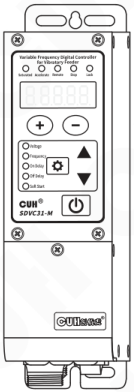

Controller×1

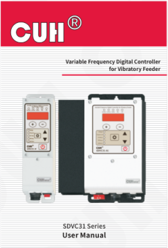

User Manual×1

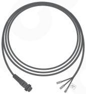

Output Cable×1

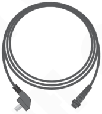

Input Power Cord×1

---

## 1.2 Indicators and Buttons Explanation

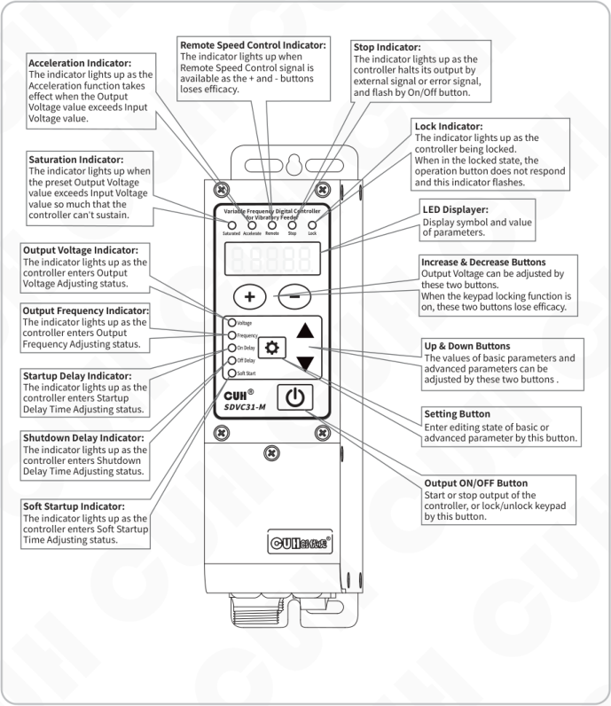

**Acceleration Indicator:**
The indicator lights up as the Acceleration function takes effect when the Output Voltage value exceeds Input Voltage value.

**Remote Speed Control Indicator:**
The indicator lights up when Remote Speed Control signal is available as the + and - buttons loses efficacy.

**Stop Indicator:**
The indicator lights up as the controller halts its output by external signal or error signal, and flash by On/Off button.

**Saturation Indicator:**
The indicator lights up when the preset Output Voltage value exceeds Input Voltage value so much that the controller can’t sustain.

**Lock Indicator:**
The indicator lights up as the controller being locked.
When in the locked state, the operation button does not respond and this indicator flashes.

**LED Displayer:**
Display symbol and value of parameters.

**Output Voltage Indicator:**
The indicator lights up as the controller enters Output Voltage Adjusting status.

**Output Frequency Indicator:**
The indicator lights up as the controller enters Output Frequency Adjusting status.

**Startup Delay Indicator:**
The indicator lights up as the controller enters Startup Delay Time Adjusting status.

**Shutdown Delay Indicator:**
The indicator lights up as the controller enters Shutdown Delay Time Adjusting status.

**Soft Startup Indicator:**
The indicator lights up as the controller enters Soft Startup Time Adjusting status.

**Increase & Decrease Buttons**
Output Voltage can be adjusted by these two buttons.
When the keypad locking function is on, these two buttons lose efficacy.

**Up & Down Buttons**
The values of basic parameters and advanced parameters can be adjusted by these two buttons .

**Setting Button**
Enter editing state of basic or advanced parameter by this button.

**Output ON/OFF Button**
Start or stop output of the controller, or lock/unlock keypad by this button.

## 1.3 External Parts Explanation

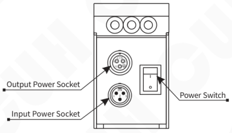

SDVC31-S (1.5A)  
SDVC31-M (3.0A)

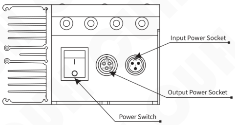

SDVC31-L (4.5A)  
SDVC31-XL (6.0A)

---

## 1.4 Wiring Ports Explanation

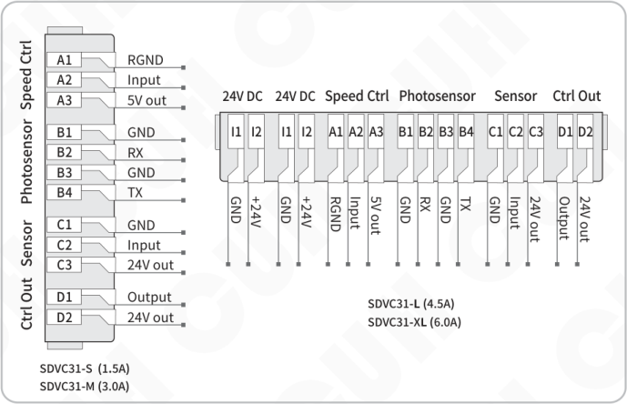

**SDVC31-S (1.5A)**  
**SDVC31-M (3.0A)**

| Port group | Terminal | Description |
|---|---|---|
| Speed Ctrl | A1 | RGND |
| Speed Ctrl | A2 | Input |
| Speed Ctrl | A3 | 5V out |
| Photosensor | B1 | GND |
| Photosensor | B2 | RX |
| Photosensor | B3 | GND |
| Photosensor | B4 | TX |
| Sensor | C1 | GND |
| Sensor | C2 | Input |
| Sensor | C3 | 24V out |
| Ctrl Out | D1 | Output |
| Ctrl Out | D2 | 24V out |

**SDVC31-L (4.5A)**  
**SDVC31-XL (6.0A)**

| Port group | Terminal | Description |
|---|---|---|
| 24V DC | I1 | GND |
| 24V DC | I2 | +24V |
| 24V DC | I1 | GND |
| 24V DC | I2 | +24V |
| Speed Ctrl | A1 | RGND |
| Speed Ctrl | A2 | Input |
| Speed Ctrl | A3 | 5V out |
| Photosensor | B1 | GND |
| Photosensor | B2 | RX |
| Photosensor | B3 | GND |
| Photosensor | B4 | TX |
| Sensor | C1 | GND |
| Sensor | C2 | Input |
| Sensor | C3 | 24V out |
| Ctrl Out | D1 | Output |
| Ctrl Out | D2 | 24V out |

## 1.5 Nameplate Explanation

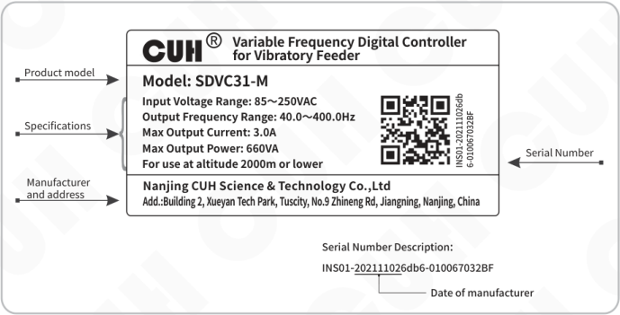

CUH® — Variable Frequency Digital Controller for Vibratory Feeder

| Nameplate item | Content |
|---|---|
| Product model | Model: SDVC31-M |
| Specifications | Input Voltage Range: 85～250VAC Output Frequency Range: 40.0～400.0Hz Max Output Current: 3.0A Max Output Power: 660VA For use at altitude 2000m or lower |
| Manufacturer and address | Nanjing CUH Science & Technology Co.,Ltd Add.:Building 2, Xueyan Tech Park, Tuscity, No.9 Zhineng Rd, Jiangning, Nanjing, China |
| Serial Number | INS01-202111026db6-010067032BF |

Serial Number Description:

INS01-<ins>20211102</ins>6db6-010067032BF

20211102 → Date of manufacturer

---

## Chapter Ⅱ Features

The controller is specially designed for controlling vibratory feeder in the automation systems. Combined with the latest electronic technology and elaborate design, the controller provides the following convenient and practical features:

**Frequency Adjusting:** Output Frequency ranges from 40.0Hz to 400.0Hz.

**Voltage Adjusting:** Output Voltage ranges from 0V to 250V.

**Automatic Voltage Stabilizing:** The controller can eliminate feeding speed variation caused by mains voltage fluctuation.

**Soft Startup:** In order to avoid sudden shock to the work pieces, the controller can gently increase output voltage from 0 to the pre-set value when startup.

**Intelligent Photoelectric Sensing:** Our adaptive Intelligent Photoelectric Sensor can help to stall the controller when work-pieces are full or work-piece is empty and to fulfill the functions of Soft Startup Time Setting, On Delay, Off Delay, and Logical Relation Adjusting.

**Ready Signal Function:** Output a modulated signal or a valid signal through the intelligent optoelectronics B4 transmission port to indicate that the controller is in the ready state. When the controller encounters an error, the ready signal becomes invalid.

**Switch Sensor:** Adaptive switch sensor or PLC can be connected to turn on/off the controller.

**Acceleration:** Due to this function, maximum output voltage value of the controller can be increased up to 150% of the input voltage value.

**Remote Speed Control:** Output Voltage of the controller can be controlled by an external potentiometer, a PLC, or a 1~5V/4~20mA DC signal.

**Controlling Output:** The Controlling Output signal outgoing from the transistor can coordinate a solenoid or other external devices with the controller.

**Keypad Locking:** Press the ON/OFF button and hold for 2 seconds to lock all buttons for fear of false operation. When in the locked state, the operation button does not respond and this indicator flashes.

**Maximum Output Restriction:** Maximum Output Voltage value can be preset to protect the equipment from damage caused by misuse.

**Waveform Index Setting:** Operators can weight efficiency and maximum capacity by adjusting this parameter.

**Default Settings Restoration:** This function allows the user to restore all default parameter settings and reset the controller.

---

---

CUH attaches great importance to the product quality management and safety performance. Apart form the high-quality components we use and rigorous quality control system, CUH has taken account of possible accidents users may encounter and provides the following protective functions to maximum the controller's practicability.

**Short-Circuit Protection:** If output of the controller is short-circuited, the controller will halt its output until restarted.

**Current Overload Protection:** The controller will halt its output to ensure equipments'operating safety when operation current exceeds its rated value.

**Overheat Protection:** The controller will halt its output to protect itself when operation temperature is too high.

**Over/Under-Voltage Protection:** When the input voltage is too high/low, the power supply will be automatically turned off for self-protection.

CUH controllers are strictly compliant with CE certification.

---

# Chapter Ⅲ Installation Guide

This chapter introduces the necessary conditions for the use of the controller and how to install and connect it correctly.

## 3.1 Controller Usage Conditions

The controller is powered by AC 110/220V, and the protective ground connection is made through the plug of the power cord. Please provide 110V or 220V, 50Hz/60Hz mains power supply and distribution facilities that meet the standard and ensure that the protective ground wire is correctly connected.

**⚠ Warn** Never connect the controller to 380V AC power, this will cause irreversible serious damage to the controller, possibly resulting in explosion, fire and other safety incidents.

**⚠ Warn** Ensure that the power supply side is reliably grounded. The metal casing of the controller is directly connected to the protective grounding wire. Poor grounding will cause the controller casing to be electrified and cause an electric shock accident.

**Notice** Long time running will generate heat and cause the temperature of the casing to rise. Please install the controller in a well-ventilated environment and fix it well, away from vibration sources.

**Notice** The output of this product is formed by the rectification and inversion of the mains supply, and there is no isolation between its input and output. Therefore, the output poles cannot be connected to the protective ground. When connecting the electromagnet, it is necessary to ensure that the electromagnet coil and the casing have basic insulation capability. Otherwise, leakage of electricity may occur, which may cause electric shock and damage to the controller.

**Notice** This product is a controller used to drive the electromagnet. It must not be connected to a piezoelectric vibratory feeder.

## 3.2 Operation Method of Buttons

a. Short press to define the pressing time greater than 0.1 and less than 2 seconds, and long press to define the pressing time greater than 2 seconds.

b. Short press ⊕ or ⊖ button to adjust the Output Voltage of the controller at any LED Interface.

c. Enter or exit the Basic Parameters Interface by long press ⚙ button, and switch among the basic parameters by short press ⚙ button, and adjust parameter's value by short press ▼ or ▲ button.

d. Enter or exit the Advanced Parameters Interface by long press ⚙ and ▲ button, and switch among the advanced parameters by short press ⚙ button, and adjust parameter's value by short press ▼ or ▲ button.

e. Short press ⏻ button to start or stop output of controller, and long press ⏻ button to lock or unlock keypad.

f. At LED interface of default setting restore parameter, Long press ▲ button until  is displayed on the LED to restore factory settings, or long press ▼ button until  is displayed on the LED to switch to SDVC311 interface.

---

## 3.3 Install and Use

### Step One:

Open the packing box and check the controller and all accessories.

### Step Two:

Connect the wiring terminals of the Output Power Cable to the vibrator's electromagnetic coil.

Align the notch on the aviation plug of the output cable with the triangle mark on the output socket of the controller, and then tighten the nut after connecting the output cable correctly.

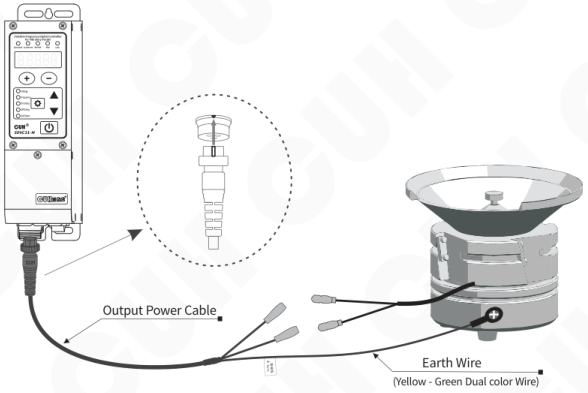

### Note

1. Make sure the vibrator's electromagnetic coils are connected to the two output pins of the Output Power Cable, and the vibrator's metal shell is reliably grounding.
2. It is forbidden to connect piezoelectric loads to the power output, otherwise it may cause an electric shock safety accident!

---

### Step Three:

Connect the Connector of the Input Power Cable to the Input Power Socket of the controller.

Connect the controller side first

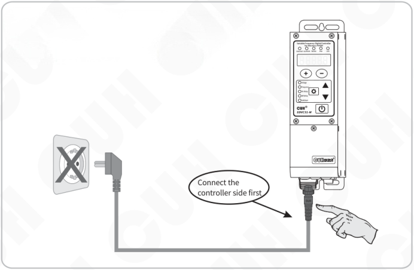

### Step Four:

Connect the plug of the Input Power Cable to the mains jack.

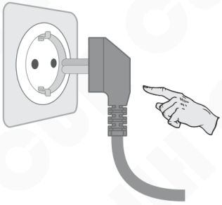

---

## Step Five:

Turn on the power switch of the controller, and the voltage "U 150 " should be displayed and Voltage indicator lights up and the vibratory feeder should start vibrating.

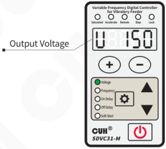

## Step Six:

Press ⊖ to adjust the voltage to 30~50V, then press the ⚙ and hold for 2 seconds enter the output frequency "E" adjustment state. Use ▼ or ▲ to search the natural frequency of the vibratory feeder, which is the resonant frequency.

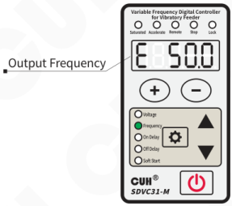

- Resonant frequency of the vibrator means the frequency value that creates the maximum amplitude.
- Each vibratory has its natural mechanical resonance frequency, adjust the output frequency of the controller to this frequency to achieve the best working state.

---

### Step Seven:

Use the ⊕ and ⊖ to adjust the voltage until to the best feed rate.

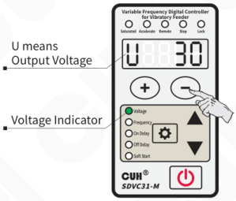

The vibratory feeder should work now. For further control instructions, please refer to the following chapters.

---

# Chapter Ⅳ Basic Function Description

This chapter introduces basic parameter settings.

## 4.1 Output Voltage

Output voltage rectified mean value of the controller can be set directly and digitally through the keypad. Benefit from the unique voltage stabilizing function, output voltage of the controller won't fluctuate as the input voltage does, so that the vibrator can maintain stable operation in case of unstable grid voltage.

- Turn on the power switch of the controller.
- The controller enters the output voltage parameter. The voltage indicator lights up, and the LED display output voltage parameter U and the default value 150.
- Press ⊕ or ⊖ to adjust the parameter value.

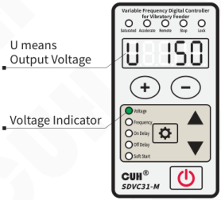

- The controller does not have a boost function. When the controller cannot reach the set voltage due to the limitation of the input power supply voltage, the saturation indicator will light up, and the mains voltage compensation will fail at this time.
- The controller can achieve a certain degree of acceleration effect by sacrificing the sinusoidal characteristics of the output waveform, which is determined by the parameter "acceleration index y". When entering the acceleration state, the output current waveform changes from a sine wave to a triangular wave, and the acceleration indicator lights up.

---

## 4.2 Output Frequency

The controller adopts direct digital frequency synthesis technology (DDS), which has very high frequency accuracy and stability, and does not change with time and temperature.

- Press ⚙ and hold for 2 seconds to enter the basic parameter interface.
- The LED displays the output frequency parameter "E" and the default value 50.0.
- Press ▼ or ▲ to adjust the parameter value.

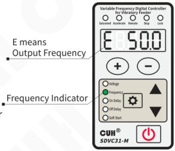

---

## 4.3 On/Off Delay of Intelligent Photoelectric Sensor

When using a sensors or PLC to turn on or turn off the controller's main output, the action can be delayed for a period of time after the control signal is given or restored. The delay time can be set through the two parameters below.

**On Delay ( J ):** The period of time the controller goes through from receiving a startup control signal to actually outputting.

- Press ⚙ and hold for 2 seconds to enter the basic parameter interface.
- Short press ⚙ to switch to on delay parameter "J" and the default value 0.2.
- Press ▲ or ▼ to adjust the parameter value.

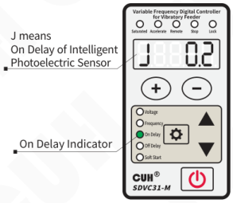

**Off Delay ( L ):** The period of time the controller goes through from receiving a shutdown control signal to actually cutting off output.

- Press ⚙ and hold for 2 seconds to enter the basic parameter interface.
- Short press ⚙ to switch to off delay parameter "L" and the default value 0.2.
- Press ▲ or ▼ to adjust the parameter value.

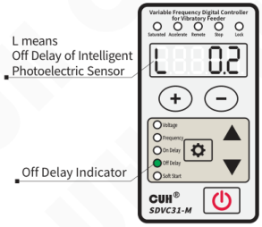

---

## 4.4 Soft Startup Time

In order to avoid sudden shock to the vibrator coil, the controller can gradually increase output voltage from 0 to the preset value when startup

**Soft Startup Time ( t ):** The period of time it takes for the controller to smoothly rise its output voltage from 0 to the preset value when startup.

- Press ⚙ and hold for 2 seconds to enter the basic parameter interface.
- Short press ⚙ to switch to soft startup parameter "t" and the default value 0.5.
- Press ▲ or ▼ to adjust the parameter value.

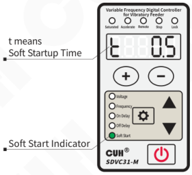

## 4.5 Keyboard Lock

When the parameters of the controller are set, the keyboard lock function can lock all buttons on the panel to avoid misoperation.

Even if it is turned off and then turned on again, the state of the keyboard lock remains the state it was in the last time it was turned off.

- Press ⏻ and hold for 2 seconds to lock all buttons on the panel. The lock indicator lights up.
- Press ⏻ and hold for 2 seconds again to unlock.

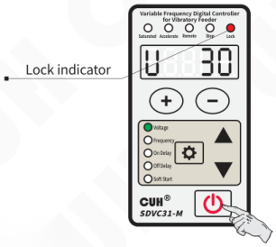

> The keyboard lock state will not disappear due to power off.
>
> When in the locked state, the operation button does not respond and this indicator flashes.

---

# Chapter Ⅴ Advanced Function Description

This chapter introduces advanced parameter settings.

## 5.1 Remote Speed Control

The controller supports external analog signal to control output voltage, analog signal supports potentiometer, 1~5V voltage, 4~20mA current.

### Potentiometer control connection

**Suggest:**

Please use a 1K linear potentiometer

> When the remote speed control signal takes effect, the speed control indicator lights on , at the same time regulating the voltage on the panel will fail.

---

## 1~5V voltage control connection

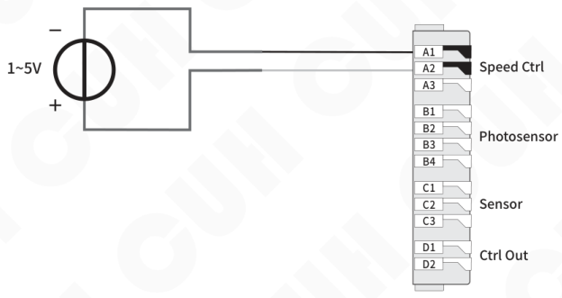

## 4~20mA current control connection

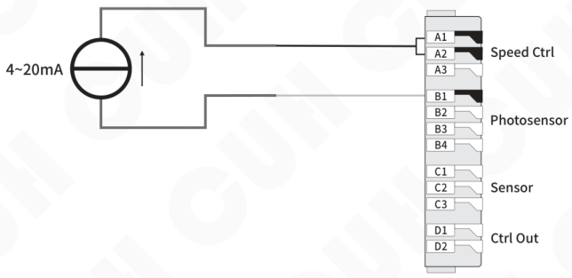

---

## 5.2 Intelligent Photoelectric Sensing

The intelligent photoelectric port of this controller supports photoelectric through-beam or reflection sensors composed of light-emitting diodes and phototransistors, and can also be set to support NPN switch sensors. The specific wiring diagram is as follows:

### 5.2.1 Wiring Method of the Intelligent Photoelectric Sensor

**Photoelectric sensor connection method**

The working distance of the sensor can be adjusted by setting the P parameter, the smaller the parameter, the more sensitive it is.

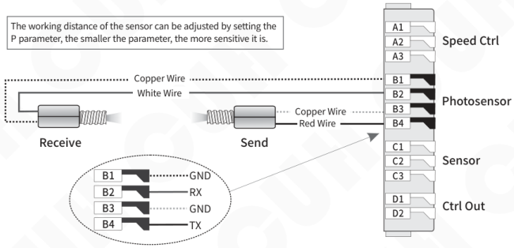

**Switch sensor connection method**

Set NPN type by parameter P = 0, PNP sensor not supported

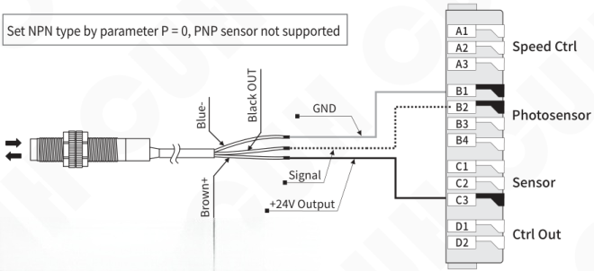

**Note:**

When Parameter P =0, B4 outputs a 10mA valid signal.

From 1 to 1000, B4 outputs a 10mA modulated signal with a frequency of about 200Hz.

When the controller encounters an error, B4 does not output. This is the ready signal function.

---

## 5.2.2 Logical Relation Setting of the Intelligent Photoelectric Sensor

Under normal circumstances, the receiving end receives no optical signal, and the controller runs by default. But in some special applications the controller needs to be stopped when the receiving end receives no optical signal. Adjusting this parameter can fulfill this kind of application.

- Long press ⚙ and ▲ simultaneously to enter the advanced parameter interface.
- Short press ⚙ to switch to Parameter Γ1.
- Press ▲ or ▼ to adjust the parameter value.

Parameter Γ1 is set to `___` by default.

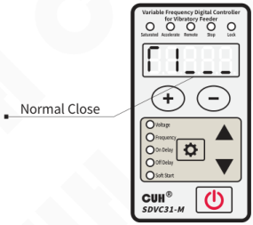

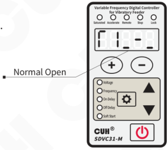

- When Parameter Γ1 is set to `___`, namely no optical signal received, the controller runs.
- When Parameter Γ1 is set to `_-_`, namely no optical signal received, the controller stops.

---

## 5.3 Switch Sensor

The Switch Sensor port can support NPN, PNP, Ut1, Ut0 modes.

**The Ut1 mode is a single scan**, that is, before the sensor signal is invalid, the high and low levels are changed to detect whether the port is valid. After finding a valid signal, the port sensor type is determined and no longer scans.

**The Ut0 mode is continuous scanning**, regardless of the sensor type, it always detects whether the port is connected to a valid signal by changing the high and low levels.

### 5.3.1 Wiring Method of the Switch Sensor

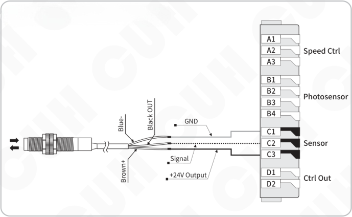

- Set the sensor type through the advanced parameter ΓA.
- When other external signals such as sensors are used to start and stop operations through the C port of the controller, if the operation needs to be delayed for a period of time after the signal is given or the signal is restored, you can set the advanced parameters "J-" and It can be realized by the time of "L-". For the operation method, please refer to 5.3.2.

---

## 5.3.2 On/Off Delay of the Switch Sensor

By default, intelligent photoelectric sensor and switch sensor share the same on delay time and off delay time. Operators can also set on delay time and off delay time independently for the switch sensor.

### On Delay ( J- )

The period of time the controller goes through from receiving a startup control signal to outputting.

- Long press ⚙ and ▲ simultaneously to enter the advanced parameter interface.
- Short press ⚙ to switch to Parameter J-.
- Press ▲ or ▼ to adjust the parameter value.

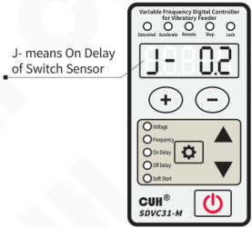

Parameter J- is set to --- by default, meaning the same value with that of Parameter J.

### Off Delay ( L- )

The period of time the controller goes through from receiving a shutdown control signal to cutting off output.

- Long press ⚙ and ▲ simultaneously to enter the advanced parameter interface.
- Short press ⚙ to switch to Parameter L-.
- Press ▲ or ▼ to adjust the parameter value.

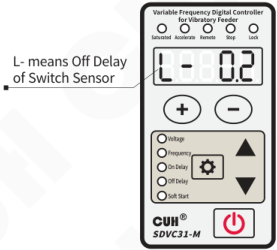

Parameter L- is set to --- by default, meaning the same value with that of Parameter L.

> - When J- and L- values are adjusted to --- , on delay time and off delay time of the switch sensor will be the same with on delay time and off delay time of the intelligent photoelectric sensor.
> - On delay time and off delay time of the Intelligent Photoelectric Sensor will not affected by the parameter of J- and L-.

---

### 5.3.3 Logical Relation Setting of the Switch Sensor

Under normal circumstances, the controller receives no signal from the Switch Sensor and runs by default. But in some special applications the controller needs to be stopped when receives no signal from the Switch Sensor. Adjusting this parameter can fulfill this kind of application.

- Long press ⚙ and ▲ simultaneously to enter the advanced parameter interface.
- Short press ⚙ to switch to Parameter Γ2.
- Press ▲ or ▼ to adjust the parameter value.

Parameter Γ2 is set to `___` by default.

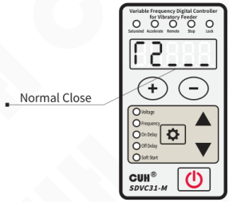

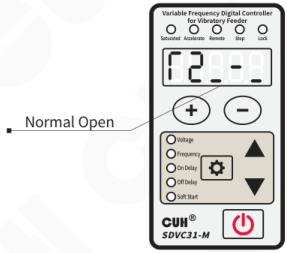

- When Parameter Γ2 is set to `___`, namely no signal received, the controller runs.
- When Parameter Γ2 is set to `_-_`, namely no signal received, the controller stops.

---

## 5.4 Logical Relation Setting of the Control Signal

The controller can set the logical relation of the Intelligent Photoelectric Sensor and the Switch Sensor when they work simultaneously.

- Long press ⚙ and ▲ simultaneously to enter the advanced parameter interface.
- Short press ⚙ to switch to Parameter Π.
- Press ▲ or ▼ to adjust the parameter value.

Default Logical Relation is AND.

**Logical Relation: AND :**

The controller runs only when both the Intelligent Photoelectric Sensor and the Switch Sensor ask the controller to.

**Logical Relation: OR :**

The controller runs when the Intelligent Photoelectric Sensor or the Switch Sensor asks the controller to.

**Logical Relation: XOR :**

The controller runs only when the Intelligent Photoelectric Sensor and the Switch Sensor output the opposite control signal.

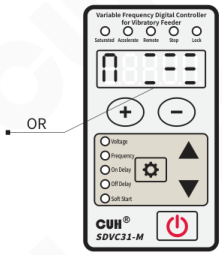

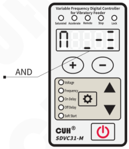

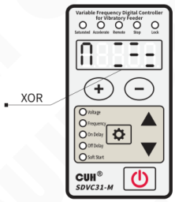

---

## 5.5 Control Output

The control output port can support NPN output, The NPN output is valid as a low level, and the output is invalid as a high-impedance state.

### 5.5.1 Wiring Method of Control Output

**NPN output connection**

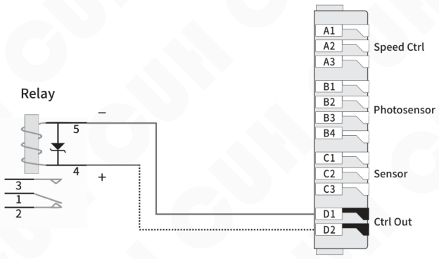

> If connecting a 24V relay, be sure to confirm the positive and negative poles of the coil to make sure they are connected correctly. Because the output current capability of this port is limited, the internal protection diode of the relay will short-circuit the port of this controller after reverse connection, triggering the short-circuit protection Err07.

---

## 5.5.2 Logical Relation Setting of the Controlling Output

- Long press ⚙ and ▲ simultaneously to enter the advanced parameter interface.
- Short press ⚙ to switch to Parameter Γ3.
- Press ▲ or ▼ to adjust the parameter value.

Parameter Γ3 is set to `___` by default.

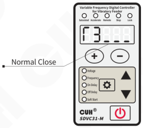

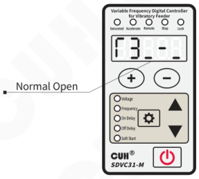

- When Parameter Γ3 is set to `___`, the controlling output works as the controller runs.
- When Parameter Γ3 is set to `_-_`, the controlling output doesn't works as the controller runs.

---

## 5.5.3 Main Control Separation Parameter

Normally, main output was followed by control output.

In special applications, the control source and relationship can change by this parameter.

- Long press ⚙ and ▲ simultaneously to enter the advanced parameter interface.
- Short press ⚙ to switch to Parameter Γ4.
- Press ▲ or ▼ to adjust the parameter value.

Parameter Γ4 is set to `___` by default.

- When Parameter Γ4 is set to , Main output and control output are related. Controlled by the logical relation between intelligent photoelectric sensor and switch sensor and ON/OFF button.
- When Parameter Γ4 is set to 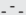, Main output and control output are separated. Main output is controlled by the ON/OFF button. Control output is controlled by the logical relation between intelligent photoelectric sensor and switch sensor.
- When Parameter Γ4 is set to 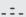, Main output is controlled by the ON/OFF button, and the switch sensor. Control output is controlled by the intelligent photoelectric sensor.
- When Parameter Γ4 is set to 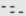, Main output is controlled by the ON/OFF button, and the intelligent photoelectric sensor. Control output is controlled by the switch sensor.

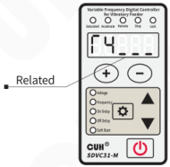

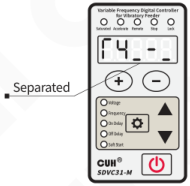

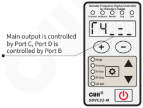

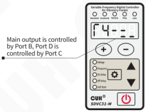

---

## 5.6 Maximum Output Voltage Limit

The controller can set the maximum output voltage limit parameter h, which can prevent the user from misoperation to output excessive voltage and damage the vibration equipment.

Neither the panel setting voltage nor the remote control voltage will exceed this value.

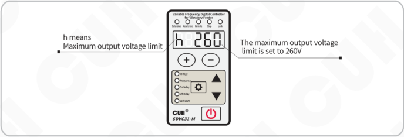

- In any case, the output voltage of the controller cannot and will not exceed the set value of this parameter.
- The factory default setting of this parameter is the maximum possible output voltage of the machine.

## 5.7 Lower Limit of Frequency

This controller can set the advanced parameter “Lower Limit of Frequency e” to limit the minimum output frequency, which can prevent users from accidentally operating the output frequency too low and damaging the electromagnet.

The panel setting frequency will not be lower than this value.

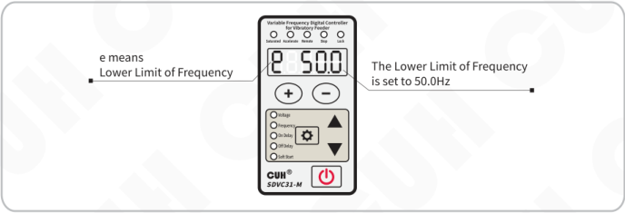

---

## 5.8 Acceleration Index

The controller can achieve a certain degree of acceleration effect by sacrificing the sinusoidal characteristics of the output waveform. When entering the acceleration state, the output current waveform changes from a sine wave to a triangular wave, and the acceleration indicator lights up. The acceleration function can be controlled by setting the parameter value of the advanced parameter "acceleration index y".

**Acceleration Index (y):** Express the maximum output voltage can reach the percentage of the input voltage.

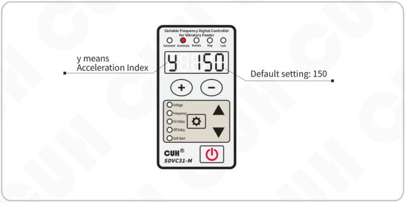

y means Acceleration Index  
Default setting: 150

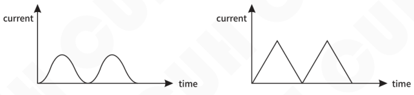

**Schematic Diagram of Acceleration Index set to 150**

---

## 5.9 Waveform Index

The controller can continuously balance the performance of the highest efficiency-maximum power and minimum noise to meet the higher demands of customers. This can be achieved by setting the parameter value of the advanced parameter "waveform index r".

- The wave index value of 0 has the highest efficiency and the least stress on the spring.
- When the value is 100, the maximum rated output power and minimum noise can be obtained, but the spring will be subjected to greater stress.

**Waveform Index Diagram**

---

## 5.10 Temperature Display Function

- Long press ⚙ and ▲ simultaneously to enter the advanced parameter interface.
- Short press ⚙ to switch to the parameter C.
- The parameter value cannot be modified.

Example:  
C means Temperature display parameters

## 5.11 Restore Default Settings/Resume Factory Mode

User can quickly restore the controller to the factory default state.

Due to the powerful functions of the controller, many parameters can be adjusted. For beginners, it may not be able to restore the normal working state of the controller after several settings and modifications. Use this function to quickly restore the disordered parameter state to the factory default setting.

To restore factory settings, it is necessary to use the Resume factory mode parameters (Pin) in combination. The resume factory mode is described as follows:

0: Restore the **working parameter group** to the **user parameter group**.  
5: Save the **working parameter group** to the **user parameter group**.  
35: Restore the **working parameter group** to the **factory value of CUH**.  
55: Restore the **working parameter group** and **user parameter group** to the **factory value of CUH**.

- Long press ⚙ and ▲ simultaneously to enter the advanced parameter interface.
- Short press ⚙ to switch to the full flashing on the LED displayer, that is the parameter of "Default setting restoration". And then press ▲ and hold until the controller displays "", indicating that the controller has been restored.
- Release ▲, after the controller displays "CUH", then enter the output voltage adjustment state "U". By this time, all parameters have been restored to the factory default settings.

Note: Press ▼ and hold until "" is displayed on the LED to switch to SDVC311 interface.

---

## Chapter Ⅵ Technical Specifications

### 6.1 Dimensions

(unit: mm)

SDVC31-S (1.5A)  
SDVC31-M (3.0A)

| Dimensions range | tolerance |
|---|---|
| 0~3 | ±0.05 |
| 3~10 | ±0.1 |
| 10~30 | ±0.15 |
| 30~80 | ±0.2 |
| 80~180 | ±0.3 |
| >180 | ±0.5 |

This tolerance table is applicable to all products in this series.

---

SDVC31-L (4.5A)  
SDVC31-XL (6.0A)

---

## 6.2 Technical Specifications

| Item | Min | Typical | Max | Unit | Note |
|---|---|---|---|---|---|
| Input Voltage | 85 | 220 | 250 | V | AC RMS |
| Adjustable Output Voltage Range | 0 | —— | 260 | V | Lower than 150% of Input Voltage |
| Voltage Adjustment Accuracy | | 1 | | V | |
| Voltage Regulation Accuracy | 0 | —— | 10 | % | ΔVout/ΔVin |
| Adjustable Output Current Range | 0 | —— | 1.5 | A | SDVC31-S |
| Adjustable Output Current Range | 0 | —— | 3.0 | A | SDVC31-M |
| Adjustable Output Current Range | 0 | —— | 4.5 | A | SDVC31-L |
| Adjustable Output Current Range | 0 | —— | 6.0 | A | SDVC31-XL |
| Output Power | 0 | —— | 330 | VA | SDVC31-S |
| Output Power | 0 | —— | 660 | VA | SDVC31-M |
| Output Power | 0 | —— | 990 | VA | SDVC31-L |
| Output Power | 0 | —— | 1320 | VA | SDVC31-XL |
| Output Frequency | 40.0 | —— | 400.0 | Hz | |
| Frequency Adjustment Accuracy | | 0.1 | | Hz | |
| Output Waveform | | Sine | | | |
| Soft Start Time | 0 | —— | 10.0 | s | Default value: 0.5 |
| On/Off Delay Time Range | 0 | —— | 20.0 | s | Default value: 0.2 |
| On/Off Delay Time Accuracy | | 0.1 | | s | |
| Overheat Protection Trigger Temperature | 58 | 60 | 66 | °C | |
| DC Control Output Current | 0 | —— | 400 | mA | |
| DC Control Output Voltage | 22 | 24 | 26 | V | |
| Analog Control Signal | | 1~5/4~20 | | V/mA | Remote Speed Control signal |
| Digital Control Signal | | 24 | | V | Switching Signal |
| Adjustment Method | | 6 | | Button | |
| Standby Power Consumption | —— | 3 | —— | W | |
| Display Method | | 5 | | Digit | LED |
| Ambient Temperature | 0 | 25 | 40 | °C | No Condensation |
| Ambient Humidity | 10 | 60 | 85 | % | No Condensation |
| Storage Ambient Temperature | -20 | 25 | 65 | °C | No Condensation |

## 6.3 Reference Standard

**Absolute Parameters:**
Above the standard will damage the controller, obey it strictly.

| Item | GB Standard | IEC Standard | Grade | Standard Requirement | Note |
|---|---|---|---|---|---|
| Electrostatic Discharge | GB/T 17626.2-2006 | IEC 61000-4-2:2001 | 4 | ±8 kV | Contact Discharge |
| | | | 4 | ±15 kV | Air Discharge |
| Electrical Fast Transient Test | GB/T 17626.4-2008 | IEC 61000-4-4:2004 | 4 | ±4 kV | |
| DC Power Line Wave Immunity | GB/T 17626.17-2005 | IEC 61000-4-17:2002 | 4 | 15% | Rating A |

> **Warning**  
> In a residential environment, this product may cause radio interference in which case supplementary mitigation measures may be required.

---

# Chapter Ⅶ Appendix

## 7.1 Parameter Table

| | Definition | Symbol | Symbol Image | Range | Default |
|---|---|---|---|---|---|
| Common parameter | Output Voltage | U |  | 0~260 V | 150 |
| Basic Parameter | Output Frequency | E |  | 40.0~400.0 Hz | 50.0 |
| Basic Parameter | On Delay of the Intelligent Photoelectric Sensor | J |  | 0.0~20.0 s | 0.2 |
| Basic Parameter | Off Delay of the Intelligent Photoelectric Sensor | L |  | 0.0~20.0 s | 0.2 |
| Basic Parameter | Soft Startup | t |  | 0.0~10.0 s | 0.5 |
| Advanced Parameter | Off Delay of the NPN Switch Sensor | L- |  | 0.0~20.0 s | L---- same as L |
| Advanced Parameter | On Delay of the NPN Switch Sensor | J- |  | 0.0~20.0 s | J---- same as J |
| Advanced Parameter | Logical Direction of the Intelligent Photoelectric Sensor | F1 |  | Normal Close , Normal Open  |  |
| Advanced Parameter | Logical Direction of the Switch Sensor | F2 |  | Normal Close , Normal Open  |  |
| Advanced Parameter | Logical Direction of the Controlling Output | F3 |  | Normal Close , Normal Open  |  |
| Advanced Parameter | Main Control Separation Parameter | F4 |  | Related , Main output is controlled by Port C, Port D is controlled by Port B  Separate , Main output is controlled by Port B, Port D is controlled by Port C  |  |
| Advanced Parameter | Logical Relation of the Control Signal | n |  | or , And , Xor  |  |
| Advanced Parameter | Maximum Output Voltage | H |  | 0~260 V | 260 |
| Advanced Parameter | Acceleration Index | y |  | 100~150 | 150 |
| Advanced Parameter | Waveform Index | r |  | 0~100 | 100 |
| Advanced Parameter | Intelligent photoelectric sensor sensitivity | P |  | 0~1000 | 80 |
| Advanced Parameter | Port C Sensor Type | FA |  | nPn, PnP ut1 (Single scan), ut0 (Continuous scan) | nPn |
| Advanced Parameter | Temperature | C |  | -20~85 °C | —— |
| Advanced Parameter | Lower Limit of Frequency | e |  | 40.0~400.0 Hz | 40.0 |
| Advanced Parameter | Default Settings Restore | 8.8.8.8.8. |  | Used in conjunction with parameter Pin | —— |
| Advanced Parameter | Resume Factory Mode | Pin |  | 0 : Restore the working parameter group to the user parameter group 5 : Save the working parameter group to the user parameter group 35: Restore the working parameter group to the factory value of CUH 55: Restore the working parameter group and user parameter group to the factory value of CUH | 0 |

## 7.2 Input and Output Circuit Diagrams

**Remote Speed Control Port A**

**Intelligent Photosensor Port B**

**Switch Sensor Port C**

**Control Output Port D**

---

## 7.3 Troubleshooting Suggestions and Error Explanations

| Error Code | Definition | Troubleshooting Methods | Symbol Image |
|---|---|---|---|
| No display after power on | | Make sure the power outlet is live Make sure the Input power Cable is reliably connected to the power outlet? | |
| Display normally, but no output | | Make sure the Output Cable is reliably connected to the vibrator. Make sure the output voltage is not small. Make sure the Stop Indicator is not light up. Please check whether Normal Close of parameter has been set, causing controller output to stop. | |
| Control signal loses effectiveness | | Make sure the control signal is correctly inputted. Make sure the ground wire of the control signal is correctly connected to the controller. Make sure the Logical Relation of the control signals is set correctly as your expectation. | |
| Beat phenomena | | Avoid vibration coupling among the vibrators. Heighten the resonant frequency of the vibrators. | |
| Display normally, no output, but sound can be heard | | Adjust all parameters as this book instructed. | |
| Err01 | Short Circuit | Make sure the load is not short-circuit, then try to restart output of the controller by press Output ON/OFF Button two times or repower the controller. |  |
| Err02 | Over Current | Reduce output voltage appropriately, then restart the output. |  |
| Err03 | Over Heat | Install the controller in a well-ventilated environment. |  |
| Err04 | Over or under voltage | Make sure input voltage between AC 85~250Vac. |  |
| Err05 | Internal Communication abnormal | Make sure no extern power supply connect to the 24V power port or contact our technical support. |  |
| Err06 | Temperature sensor abnormal | Make sure the work temperature not under -20℃ or contact our technical support. |  |
| Err07 | Short-circuit protection of Port D | Make sure the load of Port D is not short-circuit and the current does not exceed 400mA, then try to restart the output of Port D. |  |
| Err10 | 24V power output abnormal | Make sure 24V port is not short-circuit and the current does not exceed 400mA. |  |
| Err11 | 5V power output of Port A abnormal | Make sure the 5V power of Port A is not short-circuit or not connected to external power voltage more than 5V. |  |

Note: If any Error occur, the TX of port B will shutdown.

---

# Chapter Ⅷ Product Warranty Information

## 8.1 Warranty Period

The warranty period provided by the company for this product is 3 years from the date of delivery of the product to the location designated by the purchaser.

## 8.2 Warranty Coverage

(1) If there is a failure caused by our company during the above warranty period, we will repair the product free of charge. However, The following situations are not covered by the warranty:

a. Failure to comply with the conditions specified in the simple manual, user manual or technical requirements specifically agreed between the purchaser and the company, improper operation, or failure caused by improper use.

b. Failure is not due to a product defect, but to the purchaser's equipment or software design.

c. Malfunctions caused by modifications or repairs not performed by the company's personnel.

d. The failure that can be totally avoided by correct maintenance or replacement of wearing parts according to the simple operation guide or user manual.

e. After the product is shipped from our company, it is caused by factors such as unforeseen changes in the level of science and technology failure.

f. Due to natural disasters such as fire, earthquake, flood, or external factors such as abnormal voltage failure, the company is not responsible for the warranty.

(2) The scope of warranty is limited to the situation stipulated in (1)，Indirect losses (such as equipment damage, opportunities, loss of profit, etc.) or other losses, the company do not bear any responsibility.

## 8.3 Product Suitability

The controller of our company is designed and produced for general use in the vibratory feeding industry. Therefore, this controller of our company shall not be used for the following applications and is not suitable for its use.

(1) Facilities that have a serious impact on life and property, such as nuclear power plants, airports, railways, ships, motorized devices and medical equipment.

(2) Public utilities, including electricity, gas, water supply, etc.

(3) Outdoor use in similar conditions or environments.

---

Nanjing CUH Science & Technology Co.,Ltd  
https://en.cuhnj.com  
Tel.:+86-25-84730411 / 84730415 / 84730416  
Fax:+86-25-84730426  
E-mail:sales@cuhnj.com  
Add.:Building 2, Xueyan Tech Park, Tuscity,  
No.9 Zhineng Rd, Jiangning, Nanjing, China

Document No.: IDP1000530

