## Variable Frequency Digital Controller for Vibratory Feeder

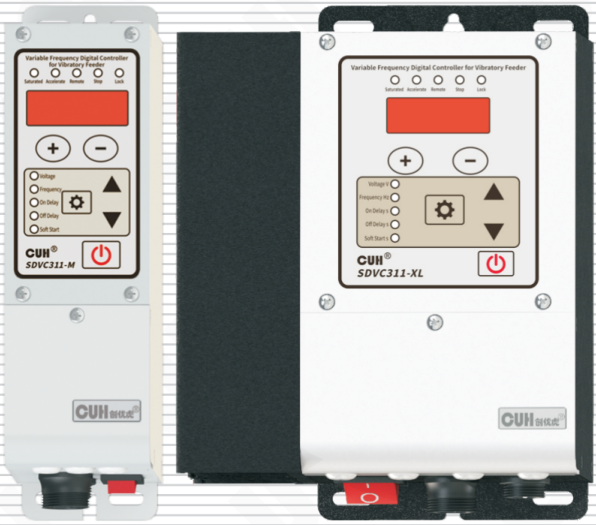

## SDVC311 Series
Variable Frequency Digital Controller for Vibratory Feeder　　SDVC311 Series
## User Manual

---

## Copyright Statement

Nanjing CUH Science & Technology CO., Ltd. reserves all rights.

All information contained in this user manual is the knowledge of our company and is protected by copyright law and other related laws. CUH enjoys and reserves all rights conferred by copyright law and other laws. Without the written consent of CUH, part or all of this user manual shall not be copied, translated, imitated or otherwise utilized.

## Disclaimer

All contents of this user manual only describe the use method of related products produced by our company, and are described according to the existing technology and the state provided to you when you use it. You must bear the relevant risks when you use this product. Except as required by law, the company does not have any express or implied responsibility for the product due to this user manual, including but not limited to personal injury, property damage, loss of opportunity, etc.

You clearly understand the above risks and agree that, except as mandated by law, the company is not responsible for any direct or indirect damage or loss to you (including but not limited to tangible loss of personnel, property, data, etc. and intangible loss of reputation, opportunity, etc.)

The company reserves the right to modify the products applicable in this user manual without prior or subsequent notice.

---

## Preface

Thank you for choosing CUH SDVC311 series digital frequency modulation vibration feeding controller. (The controller for short in the following text). This series of controllers uses high-quality components and incorporates the latest electronic technology, and is carefully designed with high-performance digital signal processors.

This manual introduces the basic operation method, functional technical description and typical application examples of this product. Provide users with relevant information on installation and debugging, parameter setting, abnormal diagnosis, troubleshooting and routine maintenance of the controller. In order to ensure the correct installation and use of this controller, please read this user manual carefully before installation and keep it properly.

Be sure to read the following symbols to alert you to precautions against personal injury and product damage.

| | |
|---|---|
| ⚠ Danger | Non-observance of this item will result in personal injury or death. |
| ⚠ Warning | Non-observance of this item may result in personal injury or death. |
| ⚠ Careful | Non-observance of this item may result in moderate or minor injury to persons. |
| Notice | Non-observance of this item will result in damage to the product and property damage. |
| ❗ Essential | Indicates precautions and usage restrictions that must be observed during use. |

**This manual is suitable for the following models of controllers:**

- Digital FM Vibration Feeding Controller SDVC311-S (1.5A)
- Digital FM Vibration Feeding Controller SDVC311-M (3.0A)
- Digital FM Vibration Feeding Controller SDVC311-L (4.5A)
- Digital FM Vibration Feeding Controller SDVC311-XL (6.0A)

---

# Safety and Precautions

1. **⚠ Danger** This product is only used to drive electromagnet-based vibratory feeding equipment, do not use this product for the purpose of protecting the human body or parts of the human body, etc.

2. **⚠ Danger** This product is not intended to be used as an explosion-proof product, do not use it in hazardous locations and/or potentially explosive gas environment.

3. **⚠ Warning** This product is powered by AC mains, please do not apply AC voltage exceeding 260Vac. Excessive input voltage, such as 380Vac, may cause the product to explode or catch fire, resulting in serious safety accidents.

4. **⚠ Warning** This product is grounded through the power cord. Please ensure that the power distribution facilities for the controller are well grounded, otherwise the controller shell may be charged, resulting in an electric shock accident.

5. **⚠ Warning** Do not input AC power to the output of this controller, it will damage the controller.

6. **⚠ Warning** Do not plug and unplug the wiring with points or touch the contact of each wiring terminal in the wiring compartment to prevent electric shock.

7. **Notice** Please avoid controlling the output of this product by cutting off the power supply through relays and other devices, which will seriously reduce the life of the controller.

8. **Notice** The controller is designed to work in a cool and dry environment. Never run the controller outside to avoid soaking and insolation. Operate the controller within the temperature specified electrical characteristic.

9. **❗ Essential** Be sure to fix this product on a solid platform that is reliably grounded and away from vibrating equipment.

10. **❗ Essential** Never operate the controller under the condition that beyond its designed limits.

11. **❗ Essential** Operate the controller in accordance with this instruction book strictly. we will not assume any civil or criminal liability if the equipment damage or personal injury is caused by incorrect operation.

12. **❗ Essential** Never open the controller shell to avoid electric shock. Contact CUH if the controller break down. Never try to repair the controller yourself which may caused void warranty.

---

# Operating and Storage Environment

## Inspection Before Using

Every controller will go through rigorous quality inspection before delivery and is packed with crash-proof packaging, Please check the following items after unpacking:

1. Whether the controller is damaged during transportation.
2. Whether the model of the controller is that you ordered.

## Runtime Environment

Please follow the notes below to ensure the better performance and longer lifetime of the controller:

- ⚠ Well-ventilated environment
- ⚠ Keep away from water, stream, dust and especially oily dust
- ⚠ Keep away from the corrosive or flammable gas and liquid
- ⚠ Keep away from floating dust and metal particles
- ⚠ Firmly fixed to avoid self vibration
- ⚠ Keep away from electromagnetic interference
- ⚠ Ensure ambient temperature is 0~40 ℃
- ⚠ For use at altitude 2000m or lower

---

# Contents

- **Chapter Ⅰ Before Use — 1**
  - 1.1 Check the Package Contents — 1
  - 1.2 Indicators and Buttons Explanation — 2
  - 1.3 External Parts Explanation — 3
  - 1.4 Wiring Ports Explanation — 4
  - 1.5 Nameplate Explanation — 4
- **Chapter Ⅱ Featured Functions — 5**
  - 2.1 Product Introduction — 5
  - 2.2 Product Performance Improvement — 5
  - 2.3 Modern/Traditional Parameter Interface — 6
- **Chapter Ⅲ Installation Guide — 7**
  - 3.1 Controller Usage Conditions — 7
  - 3.2 Operation Method of Buttons — 7
  - 3.3 Install and Use — 8
- **Chapter Ⅳ Basic Function Description — 12**
  - 4.1 Output Voltage — 12
  - 4.2 Output Frequency — 13
  - 4.3 On/Off Delay of Intelligent Photoelectric Sensor — 14
  - 4.4 Soft Startup Time — 15
  - 4.5 Brake Cycles/Soft Shutdown Time — 15
  - 4.6 Keyboard Lock — 17
- **Chapter Ⅴ Advanced Function Description — 18**
  - 5.1 Remote Speed Control — 18
  - 5.2 Intelligent Photoelectric Sensing — 20
  - 5.3 Switch Sensor — 21
- 5.4 Control Output — 22
  - 5.4.1 Wiring Method of Control Output — 22
  - 5.4.2 Control Output Signal Source and Logic Diagram — 23
  - 5.4.3 Control Output Mode Description — 25
  - 5.4.4 Control Output Logic Direction — 26
  - 5.4.5 Main Output Signal Control Function — 26
- 5.5 Maximum Output Voltage Limit — 27
- 5.6 Lower Limit of Frequency — 27
- 5.7 Acceleration Index — 28
- 5.8 Waveform Index — 29
- 5.9 Parameter Password Lock Function — 30
- 5.10 Restore Default Settings/Resume Factory Mode — 31
- 5.11 Parameter Monitoring Function — 32

## Chapter Ⅵ Technical Specifications — 33

- 6.1 Dimensions — 33
- 6.2 Technical Specifications — 35
- 6.3 Reference Standard — 36

## Chapter Ⅶ Appendix — 37

- 7.1 Parameter Table — 37
- 7.2 Input and Output Circuit Diagrams — 39
- 7.3 Troubleshooting Suggestions and Error Explanations — 40

## Chapter Ⅷ Product Warranty Information — 41

- 8.1 Warranty Period — 41
- 8.2 Warranty Coverage — 41
- 8.3 Product Suitability — 41

---

# Chapter Ⅰ Before Use

This chapter introduces product package contents, controller appearance description and controller nameplate information.

## 1.1 Check the Package Contents

Before using, please check the integrity of the controller and accessories. If you find that the product is defective or damaged, missing accessories, etc., please contact our company.

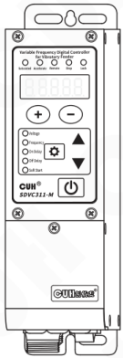

Controller×1

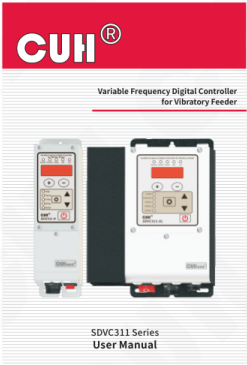

User Manual×1

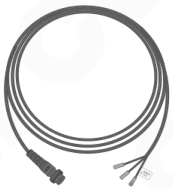

Output Cable×1

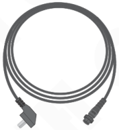

Input Power Cord×1

---

## 1.2 Indicators and Buttons Explanation

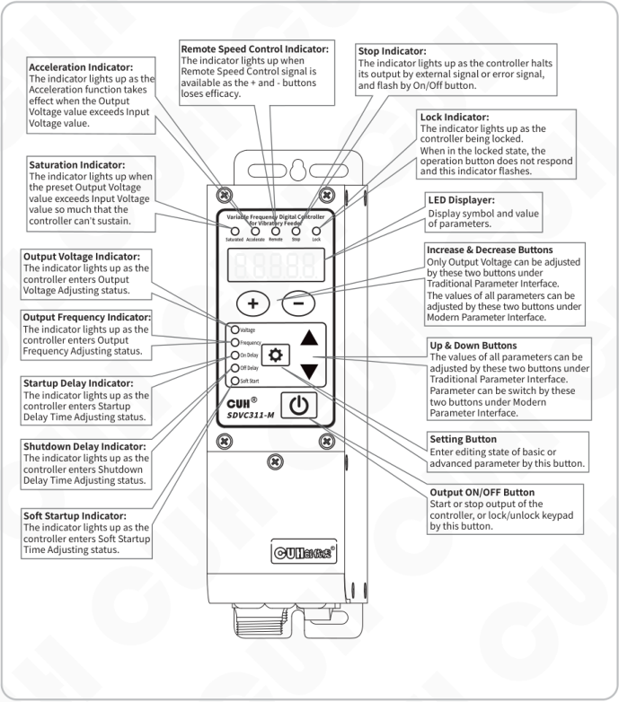

**Acceleration Indicator:**  
The indicator lights up as the Acceleration function takes effect when the Output Voltage value exceeds Input Voltage value.

**Saturation Indicator:**  
The indicator lights up when the preset Output Voltage value exceeds Input Voltage value so much that the controller can’t sustain.

**Output Voltage Indicator:**  
The indicator lights up as the controller enters Output Voltage Adjusting status.

**Output Frequency Indicator:**  
The indicator lights up as the controller enters Output Frequency Adjusting status.

**Startup Delay Indicator:**  
The indicator lights up as the controller enters Startup Delay Time Adjusting status.

**Shutdown Delay Indicator:**  
The indicator lights up as the controller enters Shutdown Delay Time Adjusting status.

**Soft Startup Indicator:**  
The indicator lights up as the controller enters Soft Startup Time Adjusting status.

**Remote Speed Control Indicator:**  
The indicator lights up when Remote Speed Control signal is available as the + and - buttons loses efficacy.

**Stop Indicator:**  
The indicator lights up as the controller halts its output by external signal or error signal, and flash by On/Off button.

**Lock Indicator:**  
The indicator lights up as the controller being locked.  
When in the locked state, the operation button does not respond and this indicator flashes.

**LED Displayer:**  
Display symbol and value of parameters.

**Increase & Decrease Buttons**  
Only Output Voltage can be adjusted by these two buttons under Traditional Parameter Interface.  
The values of all parameters can be adjusted by these two buttons under Modern Parameter Interface.

**Up & Down Buttons**  
The values of all parameters can be adjusted by these two buttons under Traditional Parameter Interface.  
Parameter can be switch by these two buttons under Modern Parameter Interface.

**Setting Button**  
Enter editing state of basic or advanced parameter by this button.

**Output ON/OFF Button**  
Start or stop output of the controller, or lock/unlock keypad by this button.

---

## 1.3 External Parts Explanation

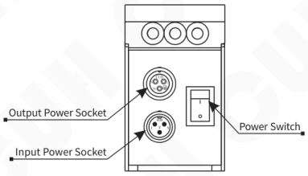

SDVC311-S (1.5A)  
SDVC311-M (3.0A)

- Output Power Socket
- Input Power Socket
- Power Switch

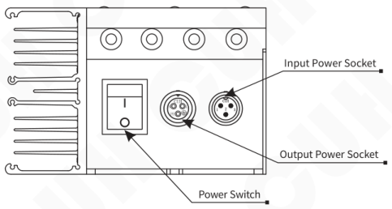

SDVC311-L (4.5A)  
SDVC311-XL (6.0A)

- Input Power Socket
- Output Power Socket
- Power Switch

---

## 1.4 Wiring Ports Explanation

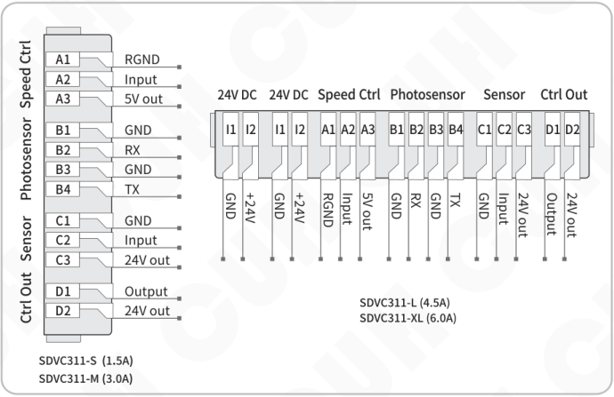

### SDVC311-S (1.5A) / SDVC311-M (3.0A)

| Port group | Terminal | Description |
|---|---|---|
| Speed Ctrl | A1 | RGND |
| Speed Ctrl | A2 | Input |
| Speed Ctrl | A3 | 5V out |
| Photosensor | B1 | GND |
| Photosensor | B2 | RX |
| Photosensor | B3 | GND |
| Photosensor | B4 | TX |
| Sensor | C1 | GND |
| Sensor | C2 | Input |
| Sensor | C3 | 24V out |
| Ctrl Out | D1 | Output |
| Ctrl Out | D2 | 24V out |

### SDVC311-L (4.5A) / SDVC311-XL (6.0A)

| Port group | Terminal | Description |
|---|---|---|
| 24V DC | I1 | GND |
| 24V DC | I2 | +24V |
| 24V DC | I1 | GND |
| 24V DC | I2 | +24V |
| Speed Ctrl | A1 | RGND |
| Speed Ctrl | A2 | Input |
| Speed Ctrl | A3 | 5V out |
| Photosensor | B1 | GND |
| Photosensor | B2 | RX |
| Photosensor | B3 | GND |
| Photosensor | B4 | TX |
| Sensor | C1 | GND |
| Sensor | C2 | Input |
| Sensor | C3 | 24V out |
| Ctrl Out | D1 | Output |
| Ctrl Out | D2 | 24V out |

## 1.5 Nameplate Explanation

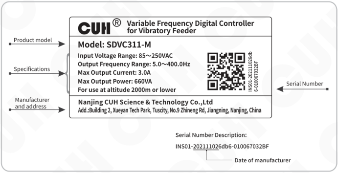

**CUH® — Variable Frequency Digital Controller for Vibratory Feeder**

**Product model**

Model: SDVC311-M

**Specifications**

- Input Voltage Range: 85~250VAC
- Output Frequency Range: 5.0~400.0Hz
- Max Output Current: 3.0A
- Max Output Power: 660VA
- For use at altitude 2000m or lower

**Manufacturer and address**

Nanjing CUH Science & Technology Co.,Ltd

Add.:Building 2, Xueyan Tech Park, Tuscity, No.9 Zhineng Rd, Jiangning, Nanjing, China

**Serial Number**

INS01-202111026db6-010067032BF

**Serial Number Description:**

INS01-<u>20211102</u>6db6-010067032BF

Date of manufacturer: 20211102

---

## Chapter Ⅱ Featured Functions

This chapter includes a brief introduction and main features of the controller.

### 2.1 Product Introduction

SDVC311 Series Digital FM Vibration Feed Controller is a compact general-purpose FM output controller that provides unique performance through the use of the latest electronic technology and careful design. Its special features include:

- The output frequency range covers 5.0Hz to 400.0Hz with 0.1Hz accuracy.
- Brake function to quickly stop the vibratory feeder by shifting the current phase by 180° during the soft-stop process.
- Intelligent photoelectric ports support photo-sensors, NPN or PNP switch sensors.
- Ready Signal Function: Output a modulated signal or a valid signal through the intelligent optoelectronics B4 transmission port to indicate that the controller is in the ready state. When the controller encounters an error, the ready signal becomes invalid.
- Switch sensor port supports NPN, PNP or auto-adaptive type.
- Control output port supports NPN, PNP or push-pull output mode.
- Complete protection functions include: main output short-circuit protection, overcurrent protection, overheat protection, undervoltage/ overvoltage protection, control output short-circuit protection, 24V output short-circuit protection, and speed regulation 5V output short-circuit protection.

### 2.2 Product Performance Improvement

Compared with SDVC31 series controller, SDVC311 series has greatly improved performance. mainly includes:

- The output frequency range is widened from 40.0Hz~400.0Hz to 5.0Hz~400.0Hz.
- The maximum on/off delay time is increased from 20.0 s to 99.9 s.
- Added the function of soft shutdown, which can be set to 0.0~10.0 s to slowly stop the vibration of the vibratory feeder.
- Added braking function, you can set 0~100 braking cycles to quickly stop the vibration of the vibrating disc.
- Intelligent photoelectric sensor port adds PNP sensor support.
- The Switch Sensor port when the material is full has been upgraded from NPN and PNP to software-settable, and automatic mode is provided.
- The control output port is upgraded from NPN output to three types of NPN, PNP and push-pull can be set.
- Added control output port on/off delay, which can be set from 0.0 to 99.9 s.
- Added control output mode, you can set delay mode and hold mode.
- Added measurement function, which can monitor temperature, bus voltage, bus ripple voltage, output current, remote speed control port voltage, intelligent photoelectric sensor port voltage, switch sensor port voltage, DC control output port voltage and +24V power voltage.

---

## 2.3 Modern/Traditional Parameter Interface

All new functions will be implemented in the modern parameter interface. In order to be compatible with the usage habits of regular customers, users can switch between the modern parameter interface and the traditional parameter interface through key board operation.

### Modern parameter interface switch to traditional parameter interface

At LED interface of default setting restore parameter, Long press ⊕ until 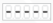 is displayed on the LED to switch to traditional parameter interface, or long press ⊖ until  is displayed on the LED to switch to modern parameter interface.

### Traditional parameter interface switch to modern parameter interface

At LED interface of default setting restore parameter, Long press ▼ until  is displayed on the LED to switch to modern parameter interface, or long press ▲ until  is displayed on the LED to switch to traditional parameter interface.

This user manual introduces modern interface parameter settings. For the settings of the traditional parameter interface, please refer to the user manual of SDVC31 series controller.

---

# Chapter Ⅲ Installation Guide

This chapter introduces the necessary conditions for the use of the controller and how to install and connect it correctly.

## 3.1 Controller Usage Conditions

The controller is powered by AC 110/220V, and the protective ground connection is made through the plug of the power cord. Please provide 110V or 220V, 50Hz/60Hz mains power supply and distribution facilities that meet the standard and ensure that the protective ground wire is correctly connected.

**⚠ Warning** Never connect the controller to 380V AC power, this will cause irreversible serious damage to the controller, possibly resulting in explosion, fire and other safety incidents.

**⚠ Warning** Ensure that the power supply side is reliably grounded. The metal casing of the controller is directly connected to the protective grounding wire. Poor grounding will cause the controller casing to be electrified and cause an electric shock accident.

**Notice** Long time running will generate heat and cause the temperature of the casing to rise. Please install the controller in a well-ventilated environment and fix it well, away from vibration sources.

**Notice** The output of this product is formed by the rectification and inversion of the mains supply, and there is no isolation between its input and output. Therefore, the output poles cannot be connected to the protective ground. When connecting the electromagnet, it is necessary to ensure that the electromagnet coil and the casing have basic insulation capability. Otherwise, leakage of electricity may occur, which may cause electric shock and damage to the controller.

**Notice** This product is a controller used to drive the electromagnet. It must not be connected to a piezoelectric vibratory feeder.

## 3.2 Operation Method of Buttons

a. Short press to define the pressing time greater than 0.1 and less than 2 seconds, and long press to define the pressing time greater than 2 seconds.

a. Short press ⊕ or ⊖ button to adjust the Output Voltage of the controller under standby Interface.

b. Enter or exit the Basic Parameters Interface by long press ⚙ button, and switch among the basic parameters by short press ▼ or ▲ button, and adjust parameter's value by short press ⊕ or ⊖ button.

c. Enter or exit the Advanced Parameters Interface by long press ⚙ and ▲ button, and switch among the advanced parameters by short press ▼ or ▲ button, and adjust parameter's value by short press ⊕ or ⊖ button.

d. Enter or exit the Monitoring Parameters Interface by long press ⚙ and ▼ button, and switch among the monitoring parameters by short press ▼ or ▲ button, but parameter's value can't be adjusted.

e. Short press ⏻ button to start or stop output of controller, and long press ⏻ button to lock or unlock keypad.

---

## 3.3 Install and Use

### Step One:

Open the packing box and check the controller and all accessories.

### Step Two:

Connect the wiring terminals of the Output Power Cable to the vibrator's electromagnetic coil.

Align the notch on the aviation plug of the output cable with the triangle mark on the output socket of the controller, and then tighten the nut after connecting the output cable correctly.

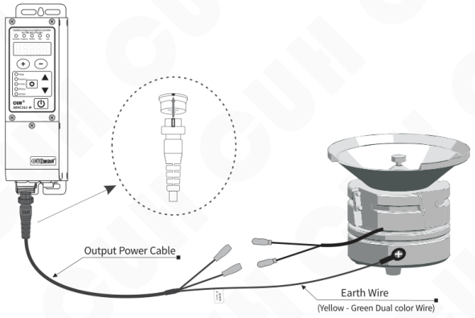

### Note

1. Make sure the vibrator's electromagnetic coils are connected to the two output pins of the Output Power Cable, and the vibrator's metal shell is reliably grounding.
2. It is forbidden to connect piezoelectric loads to the power output, otherwise it may cause an electric shock safety accident!

---

### Step Three:

Connect the Connector of the Input Power Cable to the Input Power Socket of the controller.

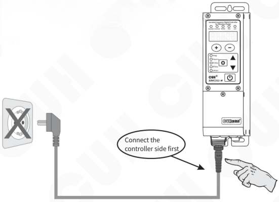

Connect the controller side first

### Step Four:

Connect the plug of the Input Power Cable to the mains jack.

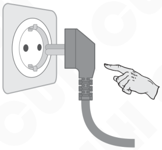

---

### Step Five:

Turn on the power switch of the controller, and the voltage "U 150" should be displayed and Channel A lights up and the vibratory feeder should start vibrating.

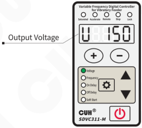

### Step Six:

Press ⊖ to adjust the voltage to 30~50V, then press the ⚙ and hold for 2 seconds enter the output frequency "E" adjustment state. Use ⊕ and ⊖ to search the natural frequency of the vibratory feeder, which is the resonant frequency.

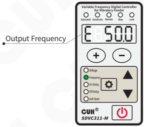

- Harmonic frequency of the vibrator means the frequency value that creates the maximum amplitude.
- Each vibratory has its natural mechanical resonance frequency, adjust the output frequency of the controller to this frequency to achieve the best working state.

---

## Step Seven:

Long press ⚙ to exit the output frequency "E" and returns to the voltage adjustment parameter, also can press ▲ switch to the voltage adjustment parameter, Use the ⊕ and ⊖ to adjust the voltage until to the best feed rate.

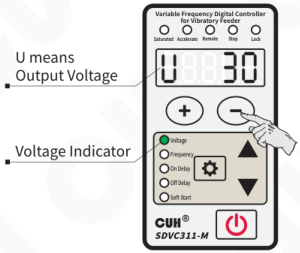

The vibratory feeder should work now. For further control instructions, please refer to the following chapters.

---

## Chapter Ⅳ Basic Function Description

This chapter introduces basic parameter settings in the modern parameter interface (default).

### 4.1 Output Voltage

Output voltage rectified mean value of the controller can be set directly and digitally through the keypad. Benefit from the unique voltage stabilizing function, output voltage of the controller won't fluctuate as the input voltage does, so that the vibrator can maintain stable operation in case of unstable grid voltage.

- Turn on the power switch of the controller.
- The controller enters the output voltage parameter. The voltage indicator lights up, and the LED display output voltage parameter U and the default value 150.
- Press **⊕** or **⊖** to adjust the parameter value.

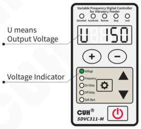

> - The controller does not have a boost function. When the controller cannot reach the set voltage due to the limitation of the input power supply voltage, the saturation indicator will light up, and the mains voltage compensation will fail at this time.
> - The controller can achieve a certain degree of acceleration effect by sacrificing the sinusoidal characteristics of the output waveform, which is determined by the parameter "acceleration index y". When entering the acceleration state, the output current waveform changes from a sine wave to a triangular wave, and the acceleration indicator lights up.

---

## 4.2 Output Frequency

The controller adopts direct digital frequency synthesis technology (DDS), which has very high frequency accuracy and stability, and does not change with time and temperature.

- Press ⚙ and hold for 2 seconds to enter the basic parameter interface.
- The LED displays the output frequency parameter "E" and the default value 50.0.
- Press ⊕ or ⊖ to adjust the parameter value.

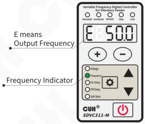

---

## 4.3 On/Off Delay of Intelligent Photoelectric Sensor

When using a sensors or PLC to turn on or turn off the controller's main output, the action can be delayed for a period of time after the control signal is given or restored. The delay time can be set through the two parameters below.

### On Delay ( J )

The period of time the controller goes through from receiving a startup control signal to actually outputting.

- Press ⚙ and hold for 2 seconds to enter the basic parameter interface.
- Press ▲ or ▼ to switch to on delay parameter "J" and the default value 0.2.
- Press ⊕ or ⊖ to adjust the parameter value.

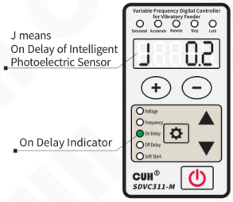

### Off Delay ( L )

The period of time the controller goes through from receiving a shutdown control signal to actually cutting off output.

- Press ⚙ and hold for 2 seconds to enter the basic parameter interface.
- Press ▲ or ▼ to switch to off delay parameter "L" and the default value 0.2.
- Press ⊕ or ⊖ to adjust the parameter value.

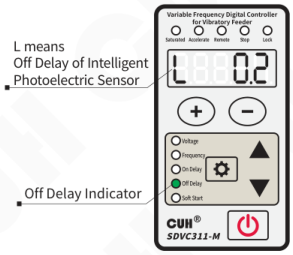

**Note:** Under the default setting, the intelligent photoelectric on/off delay controls the main output on/off delay. If the logical direction of main output is the same phase or the reverse signal source, the intelligent photoelectric on/off delay meaning exchange. The C port on/off delay is consistent with the intelligent photoelectric on/off delay.

---

## 4.4 Soft Startup Time

In order to avoid sudden shock to the vibrator coil, the controller can gradually increase output voltage from 0 to the preset value when startup

**Soft Startup Time ( t ):** The period of time it takes for the controller to smoothly rise its output voltage from 0 to the preset value when startup.

- Press ⚙ and hold for 2 seconds to enter the basic parameter interface.
- Press ▲ or ▼ to switch to soft startup parameter "t" and the default value 0.5.
- Press ⊕ or ⊖ to adjust the parameter value.

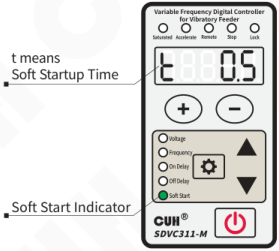

## 4.5 Brake Cycles/Soft Shutdown Time

Since the vibratory feeder will vibrate freely for a period of time after the controller stops output, the material will continue to move during this time. This will cause errors for some applications of precision metering and packaging of materials, so the vibration needs to be stopped quickly.

**Brake Function:** To quickly stop the vibration by delaying the start point of the slow stop 180° to achieve the opposite effect of the driving force and the free vibration phase of the vibratory feeder. It is realized by setting the soft shutdown time (  ) as a negative value, the unit is cycle, that is, the number of current cycles of reverse driving when braking.

When the controller is stopped from the running state, the output voltage can be gently reduced to 0 to prevent the vibration equipment from being impacted.

**Soft Shutdown Time ( 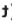 ):** When the controller stops from the running state, the time required for the output voltage to smoothly decrease from the set value to 0 .

---

- Press ⚙ and hold for 2 seconds to enter the basic parameter interface.
- Press ▲ or ▼ to switch to Breaking cycles/Soft Shutdown parameter "t".
- Press ⊕ to adjust the Soft Shutdown parameter value.
- Press ⊖ to adjust the Breaking cycles parameter value.

t means Breaking cycles/Soft Shutdown.

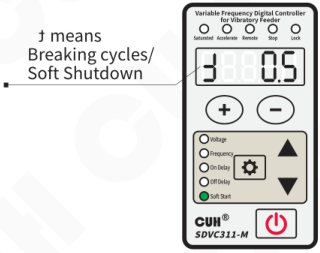

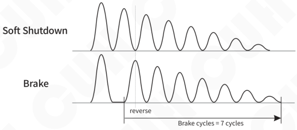

**Schematic diagram of the number of brake cycles**

---

## 4.6 Keyboard Lock

When the parameters of the controller are set, the keyboard lock function can lock all buttons on the panel to avoid misoperation.

Even if it is turned off and then turned on again, the state of the keyboard lock remains the state it was in the last time it was turned off.

- Press ⏻ and hold for 2 seconds to lock all buttons on the panel. The lock indicator lights up.
- Press ⏻ and hold for 2 seconds again to unlock.

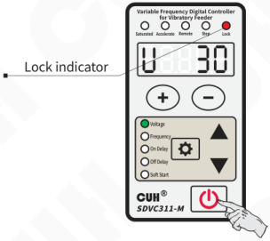

> The keyboard lock state will not disappear due to power off.

---

# Chapter Ⅴ Advanced Function Description

This chapter introduces advanced parameter settings in the modern parameter interface (default).

## 5.1 Remote Speed Control

The controller supports external analog signal to control output voltage, analog signal supports potentiometer, 1~5V voltage, 4~20mA current.

### Potentiometer control connection

**Suggest:**

Please use a 1K linear potentiometer

When the remote speed control signal takes effect, the speed control indicator lights on , at the same time regulating the voltage on the panel will fail.

---

## 1~5V voltage control connection

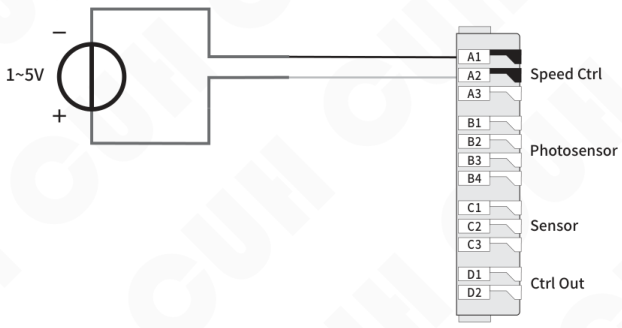

## 4~20mA current control connection

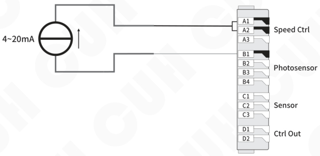

---

## 5.2 Intelligent Photoelectric Sensing

The intelligent photoelectric port of this controller supports photoelectric through-beam or reflection sensors composed of light-emitting diodes and phototransistors, and can also be set to support NPN or PNP switch sensors. The specific wiring diagram is as follows:

### Photoelectric sensor connection method

The working distance of the sensor can be adjusted by setting the P parameter, the smaller the parameter, the more sensitive it is.

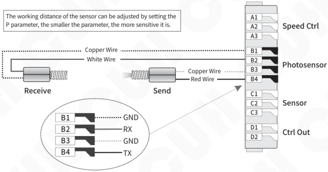

### Switch sensor connection method

Set NPN or PNP type by parameter P.

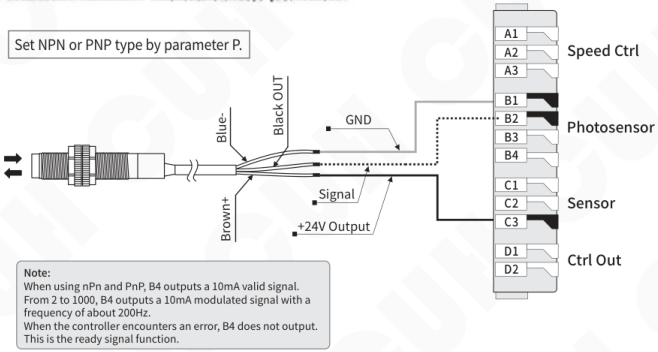

**Note:**

When using nPn and PnP, B4 outputs a 10mA valid signal.

From 2 to 1000, B4 outputs a 10mA modulated signal with a frequency of about 200Hz.

When the controller encounters an error, B4 does not output. This is the ready signal function.

---

## 5.3 Switch Sensor

The Switch Sensor port can support NPN, PNP, Ut1, Ut0 modes.

**The Ut1 mode is a single scan,** that is, before the sensor signal is invalid, the high and low levels are changed to detect whether the port is valid. After finding a valid signal, the port sensor type is determined and no longer scans.

**The Ut0 mode is continuous scanning,** regardless of the sensor type, it always detects whether the port is connected to a valid signal by changing the high and low levels.

### Switch sensor connection method

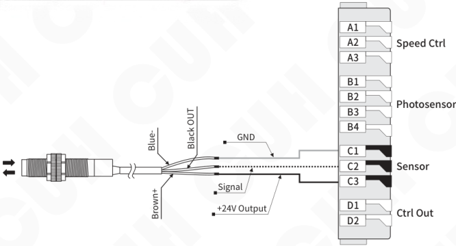

Set NPN or PNP type by parameter.

- Set the sensor type through the advanced parameter ΓA.
- When other external signals such as sensors are used to start and stop operations through the C port of the controller, if the operation needs to be delayed for a period of time after the signal is given or the signal is restored, you can set the advanced parameters "Sensor C port on delay" and It can be realized by the time of "Sensor C port off delay". For the operation method, please refer to the Intelligent Photoelectric Sensor On/Off Delay Time Setting.

---

## 5.4 Control Output

The control output port can support NPN output, PNP output and push-pull output. therein:

- The NPN output is valid as a low level, and the output is invalid as a high-impedance state;
- The PNP output is valid as a high level, and the output is invalid as a high-impedance state;
- The push-pull output is valid as a high level, and invalid as a low level.

### 5.4.1 Wiring Method of Control Output

**NPN output connection**

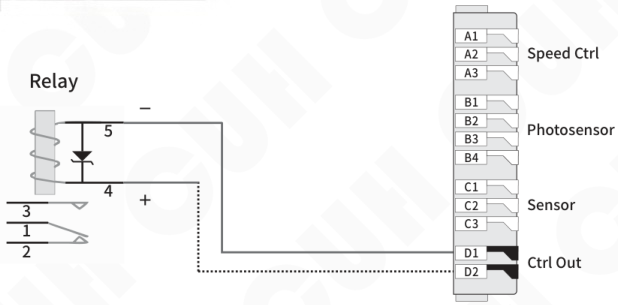

**PNP or push-pull output connection**

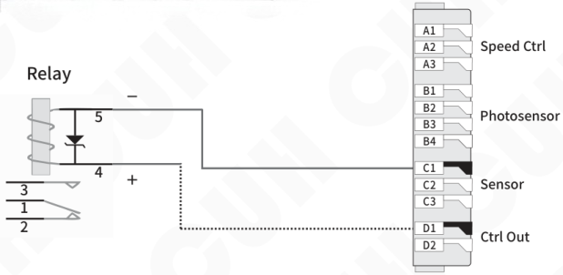

> If connecting a 24V relay, be sure to confirm the positive and negative poles of the coil to make sure they are connected correctly. Because the output current capability of this port is 400mA, the internal protection diode of the relay will short-circuit the port of this controller after reverse connection, triggering the short-circuit protection Err07.

---

## 5.4.2 Control Output Signal Source and Logic Diagram

The control of the main output and the control output is controlled by the result of the logical relationship between the two signal sources.

Set the logic relationship of the two signal sources by setting the parameter values of the advanced parameters Πd and Πq.

Select the following signals by setting the parameter values of the advanced parameters E.d, Ed, E.q, Eq.

| Signal Source | Implication |
|---|---|
| 0 | invalid signal |
| 1 | valid signal |
| b | Intelligent photoelectric sensing port signal |
| -b | Intelligent photoelectric sensing port signal is inverted |
| C | Switch sensor port signal |
| -C | Switch sensor port signal is inverted |
| od | Control output port signal |
| -od | Control output port signal is inverted |
| oq | Main power output port signal |
| -oq | Main power output port signal is inverted |

---

## Control Output Logic Diagram

## 5.4.3 Control Output Mode Description

Customers can choose 4 control output modes: delay mode, hold mode, periodic signal output mode Fn1/Fn2.

**Delay mode:** It means that after the controller output drive signal changes from valid to invalid, the control output turns off after a period of off delay time.

**Hold mode:** After the controller output drive signal becomes valid, the control output remains on during the off-delay time, and turns off after the off-delay time is exceeded.

**Periodic signal output mode Fn1/Fn2:** The duration of the high-level signal is set by the control output D port opening delay, and the duration of the low-level signal is set by the control output D port closing delay.

In Fn1 mode, the switch key cannot stop controlling the output, and in Fn2 mode, the switch key can stop controlling the output.

The difference between the four modes is expressed in the form of a timing diagram as follows, where the input signal is the signal output after the logic relationship selector.

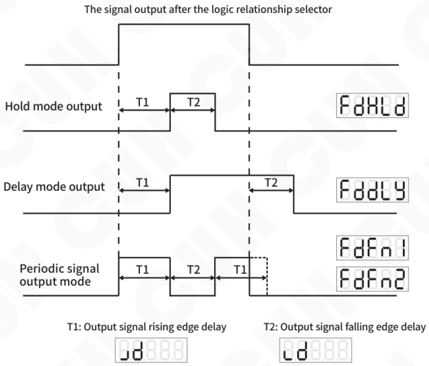

---

## 5.4.4 Control Output Logic Direction

By setting the advanced parameter "ɔd", customers can choose 4 control output logic direction:

**Same Phase `___`:** Indicates that the valid state of the output signal does not change.

**Reverse `_-_`:** Indicates that the valid state of the output signal is reversed.

**Always Active:** Indicates that the signal is always active and uncontrolled.

**Always Inactive:** Indicates that the signal has been invalid and uncontrolled.

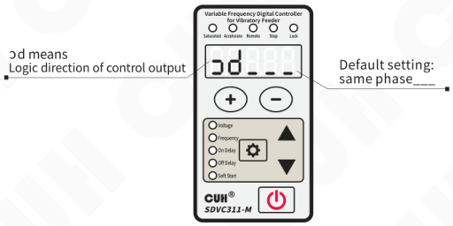

## 5.4.5 Main Output Signal Control Function

The main output signal control is similar to that of the control output. After selecting two signal sources for logic relationship operation, the control signal is obtained through on/off delay mode selection and logic direction control. The control signal is logically with the on/off signal of the panel, than send to the power board to control the main output.

The main output signal control wiring method, signal source and logic diagram can refer to the control output function.

---

## 5.5 Maximum Output Voltage Limit

The controller can set the maximum output voltage limit parameter h, which can prevent the user from misoperation to output excessive voltage and damage the vibration equipment.

Neither the panel setting voltage nor the remote control voltage will exceed this value.

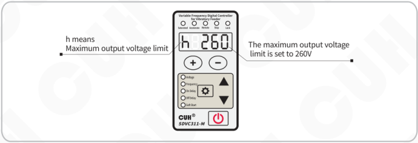

- In any case, the output voltage of the controller cannot and will not exceed the set value of this parameter.
- The factory default setting of this parameter is the maximum possible output voltage of the machine.

## 5.6 Lower Limit of Frequency

This controller can set the advanced parameter “Lower Limit of Frequency e" to limit the minimum output frequency, which can prevent users from accidentally operating the output frequency too low and damaging the electromagnet.

The panel setting frequency will not be lower than this value.

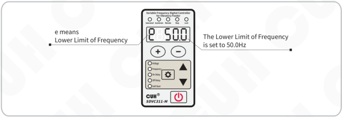

---

## 5.7 Acceleration Index

The controller can achieve a certain degree of acceleration effect by sacrificing the sinusoidal characteristics of the output waveform. When entering the acceleration state, the output current waveform changes from a sine wave to a triangular wave, and the acceleration indicator lights up. The acceleration function can be controlled by setting the parameter value of the advanced parameter "acceleration index y".

**Acceleration Index (y):** Express the maximum output voltage can reach the percentage of the input voltage.

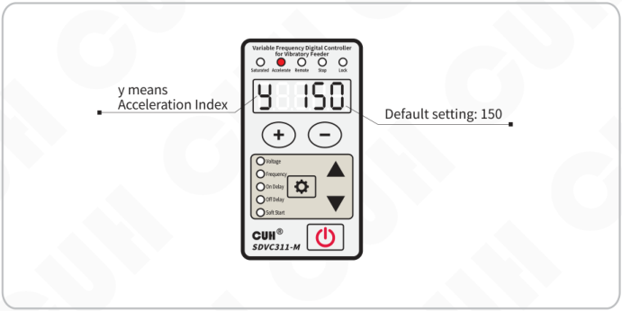

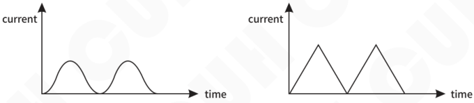

**Schematic Diagram of Acceleration Index set to 150**

---

## 5.8 Waveform Index

The controller can continuously balance the performance of the highest efficiency-maximum power and minimum noise to meet the higher demands of customers. This can be achieved by setting the parameter value of the advanced parameter "waveform index r".

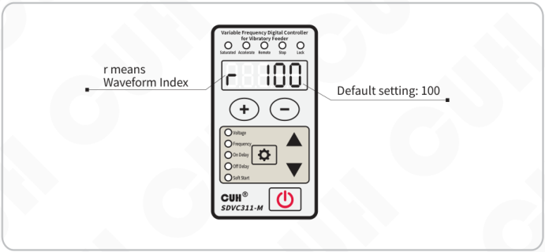

- The wave index value of 0 has the highest efficiency and the least stress on the spring.
- When the value is 100, the maximum rated output power and minimum noise can be obtained, but the spring will be subjected to greater stress.

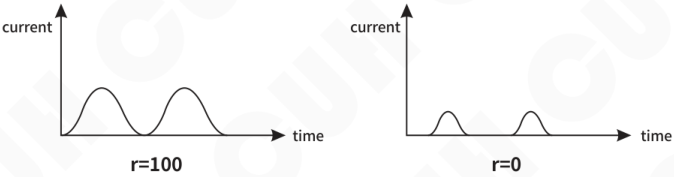

**Waveform Index Diagram**

---

## 5.9 Parameter Password Lock Function

The controller can lock key parameters to prevent users from misoperation. The parameters marked with "*" in the parameter table can be locked with the parameter password lock.

- Long press ⚙ and ▲ to enter the advanced parameter interface.
- Short press ▲ or ▼ to switch to 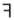, which is used to set the password.
- Press ⊕ and ⊖ to Adjust parameter values.
- After setting the parameter password, exit the current interface and enter again, you can see that the parameter value disappears.
- Enter the advanced parameter interface, switch to , enter the previously entered password, you can see the disappearing set password parameter, and then change the password.

The password lock parameter value follows the 421 code rule:

| Lock parameter | Waveform Index | Acceleration Index | Maximum output voltage limit | Logic operation of signal sources of Main output | The second signal source of Main output | The first signal source of Main output | Logic operation of signal sources of Control Port D | The second signal source of Control Port D | The first signal source of Control Port D | Port C Sensor Type | Breaking cycles/Soft Shutdown | Output Frequency |
|---|---|---|---|---|---|---|---|---|---|---|---|---|
| 1: Locked | 1 | 1 | 1 | 1 | 1 | 1 | 1 | 1 | 1 | 1 | 1 | 1 |
| 0: Unlocked | 0 | 0 | 0 | 0 | 0 | 0 | 0 | 0 | 0 | 0 | 0 | 0 |
| multiplication factor | 4 | 2 | 1 | 4 | 2 | 1 | 4 | 2 | 1 | 4 | 2 | 1 |
| Password value range (summation) | 0~7 (1st digit of password value) | | | 0~7 (2nd digit of password value) | | | 0~7 (3rd digit of password value) | | | 0~7 (4th digit of password value) | | |
| Example 1 | 0 | 0 | 0 | 0 | 0 | 0 | 0 | 0 | 0 | 0 | 0 | 1 |
| | 0 | | | 0 | | | 0 | | | 1\*1=1 | | |
| Example 2 | 1 | 0 | 0 | 0 | 0 | 1 | 0 | 0 | 0 | 0 | 0 | 1 |
| | 1\*4=4 | | | 1\*1=1 | | | 0 | | | 1\*1=1 | | |
| Example 3 | 0 | 0 | 0 | 0 | 0 | 0 | 0 | 0 | 0 | 1 | 1 | 1 |
| | 0 | | | 0 | | | 0 | | | 1\*4+1\*2+1\*1=7 | | |

**Example 1:** To lock the output frequency, 12 groups of binary codes are 000000000001, and the set password value is 0001.

**Example 2:** Lock the output frequency, waveform index and the first signal source of the main output, 12 groups of binary codes are 100001000001, and the set password value is 4101.

**Example 3:** Lock output frequency, brake cycle number/slow closing time and C port sensor type, 12 groups of binary codes are 000000000111, and the set password value is 0007.

When "Password Lock Parameter Range" is set to 9999, all parameters marked with "*" will be locked.

---

## 5.10 Restore Default Settings/Resume Factory Mode

User can quickly restore the controller to the factory default state.

Due to the powerful functions of the controller, many parameters can be adjusted. For beginners, it may not be able to restore the normal working state of the controller after several settings and modifications. Use this function to quickly restore the disordered parameter state to the factory default setting.

To restore factory settings, it is necessary to use the Resume factory mode parameters (Pin) in combination. The resume factory mode is described as follows:

- **0:** Restore the **working parameter group** to the **user parameter group**.
- **5:** Save the **working parameter group** to the **user parameter group**.
- **35:** Restore the **working parameter group** to the **factory value of CUH**.
- **55:** Restore the **working parameter group** and **user parameter group** to the **factory value of CUH**.

---

- Long press ⚙ and ▲ simultaneously to enter the advanced parameter interface.
- Short press ▼ to switch to the full flashing on the LED displayer, that is, the parameter of "Default setting restoration". And then press ⊖ and hold until the controller displays "-----", indicating that the controller has been restored.
- Release ⊖, after the controller displays "CUH", then enter the output voltage adjustment state "U". By this time, all parameters have been restored to the factory default settings.

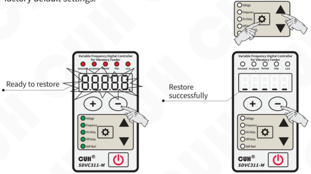

---

## 5.11 Parameter Monitoring Function

The controller has specially designed a set of monitoring parameters to monitor the status of the controller.

- Long press ⚙ and ▼ simultaneously to enter the monitoring parameter interface.
- Short press ▲ or ▼ to select the parameter to be monitored.
- The parameter value of the monitoring parameter cannot be modified.

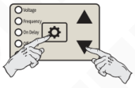

Example: C means Temperature display parameters

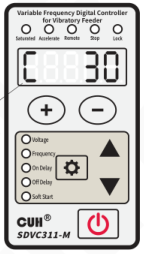

**The monitoring parameters of this controller include:**

Temperature display C, Bus voltage PU, Bus ripple voltage rU, Output current AC, Analog speed regulation A port voltage AU, B port signal voltage bU, C port signal voltage cU, D port output voltage dU, 24V output voltage nU.

---

## Chapter Ⅵ Technical Specifications

### 6.1 Dimensions

(unit: mm)

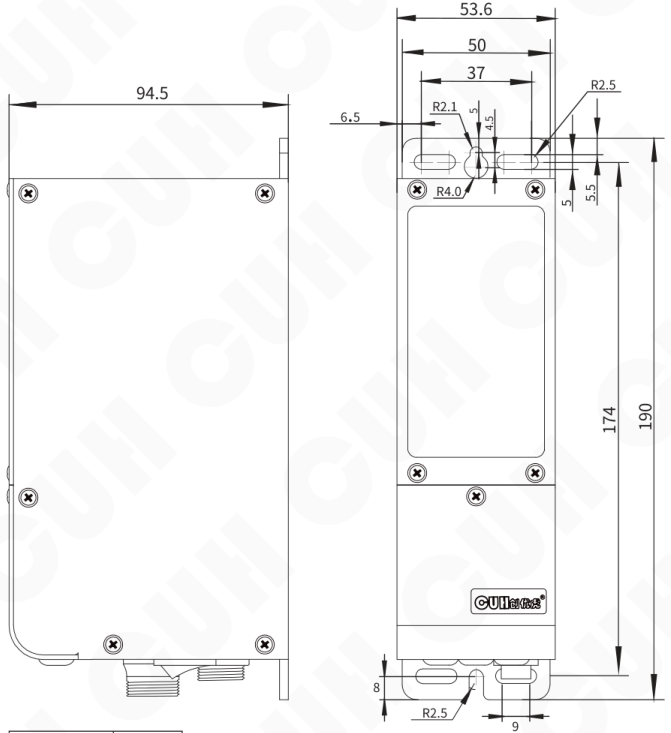

SDVC311-S (1.5A)  
SDVC311-M (3.0A)

| Dimensions range | tolerance |
|---|---|
| 0~3 | ±0.05 |
| 3~10 | ±0.1 |
| 10~30 | ±0.15 |
| 30~80 | ±0.2 |
| 80~180 | ±0.3 |
| >180 | ±0.5 |

This tolerance table is applicable to all products in this series.

---

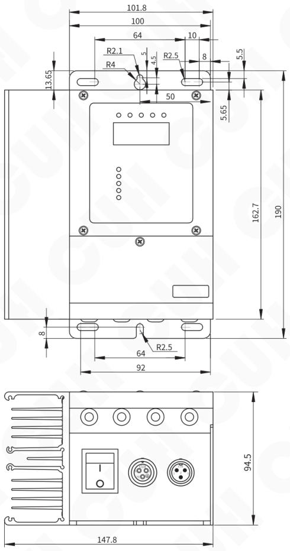

SDVC311-L (4.5A)  
SDVC311-XL (6.0A)

---

## 6.2 Technical Specifications

| Item | Min | Typical | Max | Unit | Note |
|---|---|---|---|---|---|
| Input Voltage | 85 | 220 | 250 | V | AC RMS |
| Adjustable Output Voltage Range | 0 | —— | 260 | V | Lower than 150% of Input Voltage |
| Voltage Adjustment Accuracy | | 1 | | V | |
| Voltage Regulation Accuracy | 0 | —— | 10 | % | ΔVout/ΔVin |
| Adjustable Output Current Range | 0 | —— | 1.5 | A | SDVC311-S |
| Adjustable Output Current Range | 0 | —— | 3.0 | A | SDVC311-M |
| Adjustable Output Current Range | 0 | —— | 4.5 | A | SDVC311-L |
| Adjustable Output Current Range | 0 | —— | 6.0 | A | SDVC311-XL |
| Output Power | 0 | —— | 330 | VA | SDVC311-S |
| Output Power | 0 | —— | 660 | VA | SDVC311-M |
| Output Power | 0 | —— | 990 | VA | SDVC311-L |
| Output Power | 0 | —— | 1320 | VA | SDVC311-XL |
| Output Frequency | 5.0 | —— | 400.0 | Hz | |
| Frequency Adjustment Accuracy | | 0.1 | | Hz | |
| Output Waveform | | Sine | | | |
| Soft Start Time | 0 | —— | 10.0 | s | Default value: 0.5 |
| On/Off Delay Time Range | 0 | —— | 99.9 | s | Default value: 0.2 |
| On/Off Delay Time Accuracy | | 0.1 | | s | |
| Overheat Protection Trigger Temperature | 58 | 60 | 66 | °C | |
| DC Control Output Current | 0 | —— | 400 | mA | |
| DC Control Output Voltage | 22 | 24 | 26 | V | |
| Analog Control Signal | | 1~5/4~20 | | V/mA | Remote Speed Control signal |
| Digital Control Signal | | 24 | | V | Switching Signal |
| Adjustment Method | | 6 | | Button | |
| Standby Power Consumption | —— | 3 | —— | W | |
| Display Method | | 5 | | Digit | LED |
| Ambient Temperature | 0 | 25 | 40 | °C | No Condensation |
| Ambient Humidity | 10 | 60 | 85 | % | No Condensation |
| Storage Ambient Temperature | -20 | 25 | 65 | °C | No Condensation |

## 6.3 Reference Standard

**Absolute Parameters:**  
Above the standard will damage the controller, obey it strictly.

| Item | GB Standard | IEC Standard | Grade | Standard Requirement | Note |
|---|---|---|---|---|---|
| Electrostatic Discharge | GB/T 17626.2-2006 | IEC 61000-4-2:2001 | 4 | ±8 kV | Contact Discharge |
| | | | 4 | ±15 kV | Air Discharge |
| Electrical Fast Transient Test | GB/T 17626.4-2008 | IEC 61000-4-4:2004 | 4 | ±4 kV | |
| DC Power Line Wave Immunity | GB/T 17626.17-2005 | IEC 61000-4-17:2002 | 4 | 15% | Rating A |

> **Warning**  
> In a residential environment, this product may cause radio interference in which case supplementary mitigation measures may be required.

---

# Chapter Ⅶ Appendix

## 7.1 Parameter Table

| Category | Definition | Symbol | Symbol Image | Range | Default |
|---|---|---|---|---|---|
| Common parameter | Output Voltage | U |  | 0~260 V | 150 |
| Basic Parameter | Output Frequency * | E |  | 5.0~400.0 Hz | 50.0 |
| | On Delay of the Intelligent Photoelectric Sensor | J | 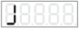 | 0.0~99.9 s | 0.2 |
| | Off Delay of the Intelligent Photoelectric Sensor | L |  | 0.0~99.9 s | 0.2 |
| | Soft Startup | t | 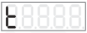 | 0.0~10.0 s | 0.5 |
| | Breaking cycles/Soft Shutdown * | d |  | -100~0 cycle (number of breaking cycles) 0.0~10.0 s (Soft Shutdown) | 0.0 |
| | Output Voltage | U |  | 0~260 V | 150 |
| Advanced Parameter | Intelligent photoelectric sensor sensitivity | P |  | PnP, nPn, 2~1000 | 80 |
| | Port C Sensor Type * | ΓA |  | nPn, PnP ut1 (Single scan), ut0 (Continuous scan) | ut0 |
| | On Delay of Port C | J- |  | 0.0~99.9 s | 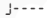 same as J |
| | Off Delay of Port C | L- |  | 0.0~99.9 s |  same as L |
| | The first signal source of Main output * | Cq |  | 0, 1, b, -b, C, -C, od, -od, oq, -oq | b |
| | The second signal source of Main output * | Eq |  | 0, 1, b, -b, C, -C, od, -od, oq, -oq | C |
| | Logic operation of signal sources of Main output * | nq |  | And, or, Xor, rS | or |
| | On Delay of Main output | Jq |  | 0.0~99.9 s | 0.0 |
| | Off Delay of Main output | Lq |  | 0.0~99.9 s | 0.0 |
| | Output Mode of Main output | Fq |  | dLy (Delay Mode), HLd (Hold Mode) | dLy |
| | Logic direction of Main output | oq |  |  on (always active), oFF (always inactive) |  |
| | The first signal source of Control Port D * | Cd |  | 0, 1, b, -b, C, -C, od (Output state of Port D), -od, oq (Output state of Main output), -oq | 0 |
| | The second signal source of Control Port D * | Ed |  | 0, 1, b, -b, C, -C, od (Output state of Port D), -od, oq (Output state of Main output), -oq | oq |
| | Logic operation of signal sources of Control Port D * | nd |  | And, or, Xor, rS | or |
| | On Delay of Port D | Jd |  | 0.0~99.9 s | 0.0 |

| | Definition | Symbol | Symbol Image | Range | Default |
|---|---|---|---|---|---|
| Advanced Parameter | Off Delay of Port D | Ld |  | 0.0~99.9 s | 0.0 |
| Advanced Parameter | Output Mode of Port D | Fd |  | dLy (Delay Mode), HLd (Hold Mode) Fn1 periodic signal output mode 1 Fn2 periodic signal output mode 2 | dLy |
| Advanced Parameter | Logic direction of Port D | Sd |  | --- (Same phase), -⁻- (Reverse) on (always active), oFF (always inactive) | --- |
| Advanced Parameter | Control Output Type | Cd |  | nPn, PnP, PSP (Push & Pull) | nPn |
| Advanced Parameter | Maximum output voltage limit \* | h |  | 0~260 V | 260 |
| Advanced Parameter | Lower Limit of Frequency | E |  | 5.0~400.0 Hz | 40.0 |
| Advanced Parameter | Acceleration Index \* | g |  | 100~150 | 150 |
| Advanced Parameter | Waveform Index \* | r |  | 0~100 | 100 |
| Advanced Parameter | Parameter Range of Disable Adjustment function | Special 7-segment symbol with decimal point (see figure) |  | 0~9999 | 0 |
| Advanced Parameter | Lock of Disable Parameter Adjustment function | Special 7-segment symbol (see figure) |  | 0~9999 | 0 |
| Advanced Parameter | Default Setting Restoration | 88888 |  | Used in conjunction with parameter Pin | —— |
| Advanced Parameter | Resume Factory Mode | Pin |  | 0 : Restore the working parameter group to the user parameter group 5 : Save the working parameter group to the user parameter group 35: Restore the working parameter group to the factory value of CUH 55: Restore the working parameter group and user parameter group to the factory value of CUH | 0 |
| Monitoring Parameter | Temperature | C |  | -20~85 °C | —— |
| Monitoring Parameter | Internal Bus Voltage | PU |  | 0~400 V | —— |
| Monitoring Parameter | Bus Ripple Voltage | rU |  | 0~200 V | —— |
| Monitoring Parameter | Output Current | AC |  | 0.00~1.60 A -SDVC31S/SDVC311S 0.00~3.20 A -SDVC31M/SDVC311M | —— |
| Monitoring Parameter | Signal Voltage of Port A | AU |  | 0.00~5.00 V | —— |
| Monitoring Parameter | Signal Voltage of Port B | bU |  | 0~999 | —— |
| Monitoring Parameter | Signal Voltage of Port C | cU |  | 0.0~28.0 V | —— |
| Monitoring Parameter | Signal Voltage of Port D | dU |  | 0.0~28.0 V | —— |
| Monitoring Parameter | Real time voltage of 24V Port | nU |  | 0.0~28.0 V | —— |
| Monitoring Parameter | Control board software version | uc |  | —— | —— |
| Monitoring Parameter | Power board software version | uP |  | —— | —— |

Note: The parameter with \* symbol can be locked by .  
All parameters with \* symbol of the controller are locked, when  is 9999.

## 7.2 Input and Output Circuit Diagrams

Remote Speed Control Port A

Intelligent Photosensor Port B

Switch Sensor Port C

Control Output Port D

---

## 7.3 Troubleshooting Suggestions and Error Explanations

| Error Code | Definition | Troubleshooting Methods | Symbol Image |
|---|---|---|---|
| No display after power on | | Make sure the power outlet is live Make sure the Input power Cable is reliably connected to the power outlet? | |
| Display normally, but no output | | Make sure the Output Cable is reliably connected to the vibrator. Make sure the output voltage is not small. Make sure the Stop Indicator is not light up. Please check whether Normal Close of parameter has been set, causing controller output to stop. | |
| Control signal loses effectiveness | | Make sure the control signal is correctly inputted. Make sure the ground wire of the control signal is correctly connected to the controller. Make sure the Logical Relation of the control signals is set correctly as your expectation. | |
| Beat phenomena | | Avoid vibration coupling among the vibrators. Heighten the resonant frequency of the vibrators. | |
| Display normally, no output, but sound can be heard | | Adjust all parameters as this book instructed. | |
| Err01 | Short Circuit | Make sure the load is not short-circuit, then try to restart output of the controller by press Output ON/OFF Button two times or repower the controller. |  |
| Err02 | Over Current | Reduce output voltage appropriately, then restart the output. |  |
| Err03 | Over Heat | Install the controller in a well-ventilated environment. |  |
| Err04 | Over or under voltage | Make sure input voltage between AC 85~250Vac. |  |
| Err05 | Internal Communication abnormal | Make sure no extern power supply connect to the 24V power port or contact our technical support. |  |
| Err06 | Temperature sensor abnormal | Make sure the work temperature not under -20℃ or contact our technical support. |  |
| Err07 | Short-circuit protection of Port D | Make sure the load of Port D is not short-circuit and the current does not exceed 400mA, then try to restart the output of Port D. |  |
| Err10 | 24V power output abnormal | Make sure 24V port is not short-circuit and the current does not exceed 400mA. |  |
| Err11 | 5V power output of Port A abnormal | Make sure the 5V power of Port A is not short-circuit or not connected to external power voltage more than 5V. |  |

Note: If any Error occur, the TX of port B will shutdown.

## Chapter Ⅷ Product Warranty Information

### 8.1 Warranty Period

The warranty period provided by the company for this product is 3 years from the date of delivery of the product to the location designated by the purchaser.

### 8.2 Warranty Coverage

(1) If there is a failure caused by our company during the above warranty period, we will repair the product free of charge. However, The following situations are not covered by the warranty:

a. Failure to comply with the conditions specified in the simple manual, user manual or technical requirements specifically agreed between the purchaser and the company, improper operation, or failure caused by improper use.

b. Failure is not due to a product defect, but to the purchaser's equipment or software design.

c. Malfunctions caused by modifications or repairs not performed by the company's personnel.

d. The failure that can be totally avoided by correct maintenance or replacement of wearing parts according to the simple operation guide or user manual.

e. After the product is shipped from our company, it is caused by factors such as unforeseen changes in the level of science and technology failure.

f. Due to natural disasters such as fire, earthquake, flood, or external factors such as abnormal voltage failure, the company is not responsible for the warranty.

(2) The scope of warranty is limited to the situation stipulated in (1), Indirect losses (such as equipment damage, opportunities, loss of profit, etc.) or other losses, the company do not bear any responsibility.

### 8.3 Product Suitability

The controller of our company is designed and produced for general use in the vibratory feeding industry. Therefore, this controller of our company shall not be used for the following applications and is not suitable for its use.

(1) Facilities that have a serious impact on life and property, such as nuclear power plants, airports, railways, ships, motorized devices and medical equipment.

(2) Public utilities, including electricity, gas, water supply, etc.

(3) Outdoor use in similar conditions or environments.

---

Nanjing CUH Science & Technology Co.,Ltd  
https://en.cuhnj.com  
Tel.:+86-25-84730411 / 84730415 / 84730416  
Fax:+86-25-84730426  
E-mail:sales@cuhnj.com  
Add.:Building 2, Xueyan Tech Park, Tuscity,  
No.9 Zhineng Rd, Jiangning, Nanjing, China

Document No.: IDP1000532

