## 目录

> 下列条目来自 PDF 内置书签/大纲；链接指向本批转换生成的整页渲染图（`assets/pages/`），便于与原版 PDF 对照校对。

- [1: 封面](assets/pages/page-0001.png)（第 1 页）
- [2: 封二](assets/pages/page-0002.png)（第 2 页）
- [3: 序言](assets/pages/page-0003.png)（第 3 页）
- [4: 注意事项](assets/pages/page-0004.png)（第 4 页）
- [5: 使用环境](assets/pages/page-0005.png)（第 5 页）
- [6: 空白页](assets/pages/page-0006.png)（第 6 页）
- [7: 目录](assets/pages/page-0007.png)（第 7 页）
- [8: 目录2](assets/pages/page-0008.png)（第 8 页）
- [页面 9](assets/pages/page-0009.png)（第 9 页）
- [页面 10](assets/pages/page-0010.png)（第 10 页）
- [页面 11](assets/pages/page-0011.png)（第 11 页）
- [页面 12](assets/pages/page-0012.png)（第 12 页）
- [页面 13](assets/pages/page-0013.png)（第 13 页）
- [页面 14](assets/pages/page-0014.png)（第 14 页）
- [页面 15](assets/pages/page-0015.png)（第 15 页）
- [页面 16](assets/pages/page-0016.png)（第 16 页）
- [页面 17](assets/pages/page-0017.png)（第 17 页）
- [页面 18](assets/pages/page-0018.png)（第 18 页）
- [页面 19](assets/pages/page-0019.png)（第 19 页）
- [页面 20](assets/pages/page-0020.png)（第 20 页）
- [页面 21](assets/pages/page-0021.png)（第 21 页）
- [页面 22](assets/pages/page-0022.png)（第 22 页）
- [页面 23](assets/pages/page-0023.png)（第 23 页）
- [页面 24](assets/pages/page-0024.png)（第 24 页）
- [页面 25](assets/pages/page-0025.png)（第 25 页）
- [页面 26](assets/pages/page-0026.png)（第 26 页）
- [页面 27](assets/pages/page-0027.png)（第 27 页）
- [页面 28](assets/pages/page-0028.png)（第 28 页）
- [页面 29](assets/pages/page-0029.png)（第 29 页）
- [页面 30](assets/pages/page-0030.png)（第 30 页）
- [页面 31](assets/pages/page-0031.png)（第 31 页）
- [页面 32](assets/pages/page-0032.png)（第 32 页）
- [页面 33](assets/pages/page-0033.png)（第 33 页）
- [页面 34](assets/pages/page-0034.png)（第 34 页）
- [页面 35](assets/pages/page-0035.png)（第 35 页）
- [页面 36](assets/pages/page-0036.png)（第 36 页）
- [页面 37](assets/pages/page-0037.png)（第 37 页）
- [页面 38](assets/pages/page-0038.png)（第 38 页）
- [页面 39](assets/pages/page-0039.png)（第 39 页）
- [页面 40](assets/pages/page-0040.png)（第 40 页）
- [页面 41](assets/pages/page-0041.png)（第 41 页）
- [页面 42](assets/pages/page-0042.png)（第 42 页）
- [页面 43](assets/pages/page-0043.png)（第 43 页）
- [页面 44](assets/pages/page-0044.png)（第 44 页）
- [页面 45](assets/pages/page-0045.png)（第 45 页）
- [页面 46](assets/pages/page-0046.png)（第 46 页）
- [47: 封三](assets/pages/page-0047.png)（第 47 页）
- [页面 48](assets/pages/page-0048.png)（第 48 页）
## 术语与命名

- 侧车：`glossary/terms.yaml`（机读）、`glossary/zh-CN.md`（人读）；候选表，定稿后并入公司级 `glossary/`。

## 适用范围

- 本文档由 PDF 自动转换生成，正文与插图需人工核对。

## 变更记录

- 2026-06-04 11:06:35：由转换工具从源 PDF 生成首版。

## 正文

<!-- auto:ai-body-draft v1 -->
> 以下为**整页视觉转写**的正文草稿（多模态模型直接输出 Markdown，含 GFM 表； 若配置 `[[vcrop:页:序]]` 占位符，裁剪步骤会插入 `assets/images/` 下 PNG）。**请务必人工校对。**

### 第 1 页

# CUH

***Variable Frequency Digital  
Controller for Vibratory Feeder***

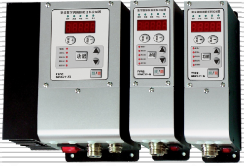

**Instruction Book of SDVC31 Series**  
**Variable Frequency Digital Controller for Vibratory Feeder**

### 第 2 页

*（本页 `page_markdown` 为空。）*

### 第 3 页

Variable Frequency Digital Controller for Vibratory Feeder　　　　　　　　　　　　　　　SDVC31 Series

---

# Preface

Thank you for choosing **CUH** Intelligent Digital Vibratory Feeder Controllers.(The controller for short in the following text)

This instruction book includes notes for installing, debugging, parameter setting, maintaining and trouble shooting of the controller. Please read this instruction book carefully before operating the controller and keep it properly

## This instruction book applies to the following models:

➡Variable Frequency Digital Controller for Vibratory Feeder  
SDVC31-S (1.5A Output Current)

➡Variable Frequency Digital Controller for Vibratory Feeder  
SDVC31-M (3.0A Output Current)

➡Variable Frequency Digital Controller for Vibratory Feeder  
SDVC31-L (4.5A Output Current)

➡Variable Frequency Digital Controller for Vibratory Feeder  
SDVC31-XL (6.0A Output Current)

➡Variable Frequency Digital Controller for Vibratory Feeder  
SDVC31-U (10.0A Output Current)

➡Variable Frequency Digital Controller for Vibratory Feeder  
SDVC31-XU (20.0A Output Current)

---

2018-11　　　　　　　　　　　　　　　　　　　　　　　　　　　　　　　SDVC31SMSEN_3.01

### 第 4 页

Variable Frequency Digital Controller for Vibratory Feeder  
**SDVC31 Series**

---

# Notice

➜ Never hot swap nor touch the contacts in any case to avoid electric shock or other accidents.

➜ Enclosure of the controller is grounded via the input power cable. Please make sure the power outlet is well grounded.

➜ Never connect the controller to 380V AC which may cause unrecoverable damage.  
(Choose products that are designed for 380V AC when needed)

➜ Never switch the input of the controller by way of cutting off power supply through a relay, a PLC or other devices, otherwise service life of the controller may be reduced severely.

➜ The controller is designed to work in a cool and dry environment. Never run outdoors to avoid soaking or sun exposure. Operate the controller within the temperature range that its electrical characteristics demand.

➜ Never operate the controller under the condition that beyond its designed limits.

➜ Operate the controller in accordance with this instruction book strictly. We will not assume any civil or criminal liability if the equipment damage or personal injury is caused by incorrect operation.

> **!**  
> Never open the controller shell to avoid electric shock. Contact CUH if the controller breaks down.
>
> Never try to revamp the controller since the solid state circuit boards inside the controller can not be repaired, and there's no adjustable part.

---

2018-11  
SDVC31SMSEN_3.01

### 第 5 页

Variable Frequency Digital Controller for Vibratory Feeder  
**SDVC31 Series**

---

# Operating Environment

## Inspection Before Using

Every controller will go through rigorous quality inspection before delivery and is packed  
with crash-proof packaging.

## Please Check the Following Items After Unpacking:

➜ Whether the controller is damaged in appearance

➜ Whether model of the controller is exactly what you ordered

## Runtime Environment

Please follow the notes below to ensure better performance and longer lifetime of the  
controller

➜ Well-ventilated environment

➜ Keep away from water, steam, dust and especially oily dust

➜ Keep away from corrosive or flammable gas and liquid

➜ Keep away from flying dust and metal particles

➜ Firmly fixed to avoid self vibration

➜ Keep away form electromagnetic interference

➜ Operate within the temperature range of 0 °C to 40 °C

➜ For use at altiude 2000m or lower

---

2018-11  
SDVC31SMSEN_3.01

### 第 6 页

Variable Frequency Digital Controller for Vibratory Feeder                                                     SDVC31 Series

---

---

2018-11                                                                                                             SDVC31SMSEN_3.01

### 第 7 页

Variable Frequency Digital Controller for Vibratory Feeder　　　　　　　　　　　　　　　SDVC31 Series  

# Contents

**Chapter I Features**---------------------------------------------------------------1  
**Chapter II Installation Guide**----------------------------------------------------3  
**Chapter III Components Descriptions**---------------------------------------------7  
**Chapter IV Function Descriptions**------------------------------------------------9  
4.1 Output Voltage Setting----------------------------------------------------------9  
4.2 Output Frequency Setting-------------------------------------------------------10  
4.3 Soft Startup Time Setting------------------------------------------------------11  
4.4 Output Switch------------------------------------------------------------------11  
4.5 Maximum Output Voltage Restriction--------------------------------------------12  
4.6 Acceleration Index Setting-----------------------------------------------------13  
4.7 Waveform Index Setting---------------------------------------------------------14  
4.8 Keypad Locking-----------------------------------------------------------------15  
4.9 Default Settings Restoration---------------------------------------------------16  
**Chapter V Sensors and Signal Control**-------------------------------------------17  
5.1 Intelligent Photoelectric Sensing----------------------------------------------17  
　　5.1.1 Connection Method of the Intelligent Photoelectric Sensor----------------17  
　　5.1.2 Startup Delay Time and Shutdown Delay Time Settings of the Intelligent  
　　　　　Photoelectric Sensor-----------------------------------------------------18  
　　5.1.3 Logical Relation Setting of Intelligent Photoelectric Sensor-------------19  
5.2 Using Method of the NPN Switch Sensor (Halt when work-pieces are full)---------20  
　　5.2.1 Connection Method of the NPN Proximity Switch Sensor---------------------20  
　　5.2.2 Connection Method of the NPN Counter-radiation Switch Sensor-------------21  
　　5.2.3 Connection Method of the Photoelectric Counter-radiation Sensor----------21  
　　5.2.4 Connection Method of the Optical Fiber Counter-radiation Sensor----------22  
　　5.2.5 Connection Method of the Photoelectric Reflection Sensor-----------------23  
5.3 Startup Delay Time and Shutdown Delay Time Settings of the NPN Switch Sensor---24  
5.4 Logical Relation Setting of the NPN Switch Sensor (Halt when work-pieces are full)---25  
5.5 Logical Relation Setting of the Control Signal---------------------------------26  
5.6 Connection Method of the Upper PLC which Controls the Vibratory Feeder Controller---27  
5.7 Controlling Output-------------------------------------------------------------28  
　　5.7.1 Connection Method of the Controlling Output------------------------------29  
　　5.7.2 Logical Relation Setting of the Controlling Output-----------------------30  
5.8 Remote Speed Control-----------------------------------------------------------31  
**Chapter VI Security Functions**--------------------------------------------------31  

2018-11　　　　　　　　　　　　　　　　　　　　　　　　　　　　　　　SDVC31SMSEN_3.01

### 第 8 页

Variable Frequency Digital Controller for Vibratory Feeder            **SDVC31 Series**

---

## Appendix

Appendix A: Dimensions -------------------------------------------------------------- 32

Appendix B: Output Interface Definition ------------------------------------------- 35

Appendix C: Signal Interface Definition -------------------------------------------35

Appendix D: Function Table ---------------------------------------------------------36

Appendix E: Electrical Specification ----------------------------------------------37

Appendix F: Troubleshooting Tips and Error Indicator Significations Description --- 38

---

2018-11                    SDVC31SMSEN_3.01

### 第 9 页

*Variable Frequency Digital Controller for Vibratory Feeder*  
**SDVC31 Series**

---

# Chapter I Features

The controller is specially designed for controlling vibratory feeder in the automation systems. Combined with the latest electronic technology and elaborate design, the controller provides the following convenient and practical features:

**Frequency Adjusting:** Output Frequency ranges from 40.0Hz to 400.0Hz.

**Voltage Adjusting:** Output Voltage ranges from 0V to 250V.

**Automatic Voltage Stabilizing:** The controller can eliminate feeding speed variation caused by mains voltage fluctuation.

**Soft Startup:** In order to avoid sudden shock to the work pieces, the controller can gently increase output voltage from 0 to the pre-set value when startup.

**Intelligent Photoelectric Sensing:** Our adaptive Intelligent Photoelectric Sensor can help to stall the controller when work-pieces are full or work-piece is empty and to fulfill the functions of Soft Startup Time Setting,Startup Delay, Shutdown Delay, and Logical Relation Adjusting.

**Halt when Work-pieces are full:** A NPN switch sensor can help to halt the controller when work-pieces are full and to fulfill the functions of Soft Startup Time Setting, Startup Delay, Shutdown Delay, and Logical Relation Adjusting.

**Acceleration:** Due to this function, maximum output voltage value of the controller can be increased up to 150% of the input voltage value.

**Remote Speed Control:** Output Voltage of the controller can be controlled by an external potentiometer, a PLC, or voltage control signal ranging form 1V to 5V.

**Controlling Output:** The Controlling Output signal outgoing from the transistor can coordinate a solenoid or other external devices with the controller.

**Keypad Locking:** Press the ON/OFF button and hold for 2 seconds to lock all buttons for fear of false operation.

**Maximum Output Restriction:** Maximum Output Voltage value can be preset to protect the equipment from damage caused by misuse.

**Waveform Index Setting:** Operators can weight efficiency and maximum capacity by adjusting this parameter.

**Default Settings Restonation:** This function allows the user to restore all default parameter settings and reset the controller.

---

2018-11　　　　　　　　　　　　　　　　　- 1 -　　　　　　　　　　　　　　　　　SDVC31SMSEN_3.01

### 第 10 页

Variable Frequency Digital Controller for Vibratory Feeder                                    **SDVC31 Series**

---

**CUH** attaches great importance to the product quality management and safety performance. Apart form the high-quality components we use and rigorous quality control system, **CUH** has taken account of possible accidents users may encounter and provides the following protective functions to maximum the controller's practicability.

**Short-Circuit Protection:** If output of the controller is short-circuited, the controller will halt its output until restarted.

**Current Overload Protection:** The controller will halt its output to ensure equipments' operating safety when operation current exceeds its rated value.

**Overheat Protection:** The controller will halt its output to protect itself when operation temperature is too high.

**CUH** controllers are strictly compliant with CE certification.

---

2018-11                                      - 2 -                                      SDVC31SMSEN_3.01

### 第 11 页

Variable Frequency Digital Controller for Vibratory Feeder　　　　　　　　　　　　　　SDVC31 Series

# Chapter II&nbsp;&nbsp;Installation Guide

## Step One:

Open the packing box and check the controller's outward appearance and make sure the controller model is exactly what you ordered.

## Step Two:

Connect the Output Power Cable in the packing box to the vibrator's electromagnetic coils.

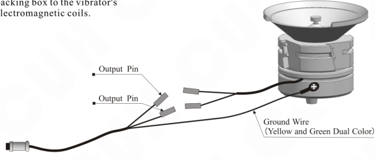

Figure labels:

- Output Pin
- Output Pin
- Ground Wire (Yellow and Green Dual Color)

## ⚠ Notice

Make sure the vibrator's electromagnetic coils is connected to the two output pins of the Output Power Cable and the electromagnetic coils is reliably grounded otherwise series security incident may occur.

---

2018-11　　　　　　　　　　　　　　　　- 3 -　　　　　　　　　　　　　　　　SDVC31SMSEN_3.01

### 第 12 页

Variable Frequency Digital Controller for Vibratory Feeder  
**SDVC31 Series**

---

## Step Three:

Connect the Input Power Cable to the controller and lock the power nut.

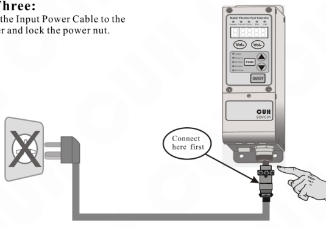

## Step Four:

Connect the plug of the Input Power Cable to the mains jack.

---

2018-11　　　　- 4 -　　　　SDVC31SMSEN_3.01

### 第 13 页

Variable Frequency Digital Controller for Vibratory Feeder　　　　　　　　　　　　　**SDVC31 Series**

---

## Step Five:

Adjust the controller's Output Voltage to the value between 30 and 80 (represented by the letter U)

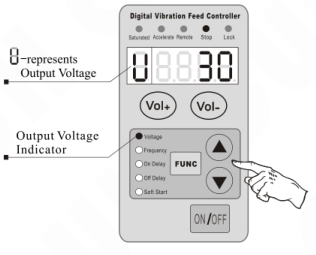

Diagram labels:

- U—represents Output Voltage
- Output Voltage Indicator

## Step Six:

Press the <kbd>FUNC</kbd> button and hold for 2 seconds to enter the Basic Settings Adjusting status.

The Output Frequency Indicator on the panel lights up and the LED displays the current frequency value (E) Press the ▲ or ▼ button to adjust the parameter value from 400Hz to 40Hz to find out harmonic frequency of the vibrator and hold this value.

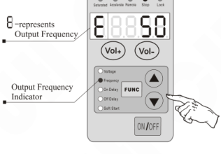

Diagram labels:

- E—represents Output Frequency
- Output Frequency Indicator

> ● Harmonic frequency of the vibrator means the frequency value that creates the maximum amplitude.
>
> ● Every vibrator has its natural mechanical resonance frequency, adjust the output frequency of the controller to this frequency to guarantee the best working condition.

---

2018-11　　　　　　　　　　　　　- 5 -　　　　　　　　　　　　　SDVC31SMSEN_3.01

### 第 14 页

Variable Frequency Digital Controller for Vibratory Feeder                                      **SDVC31 Series**

---

## Step Seven:

After setting the Output Frequency of the controller to the natural mechanical resonance frequency of the vibrator, adjust the Output Voltage of the controller by pressing the **Vol+** or **Vol-** button to change feeding speed.

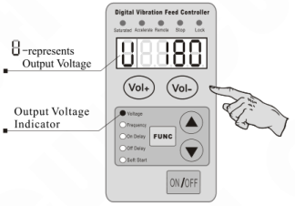

After the above seven steps, the controller can work properly. Please refer to the other chapters if advanced control functions are needed.

---

2018-11                                      - 6 -                                      SDVC31SMSEN_3.01

### 第 15 页

Variable Frequency Digital Controller for Vibratory Feeder  **SDVC31 Series**

# Chapter III Components Description

## 3.1 Descriptions of the Control Panel

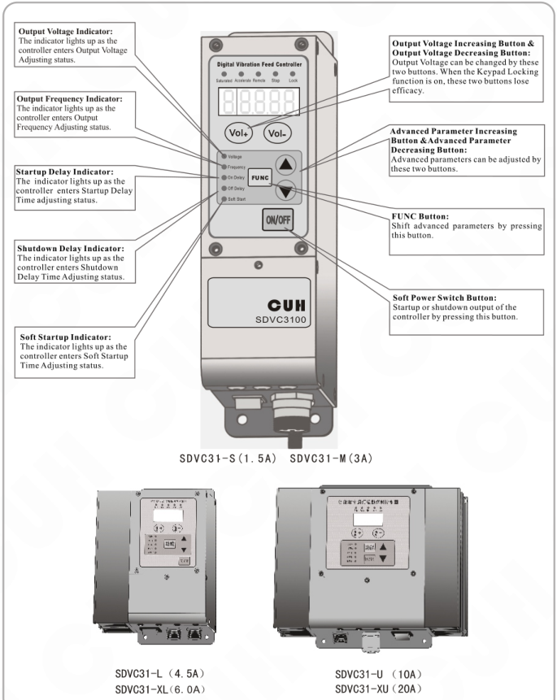

### Control panel indicators and buttons

| Item | Description |
|---|---|
| Output Voltage Indicator | The indicator lights up as the controller enters Output Voltage Adjusting status. |
| Output Frequency Indicator | The indicator lights up as the controller enters Output Frequency Adjusting status. |
| Startup Delay Indicator | The indicator lights up as the controller enters Startup Delay Time adjusting status. |
| Shutdown Delay Indicator | The indicator lights up as the controller enters Shutdown Delay Time Adjusting status. |
| Soft Startup Indicator | The indicator lights up as the controller enters Soft Startup Time Adjusting status. |
| Output Voltage Increasing Button & Output Voltage Decreasing Button | Output Voltage can be changed by these two buttons. When the Keypad Locking function is on, these two buttons lose efficacy. |
| Advanced Parameter Increasing Button &Advanced Parameter Decreasing Button | Advanced parameters can be adjusted by these two buttons. |
| FUNC Button | Shift advanced parameters by pressing this button. |
| Soft Power Switch Button | Startup or shutdown output of the controller by pressing this button. |

### Models shown

| Model | Current |
|---|---:|
| SDVC31-S | 1.5A |
| SDVC31-M | 3A |
| SDVC31-L | 4.5A |
| SDVC31-XL | 6.0A |
| SDVC31-U | 10A |
| SDVC31-XU | 20A |

---

2018-11  - 7 -  SDVC31SMSEN_3.01

### 第 16 页

Variable Frequency Digital Controller for Vibratory Feeder  
**SDVC31 Series**

---

## 3.2 Descriptions of the Status Indicators

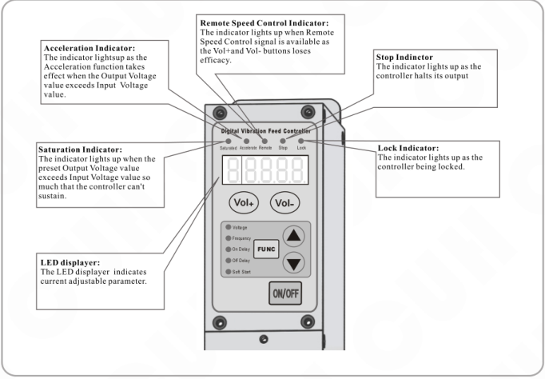

- **Acceleration Indicator:** The indicator lights up as the Acceleration function takes effect when the Output Voltage value exceeds Input Voltage value.
- **Remote Speed Control Indicator:** The indicator lights up when Remote Speed Control signal is available as the Vol+and Vol- buttons loses efficacy.
- **Stop Indicator:** The indicator lights up as the controller halts its output.
- **Saturation Indicator:** The indicator lights up when the preset Output Voltage value exceeds Input Voltage value so much that the controller can't sustain.
- **Lock Indicator:** The indicator lights up as the controller being locked.
- **LED displayer:** The LED displayer indicates current adjustable parameter.

## 3.3 I/O Interface Descriptions

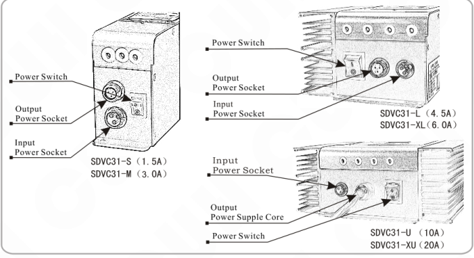

- **SDVC31-S（1.5A） / SDVC31-M（3.0A）**
  - Power Switch
  - Output Power Socket
  - Input Power Socket
- **SDVC31-L（4.5A） / SDVC31-XL（6.0A）**
  - Power Switch
  - Output Power Socket
  - Input Power Socket
- **SDVC31-U（10A） / SDVC31-XU（20A）**
  - Input Power Socket
  - Output Power Supple Core
  - Power Switch

---

2018-11　　　　- 8 -　　　　SDVC31SMSEN_3.01

### 第 17 页

*Variable Frequency Digital Controller for Vibratory Feeder*　　　　　　　　　　　　　　　　　　　**SDVC31 Series**

# Chapter IV Function Descriptions

## 4.1 Output Voltage Setting

The Output Voltage can be set directly and digitally through the control panel. Benefit from the unique Voltage Stabilizing Function, Output Voltage of the controller won't fluctuate as the Input Voltage does,and a vibrator can work stably in unstable input voltage environment.

- Turn on the power switch

- The Output Voltage Indicator lights up as the controller enters Output Voltage Adjusting status when the LED displays the voltage symbol U and the previously set voltage value.

- Adjust the Output Voltage value by pressing the <kbd>Vol+</kbd> or <kbd>Vol-</kbd> button.

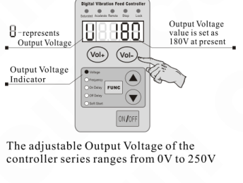

- U — represents Output Voltage
- Output Voltage Indicator
- Output Voltage value is set as 180V at present
- The adjustable Output Voltage of the controller series ranges from 0V to 250V

> Output Voltage can be adjusted in any Basic Parameter Adjusting status or Advanced Parameter Adjusting status by pressing the <kbd>Vol+</kbd> or <kbd>Vol-</kbd> button. The controller returns to the previous parameter adjusting status after adjusting the Output Voltage.

## ☺ Acceleration

When desired Output Voltage value exceeds Input Voltage value, the Acceleration function of the controller works as the Acceleration Indicator lights up.

When desired Output Voltage value exceeds too much of the Input Voltage value, the controller fails to output such voltage value as the Saturation Indicator lights up.

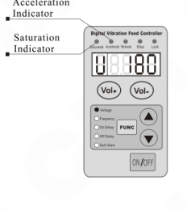

- Acceleration Indicator
- Saturation Indicator

---

2018-11　　　　　　　　　　　　　　　　　- 9 -　　　　　　　　　　　　　　　　　SDVC31SMSEN_3.01

### 第 18 页

Variable Frequency Digital Controller for Vibratory Feeder　　　　　　　　　　　　　　　　　　　　　　　　　**SDVC31 Series**

---

## 4.2 Output Frequency Adjusting

The controller is produced with the DDS technology and its output has got high frequency accuracy and stability which doesn't change as the time or temperature does.

- Press the <kbd>FUNC</kbd> button and hold for 2 seconds to enter the Basic Parameters Adjusting status.

- The Frequency Indicator on the panel lights up and the LED displays the Output Frequency symbol **E** and the current Output Frequency value.

- Press the ▲ or ▼ button to adjust the parameter value.

Output Frequency of the controller ranges from 40Hz to 400Hz.

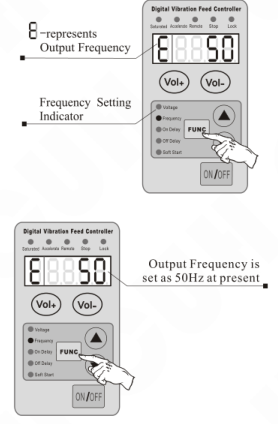

**Figure callouts:**

- **E** — represents Output Frequency
- Frequency Setting Indicator
- Output Frequency is set as 50Hz at present

> ☺
>
> ● Output Frequency (E), Startup Delay Time, Shutdown Delay Time and Soft Startup Time can be set after entering the Basic Parameters Adjusting status by pressing the <kbd>FUNC</kbd> button and holding for 2 seconds.
>
> ● The controller will return to the Output Voltage Adjusting status automatically in 1 minute after adjusting operation.
>
> ● Press the <kbd>FUNC</kbd> button and hold for 2 seconds again to exit the Basic Parameters Adjusting status.

---

2018-11　　　　　　　　　　　　　　　　　　- 10 -　　　　　　　　　　　　　　　　　　SDVC31SMSEN_3.01

### 第 19 页

Variable Frequency Digital Controller for Vibratory Feeder　　　　　　　　　　　　　　　　　　　　　**SDVC31 Series**

## 4.3 Soft Startup

In order to avoid sudden shock to the work pieces, the controller can gently increase Output Voltage from 0 to the pre-set value when startup.

Soft Startup Time ( t ): The period of time it takes for the controller to gently increase Output Voltage from 0 to the pre-set value when startup.

» Press the **FUNC** button and hold for 2 seconds to enter the Basic Parameters Adjusting status.

» Press the **FUNC** button repeatedly until shifting to the Soft Startup Time adjusting status (t) as the Soft Startup Indicator lights up.

» Press the ▲ or ▼ button to adjust the parameter value. The parameter unit is second, and the numerical precision is 0.1.

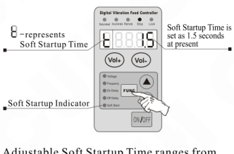

- **t** - represents Soft Startup Time
- Soft Startup Indicator
- Soft Startup Time is set as 1.5 seconds at present

Adjustable Soft Startup Time ranges from 0.1 seconds to 9.9 seconds.

## 4.4 Output Switch Button

The soft-touch switch button on the panel can turn on/off the controller's output quickly and easily.

» Press the **ON/OFF** button to turn on/off the controller's output. The Stop Indicator lights up as output of the controller is turned off.

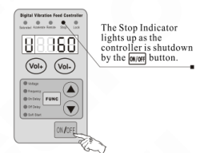

The Stop Indicator lights up as the controller is shutdown by the **ON/OFF** button.

😊

Due to the soft-touch switch and digital signal control technology, no spark will generate to spoil the contact. As a result, life-span of the controller and the vibrator will be extended greatly.

---

2018-11　　　　　　　　　　　　　　　　- 11 -　　　　　　　　　　　　　　　　SDVC31SMSEN_3.01

### 第 20 页

Variable Frequency Digital Controller for Vibratory Feeder  
**SDVC31 Series**

## 4.5 Maximum Output Voltage Restriction

Maximum Output Voltage of the controller can be set to prevent damage to the vibrator. Remote Speed Controller function is affected by this parameter.

- Press the <kbd>FUNC</kbd> and ▲ buttons simultaneously and hold for 2 seconds to enter the Advanced Parameters Adjusting status.
- Press the <kbd>FUNC</kbd> button repeatedly until shifting to the Maximum Output Voltage Restriction status (h).
- Press the ▲ or ▼ button to adjust the parameter value.

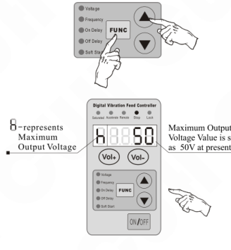

> ● Output Voltage value can not exceeds this parameter value in any case.  
> ● Default value of this parameter is set as the maximum adjustable Output Voltage value.

## Exit method of the Advanced Parameters Adjusting status

● The controller will quit to the Output Voltage Adjusting status automatically in one minute after Advanced Parameters adjusting.  
● Press the <kbd>FUNC</kbd> and ▲ buttons and hold for 2 seconds to quit to the Output Voltage Adjusting status.  
● Press the <kbd>FUNC</kbd> button and hold for 2 seconds to quit to the Basic Parameters Adjusting status.

---

2018-11　　　　　　　　　　　　　　　　　- 12 -　　　　　　　　　　　　　　　　　SDVC31SMSEN_3.01

### 第 21 页

Variable Frequency Digital Controller for Vibratory Feeder　　　　　　　　　　　　　　　　　SDVC31 Series

## 4.6 Acceleration Parameter Adjusting

Acceleration Parameter (y): This parameter means the maximum Output Voltage as percentage of the Input Voltage. The Acceleration function is affected by this parameter.

- Press the `FUNC` and ▲ buttons simultaneously and hold for 2 seconds to enter the Advanced Parameters Adjusting status
- Press the `FUNC` button repeatedly until shifting to the Acceleration Parameter Adjusting status (y).
- Press the ▲ or ▼ button to adjust the parameter value.

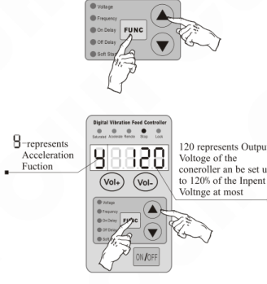

> ● Adjustable Acceleration value (y) ranges from 100 to 150, and the default value is 120.  
> ● The Saturation Indicator lights up when Output Voltage of the controller exceeds the limit.

---

2018-11　　　　　　　　　　　　　　- 13 -　　　　　　　　　　　　　　SDVC31SMSEN_3.01

### 第 22 页

Variable Frequency Digital Controller for Vibratory Feeder　　　　　　　　　　　　　　SDVC31 Series

---

## 4.7 Waveform Index Adjusting

Operators can weight peak efficiency and maximum power (minimal noise) by adjusting this parameter.

- Press the **FUNC** and **▲** buttons simultaneously and hold for 2 seconds to enter the Advanced Parameters Adjusting status.
- Press the **FUNC** button repeatedly until shifting to the Waveform Index Adjusting status (**r**).
- Press the **▲** or **▼** button to adjust the parameter value.

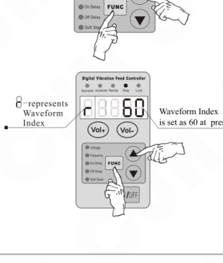

Diagram labels:

- **r** represents Waveform Index
- Waveform Index is set as **60** at present

> ☺
>
> ●Adjustable Waveform Index ranges form 0 to 100.  
> ●The value 0 represents the peak efficiency when the spring plates bear the minimal stress.  
> ●The value 100 represents the maximum power (minimal noise) when the spring plates bear the maximal stress.

---

2018-11　　　　　　　　　　　　　　　- 14 -　　　　　　　　　　　　　　　SDVC31SMSEN_3.01

### 第 23 页

Variable Frequency Digital Controller for Vibratory Feeder      SDVC31 Series

## 4.8 Keypad Locking

The Keypad Locking Function can lock all buttons on the panel to avoid misoperation.

- Press the <kbd>ON/OFF</kbd> button and hold for 2 seconds to lock all buttons on the panel as the Keypad Locking Indicator lights up.
- Press the <kbd>ON/OFF</kbd> button and hold for 2 seconds in the locking mode to unlock the keypad.

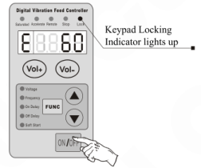

---

2018-11      - 15 -      SDVC31SMSEN_3.01

### 第 24 页

Variable Frequency Digital Controller for Vibratory Feeder  
**SDVC31 Series**

## 4.9 Default Settings Restoration

This function allows the operator to restore all default parameter settings.

Due to the abundant functions of the controller, many parameters can be adjusted. In order to avoid the circumstance that after too many times modification by a beginner, the controller can not work properly, this function allows the operator to restore default settings to the controller in an easy way.

- Press the **FUNC** and **▲** buttons simultaneously and hold for 2 seconds to enter the Advanced Parameters Adjusting status.

  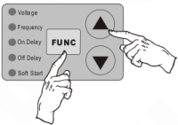

- Press the **FUNC** button repeatedly until `8888` is flashing on the LED display, and then press the **▲** button and hold until `-----` is displayed which means default settings have been restored successfully.

  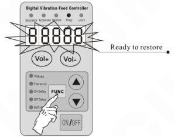

- After releasing the **▲** button, the controller enters Output Voltage Adjusting status (U). By this time, all parameters have been restored to default values.

  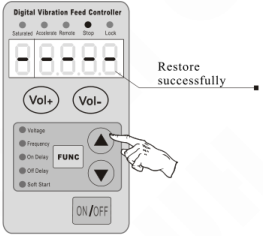

2018-11　　　　　- 16 -　　　　　SDVC31SMSEN_3.01

### 第 25 页

Variable Frequency Digital Controller for Vibratory Feeder　　　　　　　　　　　　　　　　　SDVC31 Series

# Chapter V Sensors and Signal Control

The controller can be controlled by many kinds of external signals and sensors. This chapter mainly elaborates using method of the Intelligent Photoelectric Sensor, the Proximity Switch Sensors and the PLC.

## 5.1 Intelligent Photoelectric Sensing

Combined with the SDVC-S1 Photoelectric Sensor the function of Intelligent Photoelectric Sensing can be achieved. The SDVC-S1 sensor can filter the interference of background light impacting on the sensitivity of the controller. As a result, the controller can work reliably without manual sensitivity adjustment.

### 5.1.1 Connection Method of the SDVC-S1 Intelligent Photoelectric Sensor

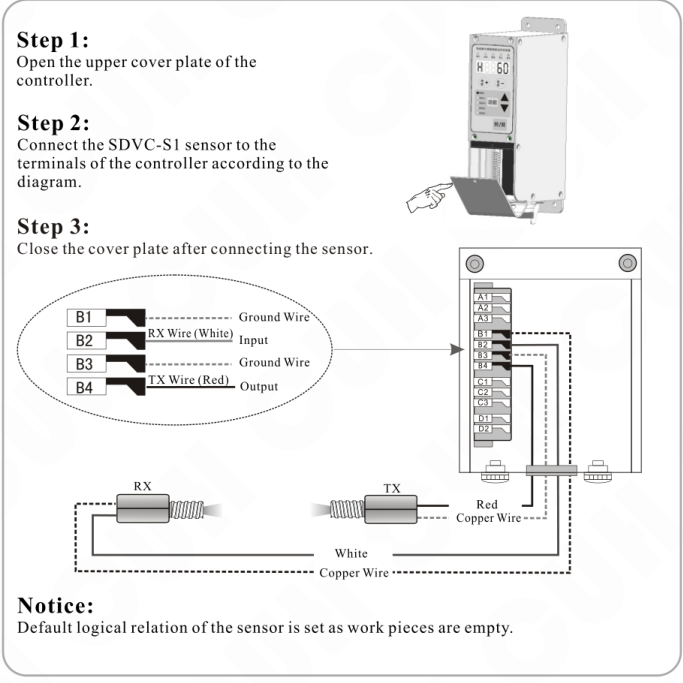

**Step 1:**  
Open the upper cover plate of the controller.

**Step 2:**  
Connect the SDVC-S1 sensor to the terminals of the controller according to the diagram.

**Step 3:**  
Close the cover plate after connecting the sensor.

**Notice:**  
Default logical relation of the sensor is set as work pieces are empty.

2018-11　　　　　　　　　　　　　　　　　- 17 -　　　　　　　　　　　　　　　　　SDVC31SMSEN_3.01

### 第 26 页

Variable Frequency Digital Controller for Vibratory Feeder　　　　　　　　　　　　　　　　　SDVC31 Series

---

## 5.1.2 Startup Delay Time and Shutdown Delay Time Settings of the Intelligent Photoelectric Sensor

In most actual applications, the output of the controller should be delayed for a period of time when Startup or Shutdown of the controller is controlled by external signals. Startup Delay Time and Shutdown Delay Time Adjusting functions made this kind of application possible. Furthermore, shocks to the work pieces as the controller starts up can be eliminated by setting Soft Startup Time.

### Startup Delay( J )

The period of time the controller goes through from receiving a startup control signal to outputting.

- Press the **FUNC** button and hold for 2 seconds to enter the Basic Parameters Adjusting status.
- Press the **FUNC** button repeatedly until shifting to the Startup Delay Time Adjusting status ( J ) as the Startup Delay Time Indicator on the panel lights up.
- Adjust the parameter by pressing the ▲ or ▼ button. The parameter unit is second, and the numerical precision is 0.1.

*Adjustable range of the parameter is from 0.0 to 9.9 seconds*  
*Default value of the parameter is 0.2 seconds*

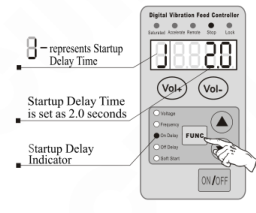

### Shutdown Delay (L)

The period of time the controller goes through from receiving a shutdown control signal to cutting off output

- Press the **FUNC** button and hold for 2 seconds to enter the Basic Parameters Adjusting status.
- Press the **FUNC** button repeatedly until shifting to the Shutdown Delay Time Adjusting status (L) as the Shutdown Delay Time Indicator on the panel lights up.
- Adjust the parameter by pressing the ▲ or ▼ button. The parameter unit is second, and the numerical precision is 0.1.

*Adjustable range of the parameter is from 0.0 to 9.9 seconds*  
*Default value of the parameter is 0.2 seconds*

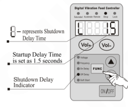

---

2018-11　　　　　　　　　　　　　　　　　- 18 -　　　　　　　　　　　　　　　　　SDVC31SMSEN_3.01

### 第 27 页

Variable Frequency Digital Controller for Vibratory Feeder  
**SDVC31 Series**

## 5.1.3 Logical Relation Setting of the Intelligent Photoelectric Sensor

Under normal circumstances, the receiving end receives no optical signal, and the controller runs by default. But in some special applications the controller needs to be stopped when the receiving end receives no optical signal. Adjusting this parameter can fulfill this kind of application.

- Press the **FUNC** and ▲ button simultaneously and hold for 2 seconds to enter the Advanced Parameters Adjusting status.

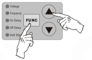

- Press the **FUNC** button repeatedly until shifting to the Logical Relation Adjusting status of the Intelligent Photoelectric Sensor.

  **08** — represents Logical Relation of the Intelligent Photoelectric Sensor  
  **Normal Open**

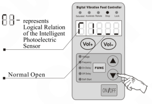

- Adjust the parameter by pressing the ▲ or ▼ button.

  **08** — represents Logical Relation of the Intelligent Photoelectric Sensor  
  **Normal Close**

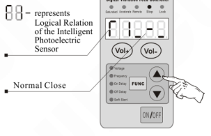

- When Logical Relation is set as Normal Open, namely no optical signal received, the controller runs.
- When Logical Relation is set as Normal Close, namely no optical signal received, the controller stops.

---

2018-11          - 19 -          SDVC31SMSEN_3.01

### 第 28 页

Variable Frequency Digital Controller for Vibratory Feeder  
**SDVC31 Series**

## 5.2 Using Method of the NPN Switch Sensor

The controller can operate with all kinds of sensors such as switch sensors, optical switch sensors and fiber optic sensors.

### 5.2.1 Connection method of the NPN Proximity Switch Sensor

**Step 1:**  
Open the upper cover plate of the controller.

**Step 2:**  
Connect the NPN Proximity Switch Sensor to the terminals of the controller according to the diagram.

**Step 3:**  
Close the cover plate after connecting the sensor.

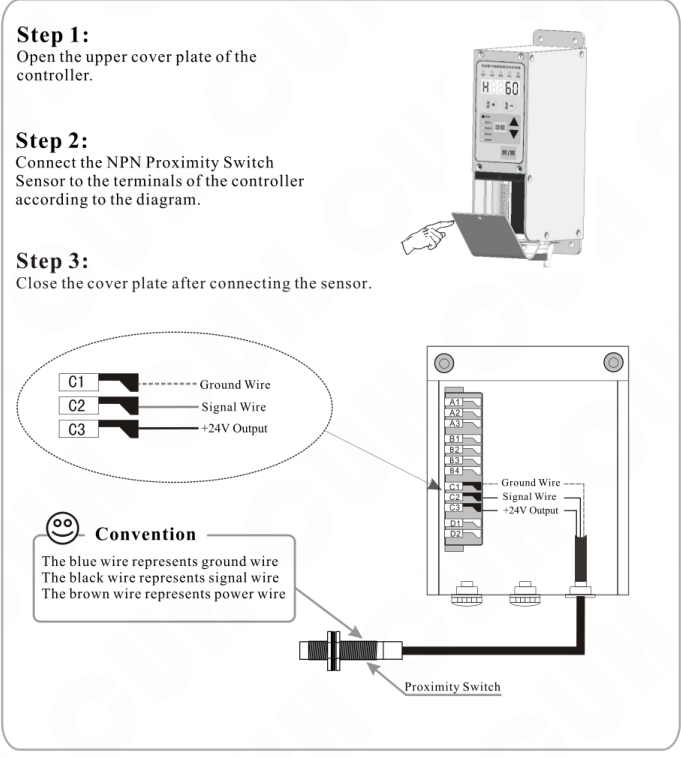

| Terminal | Wire |
|---|---|
| C1 | Ground Wire |
| C2 | Signal Wire |
| C3 | +24V Output |

**Convention**

The blue wire represents ground wire  
The black wire represents signal wire  
The brown wire represents power wire

Proximity Switch

---

2018-11 &nbsp;&nbsp;&nbsp;&nbsp; -20- &nbsp;&nbsp;&nbsp;&nbsp; SDVC31SMSEN_3.01

### 第 29 页

Variable Frequency Digital Controller for Vibratory Feeder　　　　　　　　　　　　　　　　　SDVC31 Series

---

### 5.2.2 Connection method of the NPN Counter-radiation Switch Sensor

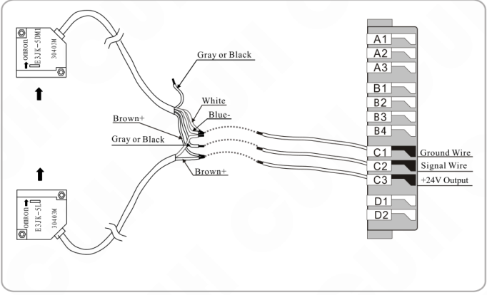

### 5.2.3 Connection method of the Photoelectric Counter-radiation Sensor

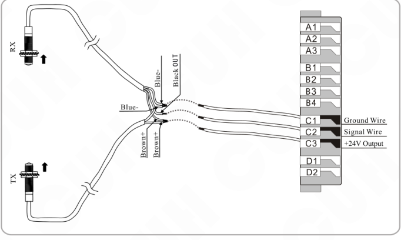

---

2018-11　　　　　　　　　　　　　　　　- 21 -　　　　　　　　　　　　　　　　SDVC31SMSEN_3.01

### 第 30 页

Variable Frequency Digital Controller for Vibratory Feeder                                                             SDVC31 Series

## 5.2.4 Connection method of the Optical Fiber Counter-radiation Sensor

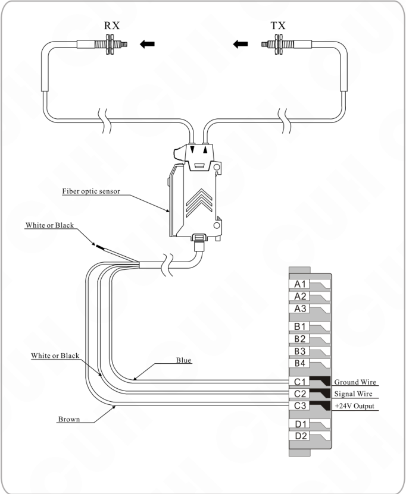

Diagram labels shown include: **RX**, **TX**, **Fiber optic sensor**, **White or Black**, **Blue**, **Brown**.

Terminal annotations shown:

| Terminal | Annotation |
|---|---|
| C1 | Ground Wire |
| C2 | Signal Wire |
| C3 | +24V Output |

2018-11                                                             -22-                                                             SDVC31SMSEN_3.01

### 第 31 页

Variable Frequency Digital Controller for Vibratory Feeder  
**SDVC31 Series**

---

## 5.2.5 Connection method of the Photoelectric Reflection Sensor

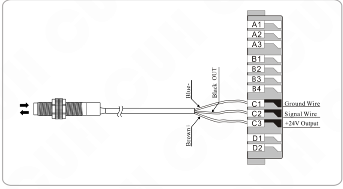

---

2018-11  
-23-  
SDVC31SMSEN_3.01

### 第 32 页

**Variable Frequency Digital Controller for Vibratory Feeder**　　　　　　　　　　　　　　　　　　　　　　　　　**SDVC31 Series**

---

## 5.3 Startup Delay Time and Shutdown Delay Time Settings of the NPN Switch Sensor

By default, Intelligent Photoelectric Sensor and Switch Sensor share the same Startup Delay Time and Shutdown Delay Time. Operators can also set Startup Delay Time and Shutdown Delay Time independently for the Switch Sensor.

### Startup Delay (J-)

The period of time the controller goes through from receiving a startup control signal to outputting.

- Press the **FUNC** and ▲ buttons simultaneously and hold for 2 seconds to enter the Advanced Parameters Adjusting status.
- Press the **FUNC** button repeatedly until shifting to the Startup Delay Time Adjusting status (`J---`) as the Startup Delay Time Indicator on the panel lights up.
- Adjust the parameter by pressing the ▲ or ▼ button. The parameter unit is second, and the numerical precision is 0.1.

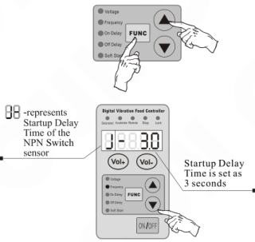

Startup Delay is set as `J---` by default

### Shutdown Delay (L-)

The period of time the controller goes through from receiving a shutdown control signal to cutting off output.

- Press the **FUNC** and ▲ buttons simultaneously and hold for 2 seconds to enter the Advanced Parameters Adjusting status.
- Press the **FUNC** button repeatedly until shifting to the Shutdown Delay Time Adjusting status (`L-`) as the Shutdown Delay Time Indicator on the panel lights up.
- Adjust the parameter by pressing the ▲ or ▼ button. The parameter unit is second, and the numerical precision is 0.1.

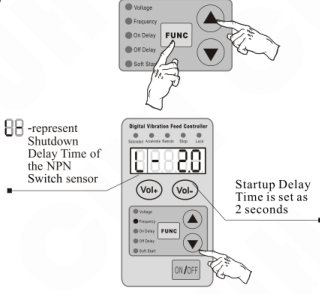

Shutdown Delay is set as `L----` by default

> ➜ When `J-` and `L-` values are adjusted to 0, Startup Delay Time and Shutdown Delay Time of the Switch Sensor will be the same with Startup Delay Time and Shutdown Delay Time of the Intelligent Photoelectric Sensor.  
> ➜ Startup Delay Time and Shutdown Delay Time of the Intelligent Photoelectric Sensor will not affected by the parameter of `J-` or `L-`.

---

2018-11　　　　　　　　　　　　　　　　　- 24 -　　　　　　　　　　　　　　　　　SDVC31SMSEN_3.01

### 第 33 页

Variable Frequency Digital Controller for Vibratory Feeder　　　　　　　　　　　　　　　　　　　　**SDVC31 Series**

---

## 5.4 Logical Relation Setting of the NPN Switch Sensor (Halt when work-pieces are full)

Under normal circumstances, the controller receives no signal from the NPN Switch Sensor and runs by default. But in some special applications the controller needs to be stopped when receives no signal from the NPN Switch Sensor. Adjusting this parameter can fulfill this kind of application.

▶▶ Press the <kbd>FUNC</kbd> and ▲ buttons simultaneously and hold for 2 seconds to enter the Advanced Parameters Adjusting status.

▶▶ Press the <kbd>FUNC</kbd> button repeatedly until shifting to the Logical Relation Adjusting status of the NPN Switch Sensor (`F2`).

▶▶ Adjust the parameter by pressing the ▲ or ▼ button.

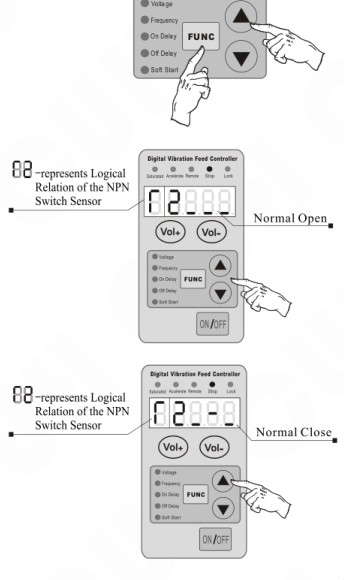

`F2`—represents Logical Relation of the NPN Switch Sensor.

- Normal Open
- Normal Close

> ●When Logical Relation is set as Normal Open, namely no signal received, the controller runs.  
> ●When Logical Relation is set as Normal Close, namely no signal received, the controller stops.

---

2018-11　　　　　　　　　　　　　　　　　　　　-25-　　　　　　　　　　　　　　　　　　　　SDVC31SMSEN_3.01

### 第 34 页

Variable Frequency Digital Controller for Vibratory Feeder　　　　　　　　　　　　　　**SDVC31 Series**

## 5.5 Logical Relation Setting of the Control Signal

The controller can set the Logical Relation of the Intelligent Photoelectric Sensor and the Switch Sensor when they work simultaneously.

▶ Press the **FUNC** and ▲ buttons simultaneously and hold for 2 seconds to enter the Advanced Parameters Adjusting status.

▶ Press the **FUNC** button repeatedly until shifting to the Logical Relation Adjusting status of the Control Signal

▶ Adjust the parameter by pressing the ▲ or ▼ button.

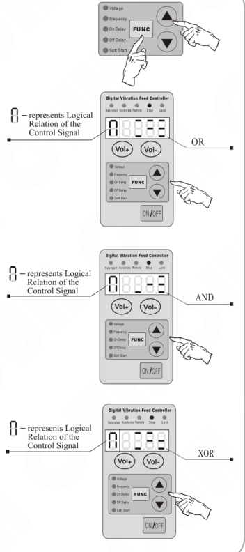

Ⅰ

●Logical relation AND: The controller runs only when both the Intelligent Photoelectric Sensor and the NPN Switch Sensor ask the controller to.

●Logical relation OR: The controller runs when the Intelligent Photoelectric Sensor or the NPN Switch Sensor asks the controller to.

●Logical relation NOR: The controller runs only when the Intelligent Photoelectric Sensor and the NPN Switch Sensor output the opposite control signal.

---

2018-11　　　　　　　　　　　　　　-26-　　　　　　　　　　　　　　SDVC31SMSEN_3.01

### 第 35 页

_Variable Frequency Digital Controller for Vibratory Feeder_  		**SDVC31 Series**

## 5.6 Connection Method of the Upper PLC which Controls the Vibratory Feeder Controller

### 5.6.1 Connection method of the controlling PLC

**Step One:**  
Open the upper cover plate of the controller.

**Step Two:**  
Connect the PLC to the terminals of the controller according to the diagram.

**Step Three:**  
Close the cover plate after connecting the sensor.

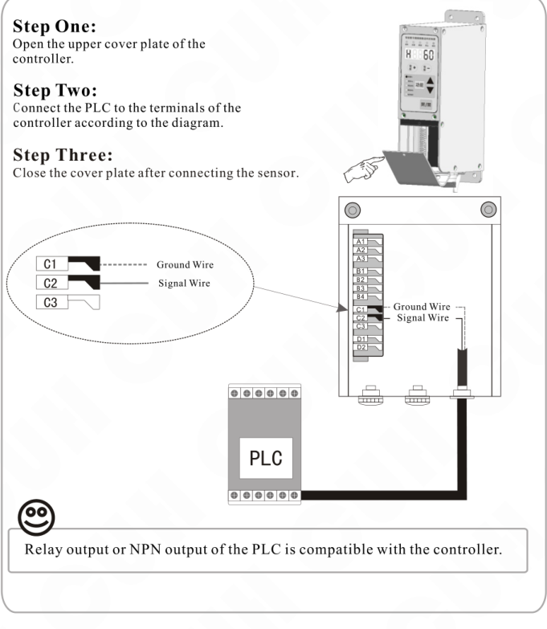

Relay output or NPN output of the PLC is compatible with the controller.

---

2018-11  		-27-  		SDVC31SMSEN_3.01

### 第 36 页

Variable Frequency Digital Controller for Vibratory Feeder                                        **SDVC31 Series**

---

## 5.7 Controlling Output

The controller can output low-voltage controlling signal to cooperate with other devices such as a solenoid valve, a PLC or an electrical relay.

### 5.7.1 Connection method of the Controlling Output

**Connection method of the solenoid valve**

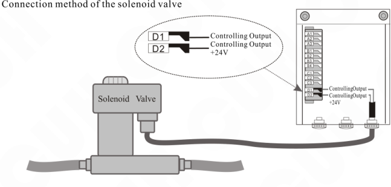

●The controller can directly drive a solenoid valve whose rated voltage is 24V and rated power lower than 4W.  
●Use external power supply for high power solenoid valve.

**Connection method of the electrical relay**

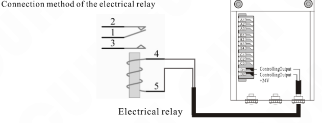

●The controller can directly drive an electrical relay whose rated voltage is 24V and rated power lower than 4W.

---

2018-11                                        -28-                                        SDVC31SMSEN_3.01

### 第 37 页

Variable Frequency Digital Controller for Vibratory Feeder　　　　　　　　　　　　　**SDVC31 Series**

## 5.7.2 Logical Relation Setting of the Controlling Output

- Press the **FUNC** and **▲** buttons simultaneously and hold for 2 seconds to enter the Advanced Parameters Adjusting status.

- Press the **FUNC** button repeatedly until shifting to the Logical Relation Adjusting status of the Controlling Output (F3).

- Adjust the parameter by pressing the **▲** or **▼** button.

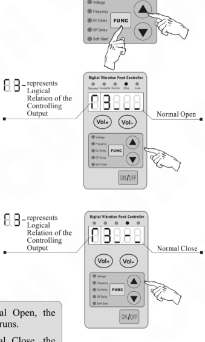

> ● When Logical Relation is set as Normal Open, the Controlling Output works as the controller runs.  
> ● When Logical Relation is set as Normal Close, the Controlling Output doesn't work as the controller runs.

---

2018-11　　　　　　　　　　　　　　　-29-　　　　　　　　　　　　　　　SDVC31SMSEN_3.01

### 第 38 页

Variable Frequency Digital Controller for Vibratory Feeder　　　　　　　　　　　　　　　　　SDVC31 Series

---

## 5.8 Remote Speed Control

The function of Remote Speed Control allows the operator to control the Output Voltage by an external potentiometer or a control signal ranging from 1V to 5V. Thus, external remote speed control can be easily achieved by a PLC, a DCS or some other means.

Remote Speed Control function becomes effective to the controller when the controlling signal exceeds 0.5V. Meanwhile, Remote Speed Control indicator on the panel lights up and the `Vol+` and `Vol-` buttons lose effectiveness. The LED displayer shows current Output Voltage if the controller is running in the Output Voltage Adjusting status.

### Connection method of the external potentiometer

- A1: Ground Wire of the Remote Speed Control
- A2: Remote Speed Control Input
- A3: Remote Speed Control Power Supply

**Note:** Please select linearity potentiometer with the resistance of 1k.

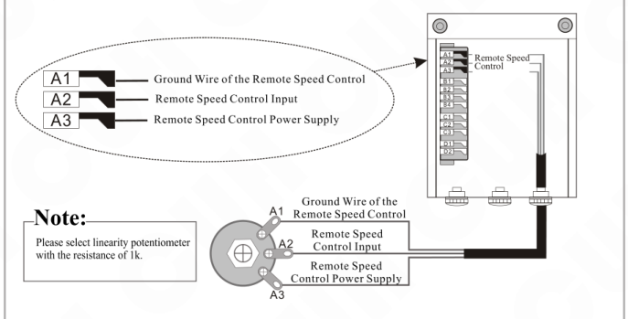

### Connection method of the PLC

- A1: Ground Wire of the Remote Speed Control
- A2: Remote Speed Control Input
- A3

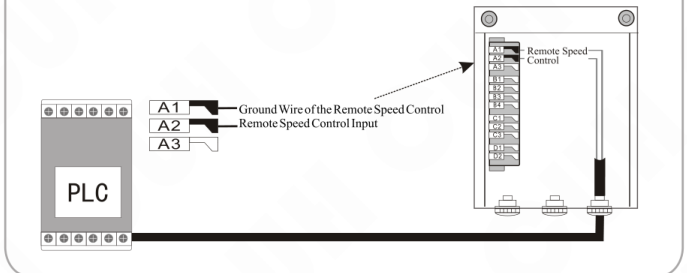

---

2018-11　　　　　　　　　　　　　　-30-　　　　　　　　　　　　　　SDVC31SMSEN_3.01

### 第 39 页

Variable Frequency Digital Controller for Vibratory Feeder  
**SDVC31 Series**

---

# Chapter VI Security Functions

## 6.1 Automatic Voltage Stabilizing

The built-in Digital Voltage Stabilizing function can eliminate feeding speed variation caused by mains voltage fluctuation.

## 6.2 Short-Circuit Protection

If output of the controller is short-circuited, the controller will halt its output until restarted.

## 6.3 Current Overload Protection

The controller will halt its output to ensure equipments' operating safety when operation current exceeds its rated value.

## 6.4 Overheat Protection

The controller will halt its output to protect itself when operation temperature is too high.

---

2018-11&nbsp;&nbsp;&nbsp;&nbsp;&nbsp;&nbsp;&nbsp;&nbsp;&nbsp;&nbsp;&nbsp;&nbsp;-31-&nbsp;&nbsp;&nbsp;&nbsp;&nbsp;&nbsp;&nbsp;&nbsp;&nbsp;&nbsp;&nbsp;&nbsp;SDVC31SMSEN_3.01

### 第 40 页

Variable Frequency Digital Controller for Vibratory Feeder                                             SDVC31 Series

---

# Appendix

## Appendix A: Dimensions

Outline Dimensions of the controller model: SDVC31-S and SDVC31-M (unit: mm)

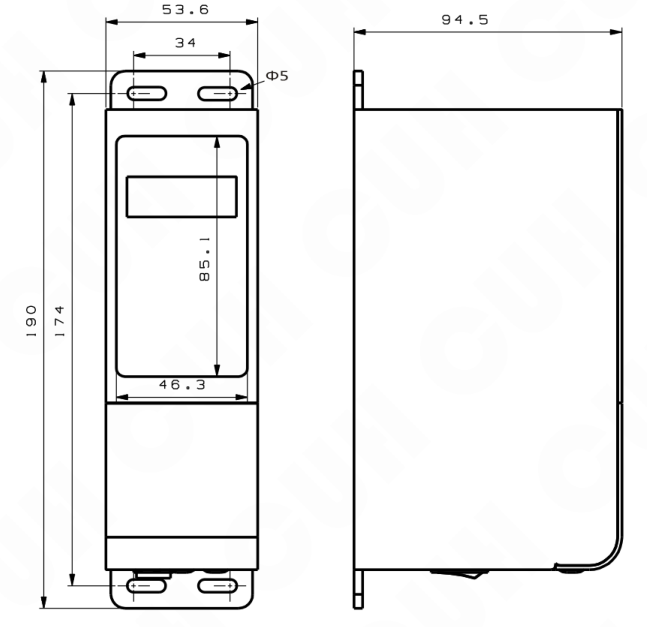

---

2018-11                                     -32-                                     SDVC31SMSEN_3.01

### 第 41 页

Variable Frequency Digital Controller for Vibratory Feeder　　　　　　　　　　　　　　　**SDVC31 Series**

Outline Dimensions of the controller model: SDVC31-L and SDVC31-XL (unit: mm)

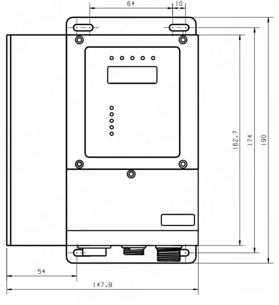

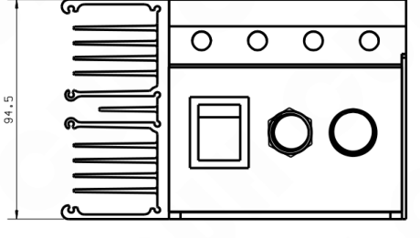

2018-11　　　　　　　　　　　　　　-33-　　　　　　　　　　　　　　SDVC31SMSEN_3.01

### 第 42 页

_Variable Frequency Digital Controller for Vibratory Feeder_  
**SDVC31 Series**

---

Outline Dimensions of the controller model: SDVC31-U and SDVC31-XU (unit:mm)

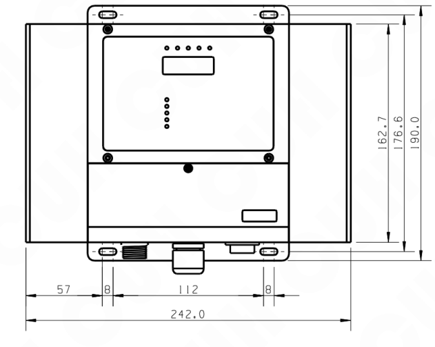

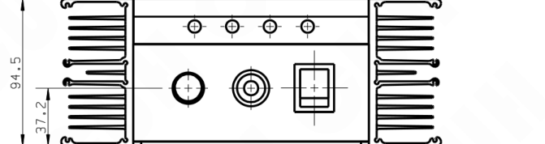

---

2018-11　　　　　　　　　　　　　-34-　　　　　　　　　　　　　SDVC31SMSEN_3.01

### 第 43 页

Variable Frequency Digital Controller for Vibratory Feeder                                        **SDVC31 Series**

---

## Appendix B: Output Interface Definition

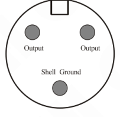

### ☺ Notice:

**A:** Make sure the electromagnetic coils of the vibrator is connected to the two output pins of the Output Power Cable socket and the shell of the vibrator is reliably earthed, otherwise series security incident may occur.

**B:** After welding, make sure the blank area is enswathe by insulating tape or heat-shrinkable tube before insert it into the Output Power Cable socket to avoid electrical leakage or short-circuit.

## Appendix C: Signal Interface Definition

| Terminal | Definition |
|---|---|
| A1 | Ground Wire of the Remote Speed Control |
| A2 | Remote Speed Control Input |
| A3 | Remote Speed Control Power Supply |
| B1 | Ground |
| B2 | Intelligent Photoelectric Sensor Signal In |
| B3 | Ground |
| B4 | Intelligent Photoelectric Sensor Signal Out |
| C1 | +24V GND |
| C2 | NPN Switch Sensor Signal In |
| C3 | +24V |
| D1 | Controlling Output |
| D2 | +24V |

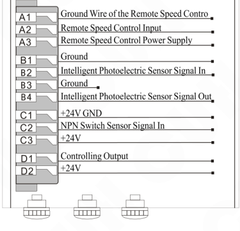

---

2018-11                                        -35-                                        SDVC31SMSEN_3.01

### 第 44 页

Variable Frequency Digital Controller for Vibratory Feeder  
**SDVC31 Series**

## **Appendix D:** LED Displayed Characters Definition

| Controller | Displayed Character | 数码管符号图片 |
|---|---|---|
| `U` | Output Voltage | 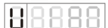 |
| `F` | Output Frequency |  |
| `d` | Startup Delay Time of the Intelligent Photoelectric Sensor |  |
| `C` | Shutdown Delay Time of the Intelligent Photoelectric Sensor |  |
| `E` | Soft Startup |  |
| `U-` | Shutdown D |  |
| `d-` | Startup Delay Time of the NPN Switch Sensor |  |
| `r1` | Logical Relation of the Intelligent Photoelectric Sensor |  |
| `r2` | Logical Relation of the NPN Switch Sensor |  |
| `r3` | Logical Relation of the Controlling Output |  |
| `n` | Logical relation of the Control Signal |  |
| `H` | Maximum Output Voltage |  |
| `A` | Acceleration Index |  |
| `P` | Waveform Index |  |
| `88888` | Default Settings Restore |  |

---

2018-11  -36-  SDVC31SMSEN_3.01

### 第 45 页

Variable Frequency Digital Controller for Vibratory Feeder                                                     SDVC31 Series

## Appendix E: Electrical Specification

| Item | Range Min | Range Typical | Range Max | Unit | Description |
|---|---:|---:|---:|:---:|---|
| Input Voltage | 85 | 220 | 250 | V | AC RMS |
| Adjustable Output Voltage Range | 0 | —— | 250 | V | Lower than 150% of Input Voltage |
| Voltage Adjustment Accuracy |  | 1 |  | V |  |
| Voltage Regulation Accuracy | 0 | —— | 10 | % | ΔVout/ΔVin |
| Response Time of Voltage Regulation | 0.0025 | —— | 0.025 | s | 1/10 of the period of output voltage |
| Adjustable Output Current Range | 0 | —— | 1.5 | A | SDVC31-S |
|  | 0 | —— | 3 | A | SDVC31-M |
|  | 0 | —— | 4.5 | A | SDVC31-L |
|  | 0 | —— | 6 | A | SDVC31-XL |
|  | 0 | —— | 10 | A | SDVC31-U |
|  | 0 | —— | 20 | A | SDVC31-XU |
| Output Power | 0 | —— | 330 | VA | SDVC31-S |
|  | 0 | —— | 660 | VA | SDVC31-M |
|  | 0 | —— | 990 | VA | SDVC31-L |
|  | 0 | —— | 1320 | VA | SDVC31-XL |
|  | 0 | —— | 2200 | VA | SDVC31-U |
|  | 0 | —— | 4400 | VA | SDVC31-XU |
| Output Frequency | 40 | —— | 400 | Hz |  |
| Frequency Adjustment Accuracy |  | 0.1 |  | Hz |  |
| Output Waveform |  | sine |  |  |  |
| Soft Start Time | 0 | —— | 10 | s | Factory Default Value:0.5 |
| On/Off Delay Time Range | 0 | —— | 20 | s | Factory Default Value:0.2 |
| On/Off Delay Time Accuracy |  | 0.1 |  | s |  |
| Overheat Protection Trigger Temperature | 58 | 60 | 66 | ℃ | SDVC31-S\M |
|  | 60 | 65 | 65 | ℃ | SDVC31-L\XL\U\XU |
| DC Control Output Voltage | 22 | 24 | 26 | V |  |
| DC Control Output Current | 0 | —— | 200 | mA |  |
| Analog Control Signal |  | 1-5 |  | V | Remote speed Control Voltage |
| Digital Control Signal |  | 24 |  | V | Switching Signal |
| Adjustment Method |  | 6 |  | Button |  |
| Standby Power Consumption | —— | 3 | —— | W |  |
| Display Method |  | 5 |  | Digit | LED Digital Tubes |
| Ambient Temperature | 0 | 25 | 40 | ℃ | No Condensation |
| Ambient Humidity | 10 | 60 | 85 | % |  |

2018-11                                                                 -37-                                                                 SDVC31SMSEN_3.01

### 第 46 页

Variable Frequency Digital Controller for Vibratory Feeder  **SDVC31 Series**

## Appendix F: Trouble Shooting Tips and Error Explanations

The following tips can help to solve the problems you may encounter

| No. | Problem / display | 数码管符号图片 | Trouble Shooting Tips and Error Explanations |
|---:|---|---|---|
| 1 | No display after power on |  | ◆ Make sure the power outlet is live ◆ Make sure the Input Power Cable is reliably connected to the power outlet |
| 2 | Displays normally but no output |  | ◆ Make sure the Input Power Cable and Output Power Cable are firmly connected ◆ Make sure the Output Voltage parameter value is not too small ◆ Make sure the controller is not stopped by the control signal ◆ Make sure the controller is not stopped by the parameters that are set as normal off |
| 3 | Control signal loses effectiveness |  | ◆ Make sure the control signal is correctly inputted ◆ Make sure the ground wire of the control signal is correctly connected to the controller ◆ Make sure the Logical Relation of the control signal is set correctly as you expectation |
| 4 | Beat phenomena |  | ◆ Avoid vibration coupling among the vibrators ◆ Heighten the resonant frequency of the vibrators |
| 5 | Displays normally, no output, but sound can be heard |  | ◆ Adjust all parameters as this book instructed |
| 6 | Err01 |  | ◆ Output in short-circuit, Make sure the Output Power Cable and the coil are not shorted out |
| 7 | Err02 |  | ◆ Output Over current, Reduce the Output Voltage value and make sure the armature gap is not too big |
| 8 | Err03 |  | ◆ Overheat, Place the controller in well ventilated environment |
| 9 | Err04 |  | ◆ Reserved, please contact us |
| 10 | Err05 |  | ◆ Reserved, please contact us |

2018-11  -38-  SDVC31SMSEN_3.01

### 第 47 页

*（本页 `page_markdown` 为空。）*

### 第 48 页

**Nanjing CUH Science & Technology Co., Ltd**

No. 1 Xiaodong Road, Chenguang Village, Qilin, Nanjing, Jiangsu, China  
Tel: +86-25-84730415  
Fax: +86-25-84730426  
Email: sales@cuhnj.com  
Website: en.cuhnj.com
<!-- /auto:ai-body-draft v1 -->

<!-- auto:data-params-summary v1 -->
## 附录 · 参数表（结构化侧车·机器生成）

> 说明：本节由 `data/<doc_key>/params/params.yaml` 自动渲染（展示前若干行），用于校对与二次开发。定稿以层 C 数据为准。

| 参数 | 标志/符号 | 范围 | 默认 | 单位 | 备注 |
| --- | --- | --- | --- | --- | --- |
|     |  |  |  |  |  |
|       |  |  |  |  |  |
|   H    |  |  |  |  |  |
| U    |  |  |  |  |  |
|     |  |  |  |  |  |
|       |  |  |  |  |  |
|       |  |  |  |  |  |
|   C    |  |  |  |  |  |
|     |  |  |  |  |  |
|     |  |  |  |  |  |
|     |  |  |  |  |  |
|   U  |  |  |  |  |  |
|   |  |  |  |  |  |
|   |  |  |  |  |  |
|      Ite m |  |  |  |  |  |
|      Ite m |  |  |  |  |  |
|      Input Voltage |  |  |  |  |  |
|      A d ju s ta b le O utput Vo ltage  R ange |  |  |  |  |  |
|      V o lta g e  Ad justm ent A c c uracy |  |  |  |  |  |
|      V o lta g e  Reg u latio n A c c uracy |  |  |  |  |  |
|        Res po nse  T im e of V o ltag e  Reg u latio n |  |  |  |  |  |
|   H     A d ju s ta b le O utput C u rre nt Ran ge |  |  |  |  |  |
|   H     A d ju s ta b le O utput C u rre nt Ran ge |  |  |  |  |  |
|   H     A d ju s ta b le O utput C u rre nt Ran ge |  |  |  |  |  |
|   H     A d ju s ta b le O utput C u rre nt Ran ge |  |  |  |  |  |
|   H     A d ju s ta b le O utput C u rre nt Ran ge |  |  |  |  |  |
|   H     A d ju s ta b le O utput C u rre nt Ran ge |  |  |  |  |  |
| CU       O utput Pow er |  |  |  |  |  |
| CU       O utput Pow er |  |  |  |  |  |
| CU       O utput Pow er |  |  |  |  |  |

*（仅展示前 30 条，共 58 条；完整数据见下方链接。）*

- 完整 YAML：`data/cuh.sdvc.manual.v0.0/params/params.yaml`
- 表格索引：`data/cuh.sdvc.manual.v0.0/index.yaml`
<!-- /auto:data-params-summary v1 -->
