## Dual Channel Digital Variable Frequency Vibratory Feeder Controller

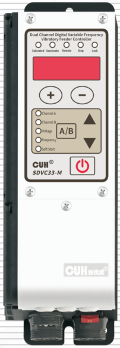

## SDVC33-Series
Dual Channel Digital Variable Frequency Vibratory Feeder Controller　SDVC33 Series
## User Manual

---

## Copyright Statement

Nanjing CUH Science & Technology CO., Ltd. all rights reserved.

All information contained in this user manual is the knowledge of our company and is protected by copyright law and all other laws. CUH enjoys and reserves all copyrights and other legal rights under the copyright Law and other laws Without the written consent of CUH, no part or all of this user manual may be copied, translated, or otherwise exploited in any form.

## Disclaimer

All contents of this user manual only describe the use method of related products produced by our company, and are described according to the existing technology and the state provided to you when you use it. You must bear the relevant risks when you use this product. Except as required by law, the company does not have any express or implied responsibility for the product due to this user manual, including but not limited to personal injury, property damage, loss of opportunity, etc.

You clearly understand the above risks and agree that, except as mandated by law, the company is not responsible for any direct or indirect damage or loss to you (including but not limited to tangible loss of personnel, property, data, etc. and intangible loss of reputation, opportunity, etc.)

The company reserves the right to modify the products applicable in this user manual without prior or subsequent notice.

---

## Preface

Thank you for choosing CUH SDVC33 series dual-channel Digital Variable Frequency Vibratory Feeder Controller. (The controller for short in the following text). This series of controllers uses high-quality components and incorporates the latest electronic technology, and is carefully designed with high-performance digital signal processors.

This instruction book includes notes for installing, debugging, parameter setting, maintenance and troubleshooting of the controller. Please read this instruction book carefully before operating the controller and keep it properly.

The following symbols draw your attention to the prevention of personal injury and product damage, please be sure to read.

| Symbol | Description |
|---|---|
| ⚠ Danger | Non-observance of this item will result in personal injury or death. |
| ⚠ Warn | Non-observance of this item may result in personal injury or death. |
| ⚠ Careful | Non-observance of this item may result in moderate or minor injury to persons. |
| Notice | Non-observance of this item will result in damage to the product and property damage. |
| ❗ Essential | Indicates precautions and usage restrictions that must be observed during use. |

**This instruction book applies to the following model**

- SDVC33-M ( two-channel combined current up to 3.5A )

---

# Safety and Precautions

1. **⚠ Danger** This product is only used to drive electromagnet-based vibratory feeding equipment, do not use this product for the purpose of protecting the human body or parts of the human body, etc.

2. **⚠ Danger** This product is not intended to be used as an explosion-proof product, do not use it in hazardous locations and/or potentially explosive gas environment.

3. **⚠ Warn** This product is powered by AC mains, please do not apply AC voltage exceeding 260Vac. Excessive input voltage, such as 380Vac, may cause the product to explode or catch fire, resulting in serious safety accidents.

4. **⚠ Warn** This product is grounded through the power cord. Please ensure that the power distribution facilities for the controller are well grounded, otherwise the controller shell may be charged, resulting in an electric shock accident.

5. **⚠ Warn** Do not input AC power to the output of this controller, it will damage the controller.

6. **⚠ Warn** Do not plug and unplug the wiring with points or touch the contact of each wiring terminal in the wiring compartment to prevent electric shock.

7. **Notice** Please avoid controlling the output of this product by cutting off the power supply through relays and other devices, which will seriously reduce the life of the controller.

8. **Notice** The controller is designed to work in a cool and dry environment. Never run the controller outside to avoid soaking and insolation. Operate the controller within the temperature specified electrical characteristic.

9. **! Essential** Be sure to fix this product on a solid platform that is reliably grounded and away from vibrating equipment.

10. **! Essential** Never operate the controller under the condition that beyond its designed limits.

11. **! Essential** Operate the controller in accordance with this instruction book strictly. we will not assume any civil or criminal liability if the equipment damage or personal injury is caused by incorrect operation.

12. **! Essential** Never open the controller shell to avoid electric shock. Contact CUH if the controller break down. Never try to repair the controller yourself which may caused void warranty.

---

---

## Operating and Storage Environment

### Inspection Before Using

Every controller will go through rigorous quality inspection before delivery and is packed with crash-proof packaging, Please check the following items after unpacking:

1. Whether the controller is damaged in appearance.
2. Whether the model of the controller is that you ordered.

### Runtime Environment

Please follow the notes below to ensure the better performance and longer lifetime of the controller:

- ⚠ Well-ventilated environment
- ⚠ Keep away from water, stream, dust and especially oily dust
- ⚠ Keep away from the corrosive or flammable gas and liquid
- ⚠ Keep away from floating dust and metal particles
- ⚠ Firmly fixed to avoid self vibration
- ⚠ Keep away from electromagnetic interference
- ⚠ Ensure ambient temperature is 0~40 ℃
- ⚠ For use at altitude 2000m or lower

---

---

# Contents

**Chapter Ⅰ Before Use — 1**

- 1.1 Check the Package Contents — 1
- 1.2 Indicators, Buttons and External Parts Explanation — 2
- 1.3 Wiring Ports Explanation — 3
- 1.4 Nameplate Explanation — 3

**Chapter Ⅱ Product Introduction — 4**

- 2.1 Product Introduction — 4
- 2.2 Product Performance Improvement — 4
- 2.3 Combined Use of Dual Outputs — 5

**Chapter Ⅲ Installation Guide — 6**

- 3.1 Controller Usage Conditions — 6
- 3.2 Operation Method of Buttons — 6
- 3.3 Install and Use — 7

**Chapter Ⅳ Basic Function Description — 11**

- 4.1 Output Voltage Setting — 11
- 4.2 Output Frequency Setting — 12
- 4.3 Soft Startup — 12
- 4.4 Soft Shutdown — 13
- 4.5 Brake Function — 13
- 4.6 Output Switch — 14
- 4.7 Keyboard Lock — 14
- 4.8 Restore Default Settings — 15

**Chapter Ⅴ Advanced Function Description — 17**

- 5.1 Remote Speed Control — 17
- 5.2 Intelligent Photoelectric Sensing — 19
- 5.3 Switch Sensor — 20

---

---

- 5.4 Control Output — 21
  - 5.4.1 Wiring Method of Control Output — 21
  - 5.4.2 Control Output Signal Source and Logic Diagram — 22
  - 5.4.3 Control Output Mode Description — 24
  - 5.4.4 Main Output Signal Control Function — 24
- 5.5 Maximum Output Voltage Limit — 25
- 5.6 Adjustable Overcurrent Protection — 25
- 5.7 Panel Brightness Adjustment — 26
- 5.8 Output Monitoring Function — 26
- 5.9 Dual-Channel Joint Control — 27
- 5.10 User Parameter Save and Restore — 28

## Chapter Ⅵ Technical Specifications — 29

- 6.1 Dimensions — 29
- 6.2 Technical Specifications — 30
- 6.3 Reference Standard — 31

## Chapter Ⅶ Appendix — 32

- 7.1 Parameter Table — 32
- 7.2 Input and Output Circuit Diagrams — 35
- 7.3 Troubleshooting Suggestions and Error Explanations — 36

## Chapter Ⅷ Product Warranty Information — 37

- 8.1 Warranty Period — 37
- 8.2 Warranty Coverage — 37
- 8.3 Product Suitability — 37

---

# Chapter Ⅰ Before Use

This chapter introduces product package contents, controller appearance description and controller nameplate information.

## 1.1 Check the Package Contents

Before using this product, please check the integrity of the controller and accessories. If you find that the product is defective or damaged, missing accessories, etc., please contact our company.

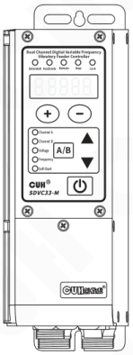

Controller×1

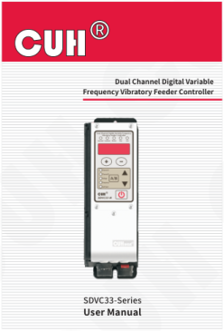

User Manual×1

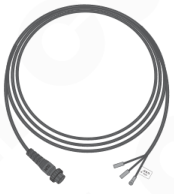

Output Cable×2

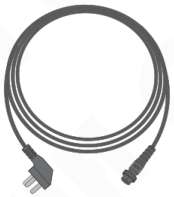

Input Power Cord×1

---

## 1.2 Indicators, Buttons and External Parts Explanation

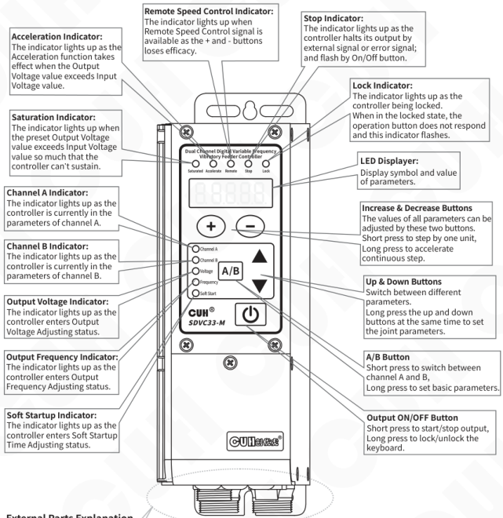

**Acceleration Indicator:**  
The indicator lights up as the Acceleration function takes effect when the Output Voltage value exceeds Input Voltage value.

**Remote Speed Control Indicator:**  
The indicator lights up when Remote Speed Control signal is available as the + and - buttons loses efficacy.

**Stop Indicator:**  
The indicator lights up as the controller halts its output by external signal or error signal; and flash by On/Off button.

**Saturation Indicator:**  
The indicator lights up when the preset Output Voltage value exceeds Input Voltage value so much that the controller can’t sustain.

**Lock Indicator:**  
The indicator lights up as the controller being locked.  
When in the locked state, the operation button does not respond and this indicator flashes.

**LED Displayer:**  
Display symbol and value of parameters.

**Channel A Indicator:**  
The indicator lights up as the controller is currently in the parameters of channel A.

**Channel B Indicator:**  
The indicator lights up as the controller is currently in the parameters of channel B.

**Output Voltage Indicator:**  
The indicator lights up as the controller enters Output Voltage Adjusting status.

**Output Frequency Indicator:**  
The indicator lights up as the controller enters Output Frequency Adjusting status.

**Soft Startup Indicator:**  
The indicator lights up as the controller enters Soft Startup Time Adjusting status.

**Increase & Decrease Buttons**  
The values of all parameters can be adjusted by these two buttons.  
Short press to step by one unit,  
Long press to accelerate continuous step.

**Up & Down Buttons**  
Switch between different parameters.  
Long press the up and down buttons at the same time to set the joint parameters.

**A/B Button**  
Short press to switch between channel A and B,  
Long press to set basic parameters.

**Output ON/OFF Button**  
Short press to start/stop output,  
Long press to lock/unlock the keyboard.

### External Parts Explanation

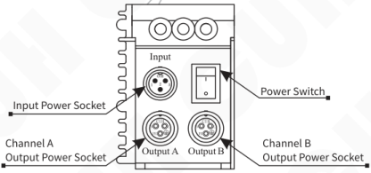

- Input Power Socket
- Power Switch
- Channel A Output Power Socket
- Channel B Output Power Socket

## 1.3 Wiring Ports Explanation

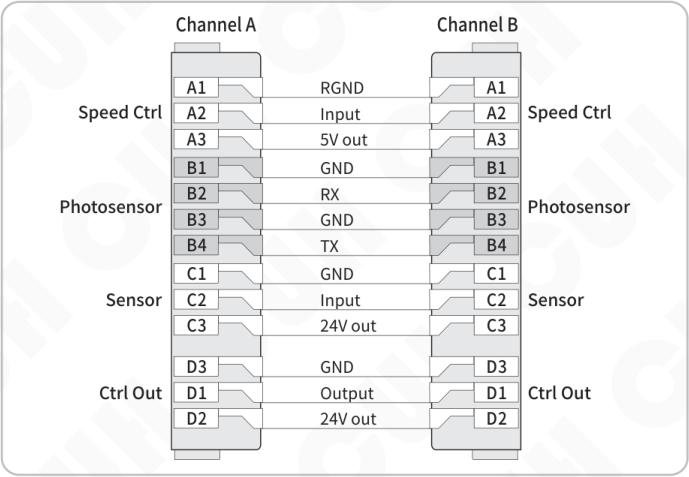

| Function | Channel A | Description | Channel B | Function |
|---|---|---|---|---|
| Speed Ctrl | A1 | RGND | A1 | Speed Ctrl |
| Speed Ctrl | A2 | Input | A2 | Speed Ctrl |
| Speed Ctrl | A3 | 5V out | A3 | Speed Ctrl |
| Photosensor | B1 | GND | B1 | Photosensor |
| Photosensor | B2 | RX | B2 | Photosensor |
| Photosensor | B3 | GND | B3 | Photosensor |
| Photosensor | B4 | TX | B4 | Photosensor |
| Sensor | C1 | GND | C1 | Sensor |
| Sensor | C2 | Input | C2 | Sensor |
| Sensor | C3 | 24V out | C3 | Sensor |
| Ctrl Out | D3 | GND | D3 | Ctrl Out |
| Ctrl Out | D1 | Output | D1 | Ctrl Out |
| Ctrl Out | D2 | 24V out | D2 | Ctrl Out |

## 1.4 Nameplate Explanation

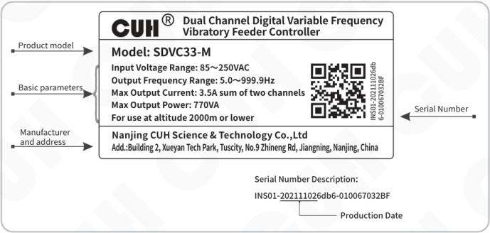

**CUH® — Dual Channel Digital Variable Frequency Vibratory Feeder Controller**

**Product model**

Model: SDVC33-M

**Basic parameters**

- Input Voltage Range: 85～250VAC
- Output Frequency Range: 5.0～999.9Hz
- Max Output Current: 3.5A sum of two channels
- Max Output Power: 770VA
- For use at altitude 2000m or lower

**Manufacturer and address**

Nanjing CUH Science & Technology Co.,Ltd

Add.:Building 2, Xueyan Tech Park, Tuscity, No.9 Zhineng Rd, Jiangning, Nanjing, China

**Serial Number**

INS01-202111026db6-010067032BF

**Serial Number Description:**

INS01-**20211102**6db6-010067032BF

Production Date: **20211102**

---

# Chapter Ⅱ Product Introduction

This chapter includes a brief introduction and main features of the controller.

## 2.1 Product Introduction

SDVC33 Dual Digital FM Vibration Feed Controller is a compact general-purpose dual FM output controller that provides unique performance through the use of the latest electronic technology and careful design. Its special features include:

- Dual-channel power output that can distribute current arbitrarily, supports setting the overcurrent protection current of each channel.
- Dual-channel working mode can choose frequency tracking, voltage tracking or frequency-voltage dual tracking.
- During frequency tracking, the phase difference between the two outputs can be set from -180°~180°.
- The output frequency range covers 5Hz to 999.9Hz with 0.1Hz accuracy.
- Brake function to quickly stop the vibratory feeder by shifting the current phase by 180° during the soft-stop process.
- Intelligent photoelectric ports support photo-sensors, NPN or PNP switch sensors.
- Ready signal function: Output a modulated signal or a valid signal through the intelligent optoelectronic B4 transmission port to indicate that the controller is in the ready state. When the controller encounters an error, the ready signal becomes invalid.
- Overflow control port supports NPN, PNP or auto-adaptive type.
- Control output port supports NPN, PNP or push-pull output mode.
- The remote speed control port can be cross-selected, allowing one potentiometer to control two outputs at the same time.
- The remote control coefficient function can magnify or reduce the control effect of the remote control voltage by 1 times.
- LED display brightness adjustment function supports 32-level brightness adjustment.
- User parameter save and restore function, allowing users to set parameters and save them in the user group for easy recovery.
- Factory reset function supports sub-channel A/B recovery or whole controller recovery.
- Complete protection functions include: main output short-circuit protection, overcurrent protection, overheating or overcooling protection, undervoltage/ overvoltage protection, control output short-circuit protection, 24V output short-circuit protection, speed regulation 5V output short-circuit protection.

## 2.2 Product Performance Improvement

Compared with SDVC31-M controller, SDVC33 has greatly improved performance. mainly includes:

- The output frequency is increased from 40.0Hz~400.0Hz to 5.0Hz~999.9Hz.
- The maximum on/off delay time is increased from 20.0 s to 99.9 s.

---

- Added the function of soft-stop, which can be set to 0.0~10.0 s to slowly stop the vibration of the vibratory feeder.
- Added braking function, you can set 0~10 braking cycles to quickly stop the vibration of the vibrating disc.
- Intelligent photoelectric sensor port adds PNP sensor support.
- The Switch Sensor port when the material is full has been upgraded from NPN and PNP to software-settable, and automatic mode is provided.
- The control output port is upgraded from NPN output to three types of NPN, PNP and push-pull can be set.
- Added control output port on/off delay, which can be set from 0.0 to 99.9 s.
- Added control output mode, you can set delay mode and hold mode.
- Added adjustable overcurrent protection current parameter to protect the electromagnet from burning.
- Added remote control coefficient, which can enlarge or reduce the control effect of remote control voltage.
- Added panel brightness adjustment function, you can set the display brightness of group A/B separately.
- Added measurement function, which can monitor output current, speed regulation voltage, signal voltage of intelligent photoelectric port, Switch Sensor port input voltage, control output port output voltage, temperature display, bus voltage, 24V output voltage.
- Added parameter save and restore functions. In addition to the automatic saving of workgroup parameters, you can also save workgroup parameters in the user group, and the parameters of group A and group B can be flexibly restored from the user group when needed.

## 2.3 Combined Use of Dual Outputs

The controller provides the parameters of the joint control channel A/B, which can be used to control the dual-axis vector vibratory feeder or the feeding system of a bowl feeder and a linear feeder.

By default, channels A and B work independently. When combined, channel B can be set to track channel A, including voltage tracking, frequency tracking, and voltage-frequency dual tracking. When the frequencies are the same, the phases of the two outputs are locked, and the user can adjust the phase difference from -180° to 180°.

After setting the voltage and frequency of the channel B to double track the channel A, you only need to adjust the voltage and frequency of the channel A to change the A/B output voltage and output frequency at the same time.

---

# Chapter Ⅲ Installation Guide

This chapter introduces the necessary conditions for the use of the controller and how to install and connect it correctly.

## 3.1 Controller Usage Conditions

The controller is powered by AC 110/220V, and the protective ground connection is made through the plug of the power cord. Please provide 110V or 220V, 50Hz/60Hz mains power supply and distribution facilities that meet the standard and ensure that the protective ground wire is correctly connected.

**⚠ Warn** Do not connect the controller to 380V AC power, this will cause irreversible serious damage to the controller, possibly resulting in explosion, fire and other safety incidents.

**⚠ Warn** Ensure that the power supply side is reliably grounded. The metal casing of the controller is directly connected to the protective grounding wire. Poor grounding will cause the controller casing to be electrified and cause an electric shock accident.

**Notice** If the controller works for a long time, it will generate heat and cause the temperature of the casing to rise. Please install the controller in a well-ventilated environment and fix it well, away from vibration sources.

**Notice** The channel A/B output of this product is formed by the rectification and inversion of the mains, and there is no isolation ring in the middle. Therefore, the output poles cannot be connected to the protective ground. When connecting the electromagnet, it is necessary to ensure that the electromagnet coil and the casing have basic insulation capability. Otherwise, leakage of electricity may occur, which may cause electric shock and damage to the controller.

**Notice** This product is a controller used to drive the electromagnet. It must not be connected to a piezoelectric vibratory feeder.

## 3.2 Operation Method of Buttons

a. The button action is divided into short press and long press (first-level acceleration, second-level acceleration) according to the pressing time.  
b. Short press to define the pressing time greater than 0.1 and less than 2 seconds, and long press to define the pressing time greater than 2 seconds.  
f. Long press [A/B] to enter/exit the basic parameter interface.  
g. Long press [A/B] and ▲ to enter/exit the advanced parameter interface.  
h. Long press [A/B] and ▼ to enter/exit the monitoring parameter interface.  
I. Long press ▲ and ▼ to enter/exit the joint parameter interface.  
j. Long press ⊕ until 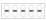 is displayed on the LED to restore the factory parameters, release to display CUH means restored the factory settings.  
k. Select uP1 when saving user parameters, long press ⊕ and ⊖, SAU will be displayed after saving successfully.  
l. When the user parameters are restored, after selecting the restoration method, long press ⊕ and ⊖, and rES will be displayed when the restoration is successful.

---

## 3.3 Install and Use

### Step One:

Open the packing box and check the controller and all accessories.

### Step Two:

Connect the wiring terminals of the Output Power Cable to the vibrator's electromagnetic coil.

Align the notch on the aviation plug of the A/B dual-channel output cable with the triangle mark on the output socket of the controller, and then tighten the nut after connecting the output cable correctly.

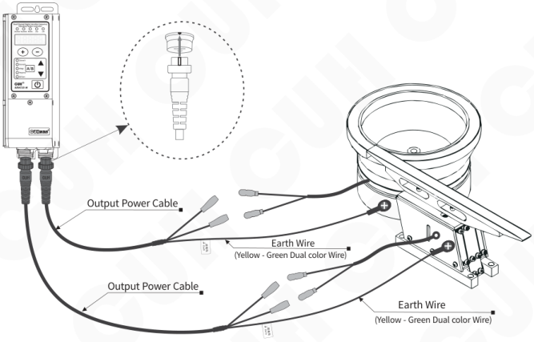

### Note

1. Make sure the vibrator's electromagnetic coils are connected to the two output pins of the Output Power Cable, and the vibrator's metal shell is reliably grounding.
2. It is forbidden to connect piezoelectric loads to the power output, otherwise it may cause an electric shock safety accident!

---

### Step Three:

Connect the Connector of the Input Power Cable to the Input Power Socket of the controller.

Connect the controller side first

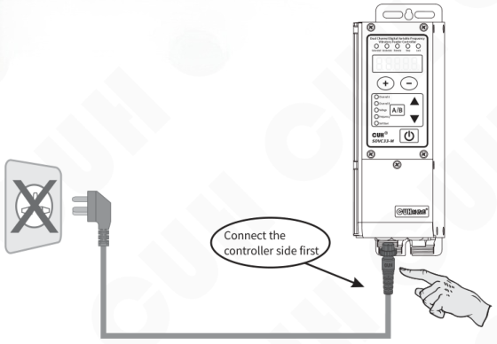

### Step Four:

Connect the plug of the Input Power Cable to the mains jack.

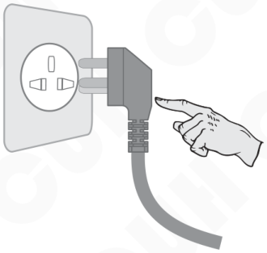

---

## Step Five:

Turn on the power switch of the controller, and the voltage "U 150" should be displayed and Channel A lights up and the two vibratory feeders should all vibrate.

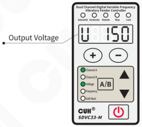

## Step Six:

Press ⊖ to adjust the voltage of channel A to 30~50V, then press the `A/B` 2 seconds enter the output frequency "E" adjustment state. Use ⊕ and ⊖ to find the natural frequency of the vibratory feeder, which is also called the resonant frequency.

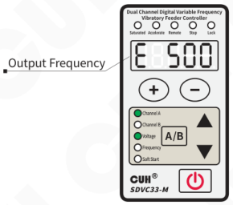

- Harmonic frequency of the vibrator means the frequency value that creates the maximum amplitude.
- Each vibrator has its natural mechanical resonance frequency, adjust the output frequency of the controller to this frequency to achieve the best working state.

---

## Step Seven:

Long press **A/B** to exit the output frequency "E" and returns to the voltage adjustment parameter,
Use the **+** and **−** to adjust the voltage until to the best feed rate.

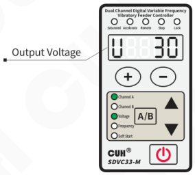

## Channel B Settings:

Short press **A/B** to switch to channel B. Repeat steps six and seven to complete the channel B adjustment.

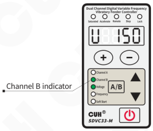

---

## Chapter IV Basic Function Description

This chapter introduces how to use the basic functions of the controller.

### 4.1 Output Voltage Setting

The controller can digitally set the output voltage directly on the panel. Because the controller can do mains voltage compensation, this value is the average value of the output voltage rectification, and it will not be affected by the input voltage, so it can maintain stable output even in the case of unstable mains voltage. At the same time, the direct voltage value setting also provides accurate data for users to understand the operation of the equipment.

- Turn on the power switch of the controller.
- The controller displays the output voltage. Channel A and voltage indicator on the panel are on, and the LED display output voltage parameter U and voltage value.
- Press ⊕ or ⊖ to adjust the parameter value.

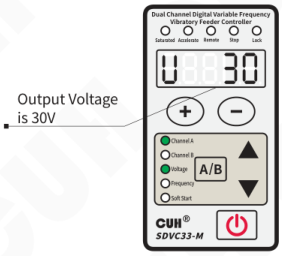

- The controller does not have a boost function. When the controller cannot reach the set voltage due to the limitation of the input power supply voltage, the saturation indicator will light up, and the mains voltage compensation will fail at this time.
- The controller can achieve a certain degree of acceleration effect by sacrificing the sinusoidal characteristics of the output waveform, which is determined by the parameter "acceleration index y". When entering the acceleration state, the output current waveform changes from a sine wave to a triangular wave, and the acceleration indicator lights up.

---

## 4.2 Output Frequency Setting

The controller adopts direct digital frequency synthesis technology (DDS), which has very high frequency accuracy and stability, and does not change with time and temperature.

- Press **A/B** and hold for 2 seconds to enter the basic parameter interface.
- The LED displays the output frequency parameter "E" and the frequency value.
- Press **+** or **−** to adjust the parameter value.

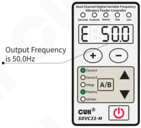

The output frequency range is 5.0～999.9Hz

## 4.3 Soft Startup

When the controller is started from the stopped state, the output voltage can be gradually increased to the set value to prevent the vibratory feeder and the controller from being impacted.

Soft startup time (t): When the controller starts from the stop state, the time required for the output voltage to rise smoothly from 0V to the set value is called the soft start time.

- Press **A/B** and hold for 2 seconds to enter the basic parameter interface.
- Press **▲** and **▼** to switch to soft startup Parameter adjustment state "t".
- Press **+** or **−** to adjust the parameter value.

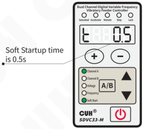

The soft startup time range is 0.0～10.0s

---

## 4.4 Soft Shutdown

When the controller stops from the running state, the output voltage can be gently reduced to 0 to prevent the vibration equipment from being impacted.

Soft shutdown time (J): When the controller starts from the running state, the time required for the output voltage to smoothly decrease from the set value to 0 is called the soft shutdown time.

- Press **A/B** and hold for 2 seconds to enter the basic parameter interface.
- Press **▲** and **▼** to switch to soft shutdown Parameter adjustment state "J".
- Press **+** or **−** to adjust the parameter value.

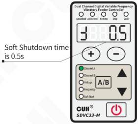

The soft shutdown time range is 0.0～10.0s

## 4.5 Brake Function

Since the vibratory feeder will vibrate freely for a period of time after the controller stops output, the material will continue to move during this time. This will cause errors for some applications of precision metering and packaging of materials, so the vibration needs to be stopped quickly.

The braking function is to quickly stop the vibration by delaying the start point of the slow stop by 180° to achieve the opposite effect of the driving force and the free vibration phase of the vibratory feeder. It is realized by setting the soft shutdown time as a negative value, the unit is cycle, that is, the number of current cycles of reverse driving when braking.

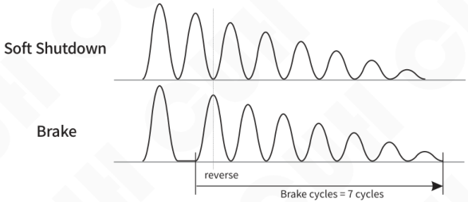

---

## 4.6 Output Switch

The light touch output switch on the panel can easily and quickly start or stop the output of the controller.

- Use ⏻ on the controller panel to control the unit to start or stop the output. the stop indicator light is on, it means entering the stop state.

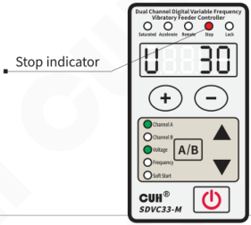

> By default, ⏻ controls the start/stop of channel A/B independently. If you need to control the start/stop of channel A/B at the same time, please set the On/Off button control mode (OF) in the joint parameter from Ind (independent) to Cob (combined).
>
> When the controller stops output, the stop indicator flashes, but when the external signal stops the controller, the stop light is always on.

## 4.7 Keyboard Lock

When the parameters of the controller are set, the keyboard lock function can lock all buttons on the panel to avoid misoperation.

Even if it is turned off and then turned on again, the state of the keyboard lock remains the state it was in the last time it was turned off.

- Press ⏻ and hold for 2 seconds to lock all buttons on the panel.
- Press ⏻ and hold for 2 seconds again to unlock.

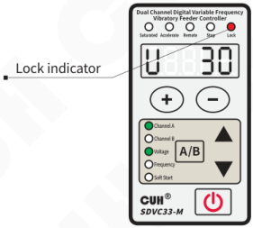

> Locking can be done for different channels, the operation of channel A and channel B can to be done independently.

---

## 4.8 Restore Default Settings

User can quickly restore the controller to the factory default state.

Due to the powerful functions of the controller, many parameters can be adjusted. For beginners, it may not be able to restore the normal working state of the controller after several settings and modifications. Use this function to quickly restore the disordered parameter state to the factory default setting.

The controller can restore the whole controller to the factory settings, as well as restore a single channel to the factory settings individually.

### Restore default settings for the entire controller:

- Long press ▲ and ▼ simultaneously to enter the joint parameter interface.

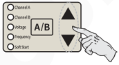

- Short press ▼ to switch to the full flashing on the LED displayer, that is, the parameter of “Restore default setting". And then press ⊕ and hold until the controller displays "-----", indicating that the controller has been restored.

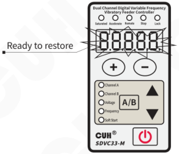

- Release ⊕, after the controller displays "CUH", then enter the output voltage adjustment state "U". By this time, all parameters have been restored to the factory default settings.

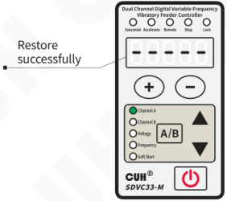

---

## Channel A/B individually restore default settings:

- Long press **A/B** and **▲** simultaneously to enter the advanced parameter interface.

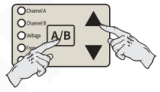

- Short press **▼** to switch to "Restore the current channel default setting" parameter. And then long press **⊕** and hold until the controller displays "-----", indicating that the current channel has been restored.

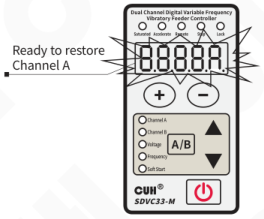

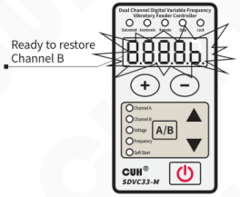

- Release **⊕**, after the controller displays "CUH", then enter the output voltage adjustment state "U". By this time, all parameters of the current channel have been restored to the factory default settings.

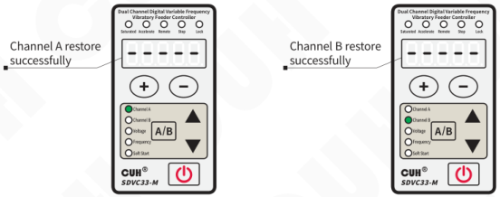

---

## Chapter Ⅴ Advanced Function Description

This chapter introduces how to use the advanced functions of the controller.

### 5.1 Remote Speed Control

The controller supports external analog signal to control output voltage, analog signal supports potentiometer, 1~5V voltage, 4~20mA current. There are two analog input ports AA and bA. By default, AA controls channel A, and bA controls channel B. It can also be adjusted by parameter cS, so that one signal can control the output voltage of two channels at the same time.

The controller also designed the remote control coefficient c parameter to enlarge or reduce the effect of the remote control voltage, which can be adjusted from 0.5 to 2.0. When it is set to 0.5, it means that the effect of the remote control voltage to control the output voltage is reduced by half, that is, the maximum remote control can only reach half of the maximum output voltage h. When it is set to 2.0, it means that the effect of the remote control voltage to control the output voltage is doubled, that is, when the remote control voltage reaches 3V, the output voltage has reached h, and if the remote control voltage is increased, the output voltage cannot be increased.

### Potentiometer control connection

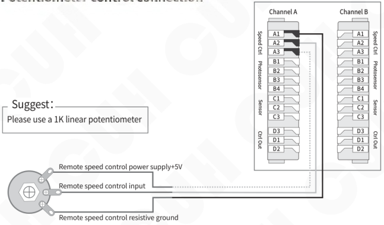

When the remote speed control signal takes effect, the speed control indicator lights on , at the same time regulating the voltage on the panel will fail.

---

## 1~5V voltage control connection

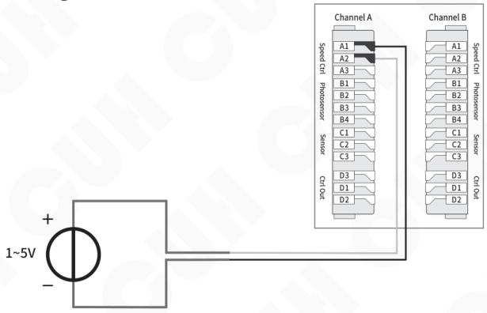

## 4~20mA current control connection

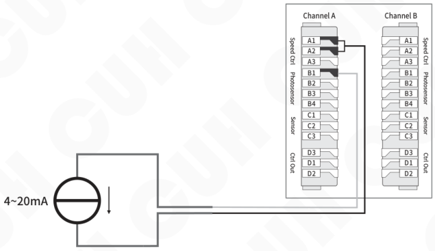

---

## 5.2 Intelligent Photoelectric Sensing

The intelligent photoelectric port of this controller supports photoelectric through-beam or reflection sensors composed of light-emitting diodes and phototransistors, and can also be set to support NPN or PNP switch sensors. The specific wiring diagram is as follows:

### Photoelectric sensor connection method

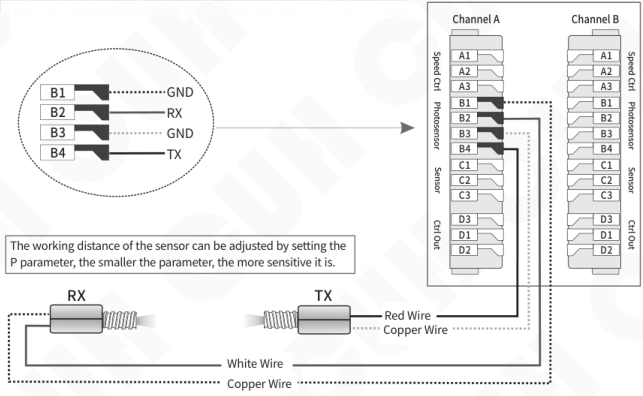

The working distance of the sensor can be adjusted by setting the P parameter, the smaller the parameter, the more sensitive it is.

### Switch sensor connection method

Set NPN or PNP type by parameter P.

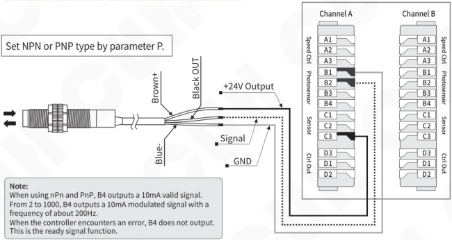

**Note:**

When using nPn and PnP, B4 outputs a 10mA valid signal.

From 2 to 1000, B4 outputs a 10mA modulated signal with a frequency of about 200Hz.

When the controller encounters an error, B4 does not output. This is the ready signal function.

---

## 5.3 Switch Sensor

The Switch Sensor port can support NPN, PNP, Ut1, Ut0 modes, and channels A and B are independently controlled.

**The Ut1 mode is a single scan,** that is, before the sensor signal is invalid, the high and low levels are changed to detect whether the port is valid. After finding a valid signal, the port sensor type is determined and no longer scans.

**The Ut0 mode is continuous scanning,** regardless of the sensor type, it always detects whether the port is connected to a valid signal by changing the high and low levels.

### Switch sensor connection method

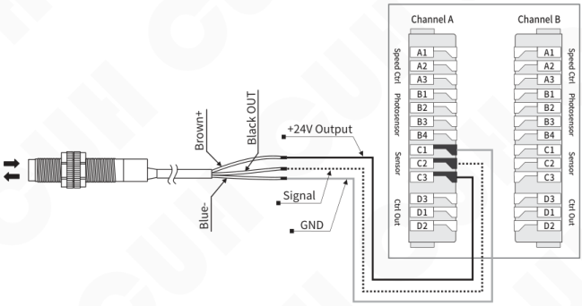

---

## 5.4 Control Output

The control output port can support NPN output, PNP output and push-pull output. therein:

- The NPN output is valid as a low level, and the output is invalid as a high-impedance state;
- The PNP output is valid as a high level, and the output is invalid as a high-impedance state;
- The push-pull output is valid as a high level, and invalid as a low level.

### 5.4.1 Wiring Method of Control Output

**NPN output connection**

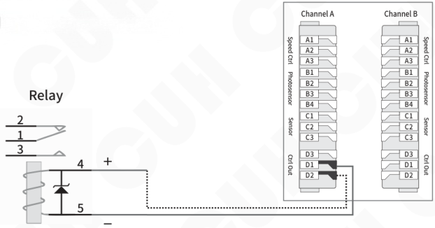

**PNP or push-pull output connection**

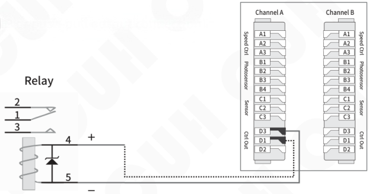

> If connecting a 24V relay, be sure to confirm the positive and negative poles of the coil to make sure they are connected correctly. Because the output current capability of this port is 350mA, the internal protection diode of the relay will short-circuit the port of this controller after reverse connection, triggering the short-circuit protection Er07.

---

## 5.4.2 Control Output Signal Source and Logic Diagram

The control of the main output and the control output is controlled by the result of the logical relationship between the two signal sources. The following signal sources can be selected from the signal source list.

| Signal Source | Implication |
|---|---|
| 0 | invalid signal |
| 1 | valid signal |
| Ab | Intelligent photoelectric sensing port signal of channel A |
| -Ab | Intelligent photoelectric sensing port signal of channel A is inverted |
| Ac | Switch sensor port signal of channel A |
| -Ac | Switch sensor port signal of channel A is inverted |
| Ad | Control output port signal of channel A |
| -Ad | Control output port signal of channel A is inverted |
| Aq | Main power output port signal of channel A |
| -Aq | Main power output port signal of channel A is inverted |
| bb | Intelligent photoelectric sensing port signal of channel B |
| -bb | Intelligent photoelectric sensing port signal of channel B is inverted |
| bc | Switch sensor port signal of channel B |
| -bc | Switch sensor port signal of channel B is inverted |
| bd | Control output port signal of channel B |
| -bd | Control output port signal of channel B is inverted |
| bq | Main power output port signal of channel B |
| -bq | Main power output port signal of channel B is inverted |

---

## Control Output Logic Diagram

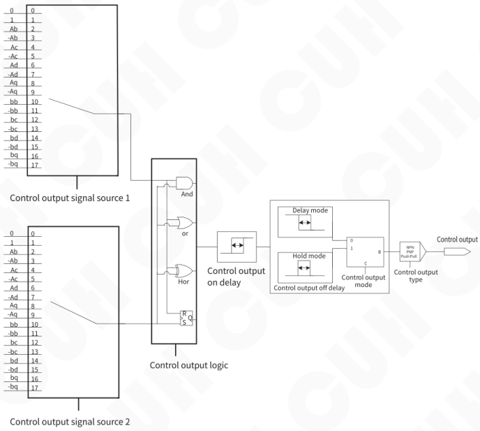

---

## 5.4.3 Control Output Mode Description

Customers can choose 2 control output modes: delay mode, hold mode.

**Delay mode:** It means that after the controller output drive signal changes from valid to invalid, the control output turns off after a period of off delay time.

**Hold mode:** After the controller output drive signal becomes valid, the control output remains on during the off-delay time, and turns off after the off-delay time is exceeded.

The difference between the two modes is expressed in the form of a timing diagram as follows, where the input signal is the signal output after the logic relationship selector.

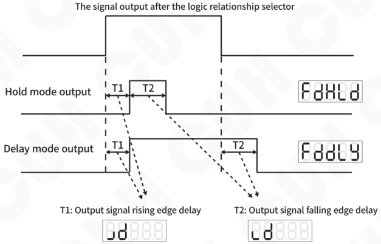

## 5.4.4 Main Output Signal Control Function

The main output signal control is similar to that of the control output. After selecting two signal sources for logic relationship operation, the control signal is obtained through on/off delay mode selection and logic direction control. The control signal is logically with the on/off signal of the panel, than send to the power board to control the main output.

The main output signal control wiring method, signal source and logic diagram can refer to the control output function.

---

## 5.5 Maximum Output Voltage Limit

Each channel of the controller can set the maximum output voltage limit parameter h, and neither the panel setting voltage nor the remote control voltage will exceed this value.

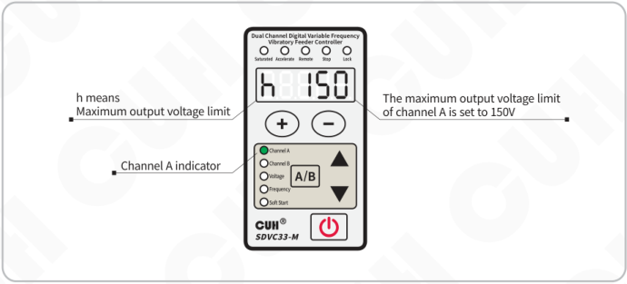

- h means Maximum output voltage limit
- Channel A indicator
- The maximum output voltage limit of channel A is set to 150V

## 5.6 Adjustable Overcurrent Protection

In order to protect the electromagnetic coil, the controller has designed a user-adjustable overcurrent protection current parameter "oc", which can be adjusted in the range of 0.5A~3.5A.

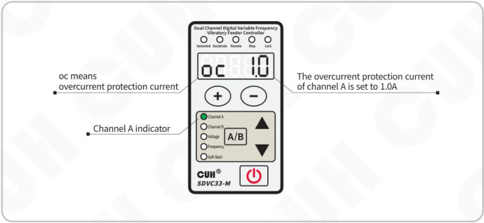

- oc means overcurrent protection current
- Channel A indicator
- The overcurrent protection current of channel A is set to 1.0A

---

## 5.7 Panel Brightness Adjustment

The controller adopts a new digital display driver chip, which supports users to adjust the LED display brightness value between 1 and 32.

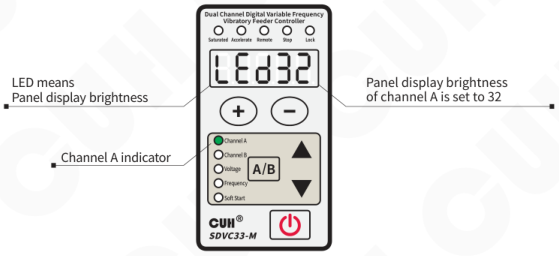

The panel brightness can be set independently for channel A and channel B, user can set different brightness in advance to quickly distinguish whether it is currently in channel A or channel B.

## 5.8 Output Monitoring Function

The controller has specially designed a set of monitoring parameters to monitor the status of the controller.

**The monitoring parameters that differentiate between channel A and channel B, include:**

Output current AC, Analog speed control port voltage AU, Intelligent photoelectric port signal voltage bU, Switch sensor port cU, Control output port voltage dU.

**The monitoring parameters that do not distinguish between channel A and channel B, include:**

Temperature display C, Bus voltage PU, 24V output voltage nU, Control board software version uc, Power board software version uq.

---

## 5.9 Dual-Channel Joint Control

The output of channel A and channel B of the controller can be controlled jointly, and the Cb parameter can be used to control channel B: independent work, track the frequency of channel A, track the voltage of channel A, track the voltage and frequency of channel A.

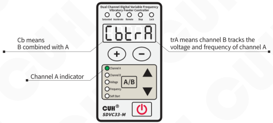

Note: After setting the tracking, the voltage and frequency of channel B can still be adjusted, but they will not work. They can work after reverting to standalone mode.

Whether you set channel A and channel B to output the same frequency independently, or set the frequency of channel B to track channel A, the phases of the two channel outputs are always locked. The phase difference can be controlled by the joint parameter μ (B refers to the phase of A), and the adjustment range is -180°~180°. This function can be used to control a vector vibratory bowl feeder or a vibratory bowl feeder and a linear feeder/conveyor relay feeding occasions.

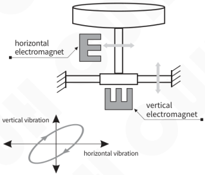

Schematic diagram of vector vibratory feeder

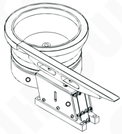

Schematic diagram of bowl feeder and linear feeder

---

## 5.10 User Parameter Save and Restore

In addition to the automatic saving of working parameters, the controller has also designed a set of user parameter group to save all user-settable parameters. Through the save and restore of user parameters, the recovery is different from the function of restoring the factory settings.

Adjust to the SP parameter in the joint parameter, display uP1, long press ⊕ and ⊖ at the same time until display SAU which indicates that the save was successful. This will save channel A, channel B, joint parameters in the user group.

If you need to restore a workgroup from a saved user group parameter, there are several ways to restore it:

**rP=1Ab:** User group parameters restore the parameters of group A and B at the same time.

**rP=1bA:** User group parameters restore the parameters of group A and group B at the same time, but they are selected alternately during restoration. i.e, The data saved in group A of the user group is restored to work group B, and the data saved in group B of the user group is restored to work group A.

**rP=1A0:** User group parameters only restore group A, and use the data of group A in the user group to restore.

**rP=10A:** User group parameters only restore group A, and use the data of group B in the user group to restore.

**rP=1b0:** User group parameters only restore group B, and use the data of group B in the user group to restore.

**rP=10b:** User group parameters only restore group B, and use the data of group A in the user group to restore.

Select the mode that needs to be restored, long press ⊕ and ⊖ at the same time until display rES, indicating that the restoration is successful.

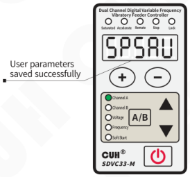

Successful save diagram

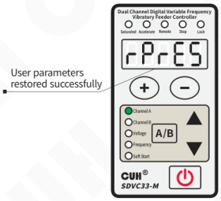

Successful restoration diagram

---

# Chapter Ⅵ Technical Specifications

## 6.1 Dimensions

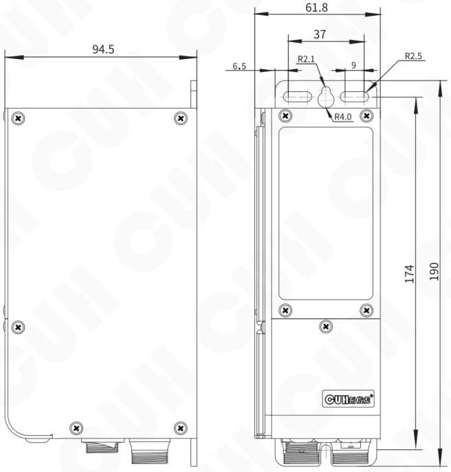

Dimensions (unit: mm)

| Dimensions range | tolerance |
|---|---|
| 0~3 | ±0.05 |
| 3~10 | ±0.1 |
| 10~30 | ±0.15 |
| 30~80 | ±0.2 |
| 80~180 | ±0.3 |
| >180 | ±0.5 |

This tolerance table is applicable to all products in this series.

---

## 6.2 Technical Specifications

| Item | Min | Typical | Max | Unit | Note |
|---|---|---|---|---|---|
| Input Voltage | 85 | 220 | 250 | V | AC RMS |
| Adjustable Output Voltage Range | 0 | —— | 260 | V | Lower than 150% of Input Voltage |
| Voltage Adjustment Accuracy | | 1 | | V | |
| Voltage Regulation Accuracy | 0 | —— | 10 | % | ΔVout/ΔVin |
| Adjustable Output Current Range | 0 | —— | 3.5 | A | The combined current can be distributed arbitrarily. |
| Output Power | 0 | —— | 770 | VA | |
| Output Frequency | 5.0 | —— | 999.9 | Hz | |
| Frequency Adjustment Accuracy | | 0.1 | | Hz | |
| Output Waveform | | Sine | | | |
| Soft Start Time | 0 | —— | 10 | s | Default value: 0.5 |
| On/Off Delay Time Range | 0 | —— | 99.9 | s | Default value: 0.2 |
| On/Off Delay Time Accuracy | | 0.1 | | s | |
| Overheat Protection Trigger Temperature | —— | 65 | —— | °C | 60°C return to normal |
| DC Control Output Current | 0 | —— | 350 | mA | Both channels A & B are supported |
| 24V Output Current | —— | —— | 700 | mA | Channel A & B output sum |
| DC Control Output Voltage | 22 | 24 | 26 | V | |
| Analog Control Signal | | 4~20/1~5 | | mA/V | |
| Digital Control Signal | | 24 | | V | Switching Signal |
| Adjustment Method | | 6 | | Button | |
| Standby Power Consumption | —— | 3 | —— | W | |
| Display Method | | 5 | | Digit | LED |
| Weight | | 850 | | g | Without Accessory |
| Dimensions | | 190\*61.8\*94.5 ( L\*W\*H ) | | mm | |
| Ingress Protection Level | | IP20 | | | |
| Ambient Temperature | 0 | 25 | 40 | °C | No Condensation |
| Ambient Humidity | 10 | 60 | 85 | % | No Condensation |
| Storage Ambient Temperature | -20 | 25 | 85 | °C | No Condensation |
| Applicable Altitude | | <2000 | | m | |

## 6.3 Reference Standard

Absolute Parameters:  
Above the standard will damage the controller, obey it strictly.

| Item | GB Standard | IEC Standard | Grade | Standard Requirement | Note |
|---|---|---|---|---|---|
| Electrostatic Discharge | GB/T 17626.2-2006 | IEC 61000-4-2:2001 | 4 | ±8 kV | Contact Discharge |
| | | | 4 | ±15 kV | Air Discharge |
| Electrical Fast Transient Test | GB/T 17626.4-2008 | IEC 61000-4-4:2004 | 4 | ±4 kV | |
| DC Power Line Wave Immunity | GB/T 17626.17-2005 | IEC 61000-4-17:2002 | 4 | 15% | Rating A |

> **Warning**  
> In a residential environment, this product may cause radio interference in which case supplementary mitigation measures may be required.

---

## Chapter Ⅶ Appendix

### 7.1 Parameter Table

| Parameter group / Operation | Definition | Symbol | Symbol Image | Range | Default |
|---|---|---|---|---|---|
| Standby parameter | Output Voltage | U |  | 0~260 V | 150 |
| Basic Parameter Long press A/B | Output Frequency | E |  | 5.0~999.9 Hz | 50.0 |
| Basic Parameter | On Delay of the Intelligent Photoelectric Sensor | J |  | 0.0~99.9 s | 0.2 |
| Basic Parameter | Off Delay of the Intelligent Photoelectric Sensor | L |  | 0.0~99.9 s | 0.2 |
| Basic Parameter | Soft Startup | t |  | 0.0~10.0 s | 0.5 |
| Basic Parameter | Breaking cycles/Soft Shutdown | d |  | -10~0 cycle (number of breaking cycles) 0.0~10.0 s (Soft Shutdown) | 0.0 |
| Advanced Parameter Long press A/B and ▲ | Intelligent photoelectric sensor sensitivity | P |  | nPn, PnP, 2~1000 | 80 |
| Advanced Parameter | Port C Sensor Type | ΓA |  | nPn, PnP ut1 (Single scan), ut0 (Continuous scan) | ut0 |
| Advanced Parameter | On Delay of Port C | J- |  | 0.0~99.9 s | 0.2 |
| Advanced Parameter | Off Delay of Port C | L- |  | 0.0~99.9 s | 0.2 |
| Advanced Parameter | The first signal source of Control Port D | E.d |  | 0, 1, Ab, -Ab, Ac, -Ac, Ad, -Ad, Aq, -Aq, bb, -bb, bc, -bc, bd, -bd, bq, -bq | A: 0 B: 0 |
| Advanced Parameter | The second signal source of Control Port D | Ed |  | 0, 1, Ab, -Ab, Ac, -Ac, Ad, -Ad, Aq, -Aq, bb, -bb, bc, -bc, bd, -bd, bq, -bq | A: Aq B: bq |
| Advanced Parameter | Logic operation of signal sources of Control Port D | ∩d |  | And, or, Hor, rS | or |
| Advanced Parameter | On Delay of Port D | Jd |  | 0.0~99.9 s | 0.0 |
| Advanced Parameter | Off Delay of Port D | Ld |  | 0.0~99.9 s | 0.0 |
| Advanced Parameter | Output Mode of Port D | Fd |  | dLy (Delay Mode), HLd (Hold Mode) | dLy |
| Advanced Parameter | Logic direction of Port D | ɔd |  | --- (Same phase), -⁻- (Reverse) on (Normal Open), oFF (Normal Close)  | --- |
| Advanced Parameter | Control Output Type | Γd |  | nPn, PnP, PSP (Push & Pull) | nPn |
| Advanced Parameter | The first signal source of Main output | E.q |  | 0, 1, Ab, -Ab, Ac, -Ac, Ad, -Ad, Aq, -Aq, bb, -bb, bc, -bc, bd, -bd, bq, -bq | A: Ab B: bb |
| Advanced Parameter | The second signal source of Main output | Eq |  | 0, 1, Ab, -Ab, Ac, -Ac, Ad, -Ad, Aq, -Aq, bb, -bb, bc, -bc, bd, -bd, bq, -bq | A: Ac B: bc |
| Advanced Parameter | Logic operation of signal sources of Main output | ∩q |  | And, or, Hor, rS | or |

| Parameter | Definition | Symbol | Symbol Image | Range | Default |
|---|---|---|---|---|---|
| Advanced Parameter Long press A/B and ▲ | On Delay of Main output | J9 |  | 0.0~99.9 s | 0.0 |
| | Off Delay of Main output | L9 |  | 0.0~99.9 s | 0.0 |
| | Output Mode of Main output | F9 |  | dLy (Delay Mode), HLd (Hold Mode) | dLy |
| | Logic direction of Main output | Ↄ9 |  |  on (Normal Open), oFF (Normal Close) |  |
| | Maximum output voltage limit | h |  | 0~260 V | 260 |
| | Overcurrent protection current | bc |  | 0.5~3.5 A | 3.5 |
| | Acceleration Index | y |  | 100~150 | 150 |
| | Waveform Index | r |  | 0~100 | 100 |
| | Remote speed control source | cS |  | AA (Port A of A), bA (Port A of B) | A: AA B: bA |
| | Remote speed control coefficient | c |  | 0.5~2.0 | 1.0 |
| | Panel display brightness | LEd |  | 1~32 | 16 |
| | Restore the current channel default setting | 8.8.8.8.A. 8.8.8.8.b. |  | —— | —— |
| Monitoring Parameter Long press A/B and ▼ | Output Current | AC |  | 0.00~3.50 A | —— |
| | Signal Voltage of Port A | AU |  | 0.00~5.00 V | —— |
| | Signal Voltage of Port B | bU |  | 0.00~5.00 V | —— |
| | Signal Voltage of Port C | cU |  | 0.0~28.0 V | —— |
| | Output Voltage of Port D | dU |  | 0.0~28.0 V | —— |
| | Temperature Display # | C |  | -20.0~85.0 ℃ | —— |
| | Internal Bus Voltage # | PU |  | 0~400 V | —— |
| | Real time voltage of 24V Port # | nU |  | 0.0~28.0 V | —— |
| | Control board software version # | uc |  | —— | —— |
| | Power board software version # | u9 |  | —— | —— |

|  | Definition | Symbol | Symbol Image | Range | Default |
|---|---|---|---|---|---|
| Joint Parameter  Long press ▲ and ▼ | B combined with A # | Cb |  | Ind (independent), trF (B frequency tracking A), trU (B voltage tracking A), trA (B voltage frequency both tracking A) | Ind |
|  | # | Y |  | -180~180 ° | 0 |
|  | On/Off button control mode # | OF |  | Ind (independent), Cob (combined) | Ind |
|  | User parameter save # | SP |  | uP1 (save user group 1) | uP1 |
|  | User parameter restore # | rP |  | 1Ab (User group 1 restores groups A and B), 1bA (User group 1 cross-restore of groups A and B), 1A0 (User group 1 restores only group A), 10A (User group 1 cross-restore only group A), 1b0 (User group 1 restores only group B), 10b (User group 1 cross-restore only group B) | 1Ab |
|  | Restore default setting # | 8.8.8.8.8. |  | —— | —— |

Notes: "#" marked parameters do not distinguish between A and B groups.

## 7.2 Input and Output Circuit Diagrams

**Remote Speed Control Port A**

**Intelligent Photosensor Port B**

**Switch Sensor Port C**

**Control Output Port D**

---

## 7.3 Troubleshooting Suggestions and Error Explanations

| Error Code | Definition (Phenomenon) | Troubleshooting Methods |
|---|---|---|
| Er01A/Er01b | Channel A/B short circuit (Both channels stop outputs) | ◆ Make sure the load is not short-circuit, then try to restart output of the controller by press Output ON/OFF Button two times or repower the controller. |
| Er02 | Channel AB combined overcurrent (Both channels pause output, after 2s restart) | ◆ Reduce output voltage appropriately, then restart the output. |
| Er02A/Er02b | Channel A/B individual overcurrent (Overcurrent channel stops output, 2s restart) | |
| Er02A./Er02b. | Channel A/B individual overcurrent reaches the set maximum | |
| Er03 | Overheating or undercooling (Both channels stop output, automatic recovery at -20℃~60℃) | ◆ Install the controller in a well-ventilated environment or avoid extreme cold. |
| Er041/Er042 | Power supply under/over voltage (Both channels stop output, automatic recovery) | ◆ Make sure input voltage between AC 85~250Vac. |
| Er05 | Internal communication abnormal (Both channels stop output) | ◆ Make sure no extern power supply connect to the 24V power port or contact our technical support. |
| Er06 | Temperature sensor abnormal (Both channels stop output) | ◆ Make sure the work temperature not under -20℃ or contact our technical support. |
| Er07A/Er07b | Channel A/B Port D port short circuit (Channel A/B control output stops, 2s try to restart) | ◆ Make sure the load of Port D is not short-circuit and the current does not exceed 350mA. |
| Er10 | 24V power output abnormal (Turn off the 24V output, 2s try to restart) | ◆ Make sure 24V port is not short-circuit and the current does not exceed 700mA. |
| Er11 | 5V power output abnormal (The speed control function is temporarily closed, and the automatic restart is restored) | ◆ Make sure the 5V power of Port A is not short-circuit or not connected to external power voltage more than 5V. |
| Er12 | 24V power supply voltage abnormal (Both channels stop output, control output high impedance, automatic recovery) | ◆ Make sure no extern power supply connect to the 24V power port. |

# Chapter Ⅷ Product Warranty Information

## 8.1 Warranty Period

The warranty period provided by the company for this product is 3 years from the date of delivery of the product to the location designated by the purchaser.

## 8.2 Warranty Coverage

(1) If there is a failure caused by our company during the above warranty period, we will repair the product free of charge. but The following situations are not covered by the warranty:

a. Failure to comply with the conditions specified in the simple manual, user manual or technical requirements specifically agreed between the purchaser and the company, improper operation, or failure caused by improper use.

b. Failure is not due to a product defect, but to the purchaser's equipment or software design.

c. Malfunctions caused by modifications or repairs not performed by the our company's personnel.

d. The failure that can be totally avoided by correct maintenance or replacement of wearing parts according to the simple operation guide or user manual.

e. After the product is shipped from our company, it is caused by factors such as unforeseen changes in the level of science and technology failure.

f. Due to natural disasters such as fire, earthquake, flood, or external factors such as abnormal voltage failure, the company is not responsible for the warranty.

(2) The scope of warranty is limited to the situation stipulated in (1)，Indirect losses (such as equipment damage, opportunities, loss of profit, etc.) or other losses, or other losses, the company do not bear any responsibility.

## 8.3 Product Suitability

The controller of our company is designed and produced for general use in the vibratory feeding industry. Therefore, this controller of our company shall not be used for the following applications and is not suitable for its use.

(1) Facilities that have a serious impact on life and property, such as nuclear power plants, airports, railways, ships, motorized devices and medical equipment.

(2) Public utilities, including electricity, gas, water supply, etc.

(3) Outdoor use in similar conditions or environments.

---

Nanjing CUH Science & Technology Co.,Ltd  
https://en.cuhnj.com  
Tel.:+86-25-84730411 / 84730415 / 84730416  
Fax:+86-25-84730426  
E-mail:sales@cuhnj.com  
Add.:Building 2, Xueyan Tech Park, Tuscity,  
No.9 Zhineng Rd, Jiangning, Nanjing, China

Document No.: IDP1000316

