## Variable Frequency Intelligent Controller for Vibratory Feeder

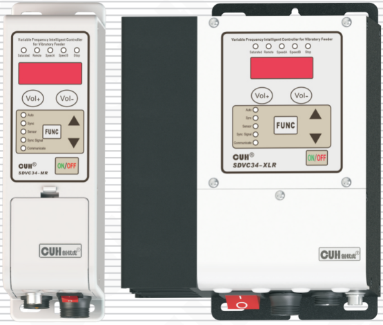

## SDVC34 Series
Variable Frequency Intelligent Controller for Vibratory Feeder — SDVC34 Series
**User Manual**

---

## Copyright Statement

Nanjing CUH Science & Technology CO., Ltd. reserves all rights.

All information contained in this user manual is the knowledge of our company and is protected by copyright law and other related laws. CUH enjoys and reserves all rights conferred by copyright law and other laws. Without the written consent of CUH, part or all of this user manual shall not be copied, translated, imitated or otherwise utilized.

## Disclaimer

All contents of this user manual only describe the use method of related products produced by our company, and are described according to the existing technology and the state provided to you when you use it. You must bear the relevant risks when you use this product. Except as required by law, the company does not have any express or implied responsibility for the product due to this user manual, including but not limited to personal injury, property damage, loss of opportunity, etc.

You clearly understand the above risks and agree that, except as mandated by law, the company is not responsible for any direct or indirect damage or loss to you (including but not limited to tangible loss of personnel, property, data, etc. and intangible loss of reputation, opportunity, etc.)

The company reserves the right to modify the products applicable in this user manual without prior or subsequent notice.

---

## Preface

Thank you for choosing CUH SDVC34 series variable frequency intelligent controller for vibratory feeder. (The controller for short in the following text). This series of controllers uses high-quality components and incorporates the latest electronic technology, and is carefully designed with high-performance digital signal processors.

This manual introduces the basic operation method, functional technical description and typical application examples of this product. Provide users with relevant information on installation and debugging, parameter setting, abnormal diagnosis, troubleshooting and routine maintenance of the controller. In order to ensure the correct installation and use of this controller, please read this user manual carefully before installation and keep it properly.

Be sure to read the following symbols to alert you to precautions against personal injury and product damage.

| | |
|---|---|
| ⚠ Danger | Non-observance of this item will result in personal injury or death. |
| ⚠ Warn | Non-observance of this item may result in personal injury or death. |
| ⚠ Careful | Non-observance of this item may result in moderate or minor injury to persons. |
| Notice | Non-observance of this item will result in damage to the product and property damage. |
| ❗ Essential | Indicates precautions and usage restrictions that must be observed during use. |

**This manual is suitable for the following models of controllers:**

Variable Frequency Intelligent Controller for Vibratory Feeder

- SDVC34-MR　3.0A Output Current (RS485)
- SDVC34-MRJ　3.0A Output Current (RS485 & Counting)
- SDVC34-XLR　6.0A Output Current (RS485)
- SDVC34-XLRJ　6.0A Output Current (RS485 & Counting)

---

# Safety and Precautions

1. **⚠ Danger** This product is only used to drive electromagnet-based vibratory feeding equipment, do not use this product for the purpose of protecting the human body or parts of the human body, etc.

2. **⚠ Danger** This product is not intended to be used as an explosion-proof product, do not use it in hazardous locations and/or potentially explosive gas environment.

3. **⚠ Warn** This product is powered by AC mains, please do not apply AC voltage exceeding 260Vac. Excessive input voltage, such as 380Vac, may cause the product to explode or catch fire, resulting in serious safety accidents.

4. **⚠ Warn** This product is grounded through the power cord. Please ensure that the power distribution facilities for the controller are well grounded, otherwise the controller shell may be charged, resulting in an electric shock accident.

5. **⚠ Warn** Do not input AC power to the output of this controller, it will damage the controller.

6. **⚠ Warn** Do not plug and unplug the wiring with points or touch the contact of each wiring terminal in the wiring compartment to prevent electric shock.

7. **Notice** Please avoid controlling the output of this product by cutting off the power supply through relays and other devices, which will seriously reduce the life of the controller.

8. **Notice** The controller is designed to work in a cool and dry environment. Never run the controller outside to avoid soaking and insolation. Operate the controller within the temperature specified electrical characteristic.

9. **❗ Essential** Be sure to fix this product on a solid platform that is reliably grounded and away from vibrating equipment.

10. **❗ Essential** Never operate the controller under the condition that beyond its designed limits.

11. **❗ Essential** Operate the controller in accordance with this instruction book strictly. we will not assume any civil or criminal liability if the equipment damage or personal injury is caused by incorrect operation.

12. **❗ Essential** Never open the controller shell to avoid electric shock. Contact CUH if the controller break down. Never try to repair the controller yourself which may caused void warranty.

---

# Operating and Storage Environment

## Inspection Before Using

Every controller will go through rigorous quality inspection before delivery and is packed with crash-proof packaging, Please check the following items after unpacking:

1. Whether the controller is damaged during transportation.
2. Whether the model of the controller is that you ordered.

## Runtime Environment

Please follow the notes below to ensure the better performance and longer lifetime of the controller:

- ⚠ Well-ventilated environment
- ⚠ Keep away from water, stream, dust and especially oily dust
- ⚠ Keep away from the corrosive or flammable gas and liquid
- ⚠ Keep away from floating dust and metal particles
- ⚠ Firmly fixed to avoid self vibration
- ⚠ Keep away from electromagnetic interference
- ⚠ Ensure ambient temperature is 0~40 °C
- ⚠ For use at altitude 2000m or lower

---

# Contents

- **Chapter Ⅰ Instructions Before Use — 1**
  - 1.1 Check Package Contents — 1
  - 1.2 Indicators Explanation — 2
  - 1.3 Buttons Explanation — 4
  - 1.4 External Parts Explanation — 4
  - 1.5 Wiring Ports Explanation — 5
  - 1.6 Nameplate Explanation — 6
- **Chapter Ⅱ Features — 7**
  - 2.1 Product Introduction — 7
  - 2.2 Selection Guide — 8
    - 2.2.1 Model Explanation — 8
    - 2.2.2 Function Explanation — 8
- **Chapter Ⅲ Installation Guide — 9**
  - 3.1 Controller Usage Conditions — 9
  - 3.2 Operation Method of Buttons — 9
  - 3.3 Install and Use — 10
- **Chapter Ⅳ Parameter Adjustment — 12**
  - 4.1 Common Parameters — 12
  - 4.2 Basic Parameters — 12
  - 4.3 Advanced Parameters — 13
  - 4.4 Auto/Sync Parameters — 18
- **Chapter Ⅴ Operating Mode — 22**
  - 5.1 Manual Mode — 22
    - 5.1.1 Output Voltage Adjustment in Manual Mode — 23
    - 5.1.2 Output Frequency Adjustment in Manual Mode — 23
  - 5.2 Auto Mode — 24
    - 5.2.1 Vibration Sensor Installation — 24

---

---

- 5.2.2 Feed Speed Adjustment in Auto Mode — 26
- 5.2.3 Auto Frequency Measuring in Auto Mode — 26
- 5.3 Semi-Auto Mode — 27
  - 5.3.1 Vibration Sensor Installation — 27
  - 5.3.2 Semi Auto Mode Setup — 27
  - 5.3.3 Feed Speed Adjustment in Semi-Auto Mode — 28
  - 5.3.4 Output Frequency Adjustment in Semi-Auto Mode — 28
- 5.4 Sync Mode — 29
  - 5.4.1 Connection Method of the Sync Signal Wire — 30
  - 5.4.2 Sync Mode Applications — 31
- 5.5 Counting Mode — 35
  - 5.5.1 Use Method — 36
  - 5.5.2 Connection Method — 37
  - 5.5.3 Count Pulse Logic Direction — 38
  - 5.5.4 Count Reset Logic Direction — 38
  - 5.5.5 Explanation of Count Parameters — 39

## Chapter Ⅵ Signal Control — 41

- 6.1 ON/OFF Control of C Ports — 41
  - 6.1.1 Connection Method of C Ports — 41
  - 6.1.2 ON/OFF Delay of C Ports — 46
  - 6.1.3 ON/OFF Control Logical Relation of C Ports — 47
- 6.2 ON/OFF Control of E Ports — 48
  - 6.2.1 Connection Method of E Ports — 48
  - 6.2.2 ON/OFF Delay of E Ports — 49
  - 6.2.3 ON/OFF Control Logical Relation of E Ports — 50
- 6.3 Common Parameters of C Ports and E Ports — 51
  - 6.3.1 Logical Relation of C Ports and E Ports — 51
  - 6.3.2 Switch Sensor Type — 52
  - 6.3.3 Logic Operation of Main Output — 53
- 6.4 Remote Speed Control — 54

---

---

- 6.5 Control Output — 56
  - 6.5.1 Connection Method of Control Output — 56
  - 6.5.2 Logical Relation of Control Output — 57
  - 6.5.3 Logic Operation of Ctrl Output — 58
- 6.6 Storage and Output of Preset Speeds — 59
- 6.7 RS485 Communication — 61
  - 6.7.1 RS485 Communication Address — 61
  - 6.7.2 RS485 Communication Baud Rate — 61
  - 6.7.3 RS485 Communication Protocol — 62

**Chapter Ⅶ Security Functions — 63**

**Chapter Ⅷ Appendix — 64**

- 8.1 Dimensions — 64
- 8.2 Input and Output Circuit Diagrams — 67
- 8.3 Technical Specifications — 70
- 8.4 Troubleshooting Suggestions and Error Explanations — 71

**Chapter Ⅸ Product Warranty Information — 73**

- 9.1 Warranty Period — 73
- 9.2 Warranty Coverage — 73
- 9.3 Product Suitability — 73

---

# Chapter I Instructions Before Use

This chapter introduces the product packaging contents, controller appearance description, and controller nameplate information.

## 1.1 Check Package Contents

Before using, please check the integrity of the controller and accessories. If you find that the product is defective or damaged, missing accessories, etc., please contact our company.

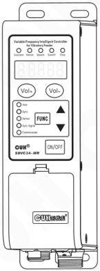

Controller×1

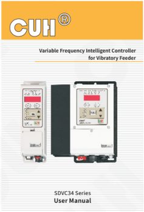

User Manual×1

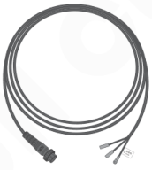

Output Cable×1

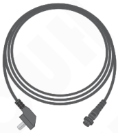

Input Power Cord×1

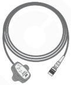

Vibration Sensor×1

---

## 1.2 Indicators Explanation

### Controller with RS485 function

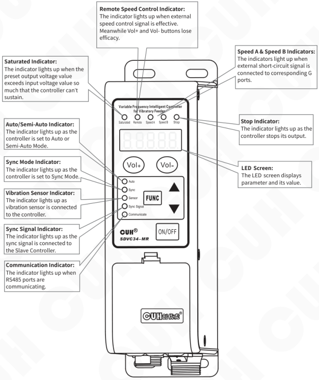

**Remote Speed Control Indicator:**
The indicator lights up when external speed control signal is effective. Meanwhile Vol+ and Vol- buttons lose efficacy.

**Saturated Indicator:**
The indicator lights up when the preset output voltage value exceeds input voltage value so much that the controller can’t sustain.

**Speed A & Speed B Indicators:**
The indicators light up when external short-circuit signal is connected to corresponding G ports.

**Auto/Semi-Auto Indicator:**
The indicator lights up as the controller is set to Auto or Semi-Auto Mode.

**Sync Mode Indicator:**
The indicator lights up as the controller is set to Sync Mode.

**Vibration Sensor Indicator:**
The indicator lights up as vibration sensor is connected to the controller.

**Sync Signal Indicator:**
The indicator lights up as the sync signal is connected to the Slave Controller.

**Communication Indicator:**
The indicator lights up when RS485 ports are communicating.

**Stop Indicator:**
The indicator lights up as the controller stops its output.

**LED Screen:**
The LED screen displays parameter and its value.

---

## Controller with RS485&Counting function

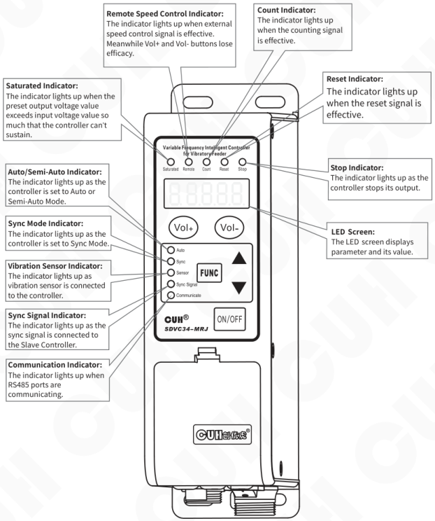

**Remote Speed Control Indicator:**  
The indicator lights up when external speed control signal is effective. Meanwhile Vol+ and Vol- buttons lose efficacy.

**Count Indicator:**  
The indicator lights up when the counting signal is effective.

**Saturated Indicator:**  
The indicator lights up when the preset output voltage value exceeds input voltage value so much that the controller can’t sustain.

**Reset Indicator:**  
The indicator lights up when the reset signal is effective.

**Auto/Semi-Auto Indicator:**  
The indicator lights up as the controller is set to Auto or Semi-Auto Mode.

**Stop Indicator:**  
The indicator lights up as the controller stops its output.

**Sync Mode Indicator:**  
The indicator lights up as the controller is set to Sync Mode.

**LED Screen:**  
The LED screen displays parameter and its value.

**Vibration Sensor Indicator:**  
The indicator lights up as vibration sensor is connected to the controller.

**Sync Signal Indicator:**  
The indicator lights up as the sync signal is connected to the Slave Controller.

**Communication Indicator:**  
The indicator lights up when RS485 ports are communicating.

---

## 1.3 Buttons Explanation

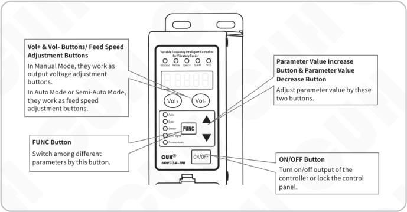

**Vol+ & Vol- Buttons/ Feed Speed Adjustment Buttons**

In Manual Mode, they work as output voltage adjustment buttons.

In Auto Mode or Semi-Auto Mode, they work as feed speed adjustment buttons.

**FUNC Button**

Switch among different parameters by this button.

**Parameter Value Increase Button & Parameter Value Decrease Button**

Adjust parameter value by these two buttons.

**ON/OFF Button**

Turn on/off output of the controller or lock the control panel.

## 1.4 External Parts Explanation

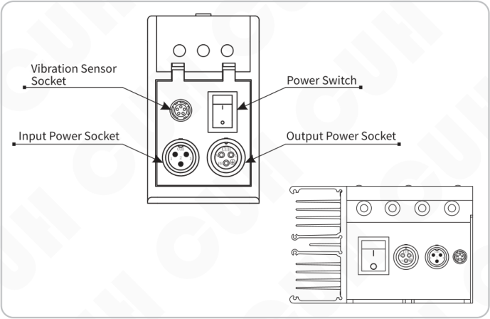

- Vibration Sensor Socket
- Input Power Socket
- Power Switch
- Output Power Socket

---

## 1.5 Wiring Ports Explanation

### SDVC34-MR:

### SDVC34-MRJ:

---

### SDVC34-XLR:

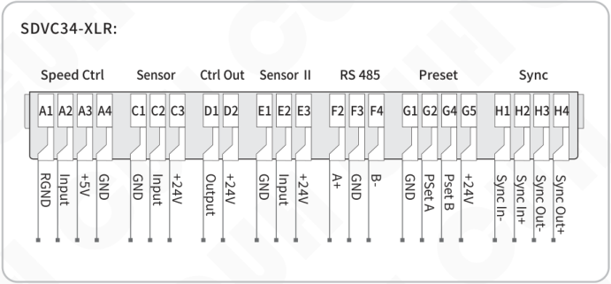

| Function | Port | Signal |
|---|---|---|
| Speed Ctrl | A1 | RGND |
| Speed Ctrl | A2 | Input |
| Speed Ctrl | A3 | +5V |
| Speed Ctrl | A4 | GND |
| Sensor | C1 | GND |
| Sensor | C2 | Input |
| Sensor | C3 | +24V |
| Ctrl Out | D1 | Output |
| Ctrl Out | D2 | +24V |
| Sensor Ⅱ | E1 | GND |
| Sensor Ⅱ | E2 | Input |
| Sensor Ⅱ | E3 | +24V |
| RS 485 | F2 | A+ |
| RS 485 | F3 | GND |
| RS 485 | F4 | B- |
| Preset | G1 | GND |
| Preset | G2 | PSet A |
| Preset | G4 | Pset B |
| Preset | G5 | +24V |
| Sync | H1 | Sync In- |
| Sync | H2 | Sync In+ |
| Sync | H3 | Sync Out- |
| Sync | H4 | Sync Out+ |

## 1.6 Nameplate Explanation

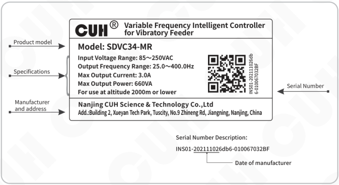

**CUH® — Variable Frequency Intelligent Controller for Vibratory Feeder**

**Product model**

Model: SDVC34-MR

**Specifications**

- Input Voltage Range: 85～250VAC
- Output Frequency Range: 25.0～400.0Hz
- Max Output Current: 3.0A
- Max Output Power: 660VA
- For use at altitude 2000m or lower

**Manufacturer and address**

Nanjing CUH Science & Technology Co.,Ltd

Add.:Building 2, Xueyan Tech Park, Tuscity, No.9 Zhineng Rd, Jiangning, Nanjing, China

**Serial Number**

INS01-202111026db6-010067032BF

Serial Number Description:

INS01-<u>20211102</u>6db6-010067032BF

20211102 → Date of manufacturer

---

## ChapterⅡ Features

### 2.1 Product Introduction

The controller is specially designed for controlling vibratory feeder in automation systems. Combined with the latest electronic technologies and elaborate design, the controller has the following convenient and practical features:

**Auto FM:** Automatic output frequency modulation in real time to ensure the vibratory feeder will always work at its best vibration frequency.

**Auto Constant Speed Control:** Automatic output voltage adjustment in real time to ensure constant preset feed speed regardless of weight change of the feed materials in the vibratory feeder.

**Auto Frequency Measuring :** Automatically measure and output the best vibration frequency of the vibratory feeder.

**Automatic Voltage Regulation:** Eliminate both feed speed variation caused by mains voltage fluctuation and beat effect caused by industrial AC frequency.

**Waveform Sync:** Sync output waveform of slave controllers with that of the master controller to the same frequency and phase to avoid beat effect.

**Remote ON/OFF Control:** The controller has 2 groups of ON/OFF control ports. Switch sensors or PLC can be connected to turn on/off the controller. Soft Startup Time, On Delay, Off Delay and Logical Relation of the ON/OFF Control can also be set.

**Automatic Switch Sensor Type Recognition:** The controller can recognize and adapt to both NPN and PNP type switch sensors .

**Soft Startup:** In order to avoid sudden shock to the feed material and vibratory feeder, the controller can gently increase output voltage/feed speed from 0 to preset value when startup.

**Preset Speeds:** 4 preset feed speeds can be stored and output by external short-circuit signal.

**Acceleration:** Maximum output voltage value of the controller can be increased up to 150% of the input voltage value.

**Max Adjustable Output Voltage:** Max Adjustable Output Voltage can be preset to protect the vibratory feeder from damage caused by high voltage.

**Waveform Index:** Users can balance efficiency and maximum power by adjusting this parameter.

**Remote Speed Control:** Output Voltage/Feed Speed of the controller can be adjusted remotely by an external potentiometer, a PLC, or 1~5V/4~20mA DC signal.

**24V DC Control Output:** The controller can output 24V DC power associated with logical relation setting of the ON/OFF Control to drive a solenoid, an electrical relay or other external devices.

**Counting:** The controller (only SDVC34-MRJ) can count the passing parts and automatically decelerate or stop its output when the quantity of passing parts reaches the preset value.

**Control Panel Lock:** Lock all buttons on the control panel by pressing the ON/OFF button and hold for 2 seconds to prevent misoperation.

**Parameter Lock:** Lock all parameters except Output Voltage/Feed Speed by self defined password to prevent unauthorized operation.

**Controller Reset:** Reset all parameters of the controller to factory defaults.

**RS485 Communication:** All the parameters can be adjusted via RS485 Communication ports.

---

## 2.2 Selection Guide

### 2.2.1 Model Explanation

| Controller Model | Power (VA) | Function |
|---|---|---|
| SDVC34-MR | 660 | RS485 |
| SDVC34-MRJ | 660 | RS485 & Counting |
| SDVC34-XLR | 1320 | RS485 |
| SDVC34-XLRJ | 1320 | RS485 & Counting |

### 2.2.2 Function Explanation

| Function | Common | Counting | RS485 | RS485 & Counting |
|---|---|---|---|---|
| ON/OFF Ctrl of C Ports | √ | √ | √ | √ |
| Remote Speed Control | √ | √ | √ | √ |
| Control Output | √ | √ | √ | √ |
| Speeds Preset | √ | | √ | |
| Count | | √ | | √ |
| ON/OFF Ctrl of E Ports | | | √ | √ |
| Synchronization | | | √ | √ |
| RS 485 | | | √ | √ |
| Vibration Sensor | √ | √ | √ | √ |

---

# Chapter Ⅲ Installation Guide

This chapter introduces the necessary conditions for the use of the controller and how to install and connect it correctly.

## 3.1 Controller Usage Conditions

The controller is powered by AC 110/220V, and the protective ground connection is made through the plug of the power cord. Please provide 110V or 220V, 50Hz/60Hz mains power supply and distribution facilities that meet the standard and ensure that the protective ground wire is correctly connected.

**⚠ Warn** Never connect the controller to 380V AC power, this will cause irreversible serious damage to the controller, possibly resulting in explosion, fire and other safety incidents.

**⚠ Warn** Ensure that the power supply side is reliably grounded. The metal casing of the controller is directly connected to the protective grounding wire. Poor grounding will cause the controller casing to be electrified and cause an electric shock accident.

**Notice** Long time running will generate heat and cause the temperature of the casing to rise. Please install the controller in a well-ventilated environment and fix it well, away from vibration sources.

**Notice** The output of this product is formed by the rectification and inversion of the mains supply, and there is no isolation between its input and output. Therefore, the output poles cannot be connected to the protective ground. When connecting the electromagnet, it is necessary to ensure that the electromagnet coil and the casing have basic insulation capability. Otherwise, leakage of electricity may occur, which may cause electric shock and damage to the controller.

**Notice** This product is a controller used to drive the electromagnet. It must not be connected to a piezoelectric vibratory feeder.

## 3.2 Operation Method of Buttons

a. Short press to define the pressing time greater than 0.1 and less than 2 seconds, and long press to define the pressing time greater than 2 seconds.

b. Short press `Vol+` or `Vol-` to adjust the Output Voltage and Feed Speed of the controller at any LED Interface. The controller will go back to the previous parameter after Common Parameter adjustment.

c. Long press `ON/OFF` to lock or unlock all buttons on the control panel. When in the locked state, all buttons are not adjustable.

d. Enter or exit the Basic Parameters Interface by long press `FUNC`, and switch among the basic parameters by short press `FUNC`, and adjust parameter's value by short press ▼ or ▲.

e. Enter or exit the Advanced Parameters Interface by long press `FUNC` and ▲, and switch among the advanced parameters by short press `FUNC`, and adjust parameter's value by short press ▼ or ▲.

f. Enter or exit the Auto/Sync Parameters Interface by long press `FUNC` and ▼, and switch among the auto/sync parameters by short press `FUNC`, and adjust parameter's value by short press ▼ or ▲.

---

## 3.3 Install and Use

### Step One:

Open the packing box and check the controller and all accessories.

### Step Two:

Connect the wiring terminals of the Output Power Cable to the vibrator's electromagnetic coil.

Align the notch on the aviation plug of the output cable with the triangle mark on the output socket of the controller, and then tighten the nut after connecting the output cable correctly.

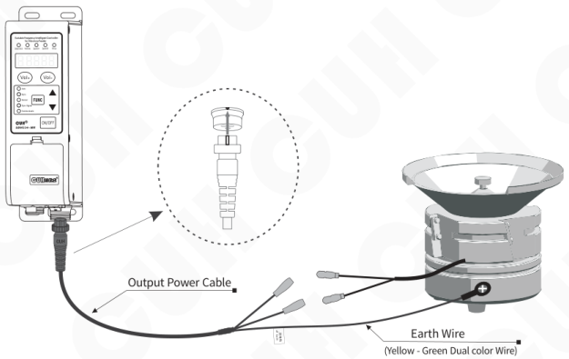

### Note

1. Make sure the vibrator's electromagnetic coils are connected to the two output pins of the Output Power Cable, and the vibrator's metal shell is reliably grounding.
2. It is forbidden to connect piezoelectric loads to the power output, otherwise it may cause an electric shock safety accident!

---

### Step Three:

Connect the Connector of the Input Power Cable to the Input Power Socket of the controller.

Connect the controller side first

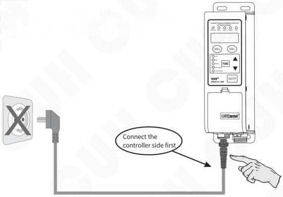

### Step Four:

After confirming that the switch is in the off position, connect the plug of the Input Power Cable to the mains jack.

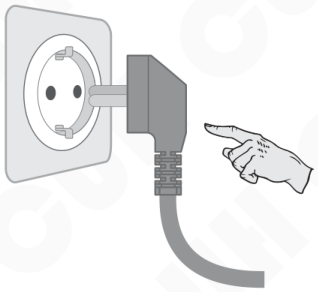

---

# Chapter Ⅳ Parameter Adjustment

Parameters of the controller are classified into 4 types according to different adjustment methods: Common Parameters, Basic Parameters, Advanced Parameters and Auto/Sync Parameters.

## 4.1 Common Parameters

- Press `Vol+` or `Vol-` to adjust Common Parameters.
- The `Vol+` and `Vol-` are designed to adjust Common Parameters only.
- Common Parameters can be adjusted by pressing `Vol+` or `Vol-` even when any other parameter is displayed on the LED screen. The controller will go back to the previous parameter after Common Parameter adjustment.

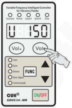

|  | Definition | Symbol | Symbol Image | Range | Default |
|---|---|---|---|---|---|
| Common Parameters | Output Voltage | U |  | 0~250 (V) | 150 |
| Common Parameters | Feed Speed | A |  | 0~3200 | 200 |
| Common Parameters | Keypad Lock | a |  | —— | Current Voltage Value/ Current Feed Speed |

## 4.2 Basic Parameters

- Press `FUNC` and hold for 2 seconds to enter Basic Parameter Adjustment Status.
- Press `FUNC` repeatedly to switch cyclically among different parameters.
- Press ▲ or ▼ button to adjust the parameter value.
- Press `FUNC` again and hold for 2 seconds to exit Basic Parameter Adjustment Status.

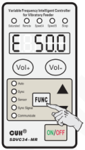

|  | Definition | Symbol | Symbol Image | Range | Default |
|---|---|---|---|---|---|
| Basic Parameters Long press `FUNC` | Output Frequency | E |  | 25.0~400.0 (Hz) | 50.0 |
| Basic Parameters Long press `FUNC` | C Ports On Delay | J | 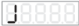 | 0.0~99.9 (s) | 0.2 |
| Basic Parameters Long press `FUNC` | C Ports Off Delay | L |  | 0.0~99.9 (s) | 0.2 |
| Basic Parameters Long press `FUNC` | Soft Startup Time | t |  | 0.0~10.0 (s) | 0.5 |
| Basic Parameters Long press `FUNC` | Maximum count limit (Controller with counter function J suffix) | 3 | 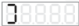 | 0~9999 | 0 |

---

## 4.3 Advanced Parameters

- Press `FUNC` and ▲ buttons simultaneously and hold for 2 seconds to enter Advanced Parameter Adjustment Status.
- Press `FUNC` repeatedly to switch cyclically among different parameters.
- Press ▲ or ▼ to adjust the parameter value.
- Press `FUNC` and ▲ buttons simultaneously again and hold for 2 seconds to exit Advanced Parameter Adjustment Status.

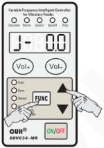

**Advanced Parameters**  
Long press `FUNC` and ▲

| Definition | Symbol | Symbol Image | Range | Default |
|---|---|---|---|---|
| Port E On Delay | J- |  | 0.0~99.9 (s) | 0.0 |
| Port E Off Delay | L- |  | 0.0~99.9 (s) | 0.0 |
| Port D On Delay | Jd |  | 0.0~99.9 (s) | 0.0 |
| Port D Off Delay | Ld |  | 0.0~99.9 (s) | 0.0 |
| Port D Type | rd |  | nPn, PnP, PSP (push-pull) | nPn |
| Port C Logical Relation | F2 | 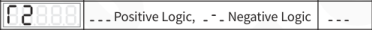 | Positive Logic, Negative Logic | Positive Logic |
| Port E Logical Relation | F1 | 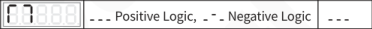 | Positive Logic, Negative Logic | Positive Logic |
| Ctrl Out Logical Relation | F3 | 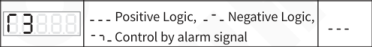 | Positive Logic, Negative Logic, Control by alarm signal | Positive Logic |
| Logic Operation of Main Output | F4 | 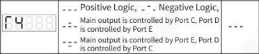 | Positive Logic, Negative Logic, Main output is controlled by Port C, Port D is controlled by Port E Main output is controlled by Port E, Port D is controlled by Port C | Positive Logic |
| Logic Operation of Ctrl Output | F8 |  | Main Logic, The second set of Logic | Main Logic |
| Switch Sensor Type (Controller with RS485 function R suffix) | FA |  | Uto, nPn, PnP | Uto |
| Switch Sensor Type (Controller with count function J suffix) | FA |  | nPn, PnP | nPn |
| Logic Relation of Port C and E | ∩ | 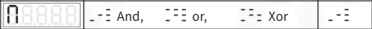 | And, or, Xor | And |
| Count Pulse Logic Direction (Controller with count function J suffix) | Fb | 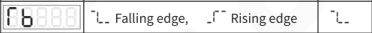 | Falling edge, Rising edge | Falling edge |
| Count Reset Logic Direction (Controller with count function J suffix) | FC | 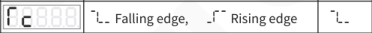 | Falling edge, Rising edge | Falling edge |
| Speed Percent of Count Ends (Controller with count function J suffix) | u |  | 0~100 | 30 |
| Count Number of Ends (Controller with count function J suffix) | n |  | 0~255 | 3 |
| Count Anti-jitter Time (Controller with count function J suffix) | U | 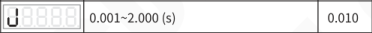 | 0.001~2.000 (s) | 0.010 |

### Advanced Parameters

Long press **FUNC** and **▲**

| Definition | Symbol | Symbol Image | Range | Default |
|---|---|---|---|---|
| Max Adjustable Output Voltage | h | 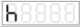 | 0~250 (V) | 250 |
| Output Frequency Lower Limit | e |  | 25.0~390.0 (Hz) | 40.0 |
| Acceleration Index | y | 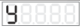 | 100~150 % | 120 |
| Waveform Index | r |  | 0~100 | 100 |
| Temperature Display | C |  | -10.0~80.0 (°C) | Current Temperature |
| Communication Protocol | P | 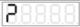 | ASC, rtu | rtu |
| Communication Address | See symbol image |  | 1~31 | 1 |
| Communication Baud Rate | d |  | 0.3~115.2 kbps | 9.6 |
| Parameter Lock Password | q- | 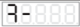 | 0~999 | - - - |
| Power On Status | rd |  | Run, Stop, Follow before power off  | - - - 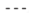 |
| Software Version | Ur |  | —— | Current Version |
| Count Auto Reset Time After Counter Filled (Controller with count function J suffix) | rE |  | 0.0~99.9 (s) | 0.0 |
| Controller Reset | 8.8.8.8.8. | 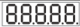 | —— | —— |

---

## Explanation of Some Advanced Parameters

### Max Adjustable Output Voltage: h

Output Voltage Range is 0 to 250 V. Parameter h restricts Maximum Output Voltage to certain value to protect the vibratory feeder from high voltage caused by misoperation.

Remote Speed Control voltage is also affected by this parameter.

### Output Frequency Lower Limit: E.

Output Frequency Range is 25.0 to 390.0 (Hz). Parameter E. restricts Minimum Output Frequency to designated value to protect the vibratory feeder from misoperation.

### Speed Percent of Count Ends: u

Means that when counting enters the final deceleration state, the controller's feeding speed will drop to the percentage of the initial speed.

### Count Number of Ends: n

Refers to the total number of distance counts. After reaching the "end number", the controller enters the counting decrement mode.

### Count Anti-jitter Time: J

The effective time of high level or low level in counter status.

### Acceleration Index: y

Express the maximum output voltage can reach the percentage of the input voltage. After setting, Max output voltage still won't exceed Parameter h value.

### Waveform Index: r

The controller can continuously balance the performance of the highest efficiency-maximum power and minimum noise to meet the higher demands of customers.

### On/Off Delay of Port D: Jd and Ld

The on/off delay range is 0.0~99.9s, the default is 0.0s.

### Port D Type: rd

The control output port can support NPN output, PNP output and push-pull output. therein:

The NPN output is valid as a low level, and the output is invalid as a high-impedance state;

The PNP output is valid as a high level, and the output is invalid as a high-impedance state;

The push-pull output is valid as a high level, and invalid as a low level.

---

### Logic Operation of Ctrl Output: Γ8

The logic of main output and control output, user can set the control output signal follow the main output signal.

### Temperature Display: C

Display internal temperature of the controller in real time. Read only.

### Parameter Lock Password: 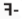

Lock all parameters except Output Voltage Parameter U/ Feed Speed Parameter A by self defined password to prevent unauthorized operation.

Active parameter lock function by setting 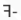 a password, this password still work after power off. When user enter Advanced Parameters, the LED display will show 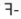 notice need password, if password correct, short press `FUNC` enter advanced parameters settings. If password incorrect, short press `FUNC` will ignored.

### Power On Status: Γd

Express the operating status of the controller after power on.

### Software Version: Ur

Display the current software version of the controller. Read only.

### Count Auto Reset Time After Counter Filled: ΓE

This parameter ΓE will set auto reset delay time after counter full, when delay time reached counter reset to zero, count and reset indicator will light up.

---

## Controller Reset Parameter: 8.8.8.8.8.

Reset all parameters to factory default by this parameter when necessary.

### Controller Reset

**Step1:** Press **FUNC** and ▲ buttons simultaneously and hold for 2 seconds to enter Advanced Parameter Adjustment Status.

**Step2:** Press **FUNC** to switch to the `8.8.8.8.8.` Parameter flashing on the LED screen.

**Step3:** Press ▲ button and hold until `-----` is displayed on the LED screen.

**Step4:** Release ▲ button to finish the Controller Reset process, U150 is displayed on the LED screen.

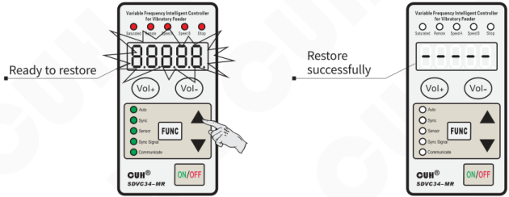

---

## 4.4 Auto/Sync Parameters

- Press **FUNC** and ▼ buttons simultaneously and hold for 2 seconds to enter Auto/Sync Parameter Adjustment Status.
- Press **FUNC** repeatedly to switch cyclically among different parameters.
- Press ▲ or ▼ to adjust the parameter value.
- Press **FUNC** and ▼ buttons simultaneously again and hold for 2 seconds to exit Auto/Sync Parameter Adjustment Status.

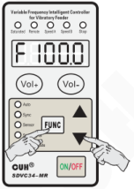

**Auto/Sync Parameters**  
Long press **FUNC** and ▼

| Definition | Symbol | Symbol Image | Range | Default |
|---|---|---|---|---|
| Centre Frequency | F |  | 25.0~400.0 (Hz) | 100.0 |
| Max Offset in Auto FM | n |  | 0.0~180.0 (Hz) | 30.0 |
| Output Voltage Adjustment Method | FS | 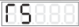 | Auto, Manual (see corresponding symbols)  | - - - |
| Output Frequency Adjustment Method | FG |  | Auto, Manual, Sync (see corresponding symbols) 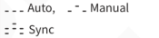 | - - - |
| Output Frequency Auto Adjustment Index | iF | 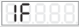 | 0~200 | 20 |
| Amplitude Auto Adjustment Index | PA | 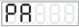 | 0~999 | 60 |
| Amplitude Auto Adjustment Index | iA | 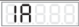 | 0~999 | 50 |
| Feed Speed Display | U | 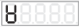 | 0~H | 0 |
| Output Voltage Display | G | 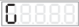 | 0~h (V) | 150 |
| Lower Limit of Voltage | GL | 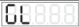 | 0~250 (V) | 0 |
| Lower Limit of Frequency | e |  | 25.0~400.0 (Hz) | 40.0 |
| Max Amplitude Index | P | 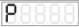 | 0~500 | 500 |
| Max Adjustable Feed Speed | H |  | 0~3200 | 1500 |
| Phase Difference | Y | 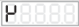 | -180~180 ° | 0 |
| Max Output Voltage in Auto Frequency Measuring Process | b | 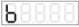 | 0~250 (V) | 100 |
| Frequency Searching Speed | SP |  | 1~7 | 5 |
| Feed Speed Min Adjustment Volume | c |  | 1~10 | 1 |
| Vibration Sensor Number | t |  | 0, 1, 2, 3, 4, 203, 204, 205, 206 | 205 |

---

## Explanation of Auto/Sync Parameters

### Output Voltage Adjustment Method: Γ5

When parameter Γ5 is set to `_-_`, Output Voltage Parameter U will be visible while parameter A hidden. Output Voltage Parameter U can be adjusted manually.

When parameter Γ5 is set to `___` and Vibration Sensor is connected to the controller, Feed Speed Parameter A will be visible while parameter U hidden. Output Voltage will be adjusted automatically based on feedback from the Vibration Sensor to ensure constant preset feed speed.

> When Vibration Sensor is not connected to the controller, even if parameter Γ5 is set to `___`, parameter U will still be visible and manually adjustable.

### Output Frequency Adjustment Method: Γ6

When parameter Γ6 is set to `_-_`, Output Frequency Parameter E can be adjusted manually.

When parameter Γ6 is set to `___` and Vibration Sensor is connected to the controller, Output Frequency Parameter E will be adjusted automatically to resonant frequency (best vibration frequency) of the vibratory feeder based on feedback from the Vibration Sensor. Output Frequency can not be adjusted manually.

When parameter Γ6 is set to  and Sync Signal Wire is connected between Master and Slave Controllers. Output Frequency of Slave Controller will always be consistent with that of Master Controller. Output Frequency of Slave Controller can not be adjusted manually.

> When Vibration Sensor is not connected to the controller, even if parameter Γ6 is set to `___`, Output Frequency will still be adjusted manually.

### Centre Frequency: F

Centre Frequency should be set around resonant frequency of the vibratory feeder so that the controller can find the best vibration frequency more quickly.

### Max Offset in Auto FM: n

Auto FM range is (F ±n) Hz.

Suggested n value is around 30.0Hz.

If Parameter n is set too large, the vibratory feeder may work at improper vibration frequency.

If Parameter n is set too small, flexibility of the vibratory feeder may be affected.

---

### Output Frequency Auto Adjustment Index: 1F

The Auto FM process is running via PID algorithm. "IF" is a frequency integration index.

The larger Parameter "IF" is set, the faster Output Frequency is auto modulated. But too large "IF" value may cause oscillation of the Output Frequency.

### Amplitude Auto Adjustment Index: PA

The controller adjusts Output Voltage automatically via PID algorithm. PA is a speed ratio index.

The larger Parameter PA is set, the faster Output Voltage is auto adjusted. But too large PA value may cause oscillation of the Output Voltage.

### Amplitude Auto Adjustment Index: 1A

The controller adjusts Output Voltage automatically via PID algorithm. IA is a speed integration index.

The larger Parameter IA is set, the faster Output Voltage is auto adjusted. But too large IA value may cause oscillation of the Output Voltage.

### Feed Speed Display: 

The parameter is designed for displaying Feed Speed and it is nonadjustable.

### Output Voltage Display: G

The parameter is designed for displaying Output Voltage and it is nonadjustable.

### Lower Limit of Voltage and Lower Limit of Frequency: GL and 

When Γ3 is set to  (Control by alarm signal), and the controller is in automatic mode (including voltage only automatic, frequency only automatic, or fully automatic) and is working normally (not in external signal and manual stop , not in soft start and fault states), if the output voltage is lower than the lower limit parameter set by GL, or the output frequency is lower than the lower limit parameter set by , then the 24V control output is valid (D1 port output is low). If neither of these situations occurs, the output is invalid (D1 port output is high impedance).

The above three parameters Γ3, GL, and  can be automatically saved after setting, and can be set and read in the RS485 communication.

### Max Amplitude Index: P

Set index P to restrict max amplitude of the vibratory feeder.

### Max Adjustable Feed Speed: H

Feed Speed range is 0 to H. Parameter H restricts Maximum Feed Speed to certain value to protect the vibratory feeder from high voltage caused by misoperation.

Remote Speed Control feed speed is also affected by this parameter.

### Phase Difference: 

Adjust Parameter  to change phase of the output wave, default phase difference is 0°.

---

## Max Output Voltage in Auto Frequency Measuring Process: b

Output Voltage won't exceed the Parameter b value in Auto Frequency Measuring Process to protect the vibratory feeder from damage.

## Frequency Searching Speed: SP

Parameter SP represents Frequency Search Speed. The higher of this value, the faster of frequency searching progress. Parameter SP ranges from 1 to 7.

## Feed Speed Min Adjustment Volume: c

Parameter c represents adjustment volume of the Feed Speed Parameter A at one press of Vol+ or Vol- button. Parameter c ranges from 1 to 10.

## Vibration Sensor Number: ├

The controller is adaptive to 8 different model Vibration Sensors. Set parameter ├ according to the sensor model so that when Feed Speed is set. the controller will output the same voltage value no matter which model Vibration Sensor is connected.

| Parameter Value | Corresponding Model | Specification X-axis/Y-axis/Z-axis acceleration |
|---|---|---|
| 1 | SDVS20-1 | 16g/16g/16g |
| 2 | SDVS20-2 | 35g/35g/—— |
| 3 | SDVS20-3 | 50g/50g/—— |
| 4 | SDVS20-4 | 70g/70g/—— |
| 203 | SDVS203 | 8g/8g/8g |
| 204 | SDVS204 | 16g/16g/16g |
| 205 | SDVS205 | 32g/32g/32g |
| 206 | SDVS206 | 64g/64g/64g |

---

# ChapterⅤ Operating Mode

The controller can be set to work in one of the following five operating modes according to specific application requirements.

- **Manual Mode:** Both Output Voltage and Output Frequency are manually adjusted.
- **Auto Mode:** Both Output Voltage and Output Frequency are auto adjusted based on feedback from the Vibration Sensor to ensure constant preset feed speed and best vibration frequency of the vibratory feeder.
- **Semi-Auto Mode:** Output Voltage is auto adjusted based on feedback from the Vibration Sensor to ensure constant preset feed speed. Output Frequency is manually adjusted.
- **Sync Mode:** In Sync Configuration, if Output Frequency of Controller B is always constant with that of Controller A. We define Controller A as Master Controller, Controller B as Slave Controller and Operating Mode of Controller B as Sync Mode.
- **Counting Mode:** The controller (only SDVC34-MRJ) can count the passing parts and automatically decelerate or stop its output when the quantity of passing parts reaches the preset value.

| Operating Mode | Output Voltage U — Adjustment Method | Output Voltage U — Γ5 Setting | Output Frequency E — Adjustment Method | Output Frequency E — Γ6 Setting | Symbol Image |
|---|---|---|---|---|---|
| Manual Mode | Manual | `_ - _` | Manual | `_ - _` |  |
| Auto Mode | Auto | `- - -` | Auto | `- - -` |  |
| Semi-Auto Mode | Auto | `- - -` | Manual | `_ - _` | [[vcrop:30:1]] / [[vcrop:30:0]] |
| Sync Mode | Manual or Auto | `_ - _` or `- - -` | Auto Sync with Master Controller |  | [[vcrop:30:0]] / [[vcrop:30:1]] / [[vcrop:30:2]] |

## 5.1 Manual Mode

In Manual Mode, both Output Voltage and Output Frequency are manually adjusted.

| Operating Mode | Output Voltage U — Adjustment Method | Output Voltage U — Γ5 Setting | Output Frequency E — Adjustment Method | Output Frequency E — Γ6 Setting | Symbol Image |
|---|---|---|---|---|---|
| Manual Mode | Manual | `_ - _` | Manual | `_ - _` |  |

To simplify operation, Parameter Γ5 and Γ6 are set to `_ _ _` by factory default. Under this setting, the controller will work in Manual Mode if Vibration Sensor is not connected to the controller or work in Auto Mode if Vibration Sensor is connected.

> - If both Γ5 and Γ6 are set to `_ - _`, the controller will work in Manual Mode whether or not Vibration Sensor is connected to the controller.
> - If Vibration Sensor is not connected to the controller, the controller will always work in Manual Mode.

## 5.1.1 Output Voltage Adjustment in Manual Mode

Actual Output Voltage value of the controller can be displayed on the LED screen digitally and accurately.

- Turn on the power switch when Vibration Sensor is not connected to the controller.
- The LED screen displays Output Voltage Parameter U and its value.
- Adjust the U value by pressing `Vol+` or `Vol-`.

## 5.1.2 Output Frequency Adjustment in Manual Mode

With the help of DDS technology, Output Frequency of the controller is always stable and high-precision regardless of time or temperature change.

- Press `FUNC` and hold for 2 seconds to enter Basic Parameter Adjustment Status.
- The LED screen displays Output Frequency Parameter E and its value.
- Adjust the E value by pressing ▲ or ▼ button when Vibration Sensor is not connected to the controller.

---

## 5.2 Auto Mode

In Auto Mode, Vibration Sensor must be connected to the controller. Output Voltage and Output Frequency will be adjusted automatically based on feedback from the Vibration Sensor to ensure constant preset feed speed and best vibration frequency. Output Voltage and Output Frequency can not be adjusted manually.

By factory default, when Vibration Sensor is connected, the controller works in Auto

| Operating Mode | Output Voltage U — Adjustment Method | Output Voltage U — Γ5 Setting | Output Frequency E — Adjustment Method | Output Frequency E — Γ6 Setting |
|---|---|---|---|---|
| Auto Mode | Auto | - - - | Auto | - - - |

> **Note:** The controller will still work in Manual Mode if Vibration Sensor is not connected.

### 5.2.1 Vibration Sensor Installation

#### 5.2.1.1 Connection Method of the Vibration Sensor

Connect the connector of the Vibration Sensor to the Vibration Sensor Socket of the controller.

**Note: Please plug and unplug the vibration sensor when the controller is powered off.**

---

## 5.2.1.2 Vibration Sensor Installation Guide

Fix Vibration Sensor to the smooth surface of vibrator and Installation direction arbitrary, and installation methods of Vibration Sensor are shown as below:

- Method 1: As shown in Fig. 1

  Advantage: Easy installation

- Method 2: As shown in Fig. 2

  Note: Don't make the vibration sensor pressed by feeding bowl.

- Method 3: weld a bracket on the vibrator and fix the vibration sensor on the bracket. As shown in Fig. 3

  Recommended Dimensions of bracket of Vibration is shown in Fig.4.

- Not recommend installation method, As shown in Fig. 5 and Fig. 6.

  If the installation location is not suitable, the vibration sensor can't feedback the resonant frequency accurately and the controller will execute searching the resonant frequency all along.

---

## 5.2.2 Feed Speed Adjustment in Auto Mode

- Turn on the power switch when Vibration Sensor is connected to the controller. The Vibration Sensor Indicator lights up.
- The LED screen displays Feed Speed Parameter A and its value.
- Adjust the A value by pressing **Vol+** or **Vol-** to desired feed speed.

## 5.2.3 Auto Frequency Measuring in Auto Mode

By Auto Frequency Measuring, the controller detects the best vibration frequency of the vibratory feeder and sets all related parameters automatically. The only thing users need to do is to set Feed Speed Parameter A, then the controller will work in the best status.

- Press ▲ and ▼ simultaneously and hold for 3 seconds when Vibration Sensor is connected to the controller to start Auto Frequency Measuring. Output Frequency Parameter E and its value will be displayed on the LED screen in the measuring process.
- After the Auto Frequency Measuring process, the controller will automatically set all related parameters including Centre Frequency Parameter F, Max Offset in Auto FM Parameter n, Output Frequency Auto Adjustment Index IF, Amplitude Auto Adjustment Index PA, Amplitude Auto Adjustment Index IA, Phase Difference Parameter , Output Voltage Adjustment Method Parameter Γ5 and Output Frequency Adjustment Method Parameter Γ6 will be set to \_\_\_.

> - If the LED screen displays Err02 the moment Auto Frequency Measuring Process start, it is normal, because of parameter b is set too high.
> - If you want to cancel Auto Frequency Measuring Process, Press **ON/OFF**. Then the controller will go back to the status before Auto Frequency Measuring.

**After Feed Speed setting and Auto Frequency Measuring, the controller will work in the best status at desired feed speed.**

---

## 5.3 Semi-Auto Mode

In Semi-Auto Mode, Vibration Sensor must be connected to the controller and Parameter Γ6 must be set to `_-_`.

Output Voltage will be adjusted automatically based on feedback from the Vibration Sensor to ensure constant preset feed speed. Output Frequency will be adjusted manually.

| Operating Mode | Output Voltage U — Adjustment Method | Output Voltage U — Γ5 Setting | Output Frequency E — Adjustment Method | Output Frequency E — Γ6 Setting | Symbol Image |
|---|---|---|---|---|---|
| Semi-Auto Mode | Auto | `---` | Manual | `_-_` | Γ5:  Γ6:  |

> **Note:** The controller will still work in Manual Mode if Vibration Sensor is not connected.

### 5.3.1 Vibration Sensor Installation

The same with Section 5.2.1.

### 5.3.2 Semi Auto Mode Setup

- Turn on the power switch when Vibration Sensor is connected to the controller. The Vibration Sensor Indicator lights up.
- Press `FUNC` and ▼ buttons simultaneously and hold for 2 seconds to enter Auto/Sync Parameter Adjustment Status.
- Press `FUNC` repeatedly to switch to Output Frequency Adjustment Method Parameter Γ6.
- Press ▲ or ▼ button to set Γ6 to `_-_`.

---

### 5.3.3 Feed Speed Adjustment in Semi-Auto Mode

- Adjust the A value by pressing Vol+ or Vol- to desired feed speed.

### 5.3.4 Output Frequency Adjustment in Semi-Auto Mode

- Press **FUNC** and hold for 2 seconds to enter Basic Parameter Adjustment Status.
- The LED screen displays Output Frequency Parameter E and its value.
- Adjust the E value by pressing ▲ or ▼ button.

---

## 5.4 Sync Mode

In Sync Mode, sync signal wire must be connected between the Master and Slave Controllers. Output Frequency of the controller(Slave Controller) is always consistent with that of Master Controller. Output Voltage of the controller(Slave Controller) can be adjusted manually or automatically.

| Operating Mode | Output Voltage U — Adjustment Method | Output Voltage U — Γ5 Setting | Output Frequency E — Adjustment Method | Output Frequency E — Γ6 Setting | Symbol Image |
|---|---|---|---|---|---|
| Sync Mode | Manual or Auto | Two symbol settings (see image, joined by "or") | Auto Sync with Master Controller | See image | Γ5: ；Γ6:  |

Sync Mode apply to the situation that there are more than one controller controlling several vibratory feeders in the feed system, output of the controllers are not synchronous so they interfere with each other (Beat Effect). Sync Mode is designed to eliminate Beat Effect as output waveform of Master and Slave Controllers are exactly synchronous.

Controller S is not set to synchronization mode, and the output waveforms of the two controllers are not synchronized.

Controller S is set to synchronization mode, and the output waveforms of the two controllers are completely synchronized.

---

## 5.4.1 Connection Method of the Sync Signal Wire

### Step 1:

Open the cover plates of the signal control ports boxes of both controllers.

### Step 2:

Connect the Sync Signal Wire between Master and Slave controllers according to the schematic diagram below.

One Master Controller could drive several Slave Controllers.

> The slave controller will halt its output when sync signal is unstable or not connected. And the sync indicator will go out.

---

## 5.4.2 Sync Mode Applications

### • Sub-Pattern 1

| Controller | Output Voltage U — Adjustment Method | Output Voltage U — Γ5 Setting | Output Frequency E — Adjustment Method | Output Frequency E — Γ6 Setting | Symbol Image |
|---|---|---|---|---|---|
| Master Controller | Manual | See symbol image | Manual | See symbol image | Γ5：；Γ6： |
| Slave Controller | Manual | See symbol image | Auto Sync with Master Controller | See symbol image | Γ5：；Γ6： |

### • Sub-Pattern 2

| Controller | Output Voltage U — Adjustment Method | Output Voltage U — Γ5 Setting | Output Frequency E — Adjustment Method | Output Frequency E — Γ6 Setting | Symbol Image |
|---|---|---|---|---|---|
| Master Controller | Auto | — — — | Auto | — — — | Γ5、Γ6： |
| Slave Controller | Manual | See symbol image | Auto Sync with Master Controller | See symbol image | Γ5：；Γ6： |

### • Sub-Pattern 3

| Controller | Output Voltage U — Adjustment Method | Output Voltage U — Γ5 Setting | Output Frequency E — Adjustment Method | Output Frequency E — Γ6 Setting | Symbol Image |
|---|---|---|---|---|---|
| Master Controller | Auto | — — — | Manual | See symbol image | Γ5：[[vcrop:40:0]]；Γ6：[[vcrop:40:1]] |
| Slave Controller | Manual | See symbol image | Auto Sync with Master Controller | See symbol image | Γ5：[[vcrop:40:1]]；Γ6：[[vcrop:40:2]] |

### • Sub-Pattern 4

| Controller | Output Voltage U — Adjustment Method | Output Voltage U — Γ5 Setting | Output Frequency E — Adjustment Method | Output Frequency E — Γ6 Setting | Symbol Image |
|---|---|---|---|---|---|
| Master Controller | Manual | See Γ5 image in right column | Manual | See Γ6 image in right column | Γ5： Γ6： |
| Slave Controller | Auto | See Γ5 image in right column | Auto Sync with Master Controller | See Γ6 image in right column | Γ5： Γ6： |

### • Sub-Pattern 5

| Controller | Output Voltage U — Adjustment Method | Output Voltage U — Γ5 Setting | Output Frequency E — Adjustment Method | Output Frequency E — Γ6 Setting | Symbol Image |
|---|---|---|---|---|---|
| Master Controller | Auto | --- | Auto | --- | Γ5、Γ6： |
| Slave Controller | Auto | --- | Auto Sync with Master Controller | See symbol image | Γ5：[[vcrop:42:0]]；Γ6： |

### • Sub-Pattern 6

| Controller | Output Voltage U — Adjustment Method | Output Voltage U — Γ5 Setting | Output Frequency E — Adjustment Method | Output Frequency E — Γ6 Setting | Symbol Image |
|---|---|---|---|---|---|
| Master Controller | Auto | --- | Manual | See symbol image | Γ5：[[vcrop:42:0]]；Γ6： |
| Slave Controller | Auto | --- | Auto Sync with Master Controller | See symbol image | Γ5：[[vcrop:42:0]]；Γ6：[[vcrop:42:1]] |

---

## 5.5 Counting Mode

Please ignore this chapter if the controller does not have the counting function.

SDVC34 series models with suffix J have a built-in counting function that can count the passing parts and automatically decelerate or stop its output when the quantity of passing parts reaches the preset value.

**Deceleration before stop function:** As shown in the diagram below, the controller outputs normal feed speed set by the user until the counting number reaches "J-C" when the controller instantly switch to output a preset lower feed speed to prevent overfeeding. When counting number reaches counting target value J, the controller stops its output immediately.

The super anti-jitter feature of the counting function was specially designed for solving the vibrating passing parts miscounting problem by setting the counting signal lasting time. Only when the counting pulse signal has lasted no less than time b, it can be confirmed. This feature effectively improves counting reliability.

Please refer to the diagram below.

**Note:**

Anti-jitter Stabilization Time means the Stabilization Time of high level and low level. A valid pulse is consist of continuously active high level and low level, then the counter plus one.

---

## 5.5.1 Use Method

If the counter reset signal set invalid with short-term and then restored to valid, the counter value is cleared and the counter starts again, which is a reset. During the short period of time (not exceeding 2 seconds) when leaving the counter state, the controller will temporarily turn off the output. Therefore, this signal can be used as a counter reset signal as needed.

In the normal counting state, the counter can be reset by using the "▲" or "▼" keys on the panel. The counting pulse signal is input through the "N2" port of the controller interface, and the counter value is displayed in the "" state. If the `FUNC` is used to enter other parameter adjustment states, the counting work will not stop and the counting value will not be lost.

> There is only one way for the controller to enter the counting state, which is to keep the counting control signal (enable/reset signal "N3") valid. After entering the counting state, the initial state is displayed as "", and the counting indicator and reset indicator lights are lights up at the same time, indicating that the counting pulse signal can be accepted and counting begins.

---

## 5.5.2 Connection Method

Wiring method when ΓA state is NPN

Wiring method when ΓA state is PNP

---

## 5.5.3 Count Pulse Logic Direction

- Press `FUNC` and ▲ buttons simultaneously and hold for 2 seconds to enter Advanced Parameter Adjustment Status.
- Press `FUNC` repeatedly to switch to Parameter Γb.
- Press ▲ or ▼ button to adjust Γb.

> - When the Γb active edge is set to the falling edge, the counting pulses are counted on the falling edge that changes from "high level" to "low level".
> - When the Γb active edge is set to rising edge, the counting pulses are counted at the rising edge that changes from "low level" to "high level".

## 5.5.4 Count Reset Logic Direction

- Press `FUNC` and ▲ buttons simultaneously and hold for 2 seconds to enter Advanced Parameter Adjustment Status.
- Press `FUNC` repeatedly to switch to Parameter Γc.
- Press ▲ or ▼ button to adjust Γc.

> - When the Γc active edge is set to the falling edge and the counting control pin is not connected to any signal, the controller does not enter the "counting" state; when the signal of this pin is pulled to the "low level", the controller enters the "counting" state.
> - When the Γc active edge is set to rising edge and no signal is connected to the counting control pin, the controller enters the "counting" state; when the signal of this pin is pulled to "low level", the controller exits the "counting" state.

---

## 5.5.5 Explanation of Count Parameters

### Maximum count limit: 

- In counting state, Press **FUNC** to enter Parameter [[vcrop:47:0]].
- Press ▲ or ▼ button to adjust parameter value.

When the counter value reaches this threshold value, the controller counts saturated, the controller output is stopped, and the feeding is also stopped until the counter is reset. After entering the counting saturation state, if the counting pulse continues to be sent, the counting will continue, but the controller output will remain stopped.

### Count Number of Ends: n

- Press **FUNC** and ▲ buttons simultaneously and hold for 2 seconds to enter Advanced Parameter Adjustment Status.
- Press **FUNC** repeatedly to switch to Parameter n.
- Press ▲ or ▼ button to adjust parameter value.

When the number of counting values from the counting limit reaches the number of counting ends, the controller enters the end state, and the feeding speed is reduced to the end speed.

When not using the ends deceleration function, setting this parameter to 0 can make the deceleration function ineffective.

---

## Speed Percent of Count Ends: u

- Press `FUNC` and ▲ buttons simultaneously and hold for 2 seconds to enter Advanced Parameter Adjustment Status.
- Press `FUNC` repeatedly to switch to Parameter u.
- Press ▲ or ▼ button to adjust parameter value.

When the counting enters the final counting state, the feeding speed of the controller will decrease as a percentage of the initial speed.

## Count Anti-jitter Time: J

- Press `FUNC` and ▲ buttons simultaneously and hold for 2 seconds to enter Advanced Parameter Adjustment Status.
- Press `FUNC` repeatedly to switch to Parameter J.
- Press ▲ or ▼ button to adjust parameter value.

Since the anti-jitter time is the stabilization time of the high and low levels respectively, the value of this parameter should be less than:

$$
\frac{1}{2} \times \frac{1}{\text{the maximum number of counts per second}}
$$

The maximum count per second should be based on the actual situation and the maximum possible speed of the specific equipment during operation. An overestimation of the speed will cause the anti-jitter function to fail to achieve the desired effect, and a too low value will result in missed counts.

---

# Chapter Ⅵ Signal Control

Signal Control includes: C Ports ON/OFF Control, E Ports ON/OFF Control, Remote Speed Control, Storage and Output of Preset Speeds, RS485 Communication and 24V DC Control Output.

## 6.1 ON/OFF Control of C Ports

Output of the controller can be turned on or off by any kind of switch sensor or PLC via C Ports.

### 6.1.1 Connection Method of C Ports

**Connection Method of the Proximity Sensor**

**Step 1:**

Open the cover plates of the signal control ports boxes of the controller.

**Step 2:**

Connect the proximity sensor to C Ports according to the diagram.

**Convention**

The blue wire represents ground wire  
The black wire represents signal wire  
The brown wire represents power wire

---

## Connection Method of the Photoelectric Couple Sensor

---

## Connection Method of the Photoelectric Reflective Sensor

---

## Connection Method of the Fiber Optic Couple Sensor

---

## Connection Method of the PLC

### Connection Method of the NPN output of the PLC

### Connection Method of the PNP output of the PLC

Note: Relay output, NPN output and PNP output of the PLC, any one of them can turn on/off the controller.

Note: When use PLC set the controller on and off, please use 24V output type PLC.

---

## 6.1.2 ON/OFF Delay of C Ports

If you want the controller to start outputting after a period of time since receiving the C Ports ON Control Signal, adjust Parameter J.

If you want the controller to go on outputting for a period of time after receiving the C Ports OFF Control Signal, adjust Parameter L.

### C Ports ON Delay

The period of time from the controller receives the C Ports ON Control Signal to starting output.

- Press `FUNC` and hold for 2 seconds to enter Basic Parameter Adjustment Status.
- Press `FUNC` repeatedly to switch to Parameter J.
- Press ▲ or ▼ button to adjust the value. The parameter unit is second, and the adjustment accuracy is 0.1.

### C Ports OFF Delay

The period of time from the controller receives the C Ports OFF Control Signal to cutting off output.

- Press `FUNC` and hold for 2 seconds to enter Basic Parameter Adjustment Status.
- Press `FUNC` repeatedly to switch to Parameter L.
- Press ▲ or ▼ button to adjust the value. The parameter unit is second, and the adjustment accuracy is 0.1.

---

## 6.1.3 ON/OFF Control Logical Relation of C Ports

By factory default, the controller runs when C Ports receives no signal. But in some other applications the controller needs to be stop when C Ports receives no signal.

Adjust Parameter Γ2 to meet either of the requirements.

- Press **FUNC** and ▲ buttons simultaneously and hold for 2 seconds to enter Advanced Parameter Adjustment Status.
- Press **FUNC** repeatedly to switch to Parameter Γ2.
- Press ▲ or ▼ button to change the logical relation.

Parameter Γ2 is set to `___` by default.

- When Parameter Γ2 is set to `___`, output of the controller will be on when C Ports receives no signal.
- When Parameter Γ2 is set to `_-_`, output of the controller will be off when C Ports receives no signal.

---

## 6.2 ON/OFF Control of E Ports

Output of the controller can be turned on or off by any kind of switch sensor or PLC via E Ports.

C Ports ON/OFF Control and E Ports ON/OFF Control are independent of each other.

### 6.2.1 Connection Method of E Ports

**Connection Method of the Proximity Sensor**

**Step 1:**

Open the cover plates of the signal control ports boxes of the controller.

**Step 2:**

Connect the proximity sensor to E Ports according to the diagram.

**Convention**

- The blue wire represents ground wire
- The black wire represents signal wire
- The brown wire represents power wire

Connection Method of other kinds of Switch Sensors and PLC to E Ports are similar to those of C Ports.

---

## 6.2.2 ON/OFF Delay of E Ports

If you want the controller to start outputting after a period of time since receiving the E Ports ON Control Signal, adjust Parameter J-.

If you want the controller to go on outputting for a period of time after receiving the E Ports OFF Control Signal, adjust Parameter L-.

E Ports ON/OFF Delay is the same with C Ports ON/OFF Delay by factory default.

E Ports ON/OFF Delay can also be set independently by adjusting Parameter J- and Parameter L-.

### E Ports ON Delay

The period of time from the controller receives the E Ports ON Control Signal to starting output.

- Press **FUNC** and ▲ buttons simultaneously and hold for 2 seconds to enter Advanced Parameter Adjustment Status.
- Press **FUNC** to switch to Parameter J-.
- Press ▲ or ▼ button to adjust the value. The parameter unit is second, and the adjustment accuracy is 0.1.

### E Ports OFF Delay

The period of time from the controller receives the E Ports OFF Control Signal to cutting off output.

- Press **FUNC** and ▲ buttons simultaneously and hold for 2 seconds to enter Advanced Parameter Adjustment Status.
- Press **FUNC** to switch to Parameter L-.
- Press ▲ or ▼ button to adjust the value. The parameter unit is second, and the adjustment accuracy is 0.1.

> Parameter J- and L- are set to ___ , meaning the same value with that of Parameter J and L.

---

## 6.2.3 ON/OFF Control Logical Relation of E Ports

By factory default, the controller runs when E Ports receives no signal. But in some other applications the controller needs to be stop when E Ports receives no signal.

Adjust Parameter Γ7 to meet either of the requirements.

- Press **FUNC** and ▲ buttons simultaneously and hold for 2 seconds to enter Advanced Parameter Adjustment Status.
- Press **FUNC** repeatedly to switch to Parameter Γ7.
- Press ▲ or ▼ button to change the logical relation.

Parameter Γ7 is set to `___` by default.

- When Parameter Γ7 is set to `___`, output of the controller will be on when E Ports receives no signal.
- When Parameter Γ7 is set to `_-_`, output of the controller will be off when E Ports receives no signal.

---

## 6.3 Common Parameters of C Ports and E Ports

### 6.3.1 Logical Relation of C Ports and E Ports

Parameter Π determines the reaction of the controller when both C Ports and E Ports are effective.

- Press `FUNC` and ▲ buttons simultaneously and hold for 2 seconds to enter Advanced Parameter Adjustment Status.
- Press `FUNC` repeatedly to switch to Parameter Π.
- Press ▲ or ▼ button to change the logical relation.

**Logical Relation: AND** 

Output of the controller will be ON only when both of the Ports require the controller to run.

**Logical Relation: OR** 

Output of the controller will be ON when either or both of the Ports require the controller to run.

**Logical Relation: XOR** 

Output of the controller will be ON only when one of the Ports require the controller to run and the other require the controller to stop.

Default Logical Relation is AND.

---

## 6.3.2 Switch Sensor Type

The controller can automatically recognize type of the Switch Sensor, NPN or PNP.

Users can also set the Switch Sensor Type manually.

- Press `FUNC` and ▲ buttons simultaneously and hold for 2 seconds to enter Advanced Parameter Adjustment Status.
- Press `FUNC` repeatedly to switch to Parameter ΓA.
- Press ▲ or ▼ button to change the value.

> **Uto:** Switch Sensor Type automatic recognition
>
> **nPn:** NPN Type Switch Sensor
>
> **PnP:** PNP Type Switch Sensor

Note: In controller with counting function, ΓA only have two states, nPn and PnP.

---

## 6.3.3 Logic Operation of Main Output

- Press `FUNC` and ▲ buttons simultaneously and hold for 2 seconds to enter Advanced Parameter Adjustment Status.
- Press `FUNC` repeatedly to switch to Parameter Γ4.
- Press ▲ or ▼ button to change the value.

Parameter Γ4 is set to ___ by default.

- When Parameter Γ4 is set to , Main output and control output are related. Controlled by the logical relation between port C and port E and ON/OFF button.
- When Parameter Γ4 is set to , Main output and control output are separated. Main output is controlled by the ON/OFF button. Control output is controlled by the logical relation between port C and port E.
- When Parameter Γ4 is set to , Main output is controlled by the ON/OFF button and port C. Control output is controlled by port E.
- When Parameter Γ4 is set to , Main output is controlled by the ON/OFF button and port E. Control output is controlled by port C.

---

## 6.4 Remote Speed Control

Output Voltage/Feed Speed can be controlled by a potentiometer or a 1~5V/4~20mA DC Control Signal remotely.

When Remote Speed Control voltage exceeds 0.5V, it becomes effective to the controller while "Vol+" and "Vol-" buttons lose efficacy.

In the process of Remote Speed Control, the Remote Speed Control Indicator will light up and the LED Screen will display Output Voltage/Feed Speed and its value.

### Connection Method of the Remote Speed Control Potentiometer

## Connection Method of the Remote Speed Control PLC

| Remote Speed Control Signal | Output Voltage U/Feed Speed A |
|---|---|
| Less than 0.5V | Controlled by Vol+ and Vol- buttons |
| 0.5V~1V | Output Voltage U=20V/Feed Speed A=0 Controlled by Remote Speed Control Signal |
| 1~5V/4~20mA | Output Voltage U/Feed Speed A is Linearly Controlled by Remote Speed Control Signal |

## 6.5 Control Output

The controller can output 24V DC Control power to drive a solenoid valve, an electrical relay or a PLC etc coordinating with C Ports/E Ports ON/OFF Control.

### 6.5.1 Connection Method of Control Output

**Connection to a solenoid valve**

- The controller can drive a solenoid valve which rated voltage is 24V and rated power up to 4W.

**Connection to an electrical relay**

- The controller can drive an electrical relay which rated voltage is 24V and rated power up to 4W.

Note: Please connect the positive and negative poles of the relay or solenoid valve correctly: D2 is connected to the positive pole, D1 is connected to the negative pole. Reversing the connection may cause short circuit damage to the control output.

---

## 6.5.2 Logical Relation of Control Output

- Press **FUNC** and ▲ buttons simultaneously and hold for 2 seconds to enter Advanced Parameter Adjustment Status.
- Press **FUNC** repeatedly to switch to Parameter Γ3.
- Press ▲ or ▼ button to change the logical relation.

Parameter Γ3 is set to ___ by default.

- If Parameter Γ3 is set to , Control Output will be on when Output of the controller is on.
- If Parameter Γ3 is set to , Control Output will be off when Output of the controller is on.
- If Parameter Γ3 is set to , Control Output only related to alarm signal witch define by parameter "GL" lower limit of voltage and "e" lower limit of frequency. see chapter 4.4 get detail.

---

## 6.5.3 Logic Operation of Ctrl Output

- Press `FUNC` and ▲ buttons simultaneously and hold for 2 seconds to enter Advanced Parameter Adjustment Status.
- Press `FUNC` repeatedly to switch to Parameter Γ8.
- Press ▲ or ▼ button to change the value.

Parameter Γ8 is set to ___ by default.

- When Γ8 set to main logic, control output and main output share same logic settings.
- When Γ8 set to second logic, control output is controlled by second logic settings and main output controlled by main logic settings.

---

## 6.6 Storage and Output of Preset Speeds

This function is suitable for controllers without counting function.

The controller can store and output 4 different Preset Speeds. The 4 kinds of ON/OFF combination of Speed A Indicator and Speed B Indicator correspond respectively to Speed 1, Speed 2, Speed 3and Speed 4.

| Preset Speed | G1 & G2 Ports — Speed A Indicator | G1 & G2 Ports — Switch 1 | G3 & G4 Ports — Speed B Indicator | G3 & G4 Ports — Switch 2 |
|---|---|---|---|---|
| Speed 1 | ON | Closed | OFF | Open |
| Speed 2 | OFF | Open | ON | Closed |
| Speed 3 | ON | Closed | ON | Closed |
| Speed 4 | OFF | Open | OFF | Open |

> Manual voltage mode, 4 setting speeds related to 4 voltage setting U  
> Manual frequency mode, 4 setting speeds related to 4 output frequency E  
> Auto voltage mode, 4 setting speeds related to 4 feed speed A  
> Auto frequency mode, 4 setting speeds related to 4 centre frequency F

### Connection Method when ΓA set to NPN

---

## Connection Method when ΓA set to PNP

### Storage of Preset Speeds

Take the storage of Speed 1 for example:

- Close K1, Speed A Indicator lights up, open K2, Speed B Indicator goes off.
- To get desired feed speed:
  - In Manual Mode, adjust Output Voltage parameter U and Output Frequency parameter E.
  - In Auto Mode, adjust Feed Speed parameter A.
  - In Semi-Auto Mode, adjust Feed Speed parameter A and Output Frequency parameter E.
- After the controller output stabilizes, press `FUNC` and ▼ buttons simultaneously and hold for 2 seconds, at this time, "SAVE" is displayed on the LED screen, express Speed 1 has been saved.

### Output of Preset Speeds

Take the output of Speed 1 for example:

- Close K1 again, Speed A Indicator lights up, open K2 again, Speed B Indicator goes off.
- The controller will output Speed 1 instantly.

---

## 6.7 RS485 Communication

All parameters of the controller can be adjusted remotely via RS485 Communication Ports.

### 6.7.1 RS485 Communication Address

Parameter  represents ID number of the controller in RS485 Communication.  
Range of the parameter: 1 to 31.  
Make sure Communication Address of all controllers in the same network are different to distinguish controllers from each other.

- Press **FUNC** and ▲ buttons simultaneously and hold for 2 seconds to enter Advanced Parameter Adjustment Status.
- Press **FUNC** repeatedly to switch to Parameter [[vcrop:69:0]].
- Press ▲ or ▼ button to change the value.

### 6.7.2 RS485 Communication Baud Rate

RS485 Communication Baud Rate can be: 3, 12, 24, 96, 192, 576 or 1152.  
Unit: 0.1 Kbps.  
Default Value: 9.6 Kbps.  
Controllers in the same network should use the same Baud Rate.

- Press **FUNC** and ▲ buttons simultaneously and hold for 2 seconds to enter Advanced Parameter Adjustment Status.
- Press **FUNC** repeatedly to switch to Parameter .
- Press ▲ or ▼ button to change the value.

---

## 6.7.3 RS485 Communication Protocol

RS485 communication type selection, Modbus ASCII type and Modbus RTU type.

Default RTU.

- Press `FUNC` and ▲ buttons simultaneously and hold for 2 seconds to enter Advanced Parameter Adjustment Status.
- Press `FUNC` repeatedly to switch to Parameter .
- Press ▲ or ▼ button to change the value.

RS485 Communication Protocol is available in the Download column of our official website: **www.cuh-controller.com**

Note: Due to the limited number of times the controller Non volatile memory can be erased, the 485 save instruction needs to be manually executed after modifying the parameters to avoid frequently sending save instructions through the program.

---

# Chapter Ⅶ Security Functions

### Automatic Voltage Regulation

Eliminate both feed speed variation caused by mains voltage fluctuation and beat effect caused by industrial AC frequency.

### Short-circuit Protection

When output of the controller is short-circuit, the controller will stop its output and display Err01 on the LED screen until restarted.

### Overcurrent Protection

If output current exceeds its rated value by misoperation, the controller will stop its output to ensure operating safety and display Err02 on the LED screen.

### Overheat Protection

If internal temperature of the controller exceeds 65°C, the controller will stop its output to protect itself and display Err03 on the LED screen until internal temperature fall below 60°C.

### Overload Protection

When Vibration Sensor is connected to the controller, if vibration amplitude exceeds Max Amplitude Index setting, the controller will turn down its output to protect the vibratory feeder.

### Overvoltage Protection

If input voltage is much higher than rated input voltage range, fuse inside the controller will be blown to protect the controller from further damage. Please contact us for repair.

---

## Chapter Ⅷ Appendix

### 8.1 Dimensions

SDVC34-MR/MRJ (unit: mm)

| Dimensions range | tolerance |
|---|---|
| 0~3 | ±0.05 |
| 3~10 | ±0.1 |
| 10~30 | ±0.15 |
| 30~80 | ±0.2 |
| 80~180 | ±0.3 |
| >180 | ±0.5 |

This tolerance table is applicable to all products in this series.

---

## SDVC34-XL Series (unit: mm)

## SDVC34-U Series (unit: mm)

## 8.2 Input and Output Circuit Diagrams

### Port A: Remote Speed Control

### Port C: Sensor

### Port D: Control Output

---

### Port E: Sensor Ⅱ

### Port F: RS485

### Port G: Speed Preset

## Port H: Synchronization

## Port N: Count

---

## 8.3 Technical Specifications

| Item | Min | Typical | Max | Unit | Note |
|---|---|---|---|---|---|
| Input Voltage | 85 | 220 | 250 | V | AC RMS |
| Adjustable Output Voltage Range | 0 | —— | 250 | V | Lower than 150% of Input Voltage |
| Voltage Adjustment Accuracy | | 1 | | V | |
| Voltage Regulation Accuracy | 0 | —— | 10 | % | ΔVout/ΔVin |
| Adjustable Output Current Range | 0 | —— | 3 | A | SDVC34-MR/MRJ |
| Adjustable Output Current Range | 0 | —— | 6 | A | SDVC34-XLR/XLRJ |
| Output Power | 0 | —— | 660 | VA | SDVC34-MR/MRJ |
| Output Power | 0 | —— | 1320 | VA | SDVC34-XLR/XLRJ |
| Output Frequency | 25 | —— | 400 | Hz | |
| Frequency Adjustment Accuracy | | 0.1 | | | |
| Output Waveform | | Sine | | | |
| Soft Start Time | 0 | —— | 10 | s | Default value: 0.5 |
| On/Off Delay Time Range | 0 | —— | 99.9 | s | Default value: 0.2 |
| On/Off Delay Time Accuracy | | 0.1 | | s | |
| Overheat Protection Trigger Temperature | 60 | 65 | 65 | °C | |
| Digital Communication | | ModBus 485 | | | |
| DC Control Output Voltage | 22 | 24 | 26 | V | |
| DC Control Output Current | 0 | —— | 350 | mA | |
| Analog Control Signal | | 1~5/ 4~20 | | V/ mA | Remote Speed Control |
| Digital Control Signal | | 24 | | V | Switching Signal |
| Adjustment Method | | 6 | | Button | |
| Standby Power Consumption | —— | 5 | —— | W | |
| Display Method | | 5 | | Digit | LED |
| Ambient Temperature | 0 | 25 | 40 | °C | No Condensation |
| Ambient Humidity | 10 | 60 | 85 | % | No Condensation |
| Storage Ambient Temperature | -20 | 25 | 65 | °C | No Condensation |

## 8.4 Troubleshooting Suggestions and Error Explanations

| Fault Phenomenon | Troubleshooting Suggestions | Symbol Image |
|---|---|---|
| No display on LED screen after power on startup | ◆ Make sure the mains jack is live. ◆ Make sure the Input Power Cable is reliably connected. | |
| LED screen displays normally but vibratory feeder has no output or sound | ◆ Make sure the Output Power Cable is reliably connected. ◆ Make sure Output Voltage is not too low. ◆ Make sure the controller is not stopped by the ON/OFF button when the Stop Indicator is on. ◆ Make sure the controller is not stopped by parameters Γ2 or Γ7 setting when the Stop Indicator is on. ◆ Reset the controller. | |
| ON/OFF Control does not work | ◆ Make sure ON/OFF Control Signal is correctly connected to the controller. ◆ Make sure parameters Γ2, Γ7 and Π are set correctly as you control expectation. ◆ Reset the controller. | |
| Beat Effect | ◆ Connect Sync Signal Wire between the controllers and set the Slave Controller to Sync Mode. | |
| LED screen displays normally, sounds can be heard from the vibratory feeder, but no output | ◆ Make sure Output Frequency is not far away from resonant frequency of the vibratory feeder. ◆ Reset the controller. | |
| Err01 | **Short-Circuit Protection** ◆ Make sure the Output Power Cable and the vibrator electromagnet are not short circuited. ◆ Disconnect the Output Power Cable from the controller and turn on the power switch again. If Err01 is still displayed, contact us for repair. |  |
| Err02 | **Overcurrent Protection** ◆ Reduce Output Voltage of the controller. ◆ Make sure armature gap of the vibrator electromagnet is not too big. |  |
| Err03 | **Overheat Protection** ◆ Place the controller in a well ventilated environment. |  |
| Err04 | ◆ Reserved, contact us for repair. |  |
| Err05 | ◆ Internal Communication abnormal, contact us for repair. |  |
| Err06 | ◆ Temperature sensor abnormal, contact us for repair. |  |
| Err07 | **Short-circuit protection of Port D** ◆ Make sure the load of Port D is not short-circuit and the current does not exceed 350mA |  |
| Err08 | ◆ Sync Signal Error , contact us for repair. |  |

| Fault Phenomenon | Symbol Image | Troubleshooting Suggestions |
|---|---|---|
| Err09 |  | Vibration Sensor Type Error ◆ The type of vibration sensor connected to the controller is mismatched with the "vibration sensor type " parameter set in the controller. |
| Err10 |  | 24V power output abnormal ◆ Do not apply a external power supply to 24V power output. ◆ Make sure the 24V load current not exceed 350mA. |
| Err11 |  | 5V power output of Port A abnormal ◆ Do not apply a external power supply to 5V power output. ◆ Do not short 5V output to GND. |

## Chapter Ⅸ Product Warranty Information

### 9.1 Warranty Period

The warranty period provided by the company for this product is 3 years from the date of delivery of the product to the location designated by the purchaser.

### 9.2 Warranty Coverage

(1) If there is a failure caused by our company during the above warranty period, we will repair the product free of charge. However, The following situations are not covered by the warranty:

a. Failure to comply with the conditions specified in the simple manual, user manual or technical requirements specifically agreed between the purchaser and the company, improper operation, or failure caused by improper use.

b. Failure is not due to a product defect, but to the purchaser's equipment or software design.

c. Malfunctions caused by modifications or repairs not performed by the company's personnel.

d. The failure that can be totally avoided by correct maintenance or replacement of wearing parts according to the simple operation guide or user manual.

e. After the product is shipped from our company, it is caused by factors such as unforeseen changes in the level of science and technology failure.

f. Due to natural disasters such as fire, earthquake, flood, or external factors such as abnormal voltage failure, the company is not responsible for the warranty.

(2) The scope of warranty is limited to the situation stipulated in (1)，Indirect losses (such as equipment damage, opportunities, loss of profit, etc.) or other losses, the company do not bear any responsibility.

### 9.3 Product Suitability

The controller of our company is designed and produced for general use in the vibratory feeding industry. Therefore, this controller of our company shall not be used for the following applications and is not suitable for its use.

(1) Facilities that have a serious impact on life and property, such as nuclear power plants, airports, railways, ships, motorized devices and medical equipment.

(2) Public utilities, including electricity, gas, water supply, etc.

(3) Outdoor use in similar conditions or environments.

---

Nanjing CUH Science & Technology Co.,Ltd  
https://en.cuhnj.com  
Tel.:+86-25-84730411 / 84730415 / 84730416  
Fax:+86-25-84730426  
E-mail:sales@cuhnj.com  
Add.:Building 2, Xueyan Tech Park, Tuscity,  
No.9 Zhineng Rd, Jiangning, Nanjing, China

Document No.: IDP1000478

