## Smart Automatic Controller for Vibratory Feeder

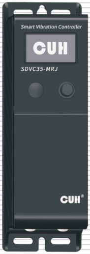

## SDVC35-Series
Smart Automatic Controller for Vibratory Feeder — SDVC35 Series
## User Manual

## Preface

Thank you for choosing CUH Intelligent Digital Vibratory Feeder Controller.

(The controller for short in the following text).

This instruction book includes notes for installing, debugging, parameter setting, maintenance and troubleshooting of the controller. Please read this instruction book carefully before operating the controller and keep it properly.

**This instruction book applies to the following model**

- SDVC35-MRJ　( Output current 3A )
- SDVC35-LRJ　( Output current 4.5A )

---

## Notice:

1. Never plug and unplug the cable nor touch the power sockets in any case when the controller is powered so as to prevent electric shock or other accident.
2. Never connect the controller to 380V AC which may cause unrecoverable damage. (we have the product that designed for 380V AC)
3. Never switch the input of the controller by the way of cutting off the power supply for turning on/off the output, otherwise it may reduce the lifetime of the controller.
4. The controller is designed to work in a cool and dry environment. Never run the controller outside to avoid soaking and insolation. Operate the controller within the temperature specified electrical characteristic.
5. Never operate the controller under the condition that beyond its designed limits.
6. Operate the controller in accordance with this instruction book strictly. we will not assume any civil or criminal liability if the equipment damage or personal injury is caused by incorrect operation.

> Never open the controller shell to avoid electric shock. Contact CUH if the controller break down. Never try to repair the controller yourself which may caused void warranty.

---

## Operating and storage environment

### Inspection before using

Every controller will go through rigorous quality inspection before delivery and is packed with crash-proof packaging, Please check the following items after unpacking:

1. Whether the controller is damaged in appearance.
2. Whether the model of the controller is that you order.

### Runtime environment

Please follow the notes below to ensure the better performance and longer lifetime of the controller:

- ⚠ Well-ventilated environment
- ⚠ Keep away from water, stream, dust and especially oily dust
- ⚠ Keep away from the corrosive or flammable gas and liquid
- ⚠ Keep away from floating dust and metal particles
- ⚠ Firmly fixed to avoid self vibration
- ⚠ Keep away from electromagnetic interference
- ⚠ Ensure ambient temperature is 0~40 ℃
- ⚠ For use at altiude 2000m or lower

---

# Contents

- **Chapter I　Features — 1**
  - 1.1　Main Features — 1
  - 1.2　Others Features — 1
- **Chapter II　Installation Guide — 3**
  - 2.1　External Parts Description — 3
  - 2.2　Installation Description — 5
  - 2.3　Installation of Vibration Sensor — 7
  - 2.4　Automatic Resonant Frequency Search — 9
- **Chapter III　HMI Description — 10**
  - 3.1　Standby Interface — 10
  - 3.2　Password Input Interface — 13
  - 3.3　Function Group Interface — 14
  - 3.4　Display Interface of Resonant Frequency Search Process — 16
- **Chapter IV　Function Description — 17**
  - 4.1　Digital Input Ports C and E ON/OFF Control — 17
  - 4.2　Counting Function — 20
  - 4.3　Main Output Control Signal — 24
  - 4.4　DC Control Output Port D and Port P — 28
  - 4.5　Remote Speed Control — 33
  - 4.6　Main Mode — 35
  - 4.7　Sync Mode — 39
  - 4.8　Preset Parameters Function — 44
  - 4.9　Default Setting Restoration — 45
  - 4.10　RS485 Communication — 46
  - 4.11　Ethernet Communication — 48
  - 4.12　Load Testing — 48
  - 4.13　Working State Monitor — 49
- **Chapter V　Security Function — 50**

---

---

Appendix A: Dimensions — 51

Appendix B: Electrical Ports Description — 52

Appendix C: Electrical Specification — 53

Appendix D: Troubleshooting Suggestions and Error Explanation — 55

Appendix E: Warning and Error Description and Troubleshooting Suggestions — 56

Appendix F: Run State and Network Card Type Description — 57

Appendix G: Wiring Method of Switch Sensors and PLC to the Digital Input Ports — 58

Appendix H: Parameters Table — 61

---

# Chapter I Features

## 1.1 Main Features

**OLED Display:** Provide Chinese, English, German three languages and friendly operating Interface.

**Automatic Resonant Frequency Search:** It provides sensor or sensorless to search out the resonant frequency of the load.

**Auto Constant Speed Control:** Automatic output voltage adjustment in real time to ensure constant preset feed speed regardless of weight change of the feed materials in the vibratory feeder.

**Sync output of multiple controllers:** Sync output waveform of slave controllers with that of the master controller to the same frequency and phase to avoid beat effect.

**Dual Push-Pull Control Output:** The controller can output 24V DC power associated with logical relation setting of the ON/OFF Control to drive a solenoid, an electrical relay or other external devices.

**Ethernet Communication:** Adjusting all parameters and monitoring the run states of the controller. Supports Ethercat and Profinet communication protocol.

**Firmware Upgrade:** Supports firmware update online for providing our company latest R & D results.

**Load Detection:** Measure the inductance, maximum current and resistance of the load.

## 1.2 Others Features

The controller is specially designed for controlling vibratory feeder in automation systems. Combined with the latest electronic technology and well-designed, the controller has the convenient and practical features:

**Automatic Voltage Regulation:** Eliminate Speed variation caused by mains voltage fluctuation and beat effect caused by industrial AC frequency.

**Dual Switch Sensor ON/OFF Control:** 2 switch sensors or PLC can be connected to turn on/off the controller.

**Automatic Switch Sensor Type Recognization:** The controller can recognize the NPN/PNP switch sensor type automatically.

**Soft Starting:** In order to avoid sudden shock to the vibratory feeder, the controller can gently increase output voltage/feed speed from 0 to preset value when startup.

---

---

**Parameters Preset:** 4 suits of preset parameters could be selected.

**Acceleration Function:** Maximum output voltage value of the controller can be increased up to 150% of the input voltage value ( Except under the Automatic Tracking state with sensorless ).

**Max Adjustable Output Voltage:** Max Adjustable Output Voltage can be preset to protect the load from damage caused by too high voltage.

**Waveform Index:** It represents the equivalent duty cycle of the sine-wave output current within one cycle. A higher parameter value corresponds to a larger equivalent duty cycle. This parameter can be adjusted to balance the operating efficiency and maximum output power of the controller.

**DC Current:** DC offset component of the sine-wave output current signal.

**Remote Speed Control:** Output Voltage of the controller can be adjusted by an external potentiometer, 4~20mA, 0~5V, 1~5V, 0~10V DC signal.

**Counting:** When Count number of the workpiece is up to the preset value, the feeding speed will be slowed down or zero.

**ON/OFF Output:** Short press the ON/OFF button to Run/Stop the controller.

**Keypad Lock:** Long press the ON/OFF button to lock the keypad.

**Parameters Password:** User can set the authority by password which prohibit parameters (like output voltage and feeding speed) adjusted.

**Parameters Save Function:** User can make the controller work at any of four suits Parameters which have preset and saved in User Data adjusted by "SavedALLTo"and "ReadALLFrm" parameters in Function 8 of controller.

**Default Setting Restoration:** This function allows the operator to restore all the parameters to the default factory setting.

**Rs485 Communication:** All the parameters can be adjusted and monitored remotely.

**Self-defining OLED Standby Interface:** User can select the parameters that you need display on the standby interface.

**Alarm Signal Output:** Alarm signal can output by control output port or communication port for automatic processing.

---

# Chapter Ⅱ Installation Guide

## 2.1 External Parts Description

### 2.1.1 Exterior Description

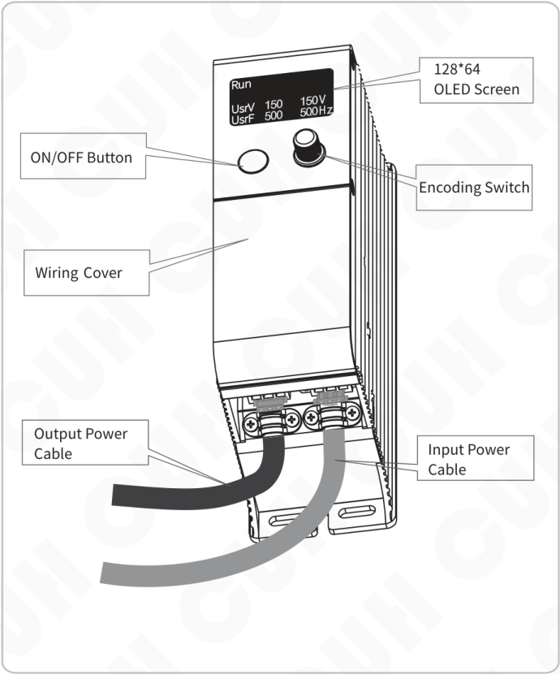

## 2.1.2 Terminal Description

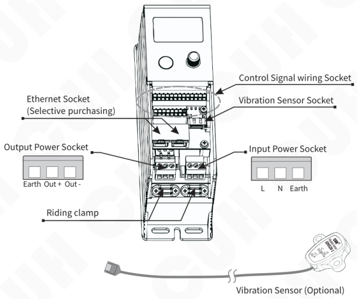

- Control Signal wiring Socket
- Vibration Sensor Socket
- Ethernet Socket (Selective purchasing)
- Output Power Socket: Earth / Out + / Out -
- Input Power Socket: L / N / Earth
- Riding clamp
- Vibration Sensor (Optional)

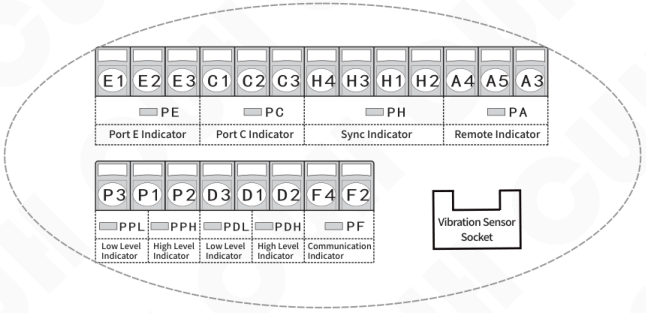

Upper row terminals (from left to right): E1, E2, E3, C1, C2, C3, H4, H3, H1, H2, A4, A5, A3.

| PE | PC | PH | PA |
|---|---|---|---|
| Port E Indicator | Port C Indicator | Sync Indicator | Remote Indicator |

Lower row terminals (from left to right): P3, P1, P2, D3, D1, D2, F4, F2.

| PPL | PPH | PDL | PDH | PF |
|---|---|---|---|---|
| Low Level Indicator | High Level Indicator | Low Level Indicator | High Level Indicator | Communication Indicator |

Vibration Sensor Socket

**Note:** Port D or Port P is High Impedance Output when the high level indicator and low level indicator are light up.

---

## 2.2 Installation Description

### Step One:

Open the packing box and check the controller and all accessories.

### Step Two:

Connect the wiring terminals of the Output Power Cable to the vibrator's electromagnetic coil.

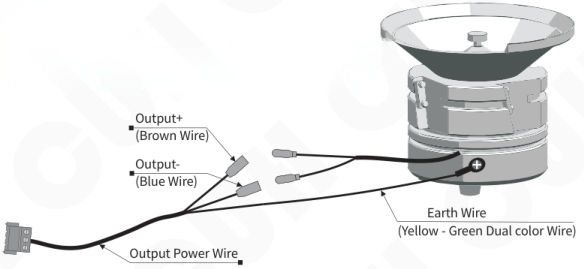

- Output+ (Brown Wire)
- Output- (Blue Wire)
- Earth Wire (Yellow - Green Dual color Wire)
- Output Power Wire

> Note: Make sure the vibrator's electromagnetic coil is connected to the live wire and neutral wire of the Output Power Cable, and the vibrator's cabinet is reliably grounding.

### Step Three:

Open the cover.

Connect the Connector of the Output Power Cable to the Socket of the controller and fix the Output Power Cable on the cabinet of the controller by Riding clamp.

Please don't operate it under power to prevent electric shock.

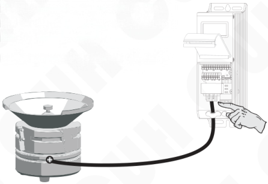

---

## Step Four:

Connect the Connector of Input Power Cable to the Input Power Socket of the controller and fix the Input Power Cable on the cabinet of the controller by Riding clamp.

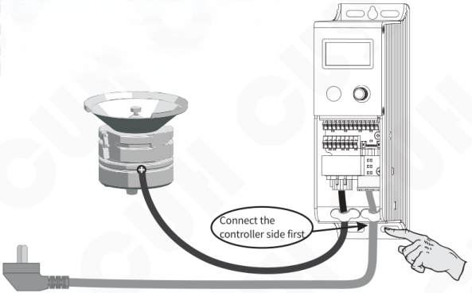

Connect the controller side first

## Step Five:

Connect the plug of the Input Power Cable to the mains jack.

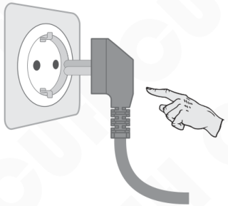

The controller power on and OLED display the Startup Interface for a while, then OLED display Standby interface.

---

## 2.3 Installation of Vibration Sensor

### 2.3.1 Connection Method of Vibration Sensor

- Turn off the controller, and connect the connector of the vibration sensor to the vibration sensor socket of the controller.
- Fix the vibration sensor near the armature of the vibrator. The method and location of installation are shown below:

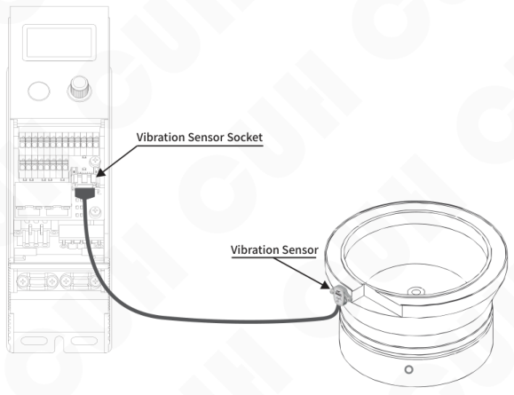

---

## 2.3.2 Installation of Vibration Sensor to the Vibrator

Fix Vibration Sensor to the smooth surface of vibrator and Installation direction arbitrary, and installation methods of Vibration Sensor are shown as below:

- Method 1: As shown in Fig. 1

  Advantage: Easy installation

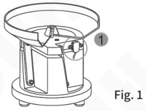

- Method 2: As shown in Fig. 2

  Note: Don't make the vibration sensor pressed by feeding bowl.

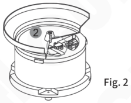

- Method 3: weld a bracket on the vibrator and fix the vibration sensor on the bracket. As shown in Fig. 3

  Recommended Dimensions of bracket of Vibration is shown in Fig.4.

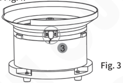

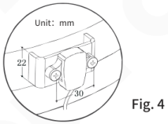

- Not recommend installation method, As shown in Fig. 5 and Fig. 6.

  If the installation location is not suitable, the vibration sensor can't feedback the resonant frequency accurately and the controller will execute searching the resonant frequency all along.

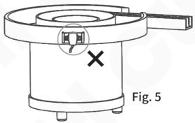

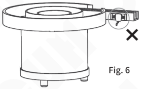

---

## 2.4 Automatic Resonant Frequency Search

### 2.4.1 Sensorless Automation Resonant Frequency Search

The controller has Automation Resonant Frequency Search Function with sensorless and user only need to adjust "Usr_Voltag" parameter for vibrator working at best condition.

Start Sensorless Automation Resonant Frequency Search Function by setting "AtoSnsrTyp " parameter to "Auto" in Function Group 3 and "AutoSerch_ " to "Star" in Function Group 1.

Note: Sensorless Automation Resonant Frequency Search Function is only valid under controller run in Main Mode, and Vibration Sensor need be connected when the controller run in Synch Mode.

### 2.4.2 Sensor Automation Resonant Frequency Search

Through the automatic resonant frequency search function with vibration sensor, the controller can make the vibrator work at best frequency and correlated parameters of the controller can be adjusted automatically. User only need to set the Feeding Speed parameter to make the vibrator work best.

After connecting vibration sensor, turn on the controller and the controller can automatically check whether the resonant frequency of the vibrator is within the presetting range of the controller, if it is not in range, the controller will start Automatic Resonant Frequency Search.

**Automatic Resonant Frequency Search Steps:**

- Long press the encoding switch on the standby interface to enter Function Group Parameters interface.
- Adjust the "AutoSerch_" parameter in the Function Group 1 to "Start" then short press encoding switch to start Automatic Resonant Frequency Search process.
- After Automatic Resonant Frequency Search process is done, the resonant frequency result and "Save" displayed on OLED indicates the parameter is saved.

After Automatic Resonant Frequency Search process, the vibrator can work normally. Short press or turn the encoding switch back to the prior interface.

> 1. Automatic resonant frequency search process need be operated under empty feeding bowl.
> 2. Cancel frequency search operation in the Automatic resonant frequency search process by short press "ON/OFF" button.
> 3. If the OLED display "OverCurrent" in the Automatic resonant frequency search process, it means "AtoSrhVMax" is set too high, but the Automatic resonant frequency search process is not affected.

---

## Chapter Ⅲ HMI Description

### 3.1 Standby Interface

Standby Interface is shown below:

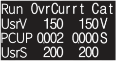

The controller will enter standby interface, when the controller isn't operated over 2 minutes.

There are 4 display rows in standby interface and the first display row is used for indicating operation state, error or alarm information of controller.

1. Left area of first display row is used for indicating run/stop of controller.
2. Right area of first display row is used for indicating the type of network card.
3. Middle area of first display row is used for indicating the warning/error of the controller.

All the items of the three areas are explained respectively in appendix F and E.

From 2nd to 4th display rows are used for adjusting parameters and user can select up to three parameters displayed on the standby interface.

Each display row of standby interface has 4 items: parameter name, setting value/parameter state, current test value/output value, unit. The example of the standby interface is as follows:

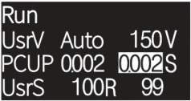

The second display row is output voltage parameter, and "Auto" means this parameter adjusted automatically by controller, and the actual output voltage is 150V.

The third display row is the Port C ON delay parameter, and the setting value is 0.002S, and the third item is real-time value of delay process. when the delay process is done, the real-time value will be reverse display.

The fourth display row is the feeding speed parameter, and the setting value is 100, and the real-time feeding speed is 99. The "R" behind the setting value means the feeding speed is controlled by remote control port.

---

The parameters can be displayed in the standby interface is shown below.

| Item | Description |
|---|---|
| UsrV | Output Voltage |
| UsrF | Output Frequency |
| UsrS | Feeding Speed |
| Cout | Current Count Value |
| PCUp | Port C Up Delay |
| PCDn | Port C Down Delay |
| PEUp | Port E Up Delay |
| PEDn | Port E Down Delay |
| PDUp | Port D Up Delay |
| PDDn | Port D Down Delay |
| PPUp | Port P Up Delay |
| PPDn | Port P Down Delay |
| MaUp | Main Control Up Delay |
| MaDn | Main Control Down Delay |
| BusV | Power Bus Voltage |
| CurE | Output Current RMS |
| CurM | Max Output Current |
| PwrA | Active power |
| PwrR | Reactive power |
| Temp | Temperature |
| SynF | The frequency of external synchronic signal |
| Remo | Remot Input Voltage |
| PCV | Port C Input Voltage |
| PEV | Port E Input Voltage |
| PDV | Port D Output Voltage |
| PPV | Port P Output Voltage |

---

---

### 3.1.1 Parameter adjusting method of standby interface

When the user need to adjust the parameter value, short press the encoding switch and the setting value of the second display row will be reversed display as white background, then turn the encoding switch to adjust the setting value. Short press the encoding switch to change over the setting value adjusting interface between three display row and adjust the parameter value by rotating the encoding switch.

Note:

If the setting value is "Auto", the parameter value can't be adjusted manually.

If the "R" behind the setting value, the parameter value can't be adjusted manually like "Voltage" and "Feeding speed".

If the password is set to lock the parameter setting, there is no response when short press the encoding switch.

### 3.1.2 Energy saving of OLED in the standby interface

If there is no operation over 2 minutes in standby interface, the brightness of OLED will decrease to enter energy saving state for extending OLED life. Short press or turn Encoding Switch to quit the energy saving state.

---

## 3.2 Password Input Interface

When either "Passsword 1" or "Passsword 2" is not zero, the operation permission for parameter adjusting is locked. Long press the encoding switch at the standby interface and the OLED will display the Password Input Interface to remind user to enter password.

The Password Input Interface is shown below:

Adjust the password value by turning the encoding switch and short press the encoding switch to confirm the input password. If the password is right, it enter the Function Group Interface.

The controlled object by password 1 and password 2 are shown below:

| Controlled object | Password 2 | Password 1 |
|---|---|---|
| ON/OFF button | ○ | ○ |
| Standby interface | ○ | √ |
| Function Group 1 and Function Group 9 | √ | √ |
| Others Function Group | × | √ |
| Explanation | when it is no permission, ON/OFF button and parameters of standby interface can be operated.  when it is permission, the parameters of Function Group 1 and Function Group 9, ON/OFF button and parameters of standby interface can be operated. | when it is no permission, ON/OFF button can be operated.  when it is permission, all the function can be operated. |

Note: ○ means uncontrolled，√ means controlled，× means no permission.

---

## 3.3 Function Group Interface

Function Group Interface is used for adjusting all parameters of the controller. There are 9 Function Group whose parameters can be adjusted and 1 Function Group whose parameters only can be read.

The first display row of Function Group interface is used for indicating operation state, error or alarm information of controller. From 2nd to 4th display row is the area which display the parameters of Function Group, and the interface is shown below:

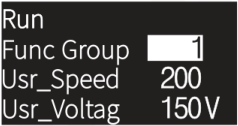

### 3.3.1 The selection of Function Group

After entering Function Group Interface by long press the Encoding Switch at Standby Interface, the cursor will be on the value of "Function Group" and turn the Encoding Switch to adjust the value for changing over between "Function Group 0" and "Function Group 9".

All the parameters of Function Group are explained in appendix H.

### 3.3.2 Adjusting parameters method of Function Group

There are 3 methods to switch parameters in Function Group Interface:

1. Short press the Encoding Switch to change over between parameters.
2. Press the Encoding Switch and hold not more than 2s, and simultaneously rotate the encoding switch to change over between parameters.

---

3.Press the Encoding Switch and hold more than 2.5s till the parameter display row reversed display then loosen it.

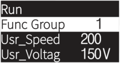

Turn the Encoding Switch to select the parameter.

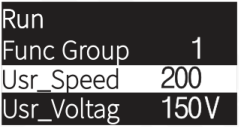

After selecting the parameter, short press Encoding Switch to enter the adjusting parameter state.

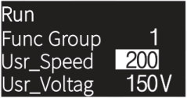

This adjustment method is suitable for switching among multi parameters.

**All the parameters of Function Group are explained in appendix H.**

---

## 3.4 Display Interface of Resonant Frequency Search Process

When the Automatic Resonant Frequency Search process is started, the OLED display the Frequency against Acceleration curve, as shown below. The horizontal direction of the curve is frequency which range is from 25Hz to 400Hz and the vertical direction of the curve is acceleration

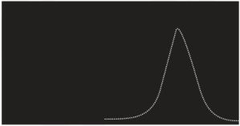

After Automatic Resonant Frequency Search process is done, the resonant frequency result and "Save" are displayed on OLED to indicate the parameters have saved, as shown below.

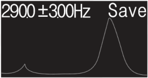

---

# Chapter Ⅳ Function Description

## 4.1 Digital Input Ports C and E ON/OFF Control

There are two Digital Input Ports C and E which can automatically recognize the NPN/PNP type of the connected sensor to ON/OFF the controller, and the device connected to the ports can be proximity switch sensor, photoelectric sensor, fiber sensor or PLC etc.

### 4.1.1 The electric circuit diagram of Port C and Port E

The electric circuit diagram of Port C

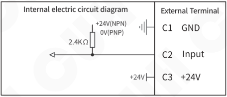

The electric circuit diagram of Port E is the same with Port C

### 4.1.2 Use method

Take the proximity switch sensor as the example, and wiring method of it is shown as below:

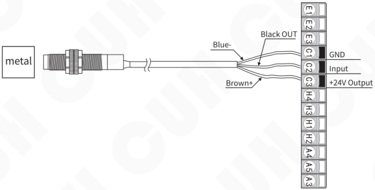

The wiring method of others switch sensor are shown in Appendix G.

---

## 4.1.3 Signal Flow Diagram of Port C and Port E

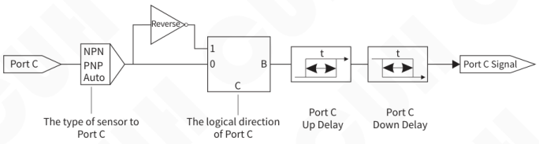

The Signal Flow Diagram of Port E is the same with Port C

## 4.1.4 Related parameters description

The parameters of Port C are adjusted in Function Group 4, and the parameters of Port E are adjusted in Function Group 5.

**"PortCType_" parameter**

The controller can automatically recognize the NPN/PNP type of the connected sensor (Factory default is Auto).

**"PortCDir__" parameter**

By factory default, the controller run when the Port C receive no signal. In some special applications the controller needs to be stopped when Port C receive no signal by adjusting the "PortCDir__" parameter.

When the "PortCDir__" is set to "Const", and the Port C receive no signal, the controller is to be started.

When the "PortCDir__" is set to "Revrs", and the Port C receive no signal, the controller is to be stopped.

---

---

### "PortCUpDly" parameter

Port C Up Delay means the period time from the port C receive the start signal is valid to the controller be started.

### "PortCDnDly" parameter

Port C Down Delay means the period time from the port C receive the stop signal is valid to the controller be stopped.

Note: when the port C is used to start/stop the controller, the delay time of the port C need to be set for eliminating signal jitter.

---

## 4.2 Counting Function

### 4.2.1 Signal Flow Diagram of Counting Function

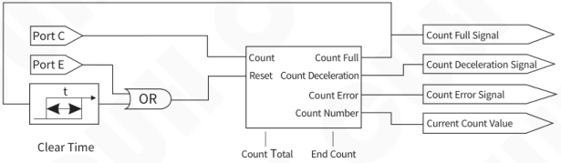

The controller has the built-in counting function which can count the pulse. when count number of pulse is up to the preset Count Total, the feeding speed will be slowed down or zero.

### 4.2.2 End Deceleration Function

For eliminating the overcount of Counting Function caused by high Feeding Speed that can not be stopped promptly, End Feeding Speed and End count need to be set. Feeding Speed is decreased to End Feeding Speed when the number of remaining count approach the End Count preset which smaller than the Count Total, and when the count number reaches the Count Total, the feeding speed is stopped in time for counting accurately.

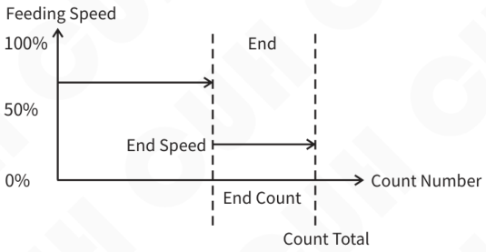

---

## 4.2.3 Super Anti-jitter Function

Super Anti-jitter Function is designed specially for solving the miscount caused by vibraion feeding condition. Through setting the Count Signal Stabilization Time to achieve Super Anti-jitter Function that the count pulse considered valid after Count Signal Stabilization Time, the precision of the Count Signal Stabilization Time is millisecond.

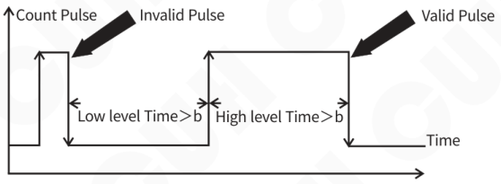

Note: Anti-jitter Stabilization Time means the Stabilization Time of high level and low level. A valid pulse is consist of continuously active high level and low level, then the counter plus one.

### The setting method of Count Signal Stabilization Time

Port C as the input port of count pulse of counter. "PortCUpDly " and "PortCDnDly " are separately the stabilization time of high level and low level of Count pulse .

Port E as the input port of Reset pulse of counter. "PortEUpDly" and "PortEDnDly" are separately the stabilization time of high level and low level of Reset pulse.

---

## 4.2.4 Timer Reset the Counter Function

When the count number reaches the Count Total, after a delay time adjusted by "Clear Time" in Function Group 1, Counter is reset and restart to count.

When the value of "Clear Time" is 0.0s, the Timer Reset the Counter Function is disable.

## 4.2.5 Counting Using Method

There is a built-in counter in the controller, and the Port C as the count port of counter and the Port E as the reset port of counter.

The State of the counter can control the Main Control Output, Port D Output and Port P Output.

- When the value of "Main Logic" which adjusted in Function Group 2 is "Count", the Main Control Output is controlled by Count Full signal.
- When the value of "Port D Logic" which adjusted in Function Group 6 is "END", the Port D Output is controlled by Count Full signal.  
  When the value of "Port P Logic" which adjusted in Function Group 7 is "END", the Port P Output is controlled by Count Full signal.
- When the value of "Port D Logic" which adjusted in Function Group 6 is "Near", the Port D Output is controlled by Count Deceleration signal.  
  When the value of "Port P Logic" which adjusted in Function Group 7 is "Near", the Port P Output is controlled by Count Deceleration signal.

---

## 4.2.6 Related parameters description

### "CountNumbr" Parameter

"CountNumbr" which counter already counted is checked in Function Group 9.

### "TotalCount" Parameter

After the "CountNumbr" reaches "TotalCount" which you expect adjusted in Function Group 1, the Count Full Signal of the counter is valid until the counter reset, the counter could keep on counting until the counter reset.

### "CountAhead" Parameter

"CountAhead" is adjusted in Parameters Group 2, it means the remain number of counter not count to the "TotalCount". When the "CountNumbr" reaches "CountAhead", the Feeding Speed decrease to the "PrcntTrmnl" adjusted in Function Group 2.

### "PrcntTrmnl" Parameter

"PrcntTrmnl" adjusted in Function Group 2, it means when "CountNumbr" reaches "CountAhead" and the Feeding Speed decrease to the Initial Speed multiplied by "PrcntTrmnl".

### "Clear Time" Parameter

When the count number reaches the Count Total, after a delay time adjusted by "Clear Time" in Function Group 1, Counter is reset and restart to count.

When the value of "Clear Time" is 0.0s, the Timer Reset the Counter Function is disable.

### The Direction of input port of Count Pulse

The Direction of input port of Count Pulse is the same with "PortCDir_" adjusted in Function Group 4.

### The Direction of input port of Reset Pulse

The Direction of input port of Reset Pulse is the same with "PortEDir_" adjusted in Function Group 5.

---

## 4.3 Main Output Control Signal

Main Output Control signal is used to ON/OFF the Main Output of controller, and all parameters of Main Output Control are adjusted in Function Group 2.

### 4.3.1 Signal Flow Diagram of Main Output Control signal

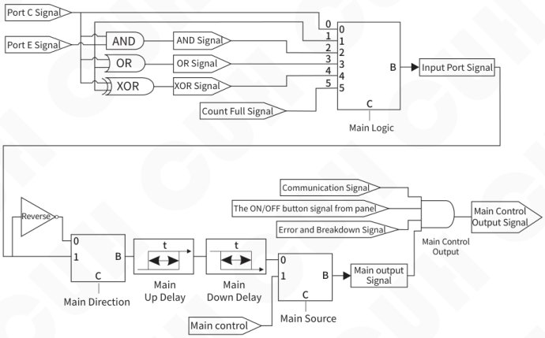

---

## 4.3.2 Signal Description

### Communication Signal

Communication Signal comes from RS485 or Ethernet.

When the Stop signal is sent to the controller by RS485 or Ethernet, the controller is stopped.

When the Start signal is sent to the controller by RS485 or Ethernet, the controller is started.

### The ON/OFF button signal on panel

The control signal comes from ON/OFF button on panel. Switch the controller ON or OFF by short press the ON/OFF button on the panel.

The Run state of the controller when the power up is set by "PowrOnStat" parameter in Function Group 2.

While the "PowrOnStat" is set to "ON", the controller start Main output when it is powered up.

While the "PowrOnStat" is set to "OFF", the controller stop Main output when it is powered up.

### Error and Breakdown Signal

When one of faults like overcurrent, short-circuit, overheat etc is occurred, the controller is stopped.

When the clear and count up operation occur simultaneously in counting process, the controller is stopped.

### Main output signal

Main output signal is the input port signal adjusted by "MainDir_", "MainUpDely", "MainDwnDly"and "MainSrc_".

### Input Port Signal

The source of Input Port Signal is selected by adjusting the value of "MainLogic_ " in Function Group 2. The value of "MainLogic_ " are "Port C", "Port E", "AND", "OR", "XOR", "Count".

---

## 4.3.3 Related parameters description

### "MainLogic_ " parameter

- When the value of "MainLogic_ " is "Port C", it means the signal source of input port comes from Signal of Port C.

  When the signal of Port C requests the controller to enter the running state, the input port signal requests to start the controller.

  When the signal of Port C requests the controller to enter the stopping state, the input port signal requests to stop the controller.

- When the value of "MainLogic_ " is "Port E", it means the signal source of input port comes from Signal of Port E.

  When the signal of Port E requests the controller to enter the running state, the input port signal requests to start the controller.

  When the signal of Port E requests the controller to enter the stopping state, the input port signal requests to stop the controller.

- When the value of "MainLogic_ " is "AND", "OR" or"XOR", it means the signal source of input port comes from the result of logical operation between Port C and Port E.

  The "AND" means the signal of Port C and Port E all request to stop the controller, and the Input port signal stop the controller.

  The "OR" means the signal of Port C or Port E request to stop the controller, and the Input port signal stop the controller.

  The "XOR" means the operation request of Port C and Port E are different, and the Input port signal stop the controller.

- When the value of "MainLogic_ " is "Count", it means the Input port signal comes from count full signal of counter.

  When the count full signal is valid, the controller stop the Main Output and the "CND" is displayed on the screen.

  When the count full signal is not valid, the controller turn on the Main Output.

---

### "MainDir_" Parameter

"Main Direction" means whether the signal of input port need to be reversed.

When the value of the "Main Direction" is "Normal ON", it means the signal of input port no need to be reversed.

When the value of the "Main Direction" is "Normal OFF", it means the signal of input port need to be reversed.

### "MainUpDely " Parameter

Main Up Delay means the period time from requesting to start the controller to the requesting signal is considered valid.

### "MainDwnDly" Parameter

Main Down Delay means the period time from requesting to stop the controller to the requesting signal is considered valid.

### "MainSrc_" Parameter

Main Output Signal comes from " Input port Signal" or "Main control".

When the value of "MainSrc_" is "Local", it means Main Output Signal comes from " Input port Signal".

When the value of "MainSrc_" is "Remot", it means Main Output Signal comes from "MainCtrl_".

### "MainCtrl_" Parameter

The "MainCtrl_" has two states: Stop the Output of controller and Start the Output of controller.

when the value of "MainCtrl_" is "OFF", it means to Stop the Output of controller.

when the value of "MainCtrl_" is "ON", it means to Start the Output of controller.

---

## 4.4 DC Control Output Port D and Port P

There are two 24V DC output ports: Port D and Port P for driving the solenoid, PLC or other external devices.

The working principle and parameters adjustment method of Port P and Port D are the same.

### 4.4.1 The electric circuit diagram of Port D and Port P

The electric circuit diagram of Port D

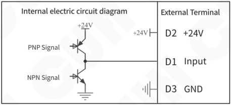

The electric circuit diagram of Port P is the same with Port D.

---

## 4.4.2 Use method

The wiring method of solenoid

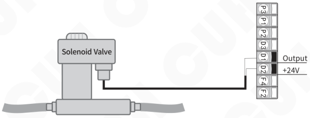

The wiring method of electrical relay

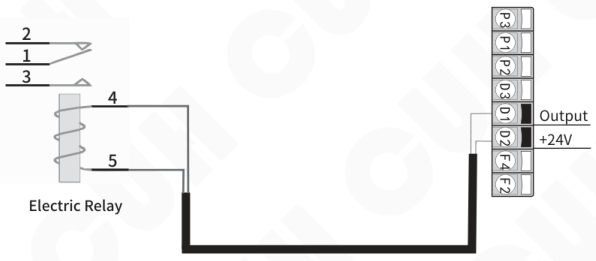

The wiring method of Port D and Port P are the same.

---

## 4.4.3 Signal Flow Diagram of Port D and Port P

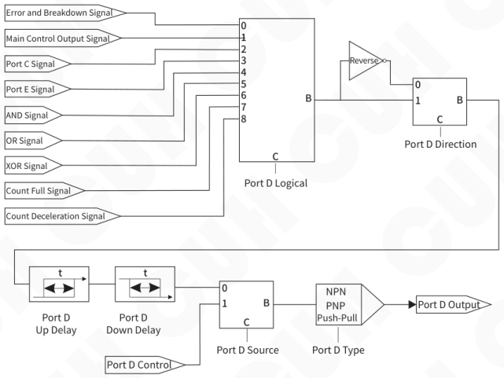

Signal Flow Diagram of Port D and Port P are the same.

## 4.4.4 Related parameters description

The parameters of Port D are adjusted in Function Group 6, and the parameters of Port P are adjusted in Function Group 7.

### "PortDLogic" parameter

The source of Port D is selected by adjusting the value of "PortDLogic" in Function Group 6. The value of "PortDLogic" are "Error", "Main", "Port C", "Port E", "AND", "OR", "XOR", "Count", "Near".

- When the value of "PortDLogic" is "Error", it means the signal source of Port D comes from breakdown state of the controller or the count error of the counter mode.

When one of faults like overcurrent, short-circuit, overheat etc is occurred, the Port D is requested to turn off.

When the clear and count up operation occur simultaneously in counting process, Port D is requested to turn off.

When both faults and count error are not occured, Port D is requested to turn on.

---

---

- When the value of "PortDLogic" is "Main", it means the signal source of Port D comes from Main control.

  When the signal of Main control is running state, the port D is requested to turn on.

  When the signal of Main control is stopping state, the port D is requested to turn off.

- When the value of "PortDLogic" is "Port C", it means the signal source of Port D comes from signal of Port C.

  When the signal of port C requests the controller to enter running state, the port D is requested to turn on.

  When the signal of port C requests the controller to enter stopping state, the port D is requested to turn off.

- When the value of "PortDLogic" is "Port E", it means the signal source of Port D comes from signal of Port E.

  When the signal of port E requests the controller to enter running state, the port D is requested to turn on.

  When the signal of port E requests the controller to enter stopping state, the port D is requested to turn off.

- When the value of "PortDLogic" is "AND","OR" or"XOR", it means the signal source of port D comes from the result of logical operation between Port C and Port E.

  The "AND" means the signal of Port C and Port E all request to stop the controller, and the input signal of port D is requested to turn off.

  The "OR" means the signal of Port C or Port E request to stop the controller, and the output of port D is requested to turn off output of port D.

  The "XOR" means the operation request of Port C and Port E are different, and the output of port D is requested to turn off .

- When the value of "PortDLogic" is "END", it means the signal source of Port D comes from count full signal of counter.

  When the count full signal is valid, the output of port D is requested to turn off .

- When the value of "PortDLogic" is "Near", it means the signal source of Port D comes from count deceleration signal of counter.

  When the count deceleration signal is valid, the output of port D is requested to turn off .

---

### "PortDDir_" parameter

"PortDDir__ " means whether the signal of port D need to be reversed.
When the value of the "PortDDir_" is "Normal ON", it means input signal of Port D no need to be reversed.

When the value of the "PortDDir_" is "Normal OFF", it means input signal of Port D need to be reversed.

### "PortDUpDly" Parameter

Port D Up Delay means the period time from requesting to turn on the output of Port D to the requesting signal is considered valid.

### "PortDDnDly" Parameter

Port D Down Delay means the period time from requesting to turn on the output of Port D to the requesting signal is considered valid.

### "PortDSrc_" Parameter

The Output Signal Source of Port D comes from " Input Signal of Port D " or "Port D Output state".

When the value of "PortDSrc__ " is "Local", it means Output Signal Source of Port D comes from " Input Signal of Port D ".

When the value of "PortDSrc__ " is "Remot", it means Output Signal Source of Port D comes from "Port D Output state".

### "PortDCtrl_" Parameter

The "PortDCtrl_" has two states: Stop and Start the Output of Port D.

when the value of "PortDCtrl_" is "OFF", it means Stop the Output of Port D.when the value of "PortDCtrl_" is "ON", it means Start the Output of Port D.

### "PortDType_ " Parameter

There are three types of Port D: NPN, PNP and Ps&Pu .

- The NPN type means output low level when output of Port D is valid, output high impedance state when the output of Port D is not valid.
- The Ps&Pu type means output High level when output of Port D is valid, output low level when the output of Port D is not valid.
- The PNP type means output high level when output of Port D is valid, output high impedance state when the output of Port D is not valid.

---

## 4.5 Remote Speed Control

Output Voltage of the controller can be adjusted by an external potentiometer, 4~20mA, 0~5V, 1~5V, 0~10V DC signal, so the user can adjust it easily by potentiometer, PLC and other external devices.

### 4.5.1 The electric circuit diagram of Port A of remote speed control

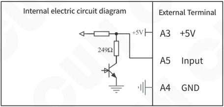

### 4.5.2 Remote control signal type

There are 6 types of Remote control signal can be set: "Panel", 20mA, 1~5V, 0~5V, 0~10V, meter.

The type of Remote control signal is adjusted by the value of "control source" in Function Group 2 (The default value is "Panel").

---

| The type of Remote control signal | Remote control signal | Output Voltage/Feeding Speed |
|---|---|---|
| Panel | | Output Voltage and Feeding speed are not controlled by Remote Control Signal |
| 20mA | <2mA | When the Voltage Mode is Manual, Output Voltage = 0 When the Voltage Mode is Auto,Feeding Speed = 0 LCD display the error information "<2mA Err" |
| | 2mA~4 mA | Output Voltage = 0, Feeding Speed = 0 |
| | 4 mA ~20mA | proportional controlled by Remote Control Signal (0%~100%) When the Voltage Mode is Manual, Output Voltage = (Input Current - 4mA)/16 ×Max Output Voltage When the Voltage Mode is Auto, Feeding Speed = (Input Current - 4mA)/16 ×Max Feeding Speed |
| 1~5V | <0.5V | Output Voltage = 0, Feeding Speed = 0 LCD display the error information "<0.5V Err" |
| | 0.5V~1V | Output Voltage = 0, Feeding Speed = 0 |
| | 1V~5V | proportional controlled by Remote Control Signal (0%~100%) When the Voltage Mode is Manual, Output Voltage = (Input Voltage 1V)/4 ×Max Output Voltage When the Voltage Mode is Manual, Output Voltage = (Input Voltage 1V)/4 ×Max Output Voltage |
| 0~5V | 0V~5V | proportional controlled by Remote Control Signal (0%~100%) When the Voltage Mode is Manual, Output Voltage = Input Voltage/5 × Max Output Voltage When the Voltage Mode is Auto, Feeding Speed = Input Voltage/5 ×Max Feeding Speed |
| 0~10V | 0V~10V | proportional controlled by Remote Control Signal (0%~100%) When the Voltage Mode is Manual, Output Voltage = Input Voltage/10 × Max Output Voltage When the Voltage Mode is Auto, Feeding Speed = Input Voltage/10 ×Max Feeding Speed |
| Meter (Potentiometer) | Divider Ratio of Potentiometer <4% | Output Voltage = 0, Feeding Speed = 0 |
| | Divider Ratio of Potentiometer is 4%~96% | proportional controlled by Remote Control Signal (0%~100%) When the Voltage Mode is Manual, Output Voltage = ((Divider Ratio - 4%)/92%)× Max Output Voltage When the Voltage Mode is Auto, Feeding Speed =((Input Voltage Internal Voltage × 4%)/Internal Voltage × 92%) ×Max Feeding Speed |

## 4.6 Main Mode

Main Mode: The occasion where controller drive the vibrator independently.

Through adjusting the "Voltage mode" and "Frequency Mode" parameter to set the Main Mode of the controller, the combination defined as below:

| The Main Mode | Voltage Mode | Frequency Mode | Vibration sensor Connected |
|---|---|---|---|
| Fully Manual mode | Manual | Manual | No |
| Fully Automation mode | Automatic | Automatic | Yes |
| Voltage Semi-automation mode | Automatic | Manual | Yes |
| Frequency Semi-automation mode | Manual | Automatic | Yes |

### 4.6.1 Fully Manual Mode

Output voltage and output frequency of the controller are adjusted manually.

**Setting method of output voltage**

Switch the cursor to the "Usr_Voltag" value in the Function Group 1 and adjust the output voltage value by turning the Encoding Switch.

**Setting method of output frequency**

Switch the cursor to the "Usr_Frqncy" value in the Function Group 1 and adjust the output frequency value by turning the Encoding Switch.

> Note:
>
> Without special instruction in this manual, the voltage is Rectified Average Voltage.
>
> This controller has Automatic Voltage Regulation function.

---

## 4.6.2 Fully Automation Mode

The controller adjust the output voltage and output frequency automatically according to the data from the vibration sensor for stabling the feeding speed of the vibrator which adjusted by "User_Speed" in Function Group 1.

### Setting method of feeding speed

Switch the cursor to the "User_Speed" value in the Function Group 1 and adjust the Feeding Speed value by rotating the Encoding Switch.

### Other related parameters description

**"AtoFCenter”**

Automatic frequency adjusting range of controller is "AtoFCenter ± AtoFRange_", and the center frequency should be adjusted to near resonant frequency of the vibrator.

**"AtoFRange_"**

Automatic frequency adjusting range of controller is "AtoFCenter ± AtoFRange_", and the recommended Frequency Range is 30.0Hz. Excessive value of the frequency range caused the vibrator can't work at best frequency and the too small value may decreased adaptability of the vibrator.

**"AtoFIntgrl”**

Adjust automatically the output frequency of the controller through the PID algorithm, the larger Frequency integral value of PID is and the faster output frequency is adjusted, but the excessive value may cause the output frequency to oscillate.

**"AtoAProptn”**

Adjust automatically the output voltage of the controller through the PID algorithm, the larger Amplitude proportion value of PID is and the faster output voltage is adjusted, but the excessive value may cause the output voltage to oscillate.

**"AtoAIntgrl”**

Adjust automatically the output voltage of the controller through the PID algorithm, the larger Amplitude integral value of PID is, the faster times and amplitude of output voltage oscillation is decreased, but the excessive value may cause the amplitude of output voltage oscillation bigger.

---

### "AtoSnsrMax”

Limit the max output amplitude by setting "AtoSnsrMax" to avoid damaging vibrator.

### "AutoPhase”

Adjust the waveform phase by setting "AutoPhase" parameter.

### "AtoSpedMax”

The adjustment range of Feeding Speed is from 0 to "AtoSpedMax".

### "AtoSrhVMax”

Limit the output voltage in Automation Resonant Frequency Search process to avoid damaging the vibratory device.

### "AtoSnsrTyp"

The controller supports multiple vibration sensor type, and output voltage of the controller are different according to the different type at the same feeding speed.

| Technical value | Vibration sensor Type | Accelaration of X/Y/Z direction |
|---|---|---|
| 16g | SDVS20-1 | 16g/16g/16g |
| 35g | SDVS20-2 | 35g/35g/- |
| 50g | SDVS20-3 | 50g/50g/- |
| 70g | SDVS20-4 | 70g/70g/- |
| Auto | None | None |

### "Speed_Now_”

Indicating the Real Time Feeding Speed indicated by "Speed_Now_" in Function Group 9 to help user observe the working condition of the device.

### "VoltagOut_"

Indicating the Real Time Output Voltage in Function Group 9 to help user observe the working condition of the device.

Note: The controller is set to Fully Automation mode by fault, but the controller work at Fully Manual mode when the vibration sensor is not connected or not connected well.

Monitor whether the output voltage and output frequency are "auto" in Standby Interface to confirm the controller work at Fully Automation mode.

---

## 4.6.3 Voltage Semi-automation

The controller adjust automatically output voltage according to the data from vibration sensor to make sure the feeding speed, but output frequency is adjusted manually.

**Setting method of feeding speed**

Switch the cursor to the "User_Speed" value in the Function Group 1 and adjust the output frequency value by rotating the Encoding Switch.

**Setting method of output frequency**

Switch the cursor to the "Usr_Frq ncy" value in the Function Group 1 and adjust the output frequency value by rotating the Encoding Switch.

## 4.6.4 Frequency Semi-automation mode

The controller adjust output frequency automatically according to the data from the vibration sensor for making the vibratory device work at resonant frequency, but the output voltage is adjusted manually.

**Setting method of output voltage**

Switch the cursor to the "Usr_Voltag" value in the Function Group 1 and adjust the output voltage value by rotating the Encoding Switch.

---

## 4.7 Sync Mode

Sync Mode: when there are more than one controller controlling several feeders in the feed system, output of the controllers are need to be synchronous and only one controller need work at Main Mode, and others follow the output frequency of the Main Mode controller(Master Controller) in real time.

Sync Mode apply to the situation which more than one controller to control the several feeders in the feed system. Output of the controllers are not synchronous so they interfere with each other(Beat Effect). Sync Mode is designed to eliminate Beat Effect as output waveform of Master and Slave controllers are exactly synchronous.

When the controller M work at Main Mode and the controller S work at Synch Mode, output waveform of two controllers are fully synchronized shown as follow:

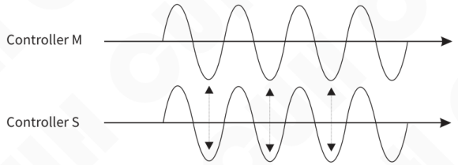

Controller S is set to Sync Mode, Output Waveforms of the two controllers are synchronous.

If the controller S is not set to the Sync Mode, output waveforms of two controllers are not synchronized.

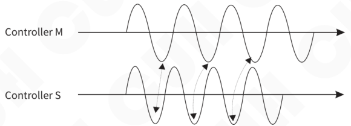

Controller S is not set to Sync Mode, Output Waveforms of the two controllers are not synchronous.

---

## The wiring method of Sync Mode between Master and Slaver controllers

Connecting the Sync signal wire between Master and Slave controllers to ensure the output frequency of the Master and Slave controllers are synchronized.

### The circuit diagram of Sync Signal Port

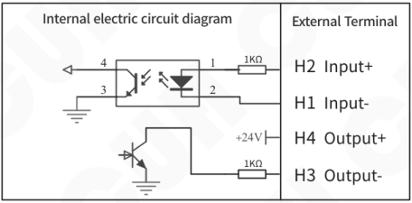

### The wiring diagram of Sync Signal between Master and Slave controller

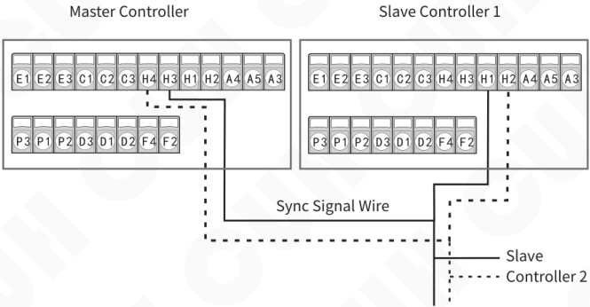

---

Through adjusting the "VoltagMode" and "FrqncyMode" parameters in the Function Group 3 to set the Slave Mode of the controller, the combination defined as below:

| Sync Mode | Voltage Mode | Frequency Mode | Phase Control | Vibration sensor Connected |
|---|---|---|---|---|
| Auto-Voltage and Auto-phase Mode | Manual | Slave C | Manual | Yes |
| Auto-Voltage and Manual-phase Mode | Manual | Slave M | Automatic | Yes |
| Manual-Voltage and Auto-phase Mode | Automatic | Slave C | Manual | Yes |
| Manual-Voltage and Manual-phase Mode | Automatic | Slave M | Automatic | No |

> "Auto" of Voltage mode means the output voltage adjusted automatically for stabling the "feeding speed " of the vibrator that you set.
>
> "Slave C" of Frequency Mode means the phase of output waveform of slave controller adjusted automatically to synchronize with master controller according to feedback data from vibration sensor.
>
> "Slave M" of Frequency Mode means adjusting manually the phase difference of output waveform of slave controller to master controller.

---

The situation that both master and slave controller have connect the vibration sensors

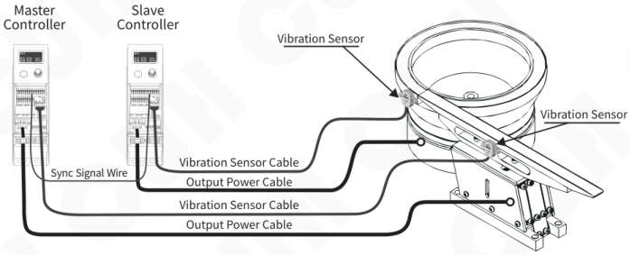

1. If the slave controller work at Manual Voltage and Manual Phase Mode, it is no need to connect the vibration sensor.
2. If the master controller work at Fully Manual Mode, it is no need to connect the vibration sensor.

## 4.7.1 Auto-Voltage and Auto-phase Mode

The controller adjust the output voltage automatically according to the feedback data from the vibration sensor for stabling the "feeding speed " of the vibrator that you set, and frequency and phase of output waveform of slave controller are the same to master controller.

### Setting method of feeding speed

Switch the cursor to the "User Speed" value in the Function Group 1 and adjust the Feeding Speed value by turning the Encoding Switch.

---

## 4.7.2 Auto-Voltage and Manual-phase Mode

The controller adjust the output voltage automatically according to the feedback data from the vibration sensor for stabling the Feeding speed of the vibrator that you set, and output frequency of slave controller is the same to master controller, and the phase difference of output waveform of slave controller to master controller is fixed.

**Setting method of feeding speed**

Switch the cursor to the "User_Speed" value in the Function Group 1 and adjust the Feeding Speed value by rotating the Encoding Switch.

**Setting method of manual phase**

Switch the cursor to the "UserPhase_" value in the Function Group 3 and adjust the "UserPhase_" value by rotating the Encoding Switch.

## 4.7.3 Manual-Voltage and Auto-phase Mode

Adjust manually the output voltage of controller, but output frequency and phase of output waveform of slave controller are the same to master controller by automatic adjustment.

**Setting method of output voltage**

Switch the cursor to the "Usr_Voltag" value in the Function Group 1 and adjust the output voltage value by rotating the Encoding Switch.

## 4.7.4 Manual-Voltage and Manual-phase Mode

Adjust manually the output voltage of controller, and output frequency of slave controller is the same to master controller, and the phase difference of output waveform of slave controller to master controller is fixed.

**Setting method of output voltage**

Switch the cursor to the "Usr_Voltag " value in the Function Group 1 and adjust the output voltage value by rotating the Encoding Switch.

**Setting method of manual phase**

Switch the cursor to the "UserPhase_" value in the Function Group 3 and adjust the "User phase" value by rotating the Encoding Switch.

**Note: Even the "VoltagMode" and "FrqncyMode" are set to "Auto" and "Slave C", the controller work at Manual Voltage and Manual Phase Mode because of vibration sensor is not connected.**

---

## 4.8 Preset Parameters Function

The controller can save and restore all the parameters of controller to "Work", "UsrD1 ", "UsrD2" and "UsrD3".

### 4.8.1 Restoration of Preset Parameters

Restore the parameters from "UsrD1", "UsrD2" or "UsrD3", which adjusted by the value of "ReadALLFrm" in Function Group 8 and short press the Encoding Switch to finish the Restoration operation .

### 4.8.2 Save Preset Parameters

Save the parameters to "Work", "UsrD1", "UsrD2" or "UsrD3", which adjusted by the value of "SavedALLTo" in Function Group 8 and short press the Encoding Switch to finish the Saving operation.

**Note:**

1. All the parameters adjusted are saved to "Work" by default, so no need to do the save operation after adjusting parameter each time.
2. After selecting the value of the "SavedALLTo", need to short press Encoding Switch one time to finish the Saving operation.

---

## 4.9 Default Setting Restoration

- Under the Standby Interface, Long press the Encoding Switch to enter the Parameters Group Interface.
- Adjust the value of the "RestorALL" in Function Group 8 to "Work".
- Short press the Encoding Switch one time to finish the Default Setting Restoration operation.
- when the value of "RestorALL" changed form "Work" to "None", it means the Default Setting Restoration operation is done.

---

## 4.10 RS485 Communication

The controller supports RTU mode and ASCII mode of modbus protocol for RS485 Communication, and all the parameters of controller can be adjusted and monitored remotely.

### 4.10.1 The electric circuit diagram of RS485 Communication (Port F)

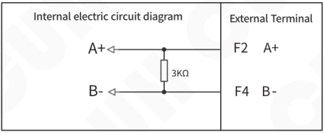

### 4.10.2 Communication Address of RS485 Communication

The Communication Address adjusted by the value of "Slave_ID"（Default value is 1）in Parameters Group 8 represents the ID number of controller in RS485 Communication and its range is 1~31 for making sure all the controller distinguish each other in the same network.

### 4.10.3 The Baud Rate of RS485 Communication

The Baud Rate of RS485 Communication which adjusted by the value of "Baud_Rate" in Parameters Group 8 can be: 3, 12, 24, 96, 192, 576 or 1152. Unit:0.1Kbps. Default value is: 115.2 Kbps.

The controller in the same network should use the same baud rate.

### 4.10.4 RS485 Communication Protocol

"CUH Modbus Communication Protocol " and "Address Table of Coil and Register of SDVC35 series for Modbus protocol" can be download from our official website: en.cuhnj.com

---

### 4.10.5 Firmware Update

Firmware Update to the controller is supported through RS485 communication interface.

**The application software running on computer for Updating Firmware and firmware file as below:**

1. UpdateFirmwareUi.exe
2. Firmware file: SDVC35K4.10_enc.script (Current Version)

The application software and newest Firmware file can be downloaded on our official website: en.cuhnj.com

**The converter required and connected between computer and controller for updating firmware:**

USB to RS485 converter

**The steps of updating firmware:**

1. Connect RS485 port of Converter to controller and USB port of Converter to computer.
2. View the USB Serial Port (COM) which recognized the USB to RS485 converter.
3. Start the UpdateFirmwareUi.exe.
4. The COM port which remembered in step 2 selected to the UpdateFirmwareUi.exe
5. Baud rate is selected to 115200.
6. Click the Open Button right of the Baud Rate on the application software to open the serial port. The Success and Failed state of Open serial port will display on the status box.
7. Click the Open Button right of Firmware File on the application software to load the newest firmware file.
8. Press the ON/OFF Button of the controller until power on the controller and all green LED of connection port light up.
9. Click the Update Button on the application software to update firmware. the progress will display on the status box. After the upgrade is done, “Firmware download OK!” will display on the status box.
10. After upgrade is done, please do the Default Setting Restoration operation one time.

---

## 4.11 Ethernet Communication

The controller supports EtherCat and Profinet, and all the parameters of controller can be adjusted and monitored remotely.

The EtherCat and Profinet protocol support periodic and aperiodic communication mode. The Ethernet periodic communication time is 5ms or more, and the typical periodic communication time is 10ms.

The Message length of periodic communication mode (The length of Input-output Buffer ) is up to 5760 bytes.

The Message length of aperiodic communication mode (The length of Send Mailbox and Receive Mailbox Buffer ) is up to 1596 bytes.

Ethernet Communication Protocol files "Hilscher NETX51 RE ECS V4.2.X-EtherCATSlave-20160520.xml" and "GSDML-V2.31-HILSCHER-NETX51-RE PNS-Profinet_20160912.xml" can be downloed from our offical website: en.cuhnj.com

When the Ethernet and RS485 are used at the same time, the controller to response in turn and the state of last instruction is saved.

## 4.12 Load Testing

The controller can test the inductor, maximum current and impedance of vibrator.

Start Load Testing Function by setting the parameter "Measure" to "valid", Load Testing is finished when the parameter "Measure" is set automatically to "Invalid".

User can check the result of Load Testing in Function Group 9.

---

## 4.13 Working State Monitor

User can check the working state of the controller by parameters in Function Group 9.

**Internal 5V and 24V Power in real time Monitor:** The voltage of 5V and 24V power are displayed by parameters "5V_Power_"and "24V_Power_".

**Main Output State in real time Monitor:** Main Output State is displayed by parameter "MainOutPut ".

**Digital Input State in real time Monitor:** The state and voltage of Port C and E are displayed by parameters "PortC_"and "PortCInput    ", "PortE_"and "PortEInput".

**DC 24V Control Output State in real time Monitor:** The state and voltage of Port D and P are displayed by parameters "PortD_"and "PortD_Out_ ", "PortP_"and "PortP_Out_ ".

**Synch Frequency in real time Monitor:** when the controller run in Synch Mode, the synch frequency follow the master controller can be displayed by parameter "SynchrFrqy".

**Internal Temperature of the controller in real time monitor:** Temperature of the controller displayed by parameter "Temperatur" and the controller will stop when the temperature over 65 ℃.

**Vibration Sensor State in real time monitor:** The state of the Vibration Sensor is displayed by parameters "AtoSnsrVld"and "AtoSnsrOvr " for checking whether the Vibration Sensor is valid and whether the Vibration Sensor is OverLoad.

---

## Chapter Ⅴ Security Function

### Short-circuit Protection

When output of the controller is short-circuit, the controller will stop its output and "ShortCircuit" displayed on the OLED until restart the controller or short press the ON/OFF Button on the panel of the controller.

### OverCurrent Protection

When the output current exceeds its rated value by misoperation, the controller will stop the output to ensure operating safety and the "OverCurrent" displayed on the OLED.

### OverHeat Protection

When the internal temperature of the controller exceeds the 65℃, the controller will stop its output to protect itself and "OverHot" displayed on the OLED until the internal temperature fall below 60℃.

### OverLoad Protection

When the vibration sensor connected to the controller, if the vibration amplitude exceeds the setting value which adjusted by the value of "AtoSnsrMax" in Parameters Group 3, the controller will turn down its output to protect the vibratory feeder and "OverLoad" displayed on the OLED.

### OverVoltage Protection

when the input voltage is higher than the rated value, the controller will turn off automatically until the input voltage returns to normal.

### Ultra OverVoltage Protection

When the input voltage far exceeds the protection limit voltage and the peak voltage is up to 430V, the fuse of the controller will be blowout to protect the controller from further damage. Please contact us for repair.

---

## Appendix A: Dimensions

SDVC35 Dimension（Unit: mm）

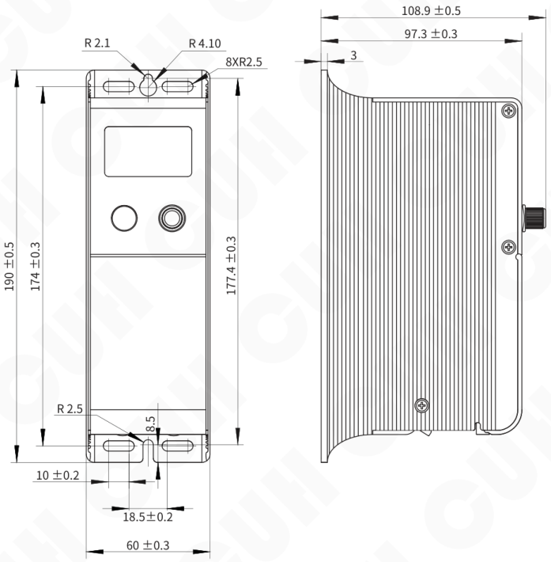

---

## Appendix B: Electrical Ports Description

| Sensor | | | Sensor | | | Sync | | | | Speed Ctrl | | |
|---|---|---|---|---|---|---|---|---|---|---|---|---|
| PortE | | | PortC | | | PortH | | | | PortA | | |
| E1 | E2 | E3 | C1 | C2 | C3 | H4 | H3 | H1 | H2 | A4 | A5 | A3 |
| GND | Input | +24V | GND | Input | +24V | Sync Out+ | Sync Out- | Sync In- | Sync In+ | GND | Input | +5V |

| Ctrl Out | | | Ctrl Out | | | RS485 | |
|---|---|---|---|---|---|---|---|
| PortP | | | PortD | | | PortF | |
| P3 | P1 | P2 | D3 | D1 | D2 | F4 | F2 |
| GND | Output | +24V | GND | Output | +24V | B- | A+ |

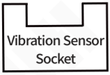

---

## Appendix C: Electrical Specification

| Item | Range: Min | Range: Typical | Range: Max | Unit | Note |
|---|---|---|---|---|---|
| Input Voltage | 85 | 220 | 250 | V | AC RMS |
| Adjustable Output Voltage Range | 0 | —— | 260 | V | Lower than 150% of Input Voltage |
| Voltage Adjustment Accuracy | | 1 | | V | |
| Voltage Regulation Accuracy | 0 | —— | 10 | % | ΔVout/ΔVin |
| Response Time of Voltage Regulation | | Real Time | | s | Voltage regulation for each waveform |
| Adjustable Output Current Range | 0 | —— | 3 | A | SDVC35-MRJ |
| Adjustable Output Current Range | 0 | —— | 4.5 | A | SDVC35-LRJ |
| Output Power | 0 | —— | 660 | VA | SDVC35-MRJ |
| Output Power | 0 | —— | 990 | VA | SDVC35-LRJ |
| Output Frequency | 25 | —— | 400 | Hz | |
| Frequency Adjustment Accuracy | | 0.1 | | Hz | |
| Output Waveform | | Sine | | | |
| Soft Start Time | 0 | —— | 10 | s | Default value: 0.5 |
| On/Off Delay Time Range | 0 | —— | 20 | s | Default value: 0.2 |
| On/Off Delay Time Accuracy | | 0.1 | | s | |
| Overheat Protection Trigger Temperature | 60 | 65 | 65 | °C | |
| Digital Communication | | ModBUS485 Communication | | | |
| Digital Communication | | EtherCat | | | Optional one |
| Digital Communication | | Profinet | | | Optional one |
| DC Control Output Current | 0 | —— | 200 | mA | Dual 24V Output |
| DC Control Output Voltage | 22 | 24 | 26 | V | Dual 24V Output |
| Analog Control Signal | | 4~20 | | mA | 1 current channel remote speed control |
| Analog Control Signal | | 1~5/0~5/0~10 | | V | 3 voltage channel remote speed control |
| Digital Control Signal | | 24 | | V | Switching Signal |
| Adjustment Method | | 1 Button+1 rotary encoder | | | |
| Standby Power Consumption | —— | —— | 3 | W | |
| Display Method | | 128\*64 | | | OLED Matrix Display |
| Ambient Temperature | 0 | 25 | 40 | °C | No Condensation |
| Ambient Humidity | 10 | 60 | 85 | % | No Condensation |
| Storage Ambient Temperature | -20 | 25 | 65 | °C | No Condensation |

## Absolute Parameters:

Above the standard will damage the controller, obey it strictly.

| Item | GB Standard | IEC Standard | Standard Requirement | Reached Level of CUH Product | Note |
|---|---|---|---|---|---|
| Electrostatic Discharge | GB/T 17626.2-2006 | IEC 61000-4-2:2001 | 4 kV | ±8 kV | Contact Discharge |
| | | | 8 kV | ±15 kV | Air Discharge |
| Electrical Fast Transient Test | GB/T 17626.4-2008 | IEC 61000-4-4:2004 | 2 kV | ±4 kV | |
| Electrical Surge | GB/T 17626.5-2008 | IEC 61000-4-5:2005 | 1 kV | ±4 kV | Line-Line Couple |
| | | | 2 kV | ±2 kV | Line-Earth Couple |

---

## Appendix D: Troubleshooting Suggestions and Error Explanation

| | Fault Phenomenon | Troubleshooting Suggestions |
|---|---|---|
| 1 | No display after power on | • Make sure the power outlet is live • Make sure the Input power Cable is reliably connected to the power outlet |
| 2 | Display normally, but no output | • Make sure the output voltage is not small • Make sure the run state of the controller is not “Man” controlled by press the “ON/OFF” button on panel • Make sure the run state of the controller is not “STP” controlled by the Port C/E • Make sure the run state of the controller is not “STP” controlled by the Logical Direction parameter of Port C/E • Reset the controller by Default Setting Restoration adjusted in Function Group 8 |
| 3 | The Port C/E cannot work normally | • Make sure the ON/OFF control signal wire is connected correctly to the Port C/E • Make sure all the parameters of Port C/E which you have adjusted are correct • Reset the controller by Default Setting Restoration adjusted in Function Group 8 |
| 4 | Beat Effect | • Connect the Sync Signal Wire between the controllers and set the slave controller to sync mode |
| 5 | Display normally, sounds can be heard from the vibratory feeder but no output | • Make sure Output Frequency is not far away from resonant frequency of the vibratory feeder • Reset the controller by Default Setting Restoration adjusted in Function Group 8 |

---

## Appendix E: Warning and Error Description and Troubleshooting Suggestions

| Fault Display | Fault Type | Troubleshooting Suggestions |
|---|---|---|
| 24VErr | Internal 24V Power Error | Internal 24V Power of the controller failure, please contact us for repair |
| 5VErr | Internal 5V Power Error | Internal 5V Power of the controller failure, please contact us for repair |
| <2mA Err | The Input Current of Remote Control Signal is too low to Port A | The Input Current of Remote Control Signal is too low to Port A, so make it is greater than 2mA |
| <0.5V Err | The Input Voltage of Remote Control Signal is too low to Port A | The Input Voltage of Remote Control Signal is too low to Port A, so make it is greater than 0.5V |
| CommErr(1~5) | Communication Error | Please contact us for repair |
| decline | Counting deceleration | When the count number reaches the "End Count" that you set, the output voltage (or Feeding Speed) decreases |
| EEPErr | Saving Preset Parameters Error | Please contact us for repair |
| FrqncyHi | Sync Reference Frequency is too high | Input Frequency of Sync Signal of slave controller is greater than 400Hz Make sure the frequency of sync signal is from 25 Hz to 400 Hz |
| FrqncyLo | Sync Reference Frequency is too low | Input Frequency of Sync Signal of slave controller is less than 25Hz Make sure the frequency of sync signal is from 25 Hz to 400 Hz |
| OverHot | OverHeat | Internal temperature of the controller exceeds 65℃ Make sure the controller work at well-ventilated environment |
| OverLoad | OverLoad of vibration sensor | Vibration sensor has detected the acceleration exceeds its absolute amplitude value |
| OvrCurrt | OverCurrent | Output Current of controller exceeds 3A |
| OvrVoltg | OverVoltage | Output Voltage of controller exceeds 260V Make sure the input voltage range is from 85V to 260V |
| PortDErr | Port D Error | Output Voltage Deviation of Port D exceeds 3V Make sure the load power of Port D does not exceed 4.8W |
| PortPErr | Port P Error | Output Voltage Deviation of Port P exceeds 3V Make sure the load power of Port P does not exceed 4.8W |
| Saturate | Output Saturation | When Output Voltage of the controller is greater than Input Voltage, the controller enters the saturation state |
| Save | Saving Preset Parameters | After Automatic Resonant Frequency Search operation, its related parameters are saved successfully |
| SenorErr | Vibration Sensor Fault | The vibration sensor signal is abnormal, please contact us for repair |
| SenTypEr | Vibration Sensor Type Error | The type of vibration sensor connected to the controller is mismatched with the "vibration sensor type" parameter set in the controller |
| Short | Short-circuit | Output of the controller is short-circuit, Make sure the output terminal is not short-circuit |
| SynchErr | Sync Signal Error | Sync signal wire is not connected to the slave controller Make sure the sync signal wire is connected correctly to the controller |
| UndrVolt | UnderVoltage | Input Voltage of the controller is less than 85V. Make sure the input voltage range is from 85V to 260V |
| UpgradeSlv | Firmware Update | The firmware is updating, the controller go back to normal after the update |

## Appendix F: Run State and Network Card Type Description

Operation States of the controller are shown as below:

| State of the controller display | State Type | Description |
|---|---|---|
| RUN | The controller is Run | Output of the controller is valid |
| MAN | The controller is stopped | Short press the “ON/OFF” button to switch the Run/Stop state of output of the controller |
| CND | The count process is finished to stop the controller | When the count process is finished, the output of controller is stopped |
| RMT | Stop the output of the controller remotely | Stop the output of the controller remotely by RS485 or Ethernet communication |
| STP | Port C/E to stop output of the controller | Stop output of the controller by Digital Input Port C/E |
| Lok | Keypad lock | The On/OFF button and Encoding is disable and long press the Encoding Switch to unlock keypad |
| ERR | Stop output of the controller caused by count fault | When the value of "Main Logic" is "Count", if the clear and count up operation occur simultaneously in counting process, the output of controller is stopped |

Network States are shown as below:

| State of the controller display | State Type | Description |
|---|---|---|
| Wit | No network card is connected | |
| Cat | EtherCat network card is connected | |
| Pro | Profinet network card is connected | |

---

## Appendix G: Wiring Method of Switch Sensors and PLC to the Digital Input Ports

### Connection Method of NPN sensor

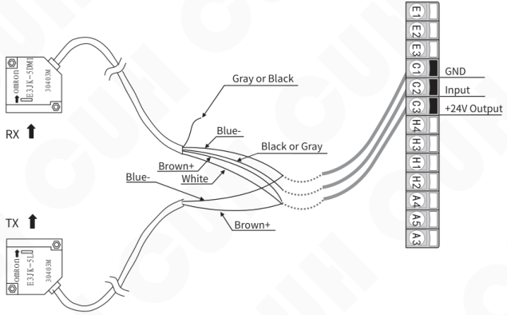

### Connection Method of Photoelectric beam sensor

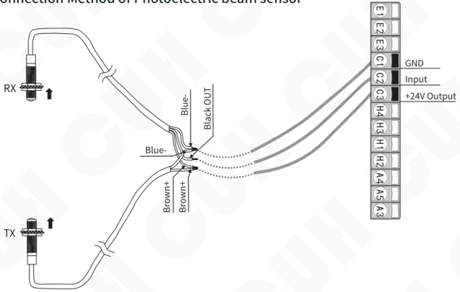

## Connection Method of optical fiber beam sensor

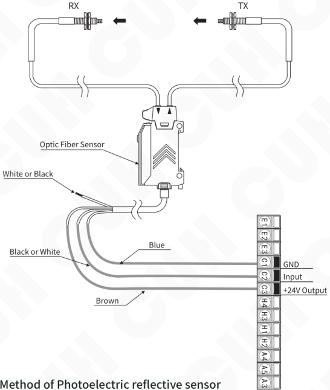

## Connection Method of Photoelectric reflective sensor

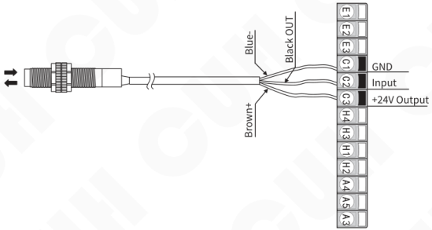

## Connection Method of NPN output of the PLC to Port C

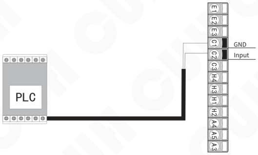

## Connection Method of PNP output of the PLC to Port C

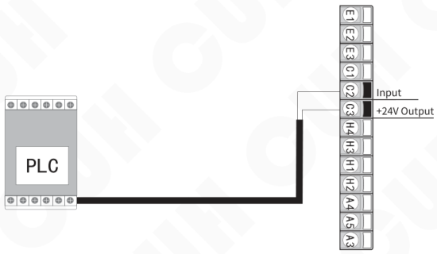

Relay Output, NPN output and PNP output of the PLC, any of them can turn on/off the controller.

**Note: when the Control signal of PLC is used to turn on /off the controller, the voltage of input signal is not allowed to exceed 24V.**

## Appendix H: Parameters Table

### The Function of each Parameters Group

| The name of Parameters Group | Description |
|---|---|
| Function Group 0 | The items could be selected to display on Standby Interface |
| Function Group 1 | Basic parameters |
| Function Group 2 | Parameters of Main output control |
| Function Group 3 | Parameters of Auto/sync function |
| Function Group 4 | Parameters of Port C control |
| Function Group 5 | Parameters of Port E control |
| Function Group 6 | Parameters of Port D control |
| Function Group 7 | Parameters of Port P control |
| Function Group 8 | Advanced parameters |
| Function Group 9 | Parameters of controller Run status |

---

All parameters of Function Group 0 shown as below:

| Item | Min | Default | Max | Unit/Enum | Description |
|---|---|---|---|---|---|
| MonitPart1 | —— | None | —— | None | The corresponding LCD row display blank in standby interface |
| | | | | UsrV | Output Voltage |
| | | | | UsrF | Output Frequency |
| | | | | UsrS | Feeding Speed |
| | | | | Cout | Current Count Value |
| | | | | PCUP | Port C Up Delay |
| | | | | PCDn | Port C Down Delay |
| | | | | PEUp | Port E Up Delay |
| | | | | PEDn | Port E Down Delay |
| | | | | PDUP | Port D Up Delay |
| | | | | PDDn | Port D Down Delay |
| | | | | PPUP | Port P Up Delay |
| | | | | PPDn | Port P Down Delay |
| | | | | MaUP | Main Control Up Delay |
| | | | | MaDn | Main Control Down Delay |
| | | | | InV | Input Voltage |
| | | | | CurE | Output Current RMS |
| | | | | CurM | Max Output Current |
| | | | | PwrA | Active power |
| | | | | PwrR | Reactive power |
| | | | | Temp | temperature |
| | | | | SynF | The frequency of external synchronic signal |
| | | | | Remo | Remote Input voltage |
| | | | | PCV | Port C Output voltage |
| | | | | PEV | Port E Output voltage |
| | | | | PDV | Port D Output voltage |
| | | | | PPV | Port P Output voltage |
| MonitPart2 | —— | UsrV | —— | The same as MonitPart1 | |
| MonitPart3 | —— | UsrF | —— | The same as MonitPart1 | |

All parameters of Function Group 1 shown as below:

| Item | Min | Default | Max | Unit/Enum |
|---|---|---|---|---|
| User_Speed | 0 | 200 | 3200 | |
| Usr_Voltag | 0 | 150 | 260 | V |
| Usr_Frqncy | 25.0 | 50.0 | 400.0 | Hz |
| TotalCount | 1 | 1 | 9999 | |
| Clear Time | 0 | 0 | 999.9 | s |
| AutoSerch_ | —— | Idle | —— | Idle Start |
| PassWord2_ | 0 | 0 | 9999 | |
| Language | —— | Englsh | —— | Englsh 中文 dt |

---

All parameters of Function Group 2 shown as below:

| Item | Min | Default | Max | Unit/Enum |
|---|---|---|---|---|
| SoftStart_ | 0 | 0.2 | 9.9 | s |
| SoftStop__ | 0 | 0.2 | 9.9 | s |
| MainUpDely | 0 | 0.2 | 9999 | 0.1s |
| MainDwnDly | 0 | 0.2 | 9999 | 0.1s |
| MainLogic_ | —— | AND | —— | PortC PortE AND OR XOR Count |
| MainDir___ | —— | Const | —— | Const Revrs |
| MainCtrl__ | —— | On | —— | On Off |
| MainSrc___ | —— | Local | —— | Local Remot |
| PowrOnStat | —— | On | —— | On Off Keep |
| PrcntTrmnl | 0 | 50 | 100 | % |
| CountAhead | 0 | 0 | 9999 | |
| CtrlSource | —— | Panel | —— | Panel 20mA 1~5V 0~5V 0~10V Meter |
| AccelrIndx | 100 | 100 | 150 | % |
| MaxVoltage | 0 | 150.0 | 260.0 | V |
| WavFomIndx | 50 | 100 | 100 | % |
| CmpnstCurt | —— | Valid | —— | Valid None |
| DCCurrent | 0 | 0.1 | 3 | A |

---

All parameters of Function Group 3 shown as below:

| Item | Min | Default | Max | Unit/Enum |
|---|---|---|---|---|
| AtoFCenter | 25.0 | 100.0 | 400.0 | Hz |
| AtoFRange_ | 0 | 30.0 | 180.0 | Hz |
| VoltagMode | —— | Auto | —— | Manul Auto |
| FrqncyMode | —— | Auto | —— | Manul Auto SlavC SlavM |
| AtoFIntgrl | 0 | 20 | 2000 | 1 |
| AtoAIntgrl | 0 | 400 | 9999 | 1 |
| AtoAProptn | 0 | 500 | 9999 | 1 |
| AtoSnsrTyp | 16g | 16g | 70g | 16g 35g 50g 70g Auto |
| AtoSrhVMax | 0 | 100.0 | 260.0 | V |
| AtoSnsrMax | 0 | 100 | 100 | % |
| AtoSpedMax | 0 | 3200 | 4000 | |
| AutoPhase_ | -180 | 0 | 180 | ° |
| UserPhase_ | -180 | 0 | 180 | |
| Measure | —— | None | —— | None Valid |

All parameters of Function Group 4 shown as below:

| Item | Min | Default | Max | Unit/Enum |
|---|---|---|---|---|
| PortCUpDly | 0 | 0.002 | 9.999 | s |
| PortCDnDly | 0 | 0.002 | 9.999 | s |
| PortCDir__ | —— | Const | —— | Const |
| | | | | Revrs |
| PortCType_ | —— | Auto | —— | NPN |
| | | | | Auto |
| | | | | PNP |

---

All parameters of Function Group 5 shown as below:

| Item | Min | Default | Max | Unit/Enum |
|---|---|---|---|---|
| PortEUpDly | 0 | 0.002 | 9.999 | s |
| PortEDnDly | 0 | 0.002 | 9.999 | s |
| PortEDir__ | —— | Const | —— | Const |
| | | | | Revrs |
| PortEType__ | —— | Auto | —— | NPN |
| | | | | Auto |
| | | | | PNP |

---

All parameters of Function Group 6 shown as below:

| Item | Min | Default | Max | Unit/Enum |
|---|---|---|---|---|
| PortDUpDly | 0 | 0.0 | 999.9 | s |
| PortDDnDly | 0 | 0.0 | 999.9 | s |
| PortDDir__ | —— | Const | —— | Const |
| | | | | Revrs |
| PortDLogic | —— | Error | —— | Error |
| | | | | Main |
| | | | | PortC |
| | | | | PortE |
| | | | | And |
| | | | | Or |
| | | | | Xor |
| | | | | End |
| | | | | Near |
| PortDCtrl_ | —— | On | —— | On |
| | | | | Off |
| PortDSrc__ | —— | Local | —— | Local |
| | | | | Remot |
| PortDType_ | —— | Ps&Pu | —— | NPN |
| | | | | Ps&Pu |
| | | | | PNP |

All parameters of Function Group 7 shown as below:

| Item | Min | Default | Max | Unit/Enum |
|---|---|---|---|---|
| PortPUpDly | 0 | 0.0 | 999.9 | 0.1s |
| PortPDnDly | 0 | 0.0 | 999.9 | 0.1s |
| PortPDir__ | —— | Const | —— | Const |
| | | | | Revrs |
| PortPLogic | —— | Error | —— | Error |
| | | | | Main |
| | | | | PortC |
| | | | | PortE |
| | | | | And |
| | | | | Or |
| | | | | Xor |
| | | | | End |
| | | | | Near |
| PortPCtrl_ | —— | On | —— | On |
| | | | | Off |
| PortPSrc__ | —— | Local | —— | Local |
| | | | | Remot |
| PortPType_ | —— | Ps&Pu | —— | NPN |
| | | | | Ps&Pu |
| | | | | PNP |

---

All parameters of Function Group 8 shown as below:

| Item | Min | Default | Max | Unit/Enum |
|---|---|---|---|---|
| Slave_ID | 1 | 1 | 31 | |
| Baud_Rate | 0.3K | 115.2 K | 115.2 K | 0.3 Kbps |
| | | | | 1.2 Kbps |
| | | | | 2.4 Kbps |
| | | | | 9.6 Kbps |
| | | | | 19.2 Kbps |
| | | | | 57.6 Kbps |
| | | | | 115.2 Kbps |
| ReadALLFrm | —— | None | —— | None |
| | | | | UsrD1 |
| | | | | UsrD2 |
| | | | | UsrD3 |
| SavedALLTo | —— | None | —— | None |
| | | | | Work |
| | | | | UsrD1 |
| | | | | UsrD2 |
| | | | | UsrD3 |
| RestorALL | —— | None | —— | None |
| | | | | RWork |
| PassWord1_ | 0 | 0 | 9999 | |

All parameters of Function Group 9 shown as below:

| Item | Min | Max | Unit | Description |
|---|---|---|---|---|
| BusVoltage | 0 | 380.0 | V | Bus Voltage（Average Value） |
| Speed_Now_ | 0 | 4000 | 1 | Real test |
| VoltagOut_ | 0 | 260.0 | V | Average value of rectification |
| AtoVltgOut | 0 | 260.0 | V | Automatic calculation of output voltage |
| SynchrFrqy | 25.0 | 400.0 | Hz | The frequency of external synchronic Signal |
| AtoFrqyOut | 25.0 | 400.0 | Hz | Automatic output frequency |
| EffectCurt | 0 | 9.999 | A | |
| CurrentMax | 0 | 9.999 | A | |
| AtoPhasRem | -180 | 180 | ° | Auto phase remnant |
| MainOutPut | 0 | 1 | | |
| RemotInput | 0 | 10.0 | V | |
| 5V_Power_ | 0 | 6.0 | V | |
| PortC_____ | 0 | 1 | | |
| PortCInput | 0 | 26.0 | V | |
| PortE_____ | 0 | 1 | | |
| PortEInput | 0 | 26.0 | V | |
| PortD_____ | 0 | 1 | | |
| PortD_Out_ | 0 | 26.0 | V | |
| PortP_____ | 0 | 1 | | |
| PortP_Out_ | 0 | 26.0 | V | |
| 24V_Power_ | 0 | 26.0 | V | |
| PowrAvtive | 0 | 9999 | W | |
| PowrReactv | 0 | 9999 | W | |
| Temperatur | 0 | 85.0 | °C | |
| Inductance | 0 | 9.999 | H | |
| Resistance | 0 | 9999 | Ω | |
| Saturatn | 0 | 9.999 | A | |
| AtoSnsrVld | —— | —— | | |
| AtoSnsrOvr | —— | —— | | |
| AtoDistrtn | 0 | 100 | % | |
| CountNumbr | 0 | 9999 | | |
| Flag______ | 0 | FFFF | | HEX |
| FwVrsnMain | 0 | 9999 | | |
| FwVrsnSlav | 0 | 9999 | | |

Nanjing CUH Science & Technology Co.,Ltd  
https://en.cuhnj.com  
Tel.:+86-25-84730411 / 84730415 / 84730416  
Fax:+86-25-84730426  
E-mail:sales@cuhnj.com  
Add.:Building 2, Xueyan Tech Park, Tuscity,  
No.9 Zhineng Rd, Jiangning, Nanjing, China

Document No.: IDP1000482

