## Variable Frequency Digital Controller for Piezo Vibratory Feeder

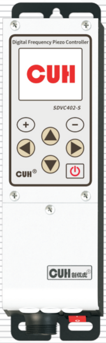

## SDVC402-S
Variable Frequency Digital Controller for Piezo Vibratory Feeder　 SDVC402-S
## User Manual

---

## Copyright Statement

Nanjing CUH Science & Technology CO., Ltd. reserves all rights.

All information contained in this user manual is the intellectual property of our company and is protected by copyright law and other related laws. CUH enjoys and reserves all rights conferred by copyright law and other laws. Without the written consent of CUH, part or all of this user manual shall not be copied, translated, imitated or otherwise utilized.

## Disclaimer

All contents of this user manual only describe the use method of related products produced by our company, and are described according to the existing technology and the state provided to you when you use it. You must bear the relevant risks when you use this product. Except as required by law, the company does not have any express or implied responsibility for the product due to this user manual, including but not limited to personal injury, property damage, loss of opportunity, etc.

You clearly understand the above risks and agree that, except as mandated by law, the company is not responsible for any direct or indirect damage or loss to you (including but not limited to tangible loss of personnel, property, data, etc. and intangible loss of reputation, opportunity, etc.)

The company reserves the right to modify the products applicable in this user manual without prior or subsequent notice.

---

## Preface

Thank you for choosing CUH SDVC402-S Variable Frequency Digital Controller for Piezo Vibratory Feeder. (The controller for short in the following text). This series of controllers uses high-quality components and incorporates the latest electronic technology, and is carefully designed with high-performance digital signal processors.

This manual introduces the basic operation method, functional technical description and typical application examples of this product. Provide users with relevant information on installation and debugging, parameter setting, abnormal diagnosis, troubleshooting and routine maintenance of the controller. In order to ensure the correct installation and use of this controller, please read this user manual carefully before installation and keep it properly.

Be sure to read the following symbols to alert you to precautions against personal injury and product damage.

| | |
|---|---|
| ⚠ Danger | Non-observance of this item will result in personal injury or death. |
| ⚠ Warning | Non-observance of this item may result in personal injury or death. |
| ⚠ Careful | Non-observance of this item may result in moderate or minor injury to persons. |
| Notice | Non-observance of this item will result in damage to the product and property damage. |
| ❗ Essential | Indicates precautions and usage restrictions that must be observed during use. |

**This manual is suitable for the following models of controllers:**

- Variable Frequency Digital Controller for Piezo Vibratory Feeder  
  SDVC402-S (150mA)

---

# Safety and Precautions

1. **⚠ Danger** This product is only used to drive piezo-electric vibratory feeding equipment, do not use this product for the purpose of protecting the human body or parts of the human body, etc.

2. **⚠ Danger** This product is not intended to be used as an explosion-proof product, do not use it in hazardous locations and/or potentially explosive gas environment.

3. **⚠ Warning** This product is powered by AC mains, please do not apply AC voltage exceeding 250Vac. Excessive input voltage, such as 300Vac, may cause the product to explode or catch fire, resulting in serious safety accidents.

4. **⚠ Warning** This product is grounded through the power cord. Please ensure that the power distribution facilities for the controller are well grounded, otherwise the controller shell may be charged, resulting in an electric shock accident.

5. **⚠ Warning** Do not input AC power to the output of this controller, it will damage the controller.

6. **⚠ Warning** Do not plug and unplug the wiring with points or touch the contact of each wiring terminal in the wiring compartment to prevent electric shock.

7. **Notice** Please avoid controlling the output of this product by cutting off the power supply through relays and other devices, which will seriously reduce the life of the controller.

8. **Notice** The controller is designed to work in a cool and dry environment. Never run the controller outside to avoid soaking and insolation. Operate the controller within the temperature specified electrical characteristic.

9. **❗ Essential** Be sure to fix this product on a solid platform that is reliably grounded and away from vibrating equipment.

10. **❗ Essential** Never operate the controller under the condition that beyond its designed limits.

11. **❗ Essential** Operate the controller in accordance with this instruction book strictly. we will not assume any civil or criminal liability if the equipment damage or personal injury is caused by incorrect operation.

12. **❗ Essential** Never open the controller shell to avoid electric shock. Contact CUH if the controller break down. Never try to repair the controller yourself which may caused void warranty.

---

---

## Operating and Storage Environment

### Inspection Before Using

Every controller will go through rigorous quality inspection before delivery and is packed with crash-proof packaging, Please check the following items after unpacking:

1. Whether the controller is damaged during transportation.
2. Whether the controller model matches your order.

### Runtime Environment

Please follow the notes below to ensure the better performance and longer lifetime of the controller:

- ⚠ Well-ventilated environment
- ⚠ Keep away from water, stream, dust and especially oily dust
- ⚠ Keep away from the corrosive or flammable gas and liquid
- ⚠ Keep away from floating dust and metal particles
- ⚠ Firmly fixed to avoid self vibration
- ⚠ Keep away from electromagnetic interference
- ⚠ Ensure ambient temperature is 0~40 °C
- ⚠ For use at altitude 2000m or lower

---

# Contents

- Chapter Ⅰ Instructions Before Use — 1
  - 1.1 Check Package Contents — 1
  - 1.2 Keypad and I/O Ports — 2
  - 1.3 Homepage Parameter Description — 3
  - 1.4 Wiring Ports Explanation — 3
  - 1.5 Nameplate Explanation — 4
- Chapter Ⅱ Features — 5
- Chapter Ⅲ Installation Guide — 7
  - 3.1 Controller Usage Conditions — 7
  - 3.2 Operation Method of Buttons — 7
  - 3.3 Install and Use — 8
- Chapter Ⅳ Brief Function Description — 12
  - 4.1 Output Voltage — 12
  - 4.2 Output Frequency — 13
  - 4.3 Soft Startup Time — 14
  - 4.4 Output Switch — 14
  - 4.5 Maximum Output Voltage Limit — 15
  - 4.6 Keyboard Lock — 16
  - 4.7 Power-on Operation Status Setting — 17
  - 4.8 Restore Default Settings — 18
- Chapter Ⅴ Sensors and Signal Control — 19
  - 5.1 Intelligent Photoelectric Sensing — 19
    - 5.1.1 Wiring Method of the Intelligent Photoelectric Sensor — 19
    - 5.1.2 On/Off Delay of the Intelligent Photoelectric Sensor — 20
    - 5.1.3 Logical Direction of the Intelligent Photoelectric Sensor — 21
  - 5.2 Using Method of the Switch Sensor — 22
    - 5.2.1 Wiring Method of the NPN Proximity Switch Sensor — 22
    - 5.2.2 On/Off Delay of the Switch Sensor — 26
    - 5.2.3 Logical Direction of the Switch Sensor — 27
    - 5.2.4 Switch Sensor Type — 28

---

---

- 5.3 Control Output — 29
- 5.4 Remote Speed Control — 30

## Chapter Ⅵ Detailed Function Introduction — 32

- 6.1 Customize Homepage — 33
- 6.2 Common Parameter Settings — 34
  - 6.2.1 Voltage — 34
  - 6.2.2 Frequency — 34
  - 6.2.3 Soft Start Time/Soft Stop Time — 35
  - 6.2.4 Maximum Output Voltage/Minimum Output Voltage — 35
  - 6.2.5 Maximum Output Frequency/Minimum Output Frequency — 35
  - 6.2.6 Backlight Off Time — 36
  - 6.2.7 Language — 36
- 6.3 Output Parameters — 37
  - 6.3.1 Main Output Parameters — 37
    - 6.3.1.1 Main Source 1/Main Source 2 — 37
    - 6.3.1.2 Main Logic — 39
    - 6.3.1.3 Main On Delay/Main Off Delay — 40
    - 6.3.1.4 Main Mode — 40
    - 6.3.1.5 Main Direction — 41
    - 6.3.1.6 Power On State — 41
  - 6.3.2 DC Control Output Parameters — 42
    - 6.3.2.1 Output Mode of Port D — 44
    - 6.3.2.2 Port D Type — 45
- 6.4 Signal Control — 46
  - 6.4.1 Port B Sensitivity — 47
  - 6.4.2 Port B/Port C Logical Direction — 47
  - 6.4.3 Port B On/Off Delay and Port C On/Off Delay — 47
- 6.5 Save Settings — 48
  - 6.5.1 Callback Settings — 48
  - 6.5.2 Save Settings — 48
  - 6.5.3 Restore Factory — 49

---

---

- 6.5.4 Local Machine Type and Number — 49
- 6.5.5 User Password — 49
- 6.6 Controller Status Monitoring — 50

## Chapter Ⅶ Appendix — 51

- 7.1 Dimensions — 51
- 7.2 Technical Specifications — 52
- 7.3 Reference Standard — 53
- 7.4 Parameter List — 54
- 7.5 Input and Output Circuit Diagrams — 56
- 7.6 Error and Warning Code — 57

## Chapter Ⅷ Product Warranty Information — 58

- 8.1 Warranty Period — 58
- 8.2 Warranty Coverage — 58
- 8.3 Product Suitability — 58

---

# Chapter Ⅰ Instructions Before Use

This chapter introduces the product packaging contents, controller appearance description, and controller nameplate information.

## 1.1 Check Package Contents

Before using, please check the integrity of the controller and accessories. If you find that the product is defective or damaged, missing accessories, etc., please contact our company.

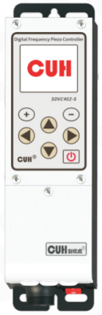

Controller×1

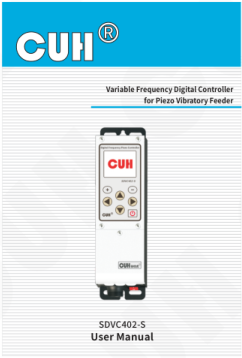

User Manual×1

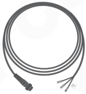

Output Cable×1

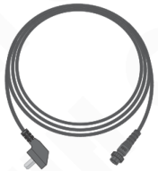

Input Power Cord×1

---

## 1.2 Keypad and I/O Ports

### Window and Buttons Explanation

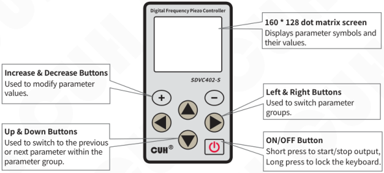

**160 * 128 dot matrix screen**  
Displays parameter symbols and their values.

**Increase & Decrease Buttons**  
Used to modify parameter values.

**Up & Down Buttons**  
Used to switch to the previous or next parameter within the parameter group.

**Left & Right Buttons**  
Used to switch parameter groups.

**ON/OFF Button**  
Short press to start/stop output, Long press to lock the keyboard.

### External Parts Explanation

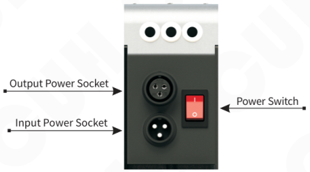

- Output Power Socket
- Input Power Socket
- Power Switch

---

## 1.3 Homepage Parameter Description

The controller can display the main output status, keyboard lock status, port status, monitoring parameters, and interface name on the homepage. Within the port status:

Highlighting X indicates that the port is valid. <u>X</u> indicates that the port is valid at low level, and X̅ indicates that the port is valid at high level.

## 1.4 Wiring Ports Explanation

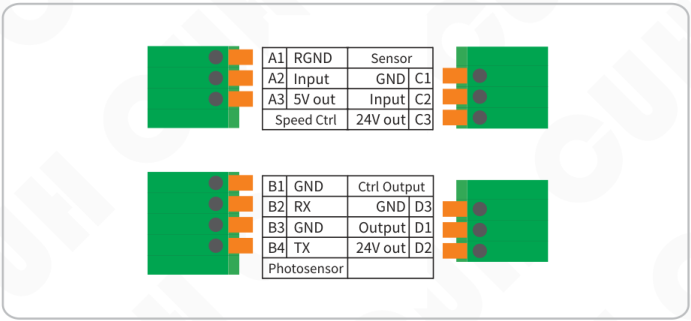

| | | | |
|---|---|---|---|
| A1 | RGND | Sensor | |
| A2 | Input | GND | C1 |
| A3 | 5V out | Input | C2 |
| Speed Ctrl | | 24V out | C3 |

| | | | |
|---|---|---|---|
| B1 | GND | Ctrl Output | |
| B2 | RX | GND | D3 |
| B3 | GND | Output | D1 |
| B4 | TX | 24V out | D2 |
| Photosensor | | | |

---

## 1.5 Nameplate Explanation

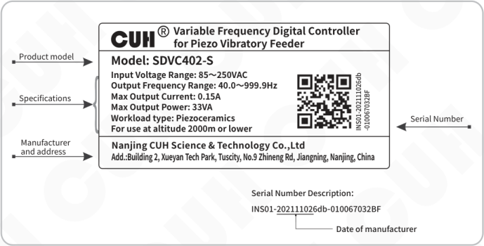

**CUH® Variable Frequency Digital Controller for Piezo Vibratory Feeder**

**Product model**

Model: SDVC402-S

**Specifications**

- Input Voltage Range: 85～250VAC
- Output Frequency Range: 40.0～999.9Hz
- Max Output Current: 0.15A
- Max Output Power: 33VA
- Workload type: Piezoceramics
- For use at altitude 2000m or lower

**Manufacturer and address**

Nanjing CUH Science & Technology Co.,Ltd

Add.:Building 2, Xueyan Tech Park, Tuscity, No.9 Zhineng Rd, Jiangning, Nanjing, China

**Serial Number**

INS01-202111026db-010067032BF

**Serial Number Description:**

INS01-<u>20211102</u>6db-010067032BF

Date of manufacturer → 20211102

---

## Chapter Ⅱ Features

The controller is specially designed for controlling vibratory feeder in the automation systems. Combined with the latest electronic technology and elaborate design, the controller provides the following convenient and practical features:

**Frequency Adjusting:** Output Frequency ranges from 40.0Hz to 999.9Hz.

**Voltage Adjusting:** Output Voltage ranges from 0V to 220V.

**Automatic Voltage Stabilizing:** The controller can eliminate feeding speed variation caused by mains voltage fluctuation.

**Intelligent Photoelectric Sensing:** Our adaptive Intelligent Photoelectric Sensor can help to stall the controller when work-pieces are full or work-piece is empty and to fulfill the functions of Soft Startup Time Setting, On Delay, Off Delay, and Logical Relation Adjusting.

**Switch Sensor:** Adaptive switch sensor or PLC can be connected to turn on/off the controller.

**Remote Speed Control:** Output Voltage of the controller can be controlled by an external potentiometer, a PLC, or a 1~5V/4~20mA DC signal.

**Output Switch:** ON/OFF button on the panel that allows for instant start and stop, facilitating user device debugging.

**Keypad Locking:** Press the ON/OFF button and hold for 2 seconds to lock all buttons for fear of false operation.

**Power On Status:** By setting this parameter, users can conveniently determine the startup operating state of the controller.

**Controlling Output:** The Controlling Output signal outgoing from the transistor can coordinate a solenoid or other external devices with the controller.

**Maximum Output Restriction:** Maximum Output Voltage value can be preset to protect the equipment from damage caused by misuse.

**Default Settings Restoration:** This function allows the user to restore all default parameter settings and reset the controller.

**LCD Display:** It adopts 160* 128 resolution color display and supports both Chinese and English languages.

**Parameter Group Saving and Reading:** Up to 4 user parameter groups can be saved and read.

---

---

CUH attaches great importance to the product quality management and safety performance. Apart from the high-quality components we use and rigorous quality control system, CUH has taken account of possible accidents users may encounter and provides the following protective functions to maximum the controller's practicability.

**Short-Circuit Protection:** If output of the controller is short-circuited, the controller will halt its output until restarted.

**Current Overload Protection:** The controller will halt its output to ensure equipment's operating safety when operation current exceeds its rated value.

**Overheat Protection:** The controller will halt its output to protect itself when operation temperature is too high.

CUH controllers are strictly compliant with CE certification.

---

# Chapter Ⅲ Installation Guide

This chapter introduces the necessary conditions for the use of the controller and how to install and connect it correctly.

## 3.1 Controller Usage Conditions

The controller is powered by AC 85V~250V and is connected to a protective ground through the plug of the power cord. Please use a standard mains power supply and ensure that the protective ground wire is correctly connected.

**⚠ Warning** Never connect the controller to 380V AC power, this will cause irreversible serious damage to the controller, possibly resulting in explosion, fire and other safety incidents.

**⚠ Warning** Ensure that the power supply side is reliably grounded. The metal casing of the controller is directly connected to the protective grounding wire. Poor grounding will cause the controller casing to be electrified and cause an electric shock accident.

**Notice** Long time running will generate heat and cause the temperature of the casing to rise. Please install the controller in a well-ventilated environment and fix it well, away from vibration sources.

**Notice** This product is a controller used to drive the piezoelectric vibratory feeder.

## 3.2 Operation Method of Buttons

a. According to the time of pressing the button, the button actions are divided into short press, long press, first level acceleration, and second level acceleration.

b. Short press to define the pressing time greater than 0.1 and less than 2 seconds, and long press to define the pressing time greater than 2 seconds.

c. ⊕ and ⊖ are used to modify parameter values. ▲ and ▼ are used to select different parameters.

d. Switch between the upper and lower parameter groups in the parameter settings interface by short pressing ◀ or ▶.

e. Switch between the upper and lower parameters of this group in the parameter setting interface by short pressing ▲ or ▼.

f. Short press ⏻ to start/stop main output, long press ⏻ to lock/unlock keyboard.

g. If there is no action for more than 5 minutes on any interface, it will enter the home page interface.

---

## 3.3 Install and Use

### Step One:

Open the packing box and check the controller and all accessories.

### Step Two:

Connect the wiring terminals of the Output Power Cable to the electrodes of the piezo vibrator.

Align the notch on the aviation plug of the output cable with the triangle mark on the output socket of the controller, and then tighten the nut after connecting the output cable correctly.

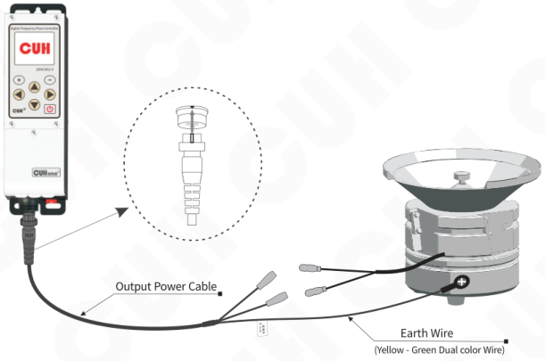

> **Note**
>
> Make sure the electrodes of the piezo vibrator are connected to the two output pins of the Output Power Cable, and the vibrator's metal shell is reliably grounding.

---

### Step Three:

Connect the Connector of the Input Power Cable to the Input Power Socket of the controller.

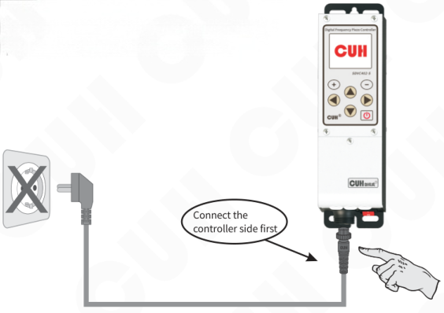

Connect the controller side first

### Step Four:

After confirming that the switch is in the off position, connect the plug of the Input Power Cable to the mains jack.

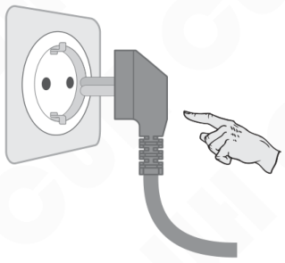

---

## Step Five:

- Turn on the power switch of the controller, the controller displays the home interface.
- Press ⊕ or ⊖ to adjust the output voltage value to between 30 and 80.

**Note:** Inverse selection indicates that the parameter value is adjustable.

## Step Six:

- On the home interface, short press ▼ to enter the adjustment state of the output frequency.
- Press ⊕ or ⊖ to find the natural frequency of the vibratory feeder, which is also called the resonant frequency.

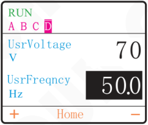

- The frequency at which the vibration reaches its maximum is the natural frequency of the vibrating body.
- Each vibrator has its natural mechanical resonance frequency, adjust the output frequency of the controller to this frequency to achieve the best working state.

---

## Step Seven:

- After finding the natural frequency of the vibratory feeder, use the ⊕ and ⊖ to adjust the voltage until to the best feed rate.

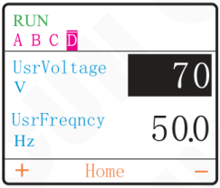

The vibratory feeder should work now. For further control instructions, please refer to the following chapters.

---

## Chapter Ⅳ Brief Function Description

This chapter introduces basic parameter settings.

### 4.1 Output Voltage

This controller can directly set the output voltage digitally on the panel. Since the controller has a voltage-stabilizing output function, this value is the voltage rectification average value and will not be affected by the input voltage. The output voltage can be kept stable even in situations where the grid voltage is unstable. At the same time, direct voltage value setting also provides accurate data for users to understand the operation of the equipment.

- Turn on the power switch of the controller.
- The controller enters the output voltage parameter. The LCD display output voltage parameter and the default value is 150.
- Press ⊕ or ⊖ to adjust the parameter value.

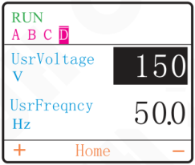

The Voltage range is 0~220V, the adjustment accuracy is 1V.

Output voltage rectified mean value of the controller can be set directly and digitally through the keypad. Benefit from the unique voltage stabilizing function, output voltage of the controller won't fluctuate as the input voltage does, so that the vibrator can maintain stable operation in case of unstable grid voltage.

---

## 4.2 Output Frequency

The controller uses direct digital frequency synthesis technology (DDS), which has very high frequency accuracy and stability, and does not change with time and temperature.

- On the home interface, short press ▼ to enter the adjustment state of the output frequency.
- The LCD display frequency parameter and the default value is 50.0.
- Press ⊕ or ⊖ to adjust the parameter value.

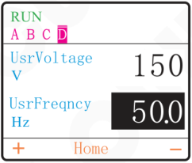

The Frequency range is 40.0～999.9Hz, the adjustment accuracy is 0.1Hz.

---

- In the home interface, short press ◀ and ▶ can switch to other parameter groups.
- In non-monitoring parameter groups, the controller automatically exits to the home interface three minutes after the operation ends.
- In monitoring parameter groups, the controller automatically exits to the home interface ten minutes after the operation ends.

---

## 4.3 Soft Startup Time

In order to avoid sudden shock to the vibrator coil, the controller can gradually increase output voltage from 0 to the preset value when startup.

**Soft Startup Time:** The period of time it takes for the controller to smoothly increase its output voltage from 0 to the preset value when startup.

- Short press ▶ to switch to "2 Common" parameter group.
- Short press ▼ to switch to the soft start parameter and the default value is 0.5.
- Press ⊕ or ⊖ to adjust the parameter value。

**RUN**  
A B C **D**

| Parameter | Value |
|---|---|
| 01.UsrVoltage | 150 V |
| 02.UsrFreqncy | 50.0 Hz |
| 03.SoftStarT | **0.5 s** |
| 04.SoftStopT | 0.0 s |
| 05.MaxVoltage | 220 V |

＋　2Common　－

The Soft Start range is 0.0～10.0s, the adjustment accuracy is 0.1s.

## 4.4 Output Switch

The soft-touch output switch on the panel can easily and quickly start or stop the output of the controller.

- Use ⏻ on the controller panel to control the unit to start or stop the output. The screen displays the "MAN" sign, it means entering the stop state.

**MAN**  
A B C **D**

| Parameter | Value |
|---|---|
| UsrVoltage | 150 V |
| UsrFreqncy | **50.0 Hz** |

＋　Home　－

> Due to the soft-touch switch and digital signal control technology, no spark will generate to spoil the contact. As a result, life-span of the controller and the vibrator will be extended greatly.

---

## 4.5 Maximum Output Voltage Limit

The controller can set the maximum output voltage, which can prevent the user from misoperation to output excessive voltage and damage the vibration equipment.

The remote control voltage will not exceed this value.

- Enter "2 Common" parameter group.
- Short press ⏷ to switch to the maximum voltage parameter and the default value is 220.
- Press ⊕ or ⊖ to adjust the parameter value。

**RUN**  
A　B　C　**D**

| Parameter | Value |
|---|---|
| 01.UsrVoltage | 150 V |
| 02.UsrFreqncy | 50.0 Hz |
| 03.SoftStarT | 0.5 s |
| 04.SoftStopT | 0.0 s |
| 05.MaxVoltage | **220** V |

＋　　2Common　　－

The Maximum Voltage range is 0～220V, the adjustment accuracy is 1V.

> - In any case, the output voltage of the controller cannot and will not exceed the set value of this parameter.
> - The factory default setting of this parameter is the maximum possible output voltage of the machine.

---

## 4.6 Keyboard Lock

When the parameters of the controller are set, the keyboard lock function can lock all buttons on the panel to avoid misoperation.

Even if it is turned off and then turned on again, the state of the keyboard lock remains the state it was in the last time it was turned off.

- Press ⏻ and hold for 2 seconds to lock all buttons on the panel. The screen displays the "Lock" sign.
- Press ⏻ and hold for 2 seconds again to unlock.

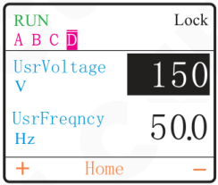

> The keyboard lock state will not disappear due to power off.

---

## 4.7 Power-on Operation Status Setting

In order to prevent sudden power outages under normal conditions and then incoming or special requirements for the power-on status of the controller, you can set this parameter to set the power-up status of the controller to be run, stop or follow the status of the last shutdown.

- Enter "3 M_output" parameter group.
- Short press ⏷ to switch to the power-on status parameter and the default value is On.
- Press ⊕ or ⊖ to adjust the parameter value。

RUN  
A B C D

| Parameter | Value |
|---|---|
| 04.MainUpDly | 0.0 s |
| 05.MainDnDly | 0.0 s |
| 06.MainMode | Delay |
| 07.MainDirect | Revrs |
| 08.PowerOnSta | On |

＋　3M_output　－

**On:** Indicates that the power-on status is on.

**Off:** Indicates that the power-on status is off.

**Hold:** Indicates that the power-on status follows the status of the last shutdown. (If the controller stops the output at the last shutdown, the next time the controller is powered, the controller will off, whereas if the controller is on the output at the last shutdown, the controller will on at the next time when it is powered)

---

## 4.8 Restore Default Settings

User can quickly restore the controller to the factory default state.

Due to the powerful functions of the controller, many parameters can be adjusted. Beginners may find it difficult to restore the controller to its normal working state after modifying multiple parameters. Use this function to quickly restore the disordered parameter state to the factory default setting.

- Enter "7Save" parameter group.
- Short press ⏷ to switch to the RestorALL parameter and the default value is "None".
- Short press ⊕ to change the parameter value to "Work".
- Press ⊕ and ⊖ simultaneously for 2 seconds, the controller will reset all parameters and restart.

RUN  
A B C **D**

| Parameter | Value |
|---|---|
| 01.ReadALLFrm | None |
| 02.SaveALLTo | None |
| 03.RestorALL | **None** |
| 04.LoadType | None |
| 05.MachineNum | None |

＋　7Save　－

RUN  
A B C **D**

| Parameter | Value |
|---|---|
| 01.ReadALLFrm | None |
| 02.SaveALLTo | None |
| 03.RestorALL | **Work** |
| 04.LoadType | None |
| 05.MachineNum | None |

＋　7Save　－

---

# Chapter Ⅴ Sensors and Signal Control

The controller can be controlled by many kinds of external signals and sensors. This chapter mainly elaborates using method of the Intelligent Photoelectric Sensor, the Proximity Switch Sensors and the PLC.

## 5.1 Intelligent Photoelectric Sensing

Combined with the SDVC-S1 Photoelectric Sensor the function of Intelligent Photoelectric Sensing can be achieved. The SDVC-S1 sensor can filter the interference of background light impacting on the sensitivity of the controller. As a result, the controller can work reliably without manual sensitivity adjustment.

### 5.1.1 Wiring Method of the Intelligent Photoelectric Sensor

**Step 1:**

Open the cover plates of the controller.

**Step 2:**

Connect the SDVC-S1 sensor to the terminals of the controller according to the diagram.

> The working distance of the sensor can be adjusted by setting the "PortBLimit" parameter of 4PhotoSen Parameter Group, the smaller the parameter value, the more sensitive it is.

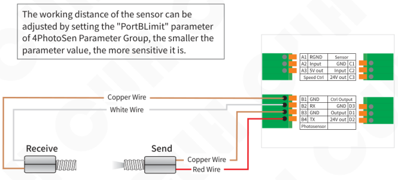

| | | | |
|---|---|---|---|
| A1 | RGND | Sensor | |
| A2 | Input | GND | C1 |
| A3 | 5V out | Input | C2 |
| Speed Ctrl | | 24V out | C3 |

| | | | |
|---|---|---|---|
| B1 | GND | Ctrl Output | |
| B2 | RX | GND | D3 |
| B3 | GND | Output | D1 |
| B4 | TX | 24V out | D2 |
| Photosensor | | | |

**Notice:**

Under the factory default settings, the logical direction "PortBDirec" of this sensor is normally open.

---

## 5.1.2 On/Off Delay of the Intelligent Photoelectric Sensor

When using a sensors or PLC to turn on or turn off the controller's main output, the action can be delayed for a period of time after the control signal is given or restored. The delay time can be set through the two parameters below.

**PortBUpDly:** The period of time the controller goes through from receiving a startup control signal to actually outputting.

- Enter "4PhotoSen" parameter group.
- Short press ⊖⃤ to switch to the On Delay of the Port B parameter and the default value is 0.2.
- Press ⊕ or ⊖ to adjust the parameter value。

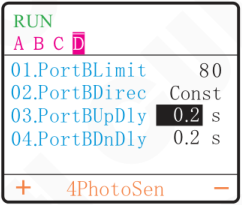

The On Delay of the Port B range is 0.0～99.9s, the adjustment accuracy is 0.1s.

**PortBDnDly:** The period of time the controller goes through from receiving a shutdown control signal to actually cutting off output.

- Enter "4PhotoSen" parameter group.
- Short press ⊖⃤ to switch to the Off Delay of the Port B parameter and the default value is 0.2.
- Press ⊕ or ⊖ to adjust the parameter value。

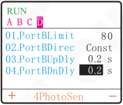

The Off Delay of the Port B range is 0.0～99.9s, the adjustment accuracy is 0.1s.

---

## 5.1.3 Logical Direction of the Intelligent Photoelectric Sensor

Under normal circumstances, the receiving end receives no optical signal, and the controller runs by default. But in some special applications the controller needs to be stopped when the receiving end receives no optical signal. Adjusting this parameter can fulfill this kind of application.

- Enter "4PhotoSen" parameter group.
- Short press ⏷ to switch to the Logical Direction of the Port B parameter and the default setting is "Const".
- Press ⊕ or ⊖ to adjust the parameter settings。

**RUN**  
A B C **D**

| Parameter | Value |
|---|---|
| 01.PortBLimit | 80 |
| 02.PortBDirec | **Const** |
| 03.PortBUpDly | 0.2 s |
| 04.PortBDnDly | 0.2 s |

＋　4PhotoSen　−

**RUN**  
A B C **D**

| Parameter | Value |
|---|---|
| 01.PortBLimit | 80 |
| 02.PortBDirec | **Inv** |
| 03.PortBUpDly | 0.2 s |
| 04.PortBDnDly | 0.2 s |

＋　4PhotoSen　−

- When Parameter "PortBDirec" is set to "Const", namely no optical signal received, the controller runs.
- When Parameter "PortBDirec" is set to "Inv", namely no optical signal received, the controller stops.

---

## 5.2 Using Method of the Switch Sensor

The controller can operate with all kinds of sensors such as switch sensors, optical switch sensors and fiber optical sensors.

### 5.2.1 Wiring Method of the NPN Proximity Switch Sensor

**Step 1:**

Open the cover plates of the controller.

**Step 2:**

Connect the NPN Proximity Switch Sensor to the terminals of the controller according to the diagram.

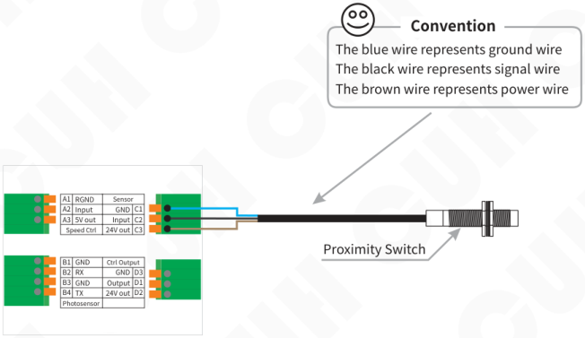

**Convention**

- The blue wire represents ground wire
- The black wire represents signal wire
- The brown wire represents power wire

Proximity Switch

| | | | |
|---|---|---|---|
| A1 | RGND | Sensor | |
| A2 | Input | GND | C1 |
| A3 | 5V out | Input | C2 |
| Speed Ctrl | | 24V out | C3 |

| | | | |
|---|---|---|---|
| B1 | GND | Ctrl Output | |
| B2 | RX | GND | D3 |
| B3 | GND | Output | D1 |
| B4 | TX | 24V out | D2 |
| Photosensor | | | |

---

## Wiring Method of the NPN Through-beam Sensor

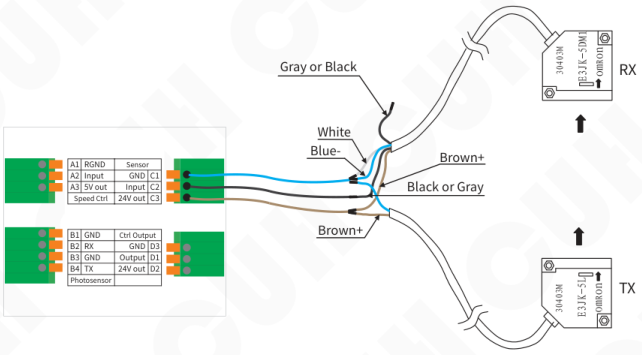

## Wiring Method of the Through-beam Sensor

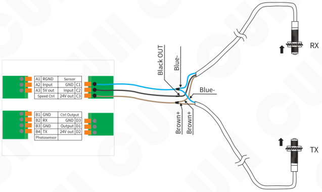

---

## Wiring Method of the Optical Fiber Through-beam Sensor

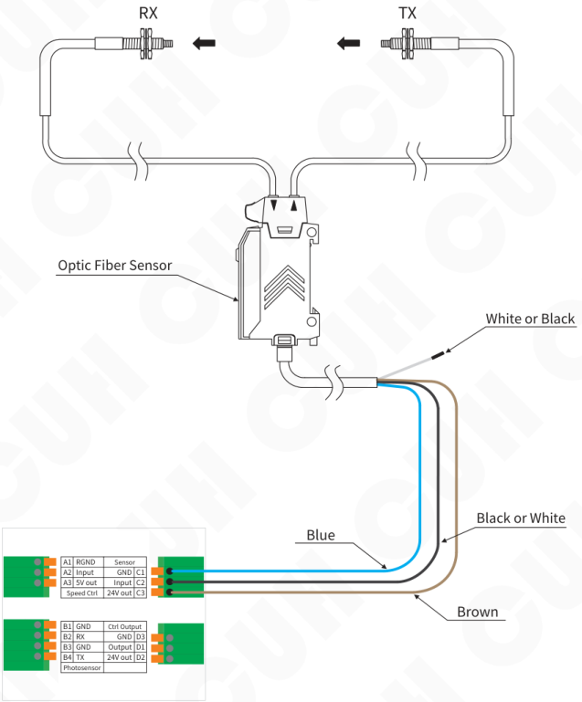

| | | | |
|---|---|---|---|
| A1 | RGND | Sensor | |
| A2 | Input | GND | C1 |
| A3 | 5V out | Input | C2 |
| Speed Ctrl | | 24V out | C3 |

| | | | |
|---|---|---|---|
| B1 | GND | Ctrl Output | |
| B2 | RX | GND | D3 |
| B3 | GND | Output | D1 |
| B4 | TX | 24V out | D2 |
| Photosensor | | | |

## Wiring Method of the Through-beam Sensor

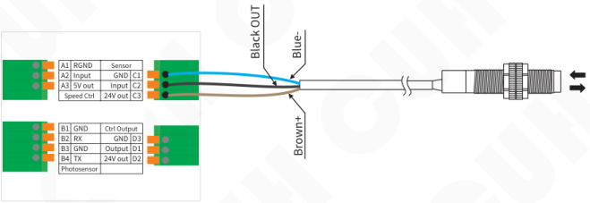

| | | | |
|---|---|---|---|
| A1 | RGND | Sensor | |
| A2 | Input | GND | C1 |
| A3 | 5V out | Input | C2 |
| Speed Ctrl | | 24V out | C3 |

| | | | |
|---|---|---|---|
| B1 | GND | Ctrl Output | |
| B2 | RX | GND | D3 |
| B3 | GND | Output | D1 |
| B4 | TX | 24V out | D2 |
| Photosensor | | | |

Wire labeling: Black OUT, Blue-, Brown+.

## Wiring Method of the PLC

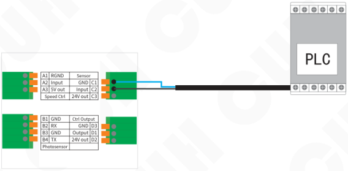

| | | | |
|---|---|---|---|
| A1 | RGND | Sensor | |
| A2 | Input | GND | C1 |
| A3 | 5V out | Input | C2 |
| Speed Ctrl | | 24V out | C3 |

| | | | |
|---|---|---|---|
| B1 | GND | Ctrl Output | |
| B2 | RX | GND | D3 |
| B3 | GND | Output | D1 |
| B4 | TX | 24V out | D2 |
| Photosensor | | | |

> You can use the relay output of the PLC or the NPN output of the PLC.

---

## 5.2.2 On/Off Delay of the Switch Sensor

By default, intelligent photoelectric sensor and switch sensor share the same on delay time and off delay time. Operators can also set on delay time and off delay time independently for the switch sensor.

**PortCUpDly:** The period of time the controller goes through from receiving a startup control signal to actually outputting.

- Enter "5On/Off" parameter group.
- Short press ⏷ to switch to the On Delay of the Port C parameter and the default value is 0.2.
- Press ⊕ or ⊖ to adjust the parameter value。

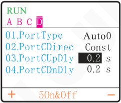

The On Delay of the Port C range is 0.0～99.9s, the adjustment accuracy is 0.1s.

**PortCDnDly:** The period of time the controller goes through from receiving a shutdown control signal to actually cutting off output.

- Enter "5On/Off" parameter group.
- Short press ⏷ to switch to the Off Delay of the Port C parameter and the default value is 0.2.
- Press ⊕ or ⊖ to adjust the parameter value。

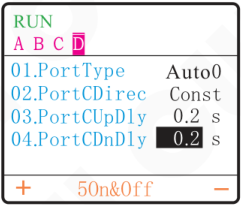

The Off Delay of the Port C range is 0.0～99.9s, the adjustment accuracy is 0.1s.

---

## 5.2.3 Logical Direction of the Switch Sensor

Under normal circumstances, the controller receives no signal from the Switch Sensor and runs by default. But in some special applications the controller needs to be stopped when receives no signal from the Switch Sensor. Adjusting this parameter can fulfill this kind of application.

- Enter "5On/Off" parameter group.
- Short press ⏷ to switch to the Logical Direction of the Port C parameter and the default setting is "Const".
- Press ⊕ or ⊖ to adjust the parameter settings。

RUN  
A B C **D**

| Parameter | Value |
|---|---|
| 01.PortType | Auto0 |
| 02.PortCDirec | **Const** |
| 03.PortCUpDly | 0.2 s |
| 04.PortCDnDly | 0.2 s |

＋　5On&Off　－

RUN  
A B C **D**

| Parameter | Value |
|---|---|
| 01.PortType | Auto0 |
| 02.PortCDirec | **Inv** |
| 03.PortCUpDly | 0.2 s |
| 04.PortCDnDly | 0.2 s |

＋　5On&Off　－

- When Parameter "PortCDirec" is set to "Const", namely no signal received, the controller runs.
- When Parameter "PortCDirec" is set to "Inv", namely no signal received, the controller stops.

---

## 5.2.4 Switch Sensor Type

The Switch Sensor port can support NPN, PNP, Auto1, Auto0 modes, can be manually set according to the sensor type.

**NPN:** NPN Switch Sensor.

**PNP:** PNP Switch Sensor.

**Auto1:** Single scan, that is, before the sensor signal is invalid, the high and low levels are changed to detect whether the port is valid. After finding a valid signal, the port sensor type is determined and no longer scans.

**Auto0:** Continuous scanning, regardless of the sensor type, it always detects whether the port is connected to a valid signal by changing the high and low levels.

- Enter "5On/Off" parameter group.
- Default the Port C Sensor Type parameter and the default setting is "Auto0".
- Press ⊕ or ⊖ to adjust the parameter settings。

RUN  
A B C **D**

| Parameter | Setting |
|---|---|
| 01.PortType | **Auto0** |
| 02.PortCDirec | Const |
| 03.PortCUpDly | 0.2 s |
| 04.PortCDnDly | 0.2 s |

＋　5On&Off　－

---

## 5.3 Control Output

The controller can output low-voltage controlling signal to cooperate with other devices such as a solenoid valve, a PLC or an electrical relay.

The control output port can support NPN output, PNP output and push-pull output. The wiring method is as follows.

### NPN Output Wiring Method

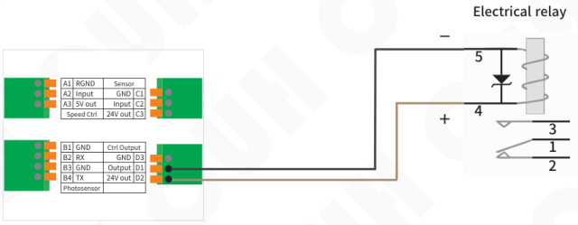

### PNP or Push-Pull Output Wiring Method

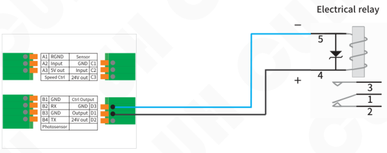

> If connecting a 24V relay, be sure to confirm the positive and negative poles of the coil to make sure they are connected correctly. Because the output current capability of this port is limited, the internal protection diode of the relay will short-circuit the port of this controller after reverse connection, triggering the short-circuit protection.

---

## 5.4 Remote Speed Control

The controller supports external analog signal to control output voltage, analog signal supports potentiometer, 1~5V voltage, 4~20mA current. Thus, external remote speed control can be easily achieved by a PLC, a DCS or some other means.

- When the input is less than 0.5V, remote speed control is ineffective.
- When the input is greater than 0.5V and less than 1V, remote speed control is effective, and the output voltage is “MinVoltage" (default: 0V).
- When the input is greater than 1V and less than 5V, the output voltage is proportionally controlled by remote control signal (0%~100%), and the maximum voltage does not exceed the “MaxVoltage" (default: 220V).

### Potentiometer Control Wiring Method

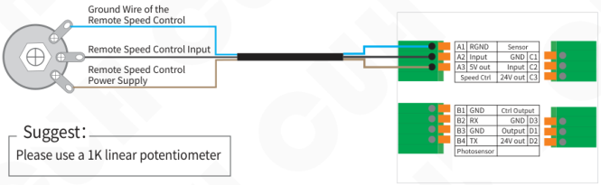

**Suggest:** Please use a 1K linear potentiometer

### 1~5V Voltage Control Wiring Method

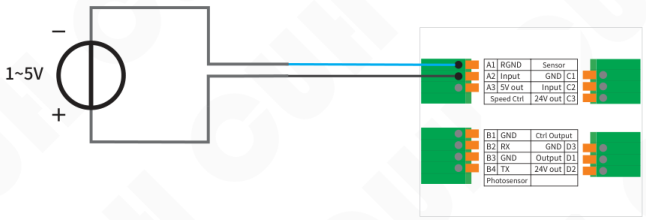

---

## 4~20mA Current Control Wiring Method

- When the input is less than 2mA, remote speed control is ineffective.
- When the input is greater than 2mA and less than 4mA, remote speed control is effective, and the output voltage is “MinVoltage” (default: 0V).
- When the input is greater than 4mA and less than 20mA, the output voltage is proportionally controlled by remote control signal (0%~100%), and the maximum voltage does not exceed the “MaxVoltage” (default: 220V).

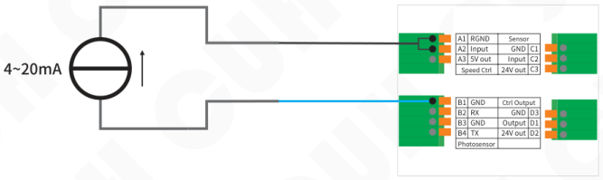

| | | | |
|---|---|---|---|
| A1 | RGND | Sensor | |
| A2 | Input | GND | C1 |
| A3 | 5V out | Input | C2 |
| Speed Ctrl | | 24V out | C3 |

| | | | |
|---|---|---|---|
| B1 | GND | Ctrl Output | |
| B2 | RX | GND | D3 |
| B3 | GND | Output | D1 |
| B4 | TX | 24V out | D2 |
| Photosensor | | | |

---

# Chapter Ⅵ Detailed Function Introduction

This chapter introduces detailed functions and settings of the controller.

Short press ▶ to enter the parameter setting interface on home interface. The parameter setting interface includes the following eight parameter groups. By short pressing ◀ or ▶ switching between different parameter groups.

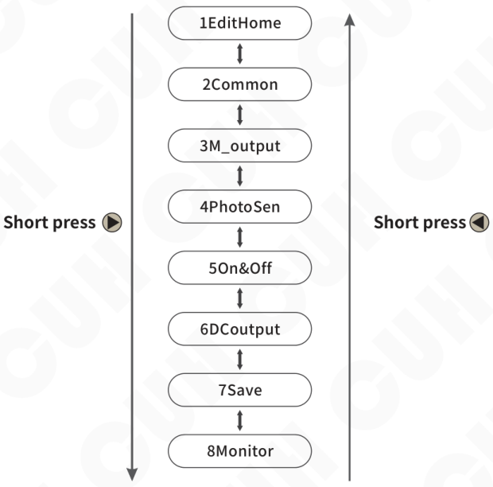

Parameter Group Rotation Diagram

---

## 6.1 Customize Homepage

In order to facilitate users to use the controller efficiently and quickly, users can perform customized operations in the interface parameter group. By extracting at most 16 of all parameters is placed as a detection item in the interface parameter group, and the user can perform quick operations on the main interface.

Example: Select 1. UsrVoltage (P2.01), 2. UsrFreqncy (P2.02), 3. CurrentOut (P8.02), 4. SoftStarT (P2.03), SoftStopT (P2.04), there are five parameters in the main interface. The steps are as follows:

- On the home interface, short press ⏵ to directly enter "1EditHome" parameter group.
- Short press ▲ or ▼ to switch between different monitoring items.
- Press ⊕ or ⊖ to select the function labels that need to be set respectively.

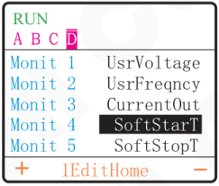

Note: Function labels can be queried through the "Parameter List" chapter.  
If the value of the monitoring item is blank, it means there is no monitoring item.

After the operation is completed, if the user needs to adjust the parameter values of voltage, frequency, Output Current, soft start time and soft stop time, enter the specific monitoring item in the parameter group of the "Home" interface and pass ⊕ or ⊖, parameter adjustment can be completed.

---

## 6.2 Common Parameter Settings

This chapter mainly introduces the setting and adjustment of the basic common parameters of the controller.

### 6.2.1 Voltage

This controller can directly set the output voltage digitally on the panel. This function can eliminate the variation in feeding speed caused by power supply voltage fluctuations. Voltage regulation can also eliminate the beat frequency effect caused by power frequency alternating current.

- Enter the "2Common" parameter group and find the voltage Setting parameters.
- Press ⊕ or ⊖ to adjust the parameter value.

The Voltage range is 0~220V, the default is 150V the adjustment accuracy is 1V.

RUN  
A B C **D**

| Parameter | Value |
|---|---|
| 01.UsrVoltage | **150** V |
| 02.UsrFreqncy | 50.0 Hz |
| 03.SoftStarT | 0.5 s |
| 04.SoftStopT | 0.0 s |
| 05.MaxVoltage | 220 V |

＋　2Common　－

### 6.2.2 Frequency

The controller has very high frequency accuracy and stability, and does not change with time and temperature.

- Enter the "2Common" parameter group and find the frequency Setting parameters.
- Press ⊕ or ⊖ to adjust the parameter value.

The Frequency range 40.0~999.9Hz, the default is 50.0Hz, the adjustment accuracy is 0.1Hz.

RUN  
A B C **D**

| Parameter | Value |
|---|---|
| 01.UsrVoltage | 150 V |
| 02.UsrFreqncy | **50.0** Hz |
| 03.SoftStarT | 0.5 s |
| 04.SoftStopT | 0.0 s |
| 05.MaxVoltage | 220 V |

＋　2Common　－

**The other parameters of this parameter group can be adjusted according to the above steps.**

---

## 6.2.3 Soft Start Time/Soft Stop Time

**Soft Start Time:** The time required for the controller to smoothly increase the output voltage from 0V to the set output voltage when starting from a stopped state.

The soft start time range is 0.0~10.0s, the default is 0.5s and the adjustment accuracy is 0.1s.

**Soft Stop Time:** When the controller stops running, the output voltage smoothly drops from the set output voltage to reach the time required for 0V.

The soft stop time range is 0.0~10.0s, the default is 0.5s and the adjustment accuracy is 0.1s.

When this controller starts or stops, the output voltage can be increased or decreased gently to prevent vibration equipment from being damaged by impact.

## 6.2.4 Maximum Output Voltage/Minimum Output Voltage

**Maximum Output Voltage:** The controller outputs the maximum voltage value.

The maximum voltage range is 0-220V, the default is 220V and the adjustment accuracy is 1V.

**Minimum Output Voltage:** The controller outputs the minimum voltage value.

The minimum voltage range is 0-220V, the default is 0V and the adjustment accuracy is 1V.

This controller can set maximum output voltage and minimum output voltage limit values, which can prevent users from damaging the vibration equipment by accidentally outputting excessive voltage.

## 6.2.5 Maximum Output Frequency/Minimum Output Frequency

**Maximum Output Frequency:** Limit the upper limit value of the "UsrFreqncy" parameter.

The maximum output frequency range is 40.0~999.9Hz, the default is 999.9Hz and the adjustment accuracy is 0.1Hz.

**Minimum Output Frequency:** Limit the lower limit value of the "UsrFreqncy" parameter.

The minimum output frequency range is 40.0~999.9Hz, the default is 40.0Hz and the adjustment accuracy is 0.1Hz.

---

## 6.2.6 Backlight Off Time

**Backlight Off Time:** That is the backlight off time. When the controller does not perform any operation for a period of time, the controller will turn off the screen backlight. The screen backlight can be triggered to turn on again by pressing any button.

The backlight extinction range is 1-30min, the default is On and the adjustment accuracy is 1min.

## 6.2.7 Language

**Language:** That is, the language displayed on the controller operation panel. The controller has two built-in languages: Chinese and English, making it easy for users in different regions to switch. Default Chines.

| Parameter | Meaning |
|---|---|
| Englis | English interface. |
| Chines | Chinese interface. |

---

## 6.3 Output Parameters

This chapter is used to introduce the setting and use of the main output parameters and control output parameters of the controller to achieve the ideal output function of the controller.

### 6.3.1 Main Output Parameters

This summary mainly introduces the main output parameter settings of the controller.

- Short press ⏵ to switch to "3 M_output" parameter group.
- Short press ⏶ or ⏷ to switch parameters in the main output parameter group.
- Press ⊕ or ⊖ to adjust the parameter value.

RUN  
A　B　C　**D**

| Parameter | Value |
|---|---|
| 01.MainSourc1 | **PortB** |
| 02.MainSourc2 | PortC |
| 03.MainLogic | Or |
| 04.MainUpDly | 0.0 s |
| 05.MainDnDly | 0.0 s |

＋　3M_output　－

The other parameters of this parameter group can be adjusted according to the above steps.

### 6.3.1.1 Main Source 1/Main Source 2

"MainSourc1" and "MainSourc2" refer to the "Main source 1 signal" and "Main logic source 2 signal", you can set the main output logic source signal through these two parameters. The signals of main source 1 and main source 2, first passes through the port signal type judgment, then through the logic direction judgment, and finally after going through the on delay and off delay, it becomes the main output logic source 1/2result signal.

---

The signal flow diagram is as follows:

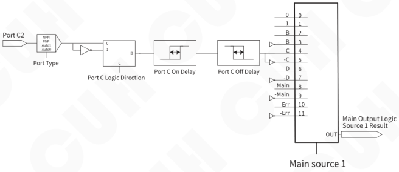

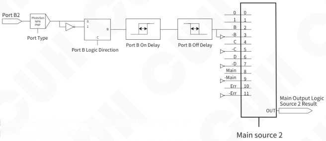

Note: Refer to the sensor wiring method in Chapter Ⅴ "Sensors and Signal Control".

**Figure 6.3.1.1**

Note: The main output state is also controlled by whether the start stop button or whether the controller itself is in a fault state. The fault control level of the start-stop button or the controller itself is higher than the main output logic signal. That is: when the start-stop button is set to stop, the controller will immediately enter the stop state; when a fault such as short circuit, over-temperature, over-current, etc. occurs, the controller will also immediately enter the stop state. At this time, the main output logic signal cannot turn on the main output of the controller.

---

## 6.3.1.2 Main Logic

The results from Main Source 1 and Source 2 are processed by the logic operator, then passed through the logic direction module, then passes through the main output on-delay and off-delay, and finally passes through the main output mode, and is used to drive the main output start-stop state.

The signal flow diagram is as follows:

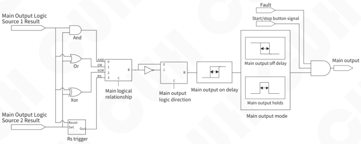

Figure 6.3.1.2

This controller can set the logical relationship table between main (logical) source 1 and main source 2 as follows. Default Or.

| Parameter | Meaning |
|---|---|
| And | Logical AND, output is invalid when both main source 1 and main source 2 are valid. |
| Or | Logical OR, output is invalid when at least one of main source 1 or main source 2 is valid. |
| Xor | Logical XOR, output is invalid when main source 1 and main source 2 are in different states, otherwise valid. |
| RS | RS flip-flop. |

## 6.3.1.3 Main On Delay/Main Off Delay

When using other external signals such as sensors to control the main output state of the device, in most cases a delay is required after the signal is given or the signal is restored before the operation can be performed. For such applications, this can be achieved by setting the time values of the on-delay and off-delay. For the signal flow diagram, refers to Figure 6.3.1.2.

**Main On Delay:** That is, the main output on-delay is the delay time experienced from the application of a control signal that causes the controller to enter the running state to the actual output of the controller starting. The delay time experienced during this period is called the on-delay.

**Main Off Delay:** That is, the main output off-delay, starting from the application of a control signal that causes the controller to enter a stop state, to the actual output of the controller stopping, the delay time experienced during this period is called the off-delay.

The main on/off delay range is 0.0~99.9s, the default is 0.0s and the adjustment accuracy is 0.1s.

## 6.3.1.4 Main Mode

There are 2 main output modes available: delay mode and hold mode. Signal flow diagram reference diagram 6.3.1.2. Default Delay.

| Parameter | Meaning |
|---|---|
| Delay | Refers to the state of the main output after logic operation, the state of driving the main output after on-delay and off-delay. |
| Hold | Refers to the state after the main output logic operation. After the on delay, the stop state remains for the off delay time, and then immediately changes to the running output state. |

The difference between the two modes is expressed in the form of a timing diagram as follows, where the input signal is a logical relationship selection.

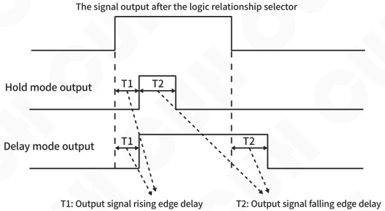

---

## 6.3.1.5 Main Direction

That is, the main output logic direction, the specific output direction can be set after the signals are logically combined. For the signal flow diagram, refers to Figure 6.3.1.2. Default Revrs.

| Parameter | Meaning |
|---|---|
| Const | The state is not inverted after the main output logic operation. |
| Revrs | The state is inverted after the main output logic operation. |
| On | The state remains running after the main output logic operation. |
| Off | The state is always stopped after the main output logic operation. |

## 6.3.1.6 Power On State

Set the operating status of the controller after power on. Default On.

| Parameter | Meaning |
|---|---|
| On | After the device is powered on, the status of the switch key is running. |
| Off | After the device is powered on, the status of the switch key is stopped. |
| Hold | After the device is powered on, the status of the switch key remains the same as before the last shutdown. |

---

## 6.3.2 DC Control Output Parameters

This summary mainly introduces the controller control output parameter settings.
The schematic diagram of the control output signal flow is as follows:

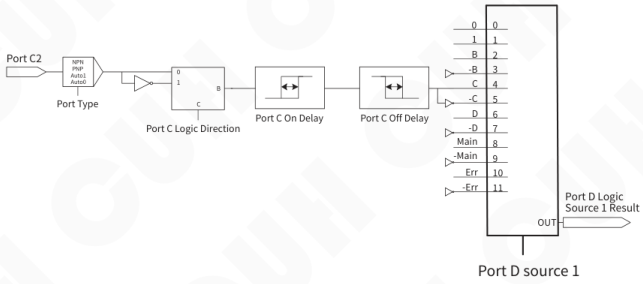

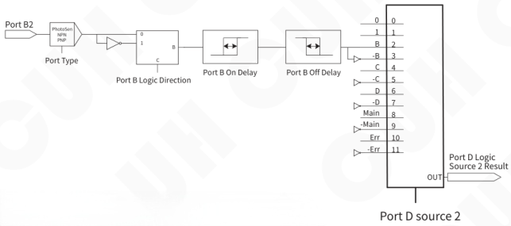

Note: Refer to the sensor wiring method in Chapter Ⅴ "Sensors and Signal Control".

---

Port D logic source 1 result and port D logic source 2 result junction after the logic operation is performed through the port D output direction, then passes through the port D output on-delay and off-delay, passes through the port D mode and finally passes through the port D output type, and is used to drive the control output start-stop state.

The signal flow diagram is as follows:

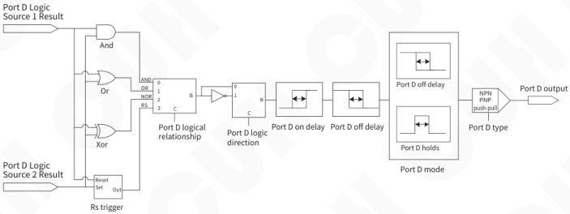

The control output parameters setting method is as follows:

- Short press ▶ to switch to "6DCoutput" parameter group.
- Short press ▲ or ▼ to switch parameters in the control output parameter group.
- Press ⊕ or ⊖ to adjust the parameter value.

**RUN**  
A　B　C　**D**

| Parameter | Value |
|---|---|
| 01.PortDSour1 | 0 |
| 02.PortDSour2 | Main |
| 03.PortDLogic | Or |
| 04.PortDUpDly | 0.0 s |
| 05.PortDDnDly | 0.0 s |

＋　6DCoutput　－

**The other parameters of this parameter group can be adjusted according to the above steps.**

"PortDSour1", “PortDSour2”, “PortDLogic”, "PortDDirec", "PortDUpDly" and "PortDDnDly", the above parameters can refer to the main output parameter settings.

---

## 6.3.2.1 Output Mode of Port D

Customers can choose 4 control output modes: delay mode, hold mode, Cycle1 and Cycle2. Default Delay.

| Parameter | Meaning |
|---|---|
| Delay | Refers to the state of the control output after logic operation, the state of driving the control output after on-delay and off-delay. |
| Hold | Refers to the state after the control output logic operation. After the on delay, the stop state remains for the off delay time, and then immediately changes to the running output state. |
| Cycle1/Cycle2 | The duration of the high-level signal is set by the "PortDUpDly". The duration of the low-level signal is set by the "PortDDnDly". |

In Cycle1 mode, the switch key cannot stop controlling the output, and in Cycle2 mode, the switch key can stop controlling the output.

The difference between the four modes is expressed in the form of a timing diagram as follows, where the input signal is the signal output after the logic relationship selector.

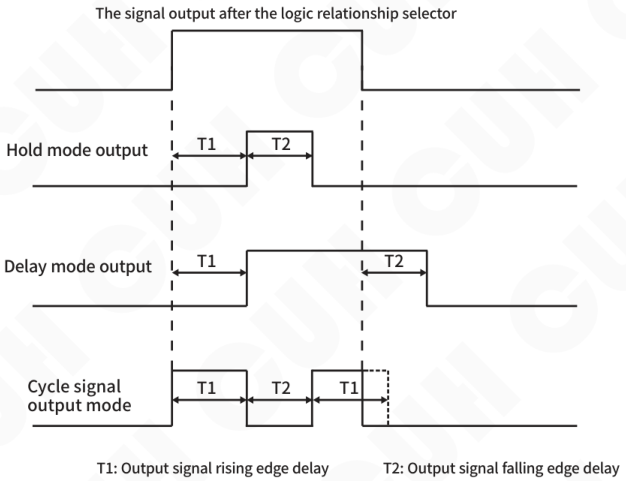

## 6.3.2.2 Port D Type

Port D output can support three types: NPN output, PNP output, and push-pull output. Default Ou_P&P (Push-Pull).

| Parameter | Meaning |
|---|---|
| Ou_NPN | When the output signal of port D is valid, port D outputs a low-level signal (0V), and when it is invalid, it is high impedance. |
| Ou_PNP | When the output signal of port D is valid, port D outputs a high-level signal (24V), and when it is invalid, it is high impedance. |
| Ou_P&P (Push Pull) | When the output signal of port D is valid, port D outputs a high-level signal (24V). When the output signal of port D is invalid, port D outputs a low-level signal (0V). |

The diagram is as follows:

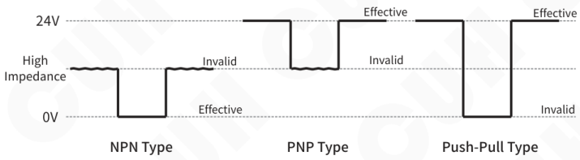

---

## 6.4 Signal Control

The controller can judge the status of the material in the vibratory feeder through an external sensor, and realize the controller's "stop when full of material" or "stop when empty of material". The port signal flow diagram is as follows:

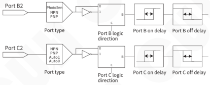

Figure 6.4

The method for setting Intelligent Photosensor parameters is as follows:

- Short press ▶ to switch to "4PhotoSen" parameter group.
- Short press ▲ or ▼ to switch parameters in the Intelligent Photosensor parameter group.
- Press ⊕ or ⊖ to adjust the parameter value.

**RUN**  
A B C **D**

| Parameter | Value |
|---|---|
| 01.PortBLimit | 80 |
| 02.PortBDirec | Const |
| 03.PortBUpDly | 0.2 s |
| 04.PortBDnDly | 0.2 s |

＋　4PhotoSen　－

The method for setting Switch Sensor parameters is as follows:

- Short press ▶ to switch to "5On&Off" parameter group.
- Short press ▲ or ▼ to switch parameters in the Switch Sensor parameter group.
- Press ⊕ or ⊖ to adjust the parameter value.

**RUN**  
A B C **D**

| Parameter | Value |
|---|---|
| 01.PortType | Auto0 |
| 02.PortCDirec | Const |
| 03.PortCUpDly | 0.2 s |
| 04.PortCDnDly | 0.2 s |

＋　5On&Off　－

**The other parameters of this parameter group can be adjusted according to the above steps.**

---

## 6.4.1 Port B Sensitivity

The controller can set the signal type of Port B to 1~1000 (Intelligent Photoelectric Sensor Sensitivity), "NPN" type, and "PNP" type switch sensors. The default value is 80.

| Parameter | Meaning |
|---|---|
| 1~1000 | Port B is connected to intelligent photosensor signals, with a range of 1 to 1000. The smaller the value, the weaker the intensity of the recognized optical signal. The transmitting and receiving ends can be spaced farther apart. |
| NPN | NPN type sensor. |
| PNP | PNP type sensor. |

## 6.4.2 Port B/Port C Logical Direction

This parameter is used to switch the controller input port B and input port C is "Shutdown when full of material" or "Shutdown when empty of material". Default Const.

When switch input port B/port C under factory default settings no any signal is received, the controller is in"Running" state (i.e. shutdown when full of material). Some special applications require the controller to be in the "stop" state (i.e. material empty shutdown) when port B/ port C does not receive any signal. This can be achieved by modifying this parameter. Refer to Figure 6.4 for the signal flow diagram.

| Parameter | Meaning |
|---|---|
| Const | When there is no control signal, the controller is in running state (stop when material is full). |
| Inv | When there is no control signal, the controller is in stop state (stop when empty). |

## 6.4.3 Port B On/Off Delay and Port C On/Off Delay

The delay time from the time a signal is applied to put the controller into the running state until the signal is considered valid by the controller is called the on-delay.

The delay time from the application of a signal that causes the controller to enter the stop state until the signal is considered valid by the controller is called the off delay.

For signal flow diagram, refer to Figure 6.4.

The on/off delay range is 0.0~99.9s, the default is 0.2s, and the adjustment accuracy is 0.1s.

**Note:** When using port B, C in performing start/stop control, if it is necessary to delay the operation for a period of time after receiving the signal to ensure that the signal is stable, this can be achieved by setting the on delay and off delay.

---

## 6.5 Save Settings

This chapter mainly introduces how to use the parameter storage and callback parameter functions of the controller.

### 6.5.1 Callback Settings

The controller can read out 3 different sets of preset parameters in addition to the work group, named "UsrD1", "UsrD2", and "UsrD3" respectively. Default None.

When the user modifies the parameters, the controller parameters are saved in the workgroup by default. When the controller is powered on again, the parameters will be automatically read from the workgroup and the parameter values before the last shutdown will be restored. At the same time, users can manually select from "UsrD1", "UsrD2", "UsrD3". Read out another file manually saved by the three groups. The data is sent to the working group in the controller, allowing the controller to switch working status immediately.

| Parameter | Meaning |
|---|---|
| None | Invalid |
| UsrD1 | User set parameter 1 |
| UsrD2 | User set parameter 2 |
| UsrD3 | User set parameter 3 |

### 6.5.2 Save Settings

The controller can save 4 different sets of preset parameters, named "Work", "UsrD1", "UsrD2", "UsrD3". Default None.

When the user modifies the parameters, the controller parameters are automatically saved in the "Work" by default. When the controller is powered on again, the parameters will be automatically read from the work group and the parameter values before the last shutdown will be restored. Users can manually save parameters in the workgroup to "UsrD1", "UsrD2", "UsrD3".

| Parameter | Meaning |
|---|---|
| None | Invalid |
| Work | Default workgroup |
| UsrD1 | User set parameter 1 |
| UsrD2 | User set parameter 2 |
| UsrD3 | User set parameter 3 |

---

## 6.5.3 Restore Factory

Use reset parameters to restore all workgroup parameters to factory default values. Default None.

After selecting "Work" in "RestorALL", press ⊕ and ⊖ hold at the same time, after more than two seconds, the display interface switches to the standby interface, and the parameters are restored successfully.

| Parameter | Meaning |
|---|---|
| None | Invalid |
| Work | Restore workgroup parameters to factory settings. (UsrD1, UsrD2 and UsrD3 will not be restored) |

## 6.5.4 Local Machine Type and Number

**Local Machine Identifier:** Used to display the identifier of the device on the home page.

The optional values for the local machine identifier are "Circ ", "Line", and "Soli". Default None.

**Identification Number:** Used to number the local machine.

The identification number range is 1 to 1000. Default None.

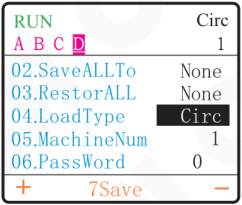

## 6.5.5 User Password

Users can set the parameter password by themselves. After locking, the user can only operate under the "SetWord" and "Home Page".

When the user sets the "user password" is non-0, it means the advanced parameter lock function is enabled. At this time, you need to enter the password when entering the parameter group on the home page. After the user "SetWord"and press ⊕ and ⊖ simultaneously for more than 2 seconds, Confirm the entered password. Only after the password is correct can the user enter other parameter groups.

The selection range of user password is 0~9999. Default 0.

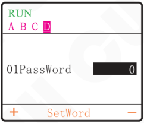

---

## 6.6 Controller Status Monitoring

In the monitoring parameter group, the controller operating status and parameter values can be read in real time.

For readable parameter entries, please refer to the "Parameter List" chapter, "8Monitor" Parameter Group.

RUN  
A B C **D**

| | |
|---|---:|
| 01.Temperatur | 50 ℃ |
| 02.CurrentOut | 20 mA |
| 03.Vol_Remote | **0.5 V** |
| 04.Vol_PortB | 100 |
| 05.Vol-PortC | 0.5 V |

＋　8Monitor　－

---

## Chapter Ⅶ Appendix

### 7.1 Dimensions

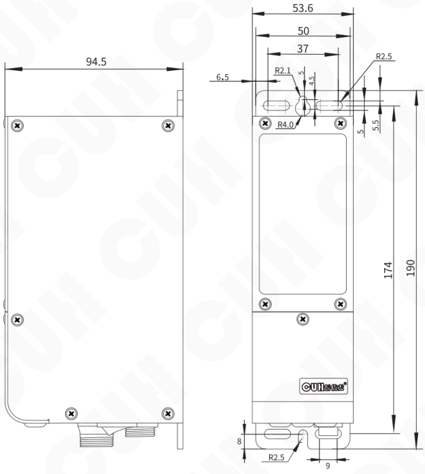

Dimensions (unit: mm)

| Dimensions range | tolerance |
|---|---|
| 0~3 | ±0.05 |
| 3~10 | ±0.1 |
| 10~30 | ±0.15 |
| 30~80 | ±0.2 |
| 80~180 | ±0.3 |
| >180 | ±0.5 |

This tolerance table is applicable to all products in this series.

---

## 7.2 Technical Specifications

| Item | Min | Typical | Max | Unit | Note |
|---|---|---|---|---|---|
| Input Voltage | 85 | 220 | 250 | V | AC RMS |
| Adjustable Output Voltage Range | 0 | —— | 220 | V | AC RMS |
| Voltage Adjustment Accuracy | | 1 | | V | |
| Adjustable Output Current Range | 0 | —— | 150 | mA | |
| Output Power | 0 | —— | 33 | VA | |
| Output Frequency | 40.0 | —— | 999.9 | Hz | |
| Frequency Adjustment Accuracy | | 0.1 | | Hz | |
| Output Waveform | | Sine | | | |
| Soft Start Time | 0 | —— | 10.0 | s | Default value: 0.5 |
| On/Off Delay Time Range | 0.0 | —— | 99.9 | s | Default value: 0.2 |
| On/Off Delay Time Accuracy | | 0.1 | | s | |
| Overheat Protection Trigger Temperature | 60 | 65 | 65 | °C | |
| DC Control Output Current | 0 | —— | 350 | mA | |
| DC Control Output Voltage | 22 | 24 | 26 | V | |
| Analog Control Signal | | 1~5 | | V | remote speed control voltage |
| Analog Control Signal | | 4~20 | | mA | remote speed control current |
| Digital Control Signal | | 24 | | V | Switching Signal |
| Adjustment Method | | 7 | | Button | |
| Standby Power Consumption | —— | —— | 5 | W | |
| Display Method | | 160*128 | | | Matrix Display |
| Ingress Protection Level | | IP20 | | | |
| Ambient Temperature | 0 | 25 | 40 | °C | No Condensation |
| Ambient Humidity | 10 | 60 | 85 | % | No Condensation |
| Storage Ambient Temperature | -20 | 25 | 65 | °C | No Condensation |

## 7.3 Reference Standard

**Absolute Parameters:**  
Above the standard will damage the controller, obey it strictly.

| Item | GB Standard | IEC Standard | Grade | Standard Requirement | Note |
|---|---|---|---|---|---|
| Electrostatic Discharge | GB/T 17626.2-2006 | IEC 61000-4-2:2001 | 4 | ±8 kV | Contact Discharge |
| | | | 4 | ±15 kV | Air Discharge |
| Electrical Fast Transient Test | GB/T 17626.4-2008 | IEC 61000-4-4:2004 | 4 | ±4 kV | |
| DC Power Line Wave Immunity | GB/T 17626.17-2005 | IEC 61000-4-17:2002 | 4 | 15% | Rating A |

> **Warning**  
> In a residential environment, this product may cause radio interference in which case supplementary mitigation measures may be required.

---

## 7.4 Parameter List

| | Parameter | Display | Value Range/Enumeration Item | Default |
|---|---|---|---|---|
| 1EditHome Parameter Group | Monitoring Project 1 | Monit 1 | Parameter Group 2~Parameter Group 8 | UsrVoltage |
| | Monitoring Project 2 | Monit 2 | Parameter Group 2~Parameter Group 8 | UsrFreqncy |
| | Monitoring Project 3 | Monit 3 | Parameter Group 2~Parameter Group 8 | CurrentOut |
| | Monitoring Project 4 | Monit 4 | Parameter Group 2~Parameter Group 8 | |
| | Monitoring Project 5 | Monit 5 | Parameter Group 2~Parameter Group 8 | |
| | Monitoring Project 6 | Monit 6 | Parameter Group 2~Parameter Group 8 | |
| | Monitoring Project 7 | Monit 7 | Parameter Group 2~Parameter Group 8 | |
| | Monitoring Project 8 | Monit 8 | Parameter Group 2~Parameter Group 8 | |
| | Monitoring Project 9 | Monit 9 | Parameter Group 2~Parameter Group 8 | |
| | Monitoring Project 10 | Monit 10 | Parameter Group 2~Parameter Group 8 | |
| | Monitoring Project 11 | Monit 11 | Parameter Group 2~Parameter Group 8 | |
| | Monitoring Project 12 | Monit 12 | Parameter Group 2~Parameter Group 8 | |
| | Monitoring Project 13 | Monit 13 | Parameter Group 2~Parameter Group 8 | |
| | Monitoring Project 14 | Monit 14 | Parameter Group 2~Parameter Group 8 | |
| | Monitoring Project 15 | Monit 15 | Parameter Group 2~Parameter Group 8 | |
| | Monitoring Project 16 | Monit 16 | Parameter Group 2~Parameter Group 8 | |
| 2Common Parameter Group | User Set Voltage | 01.UsrVoltage | 0~220 V | 150 |
| | User Set Frequency | 02.UsrFreqncy | 40.0~999.9 Hz | 50.0 |
| | Soft Start Time | 03.SoftStarT | 0.0~10.0 s | 0.5 |
| | Soft Stop Time | 04.SoftStopT | 0.0~10.0 s | 0.0 |
| | Maximum Output Voltage | 05.MaxVoltage | 0~220 V | 220 |
| | Minimum Output Voltage | 06.MinVoltage | 0~220 V | 0 |
| | Maximum Output Frequency | 07.MaxFreqncy | 40.0~999.9 Hz | 999.9 |
| | Minimum Output Frequency | 08.MinFreqncy | 40.0~999.9 Hz | 40.0 |
| | Backlight Off Time | 09.Off_time | On, 1~30 Mi | On |
| | Language | 10.Language | Chines, Englis | Chines |
| 3M_output Parameter Group | Main Output Logic Input Source 1 | 01.MainSourc1 | 0, 1, PortB, -PortB, PortC, -PortC, PortD, -PortD, Main, -Main, Err, -Err | PortB |
| | Main Output Logic Input Source 2 | 02.MainSourc2 | 0, 1, PortB, -PortB, PortC, -PortC, PortD, -PortD, Main, -Main, Err, -Err | PortC |
| | Main Output Port Logic | 03.MainLogic | And, Or, Xor, RS | Or |
| | On Delay of Main Output | 04.MainUpDly | 0.0~99.9 s | 0.0 |
| | Off Delay of Main Output | 05.MainDnDly | 0.0~99.9 s | 0.0 |
| | Main Output Mode | 06.MainMode | Delay, Hold | Delay |
| | Main Output Logical Direction | 07.MainDirect | Const, Revrs, On, Off | Revrs |
| | Power On Status | 08.PowerOnSta | On, Off, Hold | On |

| | Parameter | Display | Value Range/Enumeration Item | Default |
|---|---|---|---|---|
| 4PhotoSen Parameter Group | Intelligent Photoelectric Sensor Sensitivity | 01.PortBLimit | PNP, NPN, 1~1000 | 80 |
| 4PhotoSen Parameter Group | Logical Direction of the Port B | 02.PortBDirec | Const, Inv | Const |
| 4PhotoSen Parameter Group | On Delay of the Port B | 03.PortBUpDly | 0.0~99.9 s | 0.2 |
| 4PhotoSen Parameter Group | Off Delay of the Port B | 04.PortBDnDly | 0.0~99.9 s | 0.2 |
| 5On&Off Parameter Group | Port C Sensor Type | 01.PortType | NPN, PNP, Auto1, Auto0 | Auto0 |
| 5On&Off Parameter Group | Logical Direction of the Port C | 02.PortCDirec | Const, Inv | Const |
| 5On&Off Parameter Group | On Delay of Port C | 03.PortCUpDly | 0.0~99.9 s | 0.2 |
| 5On&Off Parameter Group | Off Delay of Port C | 04.PortCDnDly | 0.0~99.9 s | 0.2 |
| 6DCoutput Parameter Group | Port D Logic Input Source 1 | 01.PortDSour1 | 0, 1, PortB, -PortB, PortC, -PortC, PortD, -PortD, Main, -Main, Err, -Err | 0 |
| 6DCoutput Parameter Group | Port D Logic Input Source 2 | 02.PortDSour2 | 0, 1, PortB, -PortB, PortC, -PortC, PortD, -PortD, Main, -Main, Err, -Err | Main |
| 6DCoutput Parameter Group | Port D Logical Relationship | 03.PortDLogic | And, Or, Xor, RS | Or |
| 6DCoutput Parameter Group | On Delay of Port D | 04.PortDUpDly | 0.0~99.9 s | 0.0 |
| 6DCoutput Parameter Group | Off Delay of Port D | 05.PortDDnDly | 0.0~99.9 s | 0.0 |
| 6DCoutput Parameter Group | Output Mode of Port D | 06.PortDMode | Delay, Hold, Cycle1, Cycle2 | Delay |
| 6DCoutput Parameter Group | Logic Direction of Port D | 07.PortDDirec | Const, Revrs, On, Off | Const |
| 6DCoutput Parameter Group | Control Output Type | 08.PortDType | Ou_NPN, Ou_PNP, Ou_P&P | Ou_NPN |
| 7Save Parameter Group | Read All Parameters From the User Group | 01.ReadALLFrm | None, UsrD1, UsrD2, UsrD3 | None |
| 7Save Parameter Group | Save All Parameters To the User Group | 02.SaveALLTo | None, Work, UsrD1, UsrD2, UsrD3 | None |
| 7Save Parameter Group | Default setting restoration | 03.RestorALL | None, Work | None |
| 7Save Parameter Group | Local Machine Identifier | 04.LoadType | None, Circ, Line, Soli | None |
| 7Save Parameter Group | Identification Number | 05.MachineNum | None, 1~1000 | None |
| 7Save Parameter Group | User Password | 06.PassWord | 0~9999 | 0 |
| 8Monitor Parameter Group | Temperature | 01.Temperatur | -20~85 ℃ | —— |
| 8Monitor Parameter Group | Output Current | 02.CurrentOut | 0.0~150 mA | —— |
| 8Monitor Parameter Group | Signal Voltage of Port A | 03.Vol_Remote | 0.0~5.0 V | —— |
| 8Monitor Parameter Group | Signal Voltage of Port B | 04.Vol_PortB | 0~999 | —— |
| 8Monitor Parameter Group | Signal Voltage of Port C | 05.Vol-PortC | 0.0~26.0 V | —— |
| 8Monitor Parameter Group | Signal Voltage of Port D | 06.Vol-PortD | 0.0~26.0 V | —— |
| 8Monitor Parameter Group | Real time voltage of 5V Port | 07.Vol-5V | 0.0~6.0 V | —— |
| 8Monitor Parameter Group | Real time voltage of 24V Port | 08.Vol-24V | 0.0~26.0 V | —— |
| 8Monitor Parameter Group | Control board software version | 09.Version | 0~99.99 | —— |

| | Parameter | Display | Value Range/Enumeration Item | Default |
|---|---|---|---|---|
| SetWord | Password | 01PassWord | 0~9999 | 0 |

## 7.5 Input and Output Circuit Diagrams

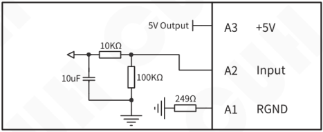

**Remote Speed Control Port A**

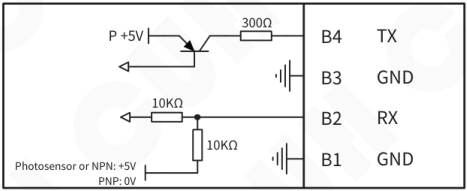

**Intelligent Photosensor Port B**

**Switch Sensor Port C**

**Control Output Port D**

---

## 7.6 Error and Warning Code

| Error Display | Troubleshooting |
|---|---|
| Short | Confirm whether the main output line is short-circuited and rewire it. |
| MainOrCu | Reduce the output voltage or increase the output frequency. |
| OverHot | Place the controller in a well-ventilated and heat-dissipating area. |
| OverCold | Place the controller in a place where the ambient temperature is higher than -20℃. |
| PotDOrCu | Make sure the load of Port D is not short-circuit and the current does not exceed 350mA, then try to restart the output of Port D. |
| 24VErr | Make sure 24V port is not short-circuited and the current does not exceed 400mA. |
| 5VErr | Make sure the 5V power of Port A is not short-circuit or not connected to external power voltage more than 5V. |
| MainRSEr | Ensure that the two input signals of the RS flip-flop are not simultaneously active. |
| PotDRSEr | Ensure that the two input signals of the RS flip-flop are not simultaneously active. |

---

## Chapter Ⅷ Product Warranty Information

### 8.1 Warranty Period

The warranty period provided by the company for this product is 3 years from the date of delivery of the product to the location designated by the purchaser.

### 8.2 Warranty Coverage

(1) If there is a failure caused by our company during the above warranty period, we will repair the product free of charge. However, The following situations are not covered by the warranty:

 a. Failure to comply with the conditions specified in the simple manual, user manual or technical requirements specifically agreed between the purchaser and the company, improper operation, or failure caused by improper use.

 b. Failure is not due to a product defect, but to the purchaser's equipment or software design.

 c. Malfunctions caused by modifications or repairs not performed by the company's personnel.

 d. The failure that can be totally avoided by correct maintenance or replacement of wearing parts according to the simple operation guide or user manual.

 e. After the product is shipped from our company, it is caused by factors such as unforeseen changes in the level of science and technology failure.

 f. Due to natural disasters such as fire, earthquake, flood, or external factors such as abnormal voltage failure, the company is not responsible for the warranty.

(2) The scope of warranty is limited to the situation stipulated in (1)，Indirect losses (such as equipment damage, opportunities, loss of profit, etc.) or other losses, the company do not bear any responsibility.

### 8.3 Product Suitability

The controller of our company is designed and produced for general use in the vibratory feeding industry. Therefore, this controller of our company shall not be used for the following applications and is not suitable for its use.

(1) Facilities that have a serious impact on life and property, such as nuclear power plants, airports, railways, ships, motorized devices and medical equipment.

(2) Public utilities, including electricity, gas, water supply, etc.

(3) Outdoor use in similar conditions or environments.

---

Nanjing CUH Science & Technology Co.,Ltd  
https://en.cuhnj.com  
Tel.:+86-25-84730411 / 84730415 / 84730416  
Fax:+86-25-84730426  
E-mail:sales@cuhnj.com  
Add.:Building 2, Xueyan Tech Park, Tuscity,  
No.9 Zhineng Rd, Jiangning, Nanjing, China

Document No.: IDP1000542

