Variable Frequency Digital Controller for Piezo Vibratory Feeder

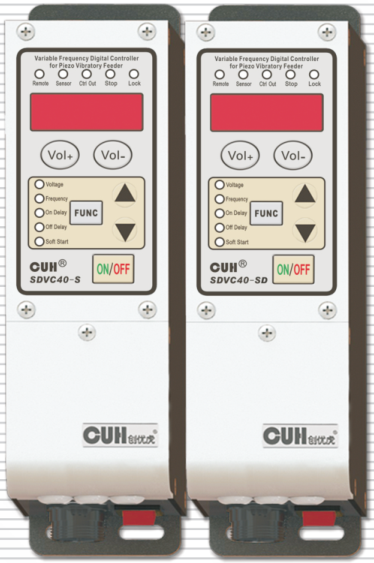

## SDVC40 Series
Variable Frequency Digital Controller for Piezo Vibratory Feeder　　**SDVC40 Series**
## Instruction Manual

---

## Preface

Thank you for choosing **CUH** Intelligent Digital Vibratory Feeder Controllers.(The controller for short in the following text)

This instruction manual includes notes for installing, debugging, parameter setting, maintaining and trouble shooting of the controller. Please read this instruction manual carefully before operating the controller and keep it properly

### This instruction manual applies to the following model:

- Variable Frequency Digital Controller for Piezo Vibratory Feeder  
  SDVC40-S (Output 220V, 150mA)

- Variable Frequency Digital Controller for Piezo Vibratory Feeder  
  SDVC40-SD (Output 50V, 600mA)

---

# Notice

- Never hot swap nor touch the contacts in any case to avoid electric shock or other accidents.
- Never connect the controller to 380V AC which may cause unrecoverable damage. (Choose products that are designed for 380V AC when needed)
- Never switch the input of the controller by way of cutting off power supply through a relay, a PLC or other devices, otherwise service life of the controller may be reduced severely.
- The controller is designed to work in a cool and dry environment. Never run outdoors to avoid soaking or sun exposure. Operate the controller within the temperature range that its electrical characteristics demand.
- Never operate the controller under the condition that beyond its designed limits.
- Operate the controller in accordance with this instruction manual strictly. We will not assume any civil or criminal liability if the equipment damage or personal injury is caused by incorrect operation.

> **!**
>
> Never open the controller shell to avoid electric shock. Contact CUH if the controller breaks down.
>
> Never try to revamp the controller since the solid state circuit boards inside the controller can not be repaired, and there's no adjustable part.

---

# Operating Environment

## Inspection Before Using

Every controller will go through rigorous quality inspection before delivery and is packed with crash-proof packaging.

## Please Check the Following Items After Unpacking:

- Whether the controller is damaged in appearance
- Whether model of the controller is exactly what you ordered

## Runtime Environment

Please follow the notes below to ensure better performance and longer lifetime of the controller

- Well-ventilated environment
- Keep away from water, steam, dust and especially oily dust
- Keep away from corrosive or flammable gas and liquid
- Keep away from flying dust and metal particles
- Firmly fixed to avoid self vibration
- Keep away form electromagnetic interference
- Operate within the temperature range of 0 °C to 40 °C
- For use at altiude 2000m or lower

---

# Contents

| Contents | Page |
|---|---:|
| **Chapter I Features** | 1 |
| **Chapter II Installation Guide** | 3 |
| **Chapter III Components Descriptions** | 7 |
| 3.1 Descriptions of the Control Panel | 7 |
| 3.2 Descriptions of the Status Indicators | 8 |
| 3.3 I/O Interface Descriptions | 8 |
| **Chapter IV Function Descriptions** | 9 |
| 4.1 Output Voltage Setting | 9 |
| 4.2 Output Frequency Adjusting | 10 |
| 4.3 Soft Startup | 11 |
| 4.4 Output Switch Button | 11 |
| 4.5 Maximum Output Voltage Restriction | 12 |
| 4.6 Keypad Locking | 13 |
| 4.7 Power-on Operation status Setting | 14 |
| 4.8 Default Settings Restoration | 15 |
| **Chapter V Sensors and Signal Control** | 16 |
| 5.1 Intelligent Photoelectric Sensing | 16 |
| 5.1.1 Connection Method of the Intelligent Photoelectric Sensor | 16 |
| 5.1.2 Startup Delay Time and Shutdown Delay Time Settings of the Intelligent Photoelectric Sensor | 17 |
| 5.1.3 Logical Relation Setting of the Intelligent Photoelectric Sensor | 18 |
| 5.2 Using Method of the NPN Switch Sensor (Halt when work-pieces are full) | 19 |
| 5.2.1 Connection Method of the NPN Proximity Switch Sensor | 19 |
| 5.2.2 Connection Method of the NPN Counter-radiation Switch Sensor | 20 |
| 5.2.3 Connection Method of the Photoelectric Counter-radiation Sensor | 20 |
| 5.2.4 Connection Method of the Optical Fiber Counter-radiation Sensor | 21 |
| 5.2.5 Connection Method of the Photoelectric Reflection Sensor | 22 |
| 5.3 Startup Delay Time and Shutdown Delay Time Settings of the NPN Switch Sensor | 23 |
| 5.4 Logical Relation Setting of the NPN Switch Sensor (Halt when work-pieces are full) | 24 |
| 5.5 Logical Relation Setting of the Control Signal | 25 |
| 5.6 Connection Method of the Upper PLC which Controls the Vibratory Feeder Controller | 26 |
| 5.7 Controlling Output | 27 |
| 5.7.1 Connection Method of the Controlling Output | 27 |
| 5.7.2 Logical Relation Setting of the Controlling Output | 28 |
| 5.8 Remote Speed Control | 29 |
| **Chapter VI Security Functions** | 30 |
| 6.1 Automatic Voltage Stabilizing | 30 |
| 6.2 Short-Circuit Protection | 30 |
| 6.3 Current Overload Protection | 30 |
| 6.4 Overheat Protection | 30 |

---

---

## Appendix

- Appendix A: Dimensions — 31
- Appendix B: Output Interface Definition — 32
- Appendix C: Signal Interface Definition — 32
- Appendix D: Function Table — 33
- Appendix E: Electrical Specification — 34
- Appendix F: Trouble Shooting Tips and Error Explanations — 35

---

# Chapter I Features

The controller is specially designed for controlling vibratory feeder in the automation systems. Combined with the latest electronic technology and elaborate design, the controller provides the following convenient and practical features:

**Frequency Adjusting:** Output Frequency ranges from 40.0Hz to 400.0Hz.

**Voltage Adjusting:** SDVC40-S: Output Voltage ranges from 0V to 260V.  
SDVC40-SD: Output Voltage ranges from 0.0V to 50.0V.

**Automatic Voltage Stabilizing:** The controller can eliminate feeding speed variation caused by mains voltage fluctuation.

**Soft Startup:** In order to avoid sudden shock to the work pieces, the controller can gently increase output voltage from 0 to the pre-set value when startup.

**Intelligent Photoelectric Sensing:** Our adaptive Intelligent Photoelectric Sensor can help to stall the controller when work-pieces are full or work-piece is empty and to fulfill the functions of Soft Startup Time Setting, Startup Delay, Shutdown Delay, and Logical Relation Adjusting.

**Halt when Work-pieces are full:** A NPN switch sensor can help to halt the controller when work-pieces are full and to fulfill the functions of Soft Startup Time Setting, Startup Delay, Shutdown Delay, and Logical Relation Adjusting.

**Remote Speed Control:** Output Voltage of the controller can be controlled by an external potentiometer, a PLC, or voltage control signal ranging form 1V to 5V.

**Controlling Output:** The Controlling Output signal outgoing from the transistor can coordinate a solenoid or other external devices with the controller.

**Keypad Locking:** Press the ON/OFF button and hold for 2 seconds to lock all buttons for fear of false operation.

**Maximum Output Restriction:** Maximum Output Voltage value can be preset to protect the equipment from damage caused by misuse.

**Default Settings Restoration:** This function allows the user to restore all default parameter settings and reset the controller.

---

---

**CUH** attaches great importance to the product quality management and safety performance. Apart from the high-quality components we use and rigorous quality control system, **CUH** has taken account of possible accidents users may encounter and provides the following protective functions to maximum the controller's practicability.

**Short-Circuit Protection:** If output of the controller is short-circuited, the controller will halt its output until restarted.

**Current Overload Protection:** The controller will halt its output to ensure equipments' operating safety when operation current exceeds its rated value.

**Overheat Protection:** The controller will halt its output to protect itself when operation temperature is too high.

**CUH** controllers are strictly compliant with CE certification.

---

## Chapter II Installation Guide

### Step One:

Open the packing box and check the controller's outward appearance and make sure the controller model is exactly what you ordered.

### Step Two:

Connect the Output Power Cable in the packing box to the vibrator's electromagnetic coils.

Connect the Output Power Cable plug to the Output Socket of the controller.

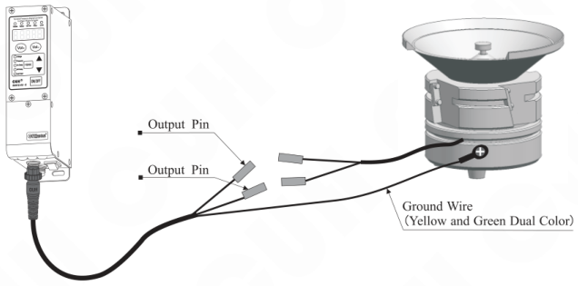

### Notice

Make sure the vibrator's electromagnetic coils is connected to the two output pins of the Output Power Cable and the electromagnetic coils is reliably grounded otherwise series security incident may occur.

---

## Step Three:

Connect the Input Power Cable to the controller and lock the power nut.

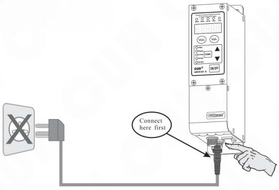

Connect here first

## Step Four:

Connect the plug of the Input Power Cable to the mains jack.

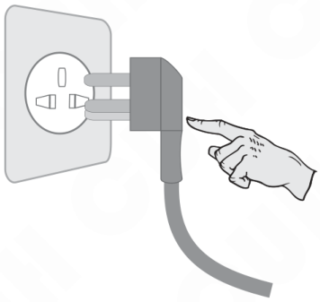

---

## Step Five:

Adjust the controller's Output Voltage to the value between 30 and 80 (represented by the letter U)

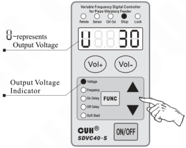

## Step Six:

Press the `FUNC` button and hold for 2 seconds to enter the Basic Settings Adjusting status.

The Output Frequency Indicator on the panel lights up and the LED displays the current frequency value (E)Press the ▲ or ▼ button to adjust the parameter value from 400Hz to 40Hz to find out resonant frequency of the vibrator and hold this value.

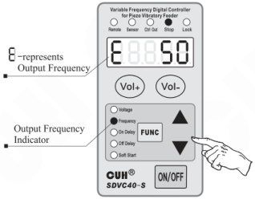

- Resonant frequency of the vibrator means the frequency value that creates the maximum amplitude.
- Every vibrator has its natural mechanical resonant frequency, adjust the output frequency of the controller to this frequency to guarantee the best working condition.

---

## Step Seven:

After setting the Output Frequency of the controller to the natural mechanical resonant frequency of the vibrator, adjust the Output Voltage of the controller by pressing the **Vol+** or **Vol-** button to change feeding speed.

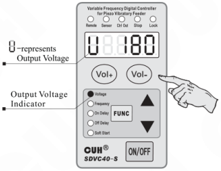

After the above seven steps, the controller can work properly. Please refer to the other chapters if advanced control functions are needed.

---

# Chapter III Components Descriptions

## 3.1 Descriptions of the Control Panel

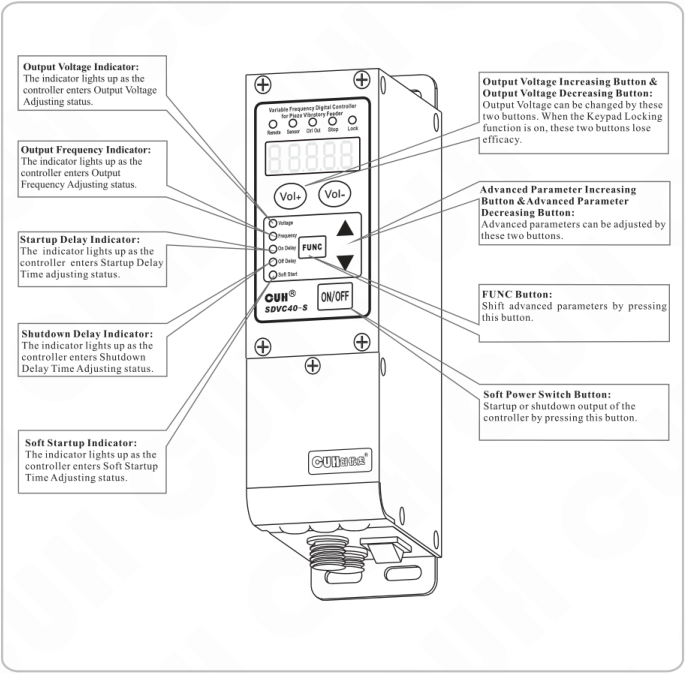

**Output Voltage Indicator:**  
The indicator lights up as the controller enters Output Voltage Adjusting status.

**Output Frequency Indicator:**  
The indicator lights up as the controller enters Output Frequency Adjusting status.

**Startup Delay Indicator:**  
The indicator lights up as the controller enters Startup Delay Time adjusting status.

**Shutdown Delay Indicator:**  
The indicator lights up as the controller enters Shutdown Delay Time Adjusting status.

**Soft Startup Indicator:**  
The indicator lights up as the controller enters Soft Startup Time Adjusting status.

**Output Voltage Increasing Button & Output Voltage Decreasing Button:**  
Output Voltage can be changed by these two buttons. When the Keypad Locking function is on, these two buttons lose efficacy.

**Advanced Parameter Increasing Button & Advanced Parameter Decreasing Button:**  
Advanced parameters can be adjusted by these two buttons.

**FUNC Button:**  
Shift advanced parameters by pressing this button.

**Soft Power Switch Button:**  
Startup or shutdown output of the controller by pressing this button.

---

## 3.2 Descriptions of the Status Indicators

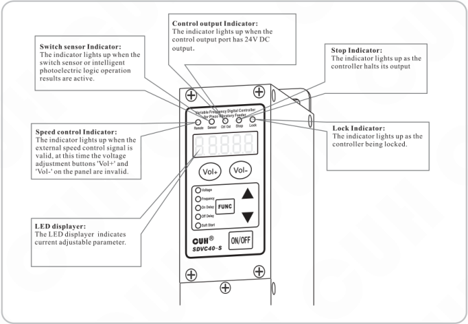

- **Switch sensor Indicator:** The indicator lights up when the switch sensor or intelligent photoelectric logic operation results are active.
- **Control output Indicator:** The indicator lights up when the control output port has 24V DC output.
- **Stop Indicator:** The indicator lights up as the controller halts its output
- **Speed control Indicator:** The indicator lights up when the external speed control signal is valid, at this time the voltage adjustment buttons 'Vol+' and 'Vol-' on the panel are invalid.
- **Lock Indicator:** The indicator lights up as the controller being locked.
- **LED displayer:** The LED displayer indicates current adjustable parameter.

## 3.3 I/O Interface Descriptions

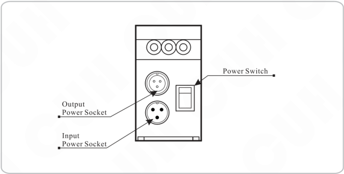

- Power Switch
- Output Power Socket
- Input Power Socket

---

# Chapter IV Function Descriptions

## 4.1 Output Voltage Setting

The Output Voltage can be set directly and digitally through the control panel. Benefit from the unique Voltage Stabilizing Function, Output Voltage of the controller won't fluctuate as the Input Voltage does,and a vibrator can work stably in unstable input voltage environment.

- Turn on the power switch
- The Output Voltage Indicator lights up as the controller enters Output Voltage Adjusting status when the LED displays the voltage symbol U and the previously set voltage value.
- Adjust the Output Voltage value by pressing the **Vol+** or **Vol-** button.

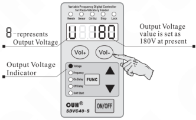

SDVC40-S:Output Voltage ranges 0V ~ 260V  
SDVC40-SD:Output Voltage ranges 0.0V ~ 50.0V

> Output Voltage can be adjusted in any Basic Parameter Adjusting status or Advanced Parameter Adjusting status by pressing the **Vol+** or **Vol-** button. The controller returns to the previous parameter adjusting status after adjusting the Output Voltage.

---

## 4.2 Output Frequency Adjusting

The controller is produced with the DDS technology and its output has got high frequency accuracy and stability which doesn't change as the time or temperature does.

- Press the **FUNC** button and hold for 2 seconds to enter the Basic Parameters Adjusting status.
- The Frequency Indicator on the panel lights up and the LED displays the Output Frequency symbol E and the current Output Frequency value.
- Press the ▲ or ▼ button to adjust the parameter value.

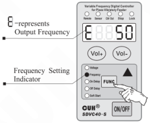

Output Frequency of the controller ranges from 40Hz to 400Hz.

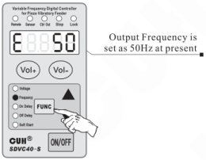

- Output Frequency (E), Startup Delay Time, Shutdown Delay Time and Soft Startup Time can be set after entering the Basic Parameters Adjusting status by pressing the **FUNC** button and holding for 2 seconds.
- The controller will return to the Output Voltage Adjusting status automatically in 1 minute after adjusting operation.
- Press the **FUNC** button and hold for 2 seconds again to exit the Basic Parameters Adjusting status.

---

## 4.3 Soft Startup

In order to avoid sudden shock to the work pieces, the controller can gently increase Output Voltage from 0 to the pre-set value when startup.

Soft Startup Time ( t ): The period of time it takes for the controller to gently increase Output Voltage from 0 to the pre-set value when startup.

- Press the `FUNC` button and hold for 2 seconds to enter the Basic Parameters Adjusting status.
- Press the `FUNC` button repeatedly until shifting to the Soft Startup Time adjusting status (t) as the Soft Startup Indicator lights up.
- Press the ▲ or ▼ button to adjust the parameter value. The parameter unit is second, and the numerical precision is 0.1.

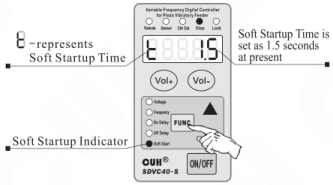

Adjustable Soft Startup Time ranges from 0.1 seconds to 9.9 seconds.

## 4.4 Output Switch Button

The soft-touch switch button on the panel can turn on/off the controller's output quickly and easily.

- Press the `ON/OFF` button to turn on/off the controller's output. The Stop Indicator lights up as output of the controller is turned off.

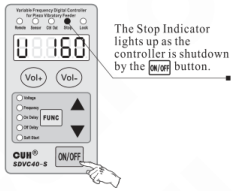

> Due to the soft-touch switch and digital signal control technology, no spark will generate to spoil the contact. As a result, life-span of the controller and the vibrator will be extended greatly.

---

## 4.5 Maximum Output Voltage Restriction

Maximum Output Voltage of the controller can be set to prevent damage to the vibrator. Remote Speed Controller function is affected by this parameter.

- Press the `FUNC` and ▲ buttons simultaneously and hold for 2 seconds to enter the Advanced Parameters Adjusting status.
- Press the `FUNC` button repeatedly until shifting to the Maximum Output Voltage Restriction status (h).
- Press the ▲ or ▼ button to adjust the parameter value.

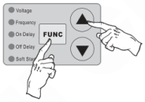

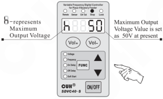

- Output Voltage value can not exceeds this parameter value in any case.
- Default value of this parameter is set as the maximum adjustable Output Voltage value.

### Exit method of the Advanced Parameters Adjusting status

- The controller will quit to the Output Voltage Adjusting status automatically in one minute after Advanced Parameters adjusting.
- Press the `FUNC` and ▲ buttons and hold for 2 seconds to quit to the Output Voltage Adjusting status.
- Press the `FUNC` button and hold for 2 seconds to quit to the Basic Parameters Adjusting status.

---

## 4.6 Keypad Locking

The Keypad Locking Function can lock all buttons on the panel to avoid misoperation.

- Press the `ON/OFF` button and hold for 2 seconds to lock all buttons on the panel as the Keypad Locking Indicator lights up.
- Press the `ON/OFF` button and hold for 2 seconds in the locking mode to unlock the keypad.

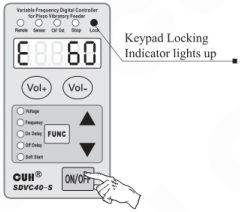

---

## 4.7 Power-on Operation status Setting

In order to prevent sudden power outages under normal conditions and then incoming or special requirements for the power-on status of the controller, you can set this parameter to set the power-up status of the controller to be run, stop or follow the status of the last shutdown.

- Press the **FUNC** and ▲ buttons simultaneously and hold for 2 seconds to enter the Advanced Parameters Adjusting status.
- Press the **FUNC** button repeatedly until shifting to the Power-on Operation status(Γd).
- Press the ▲ or ▼ button to adjust the parameter value.

>  Indicates that the power-on state is on.
>
> 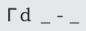 Indicates that the power-on state is off.
>
>  Indicates that the power-on state follows the status of the last shutdown. (If the controller stops the output at the last shutdown, the next time the controller is powered, the controller will off, whereas if the controller is on the output at the last shutdown, the controller will on at the next time it is powered)

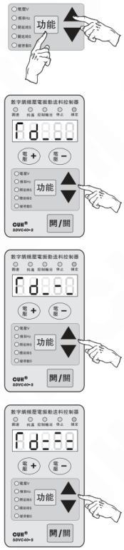

---

## 4.8 Default Settings Restoration

This function allows the operator to restore all default parameter settings.

Due to the abundant functions of the controller, many parameters can be adjusted. In order to avoid the circumstance that after too many times modification by a beginner, the controller can not work properly, this function allows the operator to restore default settings to the controller in an easy way.

- Press the **FUNC** and **▲** buttons simultaneously and hold for 2 seconds to enter the Advanced Parameters Adjusting status。

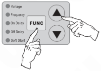

- Press the **FUNC** button repeatedly until 88888 is flashing on the LED displayer, and then press the **▲** button and hold until ----- is displayed which means default settings have been restored successfully

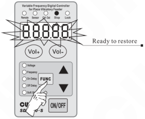

- After releasing the **▲** button, the controller enters Output Voltage Adjusting status (U). By this time, all parameters have been restored to default values.

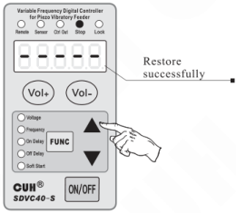

---

# Chapter V Sensors and Signal Control

The controller can be controlled by many kinds of external signals and sensors. This chapter mainly elaborates using method of the Intelligent Photoelectric Sensor, the Proximity Switch Sensors and the PLC.

## 5.1 Intelligent Photoelectric Sensing

Combined with the SDVC-S1 Photoelectric Sensor the function of Intelligent Photoelectric Sensing can be achieved. The SDVC-S1 sensor can filter the interference of background light impacting on the sensitivity of the controller. As a result, the controller can work reliably without manual sensitivity adjustment.

### 5.1.1 Connection Method of the SDVC-S1 Intelligent Photoelectric Sensor

**Step 1:**

Open the upper cover plate of the controller.

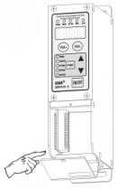

**Step 2:**

Connect the SDVC-S1 sensor to the terminals of the controller according to the diagram.

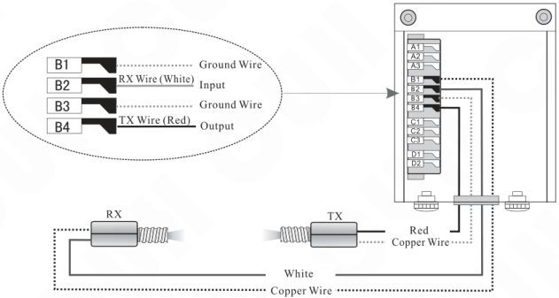

**Notice:**

Default logical relation of the sensor is set as work pieces are empty.

---

## 5.1.2 Startup Delay Time and Shutdown Delay Time Settings of the Intelligent Photoelectric Sensor

In most actual applications, the output of the controller should be delayed for a period of time when Startup or Shutdown of the controller is controlled by external signals. Startup Delay Time and Shutdown Delay Time Adjusting functions made this kind of application possible. Furthermore, shocks to the work pieces as the controller starts up can be eliminated by setting Soft Startup Time.

### Startup Delay (J)

The period of time the controller goes through from receiving a startup control signal to outputting.

- Press the **FUNC** button and hold for 2 seconds to enter the Basic Parameters Adjusting status.
- Press the **FUNC** button repeatedly until shifting to the Startup Delay Time Adjusting status (J) as the Startup Delay Time Indicator on the panel lights up.
- Adjust the parameter by pressing the ▲ or ▼ button. The parameter unit is second, and the numerical precision is 0.1.

Adjustable range of the parameter is from 0.0 to 9.9 seconds  
Default value of the parameter is 0.2 seconds

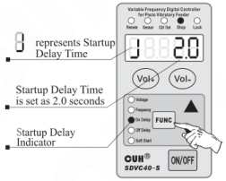

### Shutdown Delay (L)

The period of time the controller goes through from receiving a shutdown control signal to cutting off output

- Press the **FUNC** button and hold for 2 seconds to enter the Basic Parameters Adjusting status.
- Press the **FUNC** button repeatedly until shifting to the Shutdown Delay Time Adjusting status (L) as the Shutdown Delay Time Indicator on the panel lights up.
- Adjust the parameter by pressing the ▲ or ▼ button. The parameter unit is second, and the numerical precision is 0.1.

Adjustable range of the parameter is from 0.0 to 9.9 seconds  
Default value of the parameter is 0.2 seconds

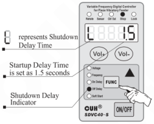

---

## 5.1.3 Logical Relation Setting of the Intelligent Photoelectric Sensor

Under normal circumstances, the receiving end receives no optical signal, and the controller runs by default. But in some special applications the controller needs to be stopped when the receiving end receives no optical signal. Adjusting this parameter can fulfill this kind of application.

- Press the **FUNC** and ▲ button simultaneously and hold for 2 seconds to enter the Advanced Parameters Adjusting status.
- Press the **FUNC** button repeatedly until shifting to the Logical Relation Adjusting status of the Intelligent Photoelectric Sensor.
- Adjust the parameter by pressing the ▲ or ▼ button.

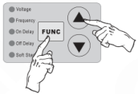

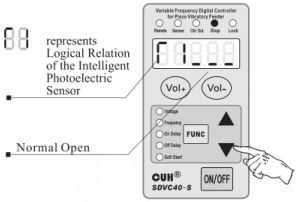

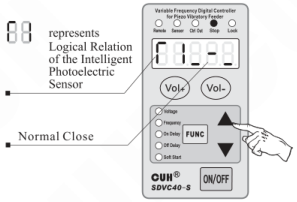

- When Logical Relation is set as Normal Open, namely no optical signal received, the controller runs.
- When Logical Relation is set as Normal Close, namely no optical signal received, the controller stops.

---

## 5.2 Using Method of the NPN Switch Sensor

The controller can operate with all kinds of sensors such as switch sensors, optical switch sensors and fiber optic sensors.

### 5.2.1 Connection method of the NPN Proximity Switch Sensor

**Step 1:**

Open the upper cover plate of the controller.

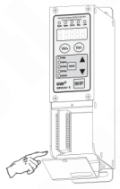

**Step 2:**

Connect the NPN Proximity Switch Sensor to the terminals of the controller according to the diagram.

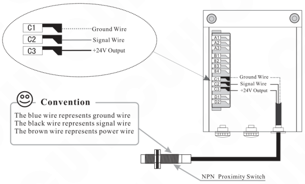

**Convention**

The blue wire represents ground wire  
The black wire represents signal wire  
The brown wire represents power wire

---

### 5.2.2 Connection method of the NPN Counter-radiation Switch Sensor

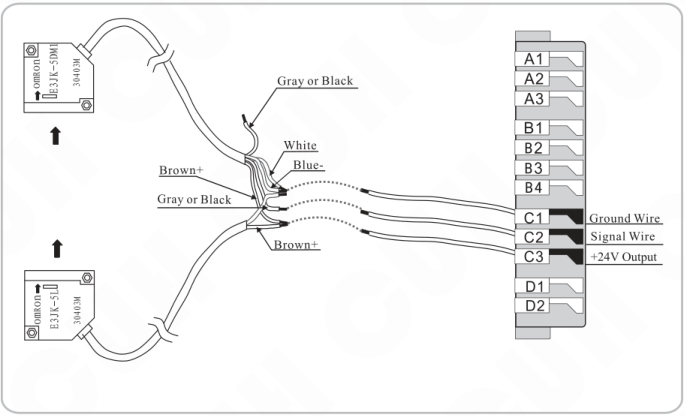

### 5.2.3 Connection method of the Photoelectric Counter-radiation Sensor

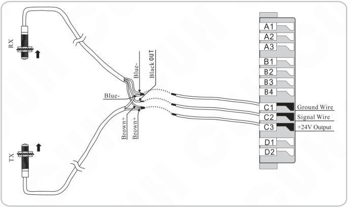

---

## 5.2.4 Connection method of the Optical Fiber Counter-radiation Sensor

---

## 5.2.5 Connection method of the Photoelectric Reflection Sensor

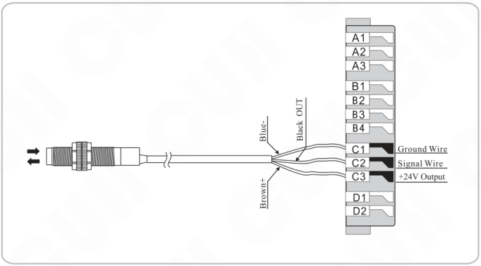

## 5.3 Startup Delay Time and Shutdown Delay Time Settings of the NPN Switch Sensor

By default, Intelligent Photoelectric Sensor and Switch Sensor share the same Startup Delay Time and Shutdown Delay Time. Operators can also set Startup Delay Time and Shutdown Delay Time independently for the Switch Sensor.

### Startup Delay (J-)

The period of time the controller goes through from receiving a startup control signal to outputting.

- Press the **FUNC** and **▲** buttons simultaneously and hold for 2 seconds to enter the Advanced Parameters Adjusting status.
- Press the **FUNC** button repeatedly until shifting to the Startup Delay Time Adjusting status (J- ---) as the Startup Delay Time Indicator on the panel lights up.
- Adjust the parameter by pressing the **▲** or **▼** button. The parameter unit is second, and the numerical precision is 0.1.

Startup Delay is set as J- --- by default

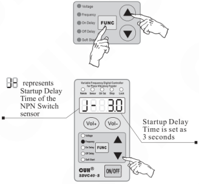

### Shutdown Delay (L-)

The period of time the controller goes through from receiving a shutdown control signal to cutting off output.

- Press the **FUNC** and **▲** buttons simultaneously and hold for 2 seconds to enter the Advanced Parameters Adjusting status.
- Press the **FUNC** button repeatedly until shifting to the Shutdown Delay Time Adjusting status (L-) as the Shutdown Delay Time Indicator on the panel lights up.
- Adjust the parameter by pressing the **▲** or **▼** button. The parameter unit is second, and the numerical precision is 0.1.

Shutdown Delay is set as L- --- by default

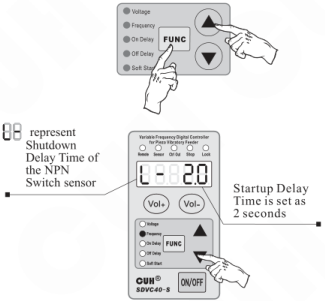

> ➔ When J- and L- values are adjusted to 0, Startup Delay Time and Shutdown Delay Time of the Switch Sensor will be the same with Startup Delay Time and Shutdown Delay Time of the Intelligent Photoelectric Sensor.
>
> ➔ Startup Delay Time and Shutdown Delay Time of the Intelligent Photoelectric Sensor will not affected by the parameter of J- or L-.

---

## 5.4 Logical Relation Setting of the NPN Switch Sensor (Halt when work-pieces are full)

Under normal circumstances, the controller receives no signal from the NPN Switch Sensor and runs by default. But in some special applications the controller needs to be stopped when receives no signal from the NPN Switch Sensor. Adjusting this parameter can fulfill this kind of application.

- Press the **FUNC** and ▲ buttons simultaneously and hold for 2 seconds to enter the Advanced Parameters Adjusting status.
- Press the **FUNC** button repeatedly until shifting to the Logical Relation Adjusting status of the NPN Switch Sensor (Γ 2).。
- Adjust the parameter by pressing the ▲ or ▼ button.

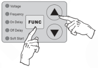

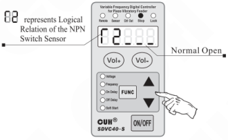

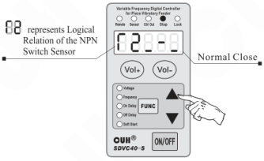

- When Logical Relation is set as Normal Open, namely no signal received, the controller runs.
- When Logical Relation is set as Normal Close, namely no signal received, the controller stops.

---

## 5.5 Logical Relation Setting of the Control Signal

The controller can set the Logical Relation of the Intelligent Photoelectric Sensor and the Switch Sensor when they work simultaneously.

- Press the **FUNC** and ▲ buttons simultaneously and hold for 2 seconds to enter the Advanced Parameters Adjusting status.
- Press the **FUNC** button repeatedly until shifting to the Logical Relation Adjusting status of the Control Signal
- Adjust the parameter by pressing the ▲ or ▼ button.

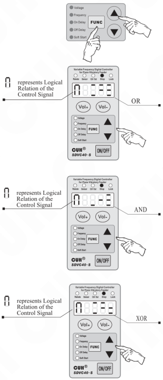

- Logical relation AND: The controller runs only when both the Intelligent Photoelectric Sensor and the NPN Switch Sensor ask the controller to.
- Logical relation OR: The controller runs when the Intelligent Photoelectric Sensor or the NPN Switch Sensor asks the controller to.
- Logical relation NOR: The controller runs only when the Intelligent Photoelectric Sensor and the NPN Switch Sensor output the opposite control signal.

---

## 5.6 Connection Method of the Upper PLC which Controls the Vibratory Feeder Controller

### Connection method of the controlling PLC

### Step One:
Open the upper cover plate of the controller.

### Step Two:
Connect the PLC to the terminals of the controller according to the diagram.

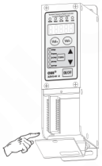

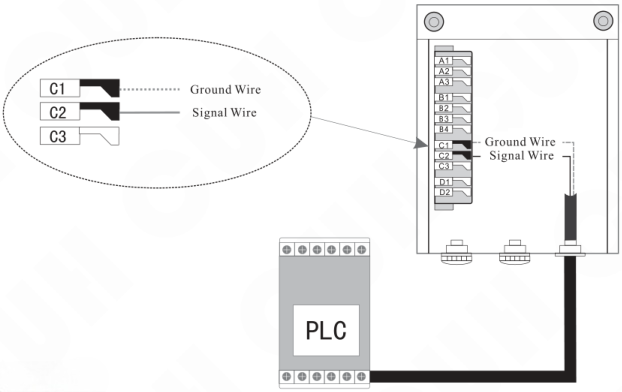

> Relay output or NPN output of the PLC is compatible with the controller.

---

## 5.7 Controlling Output

The controller can output low-voltage controlling signal to cooperate with other devices such as a solenoid valve, a PLC or an electrical relay.

### 5.7.1 Connection method of the Controlling Output

#### Connection method of the solenoid valve

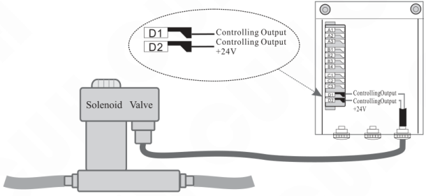

- The controller can directly drive a solenoid valve whose rated voltage is 24V and rated power lower than 4W.
- Use external power supply for high power solenoid valve.

#### Connection method of the electrical relay

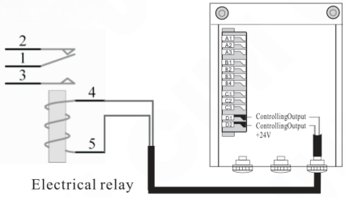

- The controller can directly drive an electrical relay whose rated voltage is 24V and rated power lower than 4W.

---

## 5.7.2 Logical Relation Setting of the Controlling Output

- Press the **FUNC** and ▲ buttons simultaneously and hold for 2 seconds to enter the Advanced Parameters Adjusting status.
- Press the **FUNC** button repeatedly until shifting to the Logical Relation Adjusting status of the Controlling Output (Γ3).
- Adjust the parameter by pressing the ▲ or ▼ button.

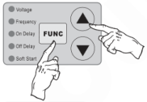

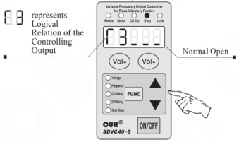

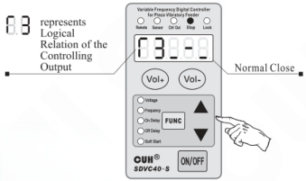

> - When Logical Relation is set as Normal Open, the Controlling Output works as the controller runs.
> - When Logical Relation is set as Normal Close, the Controlling Output doesn't work as the controller runs.

---

## 5.8 Remote Speed Control

The function of Remote Speed Control allows the operator to control the Output Voltage by an external potentiometer or a control signal ranging from 1V to 5V. Thus, external remote speed control can be easily achieved by a PLC, a DCS or some other means.

Remote Speed Control function becomes effective to the controller when the controlling signal exceeds 0.5V. Meanwhile, Remote Speed Control indicator on the panel lights up and the Vol+ and Vol- buttons lose effectiveness. The LED displayer shows current Output Voltage if the controller is running in the Output Voltage Adjusting status.

### Connection method of the external potentiometer

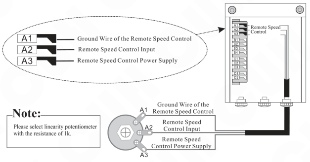

**Note:** Please select linearity potentiometer with the resistance of 1k.

### Connection method of the PLC

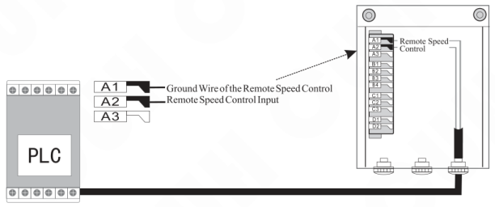

---

## Chapter VI Security Functions

### 6.1 Automatic Voltage Stabilizing

The built-in Digital Voltage Stabilizing function can eliminate feeding speed variation caused by mains voltage fluctuation.

### 6.2 Short-Circuit Protection

If output of the controller is short-circuited, the controller will halt its output until restarted.

### 6.3 Current Overload Protection

The controller will halt its output to ensure equipments' operating safety when operation current exceeds its rated value.

### 6.4 Overheat Protection

The controller will halt its output to protect itself when operation temperature is too high.

---

# Appendix

## Appendix A: Dimensions

Outline Dimensions of the controller model:（Unit: mm）

---

## Appendix B: Output Interface Definition

### Notice:

A: Make sure the electromagnetic coils of the vibrator is connected to the two output pins of the Output Power Cable socket and the shell of the vibrator is reliably earthed, otherwise series security incident may occur.

B: After solding, make sure the blank area is enswathed by insulating tape or heat-shrinkable tube before insert it into the Output Power Cable socket to avoid electrical leakage or short-circuit.

## Appendix C: Signal Interface Definition

---

## Appendix D: Function Table

| Controller | Displayed Character | symbol image |
|---|---|---|
| U | Output Voltage |  |
| E | Output Frequency |  |
| J | Startup Delay Time of the Intelligent Photoelectric Sensor |  |
| L | Shutdown Delay Time of the Intelligent Photoelectric Sensor |  |
| t | Soft Startup |  |
| L- | Shutdown Delay Time of the NPN Switch Sensor |  |
| J- | Startup Delay Time of the NPN Switch Sensor |  |
| r1 | Logical Relation of the Intelligent Photoelectric Sensor |  |
| r2 | Logical Relation of the NPN Switch Sensor |  |
| r3 | Logical Relation of the Controlling Output |  |
| rd | Power-on Operation status |  |
| A | Logical relation of the Control Signal |  |
| h | Maximum Output Voltage |  |
| 8.8.8.8.8. | Default Settings Restore |  |

---

## Appendix E: Electrical Specification

| Item | Range Min | Range Typical | Range Max | Unit | Description |
|---|---|---|---|---|---|
| Input Voltage | 85 | 220 | 260 | V | AC RMS |
| Adjustable Output Voltage Range | 0 | —— | 220 | V | SDVC40-S |
| Adjustable Output Voltage Range | 0.0 | —— | 50.0 | V | SDVC40-SD |
| Voltage Adjustment Accuracy | | 1 | | V | SDVC40-S |
| Voltage Adjustment Accuracy | | 0.1 | | V | SDVC40-SD |
| Voltage Regulation Accuracy | 0 | —— | 10 | % | ΔVout/ΔVin |
| Response Time of Voltage Regulation | 0.0025 | —— | 0.025 | s | the period of output voltage |
| Adjustable Output Current Range | 0 | —— | 150 | mA | SDVC40-S |
| Adjustable Output Current Range | 0 | —— | 600 | mA | SDVC40-SD |
| Output Power | 0 | —— | 33 | VA | SDVC40-S |
| Output Power | 0 | —— | 30 | VA | SDVC40-SD |
| Output Frequency | 40 | —— | 400 | Hz | |
| Frequency Adjustment Accuracy | | 0.1 | | Hz | |
| Output Waveform | | Sinusoidal wave | | | |
| Soft Start Time | 0 | —— | 10 | s | Factory Default Value:0.5 |
| On/Off Delay Time Range | 0 | —— | 20 | s | Factory Default Value:0.2 |
| On/Off Delay Time Accuracy | | 0.1 | | s | |
| Overheat Protection Trigger Temperature | 60 | —— | 65 | °C | |
| DC Control Output Voltage | 22 | 24 | 26 | V | |
| DC Control Output Current | 0 | —— | 200 | mA | |
| Analog Control Signal | | 1-5 | | V | Remote speed Control Voltage |
| Digital Control Signal | | 24 | | V | Switching Signal |
| Adjustment Method | | 6 | | Button | |
| Standby Power Consumption | —— | 4 | —— | W | |
| Display Method | | 5 | | Digit | LED Digital Tubes |
| Ambient Temperature | 0 | 25 | 40 | °C | No Condensation |
| Ambient Humidity | 10 | 60 | 85 | % | No Condensation |

---

## Appendix F: Trouble Shooting Tips and Error Explanations

The following tips can help to solve the problems you may encounter

| | | | symbol image |
|---|---|---|---|
| 1 | No display after power on | ◆ Make sure the power outlet is live ◆ Make sure the Input Power Cable is reliably connected to the power outlet | |
| 2 | Displays normally but no output | ◆ Make sure the Input Power Cable and Output Power Cable are firmly connected ◆ Make sure the Output Voltage parameter value is not too small ◆ Make sure the controller is not stopped by the control signal ◆ Make sure the controller is not stopped by the parameters that are set as normal off | |
| 3 | Control signal loses effectiveness | ◆ Make sure the control signal is correctly inputted ◆ Make sure the ground wire of the control signal is correctly connected to the controller ◆ Make sure the Logical Relation of the control signal is set correctly as you expectation | |
| 4 | Beat phenomena | ◆ Avoid vibration coupling among the vibrators ◆ Heighten the resonant frequency of the vibrators | |
| 5 | Displays normally, no output, but sound can be heard | ◆ Adjust all parameters as this book instructed | |
| 6 | Err01 | ◆ Output in short-circuit, Make sure the Output Power Cable and the coil are not shorted out |  |
| 7 | Err02 | ◆ Output Over current, Reduce the Output Voltage value and make sure the armature gap is not too big |  |
| 8 | Err03 | ◆ Overheat, Place the controller in well ventilated environment |  |
| 9 | Err04 | ◆ Reserved, please contact us |  |
| 10 | Err05 | ◆ Reserved, please contact us |  |

---

Nanjing CUH Science & Technology Co.,Ltd  
https://en.cuhnj.com  
Tel.:+86-25-84730411 / 84730415 / 84730416  
Fax:+86-25-84730426  
E-mail:sales@cuhnj.com  
Add.:Building 2, Xueyan Tech Park, Tuscity,  
No.9 Zhineng Rd, Jiangning, Nanjing, China

