## Variable Frequency Intelligent Controller for Piezo Vibratory Feeder

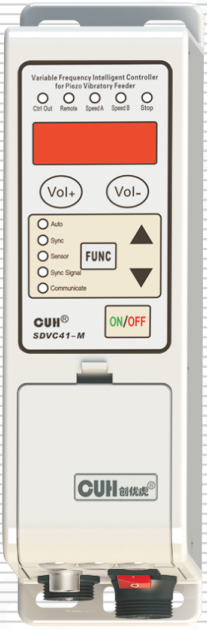

## SDVC41 Series
Variable Frequency Intelligent Controller for Piezo Vibratory Feeder　 SDVC41 Series
## User Manual

---

## Preface

Thank you for choosing CUH Intelligent Digital Vibratory Feeder Controller.

(The controller for short in the following text).

This instruction book includes notes for installing, debugging, parameter setting, maintenance and troubleshooting of the controller. Please read this instruction book carefully before operating the controller and keep it properly.

---

---

## Notice:

1. Never plug or unplug the cables, nor touch the power sockets while the controller is powered on so as to prevent electric shock or other accident.
2. Never connect the controller to 380V AC which may cause unrecoverable damage. (we have the product that designed for 380V AC)
3. Never switch the input of the controller by the way of cutting off the power supply for turning on/off the output, otherwise it may reduce the lifetime of the controller.
4. Never operate the controller under the condition that beyond its designed limits.
5. Operate the controller in accordance with this instruction book strictly. we will not assume any civil or criminal liability if the equipment damage or personal injury is caused by incorrect operation.

> Never open the controller shell to avoid electric shock. Contact CUH if the controller break down. Never try to repair the controller yourself which may caused void warranty.

---

## Operating and storage environment

### Inspection before using

Every controller will go through rigorous quality inspection before delivery and is packed with crash-proof packaging, Please check the following items after unpacking:

1. Whether the controller is damaged in appearance.
2. Whether the model of the controller is that you order.

### Runtime environment

Please follow the notes below to ensure the better performance and longer lifetime of the controller:

- ⚠ Well-ventilated environment
- ⚠ Keep away from water, stream, dust and especially oily dust
- ⚠ Keep away from the corrosive or flammable gas and liquid
- ⚠ Keep away from floating dust and metal particles
- ⚠ Firmly fixed to avoid self vibration
- ⚠ Keep away from electromagnetic interference
- ⚠ Ensure ambient temperature is 0~40 ℃
- ⚠ For use at altitude 2000m or lower

---

# Contents

- Chapter I　Features — 1
- Chapter II　Installation Guide — 2
- Chapter III　Components Descriptions — 4
  - 3.1　Descriptions of the Indicators — 4
  - 3.2　Descriptions of the Buttons — 5
  - 3.3　Descriptions of I/O Interfaces and Accessory — 5
  - 3.4　Descriptions of Signal Control Ports — 6
- Chapter IV　Parameter Adjustment — 7
  - 4.1　Common Parameters — 7
  - 4.2　Basic Parameters — 7
  - 4.3　Advanced Parameters — 8
  - 4.4　Auto/Sync Parameters — 9
- Chapter V　Operating Mode — 10
  - 5.1　Manual Mode — 10
  - 5.2　Auto Mode — 12
  - 5.3　Semi-Auto Mode — 18
  - 5.4　Sync Mode — 20
- Chapter VI　Signal Control — 27
  - 6.1　C Ports ON/OFF Control — 27
  - 6.2　E Ports ON/OFF Control — 34
  - 6.3　Common Parameters of C Ports and E Ports — 37
  - 6.4　Remote Speed Control — 39
  - 6.5　Storage and Output of Preset Speeds — 41
  - 6.6　RS485 Communication — 42
  - 6.7　24V DC Control Output — 43
- Chapter VII　Security Functions — 45

---

---

Appendix A: Dimensions ------------------------------------------------------46

Appendix B: Signal Control Ports Definition -----------------------------47

Appendix C: Electrical Specification ---------------------------------------50

Appendix D: Troubleshooting Suggestions and Error Explanation -51

Controller Reset -----------------------------------------------------------------52

---

# ChapterⅠ Features

The controller is specially designed for controlling piezo vibratory feeder in automation systems. Combined with the latest electronic technologies and well-designed, the controller has the following convenient and practical features:

**Load:** The controller is adaptive to resistive load, inductive load and especially capacitive load such as a piezo vibrator.

**Auto FM:** Automatic output frequency modulation in real time to ensure the vibratory feeder will always work at its best vibration frequency.

**Auto Constant Speed Control:** Automatic output voltage adjustment in real time to ensure constant preset feed speed regardless of weight change of the feed materials in the vibratory feeder.

**Automatic Frequency Measuring :** Automatically measure and output the best vibration frequency of the vibratory feeder.

**Automatic Voltage Regulation:** Eliminate both feed speed variation caused by mains voltage fluctuation and beat effect caused by industrial AC frequency.

**Waveform Sync:** Sync output waveform of slave controllers with that of the master controller to the same frequency and phase to avoid beat effect.

**Remote ON/OFF Control:** The controller has 2 groups of ON/OFF control ports. Switch sensors or PLC can be connected to turn on/off the controller. Soft Startup Time, On Delay, Off Delay and Logical Relation of the ON/OFF Control can also be set.

**Automatic Switch Sensor Type Recognition:** The controller can recognize and adapt to both NPN and PNP type switch sensors .

**Soft Startup:** In order to avoid sudden shock to the feed material and vibratory feeder, the controller can gently increase output voltage/feed speed from 0 to preset value when startup.

**Preset Speeds:** 4 preset feed speeds can be stored and output by external short-circuit signal.

**Max Adjustable Output Voltage:** Max Adjustable Output Voltage can be preset to protect the vibratory feeder from damage caused by high voltage.

**Remote Speed Control:** Output Voltage/Feed Speed of the controller can be adjusted remotely by an external potentiometer, a PLC, or 1~5V/4~20mA DC signal.

**24V DC Control Output:** The controller can output 24V DC power associated with logical relation setting of the ON/OFF Control to drive a solenoid, an electrical relay or other external devices.

**Control Panel Lock:** Lock all buttons on the control panel by pressing the ON/OFF button and hold for 2 seconds to prevent misoperation.

**Parameter Lock:** Lock all parameters except Output Voltage/Feed Speed by self defined password to prevent unauthorized operation.

**Controller Reset: Reset** all parameters of the controller to factory defaults.

**RS485 Communication:** All the parameters can be adjusted via RS485 Communication ports.

---

## ChapterⅡ Installation Guide

### Step One:

Open the packing box and check the controller and all accessories.

### Step Two:

Connect the wiring terminals of the Output Power Cable to the electrodes of the piezo vibrator.

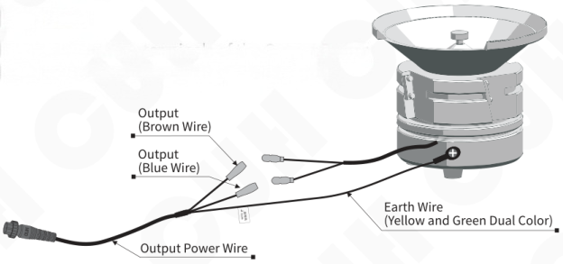

> Note: Make sure the electrodes of the piezo vibrator are connected to the live wire and neutral wire of the output power cable and the shell of the feeder is reliably earthed, otherwise serious accident may occur.

### Step Three:

Connect the Connector of the Output Power Cable to the Output Power Socket of the controller.

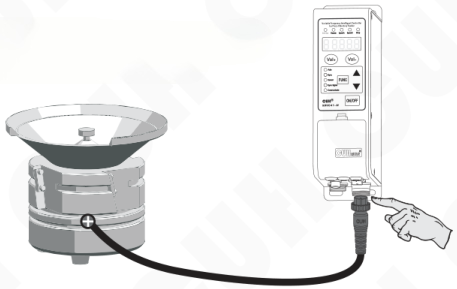

---

## Step Four:

Connect the Connector of the Input Power Cable to the Input Power Socket of the controller.

Connect the controller side first

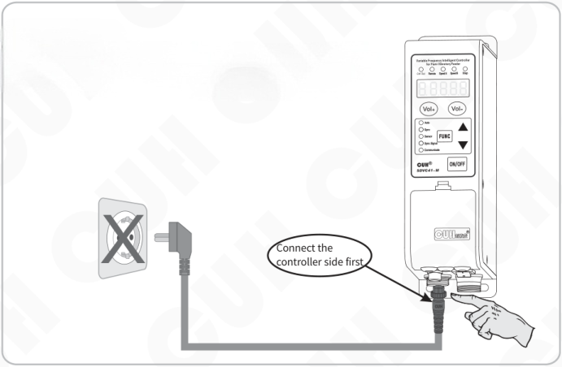

## Step Five:

Connect the plug of the Input Power Cable to the mains jack.

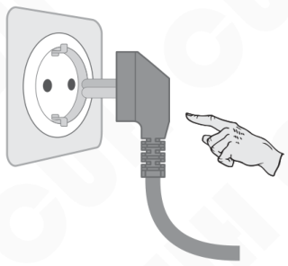

## Chapter Ⅲ Components Descriptions

### 3.1 Descriptions of the Indicators

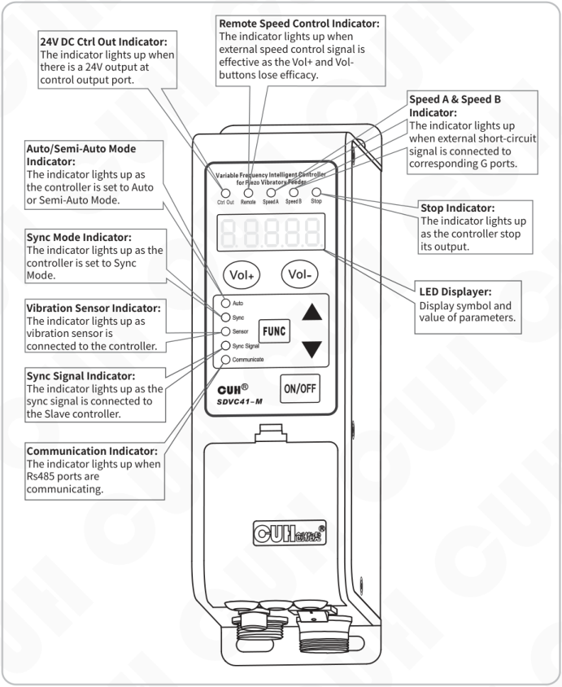

**24V DC Ctrl Out Indicator:**  
The indicator lights up when there is a 24V output at control output port.

**Remote Speed Control Indicator:**  
The indicator lights up when external speed control signal is effective as the Vol+ and Vol- buttons lose efficacy.

**Speed A & Speed B Indicator:**  
The indicator lights up when external short-circuit signal is connected to corresponding G ports.

**Auto/Semi-Auto Mode Indicator:**  
The indicator lights up as the controller is set to Auto or Semi-Auto Mode.

**Stop Indicator:**  
The indicator lights up as the controller stop its output.

**Sync Mode Indicator:**  
The indicator lights up as the controller is set to Sync Mode.

**LED Displayer:**  
Display symbol and value of parameters.

**Vibration Sensor Indicator:**  
The indicator lights up as vibration sensor is connected to the controller.

**Sync Signal Indicator:**  
The indicator lights up as the sync signal is connected to the Slave controller.

**Communication Indicator:**  
The indicator lights up when Rs485 ports are communicating.

---

## 3.2 Descriptions of the Buttons

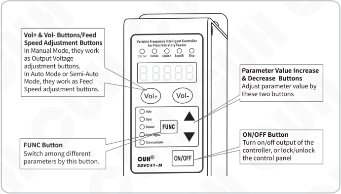

**Vol+ & Vol- Buttons/Feed Speed Adjustment Buttons**  
In Manual Mode, they work as Output Voltage adjustment buttons.  
In Auto Mode or Semi-Auto Mode, they work as Feed Speed adjustment buttons.

**Parameter Value Increase & Decrease Buttons**  
Adjust parameter value by these two buttons

**FUNC Button**  
Switch among different parameters by this button.

**ON/OFF Button**  
Turn on/off output of the controller, or lock/unlock the control panel

## 3.3 Descriptions of I/O Interfaces and Accessory

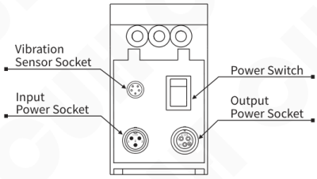

- Vibration Sensor Socket
- Input Power Socket
- Power Switch
- Output Power Socket

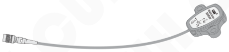

Vibration Sensor

---

## 3.4 Descriptions of Signal Control Ports

### Wiring Description of Signal Control Ports

For C ports -C1, C2 and C3- wiring description, please refer to chapter 6.1.

For E ports -E1, E2 and E3- wiring description, please refer to chapter 6.2.

For A ports -A1, A2, A3 and A4- wiring description, please refer to chapter 6.4.

For H ports -H1, H2, H3 and H4- wiring description, please refer to chapter 5.4.1.

For G ports -G1, G2, G3 and G4- wiring description, please refer to chapter 6.5.

For F ports -F1, F2 and F3- wiring description, please refer to chapter 6.6.

For D ports -D1 and D2- wiring description, please refer to chapter 6.7.

---

# Chapter Ⅳ Parameter Adjustment

Parameters of the controller are classified into 4 types according to different adjustment methods: Common Parameters, Basic Parameters, Advanced Parameters and Auto/Sync Parameters.

## 4.1 Common Parameters

- Press "Vol+" or "Vol-" button to adjust Common Parameters.
- The "Vol+" and "Vol-" buttons are designed to adjust Common Parameters only.
- Common Parameters can be adjusted by pressing "Vol+" or "Vol-" button even when any other parameter is displayed on the LED screen. The controller will go back to the previous parameter after Common Parameter adjustment.

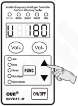

| Common Parameters | Symbol | symbol image | Range | Default |
|---|---|---|---|---|
| Output Voltage | U |  | 20~220 V | 150 |
| Feed Speed | A |  | 0~3200 | 200 |
| Keypad Lock | a |  | \ | Current Voltage Value/Current Feed Speed |

## 4.2 Basic Parameters

- Press "FUNC" button and hold for 2 seconds to enter Basic Parameter Adjustment Status.
- Press "FUNC" button repeatedly to switch cyclically among different parameters.
- Press ▲ or ▼ button to adjust the parameter value.
- Press "FUNC" button again and hold for 2 seconds to exit Basic Parameter Adjustment Status.

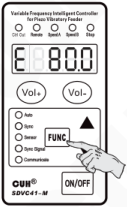

| Common Parameters | Symbol | symbol image | Range | Default |
|---|---|---|---|---|
| Output Frequency | E |  | 40.0~400.0 Hz | 50.0 |
| C Ports On Delay | J |  | 0.0~20.0 s | 0.2 |
| C Ports Off Delay | L |  | 0.0~20.0 s | 0.2 |
| Soft Startup Time | t | 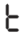 | 0.0~10.0 s | 0.5 |

---

## 4.3 Advanced Parameters

- Press "FUNC" and ▲ buttons simultaneously and hold for 2 seconds to enter Advanced Parameter Adjustment Status.
- Press "FUNC" button repeatedly to switch cyclically among different parameters.
- Press ▲ or ▼ button to adjust the parameter value.
- Press "FUNC" and ▲ buttons simultaneously again and hold for 2 seconds to exit Advanced Parameter Adjustment Status.

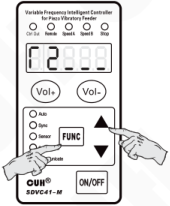

| Common Parameters | Symbol | symbol image | Range | Default |
|---|---|---|---|---|
| E Ports On Delay | J- |  | 0.0~20.0 s | --- |
| E Ports Off Delay | L- |  | 0.0~20.0 s | --- |
| C Ports Logical Relation | Γ2 | 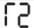 | `___` Positive Logic　`_-_` Negative Logic | --- |
| E Ports Logical Relation | Γ7 |  | `___` Positive Logic　`_-_` Negative Logic | --- |
| 24V Ctrl Out Logical Relation | Γ3 |  | `___` Positive Logic　`_-_` Negative Logic Effect by alarm signal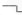 | --- |
| Whether or not output of the controller is controlled by ON/OFF Control Signal | Γ4 |  | `___` Relevant,　`_-_` Irrelevant | --- |
| Default/Spare logic parameter group switch | Γ8 |  | `___` Default logic parameter group `_-_` Spare logic parameter group `_=_` Key of spare logic parameter setting | --- |
| Switch Sensor Type | ΓA |  | Uto: Auto nPn: NPN type Sensor PnP: PNP type Sensor | Uto |
| Logical Relation of C Ports and E Ports | Π | 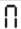 | OR, AND, XOR | AND |
| Max Adjustable Output Voltage | h | 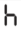 | 20~220 V | 220 |
| Temperature Display | C | 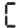 | -10.0~80.0 ℃ | Current Temperature |
| RS485 Modbus Protocol | See figure | 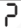 | ASC, rtu | rtu |
| Communication Address | See figure | 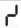 | 1~31 | 1 |
| Communication Baud Rate | See figure |  | 0.3, 1.2, 2.4, 9.6, 19.2, 57.6, 115.2 kbps | 9.6 |
| Parameter Lock Password | See figure | 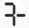 | 0~999 | --- |
| Controller output status after powering on | Γd |  | `___` On,　`_-_` Off,　Keep | --- |
| Firmware Version | Ur |  | \ | Current Version |
| Controller Reset | 8.8.8.8.8. | 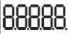 | Ready for Reset Reset Completed 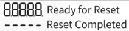 | \ |

---

## 4.4 Auto/Sync Parameters

- Press "FUNC" and ▼ buttons simultaneously and hold for 2 seconds to enter Auto/Sync Parameter Adjustment Status.
- Press "FUNC" button repeatedly to switch cyclically among different parameters.
- Press ▲ or ▼ button to adjust the parameter value.
- Press "FUNC" and ▼ buttons simultaneously again and hold for 2 seconds to exit Auto/Sync Parameter Adjustment Status.

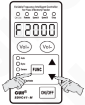

| Common Parameters | Symbol | symbol image | Range | Default |
|---|---|---|---|---|
| Centre Frequency | F |  | 40.0~400.0 Hz | 100.0 |
| Max Offset in Auto FM | n | 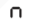 | 0.0~180.0 Hz | 30.0 |
| Output Voltage Adjustment Method | r5 |  | ___Auto　_-_Manual | ___ |
| Output Frequency Adjustment Method | r6 | 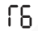 | ___Auto　_-_Manual　☰ Sync | ___ |
| Output Frequency Auto Adjustment Index | IF |  | 0~200 | 20 |
| Amplitude Auto Adjustment Index | PA |  | 0~999 | 60 |
| Amplitude Auto Adjustment Index | IA |  | 0~999 | 20 |
| Feed Speed Display | U | 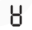 | 0~H | 0 |
| Output Voltage Display | G | 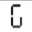 | 20~h V | 150 |
| Voltage Lower Limit | GL |  | 0~220 V | 0 |
| Frequency Lower Limit | e | 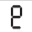 | 40.0~400.0 Hz | 40.0 |
| Max Amplitude Index | P |  | 0~500 | 500 |
| Max Adjustment Feed Speed | H | 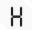 | 0~3200 | 1500 |
| Phase Difference | γ | 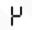 | -180~180 ° | 0 |
| Max Output Voltage in Auto Frequency Measuring Process | b | 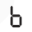 | 20~220 V | 100 |
| Frequency Search Speed | SP |  | 1~5 | 5 |
| Feed Speed Min Adjustment Volume | c | 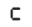 | 1~10 | 1 |
| Vibration Sensor Number | t | 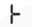 | 0, 1, 2, 3, 4, 203, 204, 205, 206 | 205 |

# ChapterⅤ Operating Mode

The controller can be set to work in one of the following four operating modes according to specific application requirements.

- **Manual Mode:** Both Output Voltage and Output Frequency are manually adjusted.
- **Auto Mode:** Both Output Voltage and Output Frequency are auto adjusted based on feedback from the Vibration Sensor to ensure constant preset feed speed and best vibration frequency of the vibratory feeder.
- **Semi-Auto Mode:** Output Voltage is auto adjusted based on feedback from the Vibration Sensor to ensure constant preset feed speed. Output Frequency is manually adjusted.
- **Sync Mode:** In Sync Configuration, if Output Frequency of Controller B is always constant with that of Controller A. We define Controller A as Master Controller, Controller B as Slave Controller and Operating Mode of Controller B as Sync Mode.

| Operating Mode | Output Voltage U — Adjustment Method | Output Voltage U — Γ5 Setting | Output Frequency E — Adjustment Method | Output Frequency E — Γ6 Setting | symbol image |
|---|---|---|---|---|---|
| Manual Mode | Manual | ₋⁻₋ | Manual | ₋⁻₋ | Γ5 / Γ6: 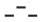 |
| Auto Mode | Auto | _ _ _ | Auto | _ _ _ | Γ5 / Γ6: 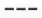 |
| Semi-Auto Mode | Auto | _ _ _ | Manual | ₋⁻₋ | Γ5: [[vcrop:16:1]]; Γ6: [[vcrop:16:0]] |
| Sync Mode | Manual or Auto | ₋⁻₋ or _ _ _ | Auto Sync with Master Controller |  | Γ5: [[vcrop:16:0]] or [[vcrop:16:1]]; Γ6: 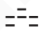 |

## 5.1 Manual Mode

In Manual Mode, both Output Voltage and Output Frequency are manually adjusted.

| Operating Mode | Output Voltage U — Adjustment Method | Output Voltage U — Γ5 Setting | Output Frequency E — Adjustment Method | Output Frequency E — Γ6 Setting | symbol image |
|---|---|---|---|---|---|
| Manual Mode | Manual | ₋⁻₋ | Manual | ₋⁻₋ | Γ5 / Γ6: [[vcrop:16:0]] |

To simplify operation, Parameter Γ5 and Γ6 are set to _ _ _ by factory default. Under this setting, the controller will work in Manual Mode if Vibration Sensor is not connected to the controller or work in Auto Mode if Vibration Sensor is connected.

---

**Note:**

If both Γ5 and Γ6 are set to _ - _, the controller will work in Manual Mode whether or not Vibration Sensor is connected to the controller.

If Vibration Sensor is not connected to the controller, the controller will always work in Manual Mode.

### 5.1.1 Output Voltage Parameter U Adjustment in Manual Mode

Actual Output Voltage value of the controller can be displayed on the LED screen digitally and accurately.

- Turn on the power switch when Vibration Sensor is not connected to the controller.
- The LED screen displays Output Voltage Parameter U and its value.
- Adjust the U value by pressing "Vol+" or "Vol-" button.

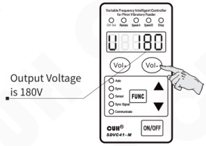

### 5.1.2 Output Frequency Parameter E Adjustment in Manual Mode

With the help of DDS technology, Output Frequency of the controller is always stable and high-precision regardless of time or temperature change.

- Press "FUNC" button and hold for 2 seconds to enter Basic Parameter Adjustment Status.
- The LED screen displays Output Frequency Parameter E and its value.
- Adjust the E value by pressing ▲ or ▼ button when Vibration Sensor is not connected to the controller.

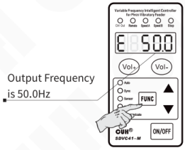

## 5.2 Auto Mode

In Auto Mode, Vibration Sensor must be connected to the controller. Output Voltage and Output Frequency will be adjusted automatically based on feedback from the Vibration Sensor to ensure constant preset feed speed and best vibration frequency. Output Voltage and Output Frequency can not be adjusted manually.

By factory default, when Vibration Sensor is connected, the controller works in Auto Mode.

| Operating Mode | Output Voltage U — Adjustment Method | Output Voltage U — Γ5 Setting | Output Frequency E — Adjustment Method | Output Frequency E — Γ6 Setting |
|---|---|---|---|---|
| Auto Mode | Auto | --- | Auto | --- |

**Note:**

The controller will still work in Manual Mode if Vibration Sensor is not connected.

### 5.2.1 Vibration Sensor Installation

#### 5.2.1.1 Connection Method of the Vibration Sensor

Connect the connector of the Vibration Sensor to the Vibration Sensor Socket of the controller.

Install the vibration sensor head on a secure and even surface of the vibratory feeder firmly.

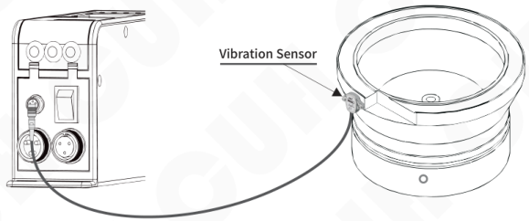

**Note: Please plug and unplug the vibration sensor when the controller is powered off.**

---

## 5.2.1.2 Installation of Vibration Sensor to the Vibrator

Fix Vibration Sensor to the smooth surface of vibrator and Installation direction arbitrary, and installation methods of Vibration Sensor are shown as below:

- Method 1: As shown in Fig. 1

  Advantage: Easy installation

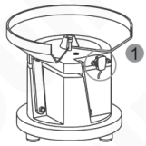

Fig. 1

- Method 2: As shown in Fig. 2

  Note: Don't make the vibration sensor pressed by feeding bowl.

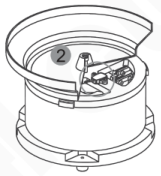

Fig. 2

- Method 3: weld a bracket on the vibrator and fix the vibration sensor on the bracket. As shown in Fig. 3

  Recommended Dimensions of bracket of Vibration is shown in Fig.4.

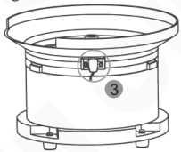

Fig. 3

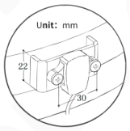

Fig. 4

- Not recommend installation method, As shown in Fig. 5 and Fig. 6.

  If the installation location is not suitable, the vibration sensor can't feedback the resonant frequency accurately and the controller will execute searching the resonant frequency all along.

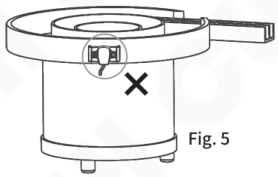

Fig. 5

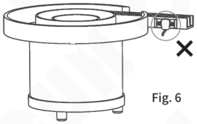

Fig. 6

---

## 5.2.2 Feed Speed Parameter A Adjustment in Auto Mode

- Turn on the power switch when Vibration Sensor is connected to the controller. The Vibration Sensor Indicator lights up.
- The LED screen displays Feed Speed Parameter A and its value.
- Adjust the A value by pressing "Vol+" or "Vol-" button to desired feed speed.

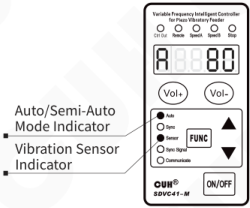

## 5.2.3 Auto Frequency Measuring in Auto Mode

By Auto Frequency Measuring, the controller detects the best vibration frequency of the vibratory feeder and sets all related parameters automatically. The only thing users need to do is to set Feed Speed Parameter A, then the controller will work in the best status.

- Press ▲ and ▼ buttons simultaneously and hold for 3 seconds when Vibration Sensor is connected to the controller to start Auto Frequency Measuring. Output Frequency Parameter E and its value will be displayed on the LED screen in the measuring process.
- After the Auto Frequency Measuring process, the controller will automatically set all related parameters including Centre Frequency Parameter F, Max Offset in Auto FM Parameter n, Output Frequency Auto Adjustment Index IF, Amplitude Auto Adjustment Index PA, Amplitude Auto Adjustment Index IA, Phase Difference Parameter μ, Output Voltage Adjustment Method Parameter Γ5 and Output Frequency Adjustment Method Parameter Γ6 will be set to \_\_\_.

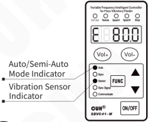

> - If the LED screen displays Err02 the moment Auto Frequency Measuring Process start, it is normal, because of parameter b is set too high.
> - If you want to cancel Auto Frequency Measuring Process, Press ON/OFF button. Then the controller will go back to the status before Auto Frequency Measuring.

**After Feed Speed setting and Auto Frequency Measuring, the controller will work in the best status at desired feed speed.**

---

## 5.2.4 Explanation of Auto/Sync Parameters

(Concerning adjustment method, value range and unit of Auto/Sync Parameters, please refer to Section 4.4.)

### 5.2.4.1 Output Voltage Adjustment Method Parameter Γ5

When parameter Γ5 is set to `_-_`, Output Voltage Parameter U will be visible while parameter A hidden. Output Voltage Parameter U can be adjusted manually.

When parameter Γ5 is set to `___` and Vibration Sensor is connected to the controller, Feed Speed Parameter A will be visible while parameter U hidden. Output Voltage will be adjusted automatically based on feedback from the Vibration Sensor to ensure constant preset feed speed.

**Note:**

When Vibration Sensor is not connected to the controller, even if parameter Γ5 is set to `___`, parameter U will still be visible and manually adjustable.

### 5.2.4.2 Output Frequency Adjustment Method Parameter Γ6

When parameter Γ6 is set to `_-_`, Output Frequency Parameter E can be adjusted manually.

When parameter Γ6 is set to `___` and Vibration Sensor is connected to the controller, Output Frequency Parameter E will be adjusted automatically to resonant frequency (best vibration frequency) of the vibratory feeder based on feedback from the Vibration Sensor. Output Frequency can not be adjusted manually.

When parameter Γ6 is set to 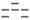 and Sync Signal Wire is connected between Master and Slave Controllers. Output Frequency of Slave Controller will always be consistent with that of Master Controller. Output Frequency of Slave Controller can not be adjusted manually.

**Note:**

When Vibration Sensor is not connected to the controller, even if parameter Γ6 is set to `___`, Output Frequency will still be adjusted manually.

If Parameter n is set too large, the vibratory feeder may work at improper vibration frequency.

If Parameter n is set too small, flexibility of the vibratory feeder may be affected.

### 5.2.4.3 Centre Frequency Parameter F

Centre Frequency should be set around resonant frequency of the vibratory feeder so that the controller can find the best vibration frequency more quickly.

### 5.2.4.4 Output Frequency Auto Adjustment Index n

Auto FM range is (F ±n) Hz.  
Suggested n value is around 30.0Hz.  
If Parameter n is set too large, the vibratory feeder may work at improper vibration frequency.  
If Parameter n is set too small, flexibility of the vibratory feeder may be affected.

---

### 5.2.4.5 Output Frequency Auto Adjustment Index IF

The Auto FM process is running via PID algorithm. "IF" is a frequency integration index.

The larger Parameter "IF" is set, the faster Output Frequency is auto modulated. But too large "IF" value may cause oscillation of the Output Frequency.

### 5.2.4.6 Amplitude Auto Adjustment Index PA

The controller adjusts Output Voltage automatically via PID algorithm. PA is a speed ratio index.

The larger Parameter PA is set, the faster Output Voltage is auto adjusted. But too large PA value may cause oscillation of the Output Voltage.

### 5.2.4.7 Amplitude Auto Adjustment Index IA

The controller adjusts Output Voltage automatically via PID algorithm. IA is a speed integration index.

The larger Parameter IA is set, the faster Output Voltage is auto adjusted. But too large IA value may cause oscillation of the Output Voltage.

### 5.2.4.8 Feed Speed Display Parameter 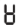

Parameter  is designed for displaying Feed Speed and it is nonadjustable.

### 5.2.4.9 Output Voltage Display Parameter G

Parameter G is designed for displaying Output Voltage and it is nonadjustable.

### 5.2.4.10 Voltage Lower Limit Parameter GL

Parameter GL is designed for alarm output voltage is lower than GL value.

If true and Γ3 set to , port D will active.

### 5.2.4.11 Frequency Lower Limit Parameter 

Parameter  is designed for alarm output frequency is lower than  value.

If true and Γ3 set to , port D will active.

### 5.2.4.12 Max Amplitude Index P

Set index P to restrict max amplitude of the vibratory feeder.

### 5.2.4.13 Max Adjustable Feed Speed Parameter H

Feed Speed range is 0 to H. Parameter H restricts Maximum Feed Speed to certain value to protect the vibratory feeder from high voltage caused by misoperation.

Remote Speed Control feed speed is also affected by this parameter.

### 5.2.4.14 Phase Difference Parameter 

Adjust Parameter  to change phase of the output wave, default phase difference is 0°.

---

### 5.2.4.15 Max Output Voltage in Auto Frequency Measuring Process Parameter b

Output Voltage won't exceed the Parameter b value in Auto Frequency Measuring Process to protect the vibratory feeder from damage.

### 5.2.4.16 Frequency Search Speed Parameter SP

Parameter SP represents Frequency Search Speed. The higher of this value, the faster of frequency searching progress.

### 5.2.4.17 Feed Speed Min Adjustment Volume Parameter c

Parameter c represents adjustment volume of the Feed Speed Parameter A at one press of Vol+ or Vol- button. Parameter c ranges from 1 to 10.

### 5.2.4.18 Vibration Sensor Number Parameter ├

The controller is adaptive to 8 different model Vibration Sensors. Set parameter ├ according to the sensor model so that when Feed Speed is set. the controller will output the same voltage value no matter which model Vibration Sensor is connected.

| Parameter Value | Model | Specification (Acceleration of x axis/y axis/z axis) |
|---|---|---|
| 1 | SDVS20-1 | 16g/16g/16g |
| 2 | SDVS20-2 | 35g/35g/—— |
| 3 | SDVS20-3 | 50g/50g/—— |
| 4 | SDVS20-4 | 70g/70g/—— |
| 203 | SDVS203 | 8g/8g/8g |
| 204 | SDVS204 | 16g/16g/16g |
| 205 | SDVS205 | 32g/32g/32g |
| 206 | SDVS206 | 64g/64g/64g |

---

## 5.3 Semi-Auto Mode

In Semi-Auto Mode, Vibration Sensor must be connected to the controller and Parameter Γ6 must be set to `_-_`.

Output Voltage will be adjusted automatically based on feedback from the Vibration Sensor to ensure constant preset feed speed. Output Frequency will be adjusted manually.

| Operating Mode | Output Voltage U — Adjustment Method | Output Voltage U — Γ5 Setting | Output Frequency E — Adjustment Method | Output Frequency E — Γ6 Setting |
|---|---|---|---|---|
| Semi-Auto Mode | Auto | `___` | Manual | `_-_` |

**Note:**

The controller will still work in Manual Mode if Vibration Sensor is not connected.

### 5.3.1 Vibration Sensor Installation

The same with Section 5.2.1.

### 5.3.2 Semi Auto Mode Setup

- Turn on the power switch when Vibration Sensor is connected to the controller. The Vibration Sensor Indicator lights up.
- Press "FUNC" and ▼ buttons simultaneously and hold for 2 seconds to enter Auto/Sync Parameter Adjustment Status.
- Press "FUNC" button repeatedly to switch to Output Frequency Adjustment Method Parameter Γ6.
- Press ▲ or ▼ button to set Γ6 to `_-_`.

---

## 5.3.3 Feed Speed Parameter A Adjustment in Semi-Auto Mode

- Adjust the A value by pressing "Vol+" or "Vol-" button to desired feed speed.

## 5.3.4 Output Frequency Parameter E Adjustment in Semi-Auto Mode

- Press "FUNC" button and hold for 2 seconds to enter Basic Parameter Adjustment Status.
- The LED screen displays Output Frequency Parameter E and its value.
- Adjust the E value by pressing ▲ or ▼ button.

---

## 5.4 Sync Mode

In Sync Mode, sync signal wire must be connected between the Master and Slave Controllers. Output Frequency of the controller(Slave Controller) is always consistent with that of Master Controller. Output Voltage of the controller(Slave Controller) can be adjusted manually or automatically.

| Operating Mode | Output Voltage U — Adjustment Method | Output Voltage U — Γ5 Setting | Output Frequency E — Adjustment Method | Output Frequency E — Γ6 Setting |
|---|---|---|---|---|
| Sync Mode | Manual or Auto |  | Auto Sync with Master Controller |  |

Sync Mode apply to the situation that there are more than one controller controlling several vibratory feeders in the feed system, output of the controllers are not synchronous so they interfere with each other (Beat Effect). Sync Mode is designed to eliminate Beat Effect as output waveform of Master and Slave Controllers are exactly synchronous.

Controller B is not set to Sync Mode, Output Waveforms of the two controllers are not synchronous.

Controller B is set to Sync Mode, Output Waveforms of the two controllers are synchronous.

---

## 5.4.1 Connection Method of the Sync Signal Wire between Master and Slave Controllers

### Step 1:

Open the cover plates of the signal control ports boxes of both controllers.

### Step 2:

Connect the Sync Signal Wire between Master and Slave controllers according to the schematic diagram below.

> The slave controller will halt its output when sync signal is unstable or not connected. And the sync indicator will go out.

**One Master Controller could drive several Slave Controllers.**

---

## 5.4.2 Sync Mode Applications

### Sub-Pattern 1

| Controller | Output Voltage U — Adjustment Method | Output Voltage U — Γ5 Setting | Output Frequency E — Adjustment Method | Output Frequency E — Γ6 Setting |
|---|---|---|---|---|
| Master Controller | Manual |  | Manual | [[vcrop:28:0]] |
| Slave Controller | Manual | [[vcrop:28:0]] | Auto Sync with Master Controller |  |

When Γ6 parameter is set to [[vcrop:28:1]], its output frequency will be controlled by the master controller.

---

## Sub-Pattern 2

| Controller | Output Voltage U — Adjustment Method | Output Voltage U — Γ5 Setting | Output Frequency E — Adjustment Method | Output Frequency E — Γ6 Setting | symbol image |
|---|---|---|---|---|---|
| Master Controller | Auto | --- | Auto | --- | Γ5、Γ6： |
| Slave Controller | Manual | symbol image | Auto Sync with Master Controller | symbol image | Γ5：；Γ6： |

## Sub-Pattern 3

| Controller | Output Voltage U — Adjustment Method | Output Voltage U — Γ5 Setting | Output Frequency E — Adjustment Method | Output Frequency E — Γ6 Setting |  |
|---|---|---|---|---|---|
| Master Controller | Auto | --- | Manual | symbol image | Γ5：[[vcrop:29:0]]；Γ6：[[vcrop:29:1]] |
| Slave Controller | Manual | symbol image | Auto Sync with Master Controller | symbol image | Γ5：[[vcrop:29:1]]；Γ6：[[vcrop:29:2]] |

## Sub-Pattern 4

| Controller | Output Voltage U — Adjustment Method | Output Voltage U — Γ5 Setting | Output Frequency E — Adjustment Method | Output Frequency E — Γ6 Setting | symbol image |
|---|---|---|---|---|---|
| Master Controller | Manual | See right column Γ5 | Manual | See right column Γ6 | Γ5：；Γ6： |
| Slave Controller | Auto | See right column Γ5 | Auto Sync with Master Controller | See right column Γ6 | Γ5：；Γ6： |

## Sub-Pattern 5

| Controller | Output Voltage U — Adjustment Method | Output Voltage U — Γ5 Setting | Output Frequency E — Adjustment Method | Output Frequency E — Γ6 Setting | symbol image |
|---|---|---|---|---|---|
| Master Controller | Auto | --- | Auto | --- | Γ5、Γ6： |
| Slave Controller | Auto | --- | Auto Sync with Master Controller | See graphical symbol image | Γ5：[[vcrop:31:0]]；Γ6： |

## Sub-Pattern 6

| Controller | Output Voltage U — Adjustment Method | Output Voltage U — Γ5 Setting | Output Frequency E — Adjustment Method | Output Frequency E — Γ6 Setting | symbol image |
|---|---|---|---|---|---|
| Master Controller | Auto | --- | Manual | See graphical symbol image | Γ5：[[vcrop:31:0]]；Γ6： |
| Slave Controller | Auto | --- | Auto Sync with Master Controller | See graphical symbol image | Γ5：[[vcrop:31:0]]；Γ6：[[vcrop:31:1]] |

## 5.4.3 Explanation of Some Advanced Parameters

### 5.4.3.1 Max Adjustable Output Voltage Parameter 

Output Voltage Range is 0 to h V. Parameter h restricts Maximum Output Voltage to certain value to protect the vibratory feeder from high voltage caused by misoperation.

Remote Speed Control voltage is also affected by this parameter.

### 5.4.3.2 Temperature Display Parameter 

Display internal temperature of the controller in real time. Read only.

### 5.4.3.3 Controller Reset Parameter 

Reset all parameters to factory default by this parameter when necessary.

### 5.4.3.4 Parameter Lock Password 

Lock all parameters except Output Voltage Parameter U/ Feed Speed Parameter A by self defined password to prevent unauthorized operation.

---

# Chapter Ⅵ Signal Control

Signal Control includes: C Ports ON/OFF Control, E Ports ON/OFF Control, Remote Speed Control, Storage and Output of Preset Speeds, RS485 Communication and 24V DC Control Output.

## 6.1 C Ports ON/OFF Control

Output of the controller can be turned on or off by any kind of switch sensor or PLC via C Ports.

### 6.1.1 Connection Method of Different Kinds of Switch Sensor and PLC to C Ports

#### 6.1.1.1 Connection Method of the Proximity Sensor to C Ports

**Step 1:**

Open the cover plates of the signal control ports boxes of the controller.

**Step 2:**

Connect the proximity sensor to C Ports according to the diagram.

**Convention**

The blue wire represents ground wire  
The black wire represents signal wire  
The brown wire represents power wire

---

### 6.1.1.2 Connection Method of the Through-beam Photoelectric Sensor to C Ports

---

### 6.1.1.3 Connection Method of the Photoelectric Reflective Sensor to C Ports

---

### 6.1.1.4 Connection Method of the Through-beam Fiber Optic Sensor to C Ports

---

### 6.1.1.5 Connection Method of the PLC to C Ports

Connection Method of the NPN output of the PLC to C Ports

Connection Method of the PNP output of the PLC to C Ports

> Note: Relay output, NPN output and PNP output of the PLC, any one of them can turn on/off the controller.

## 6.1.2 C Ports ON Delay Parameter J and C Ports OFF Delay Parameter L

If you want the controller to start outputting after a period of time since receiving the C Ports ON Control Signal, adjust Parameter J.

If you want the controller to go on outputting for a period of time after receiving the C Ports OFF Control Signal, adjust Parameter L.

### C Ports ON Delay Parameter J

The period of time from the controller receives the C Ports ON Control Signal to starting output.

- Press "FUNC" button and hold for 2 seconds to enter Basic Parameter Adjustment Status.
- Press "FUNC" button repeatedly to switch to Parameter J.
- Press ▲ or ▼ button to adjust the J value. The parameter unit is second, and the adjustment accuracy is 0.1.

### C Ports OFF Delay Parameter L

The period of time from the controller receives the C Ports OFF Control Signal to cutting off output.

- Press "FUNC" button and hold for 2 seconds to enter Basic Parameter Adjustment Status.
- Press "FUNC" button repeatedly to switch to Parameter L.
- Press ▲ or ▼ button to adjust the L value. The parameter unit is second, and the adjustment accuracy is 0.1.

---

## 6.1.3 C Ports ON/OFF Control Logical Relation Parameter Γ2

By factory default, the controller runs when C Ports receives no signal. But in some other applications the controller needs to be stop when C Ports receives no signal.

Adjust Parameter Γ2 to meet either of the requirements.

- Press "FUNC" and ▲ buttons simultaneously and hold for 2 seconds to enter Advanced Parameter Adjustment Status.
- Press "FUNC" button repeatedly to switch to Parameter Γ2.
- Press ▲ or ▼ button to change the logical relation.

Parameter Γ2 is set to `___` by default.

- When Parameter Γ2 is set to `___`, output of the controller will be on when C Ports receives no signal.
- When Parameter Γ2 is set to `_-_`, output of the controller will be off when C Ports receives no signal.

---

## 6.2 E Ports ON/OFF Control

Output of the controller can be turned on or off by any kind of switch sensor or PLC via E Ports.

C Ports ON/OFF Control and E Ports ON/OFF Control are independent of each other.

### 6.2.1 Connection Method of Different Kinds of Switch Sensor and PLC to E Ports

### 6.2.1.1 Connection Method of the Proximity Sensor to E Ports

**Step 1:**

Open the cover plates of the signal control ports boxes of the controller.

**Step 2:**

Connect the proximity sensor to C Ports according to the diagram.

**Convention**

The blue wire represents ground wire  
The black wire represents signal wire  
The brown wire represents power wire

### 6.1.1.2 Connection Method of other kinds of Switch Sensors and PLC to E Ports are similar to those of C Ports

---

## 6.2.2 E Ports ON Delay Parameter J- and E Ports OFF Delay Parameter L-

If you want the controller to start outputting after a period of time since receiving the E Ports ON Control Signal, adjust Parameter J-.

If you want the controller to go on outputting for a period of time after receiving the E Ports OFF Control Signal, adjust Parameter L-.

E Ports ON/OFF Delay is the same with C Ports ON/OFF Delay by factory default.
E Ports ON/OFF Delay can also be set independently by adjusting Parameter J- and Parameter L-.

### E Ports ON Delay Parameter J-

The period of time from the controller receives the E Ports ON Control Signal to starting output.

- Press "FUNC" and ▲ buttons simultaneously and hold for 2 seconds to enter Advanced Parameter Adjustment Status.
- Press "FUNC" button to switch to Parameter J-.
- Press ▲ or ▼ button to adjust the J- value. The parameter unit is second, and the adjustment accuracy is 0.1.

Parameter J- is set to \_\_\_ by default, meaning the same value with that of Parameter J.

### E Ports OFF Delay Parameter L-

The period of time from the controller receives the E Ports OFF Control Signal to cutting off output.

- Press "FUNC" and ▲ buttons simultaneously and hold for 2 seconds to enter Advanced Parameter Adjustment Status.
- Press "FUNC" button to switch to Parameter L-.
- Press ▲ or ▼ button to adjust the L- value. The parameter unit is second, and the adjustment accuracy is 0.1.

Parameter L- is set to \_\_\_ by default, meaning the same value with that of Parameter L.

---

## 6.2.3 E Ports ON/OFF Control Logical Relation Parameter Γ7

By factory default, the controller runs when E Ports receives no signal. But in some other applications the controller needs to be stop when E Ports receives no signal.

Adjust Parameter Γ7 to meet either of the requirements.

- Press "FUNC" and ▲ buttons simultaneously and hold for 2 seconds to enter Advanced Parameter Adjustment Status.
- Press "FUNC" button repeatedly to switch to Parameter Γ7.
- Press ▲ or ▼ button to change the logical relation.

Parameter Γ7 is set to `___` by default.

> - When Parameter Γ7 is set to `___`, output of the controller will be on when E Ports receives no signal.
> - When Parameter Γ7 is set to `_-_`, output of the controller will be off when E Ports receives no signal.

---

## 6.3 Common Parameters of C Ports and E Ports

### 6.3.1 Logical Relation Parameter Π of C Ports and E Ports

Parameter Π determines the reaction of the controller when both C Ports and E Ports are effective.

- Press "FUNC" and ▲ buttons simultaneously and hold for 2 seconds to enter Advanced Parameter Adjustment Status.
- Press "FUNC" button repeatedly to switch to Parameter Π.
- Press ▲ or ▼ button to change the logical relation.

Default Logical Relation is AND.

**Logical Relation: AND** 

Output of the controller will be ON only when both of the Ports require the controller to run.

**Logical Relation: OR** 

Output of the controller will be ON when either or both of the Ports require the controller to run.

**Logical Relation: XOR** 

Output of the controller will be ON only when one of the Ports require the controller to run and the other require the controller to stop.

---

## 6.3.2 Switch Sensor Type Parameter ΓA

The controller can automatically recognize type of the Switch Sensor, NPN or PNP.

Users can also set the Switch Sensor Type manually.

- Press "FUNC" and ▲ buttons simultaneously and hold for 2 seconds to enter Advanced Parameter Adjustment Status.
- Press "FUNC" button repeatedly to switch to Parameter ΓA.
- Press ▲ or ▼ button to change the ΓA value.

**Uto:** Switch Sensor Type automatic recognition

**nPn:** NPN Type Switch Sensor

**PnP:** PNP Type Switch Sensor

## 6.3.3 Whether or not Output of the controller is controlled by ON/OFF Control Signal Parameter Γ4

- Press "FUNC" and ▲ buttons simultaneously and hold for 2 seconds to enter Advanced Parameter Adjustment Status.
- Press "FUNC" button repeatedly to switch to Parameter Γ4.
- Press ▲ or ▼ button to change the Γ4 value.

`___` means correlated

`_-_` means not correlated

Parameter Γ4 is set to `___` by factory default.

---

## 6.4 Remote Speed Control

Output Voltage/Feed Speed can be controlled by a potentiometer or a 1~5V/4~20mA DC Control Signal remotely.

When Remote Speed Control voltage exceeds 0.5V, it becomes effective to the controller while "Vol+" and "Vol-" buttons lose efficacy.

In the process of Remote Speed Control, the Remote Speed Control Indicator will light up and the LED Screen will display Output Voltage/Feed Speed and its value.

### Connection Method of the Remote Speed Control Potentiometer

**Note:** Please select linearity potentiometer with the resistance of 1 KΩ.

---

## Connection Method of the Remote Speed Control PLC

| Remote Speed Control Signal | Output Voltage/Feed Speed |
|---|---|
| less than 0.5V | Controlled by Vol+ and Vol- buttons |
| 0.5V-1V | Output Voltage: 20V/Feed Speed: 0 Controlled by Remote Speed Control Signal |
| 1~5V/4~20mA | Output Voltage/Feed Speed is Linearly Controlled by Remote Speed Control Signal |

## 6.5 Storage and Output of Preset Speeds

The controller can store and output 4 different Preset Speeds. The 4 kinds of ON/OFF combination of Speed A Indicator and Speed B Indicator correspond respectively to Speed 1, Speed 2, Speed 3and Speed 4.

| Preset Speed | G1 & G2 Ports — Speed A Indicator | G1 & G2 Ports — Switch 1 | G3 & G4 Ports — Speed B Indicator | G3 & G4 Ports — Switch 2 |
|---|---|---|---|---|
| Speed 1 | ON | Closed | OFF | Open |
| Speed 2 | OFF | Open | ON | Closed |
| Speed 3 | ON | Closed | ON | Closed |
| Speed 4 | OFF | Open | OFF | Open |

### Connection Method of Preset Speeds

### Storage of Preset Speeds

- Take the storage of Speed 1 for example:
- Close S1, Speed A Indicator lights up, open S2, Speed B Indicator goes off.

To get desired feed speed:

In Manual Mode, adjust Output Voltage parameter U and Output Frequency parameter E.

In Auto Mode, adjust Feed Speed parameter A.

In Semi-Auto Mode, adjust Feed Speed parameter A and Output Frequency parameter E.

- Speed 1 stored automatically.

### Output of Preset Speeds

- Take the output of Speed 1 for example:
- Close S1 again, Speed A Indicator lights up, open S2 again, Speed B Indicator goes off.

The controller will output Speed 1 instantly.

---

## 6.6 RS485 Communication

All parameters of the controller can be adjusted remotely via RS485 Communication Ports.

### 6.6.1 RS485 Communication Address Parameter 

Parameter [[vcrop:48:0]] represents ID number of the controller in RS485 Communication.  
Range of the parameter: 1 to 31.  
Make sure Communication Address of all controllers in the same network are different to distinguish controllers from each other.

- Press "FUNC" and ▲ buttons simultaneously and hold for 2 seconds to enter Advanced Parameter Adjustment Status.
- Press "FUNC" button repeatedly to switch to Parameter [[vcrop:48:0]].
- Press ▲ or ▼ button to change the [[vcrop:48:0]] value.

### 6.6.2 RS485 Communication Baud Rate Parameter 

RS485 Communication Baud Rate can be: 3, 12, 24, 96, 192, 576 or 1152.  
Unit: 0.1 Kbps.  
Default Value: 9.6 Kbps.  
Controllers in the same network should use the same Baud Rate.

- Press "FUNC" and ▲ buttons simultaneously and hold for 2 seconds to enter Advanced Parameter Adjustment Status.
- Press "FUNC" button repeatedly to switch to Parameter [[vcrop:48:2]].
- Press ▲ or ▼ button to change the [[vcrop:48:2]] value.

### 6.6.3 RS485 Communication Protocol

Rs485 Communication Protocol is available in the Download column of our official website: **www.cuh-controller.com**

Note: Due to the limited number of times the controller Non volatile memory can be erased, the 485 save instruction needs to be manually executed after modifying the parameters to avoid frequently sending save instructions through the program.

---

## 6.7 24V DC Control Output

The controller can output 24V DC Control power to drive a solenoid valve, an electrical relay or a PLC etc coordinating with C Ports/E Ports ON/OFF Control.

The Ctrl Output indicator on the front panel will light up when there is 24V signal output between D1 and D2.

### 6.7.1 Connection Method of the 24V DC Control Output

Connection to a solenoid valve:

- The controller can drive a solenoid valve which rated voltage is 24V and rated power up to 4W.

Connection to an electrical relay:

- The controller can drive an electrical relay which rated voltage is 24V and rated power up to 4W.

Note: Please connect the positive and negative poles of the relay or solenoid valve correctly: D2 is connected to the positive pole, D1 is connected to the negative pole. Reversing the connection may cause short circuit damage to the control output.

---

## 6.7.2 Logical Relation of the 24V DC Control Output

- Press "FUNC" and ▲ buttons simultaneously and hold for 2 seconds to enter Advanced Parameter Adjustment Status.
- Press "FUNC" button repeatedly to switch to Parameter Γ3.
- Press ▲ or ▼ button to change the logical relation.

- If Parameter Γ3 is set to `___`, 24V DC Control Output will be on when Output of the controller is on.
- If Parameter Γ3 is set to `_-_`, 24V DC Control Output will be off when Output of the controller is on.

---

## Chapter Ⅶ Security Functions

### Automatic Voltage Regulation

Eliminate both feed speed variation caused by mains voltage fluctuation and beat effect caused by industrial AC frequency.

### Short-circuit Protection

When output of the controller is short-circuit, the controller will stop its output and display Err01 on the LED screen until restarted.

### Overcurrent Protection

If output current exceeds its rated value by misoperation, the controller will stop its output to ensure operating safety and display Err02 on the LED screen.

### Overheat Protection

If internal temperature of the controller exceeds 65°C, the controller will stop its output to protect itself and display Err02 on the LED screen until internal temperature fall below 60°C.

### Overload Protection

When Vibration Sensor is connected to the controller, if vibration amplitude exceeds Max Amplitude Index setting, the controller will turn down its output to protect the vibratory feeder.

### Overvoltage Protection

If input voltage is much higher than rated input voltage range, fuse inside the controller will be blown to protect the controller from further damage. Please contact us for repair.

---

## Appendix A: Dimensions

SDVC41-M　Unit: mm

## Appendix B: Signal Control Ports Definition

### Port A: Remote Speed Control

### Port C: ON/OFF Control

### Port D: 24V DC Control Output

---

## Port E: ON/OFF Control

| Port | Signal |
|---|---|
| E1 | GND |
| E2 | Input |
| E3 | +24V |

## Port F: RS485 Communication Interface

| Port | Signal |
|---|---|
| F2 | A+ |
| F3 | GND |
| F4 | B- |

## Port G: Speeds Preset

| Port | Signal |
|---|---|
| G1 | GND |
| G2 | Input |
| G5 | +24V |
| G4 | Input |
| G3 | GND |

---

## Port H: Synchronization

---

## Appendix C: Electrical Specification

| Item | Range: Min | Range: Typical | Range: Max | Unit | Note |
|---|---|---|---|---|---|
| Input Voltage | 85 | 220 | 250 | V | AC RMS |
| Adjustable Output Voltage Range | 20 | —— | 220 | V | |
| Voltage Adjustment Accuracy | | 1 | | V | |
| Voltage Regulation Accuracy | 0 | —— | 10 | % | ΔVout/ΔVin |
| Response Time of Voltage Regulation | 0.0025 | —— | 0.025 | s | the period of output voltage |
| Adjustable Output Current Range | 0 | —— | 300 | mA | |
| Output Power | 0 | —— | 66 | VA | |
| Output Frequency | 40 | —— | 400 | Hz | |
| Frequency Adjustment Accuracy | | 0.1 | | Hz | |
| Output Waveform | | Sine | | | |
| Soft Start Time | 0 | —— | 10 | s | Default value: 0.5 |
| On/Off Delay Time Range | 0 | —— | 20 | s | Default value: 0.2 |
| On/Off Delay Time Accuracy | | 0.1 | | s | |
| Overheat Protection Trigger Temperature | 60 | 65 | 65 | °C | |
| Digital Communication | | ModBUS485 Communication | | | |
| DC Control Output Current | 0 | —— | 200 | mA | |
| DC Control Output Voltage | 22 | 24 | 26 | V | |
| Analog Control Signal | | 1~5/4~20 | | V/mA | Remote Speed Control signal |
| Digital Control Signal | | 24 | | V | Switching Signal |
| Adjustment Method | | 6 | | Button | |
| Standby Power Consumption | —— | 3 | —— | W | |
| Display Method | | 5 | | Digit | LED |
| Ambient Temperature | 0 | 25 | 40 | °C | No Condensation |
| Ambient Humidity | 10 | 60 | 85 | % | No Condensation |
| Storage Ambient Temperature | -20 | 25 | 65 | °C | No Condensation |

## Appendix D: Troubleshooting Suggestions and Error Explanations

| Fault Phenomenon | Troubleshooting Suggestions | symbol image |
|---|---|---|
| No display on LED screen after power on startup | ● Make sure the mains jack is live. ● Make sure the Input Power Cable is reliably connected. | |
| LED screen displays normally but vibratory feeder has no output or sound | ● Make sure the Output Power Cable is reliably connected. ● Make sure Output Voltage is not too low. ● Make sure the controller is not stopped by the ON/OFF button when the Stop Indicator is on. ● Make sure the controller is not stopped by the ON/OFF control signal when the Stop Indicator is on. ● Make sure the controller is not stopped by parameters Γ2 or Γ7 setting when the Stop Indicator is on. ● Reset the controller. | |
| ON/OFF Control does not work | ● Make sure ON/OFF Control Signal is correctly connected to the controller. ● Make sure parameters Γ2, Γ7 and Π are set correctly as you control expectation. ● Reset the controller. | |
| Beat Effect | ● Connect Sync Signal Wire between the controllers and set the Slave Controller to Sync Mode. | |
| LED screen displays normally, sounds can be heard from the vibratory feeder, but no output | ● Make sure Output Frequency is not far away from resonant frequency of the vibratory feeder. ● Reset the controller. | |
| LED screen displays Err01 | **Short-Circuit Protection** ● Make sure the Output Power Cable and the vibrator electromagnet are not short circuited. ● Disconnect the Output Power Cable from the controller and turn on the power switch again. If Err01 is still displayed on the LED screen, contact us for repair. |  |
| LED screen displays Err02 | **Overcurrent Protection** ● Reduce Output Voltage of the controller. ● Make sure armature gap of the vibrator electromagnet is not too big. |  |
| LED screen displays Err03 | **Overheat Protection** ● Place the controller in a well ventilated environment. |  |
| LED screen displays Err04 | ● Reserved, contact us for repair. |  |
| LED screen displays Err05 | ● Reserved, contact us for repair. |  |
| LED screen displays Err06 | ● Reserved, contact us for repair. |  |

## Controller Reset

**Step1:** Press "FUNC" and ▲ buttons simultaneously and hold for 2 seconds to enter Advanced Parameter Adjustment Status.

**Step2:** Press "FUNC" button 16 times to switch to the  Parameter flashing on the LED screen.

**Step3:** Press ▲ button and hold until  is displayed on the LED screen.

**Step4:** Release ▲ button to finish the Controller Reset process, U150 is displayed on the LED screen.

---

Nanjing CUH Science & Technology Co.,Ltd  
https://en.cuhnj.com  
Tel.:+86-25-84730411 / 84730415 / 84730416  
Fax:+86-25-84730426  
E-mail:sales@cuhnj.com  
Add.:Building 2, Xueyan Tech Park, Tuscity,  
No.9 Zhineng Rd, Jiangning, Nanjing, China

Document No.: IDP1000544

