## Automatic High Frequency Piezo Controller

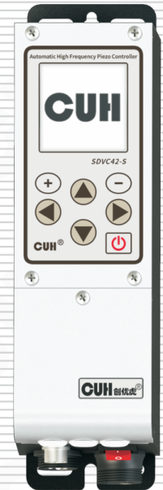

# SDVC42-S
Automatic High Frequency Piezo Controller　SDVC42-S
# User Manual

　　　　　　　　　　　　　　　　　　　　　　

---

## Copyright Statement

Nanjing CUH Science & Technology CO., Ltd. reserves all rights.

All information contained in this user manual is the knowledge of our company and is protected by copyright law and other related laws. CUH enjoys and reserves all rights conferred by copyright law and other laws. Without the written consent of CUH, part or all of this user manual shall not be copied, translated, imitated or otherwise utilized.

## Disclaimer

All contents of this user manual only describe the use method of related products produced by our company, and are described according to the existing technology and the state provided to you when you use it. You must bear the relevant risks when you use this product. Except as required by law, the company does not have any express or implied responsibility for the product due to this user manual, including but not limited to personal injury, property damage, loss of opportunity, etc.

You clearly understand the above risks and agree that, except as mandated by law, the company is not responsible for any direct or indirect damage or loss to you (including but not limited to tangible loss of personnel, property, data, etc. and intangible loss of reputation, opportunity, etc.)

The company reserves the right to modify the products applicable in this user manual without prior or subsequent notice.

---


---

# Preface

Thank you for choosing CUH SDVC42-S Automatic High Frequency Piezo Controller . (The controller for short in the following text). This series of controllers uses high-quality components and incorporates the latest electronic technology, and is carefully designed with high-performance digital signal processors.

This manual introduces the basic operation method, functional technical description and typical application examples of this product. Provide users with relevant information on installation and debugging, parameter setting, abnormal diagnosis, troubleshooting and routine maintenance of the controller. In order to ensure the correct installation and use of this controller, please read this user manual carefully before installation and keep it properly.

Be sure to read the following symbols to alert you to precautions against personal injury and product damage.

| Symbol | Description |
|---|---|
| Danger | Non-observance of this item<br>will result in personal injury or death. |
| Warn | Non-observance of this item<br>may result in personal injury or death. |
| Careful | Non-observance of this item<br>may result in moderate or minor injury to persons. |
| Notice | Non-observance of this item<br>will result in damage to the product and property damage. |
| Essential | Indicates precautions and usage restrictions that must be<br>observed during use. |

**This manual is suitable for the following models of controllers:**

◆ Automatic High Frequency Piezo Controller　　SDVC42-S (150mA)

---


---

# Safety and Precautions

1. **[Danger]** This product is only used to drive piezo-electric vibratory feeding equipment, do not use this product for the purpose of protecting the human body or parts of the human body, etc.

2. **[Danger]** This product is not intended to be used as an explosion-proof product, do not use it in hazardous locations and/or potentially explosive gas environment.

3. **[Warn]** This product is powered by AC mains, please do not apply AC voltage exceeding 250Vac. Excessive input voltage, such as 300Vac, may cause the product to explode or catch fire, resulting in serious safety accidents.

4. **[Warn]** This product is grounded through the power cord. Please ensure that the power distribution facilities for the controller are well grounded, otherwise the controller shell may be charged, resulting in an electric shock accident.

5. **[Warn]** Do not input AC power to the output of this controller, it will damage the controller.

6. **[Warn]** Do not plug and unplug the wiring with points or touch the contact of each wiring terminal in the wiring compartment to prevent electric shock.

7. **[Notice]** Please avoid controlling the output of this product by cutting off the power supply through relays and other devices, which will seriously reduce the life of the controller.

8. **[Notice]** The controller is designed to work in a cool and dry environment. Never run the controller outside to avoid soaking and insolation. Operate the controller within the temperature specified electrical characteristic.

9. **[Essential]** Be sure to fix this product on a solid platform that is reliably grounded and away from vibrating equipment.

10. **[Essential]** Never operate the controller under the condition that beyond its designed limits.

11. **[Essential]** Operate the controller in accordance with this instruction book strictly. we will not assume any civil or criminal liability if the equipment damage or personal injury is caused by incorrect operation.

12. **[Essential]** Never open the controller shell to avoid electric shock. Contact CUH if the controller break down. Never try to repair the controller yourself which may caused void warranty.

---


---

# Operating and Storage Environment

## Inspection Before Using

Every controller will go through rigorous quality inspection before delivery  
and is packed with crash-proof packaging, Please check the following items  
after unpacking:

1. Whether the controller is damaged during transportation.
2. Whether the model of the controller is that you ordered.

## Runtime Environment

Please follow the notes below to ensure the better performance and longer  
lifetime of the controller:

- ❗ Well-ventilated environment
- ❗ Keep away from water, stream, dust and especially oily dust
- ❗ Keep away from the corrosive or flammable gas and liquid
- ❗ Keep away from floating dust and metal particles
- ❗ Firmly fixed to avoid self vibration
- ❗ Keep away from electromagnetic interference
- ❗ Ensure ambient temperature is 0~40 ℃
- ❗ For use at altitude 2000m or lower

---


---

# Contents

**Chapter Ⅰ Instructions Before Use** --------------------------------------------------1

&nbsp;&nbsp;&nbsp;&nbsp;1.1 Check Package Contents --------------------------------------------------------------1

&nbsp;&nbsp;&nbsp;&nbsp;1.2 Manufacturer Nameplate Illustrate --------------------------------------------------2

&nbsp;&nbsp;&nbsp;&nbsp;1.3 Controller Usage Conditions --------------------------------------------------------2

&nbsp;&nbsp;&nbsp;&nbsp;1.4 Remarks -----------------------------------------------------------------------------3

**Chapter Ⅱ Product Introduction** ----------------------------------------------------4

&nbsp;&nbsp;&nbsp;&nbsp;2.1 Product Introduction ----------------------------------------------------------------4

&nbsp;&nbsp;&nbsp;&nbsp;2.2 Keypad and I/O Ports ----------------------------------------------------------------5

&nbsp;&nbsp;&nbsp;&nbsp;2.3 Vibration Sensor Installation Guide ------------------------------------------------6

&nbsp;&nbsp;&nbsp;&nbsp;2.4 Homepage Parameter Description ----------------------------------------------------7

&nbsp;&nbsp;&nbsp;&nbsp;2.5 Signal Control Ports Definition ----------------------------------------------------7

&nbsp;&nbsp;&nbsp;&nbsp;2.6 Keypad Operation --------------------------------------------------------------------8

&nbsp;&nbsp;&nbsp;&nbsp;2.7 Operation Interface Rotation Diagram ----------------------------------------------8

**Chapter Ⅲ Power Wiring and Basic Operation** --------------------------------------9

&nbsp;&nbsp;&nbsp;&nbsp;3.1 Power Wiring -------------------------------------------------------------------------9

&nbsp;&nbsp;&nbsp;&nbsp;3.2 Basic Operation ---------------------------------------------------------------------11

**Chapter Ⅳ Detailed Function Introduction** ---------------------------------------13

&nbsp;&nbsp;&nbsp;&nbsp;4.1 Common Parameter Settings ---------------------------------------------------------14

&nbsp;&nbsp;&nbsp;&nbsp;&nbsp;&nbsp;&nbsp;&nbsp;4.1.1 Voltage -----------------------------------------------------------------------14

&nbsp;&nbsp;&nbsp;&nbsp;&nbsp;&nbsp;&nbsp;&nbsp;4.1.2 Frequency ---------------------------------------------------------------------14

&nbsp;&nbsp;&nbsp;&nbsp;&nbsp;&nbsp;&nbsp;&nbsp;4.1.3 Feeding Speed -----------------------------------------------------------------15

&nbsp;&nbsp;&nbsp;&nbsp;&nbsp;&nbsp;&nbsp;&nbsp;4.1.4 Soft Start Time/Soft Stop Time -----------------------------------------------15

&nbsp;&nbsp;&nbsp;&nbsp;&nbsp;&nbsp;&nbsp;&nbsp;4.1.5 Maximum Voltage/Maximum Current --------------------------------------------15

&nbsp;&nbsp;&nbsp;&nbsp;&nbsp;&nbsp;&nbsp;&nbsp;4.1.6 Maximum Output Frequency/Minimum Output Frequency --------------------------15

&nbsp;&nbsp;&nbsp;&nbsp;&nbsp;&nbsp;&nbsp;&nbsp;4.1.7 Load Detection ----------------------------------------------------------------16

&nbsp;&nbsp;&nbsp;&nbsp;&nbsp;&nbsp;&nbsp;&nbsp;4.1.8 Shortage Alarm ----------------------------------------------------------------16

&nbsp;&nbsp;&nbsp;&nbsp;&nbsp;&nbsp;&nbsp;&nbsp;4.1.9 Shutdown Alarm ---------------------------------------------------------------16

&nbsp;&nbsp;&nbsp;&nbsp;&nbsp;&nbsp;&nbsp;&nbsp;4.1.10 Backlight Brightness --------------------------------------------------------16

&nbsp;&nbsp;&nbsp;&nbsp;&nbsp;&nbsp;&nbsp;&nbsp;4.1.11 Backlight Off ----------------------------------------------------------------17

&nbsp;&nbsp;&nbsp;&nbsp;&nbsp;&nbsp;&nbsp;&nbsp;4.1.12 Language ---------------------------------------------------------------------17

&nbsp;&nbsp;&nbsp;&nbsp;4.2 Automatic Resonant Frequency Search ----------------------------------------------17

&nbsp;&nbsp;&nbsp;&nbsp;&nbsp;&nbsp;&nbsp;&nbsp;4.2.1 Frequency Search Interface --------------------------------------------------17

---


---

4.3 Constant Feed Speed ----------------------------------------------------------------18

&nbsp;&nbsp;&nbsp;&nbsp;4.3.1 Central Frequency -----------------------------------------------------------18

&nbsp;&nbsp;&nbsp;&nbsp;4.3.2 Frequency Offset ------------------------------------------------------------18

&nbsp;&nbsp;&nbsp;&nbsp;4.3.3 Frequency Integration -------------------------------------------------------18

&nbsp;&nbsp;&nbsp;&nbsp;4.3.4 Amplitude Integration -------------------------------------------------------19

&nbsp;&nbsp;&nbsp;&nbsp;4.3.5 Amplitude Ratio -------------------------------------------------------------19

&nbsp;&nbsp;&nbsp;&nbsp;4.3.6 Auto Phase ------------------------------------------------------------------19

&nbsp;&nbsp;&nbsp;&nbsp;4.3.7 Frequency Searching Process Current ----------------------------------------19

&nbsp;&nbsp;&nbsp;&nbsp;4.3.8 Frequency Searching Process Amplitude --------------------------------------19

&nbsp;&nbsp;&nbsp;&nbsp;4.3.9 Maximum Feed Speed ----------------------------------------------------------19

&nbsp;&nbsp;&nbsp;&nbsp;4.3.10 Slave Controller Phase Offset ---------------------------------------------19

&nbsp;&nbsp;&nbsp;&nbsp;4.3.11 Output Voltage Control Mode -----------------------------------------------20

&nbsp;&nbsp;&nbsp;&nbsp;4.3.12 Output Frequency Control Mode ---------------------------------------------20

&nbsp;&nbsp;&nbsp;&nbsp;4.3.13 Sync Source ----------------------------------------------------------------20

&nbsp;&nbsp;&nbsp;&nbsp;4.3.14 Vibration Sensor Type ------------------------------------------------------20

&nbsp;&nbsp;&nbsp;&nbsp;4.3.15 Auto Resonant Frequency Search Speed --------------------------------------20

4.4 Output Parameters ------------------------------------------------------------------21

&nbsp;&nbsp;&nbsp;&nbsp;4.4.1 Main Output Parameters ------------------------------------------------------21

&nbsp;&nbsp;&nbsp;&nbsp;4.4.2 DC Control Output Parameters ------------------------------------------------28

4.5 Signal Control ---------------------------------------------------------------------30

&nbsp;&nbsp;&nbsp;&nbsp;4.5.1 Sensor Type -----------------------------------------------------------------30

&nbsp;&nbsp;&nbsp;&nbsp;4.5.2 C Port/E Port Logic ---------------------------------------------------------31

&nbsp;&nbsp;&nbsp;&nbsp;4.5.3 C Port On/Off Delay and E Port On/Off Delay --------------------------------31

&nbsp;&nbsp;&nbsp;&nbsp;4.5.4 Speed A Logic/Speed B Logic -------------------------------------------------32

&nbsp;&nbsp;&nbsp;&nbsp;4.5.5 Speed A On/Off Delay and Speed B On/Off Delay ------------------------------32

4.6 Material Quantity Counting ---------------------------------------------------------33

&nbsp;&nbsp;&nbsp;&nbsp;4.6.1 Material Quantity Counting (or Speed A/B) ----------------------------------33

&nbsp;&nbsp;&nbsp;&nbsp;4.6.2 Target Quantity -------------------------------------------------------------34

&nbsp;&nbsp;&nbsp;&nbsp;4.6.3 Terminal Speed --------------------------------------------------------------34

&nbsp;&nbsp;&nbsp;&nbsp;4.6.4 Terminal Speed Quantity -----------------------------------------------------35

&nbsp;&nbsp;&nbsp;&nbsp;4.6.5 Reset Counting Value to 0 ---------------------------------------------------35

&nbsp;&nbsp;&nbsp;&nbsp;4.6.6 RS Priority -----------------------------------------------------------------35

---


---

4.7 Save Settings ---------------------------------------------------------------- 36

&nbsp;&nbsp;&nbsp;&nbsp;4.7.1 Callback Settings ------------------------------------------------------ 36

&nbsp;&nbsp;&nbsp;&nbsp;4.7.2 Save Settings ---------------------------------------------------------- 36

&nbsp;&nbsp;&nbsp;&nbsp;4.7.3 Restore Factory -------------------------------------------------------- 37

&nbsp;&nbsp;&nbsp;&nbsp;4.7.4 Copy Settings ---------------------------------------------------------- 37

&nbsp;&nbsp;&nbsp;&nbsp;4.7.5 User Password ---------------------------------------------------------- 37

&nbsp;&nbsp;&nbsp;&nbsp;4.7.6 Enter Password --------------------------------------------------------- 37

4.8 RS485 Communication ---------------------------------------------------------- 38

&nbsp;&nbsp;&nbsp;&nbsp;4.8.1 Communication Type ---------------------------------------------------- 38

&nbsp;&nbsp;&nbsp;&nbsp;4.8.2 Baud Rate -------------------------------------------------------------- 39

&nbsp;&nbsp;&nbsp;&nbsp;4.8.3 Slave Controller Address ---------------------------------------------- 39

&nbsp;&nbsp;&nbsp;&nbsp;4.8.4 Port Resistance/Synchronous Resistance -------------------------------- 39

4.9 CUHBus-DS® Networking -------------------------------------------------------- 40

&nbsp;&nbsp;&nbsp;&nbsp;4.9.1 Device Networking ----------------------------------------------------- 41

&nbsp;&nbsp;&nbsp;&nbsp;4.9.2 Sync Function ---------------------------------------------------------- 45

&nbsp;&nbsp;&nbsp;&nbsp;4.9.3 Signal Sharing --------------------------------------------------------- 51

&nbsp;&nbsp;&nbsp;&nbsp;4.9.4 Data Backup ------------------------------------------------------------ 53

&nbsp;&nbsp;&nbsp;&nbsp;4.9.5 Remote Control Data --------------------------------------------------- 54

4.10 Controller Status Monitoring ------------------------------------------------ 54

4.11 Error Log ------------------------------------------------------------------- 55

4.12 Customize Homepage ---------------------------------------------------------- 55

## Chapter Ⅴ Typical Applications ---------------------------------------------- 56

5.1 How to keep two vibratory feeders running at the same frequency? ------------ 56

5.2 How to turn on/off controller B via a sensor connected to controller A? ------ 57

5.3 How to turn on/off two controllers simultaneously? --------------------------- 58

## Chapter Ⅵ Frequently Asked Questions ---------------------------------------- 59

6.1 No display upon power on ----------------------------------------------------- 59

6.2 No vibration, no noise, normal controller display ---------------------------- 59

6.3 Control signal does not work ------------------------------------------------- 59

6.4 No vibration, normal noise, controller display is normal --------------------- 59

6.5 Unstable resonant frequency tracking ---------------------------------------- 59

6.6 Slow speed correction in constant feed speed control ------------------------- 60

---


---

6.7 How to quickly reset the controller to factory default ---------------------------60

**Chapter Ⅶ Appendix** ----------------------------------------------------------------61

7.1 Dimensions -----------------------------------------------------------------------------61

7.2 Technical Specifications -------------------------------------------------------------62

7.3 Reference Standard -------------------------------------------------------------------63

7.4 Parameter List -------------------------------------------------------------------------64

&nbsp;&nbsp;&nbsp;&nbsp;7.4.1 Interface Parameter Group -----------------------------------------------64

&nbsp;&nbsp;&nbsp;&nbsp;7.4.2 Common Parameter Group ------------------------------------------------65

&nbsp;&nbsp;&nbsp;&nbsp;7.4.3 Main Output Parameter Group -------------------------------------------66

&nbsp;&nbsp;&nbsp;&nbsp;7.4.4 Steady Speed Parameter Group -----------------------------------------67

&nbsp;&nbsp;&nbsp;&nbsp;7.4.5 Signal Input Parameter Group -------------------------------------------68

&nbsp;&nbsp;&nbsp;&nbsp;7.4.6 Control Output Parameter Group ---------------------------------------69

&nbsp;&nbsp;&nbsp;&nbsp;7.4.7 DC Counting Parameter Group ------------------------------------------70

&nbsp;&nbsp;&nbsp;&nbsp;7.4.8 Communication Parameter Group --------------------------------------71

&nbsp;&nbsp;&nbsp;&nbsp;7.4.9 Save Settings Group ------------------------------------------------------72

&nbsp;&nbsp;&nbsp;&nbsp;7.4.10 Monitoring Parameter Group -------------------------------------------73

&nbsp;&nbsp;&nbsp;&nbsp;7.4.11 Attached List -------------------------------------------------------------75

7.5 Input and Output Circuit Diagrams ------------------------------------------------76

7.6 Error Code ------------------------------------------------------------------------------78

7.7 Warning Code --------------------------------------------------------------------------79

**Chapter Ⅷ Product Warranty Information** ----------------------------------------80

7.1 Warranty Period -----------------------------------------------------------------------80

8.2 Warranty Coverage -------------------------------------------------------------------80

8.3 Product Suitability -------------------------------------------------------------------80

---


# Chapter Ⅰ Instructions Before Use

This chapter introduces the product packaging contents, controller appearance description, and controller nameplate information.

## 1.1 Check Package Contents

Before using, please check the integrity of the controller and accessories. If you find that the product is defective or damaged, missing accessories, etc., please contact our company.

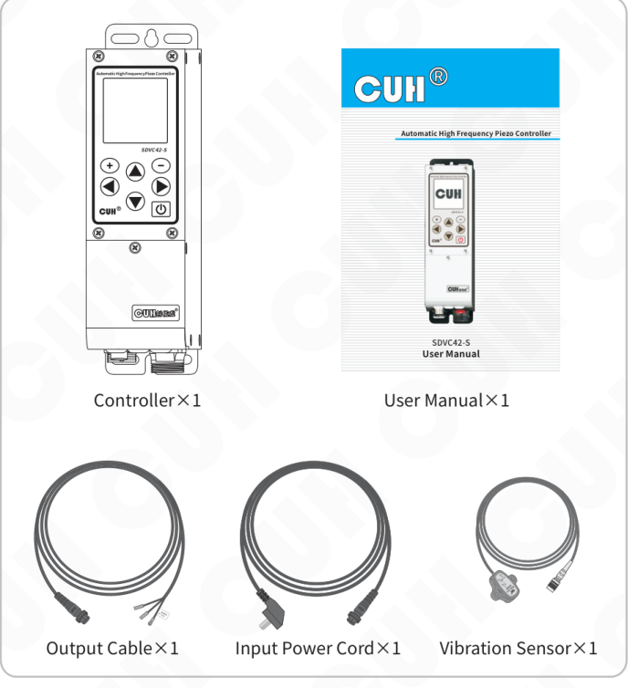

Package contents shown:

| Item | Quantity |
|---|---:|
| Controller | ×1 |
| User Manual | ×1 |
| Output Cable | ×1 |
| Input Power Cord | ×1 |
| Vibration Sensor | ×1 |

---


---

## 1.2 Manufacturer Nameplate Illustrate

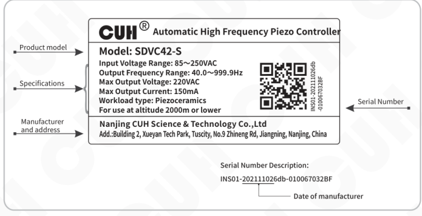

Nameplate information shown in the illustration:

- **Product model:** SDVC42-S
- **Specifications:**
  - Input Voltage Range: 85~250VAC
  - Output Frequency Range: 40.0~999.9Hz
  - Max Output Voltage: 220VAC
  - Max Output Current: 150mA
  - Workload type: Piezoceramics
  - For use at altitude 2000m or lower
- **Manufacturer and address:**
  - Nanjing CUH Science & Technology Co.,Ltd
  - Add.: Building 2, Xueyan Tech Park, Tuscity, No.9 Zhineng Rd, Jiangning, Nanjing, China
- **Serial Number Description:** INS01-202111026db-010067032BF

## 1.3 Controller Usage Conditions

The controller is powered by AC 85V~250V and is connected to a protective ground through the plug of the power cord. Please use a standard mains power supply and ensure that the protective ground wire is correctly connected.

> ⚠️ **Warn**  Never connect the controller to 380V AC power, this will cause irreversible serious damage to the controller, possibly resulting in explosion, fire and other safety incidents.

> ⚠️ **Warn**  Ensure that the power supply side is reliably grounded. The metal casing of the controller is directly connected to the protective grounding wire. Poor grounding will cause the controller casing to be electrified and cause an electric shock accident.

> **Notice**  Long time running will generate heat and cause the temperature of the casing to rise. Please install the controller in a well-ventilated environment and fix it well, away from vibration sources.

> **Notice**  This product is a controller used to drive the piezoelectric vibratory feeder.

---


---

## 1.4 Remarks

◆ The use manual is approximately 28000 words long and is expected to take you one hour to read through.

◆ Please read this manual carefully before use to prevent damage to the controller due to improper operation.

◆ Users can quickly locate the relevant functions and operation methods of the controller according to the manual directory.

◆ The subheadings of chapters and the emphasized text in the text are the actual display parameter items of the controller, such as voltage.

◆ Users can refer to "Chapter Ⅴ Typical Applications" to quickly get started with this controller.

◆ Users can quickly search for function tag codes in the section "7.4 Parameter List".

◆ Pressing ⊕ and ⊖ simultaneously indicates confirmation.

◆

---


# Chapter Ⅱ Product Introduction

The main content of this chapter includes a brief introduction and main features of this product.

## 2.1 Product Introduction

SDVC42-S series Automatic High Frequency Piezo Controller is a product specially designed for high-end feeding systems.

Unique performance is provided by using the latest electronic technology and signal processing methods. Its special features include:

- Available via CUHBus-DS® Communication realizes synchronization, backup, and recovery of remote control voltage, frequency, phase, and other parameters for each controller.
- Signals from other controller ports can be used for logic control via CUHBus-DS® communication.
- The material shortage alarm function can be realized without installing additional sensors.
- Sound cues for selectable notes can be emitted via the vibratory feeder.
- Extend the output frequency to 40.0Hz~999.9Hz.
- The analog speed control port supports 0~5V, 1~5V, 0~10V, 4~20mA and other modes.
- Equipped with counting function, including counting deceleration and counting stop.
- The improved constant amplitude frequency search ensures that two vibratory feeders with a small gap will not collide during the frequency search process.
- Supports RS485 Modbus ASCII and RS485 Modbus RTU protocols.
- Software upgrade can be performed through the RS485 interface.
- It adopts 128 * 128 resolution LCD display and supports three languages: Chinese, English, and German.
- Detect load current characteristics to help users diagnose faults.
- The fault code can store the latest 64 fault logs.


## 2.2 Keypad and I/O Ports

### Window and Buttons Explanation

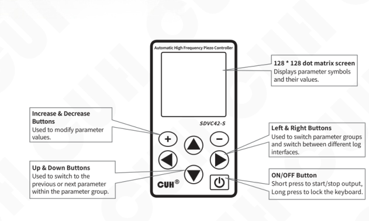

| Component | Explanation |
|---|---|
| Increase & Decrease Buttons | Used to modify parameter values. |
| Up & Down Buttons | Used to switch to the previous or next parameter within the parameter group. |
| Left & Right Buttons | Used to switch parameter groups and switch between different log interfaces. |
| 128 * 128 dot matrix screen | Displays parameter symbols and their values. |
| ON/OFF Button | Short press to start/stop output, Long press to lock the keyboard. |

### External Parts Explanation

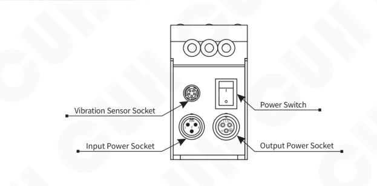

| External Part | Label in Diagram |
|---|---|
| Vibration Sensor Socket | Vibration Sensor Socket |
| Input Power Socket | Input Power Socket |
| Power Switch | Power Switch |
| Output Power Socket | Output Power Socket |


## 2.3 Vibration Sensor Installation Guide

Fix Vibration Sensor to the smooth surface of vibrator and Installation direction arbitrary, and installation methods of Vibration Sensor are shown as below:

- **Method 1:** As shown in Fig. 2.3.1  
  Advantage: Easy installation

  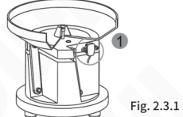

- **Method 2:** As shown in Fig. 2.3.2  
  Note: Don't make the vibration sensor pressed by feeding bowl.

  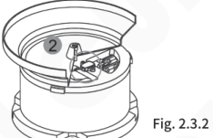

- **Method 3:** weld a bracket on the vibrator and fix the vibration sensor on the bracket. As shown in Fig. 2.3.3  
  Recommended Dimensions of bracket of Vibration is shown in Fig.2.3.4.

  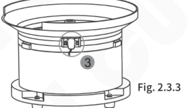

  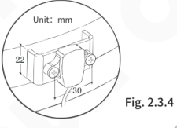

- **Not recommend installation method,** As shown in Fig. 2.3.5 and Fig. 2.3.6.  
  If the installation location is not suitable, the vibration sensor can't feedback the resonant frequency accurately and the controller will execute searching the resonant frequency all along.

  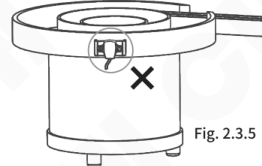

  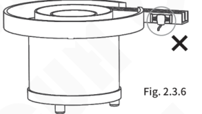


## 2.4 Homepage Parameter Description

The controller can display the main output status, keyboard lock status, port status, monitoring parameters, and interface name on the homepage. Within the port status: Highlighting **X** indicates that the port is valid. **X** indicates that the port is valid at low level, and **X** indicates that the port is valid at high level.

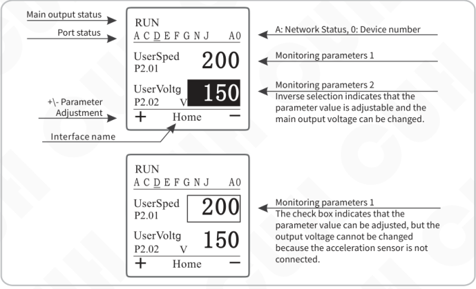

| Homepage item | Example shown | Description |
|---|---|---|
| Main output status | `RUN` | Shows the current main output status. |
| Port status | `A C D E F G N J    A0` | Shows port states. `A`: Network Status; `0`: Device number. |
| Monitoring parameters 1 | `UserSped` / `P2.01` / `200` | Monitoring parameter value displayed on the homepage. |
| Monitoring parameters 2 | `UserVoltg` / `P2.02` / `150` | Inverse selection indicates that the parameter value is adjustable and the main output voltage can be changed. |
| Monitoring parameters 1 | `UserSped` / `P2.01` / `200` in a check box | The check box indicates that the parameter value can be adjusted, but the output voltage cannot be changed because the acceleration sensor is not connected. |
| +/- Parameter Adjustment | `+` / `-` | Parameter adjustment controls. |
| Interface name | `Home` | Current interface name. |

## 2.5 Signal Control Ports Definition

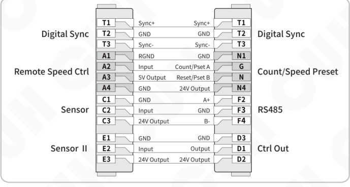

| Left function | Left terminal | Left definition | Right definition | Right terminal | Right function |
|---|---:|---|---|---:|---|
| Digital Sync | T1 | Sync+ | Sync+ | T1 | Digital Sync |
| Digital Sync | T2 | GND | GND | T2 | Digital Sync |
| Digital Sync | T3 | Sync- | Sync- | T3 | Digital Sync |
| Remote Speed Ctrl | A1 | RGND | GND | N1 | Count/Speed Preset |
| Remote Speed Ctrl | A2 | Input | Count/Pset A | G | Count/Speed Preset |
| Remote Speed Ctrl | A3 | 5V Output | Reset/Pset B | N | Count/Speed Preset |
| Remote Speed Ctrl | A4 | GND | 24V Output | N4 | Count/Speed Preset |
| Sensor | C1 | GND | A+ | F2 | RS485 |
| Sensor | C2 | Input | GND | F3 | RS485 |
| Sensor | C3 | 24V Output | B- | F4 | RS485 |
| Sensor Ⅱ | E1 | GND | GND | D3 | Ctrl Out |
| Sensor Ⅱ | E2 | Input | Output | D1 | Ctrl Out |
| Sensor Ⅱ | E3 | 24V Output | 24V Output | D2 | Ctrl Out |


## 2.6 Keypad Operation

 a. This controller uses a 128 * 128 dot matrix screen to display parameter content.

 b. According to the time of pressing the button, the button actions are divided into short press, long press, first level acceleration, and second level acceleration.

 [Short press]: Press for more than 0.1 seconds but less than 0.5 seconds.

 [Long press]: Press for more than 2 seconds.

 [Level 1 acceleration]: Press for more than 0.5 seconds but less than 2 seconds.

 [Level 2 acceleration]: Press for more than 2 seconds.

 c. <kbd>⊕</kbd> and <kbd>⊖</kbd> its main function is to modify parameter values.

 d. Switch between the upper and lower parameter groups in the parameter settings interface by short pressing ◀ or ▶.

 e. Switch between the upper and lower parameters of this group in the parameter setting interface by short pressing ▲ or ▼.

 f. Short press <kbd>⏻</kbd> to start/stop main output, long press <kbd>⏻</kbd> to lock/unlock keyboard.

 g. Enter different parameter groups through the following combination of buttons:

 Long press ▲+▼, Enter or exit the frequency search interface.

 Long press ▲+◀, Enter or exit the parameter setting interface.

 Long press ▲+▶, Enter or exit the log interface.

## 2.7 Operation Interface Rotation Diagram

Under any interface, Long press <kbd>▲+▶</kbd> enter **Log Interface**, long press again to exit to **Main interface**

Under any interface, Long press <kbd>▲+▼</kbd> enter **Frequency Search Interface**, short press the stop button to exit to **Main interface**

Under any interface, Long press <kbd>▲+◀</kbd> enter **Parameter Setting Interface**, long press again to exit to **Main interface**

Under any interface, there is no action for more than 5 minutes, enter **Standby Interface** and press any key again to **Main interface**


# Chapter Ⅲ Power Wiring and Basic Operation

## 3.1 Power Wiring

**Step One:**

Open the packing box and check the controller and all accessories.

**Step Two:**

Connect the wiring terminals of the Output Power Cable to the electrodes of the piezo vibrator.

Align the notch on the aviation plug of the output cable with the triangle mark on the output socket of the controller, and then tighten the nut after connecting the output cable correctly.

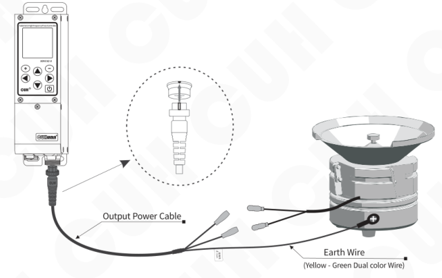

**Note**

Make sure the electrodes of the piezo vibrator are connected to the two output pins of the Output Power Cable, and the vibrator's metal shell is reliably grounding.


---

### Step Three:

Connect the Connector of the Input Power Cable  
to the Input Power Socket of the controller.

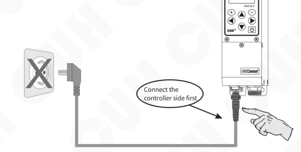

### Step Four:

After confirming that the switch is in the off position, connect the plug of the  
Input Power Cable to the mains jack.

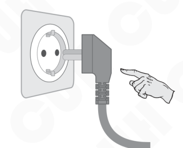

---


## 3.2 Basic Operation

### Step Five:

Turn on the power switch of the controller, the controller displays the main interface.

```text
RUN
A C D E F G N J      A0
──────────────────────
UserSped            200
P2.01

EffectCu              0
P10.05      A
+        Home        −
```

### Step Six:

The vibratory feeder starts to work. Adjust the frequency and voltage parameter values in the "2 Common" parameter group to select the appropriate feeding speed.

» Long press ▲ and ◀ enter the parameter setting interface, short press ▶ switch to "2 Common" parameter group.

» Short press ▲ or ▼ to place the cursor on the voltage parameter value.

» Press ⊕ or ⊖ to adjust the parameter value.

» Short press ▲ or ▼ to place the cursor on the frequency parameter value.

» Press ⊕ or ⊖ adjust parameter value.

```text
RUN
A C D E F G N J      A0
──────────────────────
01.UserSped       200
02.UsrVoltg       150 V
03.UsrFrqnc      50.0 Hz
04.SoftStar       0.5 S
05.SoftStop       0.5 S
+       2Common     −
```

☺

- The frequency at which the vibration reaches its maximum is the natural frequency of the vibrating body.
- Each vibratory has its natural mechanical resonance frequency, adjust the output frequency of the controller to this frequency to achieve the best working state.


---

### Step Seven:

Customers can further access the acceleration sensor to realize automatic frequency search of the controller. (Note: The user does not need to empty the materials in the vibration plate)

Take out the sensor, connect the sensor plug to the controller and tighten the nut, and correctly fix the sensor body on the vibration plate (see Chapter 2.3)

### Step Eight:

» Long press ▲ and ▼ enter frequency search interface.

» At this time, the display screen displays the amplitude curve of the vibration plate in the frequency search process (three stages), and synchronously displays the output voltage, current, and acceleration values at this time.

» After the frequency search is completed, the controller displays "Save" to indicate that the frequency search is successful and the center frequency is saved. The controller will automatically return to the homepage.

» Users can further adjust the feeding speed of the vibratory feeder through ⊕ or ⊖.

| Frequency search display examples | |
|---|---|
| 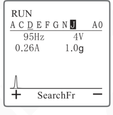 | 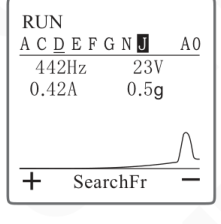 |
| 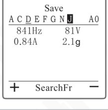 | 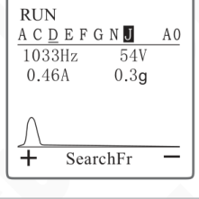 |

---


# Chapter IV Detailed Function Introduction

This chapter introduces detailed functions and settings of the controller.  
Long press ▲ and ◀ to enter the parameter setting interface on any interface.  
The parameter setting interface includes the following ten parameter groups.  
By short pressing ◀ or ▶ switching between different parameter groups.

```text
                         ┌──────────────┐
                         │ 1EditHome    │
                         └──────────────┘
                                ↕
                         ┌──────────────┐
                         │ 2Common      │
                         └──────────────┘
                                ↕
                         ┌──────────────┐
                         │ 3M_output    │
                         └──────────────┘
                                ↕
                         ┌──────────────┐
                         │ 4Stabilize   │
                         └──────────────┘
                                ↕
Short press ▶     ↓     ┌──────────────┐      ↑     Short press ▶
                         │ 5On&Off      │
                         └──────────────┘
                                ↕
                         ┌──────────────┐
                         │ 6DCoutput    │
                         └──────────────┘
                                ↕
                         ┌──────────────┐
                         │ 7Counter     │
                         └──────────────┘
                                ↕
                         ┌──────────────┐
                         │ 8Comm        │
                         └──────────────┘
                                ↕
                         ┌──────────────┐
                         │ 9Save        │
                         └──────────────┘
                                ↕
                         ┌──────────────┐
                         │ 10Monitor    │
                         └──────────────┘
```

Parameter Group Rotation Diagram

---


---

## 4.1 Common Parameter Settings

This chapter mainly introduces the setting and adjustment of the basic common parameters of the controller.

### 4.1.1 Voltage

This controller can directly set the output voltage digitally on the panel. Since the controller has a voltage-stabilizing output function, this value is the voltage rectification average value and will not be affected by the input voltage. The output voltage can be kept stable even in situations where the grid voltage is unstable. At the same time, direct voltage value setting also provides accurate data for users to understand the operation of the equipment.

> » Enter the common parameter group and find the voltage Setting parameters.  
> » Press `+` or `−` to adjust the parameter value。  
>
> The Voltage range is 0~220V, the default is 150V the adjustment accuracy is 1V.
>
> ```text
> RUN
> A C D E F G N J    A0
> 01.UserSped       200
> 02.UsrVoltg       150 V
> 03.UsrFrqnc       50.0 Hz
> 04.SoftStar       0.5 S
> 05.SoftStop       0.5 S
> +     2Common     −
> ```

### 4.1.2 Frequency

The controller uses direct digital frequency synthesis technology (DDS), which has very high frequency accuracy and stability, and does not change with time and temperature.

> » Enter the common parameter group and find the frequency Setting parameters.  
> » Press `+` or `−` to adjust the parameter value。  
>
> The Frequency range 40.0~999.9Hz, the default is 50.0Hz, the adjustment accuracy is 0.1Hz.
>
> ```text
> RUN
> A C D E F G N J    A0
> 01.UserSped       200
> 02.UsrVoltg       150 V
> 03.UsrFrqnc       50.0 Hz
> 04.SoftStar       0.5 S
> 05.SoftStop       0.5 S
> +     2Common     −
> ```

The other parameters of this parameter group can be adjusted according to the above steps.

---


---

### 4.1.3 Feeding Speed

**Feeding Speed:** The advancing speed of materials in the vibratory feeder. When the controller is connected to the acceleration sensor and the "voltage mode" parameter value is "automatic", the material forward speed can be adjusted through the feeding speed parameter, and the vibration plate can work stably at the set feeding speed.

The feeding speed range is 0~3200, the default is 200 and the adjustment accuracy is 1.

### 4.1.4 Soft Start Time/Soft Stop Time

**Soft Start Time:** The time required for the controller to smoothly increase the output voltage from 0V to the set output voltage when starting from a stopped state.

The soft start time range is 0.0~40.0s, the default is 0.5 seconds and the adjustment accuracy is 0.1 seconds.

**Soft Stop Time:** When the controller stops running, the output voltage smoothly drops from the set output voltage to reach the time required for 0V.

The soft stop time range is 0.0~40.0s, the default is 0.5 seconds and the adjustment accuracy is 0.1 seconds.

When this controller starts or stops, the output voltage can be increased or decreased gently to prevent vibration equipment from being damaged by impact.

### 4.1.5 Maximum Voltage/Maximum Current

**Maximum Voltage:** The controller outputs the maximum voltage value.

The maximum voltage range is 0~220V, the default is 220V and the adjustment accuracy is 1V.

**Maximum Current:** The controller outputs the maximum current value.

The maximum current range is 0~150mA, the default is 150mA and the adjustment accuracy is 1mA.

This controller can set maximum output voltage and maximum output current limit values, which can prevent users from damaging the vibration equipment by accidentally outputting excessive voltage or current.

### 4.1.6 Maximum Output Frequency/Minimum Output Frequency

**Maximum Output Frequency:** Limit the upper limit value of the "frequency" parameter. The upper frequency limit during frequency search is also limited by this parameter value.

The maximum output frequency range is 40.0~999.9Hz, the default is 999.9Hz and the adjustment accuracy is 0.1Hz.

**Minimum Output Frequency:** Limit the lower limit value of the "frequency" parameter. The lower limit of frequency during frequency search is also limited by this parameter value.

The minimum output frequency range is 40.0~999.9Hz, the default is 40.0Hz and the adjustment accuracy is 0.1Hz.

**Note:** The difference between the maximum output frequency and the minimum output frequency is not less than 50.0Hz.

---


### 4.1.7 Load Detection

The controller can detect the capacitance, resistance value. After using the load detection function, users can view the measured values related to the load in the monitoring parameter group. None by default.

### 4.1.8 Shortage Alarm

When the controller is connected to an accelerometer and the "voltage mode" and "frequency mode" parameter values are both "automatic", the shortage alarm function will be activated. Users can find the "Material Shortage Alarm" parameter in the monitoring parameter group when the vibratory feeder is empty or with less material, and at the same time, long press ⊕ and ⊖ record the measured value of the "Material Shortage Alarm" in the monitoring parameter group, and refer to the measured value to set the alarm value of the "Material Shortage Alarm". You can also adjust the alarm value through ⊕ or ⊖ further.

When the controller detects that the measured value of the vibratory feeder is lower than the alarm value, it triggers its alarm function.

The range of material shortage alarm is 0~3000, the default is 0 and the adjustment accuracy is 1.

Note: Users can use alarm signals as the main output or D-port output source signals to drive different output states of the controller.

### 4.1.9 Shutdown Alarm

**Shutdown Alarm:** When the controller stops outputting, the controller emits different alarm sound effects by driving the vibratory feeder, which is used to issue a shutdown warning to user in noisy environments. Optional three sound effects or invalid (no sound). None by default.

| Parameter | Meaning |
|---|---|
| None | Invalid |
| Sound 1 | Drive the vibration plate to emit sound effect 1 alarm sound |
| Sound 2 | Drive the vibration plate to emit sound effect 2 alarm sound |
| Sound 3 | Drive the vibration plate to emit sound effect 3 alarm sound |

### 4.1.10 Backlight Brightness

**Backlight Brightness:** That is, the backlight brightness of the controller display. The display's backlight brightness can be adjusted to suit different ambient lighting conditions.

The backlight brightness range is 20~100, the default is 100 and the adjustment accuracy is 1.


### 4.1.11 Backlight Off

**Backlight Off:** That is the backlight off time. When the controller does not perform any operation for a period of time, the controller will turn off the screen backlight. The screen backlight can be triggered to turn on again by pressing any button.

The backlight extinction range is 1-30min, the default is 5min and the adjustment accuracy is 1min. When set to 31, it means normal bright.

### 4.1.12 Language

**Language:** That is, the language displayed on the controller operation panel. The controller has three built-in languages: Chinese, English and German, making it easy for users in different regions to switch. Default Englis.

| Parameter | Meaning |
|---|---|
| Englis | English interface |
| Chines | Chinese interface |
| German | German interface |

## 4.2 Automatic Resonant Frequency Search

This chapter introduces how to quickly locate the resonant frequency of the vibration plate in the frequency search interface of this product, and realize the operation of the vibration plate.

### 4.2.1 Frequency Search Interface

When the acceleration sensor is correctly connected to the vibration plate, both the "voltage mode" and "frequency mode" are set to "Auto". You can quickly locate the resonant frequency value of the vibratory feeder by entering the frequency search interface.

Refer to the eighth step in Chapter 3.2 for the operation steps.


## 4.3 Constant Feed Speed

This chapter mainly introduces how to set the relevant parameters of the controller and maintain the functions of the controller running smoothly.

### 4.3.1 Center Frequency

The frequency range that the controller can automatically adjust is "center frequency" ± "frequency offset". The center frequency should be adjusted near the resonance point of the vibration equipment, so that the controller can adjust to the best working point as quickly as possible when automatically adjusting the frequency.

- Long press ▲ and ◀ to enter parameter setting interface, short press ▶ to switch to "4 Stabilize" parameter group.
- Short press ▲ or ▼ to switch to the center frequency parameter.
- Press ⊕ or ⊖ to adjust the parameter value。

```text
RUN
A C D E F G N J     A0
01.AutFCent 100.0 Hz
02.AutFRang  30.0 Hz
03.AutFIntg     20
04.AutAIntg    300
05.AutAProp    500
+   4Stabilize   −
```

The center frequency range is 40.0~999.9Hz, with a default of 100.0Hz and an adjustment accuracy of 0.1Hz.

The other parameters of this parameter group can be adjusted according to the above steps.

### 4.3.2 Frequency Offset

The frequency range that the controller can automatically adjust is "center frequency" ± "frequency offset". This is used to define a relatively small automatic frequency search range. The general frequency offset value is 30.0HzJust about. If it is too large, the vibration equipment may work at an inappropriate working point, and if it is too small, it may reduce the adaptability of the vibration equipment.

The frequency offset range is 0.0~180.0Hz, the default is 30.0Hz and the adjustment accuracy is 0.1Hz.

### 4.3.3 Frequency Integration

Controller via PID algorithm to automatically adjust the output frequency. The larger this value is, the faster the controller can adjust the output frequency, but if it is too large, it may cause oscillation of the output frequency.

The frequency integration range is 0-2000, the default is 20 and the adjustment accuracy is 1.

---


---

### 4.3.4 Amplitude Integration

Controller via PID control, automatically adjust the output voltage. The larger this value is, the faster the controller can adjust the output voltage and reduce the oscillation amplitude and frequency of the output voltage. However, if it is too large, the oscillation amplitude of the output voltage will become larger.

The amplitude integration range is 0~9999, the default is 300 and the adjustment accuracy is 1.

### 4.3.5 Amplitude Ratio

Controller via PID control, automatically adjust the output voltage. The larger this value is, the faster the controller can adjust the output voltage, but if it is too large, it will cause frequent oscillations of the output voltage.

The amplitude ratio range is 0~9999, the default is 500 and the adjustment accuracy is 1.

### 4.3.6 Auto Phase

This parameter can modify the phase difference between the output current waveform and the acceleration signal of the acceleration sensor.

The automatic phase range is -180 °~180 °, the default is 0 ° and the adjustment accuracy is 1 °.

### 4.3.7 Frequency Searching Process Voltage

Set the maximum output voltage of the controller during automatic frequency search, so that the actual output voltage of the vibration plate will not exceed the set frequency search voltage.

The search frequency voltage range is 20~220V, the default is 100V and the adjustment accuracy is 1V.

### 4.3.8 Frequency Searching Process Amplitude

The maximum amplitude of the controller will not exceed this value during automatic frequency search to protect the safety of vibration equipment.

The frequency search amplitude range is 0~3200, the default is 200 and the adjustment accuracy is 1.

### 4.3.9 Maximum Feed Speed

Set this parameter to limit the maximum adjustable feeding speed to prevent users from accidentally outputting excessive voltage and damaging the vibration equipment. When using remote speed control, the upper limit of the feeding speed is also affected by this parameter.

The maximum range of material speed is 0-4000, the default is 3200 and the adjustment accuracy is 1.

### 4.3.10 Slave Controller Phase Offset

Manual phase means that the phase of the slave controller output waveform can be manually set to have a fixed phase deviation from the synchronization signal output by the master controller.

The manual phase range -180 °~180 °, the default is 0 °, the adjustment accuracy is 1 °.

---


## 4.3.11 Output Voltage Control Mode

This parameter is used to switch the voltage output mode of the controller to achieve different control forms for the output. Default is Auto.

| Parameter | Meaning |
|---|---|
| Manuel | The output voltage is controlled by the "voltage" parameter value, or by the DC analog input of remote control speed regulation. |
| Auto | When the acceleration sensor is correctly connected to the controller, the controller automatically adjusts the output voltage based on the feedback data from the vibration sensor, ensuring that the feeding speed of the vibration equipment is stable at the "feeding speed" value. |

## 4.3.12 Output Frequency Control Mode

This parameter is used to switch the frequency output mode of the controller. Default is Auto.

| Parameter | Meaning |
|---|---|
| Manuel | The output frequency is controlled by the "frequency" parameter value |
| Auto | When the acceleration sensor is correctly connected to the controller, the controller automatically adjusts the output frequency based on the feedback data from the vibration sensor, so that the vibration frequency is at the optimal working frequency of the vibration equipment |
| SynV | Frequency synchronization, phase synchronization vibration sensor |
| SynE | Frequency synchronization, phase synchronization main output current |

## 4.3.13 Sync Source

When the user selects the frequency mode as manual or automatic, this parameter is used to select the synchronization signal source of the device. None by default.

| Parameter | Meaning |
|---|---|
| None | Out of sync |
| PhaseV | Synchronous vibration sensor phase |
| PhaseE | Synchronous main output current phase |

## 4.3.14 Vibration Sensor Type

The controller supports vibration sensors with different ranges. At the same feeding speed, the output voltage of vibration sensors in different ranges varies for the controller. Users should set this parameter according to the actual vibration sensor model. Default 205.

| Parameter | Corresponding Model | Specification X-axis/Y-axis/Z-axis acceleration |
|---|---|---|
| 20-1 | 16g | 16g/16g/16g |
| 20-2 | 35g | 35g/35g/—— |
| 20-3 | 50g | 50g/50g/—— |
| 20-4 | 70g | 70g/70g/—— |
| 203 | 8g | 8g/8g/8g |
| 204 | 16g | 16g/16g/16g |
| 205 | 32g | 32g/32g/32g |
| 206 | 64g | 64g/64g/64g |

## 4.3.15 Auto Resonant Frequency Search Speed

The controller supports 6 frequency search speeds, ranging from slow to fast, ranging from 0 to 5. The default search speed is 3.


## 4.4 Output Parameters

This chapter is used to introduce the setting and use of the main output parameters and control output parameters of the controller to achieve the ideal output function of the controller.

### 4.4.1 Main Output Parameters

This summary mainly introduces the main output parameter settings of the controller.

- Long press ▲ and ◀ to enter parameter setting interface, short press ▶ to switch to "3 M_output" parameter group.
- Short press ▲ or ▼ to switch parameters in the main output parameter group.
- Press ⊕ or ⊖ to adjust the parameter value。

```text
RUN
A C D E F G N J     A0
01.MainLogc        On
02.MainSor1        In_PtC
03.MainSor1        In_PtE
04.MainUpDy        0.2 S
05.MainDnDy        0.2 S
+   3M_output      -
```

The other parameters of this parameter group can be adjusted according to the above steps.

### 4.4.1.1 Main Source 1/Main Source 2

"Main source 1" and "Main source 2" refer to the "Main logic source 1 signal" and "Main logic source 2 signal", you can set the main output logic source signal through these two parameters. Main source 1 and main source 2 letters. The signal first passes through the port signal type judgment, then through the logic direction judgment, and finally after going through the on delay and off delay, it becomes the main output logic source 1/2result signal.


The signal flow diagram is as follows:

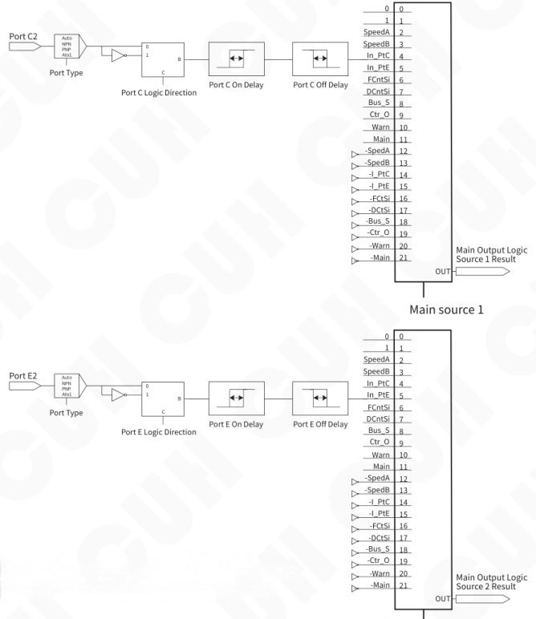

For the signal source options of main source ½,  
please refer to the chapter 7.4.11 Appendix.

**Figure 4.4.1.1**

Note: The main output state is also controlled by whether the start stop button or whether the controller itself is in a fault state. The fault control level of the start-stop button or the controller itself is higher than the main output logic signal. That is: when the start-stop button is set to stop, the controller will immediately enter the stop state; when a fault such as short circuit, over-temperature, over-current, etc. occurs, the controller will also immediately enter the stop state. At this time, the main output logic signal cannot turn on the main output of the controller.


## 4.4.1.2 Main Logic

Main output logic source1Result and main output logic source 2 junction After the logic operation is performed through the main output logic, it passes through the main output direction, then passes through the main output on-delay and off-delay, and finally passes through the main output mode, and is used to drive the main output start-stop state.

The signal flow diagram is as follows:

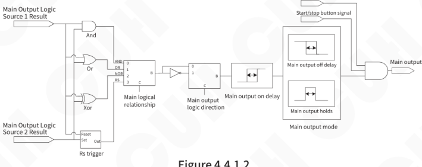

**Figure 4.4.1.2**

This controller can set the logical relationship table between main (logical) source 1 and main source 2 as follows. Default Or.

| Parameter | Meaning |
|---|---|
| And | Logical AND, output valid when both main source 1 and main source 2 are valid |
| Or | Logical OR, output valid when at least one of main source 1 or main source 2 is valid |
| Xor | Logical XOR, valid when main source 1 and main source 2 are in different states, otherwise invalid |
| RS | RS flip-flop |

## 4.4.1.3 Main Direction

That is, the main output logic direction, the specific output direction can be set after the signals are logically combined. For the signal flow diagram, refers to Figure 4.4.1.2. Default Const.

| Parameter | Meaning |
|---|---|
| Const | The state after the main output logic operation is not inverted and defaults to the normal state |
| Inv | The state is inverted after the main output logic operation |
| On | The state remains running after the main output logic operation |
| Off | The state is always stopped after the main output logic operation |


### 4.4.1.4 Main On Delay/Main Off Delay

When using other external signals such as sensors to control the main output state of the device, in most cases a delay is required after the signal is given or the signal is restored before the operation can be performed. For such applications, this can be achieved by setting the time values of the on-delay and off-delay. For the signal flow diagram, refers to Figure 4.4.1.2.

**Main On Delay:** That is, the main output on-delay is the delay time experienced from the application of a control signal that causes the controller to enter the running state to the actual output of the controller starting. The delay time experienced during this period is called the on-delay.

**Main Shutdown Delay:** That is, the main output off-delay, starting from the application of a control signal that causes the controller to enter a stop state, to the actual output of the controller stopping, the delay time experienced during this period is called the off-delay.

The main on/off delay range is 0.0~99.9s, the default is 0.2s and the adjustment accuracy is 0.1s.

### 4.4.1.5 Main Mode

There are 2 main output modes available: delay mode and hold mode. Signal flow diagram reference diagram 4.4.1.2. Default Delay.

| Parameter | Meaning |
|---|---|
| Delay | Refers to the state of the main output after logic operation, the state of driving the main output after on-delay and off-delay |
| Hold | Refers to the state after the main output logic operation. After the on delay, the running state remains for the off delay time, and then immediately changes to the stop output state |

The difference between the two modes is expressed in the form of a timing diagram as follows, where the input signal is a logical relationship selection.

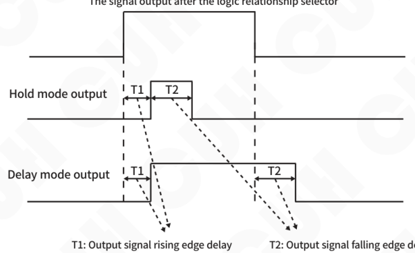


## 4.4.1.6 Power On State

Set the operating status of the controller after power on. Default On.

| Parameter | Meaning |
|---|---|
| On | After the device is powered on, the status of the switch key is running |
| Off | After the device is powered on, the status of the switch key is stopped |
| Keep | After the device is powered on, the status of the switch key remains the same as before the last shutdown |

## 4.4.1.7 Remote Control Source

The output voltage and feeding speed of the controller can be modified through panel parameters or directly controlled through the size of the remote control source input signal. Optional control methods include: panel, 0-20mA DC input, 1-5V DC input, 0-5V DC input, 0-10V DC input, as well as digital synchronization bus signal. Default is Panel.

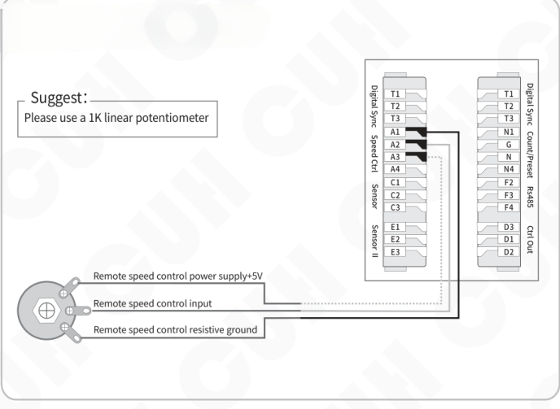


---

### PLC control connection (1~5V/0~5V/0~10V DC Input)

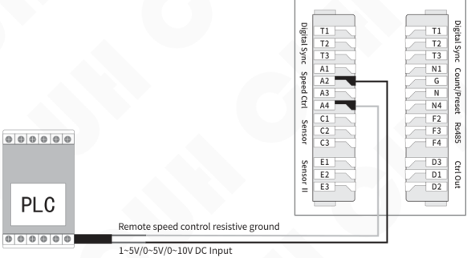

### PLC control connection (4~20mA DC Input)

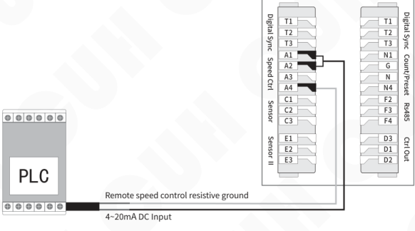

---


| Remote Control Signal | Remote Control Signal | Output Voltage/Feeding Speed |
|---|---|---|
| Panel |  | Output Voltage and Feeding speed are not controlled by Remote Control Signal |
| 20mA | &lt;2mA | When the Voltage Mode is Manual, Output Voltage = 0<br>When the Voltage Mode is Auto, Feeding Speed = 0<br>LCD display the error information "Remote control undervoltage" |
| 20mA | 2mA~4mA | Output Voltage = 0, Feeding Speed = 0 |
| 20mA | 4mA~20mA | Proportionally controlled by Remote Control Signal（0%~100%）<br>When the Voltage Mode is Manual, Output Voltage = (Input Current - 4mA)/16 × Max Output Voltage<br>When the Voltage Mode is Auto, Feeding Speed = (Input Current - 4mA)/16 × Max Feeding Speed |
| 1~5V | 小于0.5V | Output Voltage = 0, Feeding Speed = 0<br>LCD display the error information "Remote control undervoltage" |
| 1~5V | 0.5V~1V | Output Voltage = 0, Feeding Speed = 0 |
| 1~5V | 1V~5V | Proportionally controlled by Remote Control Signal（0%~100%）<br>When the Voltage Mode is Manual, Output Voltage = (Input Voltage - 1V)/4 × Max Output Voltage<br>When the Voltage Mode is Auto, Feeding Speed = (Input Voltage - 1V)/4 × Max Feeding Speed |
| 0~5V | 0V~5V | Proportionally controlled by Remote Control Signal（0%~100%）<br>When the Voltage Mode is Manual, Output Voltage = Input Voltage/5 × Max Output Voltage<br>When the Voltage Mode is Auto, Feeding Speed = Input Voltage/5 × Max Feeding Speed |
| 0~10V | 0V~10V | Proportionally controlled by Remote Control Signal（0%~100%）<br>When the Voltage Mode is Manual, Output Voltage = Input Voltage/10 × Max Output Voltage<br>When the Voltage Mode is Auto, Feeding Speed = Input Voltage/10 × Max Feeding Speed |
| DigSym | Digital Sync | The voltage of the remote control signal is the remote control input voltage of a specified device on the bus (specified through remote control synchronization parameters)<br>Proportionally controlled by the remote control input voltage signal of a specified device on the bus, with a voltage range of 0% to 100%.<br>When the Voltage Mode is Manual, Output Voltage = Input Voltage/10 × Max Output Voltage<br>When the Voltage Mode is Auto, Feeding Speed = Input Voltage/10 × Max Feeding Speed |

### 4.4.1.8 Remote Control Coefficient

When the remote control source is selected other than "panel" and "sync", the remote control coefficient can be used to amplify or reduce the control amount of the remote control input signal.

The remote control coefficient range is 0.5~2.0, the default is 1.0 and the adjustment accuracy is 0.1.

Example: The remote control coefficient is 0.5, when the remote control input signal is 2V, at this time, the equivalent remote control input voltage obtained by the controller is 2V * 0.5=1V.


---

## 4.4.2 DC Control Output Parameters

This summary mainly introduces the controller control output parameter settings. The schematic diagram of the control output signal flow is as follows:

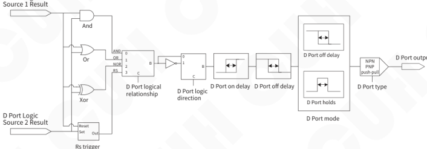

The control output parameters setting method is as follows:

> » Long press ▲ and ◀ to enter parameter setting interface, short press ▶ to switch to "6 DC output" parameter group.
>
> » Short press ▲ or ▼ to switch parameters in the control output parameter group.
>
> » Press ⊕ or ⊖ to adjust the parameter value.
>
> ```text
> RUN
> A C D E F G N J      T0
> 01.PotDLogc        Or
> 02.PotDSor1      In_PtC
> 03.PotDSor2      In_PtE
> 04.PortDDir       Const
> 05.PtDUpDly       0.2 S
> +   6DCoutput        −
> ```

The other parameters of this parameter group can be adjusted according to the above steps.

"D port source 1", "D port source 2", "D port logic", "D port direction", "D open delay"

"D off delay" and "D port mode", the above parameters can refer to the main output parameter settings.

---


## 4.4.2.1 D Port Type

D port output can support three types: NPN output, PNP output, and push-pull output.  
Default Ou_P&P (Push-Pull).

| Parameter | Meaning |
|---|---|
| Ou_NPN | When the output signal of port D is valid, port D outputs a low-level signal (0V), and when it is invalid, it is high impedence |
| Ou_PNP | When the output signal of port D is valid, port D outputs a high-level signal (24V), and when it is invalid, it is high impedence |
| Ou_P&P<br>(Push Pull) | When the output signal of port D is valid, port D outputs a high-level signal (24V).<br>When the output signal of port D is invalid, port D outputs a low-level signal (0V) |

The diagram is as follows:

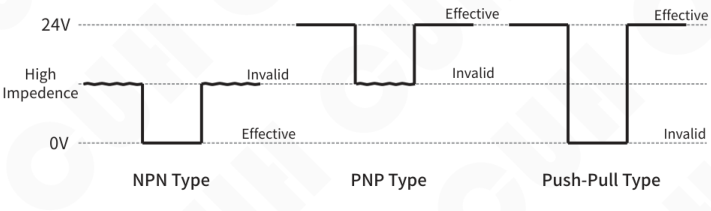


## 4.5 Signal Control

The controller can judge the status of the material in the vibratory feeder through an external sensor, and realize the controller's "stop when full of material" or "stop when empty of material". The port signal flow diagram is as follows:

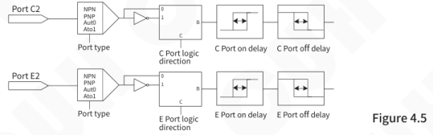

The method for setting signal input parameters is as follows:

- Long press ▲ and ◀ to enter parameter setting interface, short press ▶ to switch to "5On&Off" parameter group.
- Short press ▲ or ▼ to switch parameters in the signal input parameter group.
- Press ⊕ or ⊖ to adjust the parameter value。

```text
RUN
A C D E F G N J        A0
01.PortType        Auto
02.PortCDir        Const
03.PtCUpDly        0.2 S
04.PtCDnDly        0.2 S
05.PortEDir        Const
+   5On&Off        −
```

The other parameters of this parameter group can be adjusted according to the above steps.

### 4.5.1 Sensor Type

The controller can set the type of switch sensor to "Auto", "NPN", "PNP", or "Ato1", or it can be set manually according to the sensor type.

| Parameter | Meaning |
|---|---|
| Auto | Regardless of the sensor type, it is always detected whether the port access is valid by changing the high and low levels signal, the factory default value is automatic recognition |
| NPN | NPN type sensor |
| PNP | PNP type sensor |
| Ato1 | Before the sensor signal is invalid, it is detected whether the port is valid by changing the high and low levels. It is found that after a valid signal, the port sensor type is determined and no longer scanned |


### 4.5.2 C Port/E Port Logic

This parameter is used to switch the controller input port C and input port E is "Shutdown when full of material" or "Shutdown when empty of material".

When switch input port C/port E under factory default settings no any signal is received, the controller is in "Running" state (i.e. shutdown when full of material). Some special applications require the controller to be in the "stop" state (i.e. material empty shutdown) when port C/port E does not receive any signal. This can be achieved by modifying this parameter. Refer to Figure 4.5 for the signal flow diagram.

| Parameter | Meaning |
|---|---|
| Const | When there is no control signal, the controller is in running state (stop when material is full) |
| Inv | When there is no control signal, the controller is in stop state (stop when empty) |

### 4.5.3 C Port On/Off Delay and E Port On/Off Delay

The delay time from the time a signal is applied to put the controller into the running state until the signal is considered valid by the controller is called the on-delay.

The delay time from the application of a signal that causes the controller to enter the stop state until the signal is considered valid by the controller is called the off delay.

For signal flow diagram, refer to Figure 4.5.

The on/off delay range is 0.0~99.9s, the default is 0.2s, and the adjustment accuracy is 0.1s.

**Note:** When using port C, E in performing start/stop control, if it is necessary to delay the operation for a period of time after receiving the signal to ensure that the signal is stable, this can be achieved by setting the on delay and off delay.


## 4.5.4 Speed A Logic/Speed B Logic

The signal flow diagram is as follows:

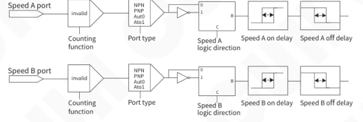

**Figure 4.5.4**

This parameter is used to switch the valid status of the input ports for controller speed A and speed B. This parameter must be set in the material full parameter group. Default is Const.

| Parameter | Meaning |
|---|---|
| Const | When there is no control signal, controller speed A and speed B are invalid |
| Inv | When there is no control signal, controller speed A and speed B are effective |

## 4.5.5 Speed A On/Off Delay and Speed B On/Off Delay

From applying a valid signal to speed A/B port to set speed active, this time period called on delay.

From applying a invalid signal to speed A/B port to set speed inactive, this time period called off delay.

For signal flow diagram, refer to Figure 4.5.4.

The speed A&B on/off delay range is 0.0~99.9s, the default is 0.2s, and the adjustment accuracy is 0.1s.


## 4.6 Material Quantity Counting

This controller has a built-in counting function that can count counting pulses and automatically decelerate or stop when the number of pulses reaches the set total count. It also has special functions such as super anti-jitter and final deceleration to prevent overshoot. The signal flow diagram is as follows:

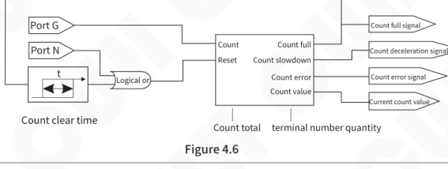

> » Long press ▲ and ◀ to enter parameter setting interface, short press ▶ to switch to "7Counter" parameter group.
>
> » Short press ▲ or ▼ to switch parameters in the counting parameter group.
>
> » Press ⊕ or ⊖ to adjust the parameter value.

```text
RUN
A C D E F G N J     A0
01.TotaCout       10
02.PrcntTrm       50 %
03.CotAhead        3
04.CotRstTm       0.0 S
05.CotPotSe       None
+     7Counter     −
```

The other parameters of this parameter group can be adjusted according to the above steps.

### 4.6.1 Material Quantity Counting (or Speed A/B)

This parameter is used to enable and disable the counting function.

The default is None, that is, the counting function is turned off, and the speed A/B function is enabled at this time.

When the counting function parameter is valid (enabled), the speed A and speed B act as speed A/B control, the controller can perform more operations for the counting function. For signal flow diagram, refer to Figure 4.6.

| Parameter | Meaning |
|---|---|
| None | Turn off the counting function and enable the speed A/B function |
| Valid | Use the speed A port as the counting port, and use the speed B port as the count clearing port |


## 4.6.2 Target Quantity

After the "current count value" reaches the limit, the count full signal is valid until the counter is reset. After entering the counting full state, if the counting pulse is continued to be sent, the counting will continue, but the counting full signal remains valid. For signal flow diagram, refer to Figure 4.6.

The total count range is 0~9999, the default value is 10, and the adjustment accuracy is 1.

## 4.6.3 Terminal Speed

**Terminal Speed**, means that when counting enters the final deceleration state, the controller's feeding speed and voltage will drop to the percentage of the initial speed and voltage, see Figure 4.6.3.

When the counting number is close to the total number, the counting process is about to be completed. In order to prevent the high-speed movement of the material from being unable to stop in time and causing counting overshoot, the controller automatically reduces the speed to the end set speed (the counting deceleration signal is valid) by the user when the remaining number is less than the end number. When the count value reaches the total count (the full count signal is valid), the controller immediately stops output, and the feeder can obtain precise counting control.

The terminal speed range is 0~100%, the default value is 50%, and the adjustment accuracy is 1%.

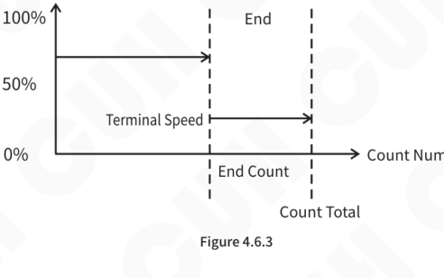


## 4.6.4 Terminal Speed Quantity

Number of final sections: Refers to the total number of distance counts. After reaching the "end number", the controller enters the counting decrement mode.

In the speed state, the feeding speed and voltage drop to the terminal speed and terminal voltage. When the value of "End Segment Quantity" is 0, it means that the final deceleration function is not used. For signal flow diagram, refer to Figure 4.6.

The number of last segments ranges from 0 to 9999, the default value is 3, and the adjustment accuracy is 1.

## 4.6.5 Reset Counting Value to 0

When the count is full, the controller will automatically clear the count value after the "count clear" time delay. When the "Count Clear" value is 0.0s, it means that the delay automatically triggers the count reset function disable.

The counting reset time range is 0.0~999.9s, the default value is 0.0s, and the adjustment accuracy is 0.1s.

## 4.6.6 RS Priority

Used to set the RS trigger port priority. Default Same。

| Parameter | Meaning |
|---|---|
| Same | The R port and the S port have the same priority. When there are signals on the R and S ports, the controller reports a warning of "main RS error" or "control RS error" |
| Reset | Reset priority. When there are signals on the R and S ports, the R port signal takes priority, that is, the reset signal takes priority |
| Set | Set priority. When there are signals on the R and S ports, the S port signal takes priority, that is, the set signal takes priority |
| Revers | When there are signals at the R and S ports, the current logic output result is inverted |


## 4.7 Save Settings

This chapter mainly introduces how to use the parameter storage and callback parameter functions of the controller.

### 4.7.1 Callback Settings

The controller can read out 3 different sets of preset parameters in addition to the work group, named "User 1," "User 2," and "User 3" respectively.

When the user modifies the parameters, the controller parameters are saved in the workgroup by default. When the controller is powered on again, the parameters will be automatically read from the workgroup and the parameter values before the last shutdown will be restored. At the same time, users can manually select from "UsrD1", "UsrD2", "UsrD3". Read out another file manually saved by the three groups. The data is sent to the working group in the controller, allowing the controller to switch working status immediately.

| Parameter | Meaning |
|---|---|
| None | Invalid |
| UsrD1 | User set parameter 1 |
| UsrD2 | User set parameter 2 |
| UsrD3 | User set parameter 3 |

### 4.7.2 Save Settings

The controller can save 4 different sets of preset parameters, named "Work", "UsrD1", "UsrD2", "UsrD3".

When the user modifies the parameters, the controller parameters are automatically saved in the "Work" by default. When the controller is powered on again, the parameters will be automatically read from the work group and the parameter values before the last shutdown will be restored. Users can manually save parameters in the workgroup to "UsrD1", "UsrD2", "UsrD3".

| Parameter | Meaning |
|---|---|
| None | Invalid |
| Work | Default workgroup |
| UsrD1 | User set parameter 1 |
| UsrD2 | User set parameter 2 |
| UsrD3 | User set parameter 3 |


---

### 4.7.3 Restore Factory

Use reset parameters to restore all workgroup parameters to factory default values.

After selecting "RWork" in "Reset Parameters", press ⊕ and ⊖ hold at the same time, after more than two seconds, the display interface switches to the standby interface, and the parameters are restored successfully.

| Parameter | Meaning |
|---|---|
| None | invalid |
| Rwork | Restore workgroup parameters to factory settings. (User 1, User 2 and User 3 will not be restored) |

### 4.7.4 Copy Settings

The controller can replace the parameter group of this controller with the data of the two controllers in the network that it has backed up to quickly copy the parameters of the two controllers.

Select the ID number of the controller to be copied to realize the function of copying the data of the controller. The selection range of copy parameters is 1~8.

### 4.7.5 User Password

Users can set the parameter password by themselves. After locking, the user can only operate under the "Monitoring Parameter Group" and "Home Page".

When the user sets when the "user password" is non-0, it means the advanced parameter lock function is enabled. At this time, you need to enter the password when entering the parameter group on the home page. After the user "enters the password"and press ▶ + ▲ , if the "enter password" and "user password" are different, the user can only enter the monitoring parameter group. Only after the password is correct can the user enter other parameter groups.

The selection range of user password is 0~9999.

### 4.7.6 Enter Password

If the "Enter Password" and "User Password" are different, the user can only operate under "Home Page" and "Monitoring Parameter Group". Only after the password is correct can the user enter other parameter groups.

The selection range for entering the password is 0~9999.

---


## 4.8 RS485 Communication

This controller supports RS485 communication. Following the Modbus protocol mode ASCII and RTU type, all parameters and status of the controller can be modified and read remotely.

The local RS485 communication protocol "SDVC42-S Series 485 Register Address Table" can be downloaded from the download area of our company's website: www.cuhnj.com.

> » Long press ▲ and ◀ to enter parameter setting interface, short press ▶ to switch to "8Comm" parameter group.
>
> » Short press ▲ or ▼ to switch parameters in the communication parameter group.
>
> » Press ⊕ or ⊖ to adjust the parameter value。
>
> ```text
> RUN
> A C D E F G N J     A0
> 01.485type       RTU
> 02.BaudRate    115.2 K
> 03.485SlvID      1
> 04.Enab485R    None
> 05.DigSynAd      1
> +     8Comm       -
> ```

The other parameters of this parameter group can be adjusted according to the above steps.

### 4.8.1 Communication Type

Rs485 communication type selection, Modbus ASCII type and Modbus RTU type. Default RTU.

| Parameter | Meaning |
|---|---|
| ASCⅡ | Modbus ASCII type |
| RTU | Modbus RTU type |


## 4.8.2 Baud Rate

Different RS485 communication baud rate options. Default is 115.2K.

| Parameter | Meaning |
|---|---|
| 0.3K | 0.3 Kbps |
| 1.2K | 1.2 Kbps |
| 2.4K | 2.4 Kbps |
| 9.6K | 9.6 Kbps |
| 19.2K | 19.2 Kbps |
| 57.6K | 57.6 Kbps |
| 115.2K | 115.2 Kbps |

## 4.8.3 Slave Controller Address

Set the slave address number in RS485 communication.

The slave number ranges from 1 to 31. Default 1.

## 4.8.4 Port Resistance/Synchronous Resistance

The RS485 communication port/Digital synchronization port incorporates a matching resistor (120Ω) function. Default is None.

| Parameter | Meaning |
|---|---|
| None | Do not use matching resistor (120Ω) |
| Valid | Use matching resistor (120Ω) |


## 4.9 CUHBus-DS® Networking

SDVC42-S controller adopts LAN bus (CUHBus-DS®) serial communication protocol bus protocol. Achieve networking of up to 8 devices on the same network. The following functions can be implemented between the controllers after networking:

**Sync Features:** The frequency, phase, remote control speed adjustment and other parameters of any controller in the network can be consistent or deviated from the output of any other controller in the network.

**Signal Sharing:** Any status signal of any controller in the network can be shared as the signal input source of any other controller. It allows any controller in the network to have richer signal sources besides the local unit and output them after logical operations to implement more complex controller operation logic at the user site.

**Data Backup:** The data of any controller in the network will be backed up on the other two controllers in the network. Any controller in the network can be perfectly replaced by replacement and joining, and the data of the replaced controller can be used to continue running.

> ☺
>
> **This network system has the following characteristics:**
>
> - It is easy to expand and new devices can be quickly added to the network.
> - The network is equivalent, with a set of equivalent CUHBus-DS® communication terminals on the left and right to facilitate user connection.
> - The device supports hot swapping, and the controller expansion can be added or deleted without powering off during stable operation of the controller system.


## 4.9.1 Device Networking

This chapter mainly introduces the quick networking between multiple controllers, how to add a new controller to the established network and how to delete the controller in the network.

### 4.9.1.1 Device Networking

A single controller is a network by itself. When the controllers CUHBus-DS® signal lines are correctly connected and simple operations are performed, multiple devices can form a new digital synchronous communication network.

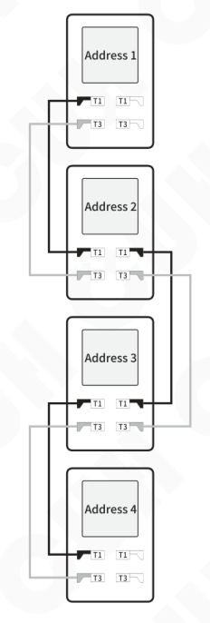


---

**Steps:**

1. Connect all controller T1 signals to each other and all T3 signals to each other, as shown in the figure above.

2. When the new device is powered on, the new controller will automatically enter the "communication parameter group".

3. In the communication parameter group, set the local digital synchronization communication device number, and "DigSynAd" is [1~8] any value. You don't need to set it, the program will automatically generate a number.

4. In the communication parameter group, set the parameter value of "EnNetwok " to "Expand", and then press ⊕ and ⊖ hold at the same time, confirm.

5. After the addition is successful, the parameter value of the new device "EnNetwok " will automatically change to "Online", indicating that the new device has been successfully added.

Users can check whether the network has been correctly networked by checking the device networking status parameters, as well as check the total number of devices in the network and the number of online devices.

Note: Only connecting the CUHBus-DS® signal line and not passing the settings does not count as joining the network.

**View Confirmation Method:**

1. In the monitoring parameter group, the value of the parameter "DevicNum" is [1~8], indicating the total number of devices in the network.

2. In the monitoring parameter group, the value of the parameter "OnlinNum" is [1~8], indicating how many controllers are currently online in the network.

**Synchronous Resistor:**

The CUHBus-DS® communication port incorporates a matching resistor (120Ω) function, which is invalid or valid.

| Parameter | Meaning |
|---|---|
| None | Do not use matching resistor (120Ω) |
| Valid | Use matching resistor (120Ω) |

---


---

## 4.9.1.2 Device Joins

Users can follow the following expansion and addition steps to add a new controller to the existing network.

The new controller after joining can call the signal of any controller in the network and act controller signal source as any other controller in the network. Enrich system signal sources.

**Steps:**

1. Connect the CUHBus-DS® T1 and T3 interfaces of the new device to the original complete network, and the ports support hot swapping.
2. When the new device is powered on, the new controller will automatically enter the "communication parameter group".
3. In the communication parameter group, set the local digital synchronization communication device number, and "DigSynAd" is [1~8] any value. You don't need to set it, the program will automatically generate a number.
4. In the communication parameter group, set the parameter value of "EnNetwok" to "Expand", and then press ⊕ and ⊖ hold at the same time, confirm.
5. After the addition is successful, the parameter value of the new device "EnNetwok" will automatically change to "Online", indicating that the new device has been successfully added.

Users can check whether the network has been correctly networked by checking the device networking status parameters, as well as check the total number of devices in the network and the number of online devices.

Note: Only connecting the CUHBus-DS® signal line and not passing the settings does not count as joining the network.


---


---

### 4.9.1.3 Device Removal

When you need to permanently remove a controller from the network, use the Remove Controller from Network feature. Deleting a controller in the network can be initiated from any controller in the network. The remaining controllers after deletion will reorganize into a complete new network.

However, if the controller is removed directly (including power outage) without deleting the controller, the data of the controller will still be retained in the network. At this time, the network is in a degraded state and new controllers cannot be added. It must be manually deleted through the controller to maintain the integrity of the network and complete the expansion and addition of new controllers.

**Steps to Delete a Controller:**

1. Enter the "communication parameter group" through any controller in the network.
2. Modify the value of the "DeltDevi" parameter to the address of the network device that needs to be deleted.
3. After modifying the value, long press ⊕ and ⊖， confirm deletion of the device.
4. After the deletion is completed, the "DeltDevi" parameter value changes to unselectable value, indicating that the device is successfully deleted.
5. At this time, check the new network status on the operating device and confirm the number of new network controls.

Example: Delete the address 3 controller from the network.

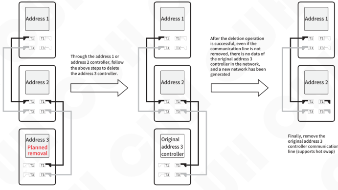

---


---

## 4.9.2 Sync Function

The frequency, phase or remote controlled speed of any controller in the network can follow another master controller in consistent or certain deviation. However, multiple controllers cannot follow each other, otherwise the their outputs will become unstable.

Example1:Address 3 controller follows address 1 controller's output frequency, so the two vibratory feeders driven by them are running at the same frequency.

Example 2: If the address 3 controller is following the address 1 controller's output frequency already, the address 1 controller cannot be set to follow the address 3 controller's output frequency. Which means the controllers cannot follow each other.

➢ **Frequency Synchronization**

The method of setting frequency synchronization is as follows:

1. Will require frequency synchronization and frequency to be synchronized between two or more controllers form the same digital synchronous communication network, please refer to the "Device Networking" chapter.

2. Set the "FrqncSyn" parameter value in the communication parameter group of the frequency synchronized controller to be (frequency) The "Digital Sync" address number of the synchronized controller.

3. Jump to the frequency-synchronized controller to the steady speed parameter group, and set the "FrqncMod" to "SynV" or "SynE".

➢ **Remote Control Speed Synchronization**

The method of setting remote control speed control synchronization is as follows:

1. Will require remote control synchronization and remote control synchronization between two or more controllers devices form the same digital synchronous communication network, please refer to the "Device Networking" chapter.

2. set the "RemotSyn" parameter value in the communication parameter group of the remote control synchronized controller to be (remote control) The "Digital Sync" address number of the synchronized controller.

3. Set the "CtrlSour" parameter value in the main output parameter group to "DigSym".

➢ **Master/Slave Working Mode**

Users can set the controller to run in one of the following two operating modes according to application requirements:

Main Mode: where one controller independently controls a load vibration plate.

Slave Mode: When two or more controllers need to work synchronously, one controller is used as the master controller and operates in the master mode as the frequency reference. All other controllers operate in slave mode, acting as slave controllers and operating synchronously with the master controller.

---


## Main Mode

The controller working in the main mode, hereinafter referred to as the main controller, modifies the parameters in the steady speed parameter group. "Voltage mode" and "frequency mode" parameters can set the controller to the corresponding working mode. The voltage mode and frequency mode have the following combinations:

| Working Mode | Voltage<br>Control Method | Frequency<br>Control Method | Vibration Sensor Need |
|---|---|---|---|
| Full Manuel | Manuel | Manuel | No |
| Full Automatic | Auto | Auto | Yes |
| Voltage Automatic | Auto | Manuel | Yes |
| Frequency Automatic | Manuel | Auto | Yes |

■ **Full Manual Mode**

In this mode, the controller's output voltage and output frequency are adjusted manually.

**Note:** Even if the parameter "Voltage Mode" or "Frequency Mode" is set to "Auto", the controller will still work in full manual mode if the vibration sensor is not connected.

■ **Full Automatic Mode**

The controller will automatically adjust the output voltage and output frequency based on the data feedback by the vibration sensor to ensure that the feeding speed of the vibration equipment is stable near the "feeding speed" set value and the vibration frequency is at the optimal operating frequency of the vibration equipment. The output voltage and output frequency are not controlled by the parameters "voltage" and "frequency".

**Note:** The factory default setting of the controller is fully automatic mode, but if the vibration sensor is not inserted correctly, the controller will still be in the fully manual state. The controller will not switch to the fully automatic state until the vibration sensor is correctly inserted.

■ **Voltage Automatic Mode**

In this mode, the controller will automatically adjust the output voltage based on the data feedback by the vibration sensor to ensure that the feeding speed of the vibration equipment is stable at the set value. The output frequency is manually set by the user. The controller must be connected to a vibration sensor for this mode to work properly.

■ **Frequency Automatic Mode**

In this mode, the controller will automatically adjust the output frequency based on the data feedback by the vibration sensor so that the vibration frequency is at the optimal operating frequency of the vibration equipment, and the output voltage is set manually. The controller must be connected to a vibration sensor for this mode to work properly.


## Slave Mode

When multiple controllers are networked, any one of them can select the slave mode. In this mode, the output frequency of the slave controller is always strictly consistent with the output frequency of the master controller. The controller working in the slave mode is hereinafter referred to as the slave controller.

Frequency synchronization mode is used in situations where there are multiple controllers in a feeding system and their output frequencies and phases need to be synchronized. Through the synchronous mode, the master and slave controllers can output completely synchronous waveforms, thus eliminating mutual interference between the controller outputs.

When controller M working in master mode, the controller S working in slave mode (synchronous mode), the output waveforms of the two controllers are completely synchronized. As shown below:

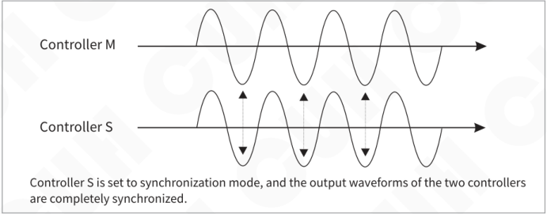

If controller S is not set to slave mode (SynV or SynE mode), the output waveforms of the two controllers are not synchronized. As shown below:

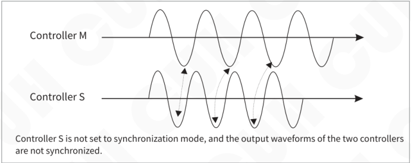


For mechanical equipment that requires precise alignment, two or more vibration equipment may need to have physically consistent phases, but each equipment has a different resonant frequency. By setting the frequency mode to "SynV", the controller can automatically Adjust the phases of each equipment according to vibration conditions to achieve consistency. If the frequency mode is "SynE", the user manually sets the phase compensation value.

Modify the "voltage mode" and "frequency mode" parameters in the steady speed parameter group to set the controller to work in the corresponding "working mode". The voltage mode and frequency mode have the following combinations:

| Working Mode | Voltage Method | Frequency Method | Phase Control | Vibration Sensor Need |
|---|---|---|---|---|
| Automatic voltage<br>Automatic phase | Auto | SynV | Auto | Yes |
| Automatic voltage<br>Aanual phase | Auto | SynE | Manuel setting | Yes |
| Manual voltage<br>Automatic phase | Manuel | SynV | Auto | Yes |
| Manual voltage<br>Aanual phase | Manuel | SynE | Manuel setting | No |

☺

**Note:**

1. Even if the parameters "Voltage Mode" and "Frequency Mode" are set to "Auto" and "SynV", if the vibration sensor is not connected, the controller will still work in the manual voltage and manual phase state.

2. Automatic voltage refers to a slave controller connected to a vibration sensor that automatically adjusts the output voltage to stabilize the feeding speed near the user-set value.

3. Automatic phase means that the slave controller connected to the vibration sensor automatically corrects the phase of the output waveform based on the sensor's feedback signal, so that the synchronization signal output by the slave controller and the master controller are in phase.

4. Manual phase refers to the phase of the slave controller's output waveform, which can be manually set to have a fixed phase deviation from the master controller's output waveform.


## Connect Method of the Sync Signal Wire between Master and Slave Controllers

Just connect the master and slave controllers to the same digital synchronous communication network and then network. Set the "frequency synchronization" parameter value in the communication parameter group of the slave controller to the "digital synchronization" address number of the master controller. Then change the "frequency mode" in the steady speed parameter group to "synchronous vibration" or "synchronous electric".

### Application scenarios where both the master and slave controllers are connected to vibration sensors

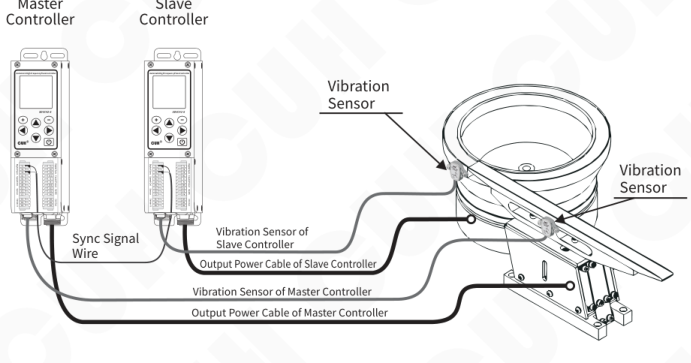

1. If the slave controller works in manual voltage manual phase mode, the slave controller does not need to be connected to a vibration sensor.

2. If the main controller works in full manual mode, the main controller does not need to be connected to a vibration sensor.


---

■ **Auto Voltage Auto Phase Mode**

In this mode, the controller must be connected to a vibration sensor. The controller will automatically adjust the output voltage based on the data fed back by the vibration sensor to ensure that the feeding speed of the vibration equipment is stable at the set value. The frequency and phase of the output waveform are consistent with the main controller, or a phase difference, set by the parameter "Auto Phase".

■ **Auto Voltage Manual Phase Mode**

In this mode, the controller must be connected to a vibration sensor. The controller will automatically adjust the output voltage based on the data fed back by the vibration sensor to ensure that the feeding speed of the vibration equipment is stable at the set value. The output frequency is consistent with the main controller. The output waveform differs from the main controller output waveform by a fixed phase difference value, which is set by the parameter "Manual Phase".

■ **Manual Voltage Auto Phase Mode**

In this mode, the controller must be connected to a vibration sensor. The output voltage of the controller is manually adjusted. The frequency and phase of the output waveform are consistent with the main controller, or a phase difference, set by the parameter "Auto Phase".

■ **Manual Voltage Manual Phase Mode**

In this mode, the output voltage of the controller is manually adjusted, and the output frequency is consistent with the main controller. The output waveform differs from the main controller output waveform by a fixed phase difference value, which is set by the parameter "Manual Phase".

> ☺
>
> 1. The automatic phase mode needs to set the "frequency mode" parameter value of the slave controller to "SynV".
>
> 2. Manual phase mode requires setting the "frequency mode" parameter value of the slave controller to "SynE".

---


---

## 4.9.3 Signal Sharing

After the device is networked, the controller can call any signal from any other controller in the network to achieve a richer signal calling port.

The signal source of one controller in the network can choose from any port of any controller in the network. And can realize complex logic control through AND, OR, XOR or RS logic operation.

Operation steps for calling other signal sources from the main output of the controller:

➢ **Select the controller witch need sourcing network signal , enter main output group, finish following setup:**

1. Set the "MainSor1" parameter or the "MainSor2" parameter to "Bus".
2. Set the "MainLogc" parameter to one of "And", "Or", "Xor", and "RS".
3. Set the "MainDire" parameter of this controller to one of "Const", "Inv", "On" or "Off".
4. Set the "MainUpDy" and "MainDnDy" time of this controller.
5. Set the "MainMode" parameter of this controller to one of "Delay" or "Hold".

➢ **Jump to communication group and finish following setup:**

6. Set the "BSigMID1" of this controller to be followed by the controller address (the controller number can be queried through digital synchronization).
7. Set the "BSigMID2" of this controller to be followed by the controller address.
8. Set the specific status bit number of "BSigM_B1" of this controller. You need to check the "status bit" of the followed controller. 1~16", select the status bit sequence number required by the machine.
9. Set the specific status bit number of "BSigM_B2" of this controller. You need to check the "status bit" of the followed controller.1~16", select the status bit sequence number required by the machine.

Any controller can send 16 of its own statuses to the bus, which can be passed through "status bit 1" ~"Status bit 16" is set independently, and "status bit 1" ~ "status bit 16" are the same as the first 16 bits of the "7.4.11 Appendix" chapter by default.

Any controller can call the signal on the bus (by default). For the meaning and details, please refer to the "7.4.11 Appendix" chapter.

---


---

Example: After networking, the address 3 Controller call location Address 1 control system Device C port signal and Address 2 control system Device C port signals, and do a logical OR, and when any signal is detected to be valid, the main output of the address 3 controller stops.

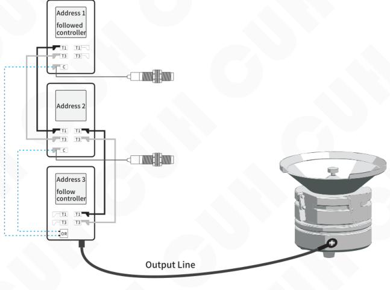

Operation steps:

1. Set the main output parameter group of the controller at address 3. "MainSor1" is "bus" and "MainSor2" is "bus".
2. Set the "MainLogc" parameter of the address 3 controller to "And".
3. Set the "MainDire" (main output direction) parameter of the address 3 controller to "Const".
4. Set the "MainUpDy" and "MainDnDy" time of the address 3 controller to the required time value. The default is 0.2 seconds.
5. Set the "MainMode" (main output mode) of the address 3 controller to "Delay".
6. Set the "BSigMID1" in the "Communication Parameter Group" of the address 3 controller to "1" (specify the address 1 controller).
7. Set the "BSigMID2" of the address 3 controller to "2" (specify the address 2 controller).
8. Set the "BSigM_B1" of the address 3 controller to "4" (specify the C port signal).
9. Set the "BSigM_B2" of the address 3 controller to "4" (specify the C port signal).
10. The setting is completed. For the control output settings of port D of the controller, refer to the main output settings of the controller.

---


## 4.9.4 Data Backup

When all controllers are networked, all controllers in the network can back up each other's data. Each controller backs up the other two controllers in the network. When a controller in the original network fails, users can quickly replace the failed controller with a new controller. All parameters of the new controller will be consistent with those of the controller before replacement.

When less than 3 numbered adjacent controllers fail in the network, the replacement operation can be successful. However, when more than 3 or more numbered controllers fail, all machine data cannot be restored.

- New controller joint network as a replacement device steps:

1. Power off the device to be replaced and remove the CUHBus-DS® communication cable.
2. Connect the CUHBus-DS® interface of the new device to the original network.
3. When the new device is powered on, the new access controller will automatically enter the "communication parameter group".
4. Set the parameter "DigSynAd" (Local Digital Synchronization Address). Since this network is incomplete, the value of this parameter will only display the device number that needs to be replaced.
5. Set the value of the parameter "EnNetwok " to "Replace", and then press ⊕ and ⊖ hold at the same time, confirm.
6. After the replacement is successful, the parameter value of the new device "EnNetwok " will automatically change to "Online".

Example 1: The original network consists of address 1, address 2 and address 3 controllers. Since the address 3 fails, it is necessary to replace the original device with a new device and restore all settings of the original device.

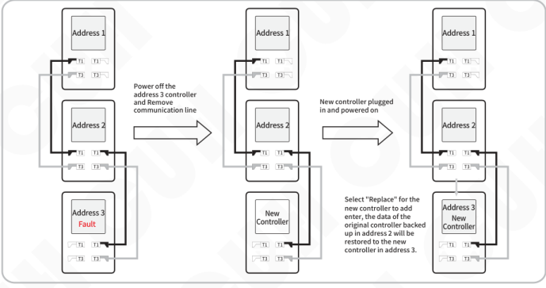

Example 2: There are four controllers with addresses 1, 2, 3, and 4 in the network. Among them, controllers at addresses 2, 3, and 4 in the network failed. However, because each device in the network backs up data from up to two controllers, the controller at address 4 cannot complete data recovery. For the replacement settings of the controllers at addresses 2 and 3, refer to the above case.

Example 3: There are originally five machines with addresses 1, 2, 3, 4 and 5 in the network. Among them, addresses 1, 2, and 4 are faulty (three non-consecutive units). You can change the address from 5Restore address 1 and address 2 controller data, restore address 4 controller data from address 3, thereby restoring all failed controller data. For controller replacement settings, refer to the above case.


## 4.9.5 Remote Control Data

Users can choose to send data sources to the synchronization network, and can choose manual voltage, remote control voltage, manual speed, and remote control speed.

| Parameter | Meaning |
|---|---|
| ManVol | Manual voltage refers to the voltage set by the user panel |
| RemVol | Remote control voltage refers to the voltage adjusted through the remote speed control port |
| ManSpd | Manual speed refers to the feeding speed set by the user panel |
| RemSpd | Remote control speed refers to the feeding speed adjusted through the remote speed control port |

## 4.10 Controller Status Monitoring

In the monitoring parameter group, the controller operating status and parameter values can be read in real time.

For readable parameter entries, please refer to the "Parameter List" chapter, Parameter Group 10, Monitoring Parameter Group.

```text
RUN
A C D E F G N J      A0
01.Voltage       150 V
02.Frequenc     50.0 Hz
03.SpeedNow        0
04.VoltgOut     19.8 V
05.EffectCu     0.00 A
+   10Monitor      −
```


---

## 4.11 Error Log

The controller can record 64 sets of logs in a loop to facilitate later viewing of the time when the problem occurred and specific information. In any interface, long press ▲ and ▶ enter the log interface group, which is displayed as follows:

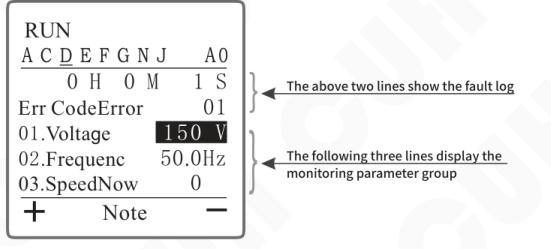

Display contents:

    RUN
    A C D E F G N J        A0
            0 H   0 M   1 S
    Err CodeError          01
    01.Voltage           150 V
    02.Frequenc          50.0Hz
    03.SpeedNow             0
    +        Note          −

- The above two lines show the fault log.
- The following three lines display the monitoring parameter group.

## 4.12 Customize Homepage

In order to facilitate users to use the controller efficiently and quickly, users can perform customized operations in the interface parameter group. By extracting at most 16 of all parameters is placed as a detection item in the interface parameter group, and the user can perform quick operations on the main interface.

Example: Select 1. UsrVoltg (P2.02), 2. UsrFrqnc (P2.03), 3. UserSped (P2.01), 4. SoftStar (P2.04), SoftStop (P2.05), there are five parameters in the main interface. The steps are as follows:

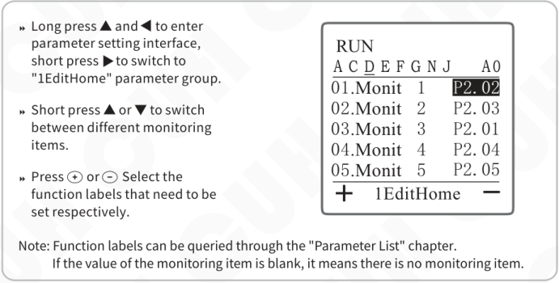

Steps:

- Long press ▲ and ◀ to enter parameter setting interface, short press ▶ to switch to "1EditHome" parameter group.
- Short press ▲ or ▼ to switch between different monitoring items.
- Press ⊕ or ⊖ Select the function labels that need to be set respectively.

Display contents:

    RUN
    A C D E F G N J      A0
    01.Monit  1      P2.02
    02.Monit  2      P2.03
    03.Monit  3      P2.01
    04.Monit  4      P2.04
    05.Monit  5      P2.05
    +     1EditHome     −

Note: Function labels can be queried through the "Parameter List" chapter.  
If the value of the monitoring item is blank, it means there is no monitoring item.

After the operation is completed, if the user needs to adjust the parameter values of voltage, frequency, feeding speed, soft start time and soft stop time, enter the specific monitoring item in the parameter group of the "Home" interface and pass ⊕ or ⊖, parameter adjustment can be completed.

---


# Chapter Ⅴ Typical Applications

## 5.1 How to keep two vibratory feeders running at the same frequency?

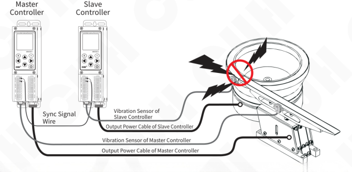

This section introduces two SDVC42-S controller is networked and realizes that one direct vibrator and one circular vibrator operate at the same frequency to avoid collision between the plates due to inconsistent operating frequencies.

1. The controller correctly connects the power cord and output cord.

2. Take out the sensor that is being followed by the controller, connect the sensor plug to the controller and tighten the nut, and correctly fix the sensor body on the vibration plate (see "2.3 Vibration Sensor Installation Guide" for details)

3. Open the equipment wiring compartment cover, connect all controller T1 signals to each other, and connect all T3 signals to each other.

4. After the two devices are powered on, one of the controllers will automatically enter the "communication parameter group".

5. In the controller communication parameter group, the program will automatically generate a set digital synchronization communication device number. "Digital synchronization" is any value [1~8]. Users can also change this value themselves.

6. In the communication parameter group, set the "EnNetwok " parameter to "Expand", and then press ⊕ and ⊖ hold at the same time, confirm.

7. After the follower controller is successfully added, the parameter value of "EnNetwok" automatically changes to "Online", indicating that the networking is successful.

8. User press and hold ▲ and ◀ enter the parameter setting interface by short pressing ◀ or ▶ Switch to the communication parameter group, view and note down the digital synchronization address of each controller.

9. Set the "FrqncSyn" parameter value of the following controller in the communication parameter group to the "DigSynAd" address number of the followed controller.

After the above settings are completed, one controller can follow another controller to output at the same frequency.


## 5.2 How to trun on/off controller B via a sensor connected to controller A?

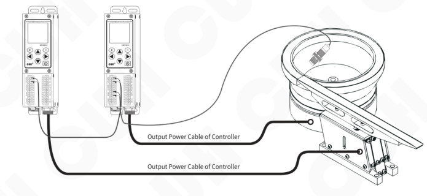

This section introduces two SDVC42-S Controller networking, and realize that the main output of the controlled controller is controlled by another main control controller C port signal controls start and stop, so that even if the sensor is not directly connected to the controlled controller, the controller can be operated through the networked signal. The signal sources of the controller are greatly enriched.

1. The controller correctly connects the power cord and output cord.

2. Open the equipment wiring compartment cover, connect all controller T1 signals to each other, and connect all T3 signals to each other.

3. After the two devices are powered on, one of the controllers will automatically enter the "communication parameter group".

4. In the controller communication parameter group, the program will automatically generate a digital synchronous communication device number, and "digital synchronization" is any value [1~8]. Users can also change this value themselves.

5. User press ▲ and ◀ hold enter the parameter setting interface by short pressing ◀ or ▶ switch to the communication parameter group, view and note down the digital synchronization address of each controller.

6. The controlled controller switches to the main output parameter group according to the above method, and the parameters are set as follows:

   "MainSor1" is "Bus", "MainSor2" is "Bus", "MainLogc" is "And", "MainDire" is "Const", "MainUpDy" and "MainDnDy" are set to the required time value, the default is 0.2 seconds, "MainMode" is set to "Delay".

7. The controlled controller switches to the communication parameter group according to the above method, and the parameters are set as follows:

   "BSigMID1" is set to "X" (X: is the digital synchronization bit number of the controller that needs to call the signal), "BSigM_B1" is set to "4" (material input port C signal), "BSigM_B2" is set to "0" (0 indicates invalid signal).

After the above settings are completed, the output of one controller is controlled by the C port signal of another controller.


---

## 5.3 How to turn on/off two controllers simultaneously?

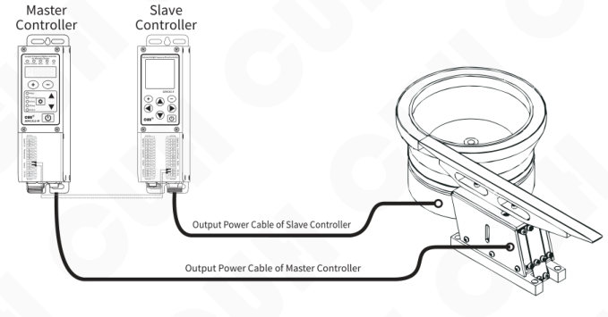

This section introduces a direct vibration controller (using SDVC311) and a disc controller (using SDVC42-S), start and stop in sync. Different series of controllers can also complete the function of synchronous start and stop.

1. The controller correctly connects the power cord and output cord.

2. Open the device wiring compartment cover, connect D1 of SDVC42-S to C2 of SDVC311, and connect D3 of SDVC42-S to C1 of SDVC311.

3. After the two devices are powered on, press press ▲ and ◀ hold enter the parameter setting interface by short pressing ◀ or ▶ switch to the control output parameter group.

4. In the control output parameter group, set the parameters as follows:

"PotDLogc" is set to "Or", "PotDSor1" is set to "Main", "PotDType" is set to "Ou_PNP", and other defaults remain unchanged.

Above, the settings are completed to implement a direct vibration controller (using SDVC311) and a vibratory feeder controller (using SDVC42-S) maintains synchronized start and stop.

---


# Chapter Ⅵ Frequently Asked Questions

## 6.1 No display upon power on

Solution:

◆ Check whether the power socket has power.

◆ Check whether the power plug has reliably connected to the socket.

## 6.2 No vibration, no noise, normal controller display

Solution:

◆ Check whether the output power cable is correctly connected to the controller and the vibratory feeder.

◆ Check whether the controller’s parameter value settings of output voltage and output frequency are appropriate.

◆ Check whether the controller is stopped by any control signal.

◆ Check whether the controller is stopped by any parameter logic off setting.

## 6.3 Control signal does not work

Solution:

◆ Check whether control signal is connected reliably.

◆ Check whether the ground wire of the control signal is connected to the GND port of the controller.

◆ Check whether the control signal logic is set correctly.

## 6.4 No vibration, normal noise, controller display is normal

Solution:

◆ Adjust parameter settings according to this user manual.

## 6.5 Unstable resonant frequency tracking

Solution:

◆ Appropriately increase the frequency integral value, but note that too much may cause oscillation of the output frequency.


---

## 6.6 Slow speed correction in constant feed speed control

Solution:

◆ Appropriately adjust the amplitude integral value, but note that if it is too large, the oscillation amplitude of the output voltage will become larger.

## 6.7 How to quickly reset the controller to factory default

Due to the powerful functions of this controller, there are a large number of control parameters that can be set by the user. For beginners, the normal working state of the controller may not be restored after multiple setting modifications. Use this function to quickly restore chaotic parameter status to factory default settings.

Solution:

◆ Long press ▲ and ◀ to enter the parameter setting interface, short press ◀ or ▶ to switch to save parameter group.

◆ Switch to restore settings parameters and select the workgroup parameters. Press ⊕ and ⊖ hold simultaneously for more than two seconds to switch to standby interface. At this time, all parameters in the workgroup are restored to factory default settings (User 1, User 2 and User 3 settings remain unchanged).

If the user has previously saved parameters in "User 1", "User 2", or "User 3", the user settings can restored also.

---


# Chapter Ⅶ Appendix

## 7.1 Dimensions

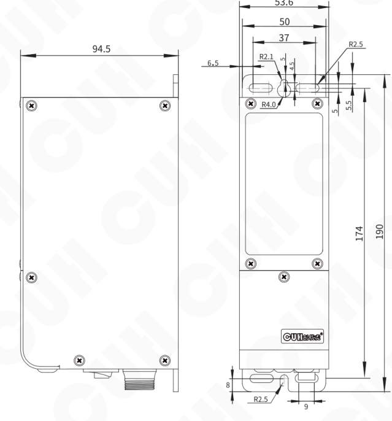

**Dimensions（unit: mm）**

| Dimensions range | tolerance |
|---|---|
| 0~3 | ±0.05 |
| 3~10 | ±0.1 |
| 10~30 | ±0.15 |
| 30~80 | ±0.2 |
| 80~180 | ±0.3 |
| >180 | ±0.5 |

This tolerance table is applicable to all products in this series.


## 7.2 Technical Specifications

| Item | Min | Typical | Max | Unit | Note |
|---|---:|---:|---:|---|---|
| Input Voltage | 85 | 220 | 250 | V | AC RMS |
| Adjustable Output Voltage Range | 0 | —— | 220 | V | AC RMS |
| Voltage Adjustment Accuracy |  | 1 |  | V |  |
| Voltage Regulation Accuracy | 0 | —— | 10 | % | ΔVout/ΔVin |
| Adjustable Output Current Range | 0 | —— | 150 | mA |  |
| Output Power | 0 | —— | 33 | VA |  |
| Output Frequency | 40.0 | —— | 999.9 | Hz |  |
| Frequency Adjustment Accuracy |  | 0.1 |  | Hz |  |
| Output Waveform |  | Sine |  |  |  |
| Soft Start Time | 0 | —— | 40.0 | s | Default value: 0.5 |
| On/Off Delay Time Range | 0.0 | —— | 99.9 | s | Default value: 0.2 |
| On/Off Delay Time Accuracy |  | 0.1 |  | s |  |
| Overheat Protection Trigger Temperature | 60 | 65 | 65 | ℃ |  |
| Sync Communication |  | CUHBus-DS® |  |  |  |
| Digital Communication |  | ModBUS485/Digital Sync |  |  |  |
| DC Control Output Current | 0 | —— | 350 | mA |  |
| DC Control Output Voltage | 22 | 24 | 26 | V |  |
| Analog Control Signal |  | 1~5/0~5/0~10 |  | V | remote speed control voltage |
| Analog Control Signal |  | 4~20 |  | mA | remote speed control current |
| Digital Control Signal |  | 24 |  | V | Switching Signal |
| Adjustment Method |  | 7 |  | Button |  |
| Standby Power Consumption | —— | —— | 5 | W |  |
| Display Method |  | 128*128 |  |  | Matrix Display |
| Ingress Protection Level |  | IP20 |  |  |  |
| Ambient Temperature | 0 | 25 | 40 | ℃ |  |
| Ambient Humidity | 10 | 60 | 85 | % | No Condensation |
| Storage Ambient Temperature | -20 | 25 | 65 | ℃ |  |


## 7.3 Reference Standard

**Absolute Parameters:**  
Above the standard will damage the controller, obey it strictly.

| Item | GB Standard | IEC Standard | Grade | Standard Requirement | Note |
|---|---|---|---|---|---|
| Electrostatic<br>Discharge | GB/T 17626.2-2006 | IEC 61000-4-2:2001 | 4 | ±8 kV | Contact<br>Discharge |
|  |  |  | 4 | ±15 kV | Air Discharge |
| Electrical Fast<br>Transient Test | GB/T 17626.4-2008 | IEC 61000-4-4:2004 | 4 | ±4 kV |  |
| DC Power Line<br>Wave Immunity | GB/T 17626.17-2005 | IEC 61000-4-17:2002 | 4 | 15% | Rating A |

> **Warning**  
> In a residential environment, this product may cause radio interference in which case supplementary mitigation measures may be required.


## 7.4 Parameter List

### 7.4.1 Interface Parameter Group

| Function | Parameter | Display | Value Range/Enumeration Item | Default value |
|---|---|---|---|---|
| P1.01 | Monitoring Project 1 | 01.Monit1 | Parameter Group 2~Parameter Group 10 | P2.01 |
| P1.02 | Monitoring Project 2 | 02.Monit2 | Parameter Group 2~Parameter Group 10 | P10.05 |
| P1.03 | Monitoring Project 3 | 03.Monit3 | Parameter Group 2~Parameter Group 10 | P2.02 |
| P1.04 | Monitoring Project 4 | 04.Monit4 | Parameter Group 2~Parameter Group 10 | P2.03 |
| P1.05 | Monitoring Project 5 | 05.Monit5 | Parameter Group 2~Parameter Group 10 |  |
| P1.06 | Monitoring Project 6 | 06.Monit6 | Parameter Group 2~Parameter Group 10 |  |
| P1.07 | Monitoring Project 7 | 07.Monit7 | Parameter Group 2~Parameter Group 10 |  |
| P1.08 | Monitoring Project 8 | 08.Monit8 | Parameter Group 2~Parameter Group 10 |  |
| P1.09 | Monitoring Project 9 | 09.Monit9 | Parameter Group 2~Parameter Group 10 |  |
| P1.10 | Monitoring Project 10 | 10.Monit10 | Parameter Group 2~Parameter Group 10 |  |
| P1.11 | Monitoring Project 11 | 11.Monit11 | Parameter Group 2~Parameter Group 10 |  |
| P1.12 | Monitoring Project 12 | 12.Monit12 | Parameter Group 2~Parameter Group 10 |  |
| P1.13 | Monitoring Project 13 | 13.Monit13 | Parameter Group 2~Parameter Group 10 |  |
| P1.14 | Monitoring Project 14 | 14.Monit14 | Parameter Group 2~Parameter Group 10 |  |
| P1.15 | Monitoring Project 15 | 15.Monit15 | Parameter Group 2~Parameter Group 10 |  |
| P1.16 | Monitoring Project 16 | 16.Monit16 | Parameter Group 2~Parameter Group 10 |  |


## 7.4.2 Common Parameter Group

| Function | Parameter | Display | Value Range/Enumeration Item | Default value |
|---|---|---|---|---|
| P2.01 | User Set Feeding Speed | 01.UserSped | 0~3200 | 200 |
| P2.02 | User Set Voltage | 02.UsrVoltg | 0~220 V | 150 |
| P2.03 | User Set Frequency | 03.UsrFrqnc | 40.0~999.9 Hz | 50.0 |
| P2.04 | Soft Start Time | 04.SoftStar | 0.0~40.0 s | 0.5 |
| P2.05 | Soft Stop Time | 05.SoftStop | 0.0~40.0 s | 0.5 |
| P2.06 | Maximum Output Voltage | 06.MaxVoltg | 0~220 V | 220 |
| P2.07 | Maximum Output Current | 07.MaxCurre | 0~150 mA | 150 |
| P2.08 | Maximum Output Frequency | 08.MaxFre | 40.0~999.9 Hz | 999.9 |
| P2.09 | Minimum Output Frequency | 09.MiniFre | 40.0~999.9 Hz | 40.0 |
| P2.10 | Load Detection | 10.Measure | None, Valid | None |
| P2.11 | Shortage Alarm | 11.LowAlrm | 0~3000 | 0 |
| P2.12 | Shutdown Alarm | 12.AlrmShut | None, Sound1, Sound2, Sound3 | None |
| P2.13 | Backlight Brightness | 13.Brightne | 20~100 | 100 |
| P2.14 | Backlight Off Time | 14.Off_time | 1~30 Mi，31(constantly lit) | 5 |
| P2.15 | Language | 15.Language | Englis, Chines, German | Englis |


## 7.4.3 Main Output Parameter Group

| Function | Parameter | Display | Value Range/Enumeration Item | Default value |
|---|---|---|---|---|
| P3.01 | Main Output Port Logic | 01.MainLogc | And, Or, Xor, RS | Or |
| P3.02 | Main Output Port Logic<br>Input Source 1 | 02.MainSor1 | See Appendix 7.4.11 | In_PtC |
| P3.03 | Main Output Port Logic<br>Input Source 2 | 03.MainSor2 | See Appendix 7.4.11 | In_PtE |
| P3.04 | Main Output Rising Delay | 04.MainUpDy | 0.0~99.9 s | 0.2 |
| P3.05 | Main Output Falling Delay | 05.MainDnDy | 0.0~99.9 s | 0.2 |
| P3.06 | Main Output Logical<br>Direction | 06.MainDire | Const, Inv, On, Off | Const |
| P3.07 | Main Output Mode | 07.MainMode | Delay, Hold | Delay |
| P3.08 | Power On Status | 08.PowOnSta | On, Off, Keep | On |
| P3.09 | Remote Control Source | 09.CtrlSour | Panel, 20mA, 1-5V, 0-5V, 0-10V, DigSym | Panel |
| P3.10 | Remote Control Coefficient | 10.CtrlCoef | 0.5~2.0 | 1.0 |


---

## 7.4.4 Steady Speed Parameter Group

| Function | Parameter | Display | Value Range/Enumeration Item | Default value |
|---|---|---|---|---|
| P4.01 | Automatic Frequency<br>Center Frequency | 01.AutFCent | 40.0~999.9 Hz | 100.0 |
| P4.02 | Automatic Frequency<br>Adjustment Range | 02.AutFRang | 0.0~180.0 Hz | 30.0 |
| P4.03 | Automatic Frequency<br>Adjustment Integral | 03.AutFIntg | 0~2000 | 20 |
| P4.04 | Automatic Amplitude<br>Adjustment Integral | 04.AutAIntg | 0~9999 | 300 |
| P4.05 | Automatic Amplitude<br>Adjustment Proportion | 05.AutAProp | 0~9999 | 500 |
| P4.06 | Automatic Phase | 06.AutoPhas | -180~180 ° | 0 |
| P4.07 | Automatic Searching<br>Frequency Voltages Max | 07.AutSrhVM | 20~220 V | 100 |
| P4.08 | Automatic Searching<br>Frequency Amplitude Max | 08.AutSrhAM | 0~3200 | 200 |
| P4.09 | Automatic Search<br>Frequency | 09.AutSpedM | 0~4000 | 3200 |
| P4.10 | Users Setting Phase | 10.UserPhas | -180~180 ° | 0 |
| P4.11 | Voltage Mode | 11.VoltgMod | Manuel, Auto | Auto |
| P4.12 | Frequency Mode | 12.FrqncMod | Manuel, Auto, SynV, SynE | Auto |
| P4.13 | Synchronize Source | 13.SynSourc | None, PhaseV, PhaseE | None |
| P4.14 | Acceleration Sensor Type | 14.AcSnsrTp | 20-1, 20-2, 20-3, 20-4, 203, 204, 205, 206 | 205 |
| P4.15 | Frequency Search Speed | 15.SrhSpeed | 0~5 | 3 |

---


## 7.4.5 Signal Input Parameter Group

| Function | Parameter | Display | Value Range/Enumeration Item | Default value |
|---|---|---|---|---|
| P5.01 | Switch Sensor Type | 01.PortType | Auto, NPN, PNP, Ato1 (automatic recognition once) | Auto |
| P5.02 | Port C Logic Direction | 02.PortCDir | Const, Inv | Const |
| P5.03 | Port C Rising Delay | 03.PtCUpDly | 0.0~99.9 s | 0.2 |
| P5.04 | Port C Falling Delay | 04.PtCDnDly | 04.PtCDnDly | 0.2 |
| P5.05 | Port E Logic Direction | 05.PortEDir | Const, Inv | Const |
| P5.06 | Port E Rising Delay | 06.PtEUpDly | 0.0~99.9 s | 0.2 |
| P5.07 | Port E Falling Delay | 07.PtEDnDly | 0.0~99.9 s | 0.2 |
| P5.08 | Speed A Logic Direction | 08.SpedADir | Const, Inv | Const |
| P5.09 | Speed A Rising Delay | 09.SpdAUpDy | 0.0~99.9 s | 0.2 |
| P5.10 | Speed A Falling Delay | 10.SpdADnDy | 0.0~99.9 s | 0.2 |
| P5.11 | Speed B Logic Direction | 11.SpedBDir | Const, Inv | Const |
| P5.12 | Speed B Rising Delay | 12.SpdBUpDy | 0.0~99.9 s | 0.2 |
| P5.13 | Speed B Falling Delay | 13.SpdBDnDy | 0.0~99.9 s | 0.2 |


## 7.4.6 DC Control Output Parameter Group

| Function | Parameter | Display | Value Range/Enumeration Item | Default value |
|---|---|---|---|---|
| P6.01 | Port D Logical Relationship | 01.PotDLogc | And, Or, Xor, RS | Or |
| P6.02 | Port D Logic Input Source 1 | 02.PotDSor1 | See Appendix 7.4.11 | In_PtC |
| P6.03 | Port D Logic Input Source 2 | 03.PotDSor2 | See Appendix 7.4.11 | In_PtE |
| P6.04 | Port D Logical Direction | 04.PortDDir | Const, Inv, On, Off | Const |
| P6.05 | Port D Rising Delay | 05.PtDUpDly | 0.0~99.9 s | 0.2 |
| P6.06 | Port D Falling Delay | 06.PtDDnDly | 0.0~99.9 s | 0.2 |
| P6.07 | Port D Output Type | 07.PotDType | Ou_PNP, Ou_NPN, Ou_P&P (Push Pull) | Ou_P&P |
| P6.08 | Port D Output Mode | 08.PotDMode | Delay, Hold | Delay |


---

## 7.4.7 Counting Parameter Group

| Function | Parameter | Display | Value Range/Enumeration Item | Default value |
|---|---|---|---|---|
| P7.01 | Total Count | 01.TotaCout | 0~9999 | 10 |
| P7.02 | Terminal Feed Rate Percentage | 02.PrcntTrm | 0~100 % | 50 |
| P7.03 | Ahead of Counting End | 03.CotAhead | 0~9999 | 3 |
| P7.04 | Counting Automatic Reset Time | 04.CotRstTm | 0.0~999.9 s | 0.0 |
| P7.05 | Counting Port Selection | 05.CotPotSe | None, Valid | None |
| P7.06 | RS-Trigger-Port-Priority | 06.RSPriori | Same, Reset, Set, Revers | Same |

---


## 7.4.8 Communication Parameter Group

| Function | Parameter | Display | Value Range/Enumeration Item | Default value |
|---|---|---|---|---|
| P8.01 | 485BUS Communication Type | 01.485type | ASCII, RTU | RTU |
| P8.02 | 485 Communication Baud Rate | 02.BaudRate | 0.3, 1.2, 2.4, 9.6, 19.2, 57.6, 115.2 Kbps | 115.2 |
| P8.03 | 485 Communication Slave Identification Number | 03.485SlvID | 1~31 | 1 |
| P8.04 | Enable Resistance of 485 Communication Port | 04.Enab485R | None, Valid | None |
| P8.05 | Local Digital Synchronization Address | 05.DigSynAd | 1~8 |  |
| P8.06 | Enable Resistance of Digital Synchronization Communication Port | 06.EnabSynR | None, Valid | None |
| P8.07 | Bus Signal Address of the Main Output Port Logic Input Source 1 | 07.BSigMID1 | 1~8 |  |
| P8.08 | Bus Signal Address of the Main Output Port Logic Input Source 2 | 08.BSigMID2 | 1~8 |  |
| P8.09 | Bus Signal Address of the Port D Logic Input Source 1 | 09.BSgD_ID1 | 1~8 |  |
| P8.10 | Bus Signal Address of the Port D Logic Input Source 2 | 10.BSgD_ID2 | 1~8 |  |
| P8.11 | Bus Signal Bit Address of the Main Output Port Logic Input Source 1 | 11.BSigM_B1 | 1~16 | 5 |
| P8.12 | Bus Signal Bit Address of the Main Output Port Logic Input Source 2 | 12.BSigM_B2 | 1~16 | 6 |
| P8.13 | Bus Signal Bit Address of the Port D Logic Input Source 1 | 13.BSigD_B1 | 1~16 | 5 |
| P8.14 | Bus Signal Bit Address of the Port D Logic Input Source 2 | 14.BSigD_B2 | 1~16 | 6 |
| P8.15 | Local Bus Signal Bit Address 1 Signal | 15.LBSig_B1 | See Appendix 7.4.11 | 0 |
| P8.16 | Local Bus Signal Bit Address 2 Signal | 16.LBSig_B2 | See Appendix 7.4.11 | 1 |
| P8.17 | Local Bus Signal Bit Address 3 Signal | 17.LBSig_B3 | See Appendix 7.4.11 | SpeedA |
| P8.18 | Local Bus Signal Bit Address 4 Signal | 18.LBSig_B4 | See Appendix 7.4.11 | SpeedB |
| P8.19 | Local Bus Signal Bit Address 5 Signal | 19.LBSig_B5 | See Appendix 7.4.11 | In_PtC |
| P8.20 | Local Bus Signal Bit Address 6 Signal | 20.LBSig_B6 | See Appendix 7.4.11 | In_PtE |
| P8.21 | Local Bus Signal Bit Address 7 Signal | 21.LBSig_B7 | See Appendix 7.4.11 | FCntSi |
| P8.22 | Local Bus Signal Bit Address 8 Signal | 22.LBSig_B8 | See Appendix 7.4.11 | DCntSi |
| P8.23 | Local Bus Signal Bit Address 9 Signal | 23.LBSig_B9 | See Appendix 7.4.11 | Ctr_O |
| P8.24 | Local Bus Signal Bit Address 10 Signal | 24.LBSigB10 | See Appendix 7.4.11 | Warn |
| P8.25 | Local Bus Signal Bit Address 11 Signal | 25.LBSigB11 | See Appendix 7.4.11 | Main |
| P8.26 | Local Bus Signal Bit Address 12 Signal | 26.LBSigB12 | See Appendix 7.4.11 | -SpeedA |
| P8.27 | Local Bus Signal Bit Address 13 Signal | 27.LBSigB13 | See Appendix 7.4.11 | -SpeedB |
| P8.28 | Local Bus Signal Bit Address 14 Signal | 28.LBSigB14 | See Appendix 7.4.11 | -In_PtC |
| P8.29 | Local Bus Signal Bit Address 15 Signal | 29.LBSigB15 | See Appendix 7.4.11 | -In_PtE |
| P8.30 | Local Bus Signal Bit Address 16 Signal | 30.LBSigB16 | See Appendix 7.4.11 | -FCtSi |
| P8.31 | Enable to Add Network Function | 31.EnNetwok | Online, Offlin, Expand, Replace |  |
| P8.32 | Remove Network Machine Number | 32.DeltDevi | 1~8 |  |
| P8.33 | Local Frequency Synchronization Number | 33.FrqncSyn | 1~8 |  |
| P8.34 | Local Remote Control Speed Regulation Synchronization Number | 34.RemotSyn | 1~8 |  |
| P8.35 | Remote Control Data | 35.RemotDat | ManVol, RemVol, ManSpd, RemSpd | ManVol |


## 7.4.9 Save Parameter Group

| Function | Parameter | Display | Value Range/Enumeration Item | Default value |
|---|---|---|---|---|
| P9.01 | Read All Parameters From<br>the User Group | 01.ReadALLF | None, UsrD1, UsrD2, UsrD3 | None |
| P9.02 | Save All Parameters To<br>the User Group | 02.SaveALLT | None, Work, UsrD1, UsrD2, UsrD3 | None |
| P9.03 | Slave Identification Number | 03.RestorAL | None, RWork (default workgroup) | None |
| P9.04 | Use The Backup of The<br>Local Data On Bus to<br>Restore The Local Data | 04.RDatFrBs | 1~8 |  |
| P9.05 | User Password | 05.PassWord | 0~9999 | 0 |
| P9.06 | Set Password | 06.SetWord | 0~9999 | 0 |


## 7.4.10 Monitoring Parameter Group

| Function | Parameter | Display | Value Range/Enumeration Item | Default value |
|---|---|---|---|---|
| P10.01 | Output Voltage | 01.Voltage | 0~220 V |  |
| P10.02 | Output Frequency | 02.Frequenc | 40.0~999.9 Hz |  |
| P10.03 | Current Measured Feeding Speed | 03.SpeedNow | 0~4000 |  |
| P10.04 | Current Output Voltage | 04.VoltgOut | 0.0~250.0 V |  |
| P10.05 | Effective Current Value | 05.EffectCu | 0~999 mA |  |
| P10.06 | Current Maximum | 06.CurrentM | 0~999 mA |  |
| P10.07 | Power Active | 07.PowActiv | 0.0~999.9 W |  |
| P10.08 | Power Reactive | 08.PowReact | 0.0~999.9 Var |  |
| P10.09 | Temperature | 09.Temperat | -20.0~85.0 ℃ |  |
| P10.10 | Capacitance value | 10.Capacitance | 0.0~9.999 uF |  |
| P10.11 | Resistance Value | 11.Resistan | 0.0~999.9 Ω |  |
| P10.12 | External Synchronization Frequency | 12.SynchrFr | 40.0~999.9 Hz |  |
| P10.13 | Current Count Number | 13.CoutNumb | 0~999 |  |
| P10.14 | Total harmonic distortion of output voltage | 14.VolTHD | 0.0~100.0 % |  |
| P10.15 | Total harmonic distortion of output current | 15.CurTHD | 0.0~100.0 % |  |
| P10.16 | Port C Input Signal Status | 16.Sig-PotC | 0~1 |  |
| P10.17 | Port E Input Signal Status | 17.Sig-PotE | 0~1 |  |
| P10.18 | Port D OutPut Status | 18.Sig-PotD | 0~1 |  |
| P10.19 | Port G Input Signal Status | 19.Sig-PotG | 0~1 |  |
| P10.20 | Port N Input Signal Status | 20.Sig-PotN | 0~1 |  |
| P10.21 | Main OutPut Status | 21.Sig-Main | 0~1 |  |
| P10.22 | Port C Input Voltage | 22.Vol-PotC | 0.0~26.0 V |  |
| P10.23 | Port E Input Voltage | 23.Vol-PotE | 0.0~26.0 V |  |
| P10.24 | Port D Output Voltage | 24.Vol-PotD | 0.0~26.0 V |  |
| P10.25 | Port G Input Voltage | 25.Vol-PotG | 0.0~26.0 V |  |
| P10.26 | Port N Input Voltage | 26.Vol-PotN | 0.0~26.0 V |  |
| P10.27 | Remote Control Input Voltage | 27.Vol-Remo | 0.0~10.0 V |  |
| P10.28 | 24V Supply Voltage | 28.Vol-24V | 0.0~26.0 V |  |
| P10.29 | 5V Supply Voltage | 29.Vol-5V | 0.0~6.0 V |  |
| P10.30 | DC Bus Voltage | 30.Vol-Bus | 0.0~28.0 V |  |
| P10.31 | Average Output Voltage | 31.OUT-avg | 0~220 V |  |
| P10.32 | Effective Value of Input Voltage | 32.Vol-Inpt | 0.0~280.0 V |  |
| P10.33 | Automatic Phase Remain | 33.PhaseRem | -180~180 ° |  |
| P10.34 | Automatic Sensor Overload | 34.Overload | 0~1 |  |
| P10.35 | Accelerated Speed | 35.Accelera | 0~64 g |  |
| P10.36 | Device Number | 36.DevicNum | 1~8 units |  |
| P10.37 | Online Number | 37.OnlinNum | 1~8 units |  |
| P10.38 | Low of Material Alarm | 38.LowAlarm | 0~3000 |  |
| P10.39 | Working Hours | 39.WorkHour | 0~9999 (units：8h) |  |


| Function | Parameter | Display | Value Range/Enumeration Item | Default value |
|---|---|---|---|---|
| P10.40 | Amplitude X | 40.Amp-X | 0~9999 um |  |
| P10.41 | Amplitude Y | 41.Amp-Y | 0~9999 um |  |
| P10.42 | Amplitude Z | 42.Amp-Z | 0~9999 um |  |
| P10.43 | Amplitude Sum | 43.Amp-Sum | 0~9999 um |  |
| P10.44 | Firmware Version Number of Main | 44.Vr-Main | 0~9999 |  |
| P10.45 | Firmware Version Number of Slave | 45.Vr-Slave | 0~9999 |  |

---


---

## 7.4.11 Attached List

The signal source definition list is as follows:

| Serial Number | Meaning | Display |
|---:|---|---|
| 0 | 0 | 0 |
| 1 | 1 | 1 |
| 2 | Speed A Port | SpeedA |
| 3 | Speed B Port | SpeedB |
| 4 | Input Port C | In_PtC |
| 5 | Input Port E | In_PtE |
| 6 | Full Count Signal | FCntSi |
| 7 | Deceleration Count Signal | DCntSi |
| 8 | Bus Signal | Bus_S |
| 9 | Control Output | Ctr_O |
| 10 | Warning | Warn |
| 11 | Main Output | Main |
| 12 | Invert Speed A Port | -SpedA |
| 13 | Invert Speed B Port | -SpedB |
| 14 | Invert Input Port C | -I_PtC |
| 15 | Invert Input Port E | -I_PtE |
| 16 | Invert Full Count Signal | -FCtSi |
| 17 | Invert Deceleration Count Signal | -DCtSi |
| 18 | Invert Bus Signal | -Bus_S |
| 19 | Invert Control output | -Ctr_O |
| 20 | Invert Warning | -Warn |
| 21 | Invert Main Output | -Main |

The device networking status comparison table is as follows:

**Device Networking Status Comparison Table**

| Display | Device Networking Status |
|---|---|
| A | All network devices are online |
| B | At least one network device is offline |
| C | This device is not a device in this network |
| D | Deleting device |
| E | Expanding to join devices |
| F | Competitive Network Control |
| R | Replacing joining device |
| S | This device is disconnected from the network |

---


## 7.5 Input and Output Circuit Diagrams

### Remote Speed Control Port A

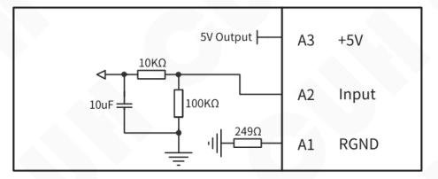

| Terminal | Definition |
|---|---|
| A3 | +5V |
| A2 | Input |
| A1 | RGND |

### Switch Sensor Port C


| Terminal | Definition |
|---|---|
| C3 | 24V Output |
| C2 | Input |
| C1 | GND |

### Switch Sensor Port E

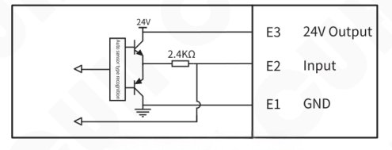

| Terminal | Definition |
|---|---|
| E3 | 24V Output |
| E2 | Input |
| E1 | GND |

### Control Output Port D

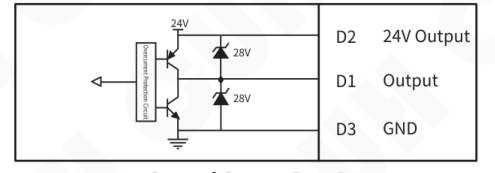

| Terminal | Definition |
|---|---|
| D2 | 24V Output |
| D1 | Output |
| D3 | GND |


### 485 Communication Port F

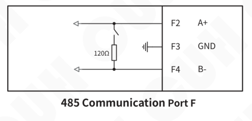

| Terminal | Signal |
|---|---|
| F2 | A+ |
| F3 | GND |
| F4 | B- |

Internal termination shown: 120Ω.

### Count/Speed Preset Port N

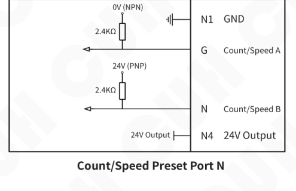

| Terminal | Signal |
|---|---|
| N1 | GND |
| G | Count/Speed A |
| N | Count/Speed B |
| N4 | 24V Output |

Input references shown: 0V (NPN), 24V (PNP), 2.4kΩ pull resistors.

### Digital Sync Port T


| Terminal | Signal |
|---|---|
| T1 | Sync+ |
| T2 | GND |
| T3 | Sync- |

Internal termination shown: 120Ω.


---

## 7.6 Error Code

The fault diagnosis of this controller is divided into fault codes and warning codes. And display each code in turn.

**Error Code:** It is necessary to stop the machine immediately and wait for the fault to disappear before canceling the display.

**Warning Code:** No shutdown is required. Wait until the warning sign disappears before canceling the display.

### Error Code Table

| Error Code | Display | Meaning | Method of Exclusion |
|---|---|---|---|
| Error01 | Short | Short circuit | Confirm whether the main output line is short-circuited and rewire it |
| Error02 | OvrCurrt | Overcurrent | Reduce the output voltage or increase the output frequency |
| Error03 | OverHot | Overheat | Place the controller in a well-ventilated and heat-dissipating area |
| Error04 | UndrCool | Undercooling | Place the controller in a place where the ambient temperature is higher than -20℃ |
| Error05 | CommErr | Communication error | Contact company technical support |
| Error06 | TSnerErr | Temperature sensor error | Contact company technical support |
| Error07 | OverVolt | Overvoltage | The input mains voltage cannot exceed 250V effective value |
| Error08 | UndrVolt | Undervoltage | The input mains voltage cannot be lower than 85V effective value |
| Error09 | LoadErr | Load disconnection | Check whether the output line is correctly connected to the vibration plate |
| Error10 | Send_Seed | Failed to send seed | Contact company technical support |
| Error11 | Send_Exit | The command to leave boot failed to execute | Contact company technical support |
| Error14 | SynchEr0 | CUHBus-DS® bus has 2 or more hosts | 1. If an alarm occurs, set the device offline and then set it online again.<br>2. After the newly added device is powered off, connect the CUHBus-DS® cable to the network device. |
| Error15 | SynchEr1 | Bus error | Confirm whether the CUHBus-DS® communication line is correctly connected, and correctly organize the network |
| Error16 | SynchEr2 | Sync device is not online | Synchronization communication network, frequency synchronization device or remote control synchronization device is not online |

---


## 7.7 Warning Code

Warning Code Table

| Warning Code | Display | Meaning | Method of Exclusion |
|---|---|---|---|
| Warn01 | Saturate | Output saturation | Reduce output voltage |
| Warn02 | decline | count slowdown | Counting deceleration state |
| Warn03 | CND | End of count | Count end status |
| Warn04 | FrqncyLo | Output frequency is too low | Increase frequency offset parameter value |
| Warn05 | FrqncyHi | Output frequency is too high | Increase frequency offset parameter value |
| Warn06 | LoMAlarm | Lack of material | Reduce the material shortage alarm parameter value, or add materials to the material tray |
| Warn07 | PortDErr | Port D output overcurrent | Reduce output port control load |
| Warn08 | RemotLow | Remote control input voltage/current is too low | Increase the remote control input voltage or current |
| Warn09 | MRSErr | Main output RS logic error | When the output logic is an RS flip-flop, the main source 1 and main source 2 signals cannot be valid at the same time |
| Warn10 | 24VErr | 24V error | Do not connect the 24V external power supply to the controller output port |
| Warn11 | 5VErr | 5V error | Do not connect 5V external power supply to the controller output port |
| Warn12 | CtrlRSErr | Control output RS logic error | When the logic of D port is RS flip-flop,D port Source 1 and D port Source 2 signals cannot be valid at the same time |
| Warn13 | OverLoad | Acceleration sensor overload | Replace the acceleration sensor with an appropriate range |
| Warn14 | AcceleEr | Acceleration sensor failure | The sensor is damaged, replace it with a new one |
| Warn15 | EEPErr | Error saving parameters | Confirm that the CUHBus-DS® communication line is connected properly and the networking has been completed correctly. |


---

# Chapter Ⅷ Product Warranty Information

## 8.1 Warranty Period

The warranty period provided by the company for this product is 3 years from the date of delivery of the product to the location designated by the purchaser.

## 8.2 Warranty Coverage

(1) If there is a failure caused by our company during the above warranty period, we will repair the product free of charge. However, The following situations are not covered by the warranty:

&nbsp;&nbsp;&nbsp;&nbsp;a. Failure to comply with the conditions specified in the simple manual, user manual or technical requirements specifically agreed between the purchaser and the company, improper operation, or failure caused by improper use.

&nbsp;&nbsp;&nbsp;&nbsp;b. Failure is not due to a product defect, but to the purchaser's equipment or software design.

&nbsp;&nbsp;&nbsp;&nbsp;c. Malfunctions caused by modifications or repairs not performed by the company's personnel.

&nbsp;&nbsp;&nbsp;&nbsp;d. The failure that can be totally avoided by correct maintenance or replacement of wearing parts according to the simple operation guide or user manual.

&nbsp;&nbsp;&nbsp;&nbsp;e. After the product is shipped from our company, it is caused by factors such as unforeseen changes in the level of science and technology failure.

&nbsp;&nbsp;&nbsp;&nbsp;f. Due to natural disasters such as fire, earthquake, flood, or external factors such as abnormal voltage failure, the company is not responsible for the warranty.

(2) The scope of warranty is limited to the situation stipulated in (1), Indirect losses (such as equipment damage, opportunities, loss of profit, etc.) or other losses, the company do not bear any responsibility.

## 8.3 Product Suitability

The controller of our company is designed and produced for general use in the vibratory feeding industry. Therefore, this controller of our company shall not be used for the following applications and is not suitable for its use.

(1) Facilities that have a serious impact on life and property, such as nuclear power plants, airports, railways, ships, motorized devices and medical equipment.

(2) Public utilities, including electricity, gas, water supply, etc.

(3) Outdoor use in similar conditions or environments.

---


Nanjing CUH Science & Technology Co.,Ltd  
https://en.cuhnj.com  
Tel.:+86-25-84730411 / 84730415 / 84730416  
Fax:+86-25-84730426  
E-mail:sales@cuhnj.com  
Add.:Building 2, Xueyan Tech Park, Tuscity,  
No.9 Zhineng Rd, Jiangning, Nanjing, China

Document No.: IDP1000480


