## Controlador digital de motor asíncrono trifásico

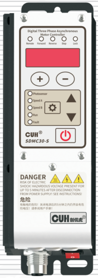

## SDMC30-S

## Manual de instrucciones

---

## Declaración de derechos de autor

Nanjing CUH Science & Technology CO., Ltd. se reserva todos los derechos.

Toda la información contenida en este manual de usuario es conocimiento de nuestra empresa y está protegida por las leyes de derechos de autor y otras leyes relacionadas. CUH goza y se reserva todos los derechos conferidos por las leyes de derechos de autor y otras leyes. Sin el consentimiento por escrito de CUH, no se permite copiar, traducir, imitar ni utilizar de cualquier otra forma parte o la totalidad de este manual de usuario.

## Descargo de responsabilidad

Todo el contenido de este manual de usuario describe únicamente el método de uso de los productos relacionados fabricados por nuestra empresa, y se describe de acuerdo con la tecnología existente y el estado en que se le proporciona al usarlo. Usted debe asumir los riesgos correspondientes al utilizar este producto. Salvo lo exigido por la ley, la empresa no asume ninguna responsabilidad expresa o implícita sobre el producto derivada de este manual de usuario, incluidos, entre otros, daños personales, daños materiales, pérdida de oportunidades, etc.

Usted comprende claramente los riesgos anteriores y acepta que, salvo lo exigido por la ley, la empresa no es responsable de ningún daño o pérdida directa o indirecta causada a usted (incluidos, entre otros, pérdidas tangibles de personal, bienes, datos, etc. y pérdidas intangibles de reputación, oportunidades, etc.)

La empresa se reserva el derecho de modificar los productos aplicables en este manual de usuario sin previo o posterior aviso.

---

# Prefacio

Gracias por elegir el controlador digital de motor asíncrono trifásico de la serie SDMC30 de CUH (en adelante, el controlador). Esta serie de controladores utiliza componentes de alta calidad e incorpora la última tecnología electrónica, y está cuidadosamente diseñada con procesadores digitales de señal de alto rendimiento.

Este manual presenta el método de operación básico, la descripción técnica funcional y ejemplos típicos de aplicación de este producto. Proporciona a los usuarios información relevante sobre la instalación y puesta en marcha, la configuración de parámetros, el diagnóstico de anomalías, la solución de problemas y el mantenimiento rutinario del controlador. Para garantizar la instalación y el uso correctos de este controlador, lea atentamente este manual de usuario antes de la instalación y consérvelo adecuadamente.

Asegúrese de leer los siguientes símbolos para alertarle sobre las precauciones contra lesiones personales y daños al producto.

|  |  |
|---|---|
| ⚠ Peligro | La inobservancia de este punto provocará lesiones personales o la muerte. |
| ⚠ Advertencia | La inobservancia de este punto puede provocar lesiones personales o la muerte. |
| ⚠ Precaución | La inobservancia de este punto puede provocar lesiones moderadas o leves en las personas. |
| Aviso | La inobservancia de este punto provocará daños al producto y daños materiales. |
| ❗ Obligatorio | Indica precauciones y restricciones de uso que deben observarse durante el uso. |

**Este manual es aplicable a los siguientes modelos de controladores:**

- Controlador digital de motor asíncrono trifásico SDMC30-S

  (Entrada monofásica 85~250VAC, salida trifásica 0~220Vrmn/0.2kW)

---

# Entorno de funcionamiento y almacenamiento

## Inspección antes del uso

Todos los controladores pasan una rigurosa inspección de calidad antes de la entrega y se embalan con un embalaje a prueba de golpes. Después de desembalar, compruebe los siguientes puntos:

1. Si el controlador ha sufrido daños durante el transporte.
2. Si el modelo del controlador es el que usted solicitó.

## Entorno de funcionamiento

Siga las notas a continuación para garantizar un mejor rendimiento y una mayor vida útil del controlador:

- ⚠ Entorno bien ventilado
- ⚠ Mantener alejado de agua, corrientes, polvo y especialmente polvo aceitoso
- ⚠ Mantener alejado de gases y líquidos corrosivos o inflamables
- ⚠ Mantener alejado de polvo en suspensión y partículas metálicas
- ⚠ Fijar firmemente para evitar vibraciones propias
- ⚠ Mantener alejado de interferencias electromagnéticas
- ⚠ Asegurar que la temperatura ambiente sea de 0~40 ℃
- ⚠ Para uso a una altitud de 2000 m o inferior

---

# Contenido

**Capítulo Ⅰ Antes del uso — 1**

- 1.1 Compruebe el contenido del paquete — 1
- 1.2 Descripción de los indicadores y botones — 2
- 1.3 Descripción de las partes externas — 3
- 1.4 Descripción de los puertos de señal — 3
- 1.5 Descripción de la placa de características — 4

**Capítulo Ⅱ Introducción del producto — 5**

- 2.1 Introducción del producto — 5

**Capítulo Ⅲ Guía de instalación — 6**

- 3.1 Condiciones de uso del controlador — 6
- 3.2 Método de operación de los botones — 6
- 3.3 Instalación y uso — 7

**Capítulo Ⅳ Descripción de las funciones básicas — 11**

- 4.1 Frecuencia establecida — 11
- 4.2 Marcha adelante e inversa — 12
- 4.3 Parada de emergencia — 13
- 4.4 Tiempo de arranque suave — 14
- 4.5 Tiempo de parada suave/Frenado DC — 14
- 4.6 Bloqueo del teclado — 15
- 4.7 Restauración de la configuración predeterminada — 16

**Capítulo Ⅴ Descripción de las funciones avanzadas — 17**

- 5.1 Arranque/parada del motor y control de dirección — 17
- 5.2 Intercambio de la dirección de rotación del motor y prohibición de la rotación inversa — 18
- 5.3 Parada de emergencia del motor — 19
- 5.4 Configuración de la curva V/F del motor — 21
- 5.5 Protección contra sobrepotencia del motor — 22

---

# Capítulo Ⅰ Antes del uso

Este capítulo presenta el contenido del paquete del producto, la descripción de la apariencia del controlador y la información de la placa de características del controlador.

## 1.1 Compruebe el contenido del paquete

Antes de usarlo, compruebe la integridad del controlador y de los accesorios. Si encuentra que el producto es defectuoso o está dañado, faltan accesorios, etc., póngase en contacto con nuestra empresa.

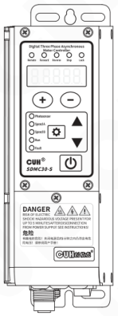

Controlador×1

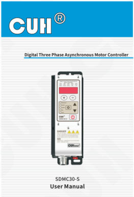

Manual de usuario×1

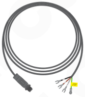

Cable de salida×1

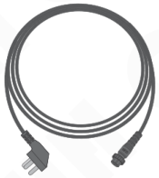

Cable de alimentación de entrada×1

---

## 1.2 Descripción de los indicadores y botones

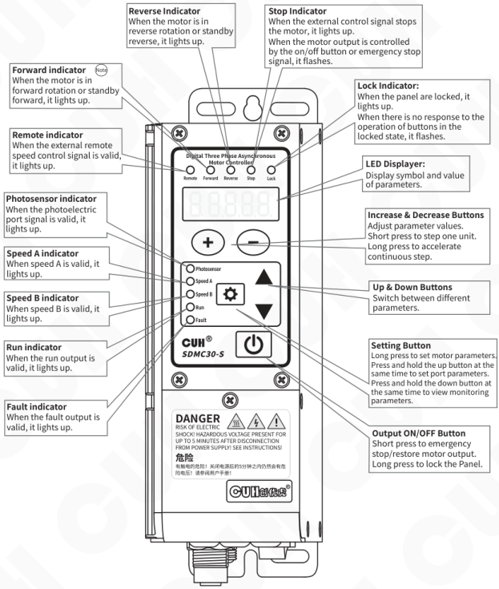

### Indicadores

- **Indicador de marcha inversa**  
  Cuando el motor está en rotación inversa o en espera inversa, se ilumina.
- **Indicador de marcha adelante** (Nota)  
  Cuando el motor está en rotación hacia adelante o en espera hacia adelante, se ilumina.
- **Indicador de control remoto**  
  Cuando la señal externa de control de velocidad remoto es válida, se ilumina.
- **Indicador de fotosensor**  
  Cuando la señal del puerto fotoeléctrico es válida, se ilumina.
- **Indicador de velocidad A**  
  Cuando la velocidad A es válida, se ilumina.
- **Indicador de velocidad B**  
  Cuando la velocidad B es válida, se ilumina.
- **Indicador de funcionamiento**  
  Cuando la salida de funcionamiento es válida, se ilumina.
- **Indicador de fallo**  
  Cuando la salida de fallo es válida, se ilumina.
- **Indicador de parada**  
  Cuando la señal de control externa detiene el motor, se ilumina.  
  Cuando la salida del motor está controlada por el botón ON/OFF o por la señal de parada de emergencia, parpadea.
- **Indicador de bloqueo:**  
  Cuando el panel está bloqueado, se ilumina.  
  Cuando no hay respuesta a la operación de los botones en estado bloqueado, parpadea.

### Pantalla y botones

- **Pantalla LED:**  
  Muestra el símbolo y el valor de los parámetros.
- **Botones de aumento y disminución**  
  Ajustan los valores de los parámetros.  
  Pulsación corta para avanzar una unidad.  
  Pulsación larga para acelerar el avance continuo.
- **Botones arriba y abajo**  
  Cambian entre diferentes parámetros.
- **Botón de configuración**  
  Mantenga pulsado para configurar los parámetros del motor.  
  Mantenga pulsado el botón arriba al mismo tiempo para configurar los parámetros de los puertos.  
  Mantenga pulsado el botón abajo al mismo tiempo para ver los parámetros de monitoreo.
- **Botón de salida ON/OFF**  
  Pulsación corta para parada de emergencia/restaurar la salida del motor.  
  Mantenga pulsado para bloquear el panel.

### Advertencia del panel

**PELIGRO**  
¡RIESGO DE DESCARGA ELÉCTRICA! ¡PRESENCIA DE TENSIÓN PELIGROSA HASTA 5 MINUTOS DESPUÉS DE DESCONECTAR LA ALIMENTACIÓN! ¡VÉANSE LAS INSTRUCCIONES!

### Nota

1. Definición: Dirección de rotación hacia adelante: se refiere a la dirección de rotación cuando se observa el eje desde el lado de la línea de terminales según el motor de accionamiento del motor. IEC60034-8 determina la dirección de rotación del motor.
2. Cuando se intercambia cualquier conexión de dos fases, el motor girará en sentido antihorario, es decir, se intercambian las direcciones hacia adelante e inversa.

---

## 1.3 Descripción de las partes externas

> ⚠️ **Peligro**
>
> Al instalar el cable de salida, alinee la dirección del pin PE e inserte el enchufe; no lo inserte a la fuerza sin confirmar la dirección.
>
> Si se inserta en la dirección incorrecta, la carcasa del motor quedará con alta tensión, **lo que puede provocar la muerte o lesiones graves.**

> ⚠️ **Peligro**
>
> 1. Este producto pertenece a la clase de protección I y el enchufe de tres clavijas del cable de alimentación se utiliza para la puesta a tierra de protección. Asegúrese de que la toma conectada esté conectada a tierra de forma segura.
> 2. En ausencia de una conexión de puesta a tierra de seguridad o en caso de una conexión defectuosa, queda alta tensión en la carcasa del controlador, y el contacto con el controlador **puede provocar la muerte o lesiones graves.**

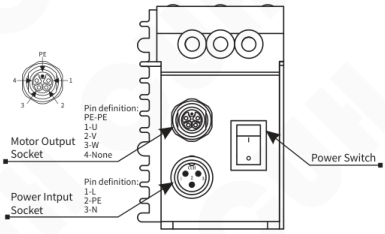

**Toma de salida del motor**

Definición de pines:
- PE-PE
- 1-U
- 2-V
- 3-W
- 4-Ninguno

**Toma de entrada de alimentación**

Definición de pines:
- 1-L
- 2-PE
- 3-N

**Interruptor de alimentación**

## 1.4 Descripción de los puertos de señal

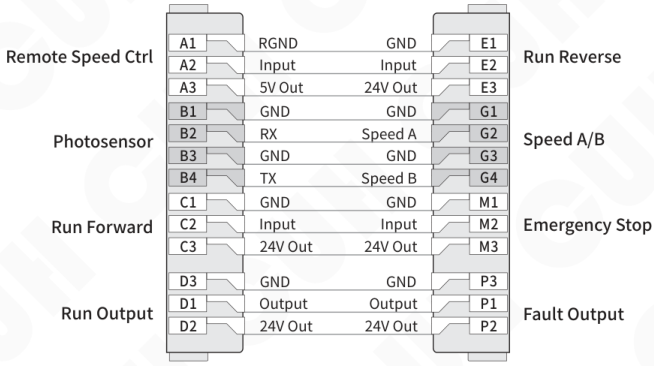

| Función | Pin | Definición | Definición | Pin | Función |
|---|---|---|---|---|---|
| Control de velocidad remoto | A1 | RGND | GND | E1 | Marcha inversa |
| | A2 | Entrada | Entrada | E2 | |
| | A3 | Salida 5V | Salida 24V | E3 | |
| Fotosensor | B1 | GND | GND | G1 | Velocidad A/B |
| | B2 | RX | Velocidad A | G2 | |
| | B3 | GND | GND | G3 | |
| | B4 | TX | Velocidad B | G4 | |
| Marcha adelante | C1 | GND | GND | M1 | Parada de emergencia |
| | C2 | Entrada | Entrada | M2 | |
| | C3 | Salida 24V | Salida 24V | M3 | |
| Salida de funcionamiento | D3 | GND | GND | P3 | Salida de fallo |
| | D1 | Salida | Salida | P1 | |
| | D2 | Salida 24V | Salida 24V | P2 | |

---

## 1.5 Descripción de la placa de características

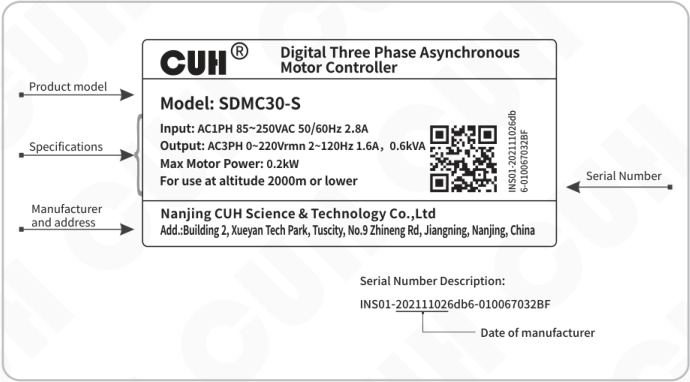

**CUH® — Controlador digital de motor asíncrono trifásico**

- **Modelo del producto**
  - Modelo: SDMC30-S
- **Especificaciones**
  - Entrada: AC1PH 85~250VAC 50/60Hz 2.8A
  - Salida: AC3PH 0~220Vrmn 2~120Hz 1.6A，0.6kVA
  - Potencia máxima del motor: 0.2kW
  - Para uso a una altitud de 2000 m o inferior
- **Fabricante y dirección**
  - Nanjing CUH Science & Technology Co.,Ltd
  - Add.:Building 2, Xueyan Tech Park, Tuscity, No.9 Zhineng Rd, Jiangning, Nanjing, China
- **Número de serie**
  - INS01-202111026db6-010067032BF

**Descripción del número de serie:**

INS01-202111026db6-010067032BF

- 20211102 → Fecha de fabricación

---

## Capítulo Ⅱ Introducción del producto

El contenido principal de este capítulo incluye una breve introducción y las principales características de este producto.

### 2.1 Introducción del producto

Los controladores digitales de motor asíncrono trifásico de la serie SDMC30 son controladores inversores compactos, silenciosos, totalmente de estado sólido y sin ventilador, que ofrecen un rendimiento único gracias al empleo de la última tecnología electrónica y un diseño cuidadoso. Ideales para aplicaciones en entornos industriales, sus características incluyen:

- El modo de salida de onda sinusoidal pura trifásica con modulación por vector espacial (SVPWM) logra un rendimiento de alta eficiencia y bajo ruido del motor.
- La curva V/F se puede personalizar para adaptarse a diferentes tipos de aplicaciones de carga del motor.
- El puerto fotoeléctrico admite sensores fotoeléctricos y sensores de conmutación NPN y PNP.
- La salida de funcionamiento y la salida de fallo se utilizan para indicar el estado de operación y de fallo del controlador.
- El puerto de salida admite los modos NPN, PNP y push-pull.
- La función anti-bloqueo evita que el motor se bloquee debido a una sobrecarga durante la aceleración, la desaceleración y el funcionamiento.
- La función de frenado DC puede frenar rápidamente para detener la rotación del motor durante la parada o la parada de emergencia.
- Admite funciones completas de protección del motor, como sobrecarga/sobrecorriente/bloqueo/falta de fase.
- La función de ajuste de brillo del panel admite 32 niveles de ajuste de brillo.
- La función de prohibición de rotación inversa puede bloquear el motor para impedir la rotación inversa.
- Función de parada de emergencia; puede seleccionar par seguro desconectado, control de freno de seguridad y parada de seguridad de clase 1.
- Función de señal de preparado: emite una señal modulada o una señal válida a través del puerto de transmisión B4 del fotoeléctrico inteligente para indicar que el controlador está en estado de preparado. Cuando el controlador encuentra un error, la señal de preparado deja de ser válida.
- La función de control remoto admite la selección de 1~5V, 0~5V, 0~10V, 4~20mA.
- La función de coeficiente de control remoto puede amplificar 1 vez o reducir 1 vez el efecto de control de la tensión de control remoto.
- La función de velocidad AB admite dos señales de conmutación para controlar hasta cuatro velocidades del motor.
- Las abundantes fuentes de señal de control, relaciones lógicas, retardos de conmutación y modos de salida permiten realizar aplicaciones complejas.
- Las completas funciones de monitoreo pueden supervisar la temperatura, la frecuencia de salida, la potencia de salida y la tensión del puerto de señal.
- Las funciones completas de protección también incluyen: protección contra cortocircuito de la salida del motor, protección contra sobrecarga del controlador, protección contra sobrecalentamiento y enfriamiento excesivo, protección contra subtensión/sobretensión de la fuente de alimentación, protección contra cortocircuito de la salida de funcionamiento y la salida de fallo, protección contra cortocircuito de la salida de 24V y protección contra cortocircuito de la salida de 5V del control de velocidad.

---

# Capítulo Ⅲ Guía de instalación

Este capítulo presenta las condiciones necesarias para el uso del controlador y cómo instalarlo y conectarlo correctamente.

## 3.1 Condiciones de uso del controlador

El controlador se alimenta con 220V CA y la conexión de puesta a tierra de protección se realiza a través del enchufe del cable de alimentación. Proporcione instalaciones de suministro y distribución de red de 220V, 50Hz/60Hz que cumplan con la norma y asegúrese de que el cable de puesta a tierra de protección esté conectado correctamente.

**⚠ Advertencia** Nunca conecte el controlador a una alimentación de 380V CA; esto causará daños graves e irreversibles al controlador y posiblemente provocará explosiones, incendios y otros accidentes de seguridad.

**⚠ Advertencia** Asegúrese de que el lado de la fuente de alimentación esté conectado a tierra de forma fiable. La carcasa metálica del controlador está conectada directamente al cable de puesta a tierra de protección. Una puesta a tierra deficiente provocará que la carcasa del controlador se electrifique y causará un accidente por descarga eléctrica.

**Aviso** El funcionamiento prolongado genera calor y provoca el aumento de la temperatura de la carcasa. Instale el controlador en un entorno bien ventilado y fíjelo bien, lejos de fuentes de vibración.

**Aviso** El puerto de salida del motor de este producto se forma rectificando e invirtiendo la alimentación de red, y no hay ningún enlace de aislamiento en el medio. Por lo tanto, el polo de salida no se puede conectar a la puesta a tierra de protección. Al conectar el motor, asegúrese de que exista un aislamiento básico entre la bobina del motor y la carcasa. De lo contrario, se producirá una fuga eléctrica, que puede causar descargas eléctricas y daños al controlador.

## 3.2 Método de operación de los botones

Este controlador utiliza símbolos de parámetros en una pantalla digital de 5 dígitos y 10 indicadores rojos que muestran el estado del controlador o del puerto de señal.

Este controlador utiliza operación con 6 botones y el método de operación es el siguiente:

 a. La acción de los botones se divide en pulsación corta y pulsación larga (aceleración de primer nivel, aceleración de segundo nivel) según el tiempo de pulsación.

 b. La pulsación corta se define como un tiempo de pulsación mayor que 0.1 y menor que 2 segundos, y la pulsación larga se define como un tiempo de pulsación mayor que 2 segundos.

 c. ⊕ y ⊖ se utilizan para ajustar los valores de los parámetros, y ▼ y ▲ se utilizan para seleccionar diferentes parámetros.

 d. Pulsación corta de ⏻ para la parada de emergencia de la salida del motor, pulsación larga para bloquear/desbloquear el panel.

 e. Mantenga pulsado ⚙ para entrar/salir de la interfaz de parámetros del motor.

 f. Mantenga pulsados ⚙ y ▲ para entrar/salir de la interfaz de parámetros de los puertos.

 g. Mantenga pulsados ⚙ y ▼ para entrar/salir de la interfaz de parámetros de monitoreo. Pulse ⊕ y ⊖ en esta interfaz para ajustar temporalmente la frecuencia establecida.

---

## 3.3 Instalación y uso

### Paso uno:

Abra la caja de embalaje y compruebe el controlador y todos los accesorios.

### Paso dos:

Saque el cable de salida, conecte el bloque de terminales del cable de salida al borne del motor y seleccione el cableado en triángulo o en estrella según la placa de características del motor. Confirme que el cable de tierra amarillo y verde esté conectado de forma fiable con la carcasa metálica del motor.

### Cableado en triángulo

Cuando el controlador se conecta a un motor △230V/Y 400V, se adopta el cableado en triángulo.

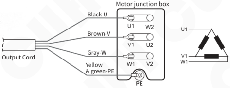

### Cableado en estrella

Cuando el controlador se conecta a un motor △120V/Y 230V, se adopta el cableado en estrella.

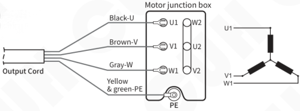

### Nota

- Según las normas IEC60446:
  1. El negro L1, el marrón L2 y el gris L3 se utilizan preferentemente para los conductores de fase de CA.
  2. El conductor de protección PE debe identificarse con una combinación de dos colores amarillo-verde.
- Este controlador emite una tensión de línea trifásica de 220V, adecuada para motores con conexión en triángulo de 220~240V o motores con conexión en estrella de 220~240V. Si se conecta un motor radial de 380V, se producirá una caída severa del par.

### ⚠ Peligro

Asegúrese de que la carcasa del motor esté conectada de forma fiable al cable PE. De lo contrario, la carcasa quedará electrificada, lo que puede provocar la muerte o lesiones graves.

### ⚠ Advertencia

Conecte los bloques de terminales del motor en el orden UVW; si el orden es incorrecto, el motor puede invertir su giro y causar riesgos mecánicos.

---

## Paso tres:

Conecte el enchufe de salida a la toma de salida del motor del controlador y apriete la tuerca.

A continuación, saque el cable de alimentación, inserte el conector de aviación del cable de alimentación en la toma de entrada de alimentación del controlador y apriete la tuerca del conector.

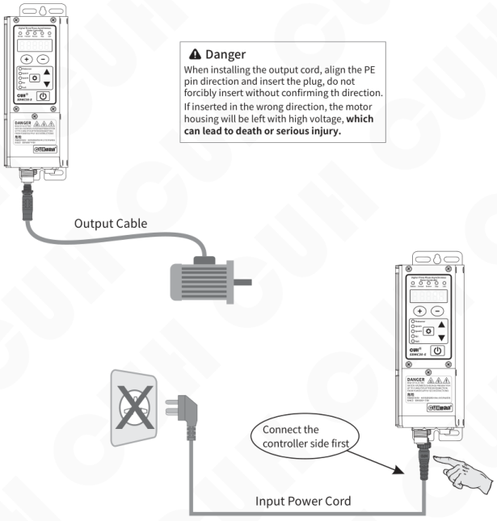

> ⚠ **Peligro**
>
> Al instalar el cable de salida, alinee la dirección del pin PE e inserte el enchufe; no lo inserte a la fuerza sin confirmar la dirección.
>
> Si se inserta en la dirección incorrecta, la carcasa del motor quedará con alta tensión, **lo que puede provocar la muerte o lesiones graves.**

> ⚠ **Peligro**
>
> Para evitar descargas eléctricas, no realice el cableado con la alimentación encendida; asegúrese de cortar la alimentación de la máquina y realice el cableado 5 minutos después de que se apague la pantalla digital. Si no se hace correctamente, **existe riesgo de muerte o lesiones graves.**

---

### Paso cuatro:

Después de confirmar que el interruptor está en la posición de apagado, conecte el enchufe del cable de alimentación de entrada a la toma de corriente de red.

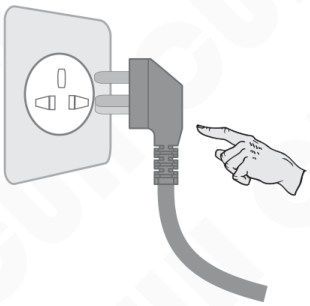

### Paso cinco:

Encienda el interruptor de alimentación; en este momento debería mostrarse la frecuencia establecida “F 50.0” y los indicadores de marcha adelante y de parada estarán encendidos. El motor no gira en este momento.

F significa frecuencia establecida

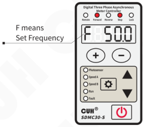

---

## Paso seis:

Conecte la señal de control de marcha adelante o la señal de control de marcha inversa al controlador; en este momento, la luz de parada del controlador se apaga, la luz de funcionamiento se enciende y el motor acelera gradualmente hasta la frecuencia de 50Hz.

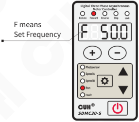

## Paso siete:

Utilice ⊕ y ⊖ para ajustar la frecuencia a la velocidad óptima máxima del motor.

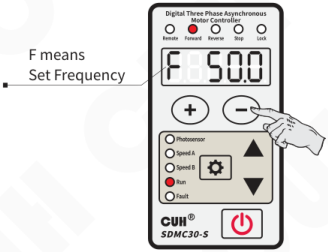

---

## Capítulo Ⅳ Descripción de las funciones básicas

Este capítulo presenta cómo utilizar las funciones básicas de este producto.

### 4.1 Frecuencia establecida

Este controlador puede ajustar la frecuencia de salida digitalmente directamente en el panel. Debido a que utiliza la tecnología de síntesis digital directa de frecuencia (DDS), tiene una precisión y estabilidad de frecuencia muy altas y no cambia con las variaciones del tiempo y la temperatura.

- Encienda el interruptor de alimentación del controlador.
- El controlador entra en el estado de espera del parámetro de frecuencia establecida F; los indicadores de marcha adelante y de parada del controlador se encienden, y la pantalla LED muestra el parámetro F y su valor.
- Pulse ⊕ o ⊖ para ajustar el valor del parámetro.

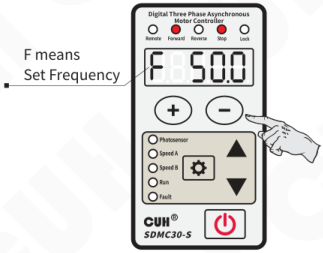

El rango de frecuencia establecida es 2.0~120.0Hz

> - El rango en el que se puede ajustar la frecuencia establecida F está limitado por la frecuencia mínima “r” y la frecuencia máxima “y”.

---

## 4.2 Marcha adelante e inversa

Este controlador dispone de un puerto de marcha adelante C y un puerto de marcha inversa E; cuando la señal del puerto no es válida, el motor no funciona y el indicador de parada se enciende.

Cuando la señal del puerto de marcha adelante C es válida, el motor gira hacia adelante, el indicador de parada se apaga, el indicador de marcha adelante se enciende y el indicador de funcionamiento se enciende.

- Mantenga pulsado ⚙ durante 2 segundos para entrar en la interfaz de parámetros del motor.
- Utilice ▲ y ▼ para cambiar al estado de ajuste de la fuente de control de arranque/parada de marcha adelante 1 “P1”.
- Pulse ⊕ o ⊖ para ajustar el valor del parámetro. El ajuste predeterminado de este parámetro es C.

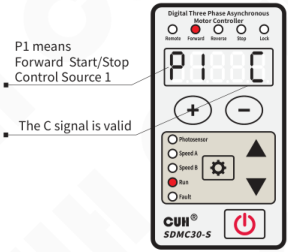

Cuando la señal del puerto de marcha inversa E es válida, el motor gira en sentido inverso, el indicador de parada se apaga, el indicador de marcha inversa se enciende y el indicador de funcionamiento se enciende.

- Mantenga pulsado ⚙ durante 2 segundos para entrar en la interfaz de parámetros del motor.
- Utilice ▲ y ▼ para cambiar al estado de ajuste de la fuente de control de marcha inversa 1 “Π1”.
- Pulse ⊕ o ⊖ para ajustar el valor del parámetro. El ajuste predeterminado de este parámetro es E.

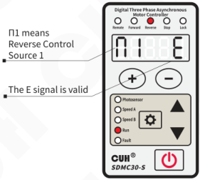

Nota:

1. Cuando las señales de los puertos de marcha adelante y marcha inversa son válidas, el controlador informará del error Er15 conflicto de marcha adelante e inversa, y el motor no funcionará.
2. Si el cableado se realiza según las instrucciones de cableado del motor, de acuerdo con la definición de la dirección de rotación del motor en IEC60034-8, la dirección de rotación hacia adelante se refiere a la rotación en sentido horario observada desde el lado del accionamiento del motor.

---

## 4.3 Parada de emergencia

En un estado de emergencia, el controlador puede entrar en el estado de parada de emergencia para detener rápidamente el funcionamiento del motor. Puede entrar en el estado de parada de emergencia pulsando el botón de encendido del panel o activando la señal del puerto de parada de emergencia. En este momento, el indicador de parada parpadea y se muestra Ar02 parada de emergencia.

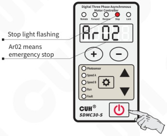

- El estado de parada de emergencia introducido al pulsar el botón de encendido del panel se puede liberar pulsando de nuevo el botón de encendido.
- El estado de parada de emergencia se introduce de forma efectiva activando la señal del puerto de parada de emergencia. Además de retirar la señal del puerto de parada de emergencia, también debe pulsar el botón de encendido del panel para liberar el estado de parada de emergencia.

> El modo de parada de emergencia se puede seleccionar mediante el parámetro Sq: par de seguridad desconectado, control de freno de seguridad y parada de seguridad de clase 1. Para conocer las funciones detalladas, consulte la descripción de las funciones avanzadas.

---

## 4.4 Tiempo de arranque suave

Cuando este controlador arranca desde un estado de parada, la frecuencia de salida del motor puede aumentarse suavemente hasta la frecuencia establecida para evitar impactos en el motor y en el equipo en funcionamiento.

Tiempo de arranque suave (t): cuando el motor arranca desde un estado de parada, el tiempo necesario para que la frecuencia de salida del controlador aumente suavemente desde la frecuencia más baja hasta la frecuencia establecida se denomina tiempo de arranque suave.

- Mantenga pulsado ⚙ durante 2 segundos para entrar en la interfaz de parámetros del motor.
- Utilice ▲ y ▼ para cambiar al estado de ajuste del tiempo de arranque suave “t”.
- Pulse ⊕ o ⊖ para ajustar el valor del parámetro.

El rango del tiempo de arranque suave es 0.0~99.9 segundos

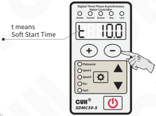

## 4.5 Tiempo de parada suave/Frenado DC

Cuando el controlador se detiene desde el estado de funcionamiento, la frecuencia de salida del motor puede reducirse suavemente hasta la frecuencia más baja para evitar impactos en el motor y en el equipo en funcionamiento.

Tiempo de parada suave (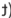): cuando el motor se detiene desde el estado de funcionamiento, el tiempo necesario para que la frecuencia de salida del controlador disminuya suavemente desde la frecuencia establecida hasta la frecuencia más baja se denomina tiempo de parada suave.

- Mantenga pulsado ⚙ durante 2 segundos para entrar en la interfaz de parámetros del motor.
- Utilice ▲ y ▼ para cambiar al estado de ajuste del tiempo de parada suave “[[vcrop:22:2]]”.
- Pulse ⊕ o ⊖ para ajustar el valor del parámetro.

El rango del tiempo de parada suave es 0.0~99.9 segundos  
El rango del tiempo de frenado DC es -0.0~-99.9 segundos

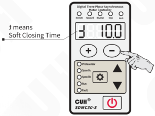

---

## 4.6 Bloqueo del teclado

Cuando se ajustan los parámetros del controlador, la función de bloqueo del teclado puede bloquear todos los botones del panel para evitar errores de operación.

Incluso si se apaga y se vuelve a encender, el estado del bloqueo del teclado permanece en el estado en que se encontraba la última vez que se apagó.

- Mantenga pulsado ⏻ durante 2 segundos para bloquear todos los botones del panel. El indicador de bloqueo se enciende.
- Mantenga pulsado ⏻ durante 2 segundos de nuevo para desbloquear.

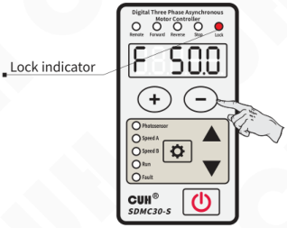

> Cuando el controlador está bloqueado, los botones de operación no responden y el indicador de bloqueo parpadea.

---

## 4.7 Restauración de la configuración predeterminada

El usuario puede restaurar rápidamente el controlador al estado predeterminado de fábrica.

Debido a las potentes funciones del controlador, se pueden ajustar muchos parámetros. Para los principiantes, es posible que no sea posible restaurar el estado de funcionamiento normal del controlador después de varios ajustes y modificaciones. Utilice esta función para restaurar rápidamente el estado desordenado de los parámetros al ajuste predeterminado de fábrica.

- Mantenga pulsados ⚙ y ▲ simultáneamente para entrar en la interfaz de parámetros de los puertos.

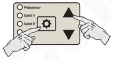

- Pulse brevemente ▲ para cambiar a la pantalla LED con parpadeo completo, es decir, el parámetro de “Restauración de la configuración predeterminada”. A continuación, pulse ⊕ y mantenga pulsado hasta que el controlador muestre “-----”, lo que indica que el controlador se ha restaurado.

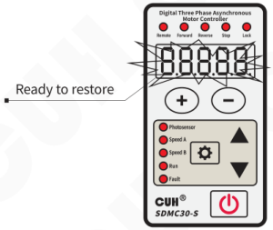

- Suelte ⊕; después de que el controlador muestre “CUH”, entrará en la interfaz de espera normal. En ese momento, todos los parámetros se han restaurado a los ajustes predeterminados de fábrica.

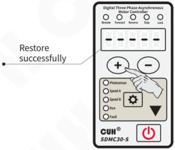

> Antes de que el usuario realice una restauración de fábrica, debe pulsar ⏻ para poner el controlador en estado de parada de emergencia; en ese momento, la luz de parada parpadea.

---

## Capítulo Ⅴ Descripción de las funciones avanzadas

Este capítulo presenta principalmente cómo utilizar las funciones avanzadas de este producto.

### 5.1 Arranque/parada del motor y control de dirección

Este controlador está diseñado con una señal de arranque/parada de marcha adelante y una señal de arranque/parada de marcha inversa para controlar el arranque/parada y la dirección del motor. La señal de arranque/parada de marcha adelante tiene 2 fuentes de señal y una unidad de cálculo lógico; lo mismo ocurre con la señal de marcha inversa. Estas dos señales se pueden seleccionar para controlar el arranque/parada, así como la marcha adelante/inversa del motor. Consulte la figura a continuación para conocer las relaciones lógicas específicas.

Las fuentes de control de arranque/parada de marcha adelante e inversa incluyen respectivamente: 0, 1, b, -b, C, -C, E, -E, SA, -SA, Sb, -Sb, ES, -ES, od, -od, oP, -oP.

Las relaciones lógicas incluyen: And, or, Xor y disparadores RS.

Existen dos valores para los modos de control de marcha adelante e inversa:

- **Fr=0 significa:** la señal de arranque/parada de marcha adelante se utiliza para controlar el arranque y la parada de marcha adelante; lo mismo ocurre con la señal de marcha inversa
- **Fr=1 significa:** la señal de arranque/parada de marcha adelante se utiliza para controlar el arranque y la parada, pero la señal de marcha inversa se utiliza para controlar la dirección.

Nota: cuando Fr=0 y las señales de marcha adelante e inversa son válidas al mismo tiempo, se activa Er15 conflicto de marcha adelante/inversa y el motor deja de funcionar.

---

## 5.2 Intercambio de la dirección de rotación del motor y prohibición de la rotación inversa

En aplicaciones prácticas, si es necesario cambiar la dirección de rotación del motor o prohibir que el motor funcione en una dirección determinada debido a limitaciones del sistema mecánico o razones de cableado, se puede utilizar el parámetro Ph (Phase) para intercambiar la dirección.

- **Cuando Ph=Abc,** significa la dirección estándar, es decir, la rotación hacia adelante es en sentido horario cuando se observa desde el extremo de accionamiento del motor.
- **Cuando Ph=Acb,** significa que la dirección está intercambiada, es decir, la rotación hacia adelante es en sentido antihorario cuando se observa desde el extremo de accionamiento del motor.
- **Cuando Ph=A.b.c.,** significa que se prohíbe la inversión en la dirección estándar, es decir, el motor solo puede girar en sentido horario; cuando aparece el comando de inversión, no responde y muestra la advertencia Ar08 prohibición de inversión.
- **Cuando Ph=A.c.b.,** significa que el intercambio de dirección prohíbe la rotación hacia adelante, es decir, el motor solo puede girar en sentido antihorario, no responde cuando aparece el comando de rotación hacia adelante y muestra la advertencia Ar08 prohibición de inversión.

La figura siguiente muestra un motor en sentido horario, con el eje girando en sentido horario desde el extremo de accionamiento y la dirección de observación desde el extremo de accionamiento hasta el extremo no accionado.

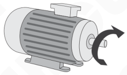

La figura siguiente muestra un motor en sentido antihorario, con el eje girando en sentido antihorario desde el extremo de accionamiento.

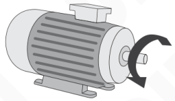

---

## 5.3 Parada de emergencia del motor

Este controlador puede realizar la parada de emergencia del motor; esta fuente de parada puede activarse de forma efectiva pulsando el botón de encendido del panel o el interruptor de parada de emergencia externo.

La fuente de parada de emergencia puede seleccionar diferentes fuentes de señal; de forma predeterminada es la señal del puerto de parada de emergencia. El botón de encendido del panel es siempre una fuente de parada de emergencia efectiva.

Según el modo de parada de emergencia, el parámetro Sq puede seleccionar diferentes estrategias para las paradas de emergencia:

- **Sq=Sto,** el controlador corta inmediatamente la alimentación del motor y el motor desacelera y se detiene por inercia.
- **Sq=Sbc,** el motor se detiene mediante frenado DC y el tiempo de frenado está determinado por el tiempo de parada suave. El puerto de salida de fallo emite un estado de parada de emergencia y no está controlado por la fuente de señal; debe utilizarse un relé de freno de seguridad.
- **Sq=SS1,** el motor desacelera o frena hasta detenerse según la acción definida por el tiempo de parada suave.

### Método de conexión del interruptor de parada de emergencia

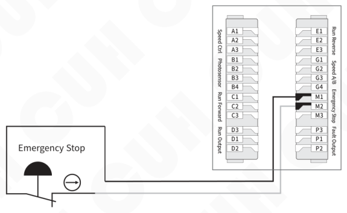

---

### Sto: Par de seguridad desconectado

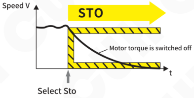

### Sbc: Control de freno de seguridad

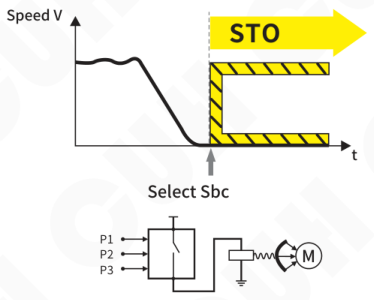

### SS1: Parada de seguridad de clase 1

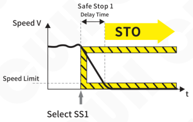

---

## 5.4 Configuración de la curva V/F del motor

Este controlador puede personalizar la curva V/F para adaptarse a diferentes cargas del motor.

Se define por la frecuencia máxima y, la frecuencia nominal b, la tensión nominal h, la frecuencia intermedia n, la tensión intermedia o, la frecuencia más baja r y la tensión mínima u.

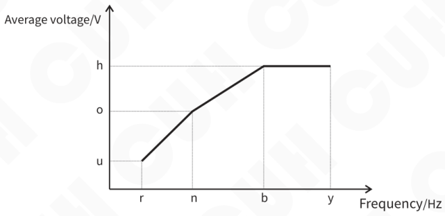

**Nota:** debido a la naturaleza inductiva de la carga del motor, las tensiones de línea de salida se calibran al valor medio rectificado Vrmn para mantener la corriente en la sección lineal de la curva V/F. En general, el valor RMS Vrms de la onda sinusoidal estándar es 1.11 veces el valor medio rectificado Vrmn.

---

**Diagrama de la protección contra exceso del límite superior de potencia del motor**

El controlador monitorea la potencia eléctrica del motor en tiempo real. Cuando la potencia supera el valor de la potencia eléctrica nominal del motor Po multiplicada por el coeficiente de exceso de potencia rc, se activa la protección contra exceso del límite de potencia del motor Er02P. El integrador electrónico de sobrecalentamiento del motor entra directamente en saturación. El controlador reducirá la frecuencia de salida hasta que la potencia de salida descienda a la potencia definida por el coeficiente de reducción de potencia rL. En este momento, el integrador se restablece. Cuando se completa el restablecimiento, vuelve al funcionamiento a la frecuencia establecida y reinicia un nuevo ciclo de protección.

---

## 5.6 Control remoto de la velocidad del motor

Además de ajustar la frecuencia a través del panel, este controlador también puede controlar la frecuencia de salida mediante señales analógicas externas. La señal analógica admite potenciómetro y señales de 1~5V, 4~20mA, 0~5V y 0~10V, que se pueden configurar mediante el parámetro fuente de control remoto A.

- **A=PAd:** indica que la frecuencia establecida solo se controla mediante los botones del panel.
- **A=1-5V:** indica que la frecuencia establecida con la entrada externa de 1-5V está entre la frecuencia mínima r y la frecuencia máxima y. Cuando la tensión es de 0-0.5V, el control remoto no es válido y la frecuencia establecida se controla mediante el panel. El control remoto es válido a 0.5-1V, pero el controlador no funcionará.
- **A=0-5V:** indica que la entrada externa es de 0-5V; la frecuencia establecida está entre la frecuencia mínima r y la frecuencia máxima y.
- **A=0-10:** indica que la entrada externa es de 0-10V; la frecuencia establecida está entre la frecuencia mínima r y la frecuencia máxima y.

Este controlador también está diseñado con un parámetro coeficiente de control remoto c para amplificar o reducir el efecto de la tensión de control remoto, que se puede ajustar en el rango de 0.5~2.0. Cuando se ajusta en 0.5, significa que el efecto del control remoto de la frecuencia establecida mediante el ajuste del valor de tensión se reduce a la mitad, es decir, solo puede elevarse de forma remota hasta la mitad de la frecuencia máxima y. Cuando se ajusta en 2.0, significa que el efecto de la tensión de control remoto que controla la tensión de salida se duplica. Es decir, la frecuencia establecida alcanza y cuando la tensión de control remoto alcanza solo la mitad. Si la tensión de control remoto se aumenta aún más, la tensión de salida ya no se puede incrementar.

### Método de conexión del control por potenciómetro

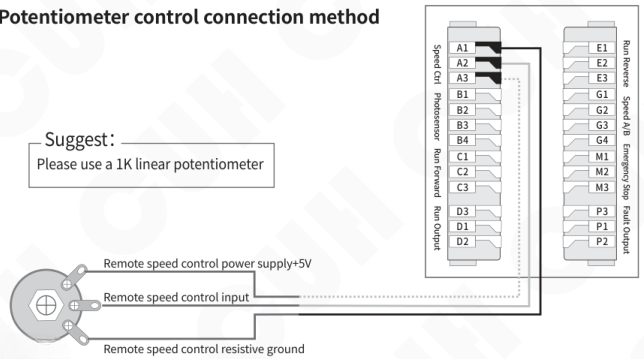

Cuando se conecta el potenciómetro, el indicador de control remoto se enciende; en este momento, el ajuste de frecuencia desde el panel no es válido.

---

## Método de conexión del control de tensión 1~5V

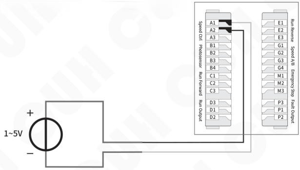

## Método de conexión del control de corriente 4~20mA

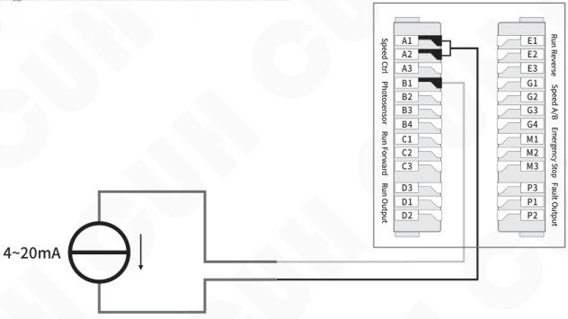

1. Seleccione A=1-5V; admite potenciómetro y entrada de 1~5V y 4~20mA.
2. Al seleccionar 0~5V o 0~10V, el método de cableado es el mismo que el de 1-5V.

---

## 5.7 Preajuste digital de la velocidad del motor

La función de preajuste de velocidad es una función que selecciona directamente una velocidad predeterminada mediante señales de control externas o internas. Constituye un sistema de control con hasta cuatro velocidades.

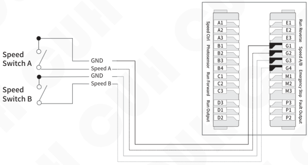

De forma predeterminada, la fuente de preajuste de velocidad 1 selecciona el puerto de velocidad A externo SA, y la fuente de preajuste de velocidad 2 selecciona el puerto de velocidad B externo Sb. Según el escenario de aplicación, la fuente de señal se puede modificar para cambiar entre diferentes velocidades.

Cada fuente de preajuste de velocidad tiene un indicador correspondiente en el panel, que se ilumina cuando la fuente está activa. La combinación de los dos estados de los indicadores tiene 4 estados (AB ambos apagados, A encendido y B apagado, A apagado y B encendido, AB ambos encendidos).

Mediante la combinación de señales, el controlador entrará en el estado de preajuste de velocidad correspondiente, y la frecuencia establecida del controlador se puede ajustar con ⊕ y ⊖. Esta frecuencia se memorizará automáticamente, y la señal de control de preajuste de velocidad hará que el controlador cambie al valor de frecuencia establecida memorizado inmediatamente después de entrar en este estado en cualquier momento.

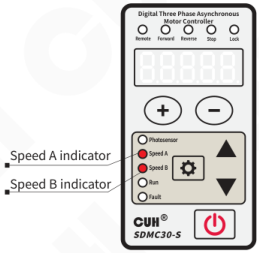

---

## 5.8 Sensor de conmutación

El controlador está diseñado con cuatro interfaces de sensor de conmutación: funcionamiento de marcha adelante e inversa, velocidad AB y parada de emergencia. Estas interfaces admiten los modos NPN, PNP, Ut1 y Ut0, y se pueden configurar mediante el parámetro tipo de sensor de conmutación ΓA.

- **El modo Ut1 es un escaneo único;** es decir, antes de que la señal del sensor sea válida, se cambian los niveles alto y bajo para detectar si el puerto es válido. Después de encontrar una señal válida, se determina el tipo de sensor del puerto y ya no se escanea.
- **El modo Ut0 es un escaneo continuo;** independientemente del tipo de sensor, siempre detecta si el puerto está conectado a una señal válida cambiando los niveles alto y bajo.

El retardo de conmutación de cada cantidad de conmutación también se puede ajustar mediante los parámetros correspondientes; consulte la tabla de parámetros para obtener más detalles.

### Método de conexión del sensor de conmutación

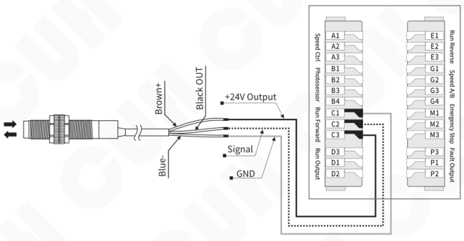

---

## 5.9 Puerto del sensor fotoeléctrico inteligente

El puerto fotoeléctrico inteligente de este controlador admite sensores fotoeléctricos de barrera o reflectivos compuestos por diodos emisores de luz y fototriodos, y también se puede configurar para admitir sensores de conmutación NPN o PNP mediante el parámetro de sensibilidad fotoeléctrica inteligente P.

### Método de conexión del sensor fotoeléctrico

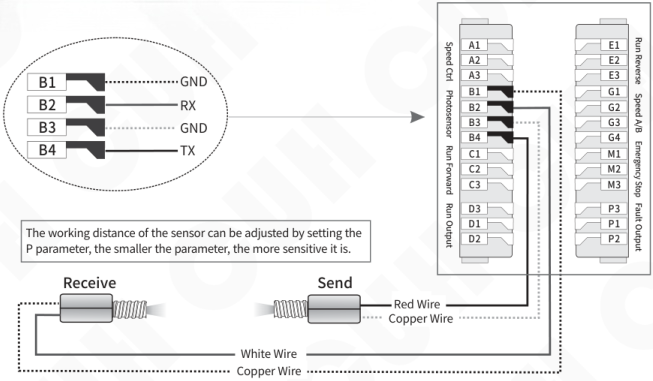

La distancia de trabajo del sensor se puede ajustar configurando el parámetro P; cuanto menor es el parámetro, más sensible es.

### Método de conexión del sensor de conmutación

Ajuste el tipo NPN o PNP mediante el parámetro P

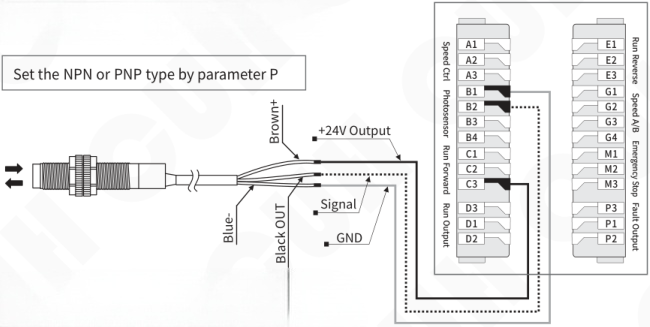

**Nota:**

Cuando el valor de P es nPn o PnP, B4 emite una señal válida de 10mA.

De 2 a 1000, B4 emite una señal modulada de 10mA con una frecuencia de aproximadamente 200Hz.

Cuando el controlador encuentra un error, B4 no emite salida. Esta es la función de señal de preparado.

---

## 5.10 Puerto de salida de funcionamiento/salida de fallo

Los puertos de salida de funcionamiento y salida de fallo admiten salida NPN, salida PNP y salida push-pull. De las cuales:

- La salida NPN es válida a nivel bajo y la salida no es válida en estado de alta impedancia.
- La salida PNP es válida a nivel alto y la salida no es válida en estado de alta impedancia.
- La salida push-pull es válida a nivel alto y no es válida a nivel bajo.

### 5.10.1 Método de cableado de la salida de funcionamiento/salida de fallo

**Método de conexión de la salida NPN**

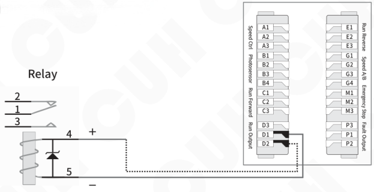

**Método de conexión de la salida PNP o push-pull**

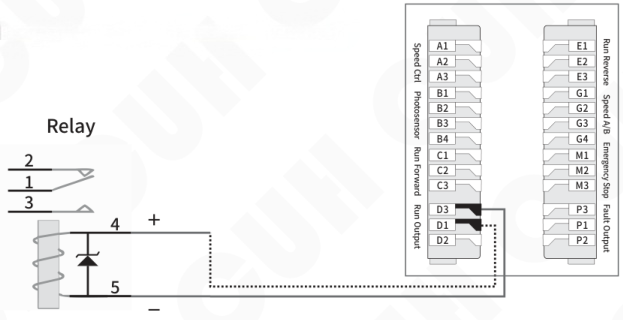

> Si se conecta un relé de 24V, asegúrese de confirmar los polos positivo y negativo de la bobina para garantizar que estén conectados correctamente. Debido a que la capacidad de corriente de salida de este puerto es de 350mA, el diodo de protección interno del relé cortocircuitará el puerto de este controlador tras invertirse, activando la protección contra cortocircuito Er07d/P.

---

## 5.10.2 Fuente de señal y diagrama lógico de la salida de funcionamiento/salida de fallo

El control de la salida de funcionamiento/salida de fallo es el resultado de la relación lógica entre las dos fuentes, y las siguientes fuentes se pueden seleccionar de la lista de fuentes.

Lista de significados de las fuentes de señal:

| Fuente de señal | Significado |
|---|---|
| 0 | Señal no válida |
| 1 | Señal válida |
| b | Señal del puerto fotoeléctrico inteligente |
| -b | Inversión de la señal del puerto fotoeléctrico inteligente |
| C | Señal del puerto de marcha adelante |
| -C | Inversión de la señal del puerto de marcha adelante |
| E | Señal del puerto de marcha inversa |
| -E | Inversión de la señal del puerto de marcha inversa |
| SA | Señal del puerto de velocidad A |
| -SA | Inversión de la señal del puerto de velocidad A |
| Sb | Señal del puerto de velocidad B |
| -Sb | Inversión de la señal del puerto de velocidad B |
| ES | Señal del puerto de parada de emergencia |
| -ES | Inversión de la señal del puerto de parada de emergencia |
| od | Señal del puerto de salida de funcionamiento |
| -od | Inversión de la señal del puerto de salida de funcionamiento |
| oP | Señal del puerto de salida de fallo |
| -oP | Inversión de la señal del puerto de salida de fallo |
| oq | Señal de salida del motor |
| -oq | Inversión de la señal de salida del motor |
| Er | Señal de cualquier fallo |
| -Er | Inversión de la señal de cualquier fallo |
| Ar | Señal de cualquier advertencia |
| -Ar | Inversión de la señal de cualquier advertencia |

---

## Diagrama lógico de la salida de funcionamiento/salida de fallo:

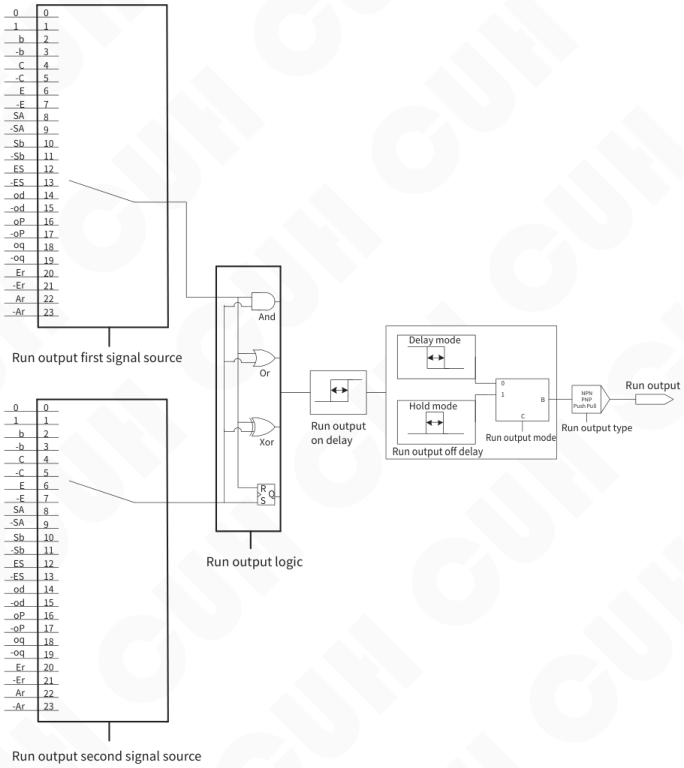

Nota: el diagrama lógico de la salida de fallo es coherente con el diagrama lógico de la salida de funcionamiento.

---

## 5.10.3 Descripción de los modos de la salida de funcionamiento/salida de fallo

Hay 2 modos disponibles para la salida de funcionamiento/salida de fallo: modo de retardo y modo de retención.

**Modo de retardo:** significa que, después de que la señal que controla la salida de funcionamiento/salida de fallo cambie de válida a no válida, la salida de funcionamiento/salida de fallo se apaga tras un período de tiempo de retardo de desconexión.

**Modo de retención:** significa que, después de que la señal que controla la salida de funcionamiento/salida de fallo se vuelva válida, la salida de funcionamiento/salida de fallo permanece abierta durante el tiempo de retardo de desconexión y se apaga una vez superado dicho tiempo de retardo de desconexión.

La diferencia entre los dos modos se expresa en forma de diagrama de temporización a continuación, donde la señal de entrada es la señal de salida después del selector de relación lógica.

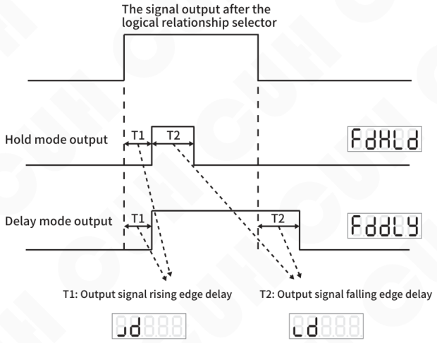

---

## 5.11 Estado de funcionamiento tras el encendido

La función de ajuste del estado de funcionamiento tras el encendido permite especificar el estado del botón de encendido después del encendido, mediante el ajuste del parámetro de estado de funcionamiento PS.

- **PS=run,** indica que el botón de encendido del controlador está en funcionamiento después del encendido.
- **PS=stP,** indica que el botón de encendido del controlador está en estado de parada después del encendido.
- **PS=FoL,** indica que el botón de encendido del controlador está en el estado del último apagado tras el encendido.

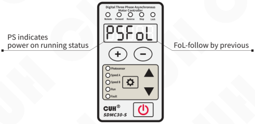

> FoL representa el estado antes de que se apague el controlador.
>
> Si el controlador está en el estado de parada de emergencia con la luz de parada parpadeando antes de apagar la alimentación, permanecerá en este estado cuando se vuelva a encender.

---

## 5.12 Ajuste del brillo del panel

Este controlador utiliza un nuevo chip controlador de pantalla digital, que permite a los usuarios ajustar el valor de brillo de la pantalla entre 1 y 32 mediante el parámetro LED.

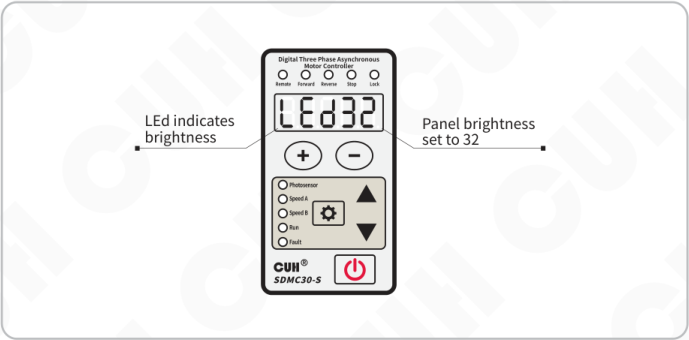

# Capítulo Ⅵ Especificaciones técnicas

## 6.1 Dimensiones　(unidad: mm)

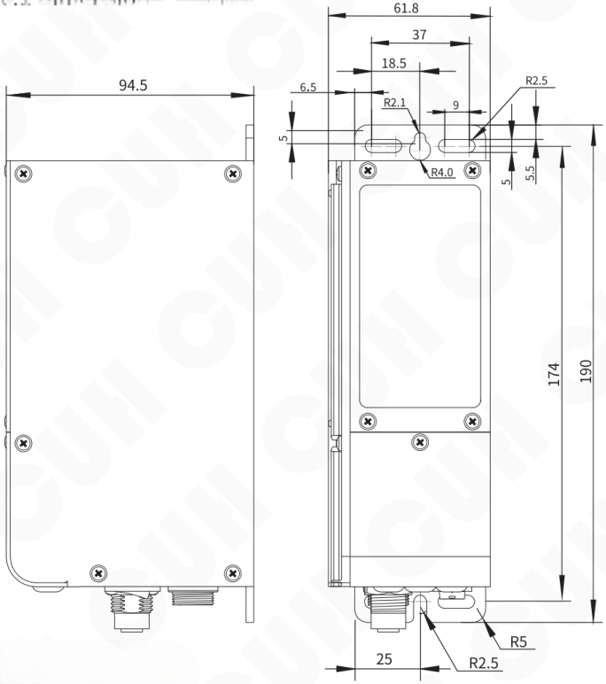

| Rango de dimensiones | tolerancia |
|---|---|
| 0~3 | ±0.05 |
| 3~10 | ±0.1 |
| 10~30 | ±0.15 |
| 30~80 | ±0.2 |
| 80~180 | ±0.3 |
| >180 | ±0.5 |

> **！Obligatorio**
>
> Asegúrese de fijar el producto sobre una plataforma sólida según sea necesario y fije los orificios de montaje superior e inferior del controlador. Instálelo lejos de la puesta a tierra del equipo de vibración.

Esta tabla de tolerancias es aplicable a todos los productos de esta serie.

---

## 6.2 Especificaciones técnicas

| Elemento | Mín. | Típico | Máx. | Unidad | Nota |
|---|---|---|---|---|---|
| Tensión de entrada | 85 | 220 | 250 | V | 50/60Hz CA RMS |
| Tensión de línea de salida | 0 | 200 | 220 | Vrmn | Promedio rectificado |
| Corriente de entrada RMS | —— | —— | 2.8 | A | |
| Pico de corriente de entrada | —— | —— | 8.0 | A | |
| Rango de ajuste de corriente de salida | 0 | —— | 1.6 | A | Promedio rectificado |
| Capacidad de salida | 0 | —— | 600 | VA | |
| Frecuencia de salida | 2.0 | —— | 120.0 | Hz | |
| Precisión de ajuste de frecuencia | | 0.1 | | Hz | |
| Forma de onda de salida | | Onda senoidal vectorial | | | |
| Potencia de motor aplicable | —— | —— | 0.2 | kW | 1/4HP |
| Temperatura de activación de la protección por sobrecalentamiento | —— | 65 | —— | °C | Retorno a la normalidad a 60°C |
| Corriente de salida de control DC | 0 | —— | 350 | mA | |
| Corriente de salida de 24V | —— | —— | 700 | mA | |
| Tensión de salida de control DC | 22 | 24 | 26 | V | |
| Señal de control analógica | | 4~20 / 1~5、0~5、0~10 | | mA / V | Controlada por el parámetro A |
| Señal de control digital | | 24 | | V | Señal de conmutación |
| Método de ajuste | | 6 | | Botón | |
| Consumo de energía en espera | —— | 3 | —— | W | |
| Método de visualización | | 5 | | Dígito | LED |
| Peso | | 830 | | g | Sin accesorios |
| Dimensiones | | 190\*61.8\*94.5 ( L\*W\*H ) | | mm | |
| Grado de protección de entrada | | IP20 | | | |
| Temperatura ambiente | -10 | 25 | 40 | °C | Sin condensación |
| Humedad ambiente | 10 | 60 | 85 | % | Sin condensación |
| Temperatura ambiente de almacenamiento | -20 | 25 | 85 | °C | Sin condensación |
| Altitud aplicable | | <2000 | | m | |

# Capítulo Ⅶ Apéndice

## 7.1 Tabla de parámetros

| Parámetro | Definición | Símbolo | imagen del símbolo | Rango | Predeterminado |
|---|---|---|---|---|---|
| Parámetro en espera | Frecuencia establecida | F |  | 2.0~120.0 (Hz) (limitada por r e y) | 50.0 |
| Parámetro del motor — Mantenga pulsado ⚙ | Fuente de control de arranque/parada de marcha adelante 1 | F1 | 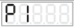 | 0, 1, b, -b, C, -C, E, -E, SA, -SA, Sb, -Sb, ES, -ES, od, -od, oP, -oP | C |
| Parámetro del motor | Fuente de control de arranque/parada de marcha adelante 2 | F2 |  | 0, 1, b, -b, C, -C, E, -E, SA, -SA, Sb, -Sb, ES, -ES, od, -od, oP, -oP | -b |
| Parámetro del motor | Relación lógica de arranque/parada de marcha adelante | FA |  | And, or, Xor, rS | And |
| Parámetro del motor | Fuente de control de marcha inversa 1 | A1 |  | 0, 1, b, -b, C, -C, E, -E, SA, -SA, Sb, -Sb, ES, -ES, od, -od, oP, -oP | E |
| Parámetro del motor | Fuente de control de marcha inversa 2 | A2 |  | 0, 1, b, -b, C, -C, E, -E, SA, -SA, Sb, -Sb, ES, -ES, od, -od, oP, -oP | -b |
| Parámetro del motor | Relación lógica de marcha inversa | AA |  | And, or, Xor, rS | And |
| Parámetro del motor | Modo de control de marcha adelante e inversa | Fr |  | 0 (La fuente de control de marcha adelante se utiliza para iniciar y detener la rotación en marcha adelante, y la fuente de control de marcha inversa se utiliza para controlar el inicio y la parada de la rotación inversa) 1 (La fuente de control de marcha adelante se utiliza para controlar el inicio y la parada, la fuente de control de marcha inversa se utiliza para controlar la marcha adelante e inversa) | 0 |
| Parámetro del motor | Fuente de parada de emergencia | Eq |  | 0, 1, b, -b, C, -C, E, -E, SA, -SA, Sb, -Sb, ES, -ES, od, -od, oP, -oP, oq, -oq, Er, -Er, Ar, -Ar | ES |
| Parámetro del motor | Tipo de parada de emergencia | Sq |  | Sto: Par de seguridad desconectado, Sbc: Control de freno de seguridad, SS1: Parada de seguridad de categoría 1　(Nota 1) | Sto |
| Parámetro del motor | Tiempo de arranque suave | t |  | 0.0~99.9 (s) | 10.0 |
| Parámetro del motor | Tiempo de parada suave | d |  | Tiempo de frenado DC: -0.0~-99.9 (s) Tiempo de parada suave: 0.0~99.9 (s) | 10.0 |
| Parámetro del motor | Frecuencia máxima | y |  | 2.0~120.0 (Hz) | 50.0 |
| Parámetro del motor | Frecuencia nominal | b |  | 45.0~65.0 (Hz) | 50.0 |
| Parámetro del motor | Tensión nominal | h |  | 70~220 (Vrmn) | 200 |
| Parámetro del motor | Frecuencia intermedia | n |  | r~b (Hz) | 10.0 |
| Parámetro del motor | Tensión intermedia | o |  | u~h (Vrmn) | 40 |
| Parámetro del motor | Frecuencia mínima | r |  | 2.0~n (Hz) | 2.0 |
| Parámetro del motor | Tensión mínima | u |  | 0~o (Vrmn) | 8 |
| Parámetro del motor | Potencia eléctrica nominal del motor | Pn |  | 0.01~0.20 (kW) | 0.20 |
| Parámetro del motor | Factor de exceso de potencia | rc |  | 100~150 (%) | 150 |
| Parámetro del motor | Coeficiente de corriente de frenado | cb |  | 10~150 (%) | 100 |
| Parámetro del motor | Umbral de sobrecalentamiento de potencia eléctrica | oL |  | 0~90 (tiempos*segundos) Observaciones: Si se excede la potencia eléctrica nominal del motor sin superar el límite superior de la potencia del motor, y si la integral por segundo excede este ajuste, entrará en el estado de protección electrónica contra sobrecalentamiento. | 30 |
| Parámetro del motor | Factor de reducción de potencia | rL |  | 0~90(%) 0 significa apagado, 90 significa reducir al 90% de la potencia nominal. | 0 |
| Parámetro del motor | Intercambio de dirección de rotación (Nota 2) | Ph |  | Abc: dirección estándar, Acb: intercambio de dirección, A.b.c.: Se prohíbe la reversión de la dirección estándar (solo marcha adelante), A.c.b.: El intercambio de dirección prohíbe la rotación en marcha adelante (solo marcha inversa) | AbC |
| Parámetro del motor | Estado de funcionamiento al encender | PS |  | run: funcionando, stp: detenido, FoL: guardar el último estado | FoL |

**Parámetro de puerto**  
Mantenga pulsados ⚙ y ▲

| Definición | Símbolo | imagen del símbolo | Rango | Predeterminado |
|---|---|---|---|---|
| Sensibilidad del sensor fotoeléctrico inteligente | P |  | nPn, PnP, 2~1000 | nPn |
| Retardo de conexión del sensor fotoeléctrico inteligente | J |  | 0.0~99.9 (s) | 0.2 |
| Retardo de desconexión del sensor fotoeléctrico inteligente | L |  | 0.0~99.9 (s) | 0.2 |
| Tipo de sensor de conmutación | rA |  | nPn, PnP, Ut1: Escaneo único, Ut0: Escaneo continuo | Ut0 |
| Retardo de conexión de marcha adelante | JC |  | 0.0~99.9 (s) | 0.2 |
| Retardo de desconexión de marcha adelante | LC |  | 0.0~99.9 (s) | 0.2 |
| Retardo de conexión de marcha inversa | JE |  | 0.0~99.9 (s) | 0.2 |
| Retardo de desconexión de marcha inversa | LE |  | 0.0~99.9 (s) | 0.2 |
| Retardo de conexión de velocidad A/B | JG |  | 0.0~99.9 (s) | 0.2 |
| Retardo de desconexión de velocidad A/B | LG |  | 0.0~99.9 (s) | 0.2 |
| Retardo de conexión de parada de emergencia | JJ |  | 0.0~99.9 (s) | 0.2 |
| Retardo de desconexión de parada de emergencia | LL |  | 0.0~99.9 (s) | 0.2 |
| Fuente de preajuste de velocidad 1 | S1 |  | 0, 1, b, -b, C, -C, E, -E, SA, -SA, Sb, -Sb, ES, -ES, od, -od, oP, -oP, oq, -oq, Er, -Er, Ar, -Ar | SA |
| Fuente de preajuste de velocidad 2 | S2 |  | 0, 1, b, -b, C, -C, E, -E, SA, -SA, Sb, -Sb, ES, -ES, od, -od, oP, -oP, oq, -oq, Er, -Er, Ar, -Ar | Sb |
| Fuente de señal de salida de funcionamiento 1 | Ed |  | 0, 1, b, -b, C, -C, E, -E, SA, -SA, Sb, -Sb, ES, -ES, od, -od, oP, -oP, oq, -oq, Er, -Er, Ar, -Ar | oq |
| Fuente de señal de salida de funcionamiento 2 | td |  | 0, 1, b, -b, C, -C, E, -E, SA, -SA, Sb, -Sb, ES, -ES, od, -od, oP, -oP, oq, -oq, Er, -Er, Ar, -Ar | 0 |
| Relación lógica de salida de funcionamiento | Ad |  | And, or, Xor, rS | or |
| Retardo de conexión de salida de funcionamiento | Jd |  | 0.0~99.9 (s) | 0.0 |
| Retardo de desconexión de salida de funcionamiento | Ld |  | 0.0~99.9 (s) | 0.0 |
| Modo de salida de funcionamiento | Fd |  | dLy (modo de retardo), HLd (modo de retención) | dLy |
| Dirección lógica de salida de funcionamiento | Sd |  | `---` En fase, `-﹉-` invertida, on (normalmente abierto), oFF (normalmente cerrado) | `---` |
| Tipo de salida de funcionamiento | rd |  | nPn, PnP, PSP (push-pull) | nPn |
| Fuente de señal de salida de fallo 1 | EP |  | 0, 1, b, -b, C, -C, E, -E, SA, -SA, Sb, -Sb, ES, -ES, od, -od, oP, -oP, oq, -oq, Er, -Er, Ar, -Ar | Er (señal de error) |
| Fuente de señal de salida de fallo 2 | 2P |  | 0, 1, b, -b, C, -C, E, -E, SA, -SA, Sb, -Sb, ES, -ES, od, -od, oP, -oP, oq, -oq, Er, -Er, Ar, -Ar | Ar (señal de advertencia) |
| Relación lógica de salida de fallo | AP |  | And, or, Xor, rS | or |
| Retardo de conexión de salida de fallo | JP |  | 0.0~99.9 (s) | 0.0 |
| Retardo de desconexión de salida de fallo | LP |  | 0.0~99.9 (s) | 0.0 |
| Modo de salida de fallo | FP |  | dLy (modo de retardo), HLd (modo de retención) | dLy |
| Dirección lógica de salida de fallo | SP |  | `---` En fase, `-﹉-` invertida, on (normalmente abierto), oFF (normalmente cerrado) | `---` |
| Tipo de salida de fallo | rP |  | nPn, PnP, PSP (push-pull) | nPn |

Símbolo de visualización de la dirección lógica：

| | Definición | Símbolo | imagen del símbolo | Rango | Predeterminado |
|---|---|---|---|---|---|
| Parámetro de puerto | Fuente de control remoto | A |  | Pad (controlado por botones), 1-5V, 0-5V, 0-10 | 1-5V |
| Parámetro de puerto | Coeficiente de control remoto | r |  | 0.50~2.00 | 1.00 |
| Parámetro de puerto | Brillo del panel | LEd |  | 1~32 | 16 |
| Parámetro de puerto | Restauración de la configuración predeterminada | 8.8.8.8.8. |  | —— | —— |
| Parámetro de monitoreo Mantenga pulsados ⚙ y ▼ | Temperatura del controlador | C |  | -20.0~85.0 (℃) | —— |
| Parámetro de monitoreo | Frecuencia de salida | E |  | 2.0~120.0 (Hz) | —— |
| Parámetro de monitoreo | Potencia activa del sistema (controlador + motor) | qP |  | 0.00~0.40 (kW) | —— |
| Parámetro de monitoreo | Corriente del bus | AC |  | 0.00~3.50 (A) | —— |
| Parámetro de monitoreo | Tensión de salida | dU |  | 0~250 (V) | —— |
| Parámetro de monitoreo | Tensión del bus | PU |  | 0~400 (V) | —— |
| Parámetro de monitoreo | Tensión de salida de 24V | nU |  | 0.0~28.0 (V) | —— |
| Parámetro de monitoreo | Tensión del puerto de control remoto | AU |  | 0.0~10.0 (V) | —— |
| Parámetro de monitoreo | Tensión de señal del sensor fotoeléctrico inteligente | bU |  | 0~999 | —— |
| Parámetro de monitoreo | Tensión de señal de marcha adelante | tU |  | 0.0~28.0 (V) | —— |
| Parámetro de monitoreo | Tensión del puerto de salida de funcionamiento | dU |  | 0.0~28.0 (V) | —— |
| Parámetro de monitoreo | Tensión de señal de marcha inversa | EU |  | 0.0~28.0 (V) | —— |
| Parámetro de monitoreo | Tensión del puerto de velocidad A | SA |  | 0.0~28.0 (V) | —— |
| Parámetro de monitoreo | Tensión del puerto de velocidad B | Sb |  | 0.0~28.0 (V) | —— |
| Parámetro de monitoreo | Tensión del puerto de parada de emergencia | SU |  | 0.0~28.0 (V) | —— |
| Parámetro de monitoreo | Tensión del puerto de salida de fallo | FU |  | 0.0~28.0 (V) | —— |
| Parámetro de monitoreo | Versión de la placa de control | uc |  | —— | —— |
| Parámetro de monitoreo | Versión de la placa de potencia | uq |  | —— | —— |

Nota 1: Cuando STo, el controlador corta inmediatamente la alimentación al motor, y el motor desacelera y se detiene por inercia.

Cuando Sbc, el motor frena hasta detenerse mediante frenado DC, y el tiempo de frenado se confirma mediante el tiempo de parada suave. El puerto de salida de fallo emite un estado de parada de emergencia, que no está controlado por la fuente de señal y debe utilizar un relé de freno de seguridad.

Cuando SS1, el motor desacelera o frena hasta detenerse según la acción definida por el tiempo de parada suave.

Nota 2: Según IEC60034-8, la dirección estándar se define como: la dirección en sentido horario observada desde el lado del accionamiento del motor; este parámetro no afecta el estado de los indicadores de marcha adelante e inversa.

---

## 7.2 Diagramas de circuitos de entrada y salida

**Puerto de control de velocidad remoto A**

**Puerto de fotosensor inteligente B**

**Puerto de salida de funcionamiento D/Puerto de salida de fallo P**

---

| Puerto | Función |
|---|---|
| C3/E3/M3 | Salida 24V |
| C2/E2/M2/G2/G4 | Entrada |
| C1/E1/M1/G1/G3 | GND |

**Puerto de marcha adelante C/Puerto de marcha inversa E/**  
**Puerto de parada de emergencia M/Puerto de preajuste de velocidad G**

---

## 7.3 Código de error

| Código de error | Significado | Condiciones de aparición | Respuesta del controlador | Métodos de solución de problemas |
|---|---|---|---|---|
| Er01 | Cortocircuito de la salida principal | Cortocircuito de salida entre fases o entre fase y PE | Detenga la salida principal, pulse brevemente el botón ON/OFF para borrar. | ◆ Cortocircuite el interruptor de salida o apague el interruptor de salida dos veces, luego encienda de nuevo. |
| Er02H | Sobrecalentamiento de la electrónica del motor | El motor excede el umbral de sobrecalentamiento de potencia eléctrica | Detenga y reinicie automáticamente o funcione con potencia nominal reducida según el ajuste del factor de reducción de potencia. | ◆ Reduzca adecuadamente el ajuste de frecuencia de funcionamiento del motor. |
| Er02P | La potencia del motor excede el límite | La potencia de salida excede el coeficiente de exceso de potencia | Detenga y reinicie automáticamente o funcione con potencia nominal reducida según el ajuste del factor de reducción de potencia. | ◆ Reduzca adecuadamente el ajuste de frecuencia de funcionamiento del motor. |
| Er03L | Subenfriamiento | La temperatura del controlador es inferior a -20°C | Detenga la salida principal. La salida se inicia automáticamente cuando la temperatura vuelve a la normalidad. | ◆ Evite activar el controlador a temperaturas extremadamente frías. |
| Er03H | Sobrecalentamiento | La temperatura del controlador es superior a 65°C | Detenga la salida principal. La salida se inicia automáticamente cuando la temperatura vuelve a la normalidad. | ◆ Instale este controlador en un entorno bien ventilado. |
| Er04L | Subtensión | La tensión media del bus es inferior a 77V | Detenga la salida principal. La salida se restaura automáticamente cuando la tensión de alimentación es normal. | ◆ Asegúrese de que la tensión de entrada esté entre 85V~250V. |
| Er04H | Sobretensión | La tensión media del bus es superior a 390V | Detenga la salida principal. La salida se restaura automáticamente cuando la tensión de alimentación es normal. | ◆ Asegúrese de que la tensión de entrada esté entre 85V~250V. |
| Er05 | Anomalía de comunicación interna | No se recibe respuesta de la placa de potencia durante 2 segundos consecutivos | Detenga la salida principal. Se elimina automáticamente cuando se restaura la comunicación | ◆ Asegúrese de que el puerto de alimentación de 24V no esté conectado a ninguna fuente de alimentación externa o contacte con nuestro soporte técnico. |
| Er06 | Anomalía del sensor de temperatura | No se puede leer la temperatura | Detenga la salida principal e intente leer la temperatura durante 2 segundos. | ◆ Contacte con nuestro soporte técnico. |
| Er07d/P | Cortocircuito del puerto de salida de funcionamiento/fallo | La corriente de salida supera 350mA o cortocircuito | Salida de funcionamiento/fallo desactivada en 5ms, Intente reiniciar la salida después de 2 segundos. | ◆ Asegúrese de que la carga no esté en cortocircuito y que la corriente no supere 350mA |
| Er10 | Cortocircuito de salida de 24V | La salida de 24V está en cortocircuito o sobrecorriente superior a 700mA | Detenga la salida de 24V y encienda de nuevo para reiniciar la salida. | ◆ Asegúrese de que la salida de 24V no esté en cortocircuito ni la salida supere 700mA. |
| Er11 | Anomalía de salida de 5V | La salida de 5V excede el rango de ±10% | El control de velocidad remoto falla, puede reanudarse automáticamente | ◆ Asegúrese de que la salida de 5V no haya sido cortocircuitada ni conectada a una tensión externa. |
| Er12 | Anomalía de tensión de 24V | Verifique si la tensión interna de 24V está entre 22~26V | El puerto de salida de control presenta alta impedancia, puede reanudarse automáticamente | ◆ Asegúrese de que el puerto de salida de alimentación de 24V o el puerto de salida de control no esté conectado a ninguna fuente de alimentación externa |
| Er13 | Fase faltante de entrada (solo modelos de entrada trifásica) | La entrada de alimentación trifásica presenta falta de fase | Detenga la salida principal | ◆ Apague para eliminar la falta de fase de la entrada y luego vuelva a encender. |
| Er14 | Fase faltante de salida | Desequilibrio de corriente de fase de salida superior al 50% | Detenga la salida principal | ◆ Apague para eliminar la falta de fase de la salida y luego vuelva a encender. |
| Er15 | Conflicto de marcha adelante e inversa | Las señales de marcha adelante e inversa se dan al mismo tiempo | Se detiene la salida principal, se reanudará automáticamente después de eliminar el conflicto | ◆ Asegúrese de que las señales de marcha adelante e inversa no se den al mismo tiempo. |

## Capítulo Ⅷ Información de garantía del producto

### 8.1 Período de garantía

El período de garantía proporcionado por la empresa para este producto es de 3 años a partir de la fecha de entrega del producto en el lugar designado por el comprador.

### 8.2 Cobertura de la garantía

(1) Si se produce una falla causada por nuestra empresa durante el período de garantía anterior, repararemos el producto de forma gratuita. Sin embargo, las siguientes situaciones no están cubiertas por la garantía:

a. Incumplimiento de las condiciones especificadas en el manual simple, el manual del usuario o los requisitos técnicos acordados específicamente entre el comprador y la empresa, operación inadecuada o falla causada por un uso indebido.

b. Falla no debida a un defecto del producto, sino al diseño del equipo o del software del comprador.

c. Fallos causados por modificaciones o reparaciones no realizadas por personal de la empresa.

d. La falla que podría evitarse totalmente mediante un mantenimiento correcto o la sustitución de las piezas de desgaste según la guía de operación simple o el manual del usuario.

e. Después de que el producto se envía desde nuestra empresa, es causada por factores como cambios imprevistos en el nivel de la ciencia y la tecnología.

f. Debido a desastres naturales como incendios, terremotos, inundaciones, o factores externos como fallas por tensión anormal, la empresa no se hace responsable de la garantía.

(2) El alcance de la garantía se limita a la situación estipulada en (1)，las pérdidas indirectas (como daños al equipo, oportunidades, pérdida de beneficios, etc.) u otras pérdidas, la empresa no asume ninguna responsabilidad.

### 8.3 Idoneidad del producto

El controlador de nuestra empresa está diseñado y producido para uso general en la industria de control de motores. Por lo tanto, este controlador de nuestra empresa no debe utilizarse para las siguientes aplicaciones y no es adecuado para su uso.

(1) Instalaciones que tienen un impacto grave en la vida y la propiedad, como plantas de energía nuclear, aeropuertos, ferrocarriles, barcos, dispositivos motorizados y equipos médicos.

(2) Servicios públicos, incluidos electricidad, gas, suministro de agua, etc.

(3) Uso en exteriores en condiciones o entornos similares.

---

Nanjing CUH Science & Technology Co.,Ltd  
https://en.cuhnj.com  
Tel.:+86-25-84730411 / 84730415 / 84730416  
Fax:+86-25-84730426  
E-mail:sales@cuhnj.com  
Add.:Building 2, Xueyan Tech Park, Tuscity,  
No.9 Zhineng Rd, Jiangning, Nanjing, China

Document No.: IDP1000330

