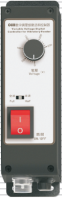
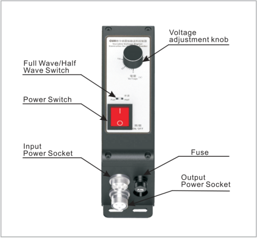
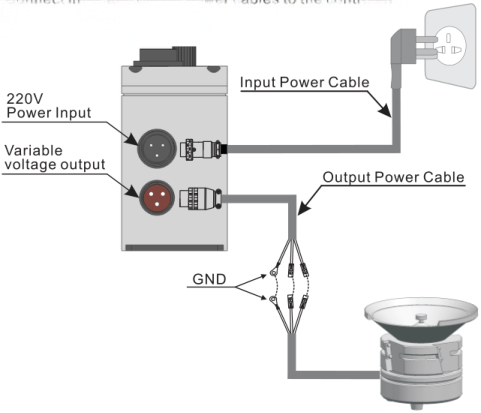
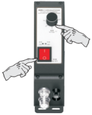

## Controlador digital de tensión variable para alimentador vibratorio

Modelo: SDVC11-M

## Descripción general:

## Cableado:

Paso 1:

Conecte los cables de alimentación de entrada y salida al controlador según el diagrama.

### Paso 2:
Gire el mando de ajuste de tensión para ajustar la tensión de salida.

### Paso 3:
Encienda el interruptor de alimentación.  
El indicador de alimentación se ilumina.

## Interruptor de onda completa/media onda:

La forma de onda/frecuencia de salida se puede conmutar

Si la frecuencia de red es 50/60Hz, la frecuencia de salida será 100/120Hz cuando el interruptor se ajuste como se muestra en la Figura (1)

Si la frecuencia de red es 50/60Hz, la frecuencia de salida será 50/60Hz cuando el interruptor se ajuste como se muestra en la Figura (2)

## Características:

**Regulación automática de tensión:** El circuito interno de regulación digital de tensión puede reducir la variación de la velocidad de alimentación causada por la fluctuación de la tensión de red.

**Arranque suave:** El controlador aumenta suavemente la tensión de salida de 0 al valor preajustado al encender, para evitar sacudidas repentinas.

**Control lineal de tensión:** El ángulo de rotación del mando de ajuste de tensión es lineal con la tensión de salida del controlador.

**Protección contra sobrecalentamiento:** Si la temperatura interna del controlador es demasiado alta, el controlador detendrá su salida para protegerse.

**Protección contra sobrecorriente:** Si la corriente de salida supera su valor nominal, el controlador detendrá su salida para protegerse a sí mismo y a la carga.

**Protección de fusible contra cortocircuito:** Si la salida del controlador se cortocircuita, el fusible interno se fundirá para proteger el controlador y la carga.

Diseño de circuito optimizado para garantizar la estabilidad y una larga vida útil.

## Especificaciones:

| Elemento | Rango: Mín | Rango: Típico | Rango: Máx | Unidad | Descripción |
|---|---|---|---|---|---|
| Tensión de entrada | 150 | 220 | 260 | V | AC RMS |
| Rango ajustable de tensión de salida | 35 | —— | Vin-10 | V | Media onda |
| Rango ajustable de tensión de salida | 45 | —— | Vin-5 | V | Onda completa |
| Tiempo de respuesta de la regulación de tensión | 0 | 0.01 | 0.02 | s | |
| Rango ajustable de corriente de salida | 0.1 | —— | 5 | A | |
| Potencia de salida | 22 | —— | 1100 | VA | |
| Frecuencia de salida | 45 | 50/60 | 65 | Hz | Media onda |
| Frecuencia de salida | 90 | 100/120 | 130 | Hz | Onda completa |
| Forma de onda de salida | | Seno recortado en fase | | | |
| Tiempo de arranque suave | 0.5 | 0.65 | 0.7 | s | |
| Temperatura de activación de la protección contra sobrecalentamiento | 58 | 60 | 66 | °C | |
| Capacidad del fusible | | 6.3 | | A | |
| Temperatura ambiente | 0 | 25 | 40 | °C | Sin condensación |
| Humedad ambiente | 10 | 60 | 85 | % | Sin condensación |

## Dimensiones y peso:

Dimensiones:154*53.6*109.3(L*W*H, mm)  
Peso:430g (sin accesorios)

Nanjing CUH Science & Technology Co.,Ltd  
https://en.cuhnj.com  
Tel.:+86-25-84730411 / 84730415 / 84730416  
Fax:+86-25-84730426  
E-mail:sales@cuhnj.com  
Add.:Building 2, Xueyan Tech Park, Tuscity,  
No.9 Zhineng Rd, Jiangning, Nanjing, China

Document NO. : SDVC11MSMEN_1.01

