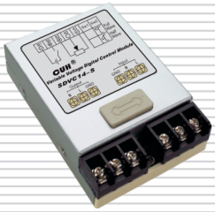
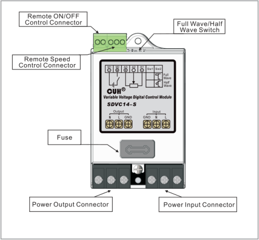
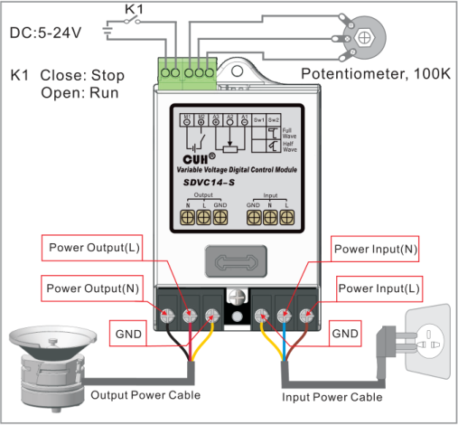
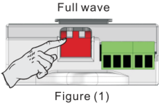
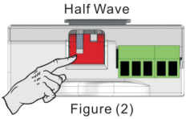

CUH

# Módulo de control digital de tensión variable para alimentador vibratorio

Modelo: SDVC14-S

## Descripción general:

## Cableado:

## Interruptor de onda completa/media onda:

La forma de onda/frecuencia de salida se puede conmutar

Si la frecuencia de red es 50/60Hz, la frecuencia de salida será 100/120Hz cuando el interruptor se ajuste como se muestra en la Figura (1)

Si la frecuencia de red es 50/60Hz, la frecuencia de salida será 50/60Hz cuando el interruptor se ajuste como se muestra en la Figura (2)

## Características:

1) Regulación automática de tensión: El circuito interno de regulación digital de tensión puede reducir la variación de la velocidad de alimentación causada por la fluctuación de la tensión de red.

2) Arranque suave: El controlador aumenta suavemente la tensión de salida de 0 al valor preajustado al encender, para evitar sacudidas repentinas.

3) Control lineal de tensión: El ángulo de rotación del potenciómetro externo es lineal con la tensión de salida del módulo de control.

4) Conectores de control de señal: El módulo de control dispone de conectores de control remoto de encendido/apagado y de velocidad remota.

5) Diseño de circuito optimizado para garantizar la estabilidad y una larga vida útil.

6) Protección contra sobrecalentamiento: Si la temperatura interna del módulo de control es demasiado alta, el módulo de control detendrá su salida para protegerse.

7) Protección contra sobrecorriente: Si la corriente de salida supera su valor nominal, el módulo de control detendrá su salida para protegerse a sí mismo y a la carga.

8) Protección de fusible contra cortocircuito: Si la salida del módulo de control se cortocircuita, el fusible interno se fundirá para proteger el módulo de control y la carga.

## Especificaciones:

| Elemento | Rango: Mín | Rango: Típico | Rango: Máx | Unidad | Descripción |
|---|---|---|---|---|---|
| Tensión de entrada | 150 | 220 | 260 | V | AC RMS |
| Rango ajustable de tensión de salida | 35 | —— | Vin-10 | V | Media onda |
| | 45 | —— | Vin-5 | | Onda completa |
| Tiempo de respuesta de la regulación de tensión | 0 | 0.01 | 0.02 | s | |
| Rango ajustable de corriente de salida | 0.1 | —— | 4 | A | |
| Potencia de salida | 22 | —— | 880 | VA | |
| Frecuencia de salida | 45 | 50/60 | 65 | Hz | Media onda |
| | 90 | 100/120 | 130 | Hz | Onda completa |
| Forma de onda de salida | | Seno recortado en fase | | | |
| Tiempo de arranque suave | 0.5 | 0.65 | 0.7 | s | |
| Temperatura de activación de la protección contra sobrecalentamiento | 58 | 60 | 66 | ℃ | |
| Tensión de control remoto de encendido/apagado | 5 | —— | 24 | V | |
| Capacidad del fusible | | 6.3 | | A | |
| Temperatura ambiente | 0 | 25 | 40 | ℃ | Sin condensación |
| Humedad ambiente | 10 | 60 | 85 | % | |

## Dimensiones y peso:

Dimensiones: 102(L)mm X 63(W)mm X 27(H)mm  
Peso: 92g

Nanjing CUH Science & Technology Co.,Ltd  
https://en.cuhnj.com  
Tel.:+86-25-84730411 / 84730415 / 84730416  
Fax:+86-25-84730426  
E-mail:sales@cuhnj.com  
Add.:Building 2, Xueyan Tech Park, Tuscity,  
No.9 Zhineng Rd, Jiangning, Nanjing, China

Document NO. : SDVC14SSMSEN_1.04

