## Controlador digital de tensión variable para alimentador vibratorio

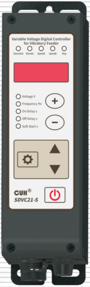

## SDVC21-S

## Manual de instrucciones

---

## Declaración de derechos de autor

Nanjing CUH Science & Technology Co., Ltd. se reserva todos los derechos.

Toda la información contenida en este manual de usuario es conocimiento de nuestra empresa y está protegida por las leyes de derechos de autor y otras leyes relacionadas. CUH disfruta y se reserva todos los derechos conferidos por las leyes de derechos de autor y otras leyes. Sin el consentimiento por escrito de CUH, no se podrá copiar, traducir, imitar ni utilizar de otra forma este manual de usuario, ni total ni parcialmente.

## Descargo de responsabilidad

Todo el contenido de este manual de usuario describe únicamente el método de uso de los productos relacionados producidos por nuestra empresa, y se describe de acuerdo con la tecnología existente y el estado en que se le proporcionan cuando los utiliza. Usted debe asumir los riesgos correspondientes al utilizar este producto. Salvo lo exigido por la ley, la empresa no tiene ninguna responsabilidad expresa o implícita sobre el producto derivada de este manual de usuario, incluidos, entre otros, daños personales, daños a la propiedad, pérdida de oportunidades, etc.

Usted comprende claramente los riesgos anteriores y acepta que, salvo lo exigido por la ley, la empresa no es responsable de ningún daño o pérdida directa o indirecta que usted sufra (incluidos, entre otros, la pérdida tangible de personal, propiedades, datos, etc., y la pérdida intangible de reputación, oportunidades, etc.).

La empresa se reserva el derecho de modificar los productos aplicables en este manual de usuario sin aviso previo ni posterior.

---

## Prefacio

Gracias por elegir el controlador de alimentación por vibración con regulación digital de tensión CUH SDVC21-S. (En lo sucesivo, “el controlador”). Esta serie de controladores utiliza componentes de alta calidad, incorpora la última tecnología electrónica y está cuidadosamente diseñada con procesadores digitales de señales de alto rendimiento.

Este manual presenta el método básico de operación, la descripción técnica funcional y ejemplos de aplicación típicos de este producto. Proporciona a los usuarios información relevante sobre la instalación y puesta en marcha, el ajuste de parámetros, el diagnóstico de anomalías, la solución de problemas y el mantenimiento rutinario del controlador. Para garantizar la instalación y el uso correctos de este controlador, lea atentamente este manual de usuario antes de la instalación y consérvelo adecuadamente.

Asegúrese de leer los siguientes símbolos que le alertan sobre las precauciones contra lesiones personales y daños al producto.

| | |
|---|---|
| ⚠ Peligro | La inobservancia de este punto provocará lesiones personales o la muerte. |
| ⚠ Advertencia | La inobservancia de este punto puede provocar lesiones personales o la muerte. |
| ⚠ Precaución | La inobservancia de este punto puede provocar lesiones moderadas o leves a las personas. |
| Aviso | La inobservancia de este punto provocará daños al producto y daños materiales. |
| ❗ Obligatorio | Indica las precauciones y restricciones de uso que deben observarse durante el uso. |

**Este manual es adecuado para los siguientes modelos de controladores:**

- Controlador digital de tensión variable para alimentador vibratorio　SDVC21-S (5A)

---

## Seguridad y precauciones

1. **⚠ Peligro** Este producto solo se utiliza para accionar equipos de alimentación vibratoria basados en electroimanes; no utilice este producto con el fin de proteger el cuerpo humano o partes del cuerpo humano, etc.

2. **⚠ Peligro** Este producto no está diseñado para usarse como producto a prueba de explosiones; no lo utilice en lugares peligrosos y/o en entornos con gases potencialmente explosivos.

3. **⚠ Advertencia** Este producto se alimenta de la red de CA; no aplique una tensión de CA superior a 260Vac. Una tensión de entrada excesiva, como 380Vac, puede provocar que el producto explote o se incendie, causando accidentes de seguridad graves.

4. **⚠ Advertencia** Este producto se pone a tierra a través del cable de alimentación. Asegúrese de que las instalaciones de distribución de energía del controlador estén bien conectadas a tierra; de lo contrario, la carcasa del controlador puede quedar cargada eléctricamente, provocando un accidente por descarga eléctrica.

5. **⚠ Advertencia** No introduzca alimentación de CA en la salida de este controlador; esto dañará el controlador.

6. **⚠ Advertencia** No enchufe ni desenchufe el cableado con corriente ni toque los contactos de cada terminal de conexión del compartimento de cableado para evitar descargas eléctricas.

7. **Aviso** Evite controlar la salida de este producto cortando la alimentación mediante relés y otros dispositivos; de lo contrario, la vida útil del controlador se reducirá gravemente.

8. **Aviso** El controlador está diseñado para funcionar en un entorno fresco y seco. Nunca utilice el controlador a la intemperie para evitar mojaduras e insolación. Utilice el controlador dentro de la temperatura especificada en las características eléctricas.

9. **❗ Obligatorio** Asegúrese de fijar este producto sobre una plataforma sólida, con conexión a tierra fiable y alejada de equipos vibratorios.

10. **❗ Obligatorio** Nunca opere el controlador en condiciones que superen sus límites de diseño.

11. **❗ Obligatorio** Utilice el controlador estrictamente de acuerdo con este manual de instrucciones. No asumiremos ninguna responsabilidad civil o penal si el daño del equipo o las lesiones personales son causados por una operación incorrecta.

12. **❗ Obligatorio** Nunca abra la carcasa del controlador para evitar descargas eléctricas. Póngase en contacto con CUH si el controlador se avería. Nunca intente reparar el controlador usted mismo, ya que podría anular la garantía.

---

## Entorno de funcionamiento y almacenamiento

### Inspección antes del uso

Cada controlador pasa por una rigurosa inspección de calidad antes de su entrega y se embala con un embalaje a prueba de impactos. Compruebe los siguientes puntos después de desembalar:

1. Si el controlador se ha dañado durante el transporte.
2. Si el modelo del controlador es el que solicitó.

### Entorno de ejecución

Siga las notas a continuación para garantizar un mejor rendimiento y una mayor vida útil del controlador:

- ⚠ Entorno bien ventilado
- ⚠ Manténgase alejado de agua, vapor, polvo y especialmente polvo aceitoso
- ⚠ Manténgase alejado de gases y líquidos corrosivos o inflamables
- ⚠ Manténgase alejado del polvo en suspensión y las partículas metálicas
- ⚠ Fíjelo firmemente para evitar vibraciones propias
- ⚠ Manténgase alejado de interferencias electromagnéticas
- ⚠ Asegúrese de que la temperatura ambiente sea de 0~40 ℃
- ⚠ Para uso a una altitud de 2000 m o inferior

---

# Contenido

- **Capítulo Ⅰ Antes de comenzar — 1**
  - 1.1 Compruebe el contenido del paquete — 1
  - 1.2 Explicación de los indicadores, botones y partes externas — 2
  - 1.3 Explicación de los puertos de cableado — 3
  - 1.4 Explicación de la placa de características — 3
- **Capítulo Ⅱ Características — 4**
- **Capítulo Ⅲ Guía de instalación — 6**
  - 3.1 Condiciones de uso del controlador — 6
  - 3.2 Método de operación de los botones — 6
  - 3.3 Instalación y uso — 7
- **Capítulo Ⅳ Descripción de las funciones básicas — 9**
  - 4.1 Tensión de salida — 9
  - 4.2 Frecuencia de salida — 10
  - 4.3 Tiempo de arranque suave — 11
  - 4.4 Interruptor de salida — 11
  - 4.5 Límite de tensión de salida máxima — 12
  - 4.6 Bloqueo del teclado — 12
  - 4.7 Restauración de la configuración predeterminada — 13
- **Capítulo Ⅴ Sensores y control de señales — 14**
  - 5.1 Detección fotoeléctrica inteligente — 14
    - 5.1.1 Método de cableado del sensor fotoeléctrico inteligente — 14
    - 5.1.2 Retardo de conexión/desconexión del sensor fotoeléctrico inteligente — 15
    - 5.1.3 Ajuste de la dirección lógica del sensor fotoeléctrico inteligente — 16
  - 5.2 Método de uso del sensor de conmutación NPN — 17
    - 5.2.1 Método de cableado del sensor de conmutación NPN — 17
    - 5.2.2 Retardo de conexión/desconexión del sensor de conmutación NPN — 18
    - 5.2.3 Ajuste de la dirección lógica del sensor de conmutación NPN — 19
  - 5.3 Método de uso del segundo sensor de conmutación NPN — 20
    - 5.3.1 Método de cableado del segundo sensor de conmutación NPN — 20
    - 5.3.2 Retardo de conexión/desconexión del segundo sensor de conmutación NPN — 21
    - 5.3.3 Ajuste de la dirección lógica del segundo sensor de conmutación NPN — 22
  - 5.4 Ajuste de la relación lógica de la señal de control — 23
  - 5.5 Salida de control — 24
    - 5.5.1 Método de cableado de la salida de control — 24
    - 5.5.2 Ajuste de la dirección lógica de la salida de control — 26
  - 5.6 Control de velocidad remoto — 27
  - 5.7 Conmutación de velocidad preajustada — 28
- **Capítulo Ⅵ Funciones de seguridad — 29**
  - 6.1 Estabilización digital automática de tensión — 29
  - 6.2 Protección contra cortocircuitos — 29
  - 6.3 Protección contra sobrecarga de corriente — 29
  - 6.4 Protección contra sobrecalentamiento — 29
- **Capítulo Ⅶ Especificaciones técnicas — 30**
  - 7.1 Dimensiones — 30
  - 7.2 Especificaciones técnicas — 31
  - 7.3 Norma de referencia — 32
  - 7.4 Tabla de parámetros — 33
  - 7.5 Sugerencias de solución de problemas y explicaciones de errores — 34
- **Capítulo Ⅷ Información de garantía del producto — 35**
  - 8.1 Período de garantía — 35
  - 8.2 Cobertura de la garantía — 35
  - 8.3 Idoneidad del producto — 35

---

# Capítulo Ⅰ Antes de comenzar

Este capítulo presenta el contenido del paquete del producto, la descripción de la apariencia del controlador y la información de la placa de características del controlador.

## 1.1 Compruebe el contenido del paquete

Antes de usar, compruebe la integridad del controlador y los accesorios. Si encuentra que el producto es defectuoso o está dañado, que faltan accesorios, etc., póngase en contacto con nuestra empresa.

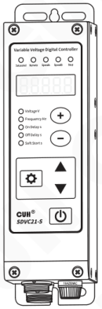

Controlador×1

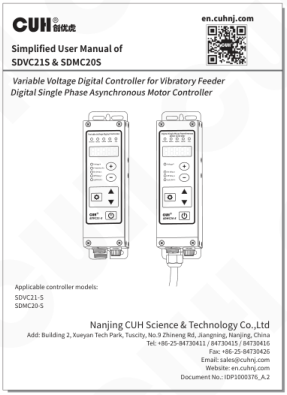

Manual de usuario×1

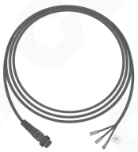

Cable de salida×1

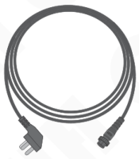

Cable de alimentación de entrada×1

---

## 1.2 Explicación de los indicadores, botones y partes externas

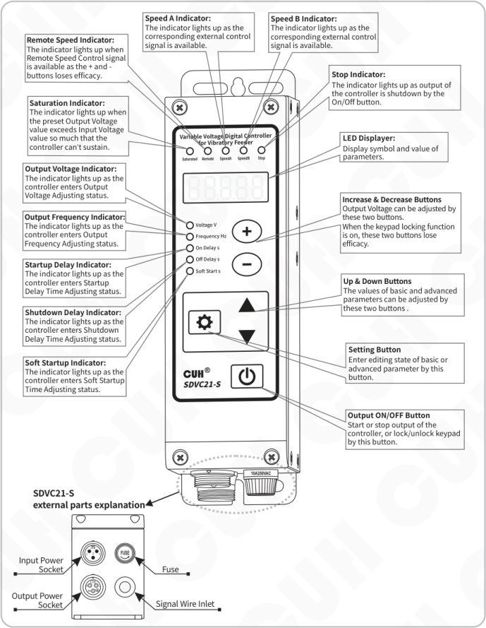

### Indicadores y pantalla

**Indicador de velocidad remoto:**  
El indicador se enciende cuando hay señal de control de velocidad remoto disponible y los botones + y - dejan de ser efectivos.

**Indicador de velocidad A:**  
El indicador se enciende cuando la señal de control externa correspondiente está disponible.

**Indicador de velocidad B:**  
El indicador se enciende cuando la señal de control externa correspondiente está disponible.

**Indicador de parada:**  
El indicador se enciende cuando la salida del controlador se detiene mediante el botón On/Off.

**Indicador de saturación:**  
El indicador se enciende cuando el valor de tensión de salida preajustado supera tanto el valor de tensión de entrada que el controlador no puede mantenerlo.

**Pantalla LED:**  
Muestra el símbolo y el valor de los parámetros.

**Indicador de tensión de salida:**  
El indicador se enciende cuando el controlador entra en el estado de ajuste de tensión de salida.

**Indicador de frecuencia de salida:**  
El indicador se enciende cuando el controlador entra en el estado de ajuste de frecuencia de salida.

**Indicador de retardo de arranque:**  
El indicador se enciende cuando el controlador entra en el estado de ajuste del tiempo de retardo de arranque.

**Indicador de retardo de parada:**  
El indicador se enciende cuando el controlador entra en el estado de ajuste del tiempo de retardo de parada.

**Indicador de arranque suave:**  
El indicador se enciende cuando el controlador entra en el estado de ajuste del tiempo de arranque suave.

### Botones

**Botones de aumento y disminución**  
La tensión de salida se puede ajustar con estos dos botones.  
Cuando la función de bloqueo del teclado está activada, estos dos botones dejan de ser efectivos.

**Botones arriba y abajo**  
Los valores de los parámetros básicos y avanzados se pueden ajustar con estos dos botones.

**Botón de ajuste**  
Con este botón se entra en el estado de edición del parámetro básico o avanzado.

**Botón de salida ON/OFF**  
Inicia o detiene la salida del controlador, o bloquea/desbloquea el teclado con este botón.

### Explicación de las partes externas del SDVC21-S

- Toma de alimentación de entrada
- Toma de alimentación de salida
- Fusible
- Entrada de cable de señal

---

## 1.3 Explicación de los puertos de cableado

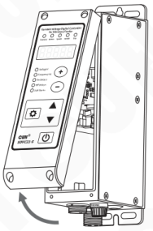

**Paso 1:** Retire los tornillos de las cuatro esquinas del panel.

**Paso 2:** Abra el panel hacia arriba; el puerto de cableado está en la parte posterior del panel.

| Puerto de cableado | Terminal | Señal |
|---|---|---|
| SensorⅡ | A1 | GND |
| SensorⅡ | A2 | Entrada |
| SensorⅡ | A3 | +24V |
| Preset | B1 | GND |
| Preset | B2 | Pset A |
| Preset | B3 | GND |
| Preset | B4 | Pset B |
| Ctrl Out | C1 | Salida |
| Ctrl Out | C2 | +24V |
| SensorⅠ | D1 | GND |
| SensorⅠ | D2 | Entrada |
| SensorⅠ | D3 | +24V |
| Photosensor | E1 | GND |
| Photosensor | E2 | Rx |
| Photosensor | E3 | GND |
| Photosensor | E4 | Tx |
| Speed Ctrl | F1 | +5V |
| Speed Ctrl | F2 | Entrada |
| Speed Ctrl | F3 | RGND |

## 1.4 Explicación de la placa de características

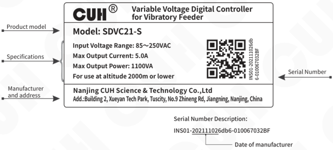

CUH® — **Controlador digital de tensión variable para alimentador vibratorio**

**Modelo de producto**

Modelo: SDVC21-S

**Especificaciones**

- Rango de tensión de entrada: 85～250VAC
- Corriente de salida máxima: 5.0A
- Potencia de salida máxima: 1100VA
- Para uso a una altitud de 2000 m o inferior

**Fabricante y dirección**

Nanjing CUH Science & Technology Co.,Ltd

Add.:Building 2, Xueyan Tech Park, Tuscity, No.9 Zhineng Rd, Jiangning, Nanjing, China

**Número de serie**

INS01-202111026db6-010067032BF

**Descripción del número de serie:**

INS01-**20211102**6db6-010067032BF

Fecha de fabricación: **20211102**

---

## Capítulo Ⅱ Características

El controlador está especialmente diseñado para controlar alimentadores vibratorios en los sistemas de automatización. Combinando la última tecnología electrónica y un diseño elaborado, el controlador ofrece las siguientes características prácticas y convenientes:

**Estabilización automática de tensión:** El controlador puede eliminar la variación de la velocidad de alimentación causada por la fluctuación de la tensión de red.

**Arranque suave:** Para evitar impactos repentinos en las piezas de trabajo, el controlador puede aumentar suavemente la tensión de salida de 0 al valor preajustado durante el arranque.

**Sensor de conmutación:** Se puede conectar un sensor de conmutación NPN o un PLC para activar/desactivar el controlador.

**Salida de control:** La señal de salida de control emitida por el transistor puede coordinar un solenoide u otros dispositivos externos con el controlador.

### Las siguientes funciones se pueden personalizar:

**Entrada de dobles señales de control:** La entrada de dobles señales de control de piezas de trabajo llenas y piezas de trabajo vacías puede formar la relación de control lógico de AND, OR, NOT, XOR y todas las demás.

**Función de preajuste de tensión de salida:** Se pueden seleccionar hasta cuatro valores de tensión de salida preajustados mediante señales de control externas.

**Detección fotoeléctrica inteligente:** Nuestro sensor fotoeléctrico inteligente adaptativo puede ayudar a detener el controlador cuando las piezas de trabajo están llenas o vacías, y realizar las funciones de ajuste del tiempo de arranque suave, retardo de conexión, retardo de desconexión y ajuste de la relación lógica.

**Control de velocidad remoto:** La tensión de salida del controlador se puede controlar mediante un potenciómetro externo, un PLC o una señal de CC de 1~5V/4~20mA.

---

CUH concede gran importancia a la gestión de la calidad del producto y al rendimiento de seguridad. Además de los componentes de alta calidad que utilizamos y el riguroso sistema de control de calidad, CUH ha tenido en cuenta los posibles accidentes que los usuarios pueden encontrar y proporciona las siguientes funciones de protección para maximizar la practicidad del controlador.

**Protección contra cortocircuitos con fusible:** Si la salida del controlador se cortocircuita, el fusible interno se fundirá para proteger el controlador y la carga.

**Protección contra sobrecarga de corriente:** El controlador detendrá su salida para garantizar la seguridad de funcionamiento de los equipos cuando la corriente de operación supere su valor nominal.

**Protección contra sobrecalentamiento:** El controlador detendrá su salida para protegerse cuando la temperatura de operación sea demasiado alta.

**Protección contra sobretensión:** Si la tensión de entrada es demasiado alta, la fuente de alimentación del controlador se apagará automáticamente para protegerse.

Los controladores CUH cumplen estrictamente con la certificación CE.

---

# Capítulo Ⅲ Guía de instalación

Este capítulo presenta las condiciones necesarias para el uso del controlador y cómo instalarlo y conectarlo correctamente.

## 3.1 Condiciones de uso del controlador

El controlador se alimenta con CA de 110/220V y la conexión a tierra de protección se realiza a través del enchufe del cable de alimentación. Proporcione instalaciones de suministro y distribución de energía de red de 110V o 220V, 50Hz/60Hz que cumplan con la norma y asegúrese de que el cable de tierra de protección esté correctamente conectado.

**⚠ Advertencia** Nunca conecte el controlador a una alimentación de CA de 380V; esto causará daños graves irreversibles al controlador, posiblemente provocando explosiones, incendios y otros incidentes de seguridad.

**⚠ Advertencia** Asegúrese de que el lado de la fuente de alimentación esté conectado a tierra de forma fiable. La carcasa metálica del controlador está conectada directamente al cable de tierra de protección. Una conexión a tierra deficiente provocará que la carcasa del controlador quede electrificada y cause un accidente por descarga eléctrica.

**Aviso** El funcionamiento prolongado generará calor y hará que aumente la temperatura de la carcasa. Instale el controlador en un entorno bien ventilado y fíjelo bien, lejos de fuentes de vibración.

**Aviso** La salida de este producto se forma mediante la rectificación e inversión del suministro de red, y no existe aislamiento entre su entrada y su salida. Por lo tanto, los polos de salida no se pueden conectar a la tierra de protección. Al conectar el electroimán, es necesario asegurarse de que la bobina del electroimán y la carcasa tengan capacidad de aislamiento básica. De lo contrario, puede producirse una fuga de electricidad, lo que puede causar descargas eléctricas y daños al controlador.

**Aviso** Este producto es un controlador utilizado para accionar el electroimán. No debe conectarse a un alimentador vibratorio piezoeléctrico.

## 3.2 Método de operación de los botones

a. Pulse brevemente el botón ⊕ o ⊖ para ajustar la tensión de salida del controlador en cualquier interfaz LED.

b. Entre o salga de la interfaz de parámetros básicos manteniendo pulsado el botón ⚙, cambie entre los parámetros básicos pulsando brevemente el botón ⚙ y ajuste el valor del parámetro pulsando brevemente el botón ▼ o ▲.

c. Entre o salga de la interfaz de parámetros avanzados manteniendo pulsados los botones ⚙ y ▲, cambie entre los parámetros avanzados pulsando brevemente el botón ⚙ y ajuste el valor del parámetro pulsando brevemente el botón ▼ o ▲.

d. Pulse brevemente el botón ⏻ para iniciar o detener la salida del controlador, y mantenga pulsado el botón ⏻ para bloquear o desbloquear el teclado.

e. En la interfaz LED del parámetro de restauración de la configuración predeterminada, mantenga pulsado el botón ▲ hasta que se muestre  en el LED para restaurar la configuración de fábrica, o mantenga pulsado el botón ▼ hasta que se muestre  en el LED para cambiar a la interfaz de parámetros moderna.

f. El SDVC21S utiliza por defecto la interfaz de parámetros tradicional.

---

## 3.3 Instalación y uso

### Paso uno:

Abra la caja de embalaje y compruebe el controlador y todos los accesorios.

### Paso dos:

Conecte los terminales de cableado del cable de alimentación de salida a la bobina electromagnética del vibrador.

Alinee la muesca del conector de aviación del cable de salida con la marca triangular de la toma de salida del controlador y, a continuación, apriete la tuerca después de conectar correctamente el cable de salida.

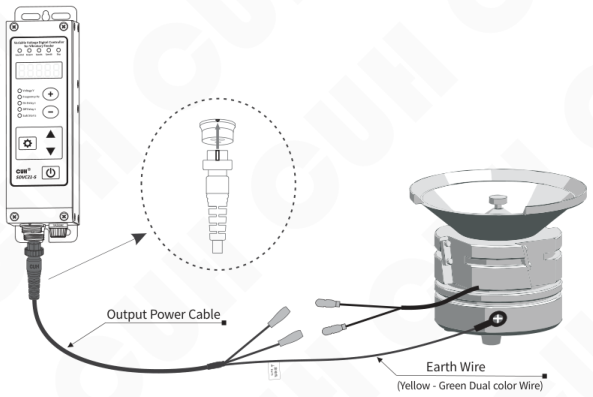

### Nota

1. Asegúrese de que las bobinas electromagnéticas del vibrador estén conectadas a los dos pines de salida del cable de alimentación de salida y de que la carcasa metálica del vibrador esté conectada a tierra de forma fiable.
2. Está prohibido conectar cargas piezoeléctricas a la salida de alimentación; de lo contrario, puede causar un accidente de seguridad por descarga eléctrica.

---

### Paso tres:

Conecte el conector del cable de alimentación de entrada a la toma de alimentación de entrada del controlador.

Conecte primero el lado del controlador.

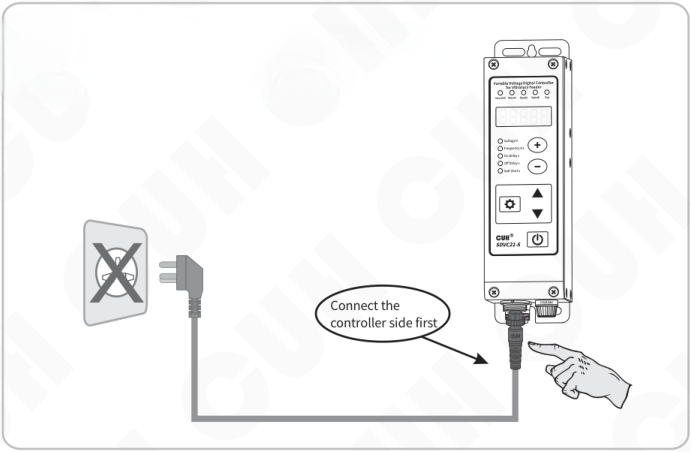

### Paso cuatro:

Conecte el enchufe del cable de alimentación de entrada a la toma de la red eléctrica.

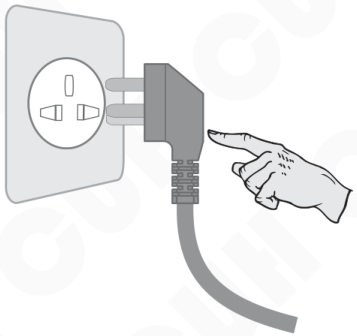

---

## Capítulo Ⅳ Descripción de las funciones básicas

### 4.1 Tensión de salida

La tensión de salida se puede ajustar de forma directa y digital a través del teclado. Gracias a la función única de estabilización de tensión, la tensión de salida del controlador no fluctuará como lo hace la tensión de entrada, de modo que el vibrador puede mantener un funcionamiento estable en caso de tensión de red inestable.

- Encienda el interruptor de alimentación del controlador.
- El controlador entra en el parámetro de tensión de salida. El indicador de tensión se enciende y la pantalla LED muestra el parámetro de tensión de salida U y el valor predeterminado 150.
- Pulse ⊕ o ⊖ para ajustar el valor del parámetro.

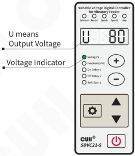

- El valor de tensión de salida del controlador no puede superar el valor de tensión de entrada. Si el valor de tensión de salida se ajusta demasiado cerca del valor de tensión de entrada, el controlador no puede estabilizar su salida de tensión y el indicador de saturación se enciende.
- Si el valor de tensión de salida se ajusta demasiado cerca de 0, el controlador no puede estabilizar su salida de tensión y el indicador de saturación se enciende.

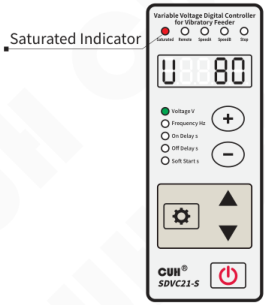

---

## 4.2 Frecuencia de salida

El controlador puede elegir salir a la frecuencia de la red o al doble de la frecuencia de la red.

- Mantenga pulsado ⚙ durante 2 segundos para entrar en la interfaz de parámetros básicos.
- La pantalla LED muestra el parámetro de frecuencia de salida "E" y el indicador de frecuencia se enciende.
- Pulse ▼ o ▲ para ajustar el valor del parámetro.

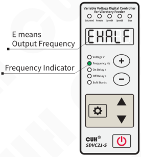

- Si la frecuencia de la red es de 50Hz, cuando el parámetro E se ajusta a HALF, la frecuencia de salida del controlador es de 50Hz; cuando el parámetro E se ajusta a FULL, la frecuencia de salida del controlador es de 100Hz.
- Si la frecuencia de la red es de 60Hz, cuando el parámetro E se ajusta a HALF, la frecuencia de salida del controlador es de 60Hz; cuando el parámetro E se ajusta a FULL, la frecuencia de salida del controlador es de 120Hz.

---

## 4.3 Tiempo de arranque suave

Para evitar impactos repentinos en la bobina del vibrador, el controlador puede aumentar gradualmente la tensión de salida de 0 al valor preajustado durante el arranque.

**Tiempo de arranque suave ( t ):** El período de tiempo que tarda el controlador en elevar suavemente su tensión de salida de 0 al valor preajustado durante el arranque.

- Mantenga pulsado ⚙ durante 2 segundos para entrar en la interfaz de parámetros básicos.
- Pulse brevemente ⚙ para cambiar al parámetro de arranque suave "t" y el indicador de arranque suave se enciende.
- Pulse ▲ o ▼ para ajustar el valor del parámetro.

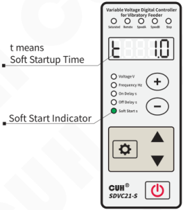

## 4.4 Interruptor de salida

El botón ⏻ del panel permite iniciar o detener la salida del controlador de forma fácil y rápida.

- Con el botón ⏻ del panel del controlador, puede controlar el inicio o la parada. El indicador de parada se enciende cuando se apaga la salida del controlador.

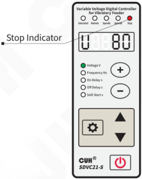

> Gracias al interruptor de tacto suave y a la tecnología de control de señal digital, no se generará ninguna chispa que deteriore el contacto. Como resultado, la vida útil del controlador y del vibrador se prolongará enormemente.

---

## 4.5 Límite de tensión de salida máxima

Se puede ajustar la tensión de salida máxima del controlador para evitar daños al vibrador.

La función de control de velocidad remoto se ve afectada por este parámetro.

- Mantenga pulsados ⚙ y ▲ simultáneamente para entrar en la interfaz de parámetros avanzados.
- Pulse brevemente ⚙ para cambiar al parámetro h.
- Pulse ▲ o ▼ para ajustar el valor del parámetro.

El valor predeterminado de la tensión de salida máxima es 250V.

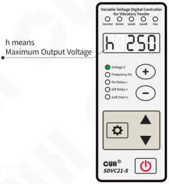

## 4.6 Bloqueo del teclado

- Mantenga pulsado ⏻ durante 2 segundos para bloquear todos los botones del panel; la pantalla LED muestra a.
- Mantenga pulsado ⏻ durante 2 segundos de nuevo para desbloquear el teclado.

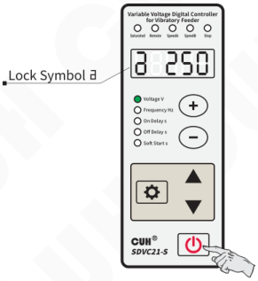

> El botón ⏻ no se verá afectado por la función de bloqueo del teclado.

---

## 4.7 Restauración de la configuración predeterminada

El usuario puede restaurar rápidamente el controlador al estado predeterminado de fábrica.

Debido a las potentes funciones del controlador, se pueden ajustar muchos parámetros. Para los principiantes, puede que no sea posible restaurar el estado de funcionamiento normal del controlador tras varios ajustes y modificaciones. Utilice esta función para restaurar rápidamente el estado de parámetros desordenado a la configuración predeterminada de fábrica.

- Mantenga pulsados ⚙ y ▲ simultáneamente para entrar en la interfaz de parámetros avanzados.
- Pulse brevemente ⚙ para cambiar a la pantalla LED con parpadeo completo, es decir, el parámetro de "restauración de la configuración predeterminada". A continuación, mantenga pulsado ▲ hasta que el controlador muestre "-----", lo que indica que el controlador se ha restaurado.

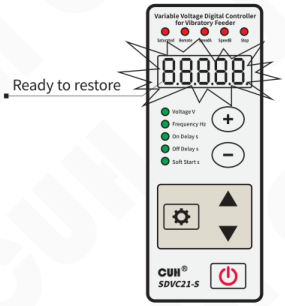

- Suelte ▲; después de que el controlador muestre "CUH", entrará en el estado de ajuste de tensión de salida "U". En este momento, todos los parámetros se habrán restaurado a la configuración predeterminada de fábrica.

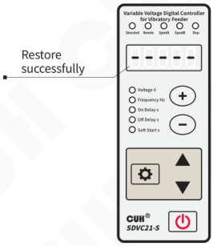

---

# Capítulo Ⅴ Sensores y control de señales

El controlador puede controlarse mediante muchos tipos de señales externas y sensores. Este capítulo describe principalmente el método de uso del sensor fotoeléctrico inteligente, los sensores de conmutación NPN y el PLC.

## 5.1 Detección fotoeléctrica inteligente

Combinado con el sensor fotoeléctrico SDVC-S1, se puede lograr la función de detección fotoeléctrica inteligente. El sensor SDVC-S1 puede filtrar la interferencia de la luz de fondo que afecta a la sensibilidad del controlador. Como resultado, el controlador puede funcionar de forma fiable sin ajuste manual de sensibilidad.

### 5.1.1 Método de cableado del sensor fotoeléctrico inteligente

**Método de conexión del sensor fotoeléctrico**

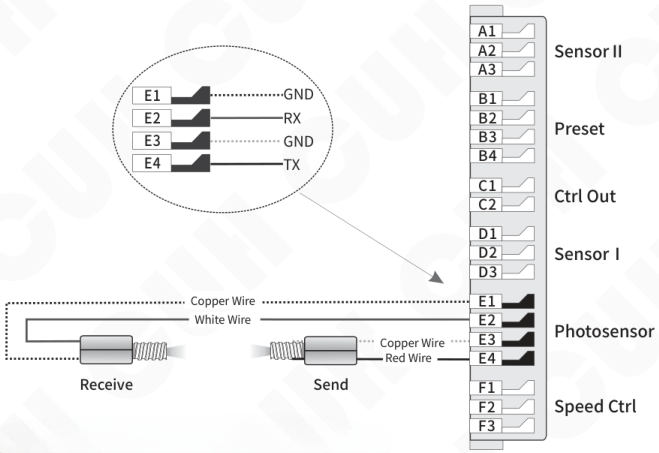

La distancia de trabajo del sensor se puede ajustar configurando el parámetro P; cuanto menor sea el parámetro, más sensible será.

Aviso: la relación lógica predeterminada del sensor está configurada como piezas de trabajo vacías.

---

## 5.1.2 Retardo de conexión/desconexión del sensor fotoeléctrico inteligente

En la mayoría de las aplicaciones reales, la salida del controlador debe retrasarse un período de tiempo cuando el encendido/apagado del controlador se controla mediante señales externas. La función de ajuste del tiempo de retardo de conexión/desconexión hace posible este tipo de aplicación. Además, los impactos en las piezas de trabajo cuando el controlador se pone en marcha se pueden eliminar ajustando el tiempo de arranque suave.

### Retardo de conexión ( J )

El período de tiempo que transcurre desde que el controlador recibe una señal de control de arranque hasta que realmente emite salida.

- Mantenga pulsado ⚙ durante 2 segundos para entrar en la interfaz de parámetros básicos.
- Pulse brevemente ⚙ para cambiar al parámetro de retardo de conexión "J" y el indicador de retardo de conexión se enciende.
- Pulse ▲ o ▼ para ajustar el valor del parámetro.

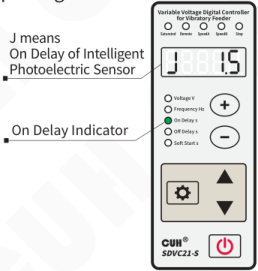

El rango ajustable del parámetro es de 0.0 a 9.9 segundos  
El valor predeterminado del parámetro es 0.2 segundos

### Retardo de desconexión ( L )

El período de tiempo que transcurre desde que el controlador recibe una señal de control de parada hasta que realmente corta la salida.

- Mantenga pulsado ⚙ durante 2 segundos para entrar en la interfaz de parámetros básicos.
- Pulse brevemente ⚙ para cambiar al parámetro de retardo de desconexión "L" y el indicador de retardo de desconexión se enciende.
- Pulse ▲ o ▼ para ajustar el valor del parámetro.

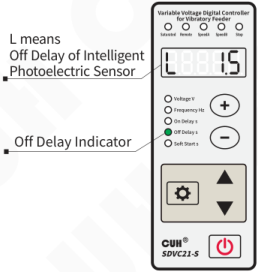

El rango ajustable del parámetro es de 0.0 a 9.9 segundos  
El valor predeterminado del parámetro es 0.2 segundos

---

### 5.1.3 Ajuste de la dirección lógica del sensor fotoeléctrico inteligente

En circunstancias normales, el extremo receptor no recibe señal óptica y el controlador funciona de forma predeterminada. Pero en algunas aplicaciones especiales, el controlador debe detenerse cuando el extremo receptor no recibe señal óptica. El ajuste de este parámetro permite este tipo de aplicación.

- Mantenga pulsados ⚙ y ▲ simultáneamente para entrar en la interfaz de parámetros avanzados.
- Pulse brevemente ⚙ para cambiar al parámetro Γ1.
- Pulse ▲ o ▼ para ajustar el valor del parámetro.

Γ1 significa dirección lógica del sensor fotoeléctrico inteligente

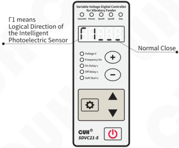

El parámetro Γ1 se ajusta a `___` de forma predeterminada

- Cuando el parámetro Γ1 se ajusta a `___`, es decir, no se recibe señal óptica, el controlador funciona.
- Cuando el parámetro Γ1 se ajusta a `_-_`, es decir, no se recibe señal óptica, el controlador se detiene.

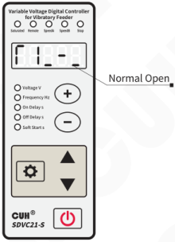

---

## 5.2 Método de uso del sensor de conmutación NPN

El controlador puede funcionar con muchos tipos de sensores, como sensores de conmutación, sensores de conmutación ópticos y sensores de fibra óptica.

### 5.2.1 Método de cableado del sensor de conmutación NPN

**Método de conexión del sensor de conmutación**

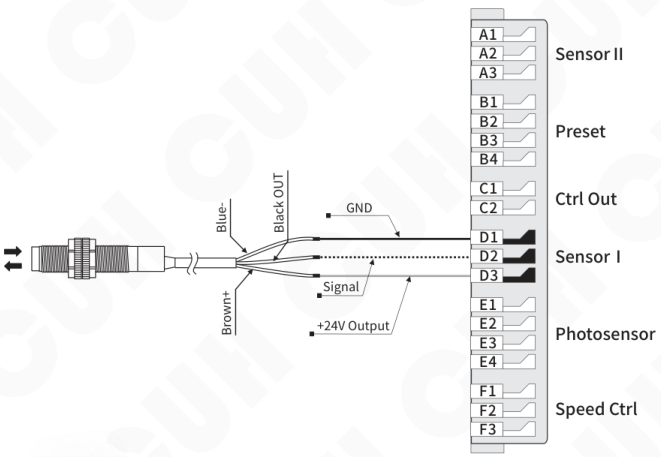

**Convención**

- El cable azul representa el cable de tierra
- El cable negro representa el cable de señal
- El cable marrón representa el cable de alimentación

---

## 5.2.2 Retardo de conexión/desconexión del sensor de conmutación NPN

De forma predeterminada, el sensor fotoeléctrico inteligente y el sensor de conmutación comparten el mismo tiempo de retardo de conexión y tiempo de retardo de desconexión. Los operadores también pueden ajustar el tiempo de retardo de conexión y el tiempo de retardo de desconexión de forma independiente para el sensor de conmutación.

### Retardo de conexión ( J- )

El período de tiempo que transcurre desde que el controlador recibe una señal de control de arranque hasta que emite salida.

- Mantenga pulsados ⚙ y ▲ simultáneamente para entrar en la interfaz de parámetros avanzados.
- Pulse brevemente ⚙ para cambiar al parámetro J-.
- Pulse ▲ o ▼ para ajustar el valor del parámetro.

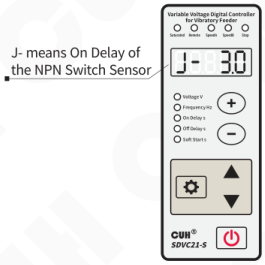

El rango ajustable del parámetro es de 0.0 a 9.9 segundos; el valor predeterminado del parámetro es ---

El retardo de conexión independiente del sensor de conmutación NPN se desactivará cuando el valor del parámetro se ajuste a 0

### Retardo de desconexión ( L- )

El período de tiempo que transcurre desde que el controlador recibe una señal de control de parada hasta que corta la salida.

- Mantenga pulsados ⚙ y ▲ simultáneamente para entrar en la interfaz de parámetros avanzados.
- Pulse brevemente ⚙ para cambiar al parámetro L-.
- Pulse ▲ o ▼ para ajustar el valor del parámetro.

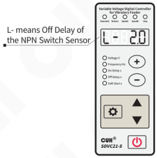

El rango ajustable del parámetro es de 0.0 a 9.9 segundos; el valor predeterminado del parámetro es ---

El retardo de desconexión independiente del sensor de conmutación NPN se desactivará cuando el valor del parámetro se ajuste a 0

- Cuando los valores J- y L- se ajustan a 0, el tiempo de retardo de conexión y el tiempo de retardo de desconexión del sensor de conmutación serán los mismos que el tiempo de retardo de conexión y el tiempo de retardo de desconexión del sensor fotoeléctrico inteligente.
- El tiempo de retardo de conexión y el tiempo de retardo de desconexión del sensor fotoeléctrico inteligente no se verán afectados por los parámetros J- y L-.

---

## 5.2.3 Ajuste de la dirección lógica del sensor de conmutación NPN

En circunstancias normales, el controlador no recibe señal del sensor de conmutación NPN y funciona de forma predeterminada. Pero en algunas aplicaciones especiales, el controlador debe detenerse cuando no recibe señal del sensor de conmutación NPN. El ajuste de este parámetro permite este tipo de aplicación.

- Mantenga pulsados ⚙ y ▲ simultáneamente para entrar en la interfaz de parámetros avanzados.
- Pulse brevemente ⚙ para cambiar al parámetro Γ2.
- Pulse ▲ o ▼ para ajustar el valor del parámetro.

Γ2 significa dirección lógica del sensor de conmutación NPN.

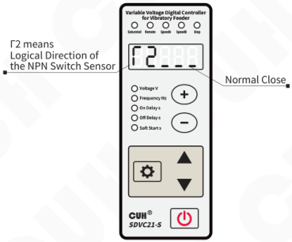

El parámetro Γ2 se ajusta a `___` de forma predeterminada.

- Cuando el parámetro Γ2 se ajusta a `___`, es decir, no se recibe señal, el controlador funciona.
- Cuando el parámetro Γ2 se ajusta a `_-_`, es decir, no se recibe señal, el controlador se detiene.

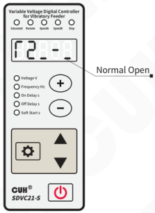

---

## 5.3 Método de uso del segundo sensor de conmutación NPN

El controlador permite conectar tres sensores: un sensor fotoeléctrico inteligente y dos sensores de conmutación NPN. Las funciones de detención cuando las piezas de trabajo están llenas y detención cuando las piezas de trabajo están vacías pueden funcionar con la ayuda de estos sensores.

### 5.3.1 Método de cableado del segundo sensor de conmutación NPN

**Método de conexión del sensor de conmutación**

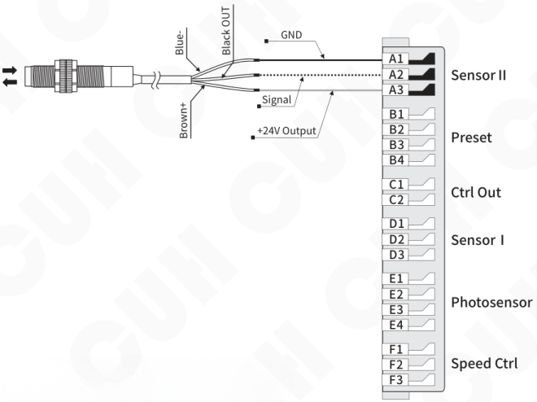

**Convención**

El cable azul representa el cable de tierra  
El cable negro representa el cable de señal  
El cable marrón representa el cable de alimentación

---

## 5.3.2 Retardo de conexión/desconexión del segundo sensor de conmutación NPN

De forma predeterminada, el sensor fotoeléctrico inteligente y los dos sensores de conmutación NPN comparten el mismo tiempo de retardo de conexión y tiempo de retardo de desconexión. Los operadores también pueden ajustar el tiempo de retardo de conexión y el tiempo de retardo de desconexión de forma independiente para el segundo sensor de conmutación NPN.

### Retardo de conexión (J_)

El período de tiempo que transcurre desde que el controlador recibe una señal de control de arranque hasta que emite salida.

- Mantenga pulsados ⚙ y ▲ simultáneamente para entrar en la interfaz de parámetros avanzados.
- Pulse brevemente ⚙ para cambiar al parámetro J_.
- Pulse ▲ o ▼ para ajustar el valor del parámetro.

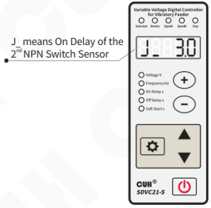

El rango ajustable del parámetro es de 0.0 a 9.9 segundos; el valor predeterminado del parámetro es ---

El retardo de conexión independiente del segundo sensor de conmutación NPN se desactivará cuando el valor del parámetro se ajuste a 0

### Retardo de desconexión (L_)

El período de tiempo que transcurre desde que el controlador recibe una señal de control de parada hasta que corta la salida.

- Mantenga pulsados ⚙ y ▲ simultáneamente para entrar en la interfaz de parámetros avanzados.
- Pulse brevemente ⚙ para cambiar al parámetro L_.
- Pulse ▲ o ▼ para ajustar el valor del parámetro.

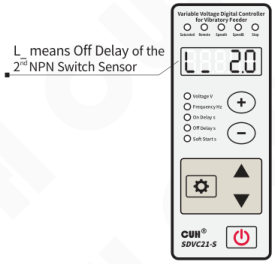

El rango ajustable del parámetro es de 0.0 a 9.9 segundos; el valor predeterminado del parámetro es ---

El retardo de desconexión independiente del segundo sensor de conmutación NPN se desactivará cuando el valor del parámetro se ajuste a 0

---

- Cuando los valores J_ y L_ se ajustan a 0, el tiempo de retardo de conexión y el tiempo de retardo de desconexión del segundo sensor de conmutación NPN serán los mismos que el tiempo de retardo de conexión y el tiempo de retardo de desconexión del sensor fotoeléctrico inteligente.
- El tiempo de retardo de conexión y el tiempo de retardo de desconexión del sensor fotoeléctrico inteligente no se verán afectados por los parámetros J_ y L_.

---

## 5.3.3 Ajuste de la dirección lógica del segundo sensor de conmutación NPN

En circunstancias normales, el controlador no recibe señal del segundo sensor de conmutación NPN y funciona de forma predeterminada. Pero en algunas aplicaciones especiales, el controlador debe detenerse cuando no recibe señal del segundo sensor de conmutación NPN. El ajuste de este parámetro permite este tipo de aplicación.

- Mantenga pulsados ⚙ y ▲ simultáneamente para entrar en la interfaz de parámetros avanzados.
- Pulse brevemente ⚙ para cambiar al parámetro Γ4.
- Pulse ▲ o ▼ para ajustar el valor del parámetro.

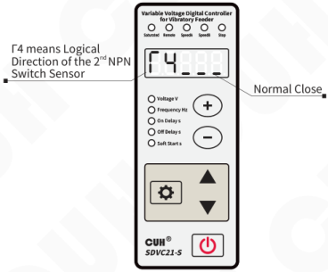

Γ4 significa dirección lógica del segundo sensor de conmutación NPN.

Normal Close

El parámetro Γ4 se ajusta a `___` de forma predeterminada

- Cuando el parámetro Γ4 se ajusta a `___`, es decir, no se recibe señal, el controlador funciona.
- Cuando el parámetro Γ4 se ajusta a `_-_`, es decir, no se recibe señal, el controlador se detiene.

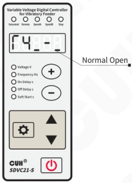

Normal Open

---

## 5.4 Ajuste de la relación lógica de la señal de control

El controlador puede ajustar la relación lógica del sensor fotoeléctrico inteligente y el sensor de conmutación cuando funcionan simultáneamente.

- Mantenga pulsados ⚙ y ▲ simultáneamente para entrar en la interfaz de parámetros avanzados.
- Pulse brevemente ⚙ para cambiar al parámetro Π.
- Pulse ▲ o ▼ para ajustar el valor del parámetro.

Π significa relación lógica de la señal de control

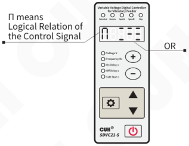

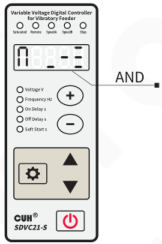

La relación lógica predeterminada es AND

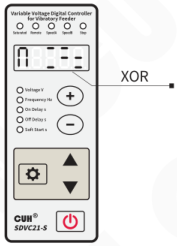

### Relación lógica: AND 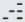:

El controlador funciona solo cuando tanto el sensor fotoeléctrico inteligente como el sensor de conmutación NPN se lo solicitan.

### Relación lógica: OR 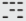:

El controlador funciona cuando el sensor fotoeléctrico inteligente o el sensor de conmutación NPN se lo solicita.

### Relación lógica: XOR 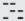:

El controlador funciona solo cuando el sensor fotoeléctrico inteligente y el sensor de conmutación NPN emiten señales de control opuestas.

---

## 5.5 Salida de control

El controlador puede emitir una señal de control de baja tensión para cooperar con otros dispositivos, como una válvula solenoide, un PLC o un relé eléctrico.

### 5.5.1 Método de cableado de la salida de control

**Método de conexión del PLC**

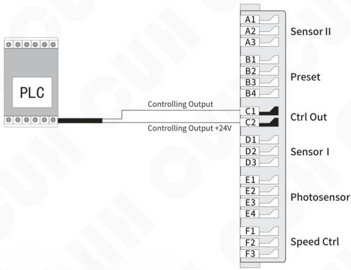

> La salida de relé o la salida NPN del PLC son compatibles con el controlador.

Los métodos de ajuste de parámetros son los mismos que los del sensor de conmutación.

---

## Método de conexión de la válvula solenoide

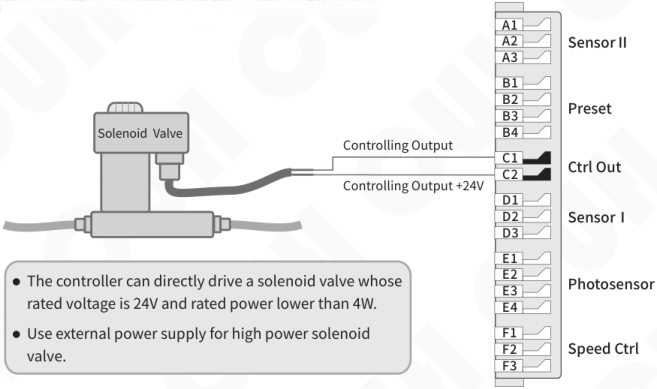

- El controlador puede accionar directamente una válvula solenoide cuya tensión nominal sea de 24V y potencia nominal inferior a 4W.
- Utilice una fuente de alimentación externa para válvulas solenoides de alta potencia.

## Método de conexión del relé eléctrico

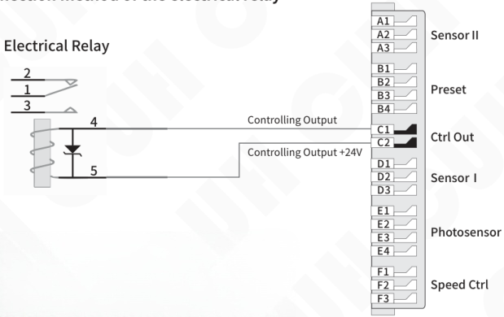

- El controlador puede accionar directamente un relé eléctrico cuya tensión nominal sea de 24V y potencia nominal inferior a 4W.

---

## 5.5.2 Ajuste de la dirección lógica de la salida de control

- Mantenga pulsados ⚙ y ▲ simultáneamente para entrar en la interfaz de parámetros avanzados.
- Pulse brevemente ⚙ para cambiar al parámetro Γ3.
- Pulse ▲ o ▼ para ajustar el valor del parámetro.

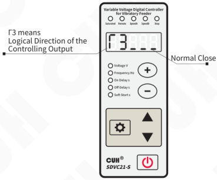

El parámetro Γ3 se ajusta a `___` de forma predeterminada

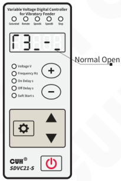

- Cuando el parámetro Γ3 se ajusta a `___`, la salida de control funciona cuando el controlador está en marcha.
- Cuando el parámetro Γ3 se ajusta a `_-_`, la salida de control no funciona cuando el controlador está en marcha.

---

## 5.6 Control de velocidad remoto

La función de control de velocidad remoto permite al operador controlar la tensión de salida mediante un potenciómetro externo, una tensión de 1~5V o una corriente de 4~20mA. Así, el control de velocidad remoto externo puede lograrse fácilmente mediante un PLC, un DCS u otros dispositivos.

### Método de conexión del potenciómetro externo

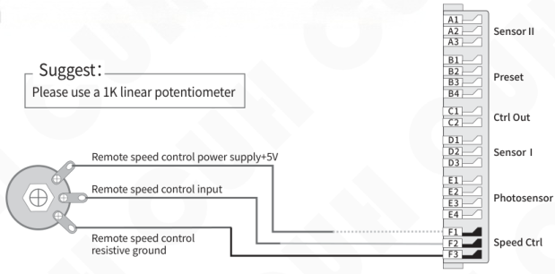

### Método de conexión del PLC

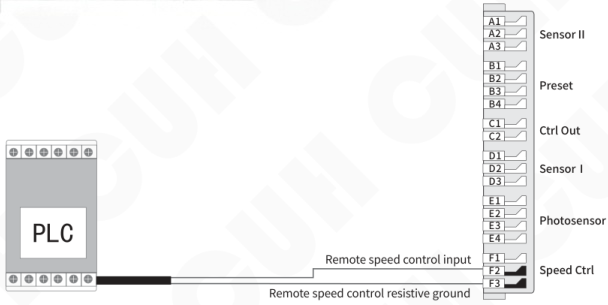

> Cuando la señal de control de velocidad remoto entra en vigor, el indicador de control de velocidad se enciende y, al mismo tiempo, la regulación de la tensión en el panel dejará de funcionar.

---

## 5.7 Conmutación de velocidad preajustada

La función de conmutación de velocidad preajustada permite seleccionar la velocidad preajustada mediante señales de control externas, como un PLC, un PC, sensores u otras fuentes de señal, para construir un sistema de control de alimentación de múltiples velocidades.

El controlador dispone de dos señales de control de conmutación de velocidad preajustada, que controlan la conmutación de velocidad A y la conmutación de velocidad B, ambas activas por nivel bajo.

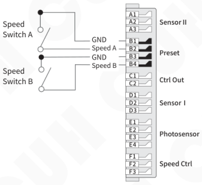

El estado de cada línea de control se muestra mediante los indicadores correspondientes del panel. Cuando se aplica una señal válida a la línea de control, el indicador correspondiente se enciende.

La combinación de los estados de encendido y apagado de los dos indicadores tiene 4 estados (A encendido y B apagado, A apagado y B encendido, ambos encendidos y ambos apagados).

Al seleccionar la señal de control, el controlador entrará en la velocidad preajustada correspondiente. En este momento, la tensión de salida del controlador se puede ajustar con ⊕ o ⊖. La tensión se registrará automáticamente. Cada vez que la señal de control de velocidad preajustada sitúe el controlador en este estado, cambiará inmediatamente a esta tensión.

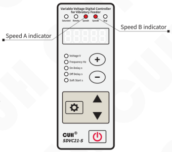

Estado cuando ambas líneas de control tienen señales válidas aplicadas.

---

## Capítulo Ⅵ Funciones de seguridad

### 6.1 Estabilización digital automática de tensión

La función interna de estabilización digital de tensión del controlador puede estabilizar la velocidad de alimentación independientemente de la fluctuación de la tensión de red.

### 6.2 Protección contra cortocircuitos

Si la salida se cortocircuita, el controlador detendrá su salida y mostrará Err01 hasta que se reinicie el controlador.

### 6.3 Protección contra sobrecarga de corriente

El controlador detendrá su salida si la corriente de salida supera la corriente nominal debido a un funcionamiento defectuoso y mostrará Err02 para proteger el controlador y los equipos del cliente.

### 6.4 Protección contra sobrecalentamiento

El controlador detendrá su salida si la temperatura de operación supera los 65°C y mostrará Err03 para protegerse hasta que la temperatura de operación descienda a 60°C.

---

## Capítulo Ⅶ Especificaciones técnicas

### 7.1 Dimensiones

Dimensiones (unidad: mm)

| Rango de dimensiones | tolerancia |
|---|---|
| 0~3 | ±0.05 |
| 3~10 | ±0.1 |
| 10~30 | ±0.15 |
| 30~80 | ±0.2 |
| 80~180 | ±0.3 |
| >180 | ±0.5 |

Esta tabla de tolerancias es aplicable a todos los productos de esta serie.

---

## 7.2 Especificaciones técnicas

| Elemento | Mín | Típico | Máx | Unidad | Nota |
|---|---|---|---|---|---|
| Tensión de entrada | 85 | 220 | 250 | V | CA RMS |
| Rango de tensión de salida ajustable | 35 | —— | Vin-10 | V | Media onda |
| Rango de tensión de salida ajustable | 45 | —— | Vin-5 | V | Onda completa |
| Precisión de ajuste de tensión | | 1 | | V | |
| Precisión de regulación de tensión | —— | —— | 30 | V | Vset = 150V △Vin+ = 70V |
| Tiempo de respuesta de regulación de tensión | 0 | 0.01 | 0.02 | s | |
| Rango de corriente de salida ajustable | 0 | —— | 5 | A | |
| Potencia de salida | 0 | —— | 1100 | VA | |
| Frecuencia de salida | 45 | 50/60 | 65 | Hz | Media onda |
| Frecuencia de salida | 90 | 100/120 | 130 | Hz | Onda completa |
| Forma de onda de salida | | Control de ángulo de fase | | | |
| Tiempo de arranque suave | 0 | —— | 9.9 | s | Valor predeterminado: 1.0 |
| Rango de tiempo de retardo de conexión/desconexión | 0 | —— | 9.9 | s | Valor predeterminado: 0.2 |
| Precisión del tiempo de retardo de conexión/desconexión | | 0.1 | | s | |
| Temperatura de activación de la protección contra sobrecalentamiento | 58 | 60 | 66 | °C | |
| Tensión de salida de control de CC | 22 | 24 | 26 | V | |
| Corriente de salida de control de CC | 0 | —— | 400 | mA | |
| Señal de control analógica | | 1~5/4~20 | | V/mA | Señal de control de velocidad remoto |
| Señal de control digital | | 24 | | V | Señal de conmutación |
| Método de ajuste | | 6 | | Botón | |
| Capacidad del fusible | | 6.3 | | A | |
| Consumo de energía en espera | —— | 2 | —— | W | |
| Método de visualización | | 5 | | Dígito | LED |
| Temperatura ambiente | 0 | 25 | 40 | °C | Sin condensación |
| Humedad ambiente | 10 | 60 | 85 | % | Sin condensación |
| Temperatura ambiente de almacenamiento | -20 | 25 | 85 | °C | Sin condensación |

## 7.3 Norma de referencia

**Parámetros absolutos:**  
Superar estos valores dañará el controlador; respételos estrictamente.

| Elemento | Norma GB | Norma IEC | Grado | Requisito de la norma | Nota |
|---|---|---|---|---|---|
| Descarga electrostática | GB/T 17626.2-2006 | IEC 61000-4-2:2001 | 4 | ±8 kV | Descarga por contacto |
| | | | 4 | ±15 kV | Descarga en el aire |
| Ensayo de transitorios eléctricos rápidos | GB/T 17626.4-2008 | IEC 61000-4-4:2004 | 4 | ±4 kV | |
| Inmunidad a ondas en la línea de alimentación de CC | GB/T 17626.17-2005 | IEC 61000-4-17:2002 | 4 | 15% | Clasificación A |

> **Advertencia**  
> En un entorno residencial, este producto puede causar interferencias de radio, en cuyo caso pueden ser necesarias medidas de mitigación adicionales.

---

## 7.4 Tabla de parámetros

| | Definición | Símbolo | imagen del símbolo | Rango | Valor predeterminado |
|---|---|---|---|---|---|
| Parámetro común | Tensión de salida | U |  | 0~250 V | 150 |
| Parámetro básico | Frecuencia de salida | E |  | FULL，HALF | FULL |
| Parámetro básico | Retardo de conexión del sensor fotoeléctrico inteligente | J |  | 0.0~9.9 s | 0.2 |
| Parámetro básico | Retardo de desconexión del sensor fotoeléctrico inteligente | L |  | 0.0~9.9 s | 0.2 |
| Parámetro básico | Arranque suave | t |  | 0.0~9.9 s | 1.0 |
| Parámetro avanzado | Retardo de conexión del sensor de conmutación NPN | J- |  | 0.0~9.9 s | --- igual que J |
| Parámetro avanzado | Retardo de desconexión del sensor de conmutación NPN | L- |  | 0.0~9.9 s | --- igual que L |
| Parámetro avanzado | Retardo de conexión del segundo sensor de conmutación NPN | J_ |  | 0.0~9.9 s | --- igual que J |
| Parámetro avanzado | Retardo de desconexión del segundo sensor de conmutación NPN | L_ |  | 0.0~9.9 s | --- igual que L |
| Parámetro avanzado | Dirección lógica del sensor fotoeléctrico inteligente | F1 |  | Normal Close, Normal Open  | ___ |
| Parámetro avanzado | Dirección lógica del sensor de conmutación NPN | F2 |  | Normal Close, Normal Open [[vcrop:41:17]] | ___ |
| Parámetro avanzado | Dirección lógica de la salida de control | F3 |  | Normal Close, Normal Open [[vcrop:41:17]] | ___ |
| Parámetro avanzado | Dirección lógica del segundo sensor de conmutación NPN | F4 |  | Normal Close, Normal Open [[vcrop:41:17]] | ___ |
| Parámetro avanzado | Relación lógica de la señal de control | A |  | or, And, Hor  |  |
| Parámetro avanzado | Tensión de salida máxima | h |  | 0~250 V | 220 |
| Parámetro avanzado | Sensibilidad del sensor fotoeléctrico inteligente | P |  | 0~1000 | 80 |
| Parámetro avanzado | Restauración de la configuración predeterminada | 8.8.8.8.8. |  | —— | —— |

## 7.5 Sugerencias de solución de problemas y explicaciones de errores

| Código de error | Definición | Métodos de solución de problemas | imagen del símbolo |
|---|---|---|---|
| Sin visualización tras encender | | Asegúrese de que la toma de corriente tenga tensión Asegúrese de que el cable de alimentación de entrada esté conectado de forma fiable a la toma de corriente | |
| Visualización normal, pero sin salida | | Asegúrese de que el cable de salida esté conectado de forma fiable al vibrador. Asegúrese de que la tensión de salida no sea pequeña. Asegúrese de que el indicador de parada no esté encendido. Compruebe si se ha configurado Normal Close del parámetro, lo que hace que se detenga la salida del controlador. | |
| La señal de control pierde efectividad | | Asegúrese de que la señal de control se introduzca correctamente. Asegúrese de que el cable de tierra de la señal de control esté correctamente conectado al controlador. Asegúrese de que la relación lógica de las señales de control esté configurada correctamente según lo esperado. | |
| Fenómenos de batido | | Evite el acoplamiento de vibraciones entre los vibradores. Aumente la frecuencia de resonancia de los vibradores. | |
| Visualización normal, sin salida, pero se oye un sonido | | Ajuste todos los parámetros como se indica en este manual. | |
| Err01 | Cortocircuito | Asegúrese de que el cable de alimentación de salida y la bobina no estén cortocircuitados. |  |
| Err02 | Sobrecorriente | Reduzca adecuadamente la tensión de salida y, a continuación, reinicie la salida. |  |
| Err03 | Sobrecalentamiento | Instale el controlador en un entorno bien ventilado. |  |
| Err04 | | Reservado, póngase en contacto con CUH |  |
| Err05 | | Reservado, póngase en contacto con CUH |  |

## Capítulo Ⅷ Información de garantía del producto

### 8.1 Período de garantía

El período de garantía proporcionado por la empresa para este producto es de 3 años a partir de la fecha de entrega del producto en el lugar designado por el comprador.

### 8.2 Cobertura de la garantía

(1) Si se produce un fallo causado por nuestra empresa durante el período de garantía anterior, repararemos el producto de forma gratuita. Sin embargo, las siguientes situaciones no están cubiertas por la garantía:

a. Incumplimiento de las condiciones especificadas en el manual simplificado, el manual de usuario o los requisitos técnicos acordados específicamente entre el comprador y la empresa, operación inadecuada o fallo causado por un uso inadecuado.

b. Fallo que no se debe a un defecto del producto, sino al diseño del equipo o del software del comprador.

c. Fallos de funcionamiento causados por modificaciones o reparaciones no realizadas por el personal de la empresa.

d. El fallo que podría haberse evitado por completo con un mantenimiento correcto o la sustitución de las piezas de desgaste según la guía de operación simplificada o el manual de usuario.

e. Fallos producidos después del envío del producto desde nuestra empresa por factores como cambios imprevistos en el nivel de la ciencia y la tecnología.

f. Por desastres naturales como incendios, terremotos, inundaciones, o factores externos como fallos por tensión anómala, la empresa no se hace responsable de la garantía.

(2) El alcance de la garantía se limita a la situación estipulada en (1)，Las pérdidas indirectas (como daños al equipo, oportunidades, pérdida de beneficios, etc.) u otras pérdidas, la empresa no asume ninguna responsabilidad.

### 8.3 Idoneidad del producto

El controlador de nuestra empresa está diseñado y fabricado para uso general en la industria de la alimentación vibratoria. Por lo tanto, este controlador de nuestra empresa no debe utilizarse para las siguientes aplicaciones y no es adecuado para su uso.

(1) Instalaciones que tienen un impacto grave en la vida y la propiedad, como centrales nucleares, aeropuertos, ferrocarriles, barcos, dispositivos motorizados y equipos médicos.

(2) Servicios públicos, incluidos electricidad, gas, suministro de agua, etc.

(3) Uso en exteriores en condiciones o entornos similares.

---

Nanjing CUH Science & Technology Co.,Ltd  
https://en.cuhnj.com  
Tel.:+86-25-84730411 / 84730415 / 84730416  
Fax:+86-25-84730426  
E-mail:sales@cuhnj.com  
Add.:Building 2, Xueyan Tech Park, Tuscity,  
No.9 Zhineng Rd, Jiangning, Nanjing, China

Document No.: IDP1000378

