# Controlador digital de tensión variable para alimentador vibratorio

**IP67**

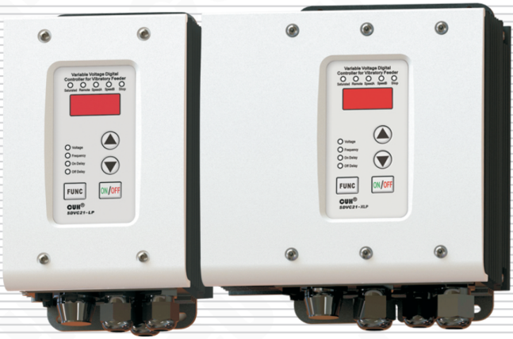

## Manual de instrucciones de la serie SDVC21P

**Controlador digital de tensión variable para alimentador vibratorio**

---

## Prefacio

Gracias por elegir los controladores digitales CUH para alimentadores vibratorios. (En lo sucesivo, “el controlador”.)

Este manual de instrucciones incluye notas para la instalación, la puesta en marcha, el ajuste de parámetros, el mantenimiento y la solución de problemas del controlador. Lea atentamente este manual de instrucciones antes de utilizar el controlador y consérvelo adecuadamente.

### Este manual de instrucciones se aplica a los siguientes modelos:

➔Controlador inteligente digital estabilizador de tensión para alimentador vibratorio SDVC21-LP  
➔Controlador inteligente digital estabilizador de tensión para alimentador vibratorio SDVC21-XLP

---

---

## Aviso

- Nunca realice conexiones ni desconexiones en caliente ni toque los contactos en ningún caso para evitar descargas eléctricas u otros accidentes.
- No conmute nunca la entrada del controlador cortando la alimentación mediante un relé u otros dispositivos; de lo contrario, la vida útil del controlador puede reducirse gravemente.
- No abra la carcasa sin autorización; de lo contrario, la protección contra agua, aceite y polvo puede fallar.
- No utilice nunca el controlador en condiciones que superen sus límites de diseño.
- Utilice el controlador estrictamente de acuerdo con este manual de instrucciones. No asumiremos ninguna responsabilidad civil o penal si el daño del equipo o las lesiones personales son causados por una operación incorrecta.

> **!**
>
> No abra nunca la carcasa del controlador para evitar descargas eléctricas. Póngase en contacto con CUH si el controlador se avería.
>
> No intente nunca modificar el controlador, ya que las placas de circuitos de estado sólido del interior no se pueden reparar y no hay ninguna pieza ajustable.

---

# Entorno de funcionamiento

## Inspecciones antes del uso

Cada controlador se somete a una rigurosa inspección de calidad antes de su entrega y se embala con un embalaje a prueba de impactos.

## Compruebe los siguientes puntos después de desembalar:

- Si el controlador presenta daños en el aspecto exterior
- Si el modelo del controlador es exactamente el que ha pedido

## Entorno de funcionamiento

Tenga en cuenta las siguientes notas para garantizar un mejor rendimiento y una vida útil más larga del controlador

- Entorno bien ventilado
- Mantener alejado de gases y líquidos corrosivos e inflamables
- Fijación firme para evitar vibraciones
- Mantener alejado de las interferencias electromagnéticas
- Funcionamiento dentro del rango de temperatura de 0 °C a 40 °C
- Para su uso a una altitud de 2000m o inferior

---

# Índice

| Sección | Página |
|---|---:|
| Capítulo I Características | 1 |
| Capítulo II Guía de instalación | 3 |
| Capítulo III Descripción de los componentes | 4 |
| Capítulo IV Descripción de las funciones | 6 |
| 4.1 Ajuste de la tensión de salida | 6 |
| 4.2 Ajuste de la frecuencia de salida | 7 |
| 4.3 Ajuste del parámetro de carácter de visualización de frecuencia | 7 |
| 4.4 Ajuste del tiempo de arranque suave | 8 |
| 4.5 Interruptor de salida | 8 |
| 4.6 Limitación de la tensión de salida máxima | 9 |
| 4.7 Restauración de la configuración predeterminada | 10 |
| Capítulo V Sensores y control de señales | 11 |
| 5.1 Detección fotoeléctrica inteligente | 11 |
| 5.2 Método de uso del sensor de conmutación | 15 |
| 5.3 Método de uso del segundo sensor de conmutación | 18 |
| 5.4 Ajuste de la relación lógica de la señal de control | 21 |
| 5.5 Salida de control | 22 |
| 5.6 Control de velocidad remoto | 26 |
| 5.7 Conmutación de velocidad predefinida | 27 |
| Capítulo VI Funciones de seguridad | 28 |
| 6.1 Estabilización automática digital de tensión | 28 |
| 6.2 Protección contra cortocircuitos | 28 |
| 6.3 Protección contra sobrecarga de corriente | 28 |
| 6.4 Protección contra sobrecalentamiento | 28 |
| 6.5 Curva de reducción por temperatura ambiente (solo para SDVC21-XLP) | 28 |

## Apéndice

| Sección | Página |
|---|---:|
| Apéndice A: Dimensiones | 29 |
| Apéndice B: Definición de la interfaz de salida | 31 |
| Apéndice C: Definición de la interfaz de señales | 31 |
| Apéndice D: Definición de los caracteres mostrados en el LED | 34 |
| Apéndice E: Especificación eléctrica | 35 |
| Apéndice F: Consejos de solución de problemas y explicación de errores | 36 |
| Apéndice G: Parámetros absolutos | 37 |

---

# Capítulo Ⅰ Características

El controlador está especialmente diseñado para controlar alimentadores vibratorios en sistemas de automatización. Combinado con la última tecnología electrónica y un diseño esmerado, el controlador ofrece las siguientes características prácticas y convenientes:

**Nivel de protección:** IP67. Este controlador puede funcionar en entornos húmedos, con contaminación de aceite o polvo.

**Rango de tensión de funcionamiento ultraamplio:** El rango de tensión de entrada de este controlador es de AC 85V a 440V.

**Estabilización automática de tensión:** El controlador puede eliminar las variaciones de velocidad de alimentación causadas por las fluctuaciones de la tensión de red.

**Ajuste de tensión:** La tensión de salida va de 0V a 440V.

**Arranque suave:** Para evitar impactos repentinos en las piezas de trabajo, el controlador puede aumentar suavemente la tensión de salida de 0 al valor preajustado al arrancar.

**Ajuste del tiempo de arranque suave:** El tiempo de arranque suave se puede ajustar con exactitud en valores digitales.

**Parada cuando las piezas de trabajo están llenas:** Un sensor de conmutación puede ayudar a detener el controlador cuando las piezas de trabajo están llenas y cumplir las funciones de ajuste del tiempo de arranque suave, retardo de arranque, retardo de parada y ajuste de la relación lógica.

**Salida de control:** La señal de salida de control emitida por el transistor puede coordinar un solenoide u otros dispositivos externos con el controlador.

**Protección contra sobrecalentamiento:** El controlador detendrá su salida para protegerse cuando la temperatura de funcionamiento sea demasiado alta.

**Protección contra sobrecarga de corriente:** El controlador detendrá su salida para garantizar la seguridad de funcionamiento del equipo cuando la corriente de funcionamiento supere su valor nominal.

## Las siguientes características se pueden personalizar:

**Entrada de doble señal de control:** La entrada de doble señal de control de “piezas de trabajo llenas” y “piezas de trabajo vacías” puede formar la relación de control lógica de AND, OR, NOT, XOR y todas las demás.

**Función de preajuste de la tensión de salida:** Se pueden seleccionar hasta cuatro valores de tensión de salida preajustados mediante señales de control externas.

**Detección fotoeléctrica inteligente:** Nuestro sensor fotoeléctrico inteligente adaptativo puede ayudar a detener el controlador cuando las piezas de trabajo están llenas o vacías y cumplir las funciones de ajuste del tiempo de arranque por impulsos, retardo de arranque, retardo de parada y ajuste de la relación lógica.

**Control de velocidad remoto:** La tensión de salida del controlador se puede controlar mediante un potenciómetro externo, un PLC o una señal de control de tensión de 1V a 5V.

---

---

**CUH** concede gran importancia a la gestión de la calidad del producto y al rendimiento de seguridad. Además de los componentes de alta calidad que utilizamos y del riguroso sistema de control de calidad, **CUH** ha tenido en cuenta los posibles accidentes que los usuarios pueden encontrar y ofrece las siguientes funciones de protección para maximizar la practicidad del controlador.

**Protección contra cortocircuitos:** Si la salida del controlador está en cortocircuito, el controlador detendrá su salida hasta que se reinicie.

**Protección contra sobrecarga de corriente:** El controlador detendrá su salida para garantizar la seguridad de funcionamiento de los equipos cuando la corriente de funcionamiento supere su valor nominal.

**Protección contra sobrecalentamiento:** El controlador detendrá su salida para protegerse cuando la temperatura de funcionamiento sea demasiado alta.

Los controladores **CUH** cumplen estrictamente con la certificación CE.

---

# Capítulo Ⅱ Guía de instalación

## Paso uno:

Abra la caja de embalaje y conecte el cable de salida de potencia a las bobinas electromagnéticas del vibrador.

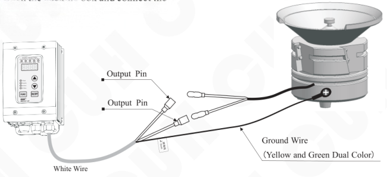

**⚠ Nota:**

Asegúrese de que las bobinas electromagnéticas del vibrador estén conectadas a los dos pines de salida del cable de salida de potencia y de que las bobinas electromagnéticas estén conectadas a tierra de forma fiable; de lo contrario, puede producirse una serie de incidentes de seguridad.

## Paso dos:

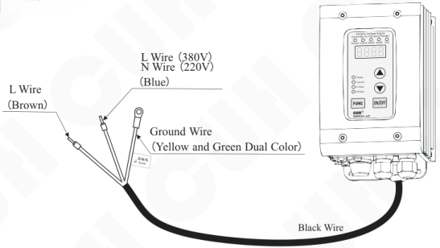

---

# Capítulo Ⅲ Descripción de los componentes

En el panel de control hay 4 botones, incluido el botón `FUNC` para cambiar entre diferentes funciones, el botón ▲ para aumentar el valor del parámetro, el botón ▼ para disminuir el valor del parámetro y el botón `ON/OFF`.

## Descripción del teclado

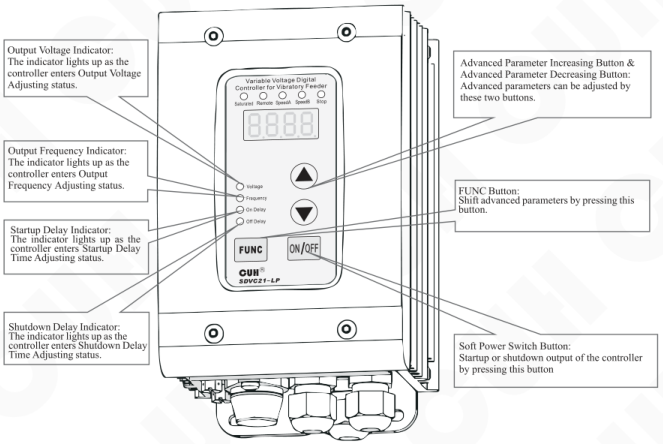

- **Indicador de tensión de salida:** El indicador se ilumina cuando el controlador entra en el estado de ajuste de la tensión de salida.
- **Indicador de frecuencia de salida:** El indicador se ilumina cuando el controlador entra en el estado de ajuste de la frecuencia de salida.
- **Indicador de retardo de arranque:** El indicador se ilumina cuando el controlador entra en el estado de ajuste del tiempo de retardo de arranque.
- **Indicador de retardo de parada:** El indicador se ilumina cuando el controlador entra en el estado de ajuste del tiempo de retardo de parada.
- **Botón de aumento de parámetros avanzados y botón de reducción de parámetros avanzados:** Los parámetros avanzados se pueden ajustar con estos dos botones.
- **Botón FUNC:** Cambie entre los parámetros avanzados pulsando este botón.
- **Botón de interruptor suave:** Encienda o apague la salida del controlador pulsando este botón

---

## Descripción de los indicadores de estado

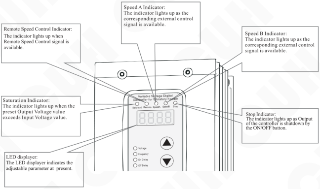

- **Indicador de control de velocidad remoto:** El indicador se ilumina cuando la señal de control de velocidad remoto está disponible.
- **Indicador de velocidad A:** El indicador se ilumina cuando la señal de control externa correspondiente está disponible.
- **Indicador de velocidad B:** El indicador se ilumina cuando la señal de control externa correspondiente está disponible.
- **Indicador de saturación:** El indicador se ilumina cuando el valor preajustado de la tensión de salida supera el valor de la tensión de entrada.
- **Indicador de parada:** El indicador se ilumina cuando la salida del controlador se apaga con el botón ON/OFF.
- **Pantalla LED:** La pantalla LED indica el parámetro ajustable en ese momento.

## Descripción de la interfaz de E/S

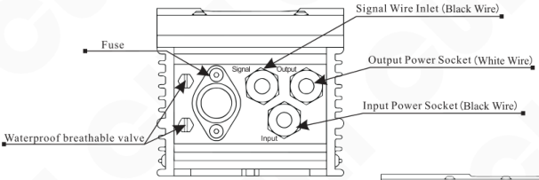

**SDVC21-LP (10A)**

- Fusible
- Válvula transpirable impermeable
- Entrada del cable de señal (cable negro)
- Zócalo de salida de potencia (cable blanco)
- Zócalo de entrada de potencia (cable negro)

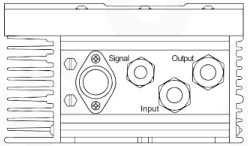

**SDVC21-XLP (25A)**

Nota: Cuando se utilice en entornos con alta contaminación de aceite, es necesario comprobar periódicamente la superficie de la válvula transpirable impermeable para evitar que el orificio de escape de la válvula transpirable impermeable se obstruya por la contaminación de aceite.

---

## Capítulo Ⅳ Descripción de las funciones

### 4.1 Ajuste de la tensión de salida

La tensión de salida se puede ajustar de forma directa y digital a través del panel de control. Gracias a la función única de estabilización de tensión, la tensión de salida del controlador no fluctúa como lo hace la tensión de entrada. Así, un vibrador puede trabajar de forma estable en un entorno de tensión de entrada inestable.

- Encienda el controlador conectando el cable de entrada de potencia.
- El indicador de tensión de salida se ilumina cuando el controlador entra en el estado de ajuste de la tensión de salida y la pantalla LED muestra el símbolo de tensión H y el valor de tensión ajustado previamente.
- Ajuste el valor de la tensión de salida pulsando el botón ▲ o ▼.

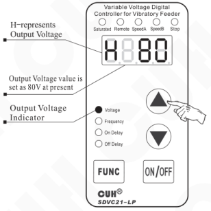

- El valor de la tensión de salida del controlador no puede superar el valor de la tensión de entrada. Si el valor de la tensión de salida se ajusta cerca del valor de la tensión de entrada, el controlador no puede estabilizar su salida de tensión y el indicador de saturación se ilumina.
- Si el valor de la tensión de salida se ajusta demasiado cerca de cero, el controlador no puede estabilizar su salida de tensión y el indicador de saturación se ilumina.

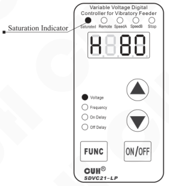

---

## 4.2 Ajuste de la frecuencia de salida

Para el SDVC21-LP, hay dos frecuencias de salida entre las que elegir: onda completa – valor de frecuencia de entrada duplicado, y media onda – valor de frecuencia de entrada.

Para el SDVC21-XLP, hay cuatro frecuencias de salida entre las que elegir: onda completa, media onda, un tercio de la onda completa y un cuarto de la onda completa.

- Pulse el botón **FUNC** repetidamente hasta que se cambie al estado de ajuste de la frecuencia de salida (E) y se ilumine el indicador de frecuencia de salida.
- Pulse el botón ▲ o ▼ para ajustar la frecuencia de salida.

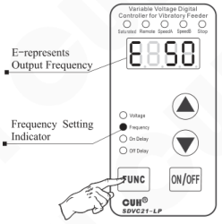

> Los caracteres mostrados del valor de frecuencia de salida se pueden ajustar mediante el parámetro de carácter de visualización de frecuencia. Consulte la sección 4.3.

## 4.3 Ajuste del parámetro de carácter de visualización de frecuencia

- Pulse el botón **FUNC** y manténgalo pulsado dos segundos para entrar en la interfaz de ajuste de parámetros avanzados.
- Pulse el botón **FUNC** repetidamente para cambiar al parámetro “ΓE”, que define el carácter de visualización de frecuencia.
- Pulse ▲ o ▼ para ajustar el valor de este parámetro.

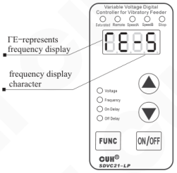

> Cuando el parámetro “ΓE” está ajustado en “-5”, los caracteres mostrados serán 100, 50, 33 o 25.  
> Cuando el parámetro “ΓE” está ajustado en “-6”, los caracteres mostrados serán 120, 60, 40 o 30.  
> Cuando el parámetro “ΓE” está ajustado en “-E”, los caracteres mostrados serán “FUL”, “HAF”, “trd” o “Foh”.

---

## 4.4 Ajuste del tiempo de arranque suave

Para evitar impactos repentinos en las piezas de trabajo, el controlador puede aumentar suavemente la tensión de salida de 0 al valor preajustado al arrancar.

Tiempo de arranque suave (t): El periodo de tiempo que tarda el controlador en aumentar suavemente la tensión de salida de 0 al valor preajustado al arrancar.

- Pulse el botón **FUNC** y manténgalo pulsado 2 segundos para entrar en el estado de ajuste de parámetros avanzados.
- Pulse el botón **FUNC** repetidamente hasta que se cambie al estado de ajuste del tiempo de arranque suave (t) y se ilumine el indicador de arranque suave.
- Pulse el botón ▲ o ▼ para ajustar el valor del parámetro. La unidad del parámetro es el segundo y la precisión numérica es 0.1.

*El tiempo de arranque suave ajustable va de 0.0 segundos a 9.9 segundos.*

*El valor predeterminado del parámetro de tiempo de arranque suave es 1 segundo.*

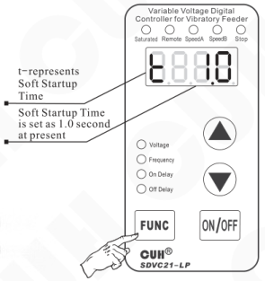

## 4.5 Interruptor de salida

El botón de conmutación de salida táctil del panel puede encender y apagar la salida del controlador de forma rápida y sencilla.

- Pulse el botón **ON/OFF** para encender o apagar la salida del controlador. El indicador de parada se ilumina cuando la salida del controlador se apaga.

> Gracias a la tecnología de interruptor táctil y control de señal digital, no se genera ninguna chispa que pueda deteriorar el contacto. Como resultado, la vida útil del controlador y del vibrador se prolonga considerablemente.

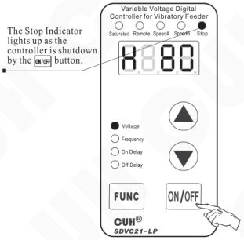

---

## 4.6 Limitación de la tensión de salida máxima

La tensión de salida máxima del controlador se puede ajustar para evitar daños al vibrador. La función de control de velocidad remoto se ve afectada por este parámetro.

- Pulse el botón **FUNC** y manténgalo pulsado 2 segundos para entrar en el estado de ajuste de parámetros avanzados.
- Pulse el botón **FUNC** repetidamente hasta que se cambie al estado de limitación de la tensión de salida máxima (h).
- Pulse el botón ▲ o ▼ para ajustar el valor del parámetro.

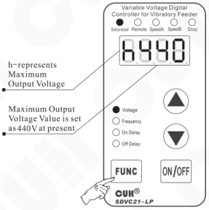

*El valor predeterminado de la tensión de salida máxima es 380V*

---

## 4.7 Restauración de la configuración predeterminada

Esta función permite al operador restaurar todos los valores predeterminados de los parámetros.

Debido a las abundantes funciones del controlador, muchos parámetros pueden ajustarse. Para evitar la circunstancia de que, tras demasiadas modificaciones por parte de un principiante, el controlador no pueda funcionar correctamente, esta función permite al operador restaurar la configuración predeterminada del controlador de una manera sencilla.

- Pulse el botón **FUNC** y manténgalo pulsado 2 segundos para entrar en el estado de ajuste de parámetros avanzados.
- Pulse el botón **FUNC** repetidamente hasta que toda la pantalla parpadee y, a continuación, mantenga pulsado el botón ▲ hasta que se muestre “----”, lo que significa que la configuración predeterminada se ha restaurado.
- Después de soltar el botón ▲, el controlador entra en el estado de ajuste de la tensión de salida (H). En ese momento, todos los parámetros se han restaurado a los valores predeterminados.

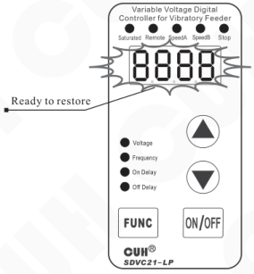

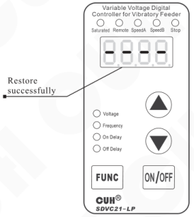

---

# Capítulo V Sensores y control de señales

El controlador puede ser controlado por muchos tipos de señales y sensores externos. Este capítulo explica principalmente el método de uso del sensor fotoeléctrico inteligente, los sensores de conmutación y el PLC.

## 5.1 Detección fotoeléctrica inteligente

Combinado con el sensor fotoeléctrico SDVC-S1, se puede lograr la función de detección fotoeléctrica inteligente. El sensor SDVC-S1 puede filtrar la interferencia de la luz de fondo que afecta a la sensibilidad del controlador. Como resultado, el controlador puede funcionar de forma fiable sin ajuste manual de la sensibilidad.

### 5.1.1 Método de conexión del sensor fotoeléctrico inteligente SDVC-S1

Conecte el sensor SDVC-S1 a los terminales del controlador según el diagrama

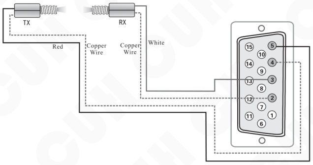

*Aviso:*  
*La relación lógica predeterminada del sensor está ajustada como “piezas de trabajo vacías”*

---

## 5.1.2 Ajuste del tiempo de retardo de arranque y del tiempo de retardo de parada del sensor fotoeléctrico inteligente

En la mayoría de las aplicaciones reales, la salida del controlador debe retrasarse durante un periodo de tiempo cuando el arranque o la parada del controlador está controlado por señales externas. La función de ajuste del tiempo de retardo de arranque y del tiempo de retardo de parada hizo posible este tipo de aplicación. Además, los impactos en las piezas de trabajo cuando el controlador arranca se pueden eliminar ajustando el tiempo de arranque suave.

### Retardo de arranque (J)

El periodo de tiempo que transcurre desde que el controlador recibe una señal de control de arranque hasta que emite salida.

- Pulse el botón **FUNC** repetidamente hasta que se cambie al estado de ajuste del tiempo de retardo de arranque (J) y se ilumine el indicador de retardo de arranque del panel.
- Ajuste el parámetro pulsando el botón ▲ o ▼. La unidad del parámetro es el segundo y la precisión numérica es 0.1.

*El rango ajustable del parámetro es de 0.0 a 9.9 segundos*  
*El valor predeterminado del parámetro es 0.2 segundos*

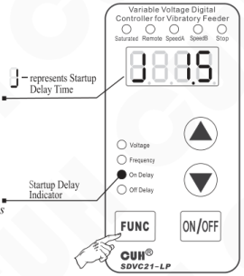

### Retardo de parada (L)

El periodo de tiempo que transcurre desde que el controlador recibe una señal de control de parada hasta que corta la salida.

- Pulse el botón **FUNC** repetidamente hasta que se cambie al estado de ajuste del tiempo de retardo de parada (L) y se ilumine el indicador de retardo de parada del panel.
- Ajuste el parámetro pulsando el botón ▲ o ▼. La unidad del parámetro es el segundo y la precisión numérica es 0.1.

*El rango ajustable del parámetro es de 0.0 a 9.9 segundos*  
*El valor predeterminado del parámetro es 0.2 segundos*

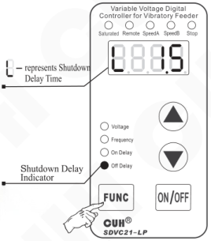

---

### 5.1.3 Ajuste de la relación lógica del sensor fotoeléctrico inteligente

En circunstancias normales, el extremo receptor del sensor fotoeléctrico inteligente no recibe ninguna señal óptica y el controlador funciona de forma predeterminada. Pero en algunas aplicaciones especiales, el controlador debe detenerse cuando el extremo receptor no recibe ninguna señal óptica. El ajuste de este parámetro puede satisfacer este tipo de aplicaciones.

- Pulse el botón **FUNC** y manténgalo pulsado 2 segundos para entrar en el estado de ajuste de parámetros avanzados.
- Pulse el botón **FUNC** repetidamente hasta que se cambie al estado de ajuste de la relación lógica del sensor fotoeléctrico inteligente.
- Ajuste el parámetro pulsando el botón ▲ o ▼.

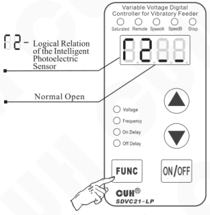

- Cuando la relación lógica está ajustada como Normal Open, es decir, no se recibe ninguna señal óptica, el controlador funciona.
- Cuando la relación lógica está ajustada como Normal Close, es decir, no se recibe ninguna señal óptica, el controlador se detiene.

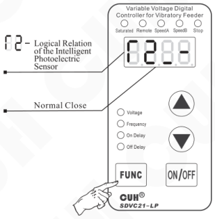

*El parámetro está ajustado como Normal Open de forma predeterminada*

---

## 5.1.4 Ajuste del parámetro de sensibilidad del sensor fotoeléctrico inteligente CUH

El parámetro P indica la sensibilidad del sensor fotoeléctrico inteligente CUH, es decir, la distancia de detección del sensor fotoeléctrico inteligente CUH.

Cuanto menor sea el valor del parámetro P, más sensible será el sensor y mayor será la distancia que puede recibir.

- Pulse el botón **FUNC** y manténgalo pulsado dos segundos para entrar en la interfaz de ajuste de parámetros avanzados.
- Pulse el botón **FUNC** repetidamente para entrar en la interfaz de ajuste del parámetro de sensibilidad fotoeléctrica inteligente. El símbolo LED de este parámetro es “P”.
- Pulse ▲ o ▼ para ajustar el valor de este parámetro.

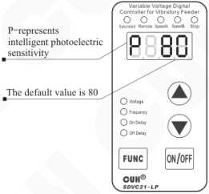

El rango de valores del parámetro es de 0 a 999 y el valor predeterminado es 80.

---

## 5.2 Método de uso del sensor de conmutación

El controlador puede funcionar con muchos tipos de sensores, como sensores de conmutación, sensores ópticos de conmutación y sensores de fibra óptica.

### 5.2.1 Método de conexión del sensor de conmutación

Conecte el sensor de conmutación de proximidad a los terminales del controlador según el diagrama.

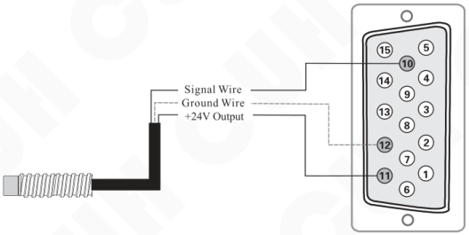

### Convención

El cable azul representa el cable de tierra  
El cable negro representa el cable de señal  
El cable marrón representa el cable de alimentación.

---

## 5.2.2 Ajuste del tiempo de retardo de arranque y del tiempo de retardo de parada del sensor de conmutación

De forma predeterminada, el sensor fotoeléctrico inteligente y el sensor de conmutación comparten el mismo tiempo de retardo de arranque y tiempo de retardo de parada. Los operadores también pueden ajustar de forma independiente el tiempo de retardo de arranque y el tiempo de retardo de parada del sensor de conmutación.

### Retardo de arranque (J-)

El periodo de tiempo que transcurre desde que el controlador recibe una señal de control de arranque hasta que emite salida.

- Pulse el botón **FUNC** y manténgalo pulsado 2 segundos para entrar en el estado de ajuste de parámetros avanzados.
- Pulse el botón **FUNC** repetidamente hasta que se cambie al estado de ajuste del tiempo de retardo de arranque (`J---`).
- Ajuste el parámetro pulsando el botón ▲ o ▼. La unidad del parámetro es el segundo y la precisión numérica es 0.1.

*El rango ajustable del parámetro es de 0.0 a 9.9 segundos*  
*El valor predeterminado del parámetro es J---*  
*El retardo de arranque independiente del sensor de conmutación se desactivará cuando el valor del parámetro se ajuste en 0*

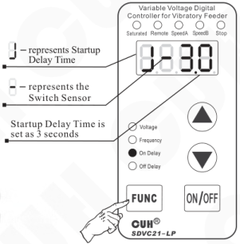

### Retardo de parada (L-)

El periodo de tiempo que transcurre desde que el controlador recibe una señal de control de parada hasta que corta la salida.

- Pulse el botón **FUNC** y manténgalo pulsado 2 segundos para entrar en el estado de ajuste de parámetros avanzados.
- Pulse el botón **FUNC** repetidamente hasta que se cambie al estado de ajuste del tiempo de retardo de parada (`L---`).
- Ajuste el parámetro pulsando el botón ▲ o ▼. La unidad del parámetro es el segundo y la precisión numérica es 0.1.

*El rango ajustable del parámetro es de 0.0 a 9.9 segundos*  
*El valor predeterminado del parámetro es L---*  
*El retardo de parada independiente del sensor de conmutación se desactivará cuando el valor del parámetro se ajuste en 0*

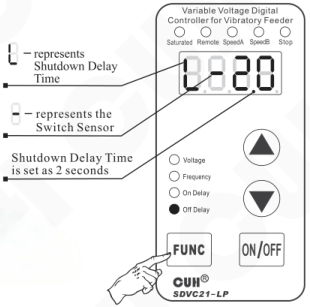

> ➔ Cuando los valores J- y L- se ajustan en 0, el tiempo de retardo de arranque y el tiempo de retardo de parada del sensor de conmutación serán los mismos que el tiempo de retardo de arranque y el tiempo de retardo de parada del sensor fotoeléctrico inteligente.
>
> ➔ El tiempo de retardo de arranque y el tiempo de retardo de parada del sensor fotoeléctrico inteligente no se verán afectados por el parámetro J- o L-.

---

## 5.2.3 Ajuste de la relación lógica del sensor de conmutación (parada cuando las piezas de trabajo están llenas)

En circunstancias normales, el controlador no recibe ninguna señal del sensor de conmutación y funciona de forma predeterminada. Pero en algunas aplicaciones especiales, el controlador debe detenerse cuando no recibe ninguna señal del sensor de conmutación. El ajuste de este parámetro puede satisfacer este tipo de aplicaciones.

- Pulse el botón **FUNC** y manténgalo pulsado 2 segundos para entrar en el estado de ajuste de parámetros avanzados.
- Pulse el botón **FUNC** repetidamente hasta que se cambie al estado de ajuste de la relación lógica del sensor de conmutación (Γ1).
- Ajuste el parámetro pulsando el botón ▲ o ▼.

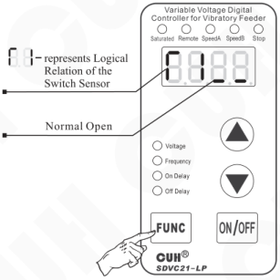

> ➔ Cuando la relación lógica está ajustada como Normal Open, es decir, no se recibe ninguna señal, el controlador funciona.
>
> ➔ Cuando la relación lógica está ajustada como Normal Close, es decir, no se recibe ninguna señal, el controlador se detiene.

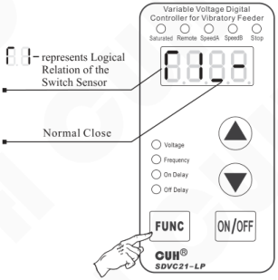

*El parámetro está ajustado como Normal Open de forma predeterminada*

---

## 5.3 Método de uso del segundo sensor de conmutación

El controlador permite conectar tres sensores: un sensor fotoeléctrico inteligente y dos sensores de conmutación. Las funciones de parada cuando las piezas de trabajo están llenas y de parada cuando las piezas de trabajo están vacías pueden funcionar con la ayuda de estos sensores.

### 5.3.1 Método de conexión del segundo sensor de conmutación

Conecte el segundo sensor de conmutación de proximidad a los terminales del controlador según el diagrama.

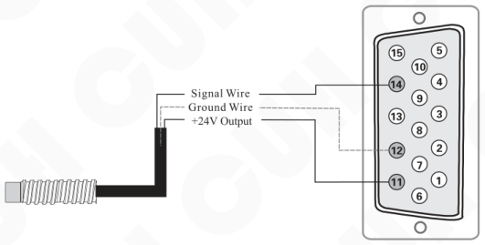

**Habitualmente**

El cable azul representa el cable de tierra  
El cable negro representa el cable de señal  
El cable marrón representa el cable de alimentación

---

### 5.3.2 Ajuste del tiempo de retardo de arranque y del tiempo de retardo de parada del segundo sensor de conmutación

De forma predeterminada, el sensor fotoeléctrico inteligente y los dos sensores de conmutación comparten el mismo tiempo de retardo de arranque y tiempo de retardo de parada. Los operadores también pueden ajustar de forma independiente el tiempo de retardo de arranque y el tiempo de retardo de parada del segundo sensor de conmutación.

**Retardo de arranque (J_):** El periodo de tiempo que transcurre desde que el controlador recibe una señal de control de arranque hasta que emite salida.

- Pulse el botón **FUNC** y manténgalo pulsado 2 segundos para entrar en el estado de ajuste de parámetros avanzados.
- Pulse el botón **FUNC** repetidamente hasta que se cambie al estado de ajuste del tiempo de retardo de arranque (`J_--`)
- Ajuste el parámetro pulsando el botón ▲ o ▼. La unidad del parámetro es el segundo y la precisión numérica es 0.1.

*El rango ajustable del parámetro es de 0.0 a 9.9 segundos*  
*El valor predeterminado del parámetro es `J_--`*  
*El retardo de arranque independiente del segundo sensor de conmutación se desactivará cuando el valor del parámetro se ajuste en 0*

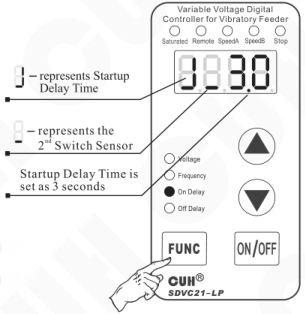

**Retardo de parada (L_):** El periodo de tiempo que transcurre desde que el controlador recibe una señal de control de parada hasta que corta la salida.

- Pulse el botón **FUNC** y manténgalo pulsado 2 segundos para entrar en el estado de ajuste de parámetros avanzados.
- Pulse el botón **FUNC** repetidamente hasta que se cambie al estado de ajuste del tiempo de retardo de parada (`L_--`).
- Ajuste el parámetro pulsando el botón ▲ o ▼. La unidad del parámetro es el segundo y la precisión numérica es 0.1.

*El rango ajustable del parámetro es de 0.0 a 9.9 segundos*  
*El valor predeterminado del parámetro es `L_--`*  
*El retardo de parada independiente del segundo sensor de conmutación se desactivará cuando el valor del parámetro se ajuste en 0*

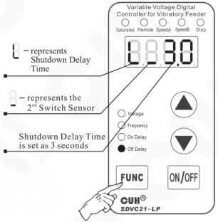

- Cuando los valores J_ y L_ se ajustan en 0, el tiempo de retardo de arranque y el tiempo de retardo de parada del segundo sensor de conmutación serán los mismos que el tiempo de retardo de arranque y el tiempo de retardo de parada del sensor fotoeléctrico inteligente.
- El tiempo de retardo de arranque y el tiempo de retardo de parada del sensor fotoeléctrico inteligente no se verán afectados por el parámetro J_ o L_.

---

## 5.3.3 Ajuste de la relación lógica del segundo sensor de conmutación (parada cuando las piezas de trabajo están llenas)

En circunstancias normales, el controlador no recibe ninguna señal del segundo sensor de conmutación y funciona de forma predeterminada. Pero en algunas aplicaciones especiales, el controlador debe detenerse cuando no recibe ninguna señal del segundo sensor de conmutación. El ajuste de este parámetro puede satisfacer este tipo de aplicaciones.

- Pulse el botón **FUNC** y manténgalo pulsado 2 segundos para entrar en el estado de ajuste de parámetros avanzados.
- Pulse el botón **FUNC** repetidamente hasta que se cambie al estado de ajuste de la relación lógica del segundo sensor de conmutación (Γ3)
- Ajuste el parámetro pulsando el botón ▲ o ▼.

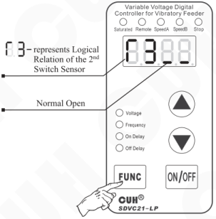

> - Cuando la relación lógica está ajustada como Normal Open, es decir, no se recibe ninguna señal, el controlador funciona.
> - Cuando la relación lógica está ajustada como Normal Close, es decir, no se recibe ninguna señal, el controlador se detiene.

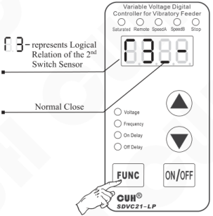

*El parámetro está ajustado como Normal Open de forma predeterminada*

---

## 5.4 Ajuste de la relación lógica de la señal de control

El controlador puede ajustar la relación lógica del sensor fotoeléctrico inteligente y del sensor de conmutación cuando trabajan simultáneamente.

- Pulse el botón **FUNC** y manténgalo pulsado 2 segundos para entrar en el estado de ajuste de parámetros avanzados.
- Pulse el botón **FUNC** repetidamente hasta que se cambie al estado de ajuste de la relación lógica de la señal de control (Π).
- Ajuste el parámetro pulsando el botón ▲ o ▼.

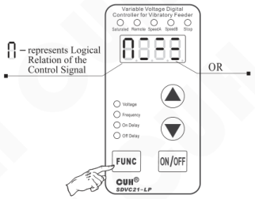

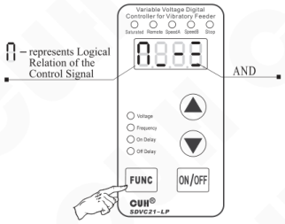

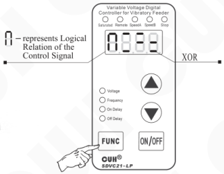

- **Relación lógica AND:** El controlador funciona solo cuando tanto el sensor fotoeléctrico inteligente como el sensor de conmutación se lo solicitan al controlador.
- **Relación lógica OR:** El controlador funciona cuando el sensor fotoeléctrico inteligente o el sensor de conmutación se lo solicita al controlador.
- **Relación lógica XOR:** El controlador funciona solo cuando el sensor fotoeléctrico inteligente y el sensor de conmutación emiten la señal de control opuesta.

*La relación lógica del parámetro está ajustada como AND de forma predeterminada.*

---

## 5.5 Salida de control

El controlador puede emitir una señal de control de baja tensión para cooperar con otros dispositivos, como una válvula solenoide, un PLC o un relé eléctrico.

### 5.5.1 Método de conexión de la salida de control

**Método de conexión del PLC controlado**

Conecte el cable de señal y el cable de tierra del controlador a los terminales del controlador según el diagrama.

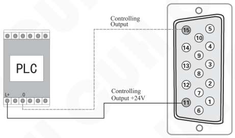

> El tipo de relé o el tipo de fuente del puerto de salida del PLC se pueden conectar al controlador y la especificación de tensión del puerto de salida es 24V.

---

### 5.5.2 Método de conexión de la válvula solenoide controlada

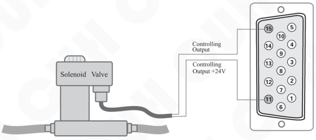

➔ El controlador puede accionar directamente una válvula solenoide cuya tensión nominal sea 24V y cuya potencia nominal sea inferior a 4W.

### 5.5.3 Método de conexión del relé eléctrico

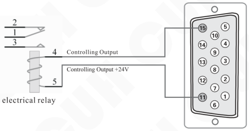

➔ El controlador puede accionar directamente un relé eléctrico cuya tensión nominal sea 24V y cuya potencia nominal sea inferior a 4W.

---

## 5.5.4 Ajuste de la relación lógica de la salida de control

- Pulse el botón **FUNC** y manténgalo pulsado 2 segundos para entrar en el estado de ajuste de parámetros avanzados.
- Pulse el botón **FUNC** repetidamente hasta que se cambie al estado de ajuste de la relación lógica de la salida de control (Γ4).
- Ajuste el parámetro pulsando el botón ▲ o ▼.

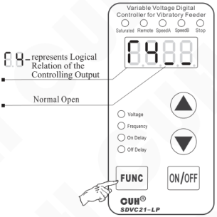

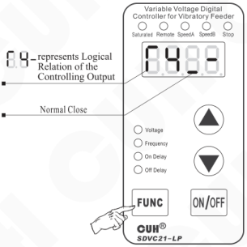

> - Cuando la relación lógica está ajustada como Normal Open, la salida de control funciona mientras el controlador está en funcionamiento.
> - Cuando la relación lógica está ajustada como Normal Close, la salida de control no funciona mientras el controlador está en funcionamiento.

---

## 5.5.5 Ajuste del parámetro de asignación de las señales de control a la salida del controlador o a la salida DC para el control por separado

- Pulse el botón **FUNC** y manténgalo pulsado dos segundos para entrar en la interfaz de ajuste de parámetros avanzados.
- Pulse el botón **FUNC** repetidamente para entrar en la interfaz de ajuste de este parámetro. El símbolo LED de este parámetro es “Γ5”.
- Pulse ▲ o ▼ para ajustar el valor de este parámetro.

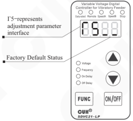

- Cuando el Γ5 está ajustado en “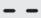”, la salida al vibrador y la salida DC están controladas por el botón ON/OFF del panel de control y el resultado de la operación lógica del sensor fotoeléctrico inteligente CUH y de dos sensores de conmutación.
- Cuando el Γ5 está ajustado en “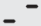”, la salida al vibrador está controlada por el botón ON/OFF del panel de control. La salida DC está controlada por el resultado de la operación lógica del sensor fotoeléctrico inteligente CUH y de dos sensores de conmutación.
- Cuando el Γ5 está ajustado en “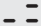”, la salida al vibrador está controlada por el botón ON/OFF del panel de control y por el resultado de la operación lógica de dos sensores de conmutación. La salida DC está controlada por el sensor fotoeléctrico inteligente CUH.
- Cuando el Γ5 está ajustado en “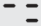”, la salida al vibrador está controlada por el botón ON/OFF del panel de control y por el sensor fotoeléctrico inteligente CUH. La salida DC está controlada por el resultado de la operación lógica de dos sensores de conmutación.

---

## 5.6 Control de velocidad remoto

La función de control de velocidad remoto permite al operador controlar la tensión de salida mediante un potenciómetro externo o una señal de control de 1V a 5V. Así, un control de velocidad remoto externo se puede lograr fácilmente con un PLC, un DCS u otros dispositivos.

La función de control de velocidad remoto se activa en el controlador cuando la señal de control supera 0.5V. Mientras tanto, se ilumina el indicador de control de velocidad remoto del panel y los botones ▲ y ▼ pierden su eficacia. La pantalla LED muestra la tensión de salida actual si el controlador está funcionando en el estado de ajuste de la tensión de salida.

Existe una relación lineal entre la tensión de control de 1~5V y la tensión de salida de 0~440V

### Método de conexión del potenciómetro externo

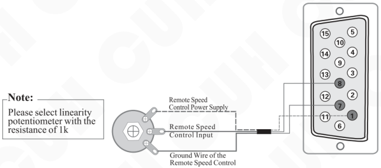

### Método de conexión del PLC

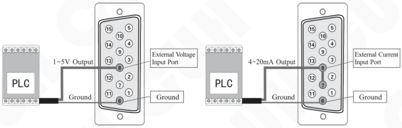

## 5.7 Conmutación de velocidad predefinida

La función de conmutación de velocidad predefinida puede seleccionar la velocidad predefinida mediante señales de control externas, como un PLC, un PC, sensores u otras fuentes de señal, para construir un sistema de control de alimentación de múltiples velocidades.

El controlador admite dos interruptores de control de velocidad remoto. El interruptor de velocidad A y el interruptor de velocidad B son ambos efectivos con nivel bajo.

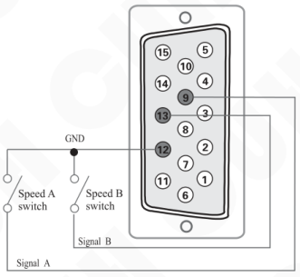

Cada interruptor de control de velocidad tiene un indicador correspondiente en el panel. Cuando el controlador recibe una señal efectiva, se ilumina el indicador correspondiente.

Los dos indicadores representan 4 estados. (A se ilumina y B se apaga, A se apaga y B se ilumina, ambos se iluminan, ambos se apagan). El diagrama de la derecha muestra el estado en el que se dan señales efectivas a ambos interruptores de control de velocidad.

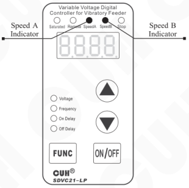

Mediante los interruptores de control de velocidad, el controlador cambia a la velocidad correspondiente. La tensión de salida correspondiente a la velocidad se puede ajustar pulsando el botón ▲ o ▼. Y la tensión ajustada se almacenará automáticamente. Tan pronto como se recibe la señal de control de velocidad, el controlador emite la tensión correspondiente de inmediato.

---

## Capítulo VI Funciones de seguridad

### 6.1 Estabilización automática digital de tensión

La función interna de estabilización digital de tensión del controlador puede estabilizar la velocidad de alimentación independientemente de las fluctuaciones de la tensión de red.

### 6.2 Protección contra cortocircuitos

Si la salida está en cortocircuito, el controlador detendrá su salida y mostrará Err02 hasta que se reinicie el controlador.

### 6.3 Protección contra sobrecarga de corriente

El controlador detendrá su salida si la corriente de salida supera la corriente nominal debido a una operación defectuosa y mostrará Err02 para proteger el controlador y los equipos del cliente.

### 6.4 Protección contra sobrecalentamiento

El controlador detendrá su salida y mostrará Err03 si la temperatura de funcionamiento supera los 65⁰C, para proteger el controlador hasta que la temperatura de funcionamiento descienda a 60⁰C.

### 6.5 Curva de reducción por temperatura ambiente (solo para SDVC21-XLP)

En condiciones de convección natural del aire, cuando la temperatura ambiente aumenta, debido a la limitación de la capacidad de disipación de calor del controlador, el controlador no puede emitir continuamente una corriente de 25A. Consulte la curva de reducción a continuación para su uso.

Si desea que el controlador pueda emitir continuamente una corriente de 25A, proporcione mejores condiciones de refrigeración.

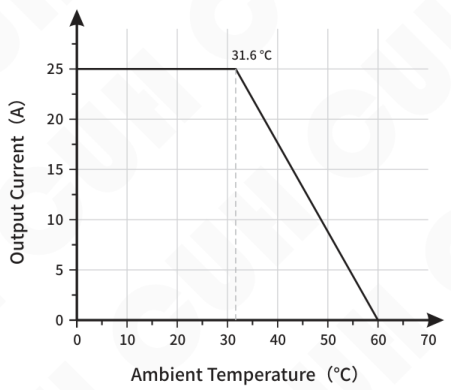

---

## Apéndice A: Dimensiones (mm)

### SDVC21-LP

---

## SDVC21-XLP

---

## Apéndice B: Definición de la interfaz de salida

### Vista de sección transversal:

**⚠ Aviso:**

A: Asegúrese de que las bobinas electromagnéticas del vibrador estén conectadas a los dos pines de salida del zócalo del cable de salida de potencia y de que la carcasa del vibrador esté conectada a tierra de forma fiable; de lo contrario, puede producirse una serie de incidentes de seguridad.

B: Después de la soldadura, asegúrese de que la zona en blanco esté envuelta con cinta aislante o tubo termorretráctil antes de insertarla en el zócalo del cable de salida de potencia, para evitar fugas eléctricas o cortocircuitos.

## Apéndice C: Definición de la interfaz de señales

![15-pin signal interface definition diagram. 1: Remote Speed Control (+5V); 2: Photosensor (GND); 3: Photosensor Rx; 4: Photosensor (GND); 5: Photosensor Tx; 6: Remote Speed Control (GND); 7: RGND; 8: Remote Speed Control (Input); 9: Pset A (Low voltage level is valid); 10: Switch Sensor Input (NPN type: Low voltage level is valid; PNP type: High voltage level is valid); 11: Control Output (+24V); 12: Control Output (GND); 13: Pset B (Low voltage level is valid); 14: Switch Sensor II Input (NPN type: Low voltage level is valid; PNP type: High voltage level is valid); 15: Control Output.](assets/images/cuh.sdvc21-lp.manual.v0.0/page-0037-vcrop-02.png)

---

## Puerto A: Control de velocidad remoto

| Puerto | Pin | Señal |
|---|---|---|
| A3 | ① | +5V |
| A2 | ⑧ | Entrada |
| A1 | ⑦ | RGND |

## Puerto B: Fotosensor inteligente

| Puerto | Pin | Señal |
|---|---|---|
| B4 | ⑤ | Tx |
| B3 | ④ | GND |
| B2 | ③ | Rx |
| B1 | ② | GND |

## Puerto C: Sensor de conmutación

| Puerto | Pin | Señal |
|---|---|---|
| C1 | ⑫ | GND |
| C2 | ⑩ | Entrada |
| C3 | ⑪ | +24V |

## Puerto D: Salida de control

| Puerto | Pin | Señal |
|---|---|---|
| D1 | ⑮ | Salida |
| D2 | ⑪ | +24V |
| D3 | ⑫ | GND |

---

## Puerto E: Sensor de conmutación II

| Puerto | Pin DB | Señal |
|---|---|---|
| E1 | ⑫ | GND |
| E2 | ⑭ | Entrada |
| E3 | ⑪ | +24V |

## Puerto G: Velocidades predefinidas

| Puerto | Pin DB | Señal |
|---|---|---|
| G1 | ⑫ | GND |
| G2 | ⑨ | Pset A |
| G3 | ⑫ | GND |
| G4 | ⑬ | Pset B |

## Puerto I: Alimentación DC de 24V

| Puerto | Pin DB | Señal |
|---|---|---|
| I1 | ⑫ | GND |
| I2 | ⑪ | +24V |

Nota: los números en el círculo representan los pines del conector DB.

---

## Apéndice D: Definición de los caracteres mostrados en el LED

| Carácter mostrado | Definición | Imagen del símbolo |
|---|---|---|
| H | Tensión de salida |  |
| E | Frecuencia de salida |  |
| t | Arranque suave |  |
| J | Tiempo de retardo de arranque del sensor fotoeléctrico inteligente |  |
| J- | Tiempo de retardo de arranque del sensor de conmutación |  |
| J_ | Tiempo de retardo de arranque del segundo sensor de conmutación |  |
| L | Tiempo de retardo de parada del sensor fotoeléctrico inteligente |  |
| L- | Tiempo de retardo de parada del sensor de conmutación |  |
| L_ | Tiempo de retardo de parada del segundo sensor de conmutación |  |
| Γ1 | Relación lógica del sensor de conmutación |  |
| Γ2 | Relación lógica del sensor fotoeléctrico inteligente |  |
| Γ3 | Relación lógica del segundo sensor de conmutación |  |
| Γ4 | Relación lógica de la salida de control |  |
| Γ5 | Ajuste del parámetro de asignación de las señales de control a la salida del controlador o a la salida DC para el control por separado |  |
| ΓE | Ajuste del parámetro de carácter de visualización de frecuencia |  |
| h | Tensión de salida máxima |  |
| A | Relación lógica de la señal de control |  |
| P | Ajuste del parámetro de sensibilidad del sensor fotoeléctrico inteligente CUH |  |
| 8.8.8.8. | Restauración de la configuración predeterminada |  |
| ---- | Restauración correcta de la configuración predeterminada |  |
| Err | Información de error |  |

## Apéndice E: Especificación eléctrica

| Elemento | Rango: Mín | Rango: Típico | Rango: Máx | Unidad | Descripción |
|---|---|---|---|---|---|
| Tensión de entrada | 85 | 380 | 440 | V | AC RMS |
| Rango de tensión de salida ajustable | 35 | —— | Vin-10 | V | Media onda |
| Rango de tensión de salida ajustable | 45 | —— | Vin-5 | V | Onda completa |
| Precisión de ajuste de tensión | | 1 | | V | |
| Tiempo de respuesta de la regulación de tensión | 0 | 0.01 | 0.02 | s | |
| Rango de corriente de salida ajustable | 0 | —— | 10 | A | SDVC21-LP |
| Rango de corriente de salida ajustable | 0 | —— | 25 | A | SDVC21-XLP |
| Potencia de salida | 0 | —— | 3800 | VA | SDVC21-LP |
| Potencia de salida | 0 | —— | 9500 | VA | SDVC21-XLP |
| Frecuencia de salida | 90 | 100/120 | 130 | Hz | Onda completa |
| Frecuencia de salida | 45 | 50/60 | 65 | Hz | Media onda |
| Frecuencia de salida | 30 | 33/40 | 43 | Hz | 1/3 de onda completa SDVC21-XLP |
| Frecuencia de salida | 22 | 25/30 | 32 | Hz | 1/4 de onda completa SDVC21-XLP |
| Forma de onda de salida | | Corte de fase sinusoidal | | | |
| Tiempo de arranque suave | 0.0 | —— | 9.9 | s | Valor predeterminado de fábrica:0.5 |
| Rango de tiempo de retardo de encendido/apagado | 0.0 | —— | 9.9 | s | Valor predeterminado de fábrica:0.2 |
| Precisión del tiempo de retardo de encendido/apagado | | 0.1 | | s | |
| Temperatura de activación de la protección contra sobrecalentamiento | 58 | 60 | 66 | ℃ | |
| Tensión de salida de control DC | 22 | 24 | 26 | V | |
| Corriente de salida de control DC | 0 | —— | 200 | mA | |
| Señal de control analógica | | 1-5 | | V | Tensión de control de velocidad remoto |
| Señal de control digital | | 24 | | V | Señal de conmutación |
| Método de ajuste | | 4 | | Botón | |
| Capacidad del fusible | | 16 | | A | SDVC21-LP |
| Capacidad del fusible | | 30 | | A | SDVC21-XLP |
| Consumo de energía en espera | —— | 4 | —— | W | |
| Método de visualización | | 4 | | Dígito | Tubos digitales LED |
| Grado de protección | | IP67 | | | |
| Peso | | 4600 | | g | SDVC21-LP |
| Peso | | 5800 | | g | SDVC21-XLP |
| Temperatura ambiente | 0 | 25 | 40 | ℃ | |

---

## Apéndice F: Consejos de solución de problemas y explicación de errores

Los siguientes consejos pueden ayudar a resolver los problemas que pueda encontrar

| | | | Imagen del símbolo |
|---|---|---|---|
| 1 | Sin visualización tras el encendido | ➔Asegúrese de que la toma de corriente tenga electricidad ➔Asegúrese de que el cable de entrada de potencia esté conectado de forma fiable a la toma de corriente | |
| 2 | Visualiza con normalidad, pero sin salida | ➔Asegúrese de que el cable de entrada de potencia y el cable de salida de potencia estén firmemente conectados ➔Asegúrese de que el valor del parámetro de tensión de salida no sea demasiado pequeño ➔Asegúrese de que el controlador no esté detenido por la señal de control ➔Asegúrese de que el controlador no esté detenido por parámetros ajustados como apagado normal | |
| 3 | La señal de control pierde su eficacia | ➔Asegúrese de que la señal de control se introduzca correctamente ➔Asegúrese de que el cable de tierra de la señal de control esté conectado correctamente al controlador ➔Asegúrese de que la relación lógica de la señal de control esté ajustada correctamente según sus expectativas | |
| 4 | Visualiza con normalidad, sin salida, pero se oye un sonido | ➔Ajuste todos los parámetros como se indica en este manual | |
| 5 | Err2 | ➔Sobrecorriente de salida. Asegúrese de que las especificaciones del vibrador no superen los límites del controlador. ➔Salida en cortocircuito. Asegúrese de que el cable de salida de potencia y el conector de aviación de salida de potencia no estén en cortocircuito. ➔Asegúrese de que el cable de salida de potencia esté conectado de forma fiable entre el controlador y el vibrador. ➔Asegúrese de que el controlador esté conectado a tierra de forma fiable. |  |
| 6 | Err3 | ➔Sobrecalentamiento. Coloque el controlador en un entorno bien ventilado |  |

## Apéndice G: Parámetros absolutos

Parámetros absolutos:
Superar la norma dañará el controlador; cúmplala estrictamente.

| Elemento | Norma GB | Norma IEC | Requisito de la norma | Nivel alcanzado del producto CUH | Nota |
|---|---|---|---|---|---|
| Descarga electrostática | GB/T 17626.2-2006 | IEC 61000-4-2:2001 | 4 kV | ±8 kV | Descarga por contacto |
| | | | 4 kV | ±15 kV | Descarga aérea |
| Prueba de transitorios eléctricos rápidos | GB/T 17626.4-2008 | IEC 61000-4-4:2004 | 4 kV | ±4 kV | Acoplamiento directo |
| Sobretensión eléctrica | GB/T 17626.5-2008 | IEC 61000-4-5:2005 | 4 kV | ±4 kV | Acoplamiento línea-línea |
| | | | 4 kV | ±4 kV | Acoplamiento línea-tierra |

---

Nanjing CUH Science & Technology Co.,Ltd  
https://en.cuhnj.com  
Tel.:+86-25-84730411 / 84730415 / 84730416  
Fax:+86-25-84730426  
E-mail:sales@cuhnj.com  
Add.:Building 2, Xueyan Tech Park, Tuscity,  
No.9 Zhineng Rd, Jiangning, Nanjing, China

Document No.: IDP1000415

