## Controlador digital de frecuencia variable para alimentador vibratorio

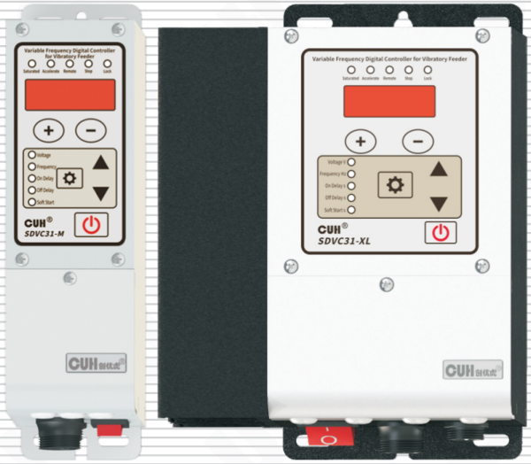

## Serie SDVC31
Controlador digital de frecuencia variable para alimentador vibratorio — Serie SDVC31
**Manual de instrucciones**

---

## Declaración de derechos de autor

Nanjing CUH Science & Technology Co., Ltd. se reserva todos los derechos.

Toda la información contenida en este manual de usuario es conocimiento de nuestra empresa y está protegida por las leyes de derechos de autor y otras leyes relacionadas. CUH disfruta y se reserva todos los derechos conferidos por las leyes de derechos de autor y otras leyes. Sin el consentimiento por escrito de CUH, no se podrá copiar, traducir, imitar ni utilizar de otra forma este manual de usuario, ni total ni parcialmente.

## Descargo de responsabilidad

Todo el contenido de este manual de usuario describe únicamente el método de uso de los productos relacionados producidos por nuestra empresa, y se describe de acuerdo con la tecnología existente y el estado en que se le proporcionan cuando los utiliza. Usted debe asumir los riesgos correspondientes al utilizar este producto. Salvo lo exigido por la ley, la empresa no tiene ninguna responsabilidad expresa o implícita sobre el producto derivada de este manual de usuario, incluidos, entre otros, daños personales, daños a la propiedad, pérdida de oportunidades, etc.

Usted comprende claramente los riesgos anteriores y acepta que, salvo lo exigido por la ley, la empresa no es responsable de ningún daño o pérdida directa o indirecta que usted sufra (incluidos, entre otros, la pérdida tangible de personal, propiedades, datos, etc., y la pérdida intangible de reputación, oportunidades, etc.).

La empresa se reserva el derecho de modificar los productos aplicables en este manual de usuario sin aviso previo ni posterior.

---

# Prefacio

Gracias por elegir el controlador de alimentación por vibración con modulación digital de frecuencia de la serie CUH SDVC31. (En lo sucesivo, “el controlador”). Esta serie de controladores utiliza componentes de alta calidad, incorpora la última tecnología electrónica y está cuidadosamente diseñada con procesadores digitales de señales de alto rendimiento.

Este manual presenta el método básico de operación, la descripción técnica funcional y ejemplos de aplicación típicos de este producto. Proporciona a los usuarios información relevante sobre la instalación y puesta en marcha, el ajuste de parámetros, el diagnóstico de anomalías, la solución de problemas y el mantenimiento rutinario del controlador. Para garantizar la instalación y el uso correctos de este controlador, lea atentamente este manual de usuario antes de la instalación y consérvelo adecuadamente.

Asegúrese de leer los siguientes símbolos que le alertan sobre las precauciones contra lesiones personales y daños al producto.

| | |
|---|---|
| ⚠ Peligro | La inobservancia de este punto provocará lesiones personales o la muerte. |
| ⚠ Advertencia | La inobservancia de este punto puede provocar lesiones personales o la muerte. |
| ⚠ Precaución | La inobservancia de este punto puede provocar lesiones moderadas o leves a las personas. |
| Aviso | La inobservancia de este punto provocará daños al producto y daños materiales. |
| ❗ Obligatorio | Indica las precauciones y restricciones de uso que deben observarse durante el uso. |

**Este manual es adecuado para los siguientes modelos de controladores:**

- Controlador de alimentación por vibración con FM digital SDVC31-S (1.5A)
- Controlador de alimentación por vibración con FM digital SDVC31-M (3.0A)
- Controlador de alimentación por vibración con FM digital SDVC31-L (4.5A)
- Controlador de alimentación por vibración con FM digital SDVC31-XL (6.0A)

---

## Seguridad y precauciones

1. **⚠ Peligro** Este producto solo se utiliza para accionar equipos de alimentación vibratoria basados en electroimanes; no utilice este producto con el fin de proteger el cuerpo humano o partes del cuerpo humano, etc.

2. **⚠ Peligro** Este producto no está diseñado para usarse como producto a prueba de explosiones; no lo utilice en lugares peligrosos y/o en entornos con gases potencialmente explosivos.

3. **⚠ Advertencia** Este producto se alimenta de la red de CA; no aplique una tensión de CA superior a 260Vac. Una tensión de entrada excesiva, como 380Vac, puede provocar que el producto explote o se incendie, causando accidentes de seguridad graves.

4. **⚠ Advertencia** Este producto se pone a tierra a través del cable de alimentación. Asegúrese de que las instalaciones de distribución de energía del controlador estén bien conectadas a tierra; de lo contrario, la carcasa del controlador puede quedar cargada eléctricamente, provocando un accidente por descarga eléctrica.

5. **⚠ Advertencia** No introduzca alimentación de CA en la salida de este controlador; esto dañará el controlador.

6. **⚠ Advertencia** No enchufe ni desenchufe el cableado con corriente ni toque los contactos de cada terminal de conexión del compartimento de cableado para evitar descargas eléctricas.

7. **Aviso** Evite controlar la salida de este producto cortando la alimentación mediante relés y otros dispositivos; de lo contrario, la vida útil del controlador se reducirá gravemente.

8. **Aviso** El controlador está diseñado para funcionar en un entorno fresco y seco. Nunca utilice el controlador a la intemperie para evitar mojaduras e insolación. Utilice el controlador dentro de la temperatura especificada en las características eléctricas.

9. **❗ Obligatorio** Asegúrese de fijar este producto sobre una plataforma sólida, con conexión a tierra fiable y alejada de equipos vibratorios.

10. **❗ Obligatorio** Nunca opere el controlador en condiciones que superen sus límites de diseño.

11. **❗ Obligatorio** Utilice el controlador estrictamente de acuerdo con este manual de instrucciones. No asumiremos ninguna responsabilidad civil o penal si el daño del equipo o las lesiones personales son causados por una operación incorrecta.

12. **❗ Obligatorio** Nunca abra la carcasa del controlador para evitar descargas eléctricas. Póngase en contacto con CUH si el controlador se avería. Nunca intente reparar el controlador usted mismo, ya que podría anular la garantía.

---

# Entorno de funcionamiento y almacenamiento

## Inspección antes del uso

Cada controlador pasa por una rigurosa inspección de calidad antes de su entrega y se embala con un embalaje a prueba de impactos. Compruebe los siguientes puntos después de desembalar:

1. Si el controlador se ha dañado durante el transporte.
2. Si el modelo del controlador es el que solicitó.

## Entorno de ejecución

Siga las notas a continuación para garantizar un mejor rendimiento y una mayor vida útil del controlador:

- ⚠ Entorno bien ventilado
- ⚠ Manténgase alejado de agua, vapor, polvo y especialmente polvo aceitoso
- ⚠ Manténgase alejado de gases y líquidos corrosivos o inflamables
- ⚠ Manténgase alejado del polvo en suspensión y las partículas metálicas
- ⚠ Fíjelo firmemente para evitar vibraciones propias
- ⚠ Manténgase alejado de interferencias electromagnéticas
- ⚠ Asegúrese de que la temperatura ambiente sea de 0~40 ℃
- ⚠ Para uso a una altitud de 2000 m o inferior

---

# Contenido

- **Capítulo Ⅰ Antes de comenzar — 1**
  - 1.1 Compruebe el contenido del paquete — 1
  - 1.2 Explicación de los indicadores y botones — 2
  - 1.3 Explicación de las partes externas — 3
  - 1.4 Explicación de los puertos de cableado — 4
  - 1.5 Explicación de la placa de características — 4
- **Capítulo Ⅱ Características — 5**
- **Capítulo Ⅲ Guía de instalación — 7**
  - 3.1 Condiciones de uso del controlador — 7
  - 3.2 Método de operación de los botones — 7
  - 3.3 Instalación y uso — 8
- **Capítulo Ⅳ Descripción de las funciones básicas — 12**
  - 4.1 Tensión de salida — 12
  - 4.2 Frecuencia de salida — 13
  - 4.3 Retardo de conexión/desconexión del sensor fotoeléctrico inteligente — 14
  - 4.4 Tiempo de arranque suave — 15
  - 4.5 Bloqueo del teclado — 15
- **Capítulo Ⅴ Descripción de las funciones avanzadas — 16**
  - 5.1 Control de velocidad remoto — 16
  - 5.2 Detección fotoeléctrica inteligente — 18
    - 5.2.1 Método de cableado del sensor fotoeléctrico inteligente — 18
    - 5.2.2 Ajuste de la relación lógica del sensor fotoeléctrico inteligente — 19
  - 5.3 Sensor de conmutación — 20
    - 5.3.1 Método de cableado del sensor de conmutación — 20
    - 5.3.2 Retardo de conexión/desconexión del sensor de conmutación — 21
    - 5.3.3 Ajuste de la relación lógica del sensor de conmutación — 22

---

---

- 5.4 Ajuste de la relación lógica de la señal de control — 23
- 5.5 Salida de control — 24
  - 5.5.1 Método de cableado de la salida de control — 24
  - 5.5.2 Ajuste de la relación lógica de la salida de control — 25
  - 5.5.3 Parámetro de separación de la salida principal y la salida de control — 26
- 5.6 Límite de tensión de salida máxima — 27
- 5.7 Límite inferior de frecuencia — 27
- 5.8 Índice de aceleración — 28
- 5.9 Índice de forma de onda — 29
- 5.10 Función de visualización de temperatura — 30
- 5.11 Restauración de la configuración predeterminada/Reanudación del modo de fábrica — 31

## Capítulo Ⅵ Especificaciones técnicas — 32

- 6.1 Dimensiones — 32
- 6.2 Especificaciones técnicas — 34
- 6.3 Norma de referencia — 35

## Capítulo Ⅶ Apéndice — 36

- 7.1 Tabla de parámetros — 36
- 7.2 Diagramas de circuito de entrada y salida — 37
- 7.3 Sugerencias de solución de problemas y explicaciones de errores — 38

## Capítulo Ⅷ Información de garantía del producto — 39

- 8.1 Período de garantía — 39
- 8.2 Cobertura de la garantía — 39
- 8.3 Idoneidad del producto — 39

---

# Capítulo Ⅰ Antes de comenzar

Este capítulo presenta el contenido del paquete del producto, la descripción de la apariencia del controlador y la información de la placa de características del controlador.

## 1.1 Compruebe el contenido del paquete

Antes de usar, compruebe la integridad del controlador y los accesorios. Si encuentra que el producto es defectuoso o está dañado, que faltan accesorios, etc., póngase en contacto con nuestra empresa.

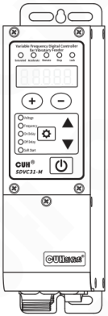

Controlador×1

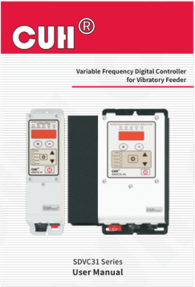

Manual de usuario×1

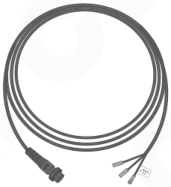

Cable de salida×1

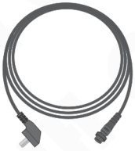

Cable de alimentación de entrada×1

---

## 1.2 Explicación de los indicadores y botones

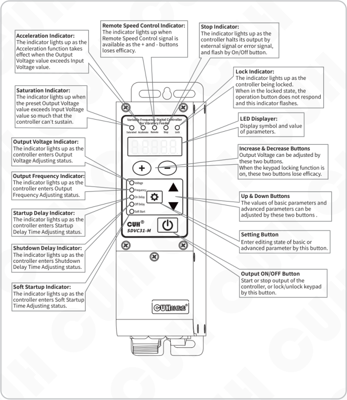

**Indicador de aceleración:**
El indicador se enciende cuando la función de aceleración entra en vigor, cuando el valor de tensión de salida supera el valor de tensión de entrada.

**Indicador de control de velocidad remoto:**
El indicador se enciende cuando hay señal de control de velocidad remoto disponible y los botones + y - dejan de ser efectivos.

**Indicador de parada:**
El indicador se enciende cuando el controlador detiene su salida por una señal externa o una señal de error, y parpadea cuando se detiene con el botón On/Off.

**Indicador de saturación:**
El indicador se enciende cuando el valor de tensión de salida preajustado supera tanto el valor de tensión de entrada que el controlador no puede mantenerlo.

**Indicador de bloqueo:**
El indicador se enciende cuando el controlador está bloqueado.
Cuando está en estado bloqueado, el botón de operación no responde y este indicador parpadea.

**Pantalla LED:**
Muestra el símbolo y el valor de los parámetros.

**Indicador de tensión de salida:**
El indicador se enciende cuando el controlador entra en el estado de ajuste de tensión de salida.

**Indicador de frecuencia de salida:**
El indicador se enciende cuando el controlador entra en el estado de ajuste de frecuencia de salida.

**Indicador de retardo de arranque:**
El indicador se enciende cuando el controlador entra en el estado de ajuste del tiempo de retardo de arranque.

**Indicador de retardo de parada:**
El indicador se enciende cuando el controlador entra en el estado de ajuste del tiempo de retardo de parada.

**Indicador de arranque suave:**
El indicador se enciende cuando el controlador entra en el estado de ajuste del tiempo de arranque suave.

**Botones de aumento y disminución**
La tensión de salida se puede ajustar con estos dos botones.
Cuando la función de bloqueo del teclado está activada, estos dos botones dejan de ser efectivos.

**Botones arriba y abajo**
Los valores de los parámetros básicos y avanzados se pueden ajustar con estos dos botones.

**Botón de ajuste**
Con este botón se entra en el estado de edición del parámetro básico o avanzado.

**Botón de salida ON/OFF**
Inicia o detiene la salida del controlador, o bloquea/desbloquea el teclado con este botón.

## 1.3 Explicación de las partes externas

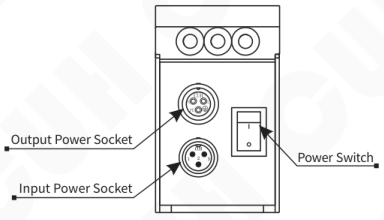

SDVC31-S (1.5A)  
SDVC31-M (3.0A)

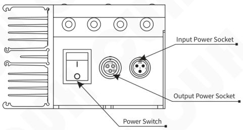

SDVC31-L (4.5A)  
SDVC31-XL (6.0A)

---

## 1.4 Explicación de los puertos de cableado

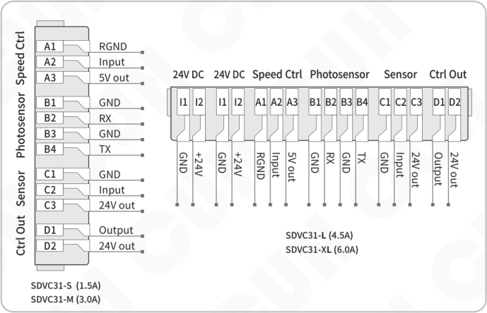

**SDVC31-S (1.5A)**  
**SDVC31-M (3.0A)**

| Puerto de cableado | Terminal | Descripción |
|---|---|---|
| Speed Ctrl | A1 | RGND |
| Speed Ctrl | A2 | Entrada |
| Speed Ctrl | A3 | Salida 5V |
| Photosensor | B1 | GND |
| Photosensor | B2 | RX |
| Photosensor | B3 | GND |
| Photosensor | B4 | TX |
| Sensor | C1 | GND |
| Sensor | C2 | Entrada |
| Sensor | C3 | Salida 24V |
| Ctrl Out | D1 | Salida |
| Ctrl Out | D2 | Salida 24V |

**SDVC31-L (4.5A)**  
**SDVC31-XL (6.0A)**

| Puerto de cableado | Terminal | Descripción |
|---|---|---|
| 24V DC | I1 | GND |
| 24V DC | I2 | +24V |
| 24V DC | I1 | GND |
| 24V DC | I2 | +24V |
| Speed Ctrl | A1 | RGND |
| Speed Ctrl | A2 | Entrada |
| Speed Ctrl | A3 | Salida 5V |
| Photosensor | B1 | GND |
| Photosensor | B2 | RX |
| Photosensor | B3 | GND |
| Photosensor | B4 | TX |
| Sensor | C1 | GND |
| Sensor | C2 | Entrada |
| Sensor | C3 | Salida 24V |
| Ctrl Out | D1 | Salida |
| Ctrl Out | D2 | Salida 24V |

## 1.5 Explicación de la placa de características

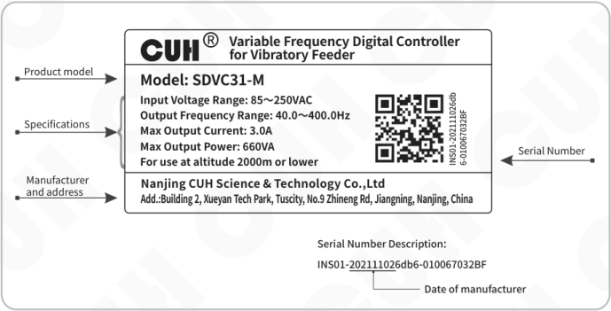

CUH® — Controlador digital de frecuencia variable para alimentador vibratorio

| Elemento de la placa de características | Contenido |
|---|---|
| Modelo de producto | Modelo: SDVC31-M |
| Especificaciones | Rango de tensión de entrada: 85～250VAC Rango de frecuencia de salida: 40.0～400.0Hz Corriente de salida máxima: 3.0A Potencia de salida máxima: 660VA Para uso a una altitud de 2000 m o inferior |
| Fabricante y dirección | Nanjing CUH Science & Technology Co.,Ltd Add.:Building 2, Xueyan Tech Park, Tuscity, No.9 Zhineng Rd, Jiangning, Nanjing, China |
| Número de serie | INS01-202111026db6-010067032BF |

Descripción del número de serie:

INS01-<ins>20211102</ins>6db6-010067032BF

20211102 → Fecha de fabricación

---

## Capítulo Ⅱ Características

El controlador está especialmente diseñado para controlar alimentadores vibratorios en los sistemas de automatización. Combinando la última tecnología electrónica y un diseño elaborado, el controlador ofrece las siguientes características prácticas y convenientes:

**Ajuste de frecuencia:** El rango de frecuencia de salida es de 40.0Hz a 400.0Hz.

**Ajuste de tensión:** El rango de tensión de salida es de 0V a 250V.

**Estabilización automática de tensión:** El controlador puede eliminar la variación de la velocidad de alimentación causada por la fluctuación de la tensión de red.

**Arranque suave:** Para evitar impactos repentinos en las piezas de trabajo, el controlador puede aumentar suavemente la tensión de salida de 0 al valor preajustado durante el arranque.

**Detección fotoeléctrica inteligente:** Nuestro sensor fotoeléctrico inteligente adaptativo puede ayudar a detener el controlador cuando las piezas de trabajo están llenas o vacías, y realizar las funciones de ajuste del tiempo de arranque suave, retardo de conexión, retardo de desconexión y ajuste de la relación lógica.

**Función de señal de preparación:** Emite una señal modulada o una señal válida a través del puerto de transmisión B4 del sistema optoelectrónico inteligente para indicar que el controlador está en estado de preparación. Cuando el controlador detecta un error, la señal de preparación se vuelve inválida.

**Sensor de conmutación:** Se puede conectar un sensor de conmutación adaptativo o un PLC para activar/desactivar el controlador.

**Aceleración:** Gracias a esta función, el valor máximo de tensión de salida del controlador se puede aumentar hasta el 150% del valor de la tensión de entrada.

**Control de velocidad remoto:** La tensión de salida del controlador se puede controlar mediante un potenciómetro externo, un PLC o una señal de CC de 1~5V/4~20mA.

**Salida de control:** La señal de salida de control emitida por el transistor puede coordinar un solenoide u otros dispositivos externos con el controlador.

**Bloqueo del teclado:** Mantenga pulsado el botón ON/OFF durante 2 segundos para bloquear todos los botones para evitar operaciones erróneas. En estado bloqueado, el botón de operación no responde y este indicador parpadea.

**Limitación de la salida máxima:** El valor de tensión de salida máxima se puede preajustar para proteger el equipo de daños causados por un uso incorrecto.

**Ajuste del índice de forma de onda:** Los operadores pueden ponderar la eficiencia y la capacidad máxima ajustando este parámetro.

**Restauración de la configuración predeterminada:** Esta función permite al usuario restaurar todos los ajustes de parámetros predeterminados y reiniciar el controlador.

---

---

CUH concede gran importancia a la gestión de la calidad del producto y al rendimiento de seguridad. Además de los componentes de alta calidad que utilizamos y el riguroso sistema de control de calidad, CUH ha tenido en cuenta los posibles accidentes que los usuarios pueden encontrar y proporciona las siguientes funciones de protección para maximizar la practicidad del controlador.

**Protección contra cortocircuitos:** Si la salida del controlador se cortocircuita, el controlador detendrá su salida hasta que se reinicie.

**Protección contra sobrecarga de corriente:** El controlador detendrá su salida para garantizar la seguridad de funcionamiento de los equipos cuando la corriente de operación supere su valor nominal.

**Protección contra sobrecalentamiento:** El controlador detendrá su salida para protegerse cuando la temperatura de operación sea demasiado alta.

**Protección contra sobretensión/subtensión:** Cuando la tensión de entrada es demasiado alta o demasiado baja, la fuente de alimentación se apagará automáticamente para protegerse.

Los controladores CUH cumplen estrictamente con la certificación CE.

---

# Capítulo Ⅲ Guía de instalación

Este capítulo presenta las condiciones necesarias para el uso del controlador y cómo instalarlo y conectarlo correctamente.

## 3.1 Condiciones de uso del controlador

El controlador se alimenta con CA de 110/220V y la conexión a tierra de protección se realiza a través del enchufe del cable de alimentación. Proporcione instalaciones de suministro y distribución de energía de red de 110V o 220V, 50Hz/60Hz que cumplan con la norma y asegúrese de que el cable de tierra de protección esté correctamente conectado.

**⚠ Advertencia** Nunca conecte el controlador a una alimentación de CA de 380V; esto causará daños graves irreversibles al controlador, posiblemente provocando explosiones, incendios y otros incidentes de seguridad.

**⚠ Advertencia** Asegúrese de que el lado de la fuente de alimentación esté conectado a tierra de forma fiable. La carcasa metálica del controlador está conectada directamente al cable de tierra de protección. Una conexión a tierra deficiente provocará que la carcasa del controlador quede electrificada y cause un accidente por descarga eléctrica.

**Aviso** El funcionamiento prolongado generará calor y hará que aumente la temperatura de la carcasa. Instale el controlador en un entorno bien ventilado y fíjelo bien, lejos de fuentes de vibración.

**Aviso** La salida de este producto se forma mediante la rectificación e inversión del suministro de red, y no existe aislamiento entre su entrada y su salida. Por lo tanto, los polos de salida no se pueden conectar a la tierra de protección. Al conectar el electroimán, es necesario asegurarse de que la bobina del electroimán y la carcasa tengan capacidad de aislamiento básica. De lo contrario, puede producirse una fuga de electricidad, lo que puede causar descargas eléctricas y daños al controlador.

**Aviso** Este producto es un controlador utilizado para accionar el electroimán. No debe conectarse a un alimentador vibratorio piezoeléctrico.

## 3.2 Método de operación de los botones

a. La pulsación corta se define como un tiempo de pulsación superior a 0.1 e inferior a 2 segundos, y la pulsación larga como un tiempo de pulsación superior a 2 segundos.

b. Pulse brevemente el botón ⊕ o ⊖ para ajustar la tensión de salida del controlador en cualquier interfaz LED.

c. Entre o salga de la interfaz de parámetros básicos manteniendo pulsado el botón ⚙; cambie entre los parámetros básicos pulsando brevemente el botón ⚙ y ajuste el valor del parámetro pulsando brevemente el botón ▼ o ▲.

d. Entre o salga de la interfaz de parámetros avanzados manteniendo pulsados los botones ⚙ y ▲; cambie entre los parámetros avanzados pulsando brevemente el botón ⚙ y ajuste el valor del parámetro pulsando brevemente el botón ▼ o ▲.

e. Pulse brevemente el botón ⏻ para iniciar o detener la salida del controlador, y mantenga pulsado el botón ⏻ para bloquear o desbloquear el teclado.

f. En la interfaz LED del parámetro de restauración de la configuración predeterminada, mantenga pulsado el botón ▲ hasta que se muestre en el LED 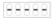 para restaurar la configuración de fábrica, o mantenga pulsado el botón ▼ hasta que se muestre en el LED  para cambiar a la interfaz SDVC311.

---

## 3.3 Instalación y uso

### Paso uno:

Abra la caja de embalaje y compruebe el controlador y todos los accesorios.

### Paso dos:

Conecte los terminales del cable de alimentación de salida a la bobina electromagnética del vibrador.

Alinee la muesca del conector de aviación del cable de salida con la marca triangular de la toma de salida del controlador y, a continuación, apriete la tuerca después de conectar correctamente el cable de salida.

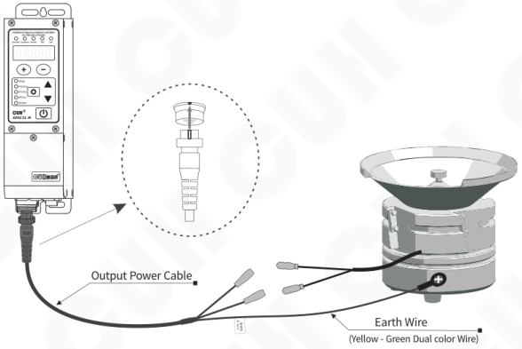

### Nota

1. Asegúrese de que las bobinas electromagnéticas del vibrador estén conectadas a los dos pines de salida del cable de alimentación de salida, y de que la carcasa metálica del vibrador esté conectada a tierra de forma fiable.
2. Está prohibido conectar cargas piezoeléctricas a la salida de potencia; de lo contrario, ¡puede provocar un accidente de seguridad por descarga eléctrica!

---

### Paso tres:

Conecte el conector del cable de alimentación de entrada a la toma de alimentación de entrada del controlador.

Conecte primero el lado del controlador

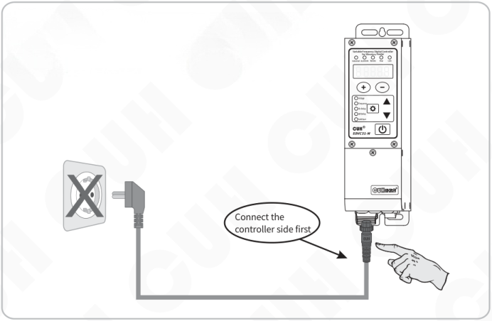

### Paso cuatro:

Conecte el enchufe del cable de alimentación de entrada a la toma de red eléctrica.

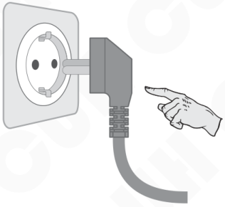

---

## Paso cinco:

Encienda el interruptor de alimentación del controlador; debería mostrarse la tensión “U 150” y el indicador de tensión debería encenderse, y el alimentador vibratorio debería comenzar a vibrar.

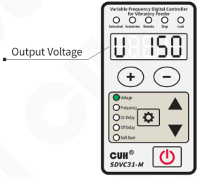

## Paso seis:

Pulse ⊖ para ajustar la tensión a 30~50V, luego pulse ⚙ y mantenga pulsado 2 segundos para entrar en el estado de ajuste de la frecuencia de salida “E”. Utilice ▼ o ▲ para buscar la frecuencia natural del alimentador vibratorio, que es la frecuencia de resonancia.

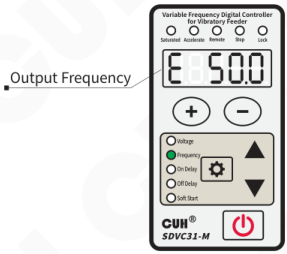

- La frecuencia de resonancia del vibrador es el valor de frecuencia que crea la máxima amplitud.
- Cada vibrador tiene su propia frecuencia de resonancia mecánica natural; ajuste la frecuencia de salida del controlador a esta frecuencia para lograr el mejor estado de funcionamiento.

---

### Paso siete:

Utilice los botones ⊕ y ⊖ para ajustar la tensión hasta obtener la mejor velocidad de alimentación.

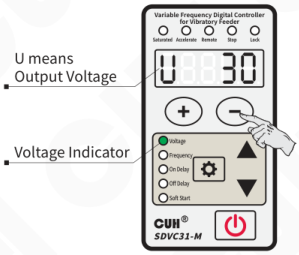

El alimentador vibratorio debería funcionar ahora. Para obtener más instrucciones de control, consulte los capítulos siguientes.

---

# Capítulo Ⅳ Descripción de las funciones básicas

Este capítulo presenta los ajustes de los parámetros básicos.

## 4.1 Tensión de salida

El valor medio rectificado de la tensión de salida del controlador se puede ajustar de forma directa y digital mediante el teclado. Gracias a la exclusiva función de estabilización de tensión, la tensión de salida del controlador no fluctuará como lo hace la tensión de entrada, de modo que el vibrador puede mantener un funcionamiento estable en caso de tensión de red inestable.

- Encienda el interruptor de alimentación del controlador.
- El controlador entra en el parámetro de tensión de salida. El indicador de tensión se enciende y el LED muestra el parámetro de tensión de salida U y el valor predeterminado 150.
- Pulse ⊕ o ⊖ para ajustar el valor del parámetro.

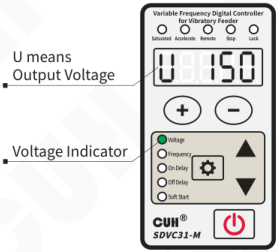

- El controlador no dispone de función de elevación. Cuando el controlador no puede alcanzar la tensión ajustada debido a la limitación de la tensión de alimentación de entrada, el indicador de saturación se encenderá y la compensación de la tensión de red fallará en ese momento.
- El controlador puede lograr cierto grado de efecto de aceleración sacrificando las características sinusoidales de la forma de onda de salida, lo cual está determinado por el parámetro “índice de aceleración y”. Al entrar en el estado de aceleración, la forma de onda de la corriente de salida cambia de onda sinusoidal a onda triangular, y el indicador de aceleración se enciende.

---

## 4.2 Frecuencia de salida

El controlador adopta la tecnología de síntesis digital directa de frecuencia (DDS), que tiene una precisión y estabilidad de frecuencia muy altas y no cambia con el tiempo ni la temperatura.

- Mantenga pulsado ⚙ durante 2 segundos para entrar en la interfaz de parámetros básicos.
- El LED muestra el parámetro de frecuencia de salida “E” y el valor predeterminado 50.0.
- Pulse ▼ o ▲ para ajustar el valor del parámetro.

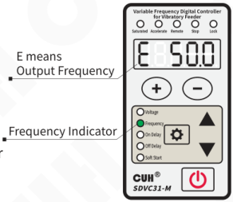

---

## 4.3 Retardo de conexión/desconexión del sensor fotoeléctrico inteligente

Al utilizar un sensor o un PLC para activar o desactivar la salida principal del controlador, la acción se puede retrasar un período de tiempo después de que se dé o se restablezca la señal de control. El tiempo de retardo se puede ajustar mediante los dos parámetros siguientes.

**Retardo de conexión ( J ):** El período de tiempo que transcurre desde que el controlador recibe una señal de control de arranque hasta que emite realmente la salida.

- Mantenga pulsado ⚙ durante 2 segundos para entrar en la interfaz de parámetros básicos.
- Pulse brevemente ⚙ para cambiar al parámetro de retardo de conexión “J” y el valor predeterminado 0.2.
- Pulse ▲ o ▼ para ajustar el valor del parámetro.

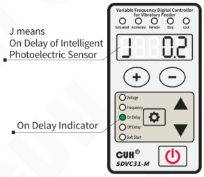

**Retardo de desconexión ( L ):** El período de tiempo que transcurre desde que el controlador recibe una señal de control de parada hasta que corta realmente la salida.

- Mantenga pulsado ⚙ durante 2 segundos para entrar en la interfaz de parámetros básicos.
- Pulse brevemente ⚙ para cambiar al parámetro de retardo de desconexión “L” y el valor predeterminado 0.2.
- Pulse ▲ o ▼ para ajustar el valor del parámetro.

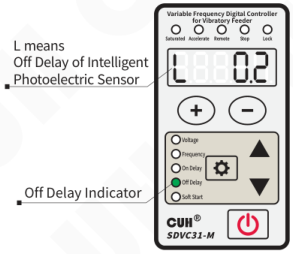

---

## 4.4 Tiempo de arranque suave

Para evitar impactos repentinos en la bobina del vibrador, el controlador puede aumentar gradualmente la tensión de salida de 0 al valor preajustado durante el arranque.

**Tiempo de arranque suave ( t ):** El período de tiempo que tarda el controlador en elevar suavemente su tensión de salida de 0 al valor preajustado durante el arranque.

- Mantenga pulsado ⚙ durante 2 segundos para entrar en la interfaz de parámetros básicos.
- Pulse brevemente ⚙ para cambiar al parámetro de arranque suave “t” y el valor predeterminado 0.5.
- Pulse ▲ o ▼ para ajustar el valor del parámetro.

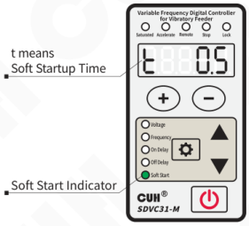

## 4.5 Bloqueo del teclado

Cuando los parámetros del controlador están configurados, la función de bloqueo del teclado puede bloquear todos los botones del panel para evitar errores de operación.

Incluso si se apaga y se vuelve a encender, el estado del bloqueo del teclado permanece en el estado en que se encontraba la última vez que se apagó.

- Mantenga pulsado ⏻ durante 2 segundos para bloquear todos los botones del panel. El indicador de bloqueo se enciende.
- Mantenga pulsado ⏻ durante 2 segundos de nuevo para desbloquear.

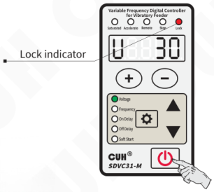

> El estado de bloqueo del teclado no desaparecerá al apagar el equipo.
>
> Cuando está en estado bloqueado, el botón de operación no responde y este indicador parpadea.

---

# Capítulo Ⅴ Descripción de las funciones avanzadas

Este capítulo presenta los ajustes de los parámetros avanzados.

## 5.1 Control de velocidad remoto

El controlador admite señales analógicas externas para controlar la tensión de salida; las señales analógicas admiten potenciómetro, tensión de 1~5V y corriente de 4~20mA.

### Conexión de control por potenciómetro

**Sugerencia:**

Utilice un potenciómetro lineal de 1K

> Cuando la señal de control de velocidad remoto entra en vigor, el indicador de control de velocidad se enciende y, al mismo tiempo, el ajuste de la tensión en el panel deja de ser efectivo.

---

## Conexión de control por tensión de 1~5V

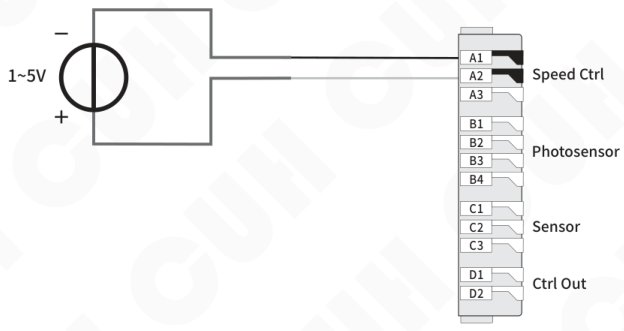

## Conexión de control por corriente de 4~20mA

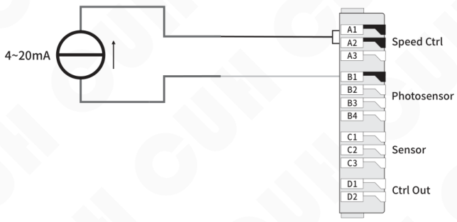

---

## 5.2 Detección fotoeléctrica inteligente

El puerto fotoeléctrico inteligente de este controlador admite sensores fotoeléctricos de barrera o de reflexión compuestos por diodos emisores de luz y fototransistores, y también se puede configurar para admitir sensores de conmutación NPN. El diagrama de cableado específico es el siguiente:

### 5.2.1 Método de cableado del sensor fotoeléctrico inteligente

**Método de conexión del sensor fotoeléctrico**

La distancia de trabajo del sensor se puede ajustar configurando el parámetro P; cuanto menor sea el parámetro, más sensible será.

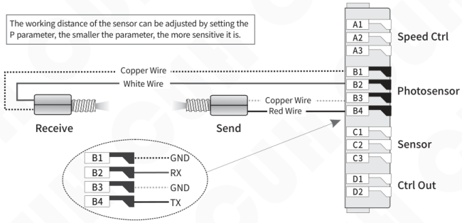

**Método de conexión del sensor de conmutación**

Configure el tipo NPN con el parámetro P = 0; no se admiten sensores PNP

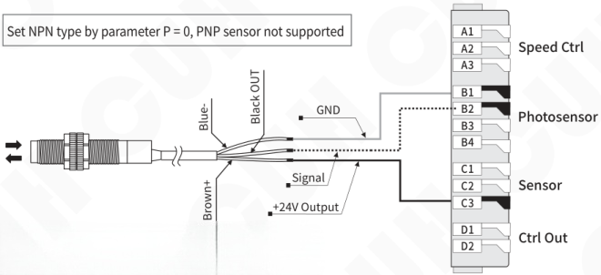

**Nota:**

Cuando el parámetro P = 0, B4 emite una señal válida de 10mA.

De 1 a 1000, B4 emite una señal modulada de 10mA con una frecuencia de aproximadamente 200Hz.

Cuando el controlador detecta un error, B4 no emite salida. Esta es la función de señal de preparación.

---

## 5.2.2 Ajuste de la relación lógica del sensor fotoeléctrico inteligente

En circunstancias normales, el extremo receptor no recibe señal óptica y el controlador funciona de forma predeterminada. Pero en algunas aplicaciones especiales, el controlador debe detenerse cuando el extremo receptor no recibe señal óptica. El ajuste de este parámetro puede satisfacer este tipo de aplicación.

- Mantenga pulsados ⚙ y ▲ simultáneamente para entrar en la interfaz de parámetros avanzados.
- Pulse brevemente ⚙ para cambiar al parámetro Γ1.
- Pulse ▲ o ▼ para ajustar el valor del parámetro.

El parámetro Γ1 está configurado en `___` de forma predeterminada.

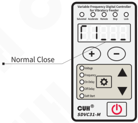

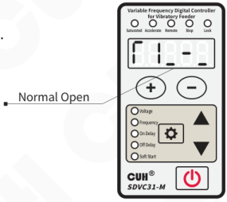

- Cuando el parámetro Γ1 está configurado en `___`, es decir, no se recibe señal óptica, el controlador funciona.
- Cuando el parámetro Γ1 está configurado en `_-_`, es decir, no se recibe señal óptica, el controlador se detiene.

---

## 5.3 Sensor de conmutación

El puerto del sensor de conmutación admite los modos NPN, PNP, Ut1 y Ut0.

**El modo Ut1 es un escaneo único**, es decir, antes de que la señal del sensor sea inválida, se cambian los niveles alto y bajo para detectar si el puerto es válido. Después de encontrar una señal válida, se determina el tipo de sensor del puerto y ya no se escanea.

**El modo Ut0 es un escaneo continuo**; independientemente del tipo de sensor, siempre detecta si el puerto está conectado a una señal válida cambiando los niveles alto y bajo.

### 5.3.1 Método de cableado del sensor de conmutación

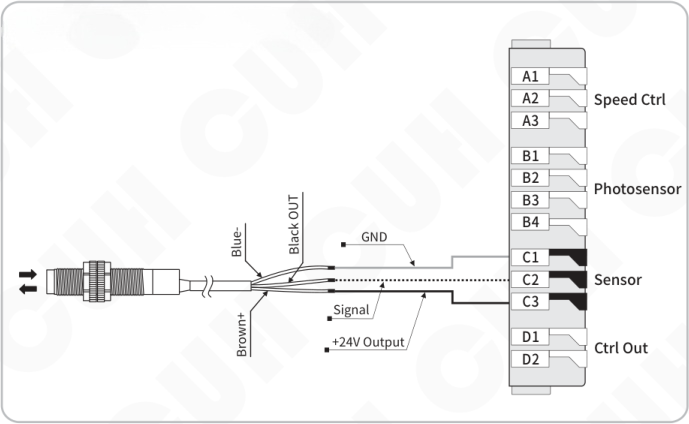

- Configure el tipo de sensor mediante el parámetro avanzado ΓA.
- Cuando se utilizan otras señales externas, como sensores, para iniciar y detener las operaciones a través del puerto C del controlador, si la operación debe retrasarse un período de tiempo después de dar la señal o de restaurar la señal, puede realizarlo configurando los tiempos de los parámetros avanzados "J-" y "L-". Para conocer el método de operación, consulte 5.3.2.

---

## 5.3.2 Retardo de conexión/desconexión del sensor de conmutación

De forma predeterminada, el sensor fotoeléctrico inteligente y el sensor de conmutación comparten el mismo tiempo de retardo de conexión y tiempo de retardo de desconexión. Los operadores también pueden configurar de forma independiente el tiempo de retardo de conexión y el tiempo de retardo de desconexión para el sensor de conmutación.

### Retardo de conexión ( J- )

El período de tiempo que transcurre desde que el controlador recibe una señal de control de arranque hasta que emite salida.

- Mantenga pulsados ⚙ y ▲ simultáneamente para entrar en la interfaz de parámetros avanzados.
- Pulse brevemente ⚙ para cambiar al parámetro J-.
- Pulse ▲ o ▼ para ajustar el valor del parámetro.

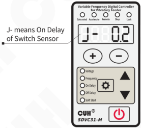

El parámetro J- está configurado en --- de forma predeterminada, lo que significa el mismo valor que el del parámetro J.

### Retardo de desconexión ( L- )

El período de tiempo que transcurre desde que el controlador recibe una señal de control de parada hasta que corta la salida.

- Mantenga pulsados ⚙ y ▲ simultáneamente para entrar en la interfaz de parámetros avanzados.
- Pulse brevemente ⚙ para cambiar al parámetro L-.
- Pulse ▲ o ▼ para ajustar el valor del parámetro.

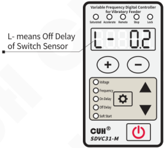

El parámetro L- está configurado en --- de forma predeterminada, lo que significa el mismo valor que el del parámetro L.

> - Cuando los valores de J- y L- se ajustan a --- , el tiempo de retardo de conexión y el tiempo de retardo de desconexión del sensor de conmutación serán los mismos que el tiempo de retardo de conexión y el tiempo de retardo de desconexión del sensor fotoeléctrico inteligente.
> - El tiempo de retardo de conexión y el tiempo de retardo de desconexión del sensor fotoeléctrico inteligente no se verán afectados por los parámetros J- y L-.

---

### 5.3.3 Ajuste de la relación lógica del sensor de conmutación

En circunstancias normales, el controlador no recibe señal del sensor de conmutación y funciona de forma predeterminada. Pero en algunas aplicaciones especiales, el controlador debe detenerse cuando no recibe señal del sensor de conmutación. El ajuste de este parámetro puede satisfacer este tipo de aplicación.

- Mantenga pulsados ⚙ y ▲ simultáneamente para entrar en la interfaz de parámetros avanzados.
- Pulse brevemente ⚙ para cambiar al parámetro Γ2.
- Pulse ▲ o ▼ para ajustar el valor del parámetro.

El parámetro Γ2 está configurado en `___` de forma predeterminada.

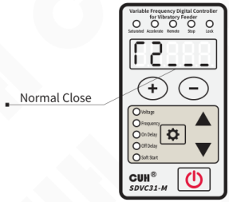

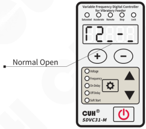

- Cuando el parámetro Γ2 está configurado en `___`, es decir, no se recibe señal, el controlador funciona.
- Cuando el parámetro Γ2 está configurado en `_-_`, es decir, no se recibe señal, el controlador se detiene.

---

## 5.4 Ajuste de la relación lógica de la señal de control

El controlador puede configurar la relación lógica del sensor fotoeléctrico inteligente y el sensor de conmutación cuando funcionan simultáneamente.

- Mantenga pulsados ⚙ y ▲ simultáneamente para entrar en la interfaz de parámetros avanzados.
- Pulse brevemente ⚙ para cambiar al parámetro Π.
- Pulse ▲ o ▼ para ajustar el valor del parámetro.

La relación lógica predeterminada es AND.

**Relación lógica: AND 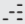:**

El controlador funciona solo cuando tanto el sensor fotoeléctrico inteligente como el sensor de conmutación se lo indican.

**Relación lógica: OR :**

El controlador funciona cuando el sensor fotoeléctrico inteligente o el sensor de conmutación se lo indican.

**Relación lógica: XOR 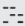:**

El controlador funciona solo cuando el sensor fotoeléctrico inteligente y el sensor de conmutación emiten señales de control opuestas.

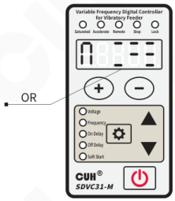

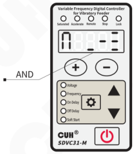

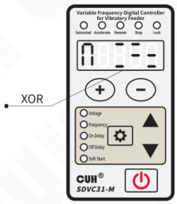

---

## 5.5 Salida de control

El puerto de salida de control admite salida NPN. La salida NPN es válida con nivel bajo y la salida es inválida en estado de alta impedancia.

### 5.5.1 Método de cableado de la salida de control

**Conexión de salida NPN**

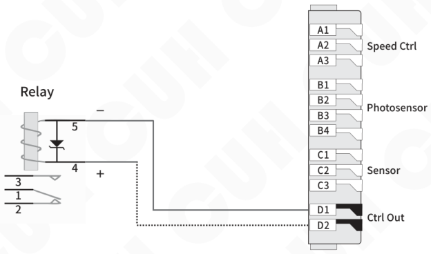

> Si se conecta un relé de 24V, asegúrese de confirmar los polos positivo y negativo de la bobina para garantizar que se conecten correctamente. Dado que la capacidad de corriente de salida de este puerto es limitada, el diodo de protección interno del relé cortocircuitará el puerto de este controlador tras una conexión inversa, activando la protección contra cortocircuitos Err07.

---

## 5.5.2 Ajuste de la relación lógica de la salida de control

- Mantenga pulsados ⚙ y ▲ simultáneamente para entrar en la interfaz de parámetros avanzados.
- Pulse brevemente ⚙ para cambiar al parámetro Γ3.
- Pulse ▲ o ▼ para ajustar el valor del parámetro.

El parámetro Γ3 está configurado en `___` de forma predeterminada.

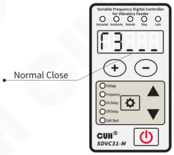

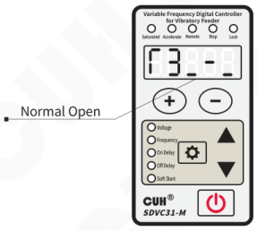

- Cuando el parámetro Γ3 está configurado en `___`, la salida de control funciona cuando el controlador está en funcionamiento.
- Cuando el parámetro Γ3 está configurado en `_-_`, la salida de control no funciona cuando el controlador está en funcionamiento.

---

## 5.5.3 Parámetro de separación de la salida principal y la salida de control

Normalmente, la salida de control sigue a la salida principal.

En aplicaciones especiales, la fuente de control y la relación pueden cambiar mediante este parámetro.

- Mantenga pulsados ⚙ y ▲ simultáneamente para entrar en la interfaz de parámetros avanzados.
- Pulse brevemente ⚙ para cambiar al parámetro Γ4.
- Pulse ▲ o ▼ para ajustar el valor del parámetro.

El parámetro Γ4 está configurado en `___` de forma predeterminada.

- Cuando el parámetro Γ4 está configurado en 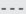, la salida principal y la salida de control están relacionadas. Se controlan mediante la relación lógica entre el sensor fotoeléctrico inteligente y el sensor de conmutación y el botón ON/OFF.
- Cuando el parámetro Γ4 está configurado en 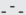, la salida principal y la salida de control están separadas. La salida principal se controla con el botón ON/OFF. La salida de control se controla mediante la relación lógica entre el sensor fotoeléctrico inteligente y el sensor de conmutación.
- Cuando el parámetro Γ4 está configurado en 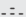, la salida principal se controla con el botón ON/OFF y con el sensor de conmutación. La salida de control se controla mediante el sensor fotoeléctrico inteligente.
- Cuando el parámetro Γ4 está configurado en 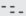, la salida principal se controla con el botón ON/OFF y con el sensor fotoeléctrico inteligente. La salida de control se controla mediante el sensor de conmutación.

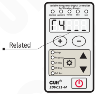

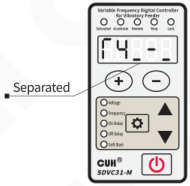

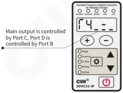

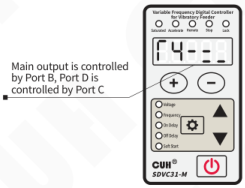

---

## 5.6 Límite de tensión de salida máxima

El controlador puede configurar el parámetro de límite de tensión de salida máxima h, que puede evitar que el usuario, por un error de operación, emita una tensión excesiva y dañe el equipo de vibración.

Ni la tensión configurada en el panel ni la tensión de control remoto superarán este valor.

- En ningún caso la tensión de salida del controlador puede ni podrá superar el valor configurado de este parámetro.
- El ajuste predeterminado de fábrica de este parámetro es la tensión de salida máxima posible de la máquina.

## 5.7 Límite inferior de frecuencia

Este controlador puede configurar el parámetro avanzado “Límite inferior de frecuencia e” para limitar la frecuencia de salida mínima, lo que puede evitar que los usuarios, por una operación accidental, ajusten la frecuencia de salida demasiado baja y dañen el electroimán.

La frecuencia configurada en el panel no será inferior a este valor.

---

## 5.8 Índice de aceleración

El controlador puede lograr cierto grado de efecto de aceleración sacrificando las características sinusoidales de la forma de onda de salida. Al entrar en el estado de aceleración, la forma de onda de la corriente de salida cambia de onda sinusoidal a onda triangular y el indicador de aceleración se enciende. La función de aceleración se puede controlar configurando el valor del parámetro avanzado “índice de aceleración y”.

**Índice de aceleración (y):** Expresa el porcentaje que la tensión de salida máxima puede alcanzar de la tensión de entrada.

y significa índice de aceleración  
Ajuste predeterminado: 150

**Diagrama esquemático del índice de aceleración configurado en 150**

---

## 5.9 Índice de forma de onda

El controlador puede equilibrar continuamente el rendimiento entre la máxima eficiencia-potencia máxima y el mínimo ruido para satisfacer las mayores exigencias de los clientes. Esto se puede lograr configurando el valor del parámetro avanzado “índice de forma de onda r”.

- El valor de índice de forma de onda de 0 tiene la máxima eficiencia y la menor tensión sobre el resorte.
- Cuando el valor es 100, se pueden obtener la potencia de salida nominal máxima y el mínimo ruido, pero el resorte estará sometido a una mayor tensión.

**Diagrama del índice de forma de onda**

---

## 5.10 Función de visualización de temperatura

- Mantenga pulsados ⚙ y ▲ simultáneamente para entrar en la interfaz de parámetros avanzados.
- Pulse brevemente ⚙ para cambiar al parámetro C.
- El valor del parámetro no se puede modificar.

Ejemplo:  
C significa parámetros de visualización de temperatura

## 5.11 Restauración de la configuración predeterminada/Reanudación del modo de fábrica

El usuario puede restaurar rápidamente el controlador al estado predeterminado de fábrica.

Debido a las potentes funciones del controlador, se pueden ajustar muchos parámetros. Para los principiantes, puede que no sea posible restaurar el estado de funcionamiento normal del controlador después de varios ajustes y modificaciones. Utilice esta función para restaurar rápidamente el estado desordenado de los parámetros al ajuste predeterminado de fábrica.

Para restaurar la configuración de fábrica, es necesario utilizar en combinación los parámetros del modo de reanudación de fábrica (Pin). El modo de reanudación de fábrica se describe a continuación:

0: Restaurar el **grupo de parámetros de trabajo** al **grupo de parámetros de usuario**.  
5: Guardar el **grupo de parámetros de trabajo** en el **grupo de parámetros de usuario**.  
35: Restaurar el **grupo de parámetros de trabajo** al **valor de fábrica de CUH**.  
55: Restaurar el **grupo de parámetros de trabajo** y el **grupo de parámetros de usuario** al **valor de fábrica de CUH**.

- Mantenga pulsados ⚙ y ▲ simultáneamente para entrar en la interfaz de parámetros avanzados.
- Pulse brevemente ⚙ para cambiar al parpadeo total en la pantalla LED, es decir, el parámetro de “restauración de la configuración predeterminada”. A continuación, mantenga pulsado ▲ hasta que el controlador muestre “”, lo que indica que el controlador se ha restaurado.
- Suelte ▲; después de que el controlador muestre “CUH”, entrará en el estado de ajuste de tensión de salida “U”. En este momento, todos los parámetros se han restaurado a los ajustes predeterminados de fábrica.

Nota: Mantenga pulsado ▼ hasta que aparezca “” en el LED para cambiar a la interfaz SDVC311.

---

## Capítulo Ⅵ Especificaciones técnicas

### 6.1 Dimensiones

(unidad: mm)

SDVC31-S (1.5A)  
SDVC31-M (3.0A)

| Rango de dimensiones | Tolerancia |
|---|---|
| 0~3 | ±0.05 |
| 3~10 | ±0.1 |
| 10~30 | ±0.15 |
| 30~80 | ±0.2 |
| 80~180 | ±0.3 |
| >180 | ±0.5 |

Esta tabla de tolerancias es aplicable a todos los productos de esta serie.

---

SDVC31-L (4.5A)  
SDVC31-XL (6.0A)

---

## 6.2 Especificaciones técnicas

| Elemento | Mín | Típico | Máx | Unidad | Nota |
|---|---|---|---|---|---|
| Tensión de entrada | 85 | 220 | 250 | V | AC RMS |
| Rango de tensión de salida ajustable | 0 | —— | 260 | V | Inferior al 150% de la tensión de entrada |
| Precisión de ajuste de tensión | | 1 | | V | |
| Precisión de regulación de tensión | 0 | —— | 10 | % | ΔVout/ΔVin |
| Rango de corriente de salida ajustable | 0 | —— | 1.5 | A | SDVC31-S |
| Rango de corriente de salida ajustable | 0 | —— | 3.0 | A | SDVC31-M |
| Rango de corriente de salida ajustable | 0 | —— | 4.5 | A | SDVC31-L |
| Rango de corriente de salida ajustable | 0 | —— | 6.0 | A | SDVC31-XL |
| Potencia de salida | 0 | —— | 330 | VA | SDVC31-S |
| Potencia de salida | 0 | —— | 660 | VA | SDVC31-M |
| Potencia de salida | 0 | —— | 990 | VA | SDVC31-L |
| Potencia de salida | 0 | —— | 1320 | VA | SDVC31-XL |
| Frecuencia de salida | 40.0 | —— | 400.0 | Hz | |
| Precisión de ajuste de frecuencia | | 0.1 | | Hz | |
| Forma de onda de salida | | Senoidal | | | |
| Tiempo de arranque suave | 0 | —— | 10.0 | s | Valor predeterminado: 0.5 |
| Rango de tiempo de retardo de conexión/desconexión | 0 | —— | 20.0 | s | Valor predeterminado: 0.2 |
| Precisión del tiempo de retardo de conexión/desconexión | | 0.1 | | s | |
| Temperatura de activación de la protección contra sobrecalentamiento | 58 | 60 | 66 | °C | |
| Corriente de salida de control de CC | 0 | —— | 400 | mA | |
| Tensión de salida de control de CC | 22 | 24 | 26 | V | |
| Señal de control analógica | | 1~5/4~20 | | V/mA | Señal de control de velocidad remoto |
| Señal de control digital | | 24 | | V | Señal de conmutación |
| Método de ajuste | | 6 | | Botón | |
| Consumo de energía en espera | —— | 3 | —— | W | |
| Método de visualización | | 5 | | Dígito | LED |
| Temperatura ambiente | 0 | 25 | 40 | °C | Sin condensación |
| Humedad ambiente | 10 | 60 | 85 | % | Sin condensación |
| Temperatura ambiente de almacenamiento | -20 | 25 | 65 | °C | Sin condensación |

## 6.3 Norma de referencia

**Parámetros absolutos:**
Superar el estándar dañará el controlador; respételo estrictamente.

| Elemento | Norma GB | Norma IEC | Grado | Requisito de la norma | Nota |
|---|---|---|---|---|---|
| Descarga electrostática | GB/T 17626.2-2006 | IEC 61000-4-2:2001 | 4 | ±8 kV | Descarga por contacto |
| | | | 4 | ±15 kV | Descarga aérea |
| Ensayo de transitorios eléctricos rápidos | GB/T 17626.4-2008 | IEC 61000-4-4:2004 | 4 | ±4 kV | |
| Inmunidad a ondulación de la línea de alimentación de CC | GB/T 17626.17-2005 | IEC 61000-4-17:2002 | 4 | 15% | Clasificación A |

> **Advertencia**  
> En un entorno residencial, este producto puede causar interferencias radioeléctricas, en cuyo caso pueden ser necesarias medidas de mitigación adicionales.

---

# Capítulo Ⅶ Apéndice

## 7.1 Tabla de parámetros

| | Definición | Símbolo | Imagen del símbolo | Rango | Predeterminado |
|---|---|---|---|---|---|
| Parámetro común | Tensión de salida | U |  | 0~260 V | 150 |
| Parámetro básico | Frecuencia de salida | E |  | 40.0~400.0 Hz | 50.0 |
| Parámetro básico | Retardo de conexión del sensor fotoeléctrico inteligente | J |  | 0.0~20.0 s | 0.2 |
| Parámetro básico | Retardo de desconexión del sensor fotoeléctrico inteligente | L |  | 0.0~20.0 s | 0.2 |
| Parámetro básico | Arranque suave | t |  | 0.0~10.0 s | 0.5 |
| Parámetro avanzado | Retardo de desconexión del sensor de conmutación NPN | L- |  | 0.0~20.0 s | L---- igual que L |
| Parámetro avanzado | Retardo de conexión del sensor de conmutación NPN | J- |  | 0.0~20.0 s | J---- igual que J |
| Parámetro avanzado | Dirección lógica del sensor fotoeléctrico inteligente | F1 |  | Normal Close , Normal Open  |  |
| Parámetro avanzado | Dirección lógica del sensor de conmutación | F2 |  | Normal Close , Normal Open  |  |
| Parámetro avanzado | Dirección lógica de la salida de control | F3 |  | Normal Close , Normal Open  |  |
| Parámetro avanzado | Parámetro de separación de la salida principal y la salida de control | F4 |  | Relacionado , la salida principal se controla mediante el puerto C, el puerto D se controla mediante el puerto B  Separado , la salida principal se controla mediante el puerto B, el puerto D se controla mediante el puerto C  |  |
| Parámetro avanzado | Relación lógica de la señal de control | n |  | or , And , Xor  |  |
| Parámetro avanzado | Tensión de salida máxima | H |  | 0~260 V | 260 |
| Parámetro avanzado | Índice de aceleración | y |  | 100~150 | 150 |
| Parámetro avanzado | Índice de forma de onda | r |  | 0~100 | 100 |
| Parámetro avanzado | Sensibilidad del sensor fotoeléctrico inteligente | P |  | 0~1000 | 80 |
| Parámetro avanzado | Tipo de sensor del puerto C | FA |  | nPn, PnP ut1 (escaneo único), ut0 (escaneo continuo) | nPn |
| Parámetro avanzado | Temperatura | C |  | -20~85 °C | —— |
| Parámetro avanzado | Límite inferior de frecuencia | e |  | 40.0~400.0 Hz | 40.0 |
| Parámetro avanzado | Restauración de la configuración predeterminada | 8.8.8.8.8. |  | Se utiliza junto con el parámetro Pin | —— |
| Parámetro avanzado | Reanudación del modo de fábrica | Pin |  | 0 : Restaurar el grupo de parámetros de trabajo al grupo de parámetros de usuario 5 : Guardar el grupo de parámetros de trabajo en el grupo de parámetros de usuario 35: Restaurar el grupo de parámetros de trabajo al valor de fábrica de CUH 55: Restaurar el grupo de parámetros de trabajo y el grupo de parámetros de usuario al valor de fábrica de CUH | 0 |

## 7.2 Diagramas de circuito de entrada y salida

**Puerto A de control de velocidad remoto**

**Puerto B del sensor fotoeléctrico inteligente**

**Puerto C del sensor de conmutación**

**Puerto D de salida de control**

---

## 7.3 Sugerencias de solución de problemas y explicaciones de errores

| Código de error | Definición | Métodos de solución de problemas | Imagen del símbolo |
|---|---|---|---|
| Sin visualización tras encender | | Asegúrese de que la toma de corriente tenga tensión ¿Está el cable de alimentación de entrada conectado de forma fiable a la toma de corriente? | |
| Visualización normal, pero sin salida | | Asegúrese de que el cable de salida esté conectado de forma fiable al vibrador. Asegúrese de que la tensión de salida no sea pequeña. Asegúrese de que el indicador de parada no esté encendido. Compruebe si se ha configurado Normal Close del parámetro, lo que provoca que la salida del controlador se detenga. | |
| La señal de control pierde efectividad | | Asegúrese de que la señal de control se introduzca correctamente. Asegúrese de que el cable de tierra de la señal de control esté conectado correctamente al controlador. Asegúrese de que la relación lógica de las señales de control esté configurada correctamente según lo esperado. | |
| Fenómenos de batido | | Evite el acoplamiento de vibraciones entre los vibradores. Aumente la frecuencia de resonancia de los vibradores. | |
| Visualización normal, sin salida, pero se oye sonido | | Ajuste todos los parámetros según lo indicado en este manual. | |
| Err01 | Cortocircuito | Asegúrese de que la carga no esté en cortocircuito; a continuación, intente reiniciar la salida del controlador pulsando el botón de salida ON/OFF dos veces o vuelva a alimentar el controlador. |  |
| Err02 | Sobrecorriente | Reduzca la tensión de salida adecuadamente y, a continuación, reinicie la salida. |  |
| Err03 | Sobrecalentamiento | Instale el controlador en un entorno bien ventilado. |  |
| Err04 | Sobretensión o subtensión | Asegúrese de que la tensión de entrada esté entre AC 85~250Vac. |  |
| Err05 | Comunicación interna anómala | Asegúrese de que no haya ninguna fuente de alimentación externa conectada al puerto de alimentación de 24V o póngase en contacto con nuestro soporte técnico. |  |
| Err06 | Sensor de temperatura anómalo | Asegúrese de que la temperatura de trabajo no sea inferior a -20℃ o póngase en contacto con nuestro soporte técnico. |  |
| Err07 | Protección contra cortocircuitos del puerto D | Asegúrese de que la carga del puerto D no esté en cortocircuito y que la corriente no supere 400mA; a continuación, intente reiniciar la salida del puerto D. |  |
| Err10 | Salida de alimentación de 24V anómala | Asegúrese de que el puerto de 24V no esté en cortocircuito y que la corriente no supere 400mA. |  |
| Err11 | Salida de alimentación de 5V del puerto A anómala | Asegúrese de que la alimentación de 5V del puerto A no esté en cortocircuito ni conectada a una tensión de alimentación externa superior a 5V. |  |

Nota: Si se produce algún error, el TX del puerto B se apagará.

---

# Capítulo Ⅷ Información de garantía del producto

## 8.1 Período de garantía

El período de garantía ofrecido por la empresa para este producto es de 3 años a partir de la fecha de entrega del producto en el lugar designado por el comprador.

## 8.2 Cobertura de la garantía

(1) Si se produce una avería causada por nuestra empresa durante el período de garantía anterior, repararemos el producto de forma gratuita. Sin embargo, las siguientes situaciones no están cubiertas por la garantía:

a. Incumplimiento de las condiciones especificadas en el manual simplificado, el manual de usuario o los requisitos técnicos acordados específicamente entre el comprador y la empresa, operación inadecuada o avería causada por un uso inadecuado.

b. Avería no debida a un defecto del producto, sino al diseño del equipo o del software del comprador.

c. Fallos causados por modificaciones o reparaciones no realizadas por el personal de la empresa.

d. Averías que puedan evitarse totalmente mediante un mantenimiento correcto o la sustitución de piezas de desgaste según la guía de operación simplificada o el manual de usuario.

e. Averías causadas, después del envío del producto desde nuestra empresa, por factores como cambios imprevistos en el nivel de la ciencia y la tecnología.

f. La empresa no se hace responsable de la garantía por desastres naturales como incendios, terremotos o inundaciones, o por factores externos como averías por tensión anómala.

(2) El alcance de la garantía se limita a las situaciones estipuladas en (1)，las pérdidas indirectas (como daños al equipo, oportunidades, pérdida de beneficios, etc.) u otras pérdidas; la empresa no asume ninguna responsabilidad.

## 8.3 Idoneidad del producto

El controlador de nuestra empresa está diseñado y producido para uso general en la industria de la alimentación vibratoria. Por lo tanto, este controlador de nuestra empresa no debe utilizarse para las siguientes aplicaciones y no es adecuado para su uso.

(1) Instalaciones que tienen un impacto grave en la vida y la propiedad, como centrales nucleares, aeropuertos, ferrocarriles, barcos, dispositivos motorizados y equipos médicos.

(2) Servicios públicos, incluidos electricidad, gas, suministro de agua, etc.

(3) Uso en exteriores en condiciones o entornos similares.

---

Nanjing CUH Science & Technology Co.,Ltd  
https://en.cuhnj.com  
Tel.:+86-25-84730411 / 84730415 / 84730416  
Fax:+86-25-84730426  
E-mail:sales@cuhnj.com  
Add.:Building 2, Xueyan Tech Park, Tuscity,  
No.9 Zhineng Rd, Jiangning, Nanjing, China

Document No.: IDP1000530

