# **Manual de instrucciones de la serie CUH SDVC31**    
**Controlador digital de frecuencia variable para alimentador vibratorio**

---
# Prefacio

Gracias por elegir los controladores digitales inteligentes CUH para alimentadores vibratorios. (En lo sucesivo, “el controlador”).

Este manual de instrucciones incluye notas para la instalación, la puesta en marcha, el ajuste de parámetros, el mantenimiento y la solución de problemas del controlador. Lea atentamente este manual de instrucciones antes de utilizar el controlador y consérvelo adecuadamente.

## Este manual de instrucciones se aplica a los siguientes modelos:

➡Controlador digital de frecuencia variable para alimentador vibratorio    
SDVC31-S (corriente de salida de 1.5A)

➡Controlador digital de frecuencia variable para alimentador vibratorio    
SDVC31-M (corriente de salida de 3.0A)

➡Controlador digital de frecuencia variable para alimentador vibratorio    
SDVC31-L (corriente de salida de 4.5A)

➡Controlador digital de frecuencia variable para alimentador vibratorio    
SDVC31-XL (corriente de salida de 6.0A)

➡Controlador digital de frecuencia variable para alimentador vibratorio    
SDVC31-U (corriente de salida de 10.0A)

➡Controlador digital de frecuencia variable para alimentador vibratorio    
SDVC31-XU (corriente de salida de 20.0A)

---

# Aviso

➜ Nunca realice conexiones en caliente ni toque los contactos en ningún caso para evitar descargas eléctricas u otros accidentes.

➜ La carcasa del controlador está conectada a tierra a través del cable de entrada de potencia. Asegúrese de que la toma de corriente esté bien conectada a tierra.

➜ No conecte nunca el controlador a 380V AC, ya que podría causar daños irreparables.    
(Elija productos diseñados para 380V AC cuando sea necesario)

➜ No conmute nunca la entrada del controlador cortando la alimentación mediante un relé, un PLC u otros dispositivos; de lo contrario, la vida útil del controlador puede reducirse gravemente.

➜ El controlador está diseñado para funcionar en un entorno fresco y seco. No lo utilice nunca al aire libre para evitar mojarlo o la exposición al sol. Utilice el controlador dentro del rango de temperatura que exigen sus características eléctricas.

➜ No utilice nunca el controlador en condiciones que superen sus límites de diseño.

➜ Utilice el controlador estrictamente de acuerdo con este manual de instrucciones. No asumiremos ninguna responsabilidad civil o penal si el daño del equipo o las lesiones personales son causados por una operación incorrecta.

> [!CAUTION]
> **No abra nunca la carcasa del controlador para evitar descargas eléctricas.** Póngase en contacto con CUH si el controlador se avería.
>
> No intente nunca modificar el controlador, ya que las placas de circuitos de estado sólido del interior no se pueden reparar y no hay ninguna pieza ajustable.

---

# Entorno de funcionamiento

## Inspección antes del uso

Cada controlador se somete a una rigurosa inspección de calidad antes de su entrega y se embala    
con un embalaje a prueba de impactos.

## Compruebe los siguientes puntos después de desembalar:

➜ Si el controlador presenta daños en el aspecto exterior

➜ Si el modelo del controlador es exactamente el que ha pedido

## Entorno de funcionamiento

Tenga en cuenta las siguientes notas para garantizar un mejor rendimiento y una vida útil más larga del    
controlador

➜ Entorno bien ventilado

➜ Mantener alejado del agua, el vapor, el polvo y, en especial, el polvo aceitoso

➜ Mantener alejado de gases y líquidos corrosivos o inflamables

➜ Mantener alejado del polvo en suspensión y las partículas metálicas

➜ Fijación firme para evitar vibraciones propias

➜ Mantener alejado de las interferencias electromagnéticas

➜ Funcionamiento dentro del rango de temperatura de 0 °C a 40 °C

➜ Para su uso a una altitud de 2000m o inferior

---

# Capítulo I Características

El controlador está especialmente diseñado para controlar alimentadores vibratorios en sistemas de automatización. Combinado con la última tecnología electrónica y un diseño esmerado, el controlador ofrece las siguientes características cómodas y prácticas:

**Ajuste de frecuencia:** La frecuencia de salida va de 40.0Hz a 400.0Hz.

**Ajuste de tensión:** La tensión de salida va de 0V a 250V.

**Estabilización automática de tensión:** El controlador puede eliminar las variaciones de velocidad de alimentación causadas por las fluctuaciones de la tensión de red.

**Arranque suave:** Para evitar golpes repentinos en las piezas de trabajo, el controlador puede aumentar suavemente la tensión de salida de 0 al valor preestablecido durante el arranque.

**Detección fotoeléctrica inteligente:** Nuestro sensor fotoeléctrico inteligente adaptativo puede ayudar a detener el controlador cuando las piezas de trabajo están llenas o la pieza de trabajo está vacía, y cumplir las funciones de ajuste del tiempo de arranque suave, retardo de arranque, retardo de parada y ajuste de la relación lógica.

**Parada cuando las piezas de trabajo están llenas:** Un sensor de conmutación NPN puede ayudar a detener el controlador cuando las piezas de trabajo están llenas y cumplir las funciones de ajuste del tiempo de arranque suave, retardo de arranque, retardo de parada y ajuste de la relación lógica.

**Aceleración:** Gracias a esta función, el valor máximo de tensión de salida del controlador puede aumentarse hasta el 150% del valor de la tensión de entrada.

**Control de velocidad remoto:** La tensión de salida del controlador puede controlarse mediante un potenciómetro externo, un PLC o una señal de control de tensión de 1V a 5V.

**Salida de control:** La señal de salida de control emitida por el transistor puede coordinar un solenoide u otros dispositivos externos con el controlador.

**Bloqueo del teclado:** Mantenga pulsado el botón ON/OFF durante 2 segundos para bloquear todos los botones y evitar operaciones erróneas.

**Limitación de la salida máxima:** El valor máximo de tensión de salida puede preajustarse para proteger el equipo de daños causados por un uso indebido.

**Ajuste del índice de forma de onda:** Los operadores pueden sopesar la eficiencia y la capacidad máxima ajustando este parámetro.

**Restauración de la configuración predeterminada:** Esta función permite al usuario restaurar todos los ajustes de parámetros predeterminados y reiniciar el controlador.

**CUH** concede gran importancia a la gestión de la calidad del producto y al rendimiento de seguridad. Además de los componentes de alta calidad que utilizamos y del riguroso sistema de control de calidad, **CUH** ha tenido en cuenta los posibles accidentes que los usuarios pueden encontrar y ofrece las siguientes funciones de protección para maximizar la practicidad del controlador.

**Protección contra cortocircuitos:** Si la salida del controlador se cortocircuita, el controlador detendrá su salida hasta que se reinicie.

**Protección contra sobrecarga de corriente:** El controlador detendrá su salida para garantizar la seguridad de funcionamiento de los equipos cuando la corriente de funcionamiento supere su valor nominal.

**Protección contra sobrecalentamiento:** El controlador detendrá su salida para protegerse cuando la temperatura de funcionamiento sea demasiado alta.

Los controladores **CUH** cumplen estrictamente con la certificación CE.

---

# Capítulo II Guía de instalación

## Paso uno:

Abra la caja de embalaje, compruebe el aspecto exterior del controlador y asegúrese de que el modelo del controlador es exactamente el que ha pedido.

## Paso dos:

Conecte el cable de salida de potencia de la caja de embalaje a las bobinas electromagnéticas del vibrador.

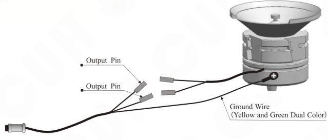

Etiquetas de la figura:

- Pin de salida
- Pin de salida
- Cable de tierra (bicolor amarillo y verde)

## ⚠ Aviso

Asegúrese de que las bobinas electromagnéticas del vibrador estén conectadas a los dos pines de salida del cable de salida de potencia y de que las bobinas electromagnéticas estén conectadas a tierra de forma fiable; de lo contrario, pueden producirse incidentes de seguridad en cadena.

---

---

## Paso tres:

Conecte el cable de entrada de potencia al controlador y bloquee la tuerca de alimentación.

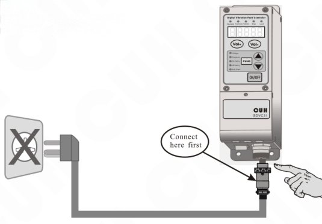

## Paso cuatro:

Conecte el enchufe del cable de entrada de potencia a la toma de red.

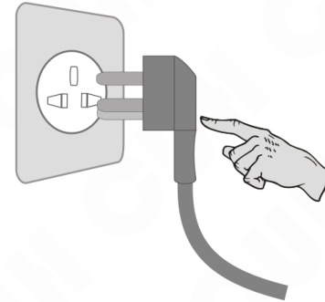

---

---

## Paso cinco:

Ajuste la tensión de salida del controlador a un valor entre 30 y 80 (representada por la letra U)

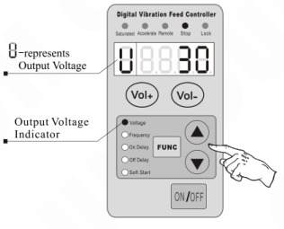

Etiquetas del diagrama:

- U—representa la tensión de salida
- Indicador de tensión de salida

## Paso seis:

Mantenga pulsado el botón <kbd>FUNC</kbd> durante 2 segundos para entrar en el estado de ajuste de parámetros básicos.

El indicador de frecuencia de salida del panel se ilumina y el LED muestra el valor de frecuencia actual (E). Pulse el botón ▲ o ▼ para ajustar el valor del parámetro de 400Hz a 40Hz, con el fin de encontrar la frecuencia armónica del vibrador, y mantenga este valor.

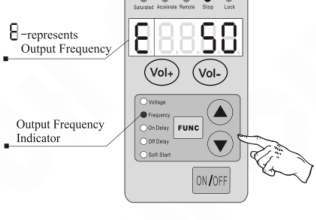

Etiquetas del diagrama:

- E—representa la frecuencia de salida
- Indicador de frecuencia de salida

> ● La frecuencia armónica del vibrador significa el valor de frecuencia que crea la máxima amplitud.
>
> ● Cada vibrador tiene su propia frecuencia de resonancia mecánica natural; ajuste la frecuencia de salida del controlador a esta frecuencia para garantizar las mejores condiciones de trabajo.

---

---

## Paso siete:

Después de ajustar la frecuencia de salida del controlador a la frecuencia de resonancia mecánica natural del vibrador, ajuste la tensión de salida del controlador pulsando el botón **Vol+** o **Vol-** para cambiar la velocidad de alimentación.

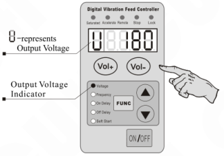

Después de los siete pasos anteriores, el controlador puede funcionar correctamente. Consulte los demás capítulos si necesita funciones de control avanzadas.

---

# Capítulo III Descripción de los componentes

## 3.1 Descripción del panel de control

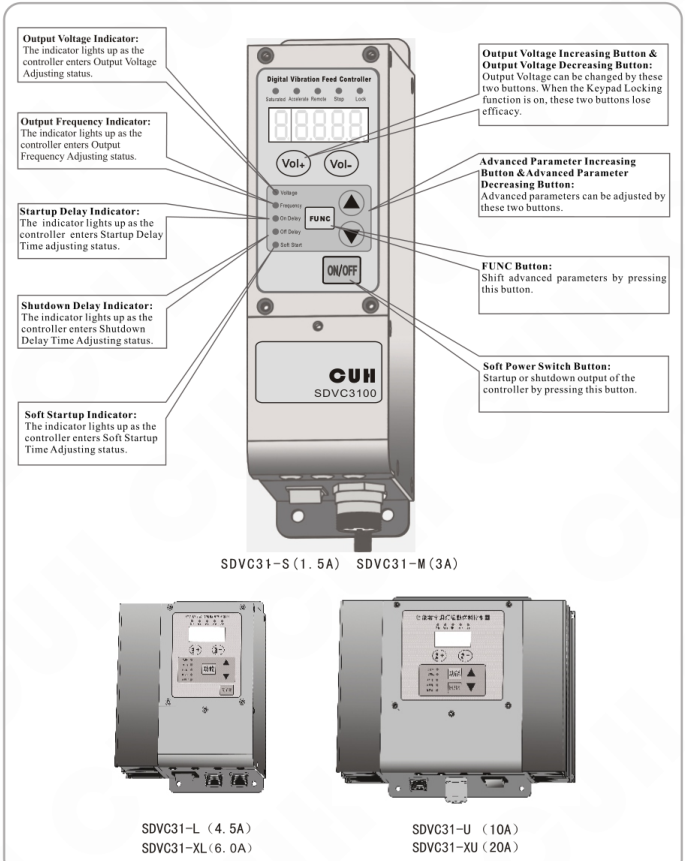

### Indicadores y botones del panel de control

| Elemento | Descripción |
|---|---|
| Indicador de tensión de salida | El indicador se ilumina cuando el controlador entra en el estado de ajuste de la tensión de salida. |
| Indicador de frecuencia de salida | El indicador se ilumina cuando el controlador entra en el estado de ajuste de la frecuencia de salida. |
| Indicador de retardo de arranque | El indicador se ilumina cuando el controlador entra en el estado de ajuste del tiempo de retardo de arranque. |
| Indicador de retardo de parada | El indicador se ilumina cuando el controlador entra en el estado de ajuste del tiempo de retardo de parada. |
| Indicador de arranque suave | El indicador se ilumina cuando el controlador entra en el estado de ajuste del tiempo de arranque suave. |
| Botón de aumento de tensión de salida y botón de reducción de tensión de salida | La tensión de salida puede modificarse con estos dos botones. Cuando la función de bloqueo del teclado está activada, estos dos botones dejan de ser eficaces. |
| Botón de aumento de parámetros avanzados y botón de reducción de parámetros avanzados | Los parámetros avanzados pueden ajustarse con estos dos botones. |
| Botón FUNC | Cambie los parámetros avanzados pulsando este botón. |
| Botón de interruptor de alimentación suave | Encienda o apague la salida del controlador pulsando este botón. |

### Modelos mostrados

| Modelo | Corriente |
|---|---:|
| SDVC31-S | 1.5A |
| SDVC31-M | 3A |
| SDVC31-L | 4.5A |
| SDVC31-XL | 6.0A |
| SDVC31-U | 10A |
| SDVC31-XU | 20A |

---

---

## 3.2 Descripción de los indicadores de estado

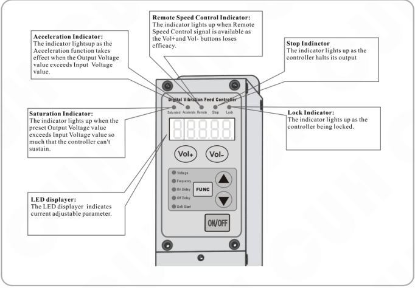

- **Indicador de aceleración:** El indicador se ilumina cuando la función de aceleración entra en vigor, al superar el valor de tensión de salida el valor de tensión de entrada.
- **Indicador de control de velocidad remoto:** El indicador se ilumina cuando hay señal de control de velocidad remoto, momento en que los botones Vol+ y Vol- dejan de ser eficaces.
- **Indicador de parada:** El indicador se ilumina cuando el controlador detiene su salida.
- **Indicador de saturación:** El indicador se ilumina cuando el valor preajustado de tensión de salida supera tanto el valor de tensión de entrada que el controlador no puede mantenerlo.
- **Indicador de bloqueo:** El indicador se ilumina cuando el controlador está bloqueado.
- **Pantalla LED:** La pantalla LED indica el parámetro ajustable actual.

## 3.3 Descripción de las interfaces de E/S

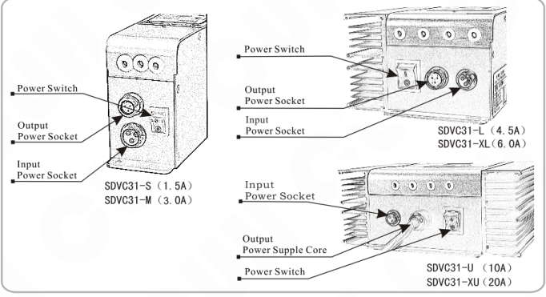

- **SDVC31-S（1.5A） / SDVC31-M（3.0A）**
  - Interruptor de alimentación
  - Zócalo de salida de potencia
  - Zócalo de entrada de potencia
- **SDVC31-L（4.5A） / SDVC31-XL（6.0A）**
  - Interruptor de alimentación
  - Zócalo de salida de potencia
  - Zócalo de entrada de potencia
- **SDVC31-U（10A） / SDVC31-XU（20A）**
  - Zócalo de entrada de potencia
  - Cable de salida de potencia
  - Interruptor de alimentación

---

# Capítulo IV Descripción de las funciones

## 4.1 Ajuste de la tensión de salida

La tensión de salida puede ajustarse de forma directa y digital a través del panel de control. Gracias a la exclusiva función de estabilización de tensión, la tensión de salida del controlador no fluctúa como lo hace la tensión de entrada, y el vibrador puede trabajar de forma estable en entornos de tensión de entrada inestable.

- Encienda el interruptor de alimentación

- El indicador de tensión de salida se ilumina cuando el controlador entra en el estado de ajuste de la tensión de salida; el LED muestra el símbolo de tensión U y el valor de tensión ajustado previamente.

- Ajuste el valor de tensión de salida pulsando el botón <kbd>Vol+</kbd> o <kbd>Vol-</kbd>.

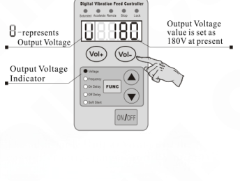

- U — representa la tensión de salida
- Indicador de tensión de salida
- El valor de tensión de salida está ajustado actualmente en 180V
- La tensión de salida ajustable de la serie de controladores va de 0V a 250V

> La tensión de salida puede ajustarse en cualquier estado de ajuste de parámetros básicos o de parámetros avanzados pulsando el botón <kbd>Vol+</kbd> o <kbd>Vol-</kbd>. El controlador vuelve al estado de ajuste de parámetros anterior después de ajustar la tensión de salida.

## ☺ Aceleración

Cuando el valor deseado de tensión de salida supera el valor de tensión de entrada, la función de aceleración del controlador actúa y el indicador de aceleración se ilumina.

Cuando el valor deseado de tensión de salida supera en exceso el valor de tensión de entrada, el controlador no puede emitir dicho valor de tensión y el indicador de saturación se ilumina.

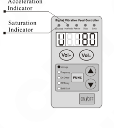

- Indicador de aceleración
- Indicador de saturación

---

---

## 4.2 Ajuste de la frecuencia de salida

El controlador se fabrica con la tecnología DDS y su salida posee una alta precisión y estabilidad de frecuencia, que no cambia con el tiempo ni con la temperatura.

- Mantenga pulsado el botón <kbd>FUNC</kbd> durante 2 segundos para entrar en el estado de ajuste de los parámetros básicos.

- El indicador de frecuencia del panel se ilumina y la pantalla LED muestra el símbolo de frecuencia de salida **E** y el valor actual de la frecuencia de salida.

- Pulse el botón ▲ o ▼ para ajustar el valor del parámetro.

La frecuencia de salida del controlador va de 40Hz a 400Hz.

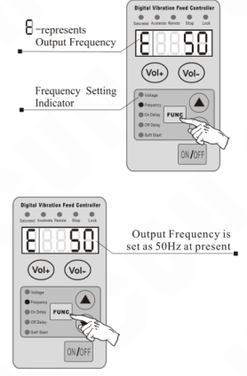

**Etiquetas de la figura:**

- **E** — representa la frecuencia de salida
- Indicador de ajuste de frecuencia
- La frecuencia de salida está ajustada actualmente en 50Hz

> ☺
>
> ● La frecuencia de salida (E), el tiempo de retardo de arranque, el tiempo de retardo de parada y el tiempo de arranque suave se pueden ajustar después de entrar en el estado de ajuste de los parámetros básicos manteniendo pulsado el botón <kbd>FUNC</kbd> durante 2 segundos.
>
> ● El controlador volverá automáticamente al estado de ajuste de la tensión de salida 1 minuto después de la operación de ajuste.
>
> ● Vuelva a mantener pulsado el botón <kbd>FUNC</kbd> durante 2 segundos para salir del estado de ajuste de los parámetros básicos.

---

## 4.3 Arranque suave

Para evitar impactos repentinos en las piezas de trabajo, el controlador puede aumentar suavemente la tensión de salida de 0 al valor preajustado al arrancar.

Tiempo de arranque suave ( t ): El período de tiempo que tarda el controlador en aumentar suavemente la tensión de salida de 0 al valor preajustado al arrancar.

» Mantenga pulsado el botón **FUNC** durante 2 segundos para entrar en el estado de ajuste de los parámetros básicos.

» Pulse el botón **FUNC** repetidamente hasta que se cambie al estado de ajuste del tiempo de arranque suave (t) y se ilumine el indicador de arranque suave.

» Pulse el botón ▲ o ▼ para ajustar el valor del parámetro. La unidad del parámetro es el segundo y la precisión numérica es 0.1.

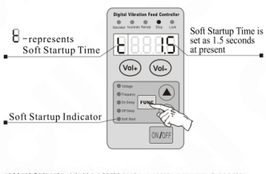

- **t** - representa el tiempo de arranque suave
- Indicador de arranque suave
- El tiempo de arranque suave está ajustado actualmente en 1.5 segundos

El tiempo de arranque suave ajustable va de 0.1 segundos a 9.9 segundos.

## 4.4 Botón de conexión/desconexión de salida

El botón de conmutación táctil del panel puede conectar/desconectar la salida del controlador de forma rápida y sencilla.

» Pulse el botón **ON/OFF** para conectar/desconectar la salida del controlador. El indicador de parada se ilumina cuando se desconecta la salida del controlador.

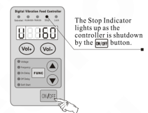

El indicador de parada se ilumina cuando el controlador se apaga mediante el botón **ON/OFF**.

😊

Gracias a la tecnología de conmutación táctil y control de señal digital, no se genera ninguna chispa que pueda dañar el contacto. Como resultado, la vida útil del controlador y del vibrador se prolonga considerablemente.

---

## 4.5 Limitación de la tensión de salida máxima

La tensión de salida máxima del controlador se puede ajustar para evitar daños al vibrador. La función de control de velocidad remoto se ve afectada por este parámetro.

- Mantenga pulsados simultáneamente los botones <kbd>FUNC</kbd> y ▲ durante 2 segundos para entrar en el estado de ajuste de los parámetros avanzados.
- Pulse el botón <kbd>FUNC</kbd> repetidamente hasta que se cambie al estado de limitación de la tensión de salida máxima (h).
- Pulse el botón ▲ o ▼ para ajustar el valor del parámetro.

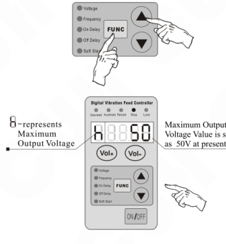

> ● El valor de la tensión de salida no puede superar este valor de parámetro en ningún caso.    
> ● El valor predeterminado de este parámetro está ajustado al valor máximo de tensión de salida ajustable.

## Método para salir del estado de ajuste de los parámetros avanzados

● El controlador volverá automáticamente al estado de ajuste de la tensión de salida un minuto después del ajuste de los parámetros avanzados.    
● Mantenga pulsados los botones <kbd>FUNC</kbd> y ▲ durante 2 segundos para volver al estado de ajuste de la tensión de salida.    
● Mantenga pulsado el botón <kbd>FUNC</kbd> durante 2 segundos para volver al estado de ajuste de los parámetros básicos.

---

## 4.6 Ajuste del parámetro de aceleración

Parámetro de aceleración (y): Este parámetro indica la tensión de salida máxima como porcentaje de la tensión de entrada. La función de aceleración se ve afectada por este parámetro.

- Mantenga pulsados simultáneamente los botones `FUNC` y ▲ durante 2 segundos para entrar en el estado de ajuste de los parámetros avanzados
- Pulse el botón `FUNC` repetidamente hasta que se cambie al estado de ajuste del parámetro de aceleración (y).
- Pulse el botón ▲ o ▼ para ajustar el valor del parámetro.

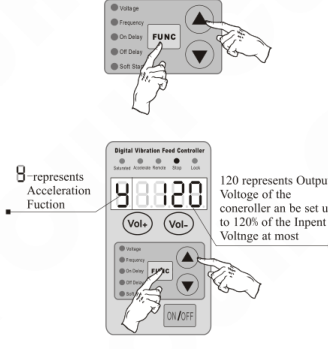

> ● El valor de aceleración ajustable (y) va de 100 a 150 y el valor predeterminado es 120.    
> ● El indicador de saturación se ilumina cuando la tensión de salida del controlador supera el límite.

---

---

## 4.7 Ajuste del índice de forma de onda

Los operadores pueden sopesar la eficiencia máxima y la potencia máxima (ruido mínimo) ajustando este parámetro.

- Mantenga pulsados simultáneamente los botones **FUNC** y **▲** durante 2 segundos para entrar en el estado de ajuste de los parámetros avanzados.
- Pulse el botón **FUNC** repetidamente hasta que se cambie al estado de ajuste del índice de forma de onda (**r**).
- Pulse el botón **▲** o **▼** para ajustar el valor del parámetro.

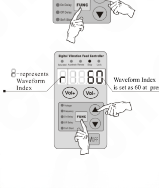

Etiquetas del diagrama:

- **r** representa el índice de forma de onda
- El índice de forma de onda está ajustado actualmente en **60**

> ☺
>
> ●El índice de forma de onda ajustable va de 0 a 100.    
> ●El valor 0 representa la eficiencia máxima cuando las placas de resorte soportan el esfuerzo mínimo.    
> ●El valor 100 representa la potencia máxima (ruido mínimo) cuando las placas de resorte soportan el esfuerzo máximo.

---

## 4.8 Bloqueo del teclado

La función de bloqueo del teclado puede bloquear todos los botones del panel para evitar errores de operación.

- Mantenga pulsado el botón <kbd>ON/OFF</kbd> durante 2 segundos para bloquear todos los botones del panel y se ilumina el indicador de bloqueo del teclado.
- Mantenga pulsado el botón <kbd>ON/OFF</kbd> durante 2 segundos en el modo de bloqueo para desbloquear el teclado.

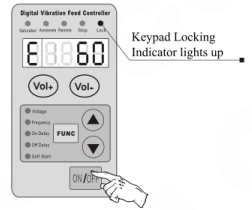

---

## 4.9 Restauración de la configuración predeterminada

Esta función permite al operador restaurar toda la configuración predeterminada de los parámetros.

Debido a las abundantes funciones del controlador, se pueden ajustar muchos parámetros. Para evitar la circunstancia de que, tras demasiadas modificaciones por parte de un principiante, el controlador no pueda funcionar correctamente, esta función permite al operador restaurar la configuración predeterminada del controlador de forma sencilla.

- Mantenga pulsados simultáneamente los botones **FUNC** y **▲** durante 2 segundos para entrar en el estado de ajuste de los parámetros avanzados.

  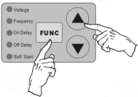

- Pulse el botón **FUNC** repetidamente hasta que `8888` parpadee en la pantalla LED y, a continuación, mantenga pulsado el botón **▲** hasta que se muestre `-----`, lo que significa que la configuración predeterminada se ha restaurado correctamente.

  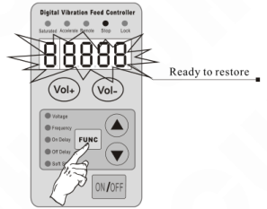

- Después de soltar el botón **▲**, el controlador entra en el estado de ajuste de la tensión de salida (U). En este momento, todos los parámetros se han restaurado a los valores predeterminados.

  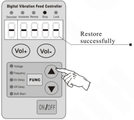

# Capítulo V Sensores y control de señales

El controlador se puede controlar mediante muchos tipos de señales y sensores externos. Este capítulo describe principalmente el método de uso del sensor fotoeléctrico inteligente, los sensores de conmutación de proximidad y el PLC.

## 5.1 Detección fotoeléctrica inteligente

Combinado con el sensor fotoeléctrico SDVC-S1, se puede lograr la función de detección fotoeléctrica inteligente. El sensor SDVC-S1 puede filtrar la interferencia de la luz de fondo que afecta a la sensibilidad del controlador. Como resultado, el controlador puede trabajar de forma fiable sin ajuste manual de la sensibilidad.

### 5.1.1 Método de conexión del sensor fotoeléctrico inteligente SDVC-S1

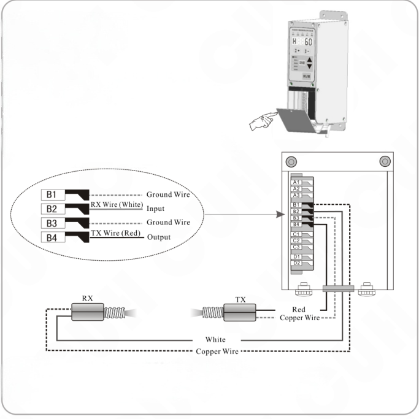

**Paso 1:**    
Abra la placa de cubierta superior del controlador.

**Paso 2:**    
Conecte el sensor SDVC-S1 a los terminales del controlador según el diagrama.

**Paso 3:**    
Cierre la placa de cubierta después de conectar el sensor.

**Aviso:**    
La relación lógica predeterminada del sensor está configurada como piezas de trabajo vacías.

---

## 5.1.2 Ajuste del tiempo de retardo de arranque y del tiempo de retardo de parada del sensor fotoeléctrico inteligente

En la mayoría de las aplicaciones reales, la salida del controlador debe retrasarse durante un período de tiempo cuando el arranque o la parada del controlador se controla mediante señales externas. Las funciones de ajuste del tiempo de retardo de arranque y del tiempo de retardo de parada hacen posible este tipo de aplicación. Además, los impactos en las piezas de trabajo al arrancar el controlador se pueden eliminar ajustando el tiempo de arranque suave.

### Retardo de arranque ( J )

El período de tiempo que transcurre desde que el controlador recibe una señal de control de arranque hasta que emite salida.

- Mantenga pulsado el botón **FUNC** durante 2 segundos para entrar en el estado de ajuste de los parámetros básicos.
- Pulse el botón **FUNC** repetidamente hasta que se cambie al estado de ajuste del tiempo de retardo de arranque ( J ) y se ilumine el indicador de tiempo de retardo de arranque en el panel.
- Ajuste el parámetro pulsando el botón ▲ o ▼. La unidad del parámetro es el segundo y la precisión numérica es 0.1.

*El rango ajustable del parámetro es de 0.0 a 9.9 segundos*    
*El valor predeterminado del parámetro es 0.2 segundos*

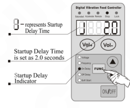

### Retardo de parada (L)

El período de tiempo que transcurre desde que el controlador recibe una señal de control de parada hasta que corta la salida

- Mantenga pulsado el botón **FUNC** durante 2 segundos para entrar en el estado de ajuste de los parámetros básicos.
- Pulse el botón **FUNC** repetidamente hasta que se cambie al estado de ajuste del tiempo de retardo de parada (L) y se ilumine el indicador de tiempo de retardo de parada en el panel.
- Ajuste el parámetro pulsando el botón ▲ o ▼. La unidad del parámetro es el segundo y la precisión numérica es 0.1.

*El rango ajustable del parámetro es de 0.0 a 9.9 segundos*    
*El valor predeterminado del parámetro es 0.2 segundos*

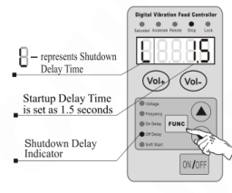

---

## 5.1.3 Ajuste de la relación lógica del sensor fotoeléctrico inteligente

En circunstancias normales, el extremo receptor no recibe señal óptica y el controlador funciona de forma predeterminada. Pero en algunas aplicaciones especiales, el controlador debe detenerse cuando el extremo receptor no recibe señal óptica. El ajuste de este parámetro permite este tipo de aplicación.

- Mantenga pulsados simultáneamente los botones **FUNC** y ▲ durante 2 segundos para entrar en el estado de ajuste de los parámetros avanzados.

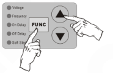

- Pulse el botón **FUNC** repetidamente hasta que se cambie al estado de ajuste de la relación lógica del sensor fotoeléctrico inteligente.

  **08** — representa la relación lógica del sensor fotoeléctrico inteligente    
  **Normal Open**

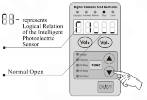

- Ajuste el parámetro pulsando el botón ▲ o ▼.

  **08** — representa la relación lógica del sensor fotoeléctrico inteligente    
  **Normal Close**

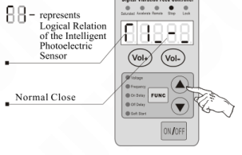

- Cuando la relación lógica está configurada como Normal Open, es decir, no se recibe señal óptica, el controlador funciona.
- Cuando la relación lógica está configurada como Normal Close, es decir, no se recibe señal óptica, el controlador se detiene.

---

## 5.2 Método de uso del sensor de conmutación NPN

El controlador puede funcionar con todo tipo de sensores, como sensores de conmutación, sensores de conmutación ópticos y sensores de fibra óptica.

### 5.2.1 Método de conexión del sensor de conmutación de proximidad NPN

**Paso 1:**    
Abra la placa de cubierta superior del controlador.

**Paso 2:**    
Conecte el sensor de conmutación de proximidad NPN a los terminales del controlador según el diagrama.

**Paso 3:**    
Cierre la placa de cubierta después de conectar el sensor.

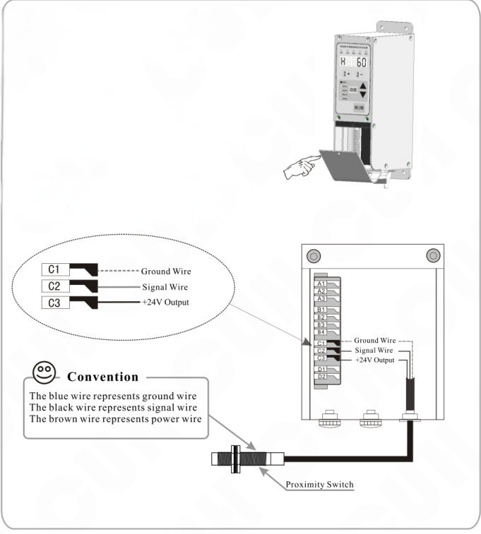

| Terminal | Cable |
|---|---|
| C1 | Cable de tierra |
| C2 | Cable de señal |
| C3 | Salida de +24V |

**Convención**

El cable azul representa el cable de tierra    
El cable negro representa el cable de señal    
El cable marrón representa el cable de alimentación

Interruptor de proximidad

---

---

### 5.2.2 Método de conexión del sensor de conmutación de contrarradiación NPN

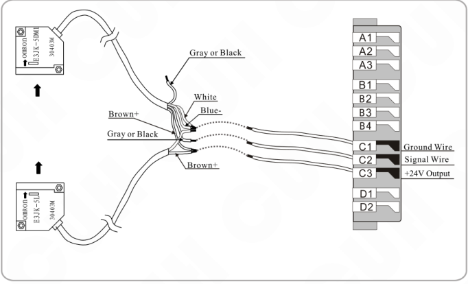

### 5.2.3 Método de conexión del sensor fotoeléctrico de contrarradiación

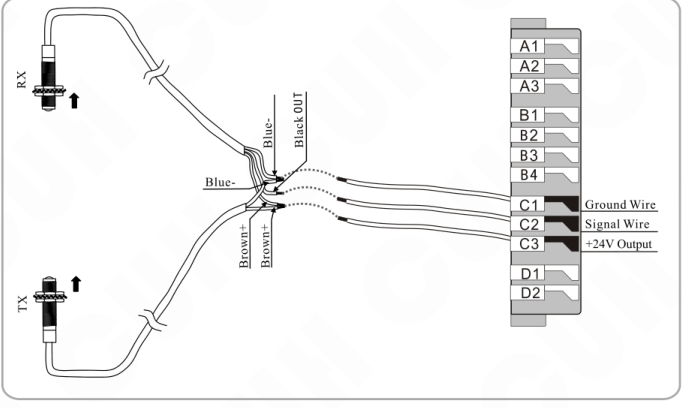

---

## 5.2.4 Método de conexión del sensor de contrarradiación de fibra óptica

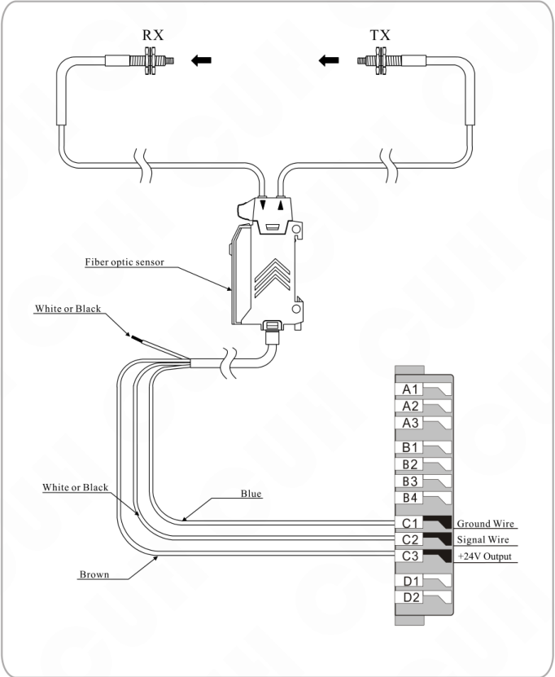

Las etiquetas del diagrama mostradas incluyen: **RX**, **TX**, **Sensor de fibra óptica**, **Blanco o negro**, **Azul**, **Marrón**.

Anotaciones de terminales mostradas:

| Terminal | Anotación |
|---|---|
| C1 | Cable de tierra |
| C2 | Cable de señal |
| C3 | Salida de +24V |

---

## 5.2.5 Método de conexión del sensor fotoeléctrico de reflexión

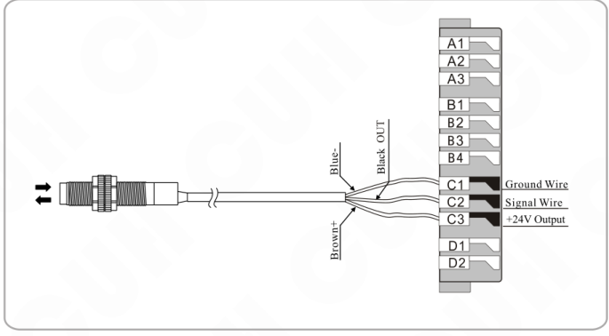

---

---

## 5.3 Ajuste del tiempo de retardo de arranque y del tiempo de retardo de parada del sensor de conmutación NPN

De forma predeterminada, el sensor fotoeléctrico inteligente y el sensor de conmutación comparten el mismo tiempo de retardo de arranque y tiempo de retardo de parada. Los operadores también pueden ajustar el tiempo de retardo de arranque y el tiempo de retardo de parada de forma independiente para el sensor de conmutación.

### Retardo de arranque (J-)

El período de tiempo que transcurre desde que el controlador recibe una señal de control de arranque hasta que emite salida.

- Mantenga pulsados simultáneamente los botones **FUNC** y ▲ durante 2 segundos para entrar en el estado de ajuste de los parámetros avanzados.
- Pulse el botón **FUNC** repetidamente hasta que se cambie al estado de ajuste del tiempo de retardo de arranque (`J---`) y se ilumine el indicador de tiempo de retardo de arranque en el panel.
- Ajuste el parámetro pulsando el botón ▲ o ▼. La unidad del parámetro es el segundo y la precisión numérica es 0.1.

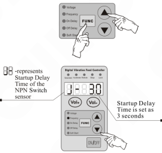

El retardo de arranque está configurado como `J---` de forma predeterminada

### Retardo de parada (L-)

El período de tiempo que transcurre desde que el controlador recibe una señal de control de parada hasta que corta la salida.

- Mantenga pulsados simultáneamente los botones **FUNC** y ▲ durante 2 segundos para entrar en el estado de ajuste de los parámetros avanzados.
- Pulse el botón **FUNC** repetidamente hasta que se cambie al estado de ajuste del tiempo de retardo de parada (`L-`) y se ilumine el indicador de tiempo de retardo de parada en el panel.
- Ajuste el parámetro pulsando el botón ▲ o ▼. La unidad del parámetro es el segundo y la precisión numérica es 0.1.

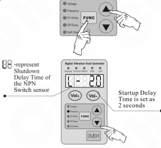

El retardo de parada está configurado como `L----` de forma predeterminada

> ➜ Cuando los valores `J-` y `L-` se ajustan a 0, el tiempo de retardo de arranque y el tiempo de retardo de parada del sensor de conmutación serán los mismos que el tiempo de retardo de arranque y el tiempo de retardo de parada del sensor fotoeléctrico inteligente.    
> ➜ El tiempo de retardo de arranque y el tiempo de retardo de parada del sensor fotoeléctrico inteligente no se verán afectados por el parámetro `J-` o `L-`.

---

---

## 5.4 Ajuste de la relación lógica del sensor de conmutación NPN (parada cuando las piezas de trabajo están llenas)

En circunstancias normales, el controlador no recibe señal del sensor de conmutación NPN y funciona de forma predeterminada. Pero en algunas aplicaciones especiales, el controlador debe detenerse cuando no recibe señal del sensor de conmutación NPN. El ajuste de este parámetro permite este tipo de aplicación.

▶▶ Mantenga pulsados simultáneamente los botones <kbd>FUNC</kbd> y ▲ durante 2 segundos para entrar en el estado de ajuste de los parámetros avanzados.

▶▶ Pulse el botón <kbd>FUNC</kbd> repetidamente hasta que se cambie al estado de ajuste de la relación lógica del sensor de conmutación NPN (`F2`).

▶▶ Ajuste el parámetro pulsando el botón ▲ o ▼.

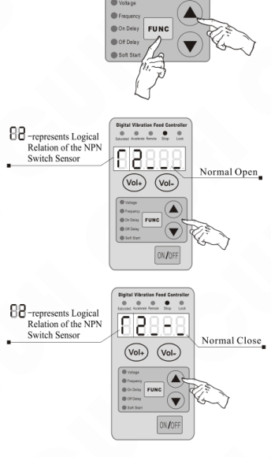

`F2`—representa la relación lógica del sensor de conmutación NPN.

- Normal Open
- Normal Close

> ●Cuando la relación lógica está configurada como Normal Open, es decir, no se recibe señal, el controlador funciona.    
> ●Cuando la relación lógica está configurada como Normal Close, es decir, no se recibe señal, el controlador se detiene.

---

## 5.5 Ajuste de la relación lógica de la señal de control

El controlador puede ajustar la relación lógica del sensor fotoeléctrico inteligente y del sensor de conmutación cuando trabajan simultáneamente.

▶ Mantenga pulsados simultáneamente los botones **FUNC** y ▲ durante 2 segundos para entrar en el estado de ajuste de los parámetros avanzados.

▶ Pulse el botón **FUNC** repetidamente hasta que se cambie al estado de ajuste de la relación lógica de la señal de control

▶ Ajuste el parámetro pulsando el botón ▲ o ▼.

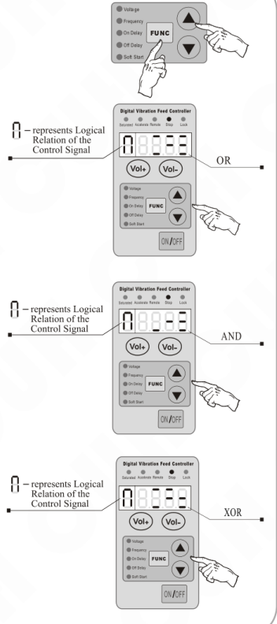

Ⅰ

●Relación lógica AND: El controlador funciona solo cuando tanto el sensor fotoeléctrico inteligente como el sensor de conmutación NPN se lo solicitan.

●Relación lógica OR: El controlador funciona cuando el sensor fotoeléctrico inteligente o el sensor de conmutación NPN se lo solicita.

●Relación lógica NOR: El controlador funciona solo cuando el sensor fotoeléctrico inteligente y el sensor de conmutación NPN emiten la señal de control opuesta.

---

## 5.6 Método de conexión del PLC superior que controla el controlador del alimentador vibratorio

### 5.6.1 Método de conexión del PLC de control

**Paso uno:**    
Abra la placa de cubierta superior del controlador.

**Paso dos:**    
Conecte el PLC a los terminales del controlador según el diagrama.

**Paso tres:**    
Cierre la placa de cubierta después de conectar el sensor.

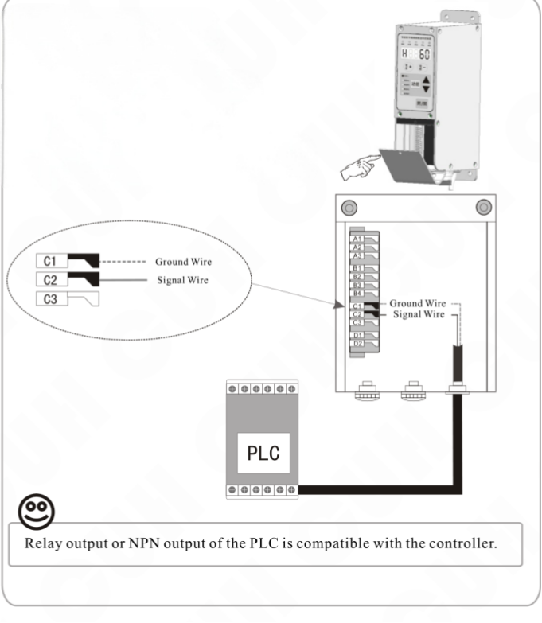

La salida de relé o la salida NPN del PLC son compatibles con el controlador.

---

---

## 5.7 Salida de control

El controlador puede emitir una señal de control de baja tensión para cooperar con otros dispositivos, como una válvula solenoide, un PLC o un relé eléctrico.

### 5.7.1 Método de conexión de la salida de control

**Método de conexión de la válvula solenoide**

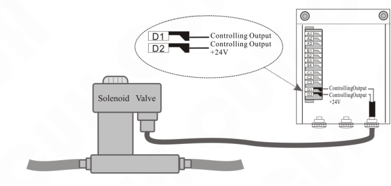

●El controlador puede accionar directamente una válvula solenoide cuya tensión nominal sea 24V y cuya potencia nominal sea inferior a 4W.    
●Utilice una fuente de alimentación externa para válvulas solenoide de alta potencia.

**Método de conexión del relé eléctrico**

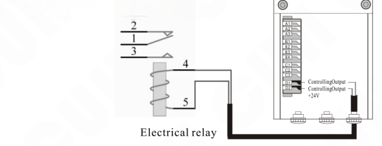

●El controlador puede accionar directamente un relé eléctrico cuya tensión nominal sea 24V y cuya potencia nominal sea inferior a 4W.

---

## 5.7.2 Ajuste de la relación lógica de la salida de control

- Mantenga pulsados simultáneamente los botones **FUNC** y **▲** durante 2 segundos para entrar en el estado de ajuste de los parámetros avanzados.

- Pulse el botón **FUNC** repetidamente hasta que se cambie al estado de ajuste de la relación lógica de la salida de control (F3).

- Ajuste el parámetro pulsando el botón **▲** o **▼**.

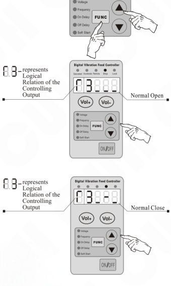

> ● Cuando la relación lógica está configurada como Normal Open, la salida de control funciona mientras el controlador está en marcha.    
> ● Cuando la relación lógica está configurada como Normal Close, la salida de control no funciona mientras el controlador está en marcha.

---

---

## 5.8 Control de velocidad remoto

La función de control de velocidad remoto permite al operador controlar la tensión de salida mediante un potenciómetro externo o una señal de control de 1V a 5V. Así, el control de velocidad remoto externo se puede lograr fácilmente mediante un PLC, un DCS u otros medios.

La función de control de velocidad remoto se activa en el controlador cuando la señal de control supera 0.5V. Mientras tanto, el indicador de control de velocidad remoto del panel se ilumina y los botones `Vol+` y `Vol-` pierden eficacia. La pantalla LED muestra la tensión de salida actual si el controlador está funcionando en el estado de ajuste de la tensión de salida.

### Método de conexión del potenciómetro externo

- A1: Cable de tierra del control de velocidad remoto
- A2: Entrada del control de velocidad remoto
- A3: Fuente de alimentación del control de velocidad remoto

**Nota:** Seleccione un potenciómetro de linealidad con una resistencia de 1k.

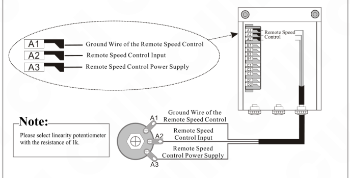

### Método de conexión del PLC

- A1: Cable de tierra del control de velocidad remoto
- A2: Entrada del control de velocidad remoto
- A3

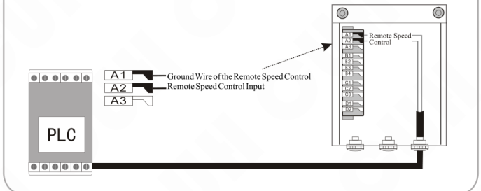

---

---

# Capítulo VI Funciones de seguridad

## 6.1 Estabilización automática de tensión

La función de estabilización digital de tensión incorporada puede eliminar las variaciones de velocidad de alimentación causadas por las fluctuaciones de la tensión de red.

## 6.2 Protección contra cortocircuitos

Si la salida del controlador se cortocircuita, el controlador detendrá su salida hasta que se reinicie.

## 6.3 Protección contra sobrecarga de corriente

El controlador detendrá su salida para garantizar la seguridad de funcionamiento de los equipos cuando la corriente de operación supere su valor nominal.

## 6.4 Protección contra sobrecalentamiento

El controlador detendrá su salida para protegerse cuando la temperatura de operación sea demasiado alta.

---

---

# Apéndice

## Apéndice A: Dimensiones

Dimensiones exteriores del modelo de controlador: SDVC31-S y SDVC31-M (unidad: mm)

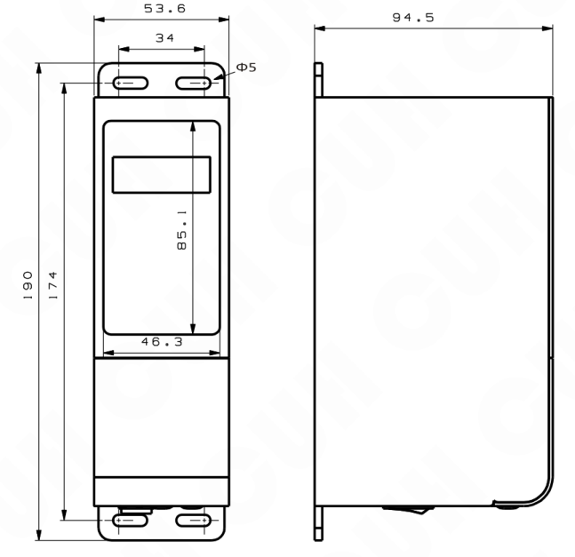

---

Dimensiones exteriores del modelo de controlador: SDVC31-L y SDVC31-XL (unidad: mm)

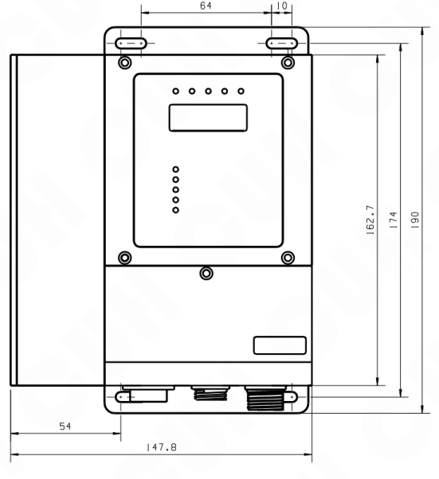

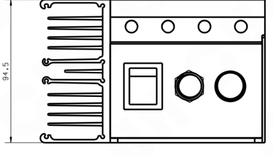

---

Dimensiones exteriores del modelo de controlador: SDVC31-U y SDVC31-XU (unidad: mm)

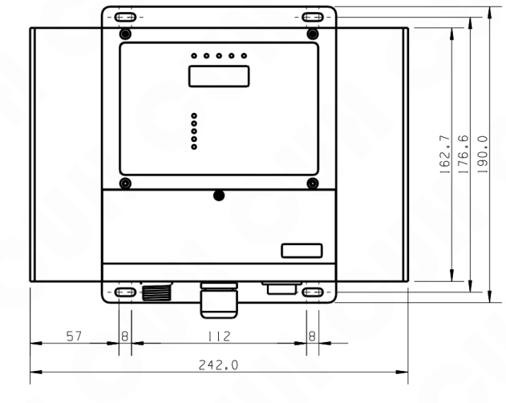

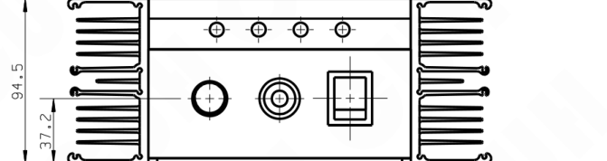

---

---

## Apéndice B: Definición de la interfaz de salida

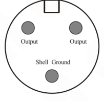

### ☺ Aviso:

**A:** Asegúrese de que las bobinas electromagnéticas del vibrador estén conectadas a los dos pines de salida de la toma del cable de salida de potencia y de que la carcasa del vibrador esté conectada a tierra de forma fiable; de lo contrario, pueden producirse incidentes de seguridad en cadena.

**B:** Después de soldar, asegúrese de que la zona en blanco esté envuelta con cinta aislante o tubo termorretráctil antes de insertarla en la toma del cable de salida de potencia, para evitar fugas eléctricas o cortocircuitos.

## Apéndice C: Definición de la interfaz de señales

| Terminal | Definición |
|---|---|
| A1 | Cable de tierra del control de velocidad remoto |
| A2 | Entrada del control de velocidad remoto |
| A3 | Fuente de alimentación del control de velocidad remoto |
| B1 | Tierra |
| B2 | Entrada de señal del sensor fotoeléctrico inteligente |
| B3 | Tierra |
| B4 | Salida de señal del sensor fotoeléctrico inteligente |
| C1 | GND de +24V |
| C2 | Entrada de señal del sensor de conmutación NPN |
| C3 | +24V |
| D1 | Salida de control |
| D2 | +24V |

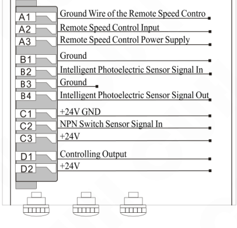

---

## **Apéndice D:** Definición de los caracteres mostrados en LED

| Controlador | Carácter mostrado | Imagen del símbolo |
|---|---|---|
| `U` | Tensión de salida |  |
| `F` | Frecuencia de salida |  |
| `d` | Tiempo de retardo de arranque del sensor fotoeléctrico inteligente |  |
| `C` | Tiempo de retardo de parada del sensor fotoeléctrico inteligente |  |
| `E` | Arranque suave |  |
| `U-` | Retardo de parada |  |
| `d-` | Tiempo de retardo de arranque del sensor de conmutación NPN | 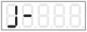 |
| `r1` | Relación lógica del sensor fotoeléctrico inteligente |  |
| `r2` | Relación lógica del sensor de conmutación NPN |  |
| `r3` | Relación lógica de la salida de control |  |
| `n` | Relación lógica de la señal de control |  |
| `H` | Tensión de salida máxima |  |
| `A` | Índice de aceleración |  |
| `P` | Índice de forma de onda |  |
| `88888` | Restauración de la configuración predeterminada |  |

---

## Apéndice E: Especificaciones eléctricas

| Elemento | Mínimo | Típico | Máximo | Unidad | Descripción |
|---|---:|---:|---:|:---:|---|
| Tensión de entrada | 85 | 220 | 250 | V | AC RMS |
| Rango ajustable de tensión de salida | 0 | —— | 250 | V | Inferior al 150% de la tensión de entrada |
| Precisión de ajuste de tensión |  | 1 |  | V |  |
| Precisión de regulación de tensión | 0 | —— | 10 | % | ΔVout/ΔVin |
| Tiempo de respuesta de la regulación de tensión | 0.0025 | —— | 0.025 | s | 1/10 del período de la tensión de salida |
| Rango ajustable de corriente de salida | 0 | —— | 1.5 | A | SDVC31-S |
|  | 0 | —— | 3 | A | SDVC31-M |
|  | 0 | —— | 4.5 | A | SDVC31-L |
|  | 0 | —— | 6 | A | SDVC31-XL |
|  | 0 | —— | 10 | A | SDVC31-U |
|  | 0 | —— | 20 | A | SDVC31-XU |
| Potencia de salida | 0 | —— | 330 | VA | SDVC31-S |
|  | 0 | —— | 660 | VA | SDVC31-M |
|  | 0 | —— | 990 | VA | SDVC31-L |
|  | 0 | —— | 1320 | VA | SDVC31-XL |
|  | 0 | —— | 2200 | VA | SDVC31-U |
|  | 0 | —— | 4400 | VA | SDVC31-XU |
| Frecuencia de salida | 40 | —— | 400 | Hz |  |
| Precisión de ajuste de frecuencia |  | 0.1 |  | Hz |  |
| Forma de onda de salida |  | senoidal |  |  |  |
| Tiempo de arranque suave | 0 | —— | 10 | s | Valor predeterminado de fábrica: 0.5 |
| Rango del tiempo de retardo de conexión/desconexión | 0 | —— | 20 | s | Valor predeterminado de fábrica: 0.2 |
| Precisión del tiempo de retardo de conexión/desconexión |  | 0.1 |  | s |  |
| Temperatura de activación de la protección contra sobrecalentamiento | 58 | 60 | 66 | ℃ | SDVC31-S\M |
|  | 60 | 65 | 65 | ℃ | SDVC31-L\XL\U\XU |
| Tensión de salida de control DC | 22 | 24 | 26 | V |  |
| Corriente de salida de control DC | 0 | —— | 200 | mA |  |
| Señal de control analógica |  | 1-5 |  | V | Tensión de control de velocidad remoto |
| Señal de control digital |  | 24 |  | V | Señal de conmutación |
| Método de ajuste |  | 6 |  | Botón |  |
| Consumo de energía en espera | —— | 3 | —— | W |  |
| Método de visualización |  | 5 |  | Dígito | Tubos digitales LED |
| Temperatura ambiente | 0 | 25 | 40 | ℃ | Sin condensación |
| Humedad ambiente | 10 | 60 | 85 | % |  |

## Apéndice F: Consejos para la solución de problemas y explicaciones de errores

Los siguientes consejos pueden ayudarle a resolver los problemas que pueda encontrar

| N.º | Problema / visualización | Imagen del símbolo | Consejos para la solución de problemas y explicaciones de errores |
|---:|---|---|---|
| 1 | Sin visualización tras encender |  | ◆ Asegúrese de que la toma de corriente tenga tensión ◆ Asegúrese de que el cable de entrada de potencia esté conectado de forma fiable a la toma de corriente |
| 2 | Visualiza con normalidad, pero sin salida |  | ◆ Asegúrese de que el cable de entrada de potencia y el cable de salida de potencia estén firmemente conectados ◆ Asegúrese de que el valor del parámetro de tensión de salida no sea demasiado pequeño ◆ Asegúrese de que el controlador no esté detenido por la señal de control ◆ Asegúrese de que el controlador no esté detenido por los parámetros configurados como normal off |
| 3 | La señal de control pierde eficacia |  | ◆ Asegúrese de que la señal de control se introduzca correctamente ◆ Asegúrese de que el cable de tierra de la señal de control esté conectado correctamente al controlador ◆ Asegúrese de que la relación lógica de la señal de control esté configurada correctamente según lo esperado |
| 4 | Fenómeno de batido |  | ◆ Evite el acoplamiento de vibraciones entre los vibradores ◆ Aumente la frecuencia de resonancia de los vibradores |
| 5 | Visualiza con normalidad, sin salida, pero se oye un sonido |  | ◆ Ajuste todos los parámetros como se indica en este manual |
| 6 | Err01 |  | ◆ Salida en cortocircuito; asegúrese de que el cable de salida de potencia y la bobina no estén cortocircuitados |
| 7 | Err02 |  | ◆ Sobrecorriente de salida; reduzca el valor de la tensión de salida y asegúrese de que el entrehierro de la armadura no sea demasiado grande |
| 8 | Err03 |  | ◆ Sobrecalentamiento; coloque el controlador en un entorno bien ventilado |
| 9 | Err04 |  | ◆ Reservado; póngase en contacto con nosotros |
| 10 | Err05 |  | ◆ Reservado; póngase en contacto con nosotros |

**Nanjing CUH Science & Technology Co., Ltd**

No. 1 Xiaodong Road, Chenguang Village, Qilin, Nanjing, Jiangsu, China    
Tel: +86-25-84730415    
Fax: +86-25-84730426    
Email: sales@cuhnj.com    
Website: en.cuhnj.com

