## Controlador digital de frecuencia variable de doble canal para alimentador vibratorio

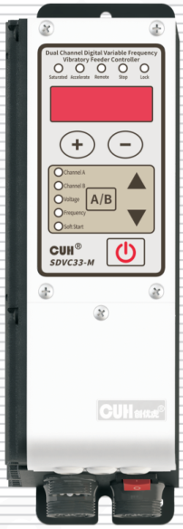

## Serie SDVC33
Controlador digital de frecuencia variable de doble canal para alimentador vibratorio　Serie SDVC33
## Manual de instrucciones

---

## Declaración de derechos de autor

Nanjing CUH Science & Technology CO., Ltd. Todos los derechos reservados.

Toda la información contenida en este manual de usuario es conocimiento de nuestra empresa y está protegida por las leyes de derechos de autor y todas las demás leyes. CUH disfruta y se reserva todos los derechos de autor y otros derechos legales en virtud de la Ley de derechos de autor y otras leyes. Sin el consentimiento por escrito de CUH, no se podrá copiar, traducir ni explotar de ninguna otra forma este manual de usuario, ni total ni parcialmente.

## Descargo de responsabilidad

Todo el contenido de este manual de usuario describe únicamente el método de uso de los productos relacionados producidos por nuestra empresa, y se describe de acuerdo con la tecnología existente y el estado en que se le proporcionan cuando los utiliza. Usted debe asumir los riesgos correspondientes al utilizar este producto. Salvo lo exigido por la ley, la empresa no tiene ninguna responsabilidad expresa o implícita sobre el producto derivada de este manual de usuario, incluidos, entre otros, daños personales, daños a la propiedad, pérdida de oportunidades, etc.

Usted comprende claramente los riesgos anteriores y acepta que, salvo lo exigido por la ley, la empresa no es responsable de ningún daño o pérdida directa o indirecta que usted sufra (incluidos, entre otros, la pérdida tangible de personal, propiedades, datos, etc., y la pérdida intangible de reputación, oportunidades, etc.).

La empresa se reserva el derecho de modificar los productos aplicables en este manual de usuario sin aviso previo ni posterior.

---

## Prefacio

Gracias por elegir el controlador digital de frecuencia variable de doble canal para alimentador vibratorio de la serie CUH SDVC33. (En lo sucesivo, “el controlador”). Esta serie de controladores utiliza componentes de alta calidad, incorpora la última tecnología electrónica y está cuidadosamente diseñada con procesadores digitales de señales de alto rendimiento.

Este manual incluye notas para la instalación, la puesta en marcha, el ajuste de parámetros, el mantenimiento y la solución de problemas del controlador. Lea atentamente este manual antes de operar el controlador y consérvelo adecuadamente.

Los siguientes símbolos le advierten sobre la prevención de lesiones personales y daños al producto; asegúrese de leerlos.

| Símbolo | Descripción |
|---|---|
| ⚠ Peligro | La inobservancia de este punto provocará lesiones personales o la muerte. |
| ⚠ Advertencia | La inobservancia de este punto puede provocar lesiones personales o la muerte. |
| ⚠ Precaución | La inobservancia de este punto puede provocar lesiones moderadas o leves a las personas. |
| Aviso | La inobservancia de este punto provocará daños al producto y daños materiales. |
| ❗ Obligatorio | Indica las precauciones y restricciones de uso que deben observarse durante el uso. |

**Este manual es aplicable al siguiente modelo**

- SDVC33-M ( corriente combinada de dos canales de hasta 3.5A )

---

# Seguridad y precauciones

1. **⚠ Peligro** Este producto solo se utiliza para accionar equipos de alimentación vibratoria basados en electroimanes; no utilice este producto con el fin de proteger el cuerpo humano o partes del cuerpo humano, etc.

2. **⚠ Peligro** Este producto no está diseñado para usarse como producto a prueba de explosiones; no lo utilice en lugares peligrosos y/o en entornos con gases potencialmente explosivos.

3. **⚠ Advertencia** Este producto se alimenta de la red de CA; no aplique una tensión de CA superior a 260Vac. Una tensión de entrada excesiva, como 380Vac, puede provocar que el producto explote o se incendie, causando accidentes de seguridad graves.

4. **⚠ Advertencia** Este producto se pone a tierra a través del cable de alimentación. Asegúrese de que las instalaciones de distribución de energía del controlador estén bien conectadas a tierra; de lo contrario, la carcasa del controlador puede quedar cargada eléctricamente, provocando un accidente por descarga eléctrica.

5. **⚠ Advertencia** No introduzca alimentación de CA en la salida de este controlador; esto dañará el controlador.

6. **⚠ Advertencia** No enchufe ni desenchufe el cableado con corriente ni toque los contactos de cada terminal de conexión del compartimento de cableado para evitar descargas eléctricas.

7. **Aviso** Evite controlar la salida de este producto cortando la alimentación mediante relés y otros dispositivos; de lo contrario, la vida útil del controlador se reducirá gravemente.

8. **Aviso** El controlador está diseñado para funcionar en un entorno fresco y seco. Nunca utilice el controlador a la intemperie para evitar mojaduras e insolación. Utilice el controlador dentro de la temperatura especificada en las características eléctricas.

9. **! Obligatorio** Asegúrese de fijar este producto sobre una plataforma sólida, con conexión a tierra fiable y alejada de equipos vibratorios.

10. **! Obligatorio** Nunca opere el controlador en condiciones que superen sus límites de diseño.

11. **! Obligatorio** Utilice el controlador estrictamente de acuerdo con este manual de instrucciones. No asumiremos ninguna responsabilidad civil o penal si el daño del equipo o las lesiones personales son causados por una operación incorrecta.

12. **! Obligatorio** Nunca abra la carcasa del controlador para evitar descargas eléctricas. Póngase en contacto con CUH si el controlador se avería. Nunca intente reparar el controlador usted mismo, ya que podría anular la garantía.

---

---

## Entorno de funcionamiento y almacenamiento

### Inspección antes del uso

Cada controlador pasa por una rigurosa inspección de calidad antes de su entrega y se embala con un embalaje a prueba de impactos. Compruebe los siguientes puntos después de desembalar:

1. Si el controlador está dañado en su apariencia.
2. Si el modelo del controlador es el que solicitó.

### Entorno de ejecución

Siga las notas a continuación para garantizar un mejor rendimiento y una mayor vida útil del controlador:

- ⚠ Entorno bien ventilado
- ⚠ Manténgase alejado de agua, vapor, polvo y especialmente polvo aceitoso
- ⚠ Manténgase alejado de gases y líquidos corrosivos o inflamables
- ⚠ Manténgase alejado del polvo en suspensión y las partículas metálicas
- ⚠ Fíjelo firmemente para evitar vibraciones propias
- ⚠ Manténgase alejado de interferencias electromagnéticas
- ⚠ Asegúrese de que la temperatura ambiente sea de 0~40 ℃
- ⚠ Para uso a una altitud de 2000 m o inferior

---

---

# Contenido

**Capítulo Ⅰ Antes de comenzar — 1**

- 1.1 Compruebe el contenido del paquete — 1
- 1.2 Explicación de los indicadores, botones y partes externas — 2
- 1.3 Explicación de los puertos de cableado — 3
- 1.4 Explicación de la placa de características — 3

**Capítulo Ⅱ Introducción del producto — 4**

- 2.1 Introducción del producto — 4
- 2.2 Mejora del rendimiento del producto — 4
- 2.3 Uso combinado de las dos salidas — 5

**Capítulo Ⅲ Guía de instalación — 6**

- 3.1 Condiciones de uso del controlador — 6
- 3.2 Método de operación de los botones — 6
- 3.3 Instalación y uso — 7

**Capítulo Ⅳ Descripción de las funciones básicas — 11**

- 4.1 Ajuste de la tensión de salida — 11
- 4.2 Ajuste de la frecuencia de salida — 12
- 4.3 Arranque suave — 12
- 4.4 Parada suave — 13
- 4.5 Función de frenado — 13
- 4.6 Interruptor de salida — 14
- 4.7 Bloqueo del teclado — 14
- 4.8 Restauración de la configuración predeterminada — 15

**Capítulo Ⅴ Descripción de las funciones avanzadas — 17**

- 5.1 Control de velocidad remoto — 17
- 5.2 Detección fotoeléctrica inteligente — 19
- 5.3 Sensor de conmutación — 20

---

---

- 5.4 Salida de control — 21
  - 5.4.1 Método de cableado de la salida de control — 21
  - 5.4.2 Fuente de señal de la salida de control y diagrama lógico — 22
  - 5.4.3 Descripción del modo de salida de control — 24
  - 5.4.4 Función de control de la señal de salida principal — 24
- 5.5 Límite de tensión de salida máxima — 25
- 5.6 Protección contra sobrecorriente ajustable — 25
- 5.7 Ajuste del brillo del panel — 26
- 5.8 Función de monitoreo de salida — 26
- 5.9 Control conjunto de doble canal — 27
- 5.10 Guardar y restaurar parámetros de usuario — 28

## Capítulo Ⅵ Especificaciones técnicas — 29

- 6.1 Dimensiones — 29
- 6.2 Especificaciones técnicas — 30
- 6.3 Norma de referencia — 31

## Capítulo Ⅶ Apéndice — 32

- 7.1 Tabla de parámetros — 32
- 7.2 Diagramas de circuito de entrada y salida — 35
- 7.3 Sugerencias de solución de problemas y explicaciones de errores — 36

## Capítulo Ⅷ Información de garantía del producto — 37

- 8.1 Período de garantía — 37
- 8.2 Cobertura de la garantía — 37
- 8.3 Idoneidad del producto — 37

---

# Capítulo Ⅰ Antes de comenzar

Este capítulo presenta el contenido del paquete del producto, la descripción de la apariencia del controlador y la información de la placa de características del controlador.

## 1.1 Compruebe el contenido del paquete

Antes de usar este producto, compruebe la integridad del controlador y los accesorios. Si encuentra que el producto es defectuoso o está dañado, que faltan accesorios, etc., póngase en contacto con nuestra empresa.

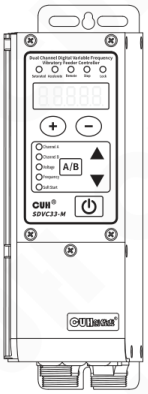

Controlador×1

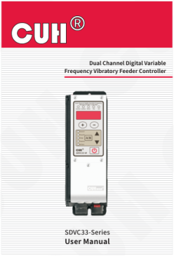

Manual de usuario×1

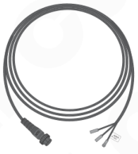

Cable de salida×2

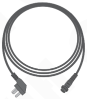

Cable de alimentación de entrada×1

---

## 1.2 Explicación de los indicadores, botones y partes externas

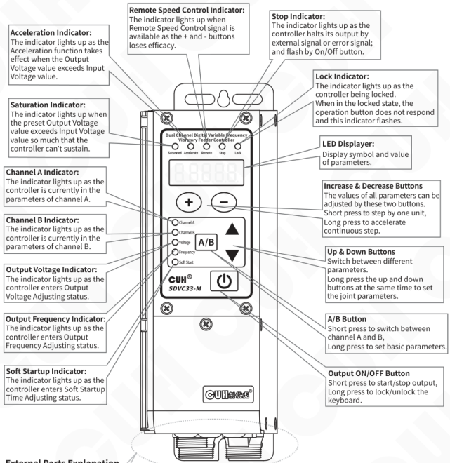

**Indicador de aceleración:**  
El indicador se enciende cuando la función de aceleración entra en vigor, cuando el valor de tensión de salida supera el valor de tensión de entrada.

**Indicador de control de velocidad remoto:**  
El indicador se enciende cuando hay señal de control de velocidad remoto disponible y los botones + y - dejan de ser efectivos.

**Indicador de parada:**  
El indicador se enciende cuando el controlador detiene su salida por una señal externa o una señal de error, y parpadea cuando se detiene con el botón On/Off.

**Indicador de saturación:**  
El indicador se enciende cuando el valor de tensión de salida preajustado supera tanto el valor de tensión de entrada que el controlador no puede mantenerlo.

**Indicador de bloqueo:**  
El indicador se enciende cuando el controlador está bloqueado.  
Cuando está en estado bloqueado, el botón de operación no responde y este indicador parpadea.

**Pantalla LED:**  
Muestra el símbolo y el valor de los parámetros.

**Indicador de canal A:**  
El indicador se enciende cuando el controlador está actualmente en los parámetros del canal A.

**Indicador de canal B:**  
El indicador se enciende cuando el controlador está actualmente en los parámetros del canal B.

**Indicador de tensión de salida:**  
El indicador se enciende cuando el controlador entra en el estado de ajuste de tensión de salida.

**Indicador de frecuencia de salida:**  
El indicador se enciende cuando el controlador entra en el estado de ajuste de frecuencia de salida.

**Indicador de arranque suave:**  
El indicador se enciende cuando el controlador entra en el estado de ajuste del tiempo de arranque suave.

**Botones de aumento y disminución**  
Los valores de todos los parámetros se pueden ajustar con estos dos botones.  
Pulse brevemente para avanzar una unidad,  
Mantenga pulsado para acelerar el avance continuo.

**Botones arriba y abajo**  
Cambie entre diferentes parámetros.  
Mantenga pulsados los botones arriba y abajo al mismo tiempo para configurar los parámetros conjuntos.

**Botón A/B**  
Pulse brevemente para cambiar entre el canal A y el B,  
Mantenga pulsado para configurar los parámetros básicos.

**Botón de salida ON/OFF**  
Pulse brevemente para iniciar/detener la salida,  
Mantenga pulsado para bloquear/desbloquear el teclado.

### Explicación de las partes externas

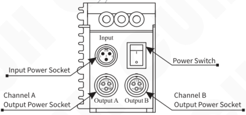

- Toma de alimentación de entrada
- Interruptor de alimentación
- Toma de alimentación de salida del canal A
- Toma de alimentación de salida del canal B

## 1.3 Explicación de los puertos de cableado

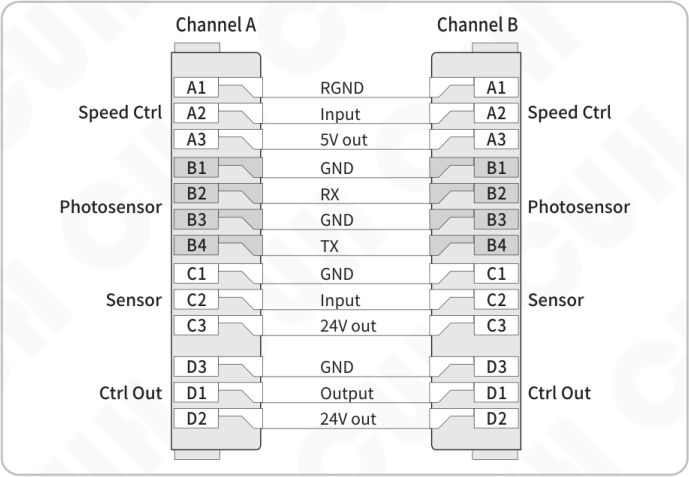

| Función | Canal A | Descripción | Canal B | Función |
|---|---|---|---|---|
| Speed Ctrl | A1 | RGND | A1 | Speed Ctrl |
| Speed Ctrl | A2 | Entrada | A2 | Speed Ctrl |
| Speed Ctrl | A3 | Salida 5V | A3 | Speed Ctrl |
| Photosensor | B1 | GND | B1 | Photosensor |
| Photosensor | B2 | RX | B2 | Photosensor |
| Photosensor | B3 | GND | B3 | Photosensor |
| Photosensor | B4 | TX | B4 | Photosensor |
| Sensor | C1 | GND | C1 | Sensor |
| Sensor | C2 | Entrada | C2 | Sensor |
| Sensor | C3 | Salida 24V | C3 | Sensor |
| Ctrl Out | D3 | GND | D3 | Ctrl Out |
| Ctrl Out | D1 | Salida | D1 | Ctrl Out |
| Ctrl Out | D2 | Salida 24V | D2 | Ctrl Out |

## 1.4 Explicación de la placa de características

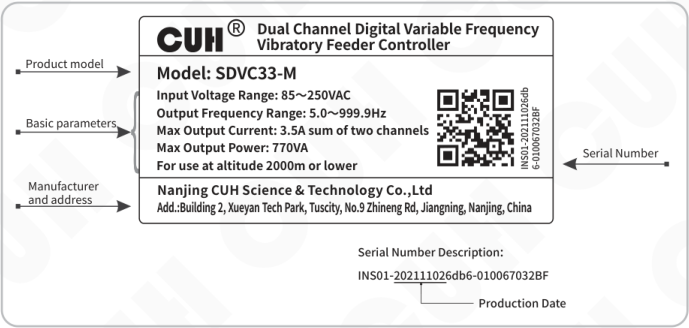

**CUH® — Controlador digital de frecuencia variable de doble canal para alimentador vibratorio**

**Modelo de producto**

Modelo: SDVC33-M

**Parámetros básicos**

- Rango de tensión de entrada: 85～250VAC
- Rango de frecuencia de salida: 5.0～999.9Hz
- Corriente de salida máxima: 3.5A (suma de los dos canales)
- Potencia de salida máxima: 770VA
- Para uso a una altitud de 2000 m o inferior

**Fabricante y dirección**

Nanjing CUH Science & Technology Co.,Ltd

Add.:Building 2, Xueyan Tech Park, Tuscity, No.9 Zhineng Rd, Jiangning, Nanjing, China

**Número de serie**

INS01-202111026db6-010067032BF

**Descripción del número de serie:**

INS01-**20211102**6db6-010067032BF

Fecha de fabricación: **20211102**

---

# Capítulo Ⅱ Introducción del producto

Este capítulo incluye una breve introducción y las características principales del controlador.

## 2.1 Introducción del producto

El controlador de alimentación por vibración de doble FM digital SDVC33 es un controlador compacto de doble salida FM de uso general que ofrece un rendimiento único gracias al uso de la última tecnología electrónica y un diseño cuidadoso. Sus características especiales incluyen:

- Salida de potencia de doble canal que puede distribuir la corriente de forma arbitraria y permite ajustar la corriente de protección contra sobrecorriente de cada canal.
- El modo de trabajo de doble canal puede seleccionar seguimiento de frecuencia, seguimiento de tensión o doble seguimiento de frecuencia-tensión.
- Durante el seguimiento de frecuencia, la diferencia de fase entre las dos salidas se puede ajustar de -180°~180°.
- El rango de frecuencia de salida cubre de 5Hz a 999.9Hz con una precisión de 0.1Hz.
- Función de frenado para detener rápidamente el alimentador vibratorio desplazando la fase de corriente 180° durante el proceso de parada suave.
- Los puertos fotoeléctricos inteligentes admiten fotosensores y sensores de conmutación NPN o PNP.
- Función de señal de preparación: emite una señal modulada o una señal válida a través del puerto de transmisión B4 optoelectrónico inteligente para indicar que el controlador está en estado de preparación. Cuando el controlador encuentra un error, la señal de preparación se vuelve inválida.
- El puerto de control de desbordamiento admite el tipo NPN, PNP o auto-adaptativo.
- El puerto de salida de control admite el modo de salida NPN, PNP o push-pull.
- El puerto de control de velocidad remoto se puede seleccionar de forma cruzada, lo que permite que un potenciómetro controle dos salidas al mismo tiempo.
- La función de coeficiente de control remoto puede ampliar o reducir en 1 vez el efecto de control de la tensión de control remoto.
- La función de ajuste del brillo de la pantalla LED admite 32 niveles de ajuste de brillo.
- Función de guardado y restauración de parámetros de usuario, que permite a los usuarios ajustar parámetros y guardarlos en el grupo de usuario para facilitar su recuperación.
- La función de restauración de fábrica admite la recuperación del subcanal A/B o la recuperación de todo el controlador.
- Funciones de protección completas que incluyen: protección contra cortocircuito de la salida principal, protección contra sobrecorriente, protección contra sobrecalentamiento o enfriamiento excesivo, protección contra subtensión/sobretensión, protección contra cortocircuito de la salida de control, protección contra cortocircuito de la salida de 24V y protección contra cortocircuito de la salida de 5V de regulación de velocidad.

## 2.2 Mejora del rendimiento del producto

En comparación con el controlador SDVC31-M, el SDVC33 ha mejorado enormemente su rendimiento. Principalmente incluye:

- La frecuencia de salida se ha aumentado de 40.0Hz~400.0Hz a 5.0Hz~999.9Hz.
- El tiempo máximo de retardo de conexión/desconexión se ha aumentado de 20.0 s a 99.9 s.

---

- Se ha añadido la función de parada suave, que se puede ajustar de 0.0~10.0 s para detener lentamente la vibración del alimentador vibratorio.
- Se ha añadido la función de frenado; puede ajustar de 0~10 ciclos de frenado para detener rápidamente la vibración del disco vibratorio.
- El puerto del sensor fotoeléctrico inteligente añade compatibilidad con sensores PNP.
- El puerto del sensor de conmutación de material lleno se ha actualizado de NPN y PNP a configurable por software, y se proporciona el modo automático.
- El puerto de salida de control se ha actualizado de la salida NPN a tres tipos configurables: NPN, PNP y push-pull.
- Se ha añadido el retardo de conexión/desconexión del puerto de salida de control, que se puede ajustar de 0.0 a 99.9 s.
- Se ha añadido el modo de salida de control; puede ajustar el modo de retardo y el modo de retención.
- Se ha añadido el parámetro ajustable de corriente de protección contra sobrecorriente para proteger el electroimán contra quemaduras.
- Se ha añadido el coeficiente de control remoto, que puede ampliar o reducir el efecto de control de la tensión de control remoto.
- Se ha añadido la función de ajuste del brillo del panel; puede ajustar por separado el brillo de la pantalla del grupo A/B.
- Se ha añadido la función de medición, que puede monitorear la corriente de salida, la tensión de regulación de velocidad, la tensión de señal del puerto fotoeléctrico inteligente, la tensión de entrada del puerto del sensor de conmutación, la tensión de salida del puerto de salida de control, la visualización de temperatura, la tensión del bus y la tensión de salida de 24V.
- Se han añadido las funciones de guardado y restauración de parámetros. Además del guardado automático de los parámetros del grupo de trabajo, también puede guardar los parámetros del grupo de trabajo en el grupo de usuario, y los parámetros del grupo A y del grupo B se pueden restaurar de forma flexible desde el grupo de usuario cuando sea necesario.

## 2.3 Uso combinado de las dos salidas

El controlador proporciona los parámetros del canal de control conjunto A/B, que se pueden utilizar para controlar el alimentador vibratorio vectorial de doble eje o el sistema de alimentación de un alimentador de cuenco y un alimentador lineal.

De forma predeterminada, los canales A y B funcionan de forma independiente. Cuando se combinan, el canal B se puede configurar para seguir al canal A, lo que incluye seguimiento de tensión, seguimiento de frecuencia y doble seguimiento de tensión-frecuencia. Cuando las frecuencias son iguales, las fases de las dos salidas se bloquean y el usuario puede ajustar la diferencia de fase de -180° a 180°.

Después de configurar la tensión y la frecuencia del canal B para el doble seguimiento del canal A, solo necesita ajustar la tensión y la frecuencia del canal A para cambiar al mismo tiempo la tensión y la frecuencia de salida de A/B.

---

# Capítulo Ⅲ Guía de instalación

Este capítulo presenta las condiciones necesarias para el uso del controlador y cómo instalarlo y conectarlo correctamente.

## 3.1 Condiciones de uso del controlador

El controlador se alimenta con CA de 110/220V y la conexión a tierra de protección se realiza a través del enchufe del cable de alimentación. Proporcione instalaciones de suministro y distribución de energía de red de 110V o 220V, 50Hz/60Hz que cumplan con la norma y asegúrese de que el cable de tierra de protección esté correctamente conectado.

**⚠ Advertencia** No conecte el controlador a una alimentación de CA de 380V; esto causará daños graves irreversibles al controlador, posiblemente provocando explosiones, incendios y otros incidentes de seguridad.

**⚠ Advertencia** Asegúrese de que el lado de la fuente de alimentación esté conectado a tierra de forma fiable. La carcasa metálica del controlador está conectada directamente al cable de tierra de protección. Una conexión a tierra deficiente provocará que la carcasa del controlador quede electrificada y cause un accidente por descarga eléctrica.

**Aviso** Si el controlador funciona durante mucho tiempo, generará calor y hará que aumente la temperatura de la carcasa. Instale el controlador en un entorno bien ventilado y fíjelo bien, lejos de fuentes de vibración.

**Aviso** La salida de canal A/B de este producto se forma mediante la rectificación e inversión del suministro de red, y no existe aislamiento en el medio. Por lo tanto, los polos de salida no se pueden conectar a la tierra de protección. Al conectar el electroimán, es necesario asegurarse de que la bobina del electroimán y la carcasa tengan capacidad de aislamiento básica. De lo contrario, puede producirse una fuga de electricidad, lo que puede causar descargas eléctricas y daños al controlador.

**Aviso** Este producto es un controlador utilizado para accionar el electroimán. No debe conectarse a un alimentador vibratorio piezoeléctrico.

## 3.2 Método de operación de los botones

a. La acción del botón se divide en pulsación corta y pulsación larga (aceleración de primer nivel, aceleración de segundo nivel) según el tiempo de pulsación.  
b. La pulsación corta se define como un tiempo de pulsación superior a 0.1 e inferior a 2 segundos, y la pulsación larga como un tiempo de pulsación superior a 2 segundos.  
f. Mantenga pulsado [A/B] para entrar o salir de la interfaz de parámetros básicos.  
g. Mantenga pulsados [A/B] y ▲ para entrar o salir de la interfaz de parámetros avanzados.  
h. Mantenga pulsados [A/B] y ▼ para entrar o salir de la interfaz de parámetros de monitoreo.  
I. Mantenga pulsados ▲ y ▼ para entrar o salir de la interfaz de parámetros conjuntos.  
j. Mantenga pulsado ⊕ hasta que se muestre 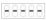 en el LED para restaurar los parámetros de fábrica; suéltelo y se mostrará CUH, lo que significa que se han restaurado los ajustes de fábrica.  
k. Seleccione uP1 al guardar los parámetros de usuario, mantenga pulsados ⊕ y ⊖; después de guardar correctamente, se mostrará SAU.  
l. Cuando se restauren los parámetros de usuario, después de seleccionar el método de restauración, mantenga pulsados ⊕ y ⊖; cuando la restauración se realice correctamente, se mostrará rES.

---

## 3.3 Instalación y uso

### Paso uno:

Abra la caja de embalaje y compruebe el controlador y todos los accesorios.

### Paso dos:

Conecte los terminales del cable de alimentación de salida a la bobina electromagnética del vibrador.

Alinee la muesca del conector de aviación del cable de salida de doble canal A/B con la marca triangular de la toma de salida del controlador y, a continuación, apriete la tuerca después de conectar correctamente el cable de salida.

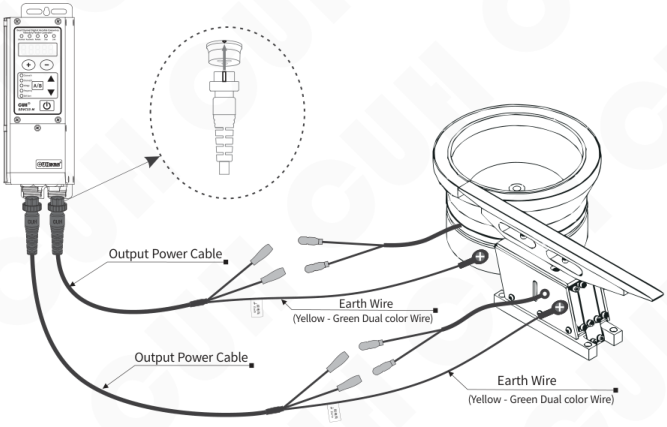

### Nota

1. Asegúrese de que las bobinas electromagnéticas del vibrador estén conectadas a los dos pines de salida del cable de alimentación de salida, y de que la carcasa metálica del vibrador esté conectada a tierra de forma fiable.
2. Está prohibido conectar cargas piezoeléctricas a la salida de potencia; de lo contrario, ¡puede provocar un accidente de seguridad por descarga eléctrica!

---

### Paso tres:

Conecte el conector del cable de alimentación de entrada a la toma de alimentación de entrada del controlador.

Conecte primero el lado del controlador

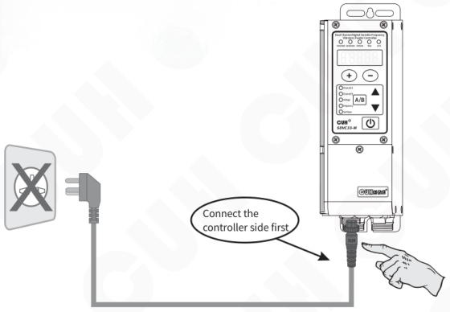

### Paso cuatro:

Conecte el enchufe del cable de alimentación de entrada a la toma de red eléctrica.

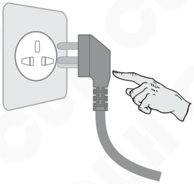

---

## Paso cinco:

Encienda el interruptor de alimentación del controlador; debería mostrarse la tensión “U 150”, el indicador de canal A debería encenderse y los dos alimentadores vibratorios deberían vibrar.

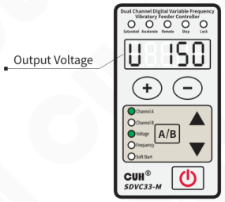

## Paso seis:

Pulse ⊖ para ajustar la tensión del canal A a 30~50V, luego pulse `A/B` y mantenga pulsado 2 segundos para entrar en el estado de ajuste de la frecuencia de salida “E”. Utilice ⊕ y ⊖ para buscar la frecuencia natural del alimentador vibratorio, que también se denomina frecuencia de resonancia.

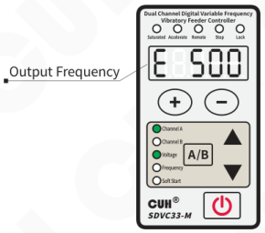

- La frecuencia armónica del vibrador significa el valor de frecuencia que crea la máxima amplitud.
- Cada vibrador tiene su propia frecuencia de resonancia mecánica natural; ajuste la frecuencia de salida del controlador a esta frecuencia para lograr el mejor estado de funcionamiento.

---

## Paso siete:

Mantenga pulsado **A/B** para salir de la frecuencia de salida “E” y volver al parámetro de ajuste de tensión,
Utilice **+** y **−** para ajustar la tensión hasta obtener la mejor velocidad de alimentación.

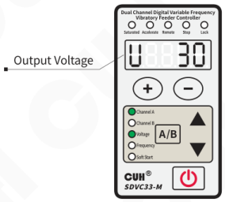

## Configuración del canal B:

Pulse brevemente **A/B** para cambiar al canal B. Repita los pasos seis y siete para completar el ajuste del canal B.

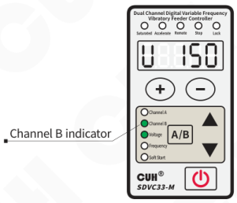

---

## Capítulo IV Descripción de las funciones básicas

Este capítulo presenta cómo utilizar las funciones básicas del controlador.

### 4.1 Ajuste de la tensión de salida

La tensión de salida del controlador se puede ajustar digitalmente de forma directa en el panel. Dado que el controlador puede realizar la compensación de la tensión de red, este valor es el valor medio de la rectificación de la tensión de salida y no se verá afectado por la tensión de entrada, por lo que puede mantener una salida estable incluso en el caso de una tensión de red inestable. Al mismo tiempo, el ajuste directo del valor de tensión también proporciona datos precisos a los usuarios para comprender el funcionamiento del equipo.

- Encienda el interruptor de alimentación del controlador.
- El controlador muestra la tensión de salida. Los indicadores de canal A y de tensión del panel están encendidos, y el LED muestra el parámetro de tensión de salida U y el valor de tensión.
- Pulse ⊕ o ⊖ para ajustar el valor del parámetro.

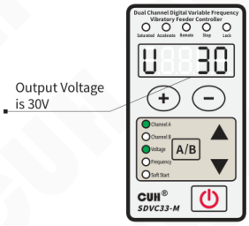

- El controlador no tiene función de elevación. Cuando el controlador no pueda alcanzar la tensión ajustada debido a la limitación de la tensión de la fuente de alimentación de entrada, se encenderá el indicador de saturación y, en ese momento, la compensación de la tensión de red dejará de funcionar.
- El controlador puede lograr cierto grado de efecto de aceleración sacrificando las características sinusoidales de la forma de onda de salida, lo cual está determinado por el parámetro “índice de aceleración y”. Al entrar en el estado de aceleración, la forma de onda de la corriente de salida cambia de una onda sinusoidal a una onda triangular y el indicador de aceleración se enciende.

---

## 4.2 Ajuste de la frecuencia de salida

El controlador adopta la tecnología de síntesis digital directa de frecuencia (DDS), que tiene una precisión y estabilidad de frecuencia muy altas y no cambia con el tiempo ni la temperatura.

- Mantenga pulsado **A/B** durante 2 segundos para entrar en la interfaz de parámetros básicos.
- El LED muestra el parámetro de frecuencia de salida “E” y el valor de frecuencia.
- Pulse **+** o **−** para ajustar el valor del parámetro.

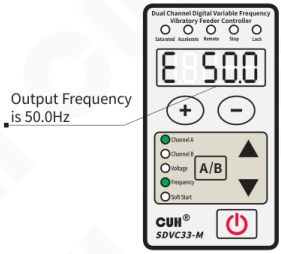

El rango de frecuencia de salida es 5.0～999.9Hz

## 4.3 Arranque suave

Cuando el controlador se pone en marcha desde el estado detenido, la tensión de salida puede aumentarse gradualmente hasta el valor ajustado para evitar que el alimentador vibratorio y el controlador sufran impactos.

Tiempo de arranque suave (t): cuando el controlador arranca desde el estado de parada, el tiempo necesario para que la tensión de salida aumente suavemente de 0V al valor ajustado se denomina tiempo de arranque suave.

- Mantenga pulsado **A/B** durante 2 segundos para entrar en la interfaz de parámetros básicos.
- Pulse **▲** y **▼** para cambiar al estado de ajuste del parámetro de arranque suave “t”.
- Pulse **+** o **−** para ajustar el valor del parámetro.

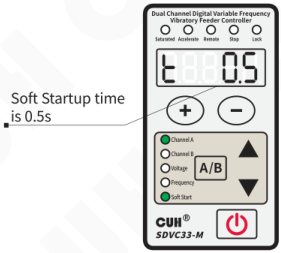

El rango de tiempo de arranque suave es 0.0～10.0s

---

## 4.4 Parada suave

Cuando el controlador se detiene desde el estado de funcionamiento, la tensión de salida puede reducirse suavemente a 0 para evitar que el equipo de vibración sufra impactos.

Tiempo de parada suave (J): cuando el controlador arranca desde el estado de funcionamiento, el tiempo necesario para que la tensión de salida disminuya suavemente del valor ajustado a 0 se denomina tiempo de parada suave.

- Mantenga pulsado **A/B** durante 2 segundos para entrar en la interfaz de parámetros básicos.
- Pulse **▲** y **▼** para cambiar al estado de ajuste del parámetro de parada suave “J”.
- Pulse **+** o **−** para ajustar el valor del parámetro.

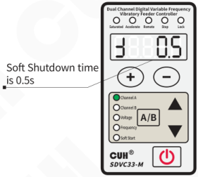

El rango de tiempo de parada suave es 0.0～10.0s

## 4.5 Función de frenado

Dado que el alimentador vibratorio vibrará libremente durante un período de tiempo después de que el controlador detenga la salida, el material continuará moviéndose durante este tiempo. Esto causará errores en algunas aplicaciones de medición de precisión y envasado de materiales, por lo que es necesario detener la vibración rápidamente.

La función de frenado consiste en detener rápidamente la vibración retrasando el punto de inicio de la parada suave 180° para lograr el efecto opuesto de la fuerza motriz y la fase de vibración libre del alimentador vibratorio. Se realiza ajustando el tiempo de parada suave a un valor negativo; la unidad es el ciclo, es decir, el número de ciclos de corriente de accionamiento inverso durante el frenado.

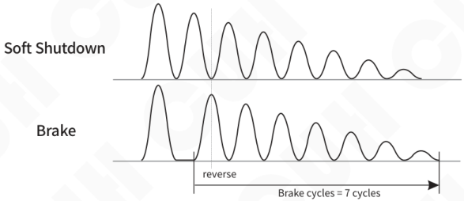

---

## 4.6 Interruptor de salida

El interruptor de salida táctil del panel puede iniciar o detener de forma fácil y rápida la salida del controlador.

- Utilice ⏻ en el panel del controlador para controlar el arranque o la parada de la salida de la unidad. Si el indicador de parada está encendido, significa que ha entrado en el estado de parada.

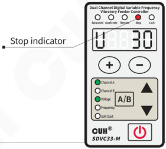

> De forma predeterminada, ⏻ controla el arranque/parada del canal A/B de forma independiente. Si necesita controlar el arranque/parada del canal A/B al mismo tiempo, configure el modo de control del botón de encendido/apagado (OF) en el parámetro conjunto de Ind (independiente) a Cob (combinado).
>
> Cuando el controlador detiene la salida, el indicador de parada parpadea, pero cuando la señal externa detiene el controlador, la luz de parada permanece encendida.

## 4.7 Bloqueo del teclado

Cuando los parámetros del controlador están configurados, la función de bloqueo del teclado puede bloquear todos los botones del panel para evitar errores de operación.

Incluso si se apaga y se vuelve a encender, el estado del bloqueo del teclado permanece en el estado en que se encontraba la última vez que se apagó.

- Mantenga pulsado ⏻ durante 2 segundos para bloquear todos los botones del panel.
- Mantenga pulsado ⏻ durante 2 segundos de nuevo para desbloquear.

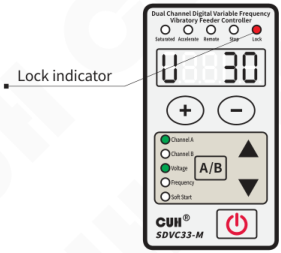

> El bloqueo se puede realizar para diferentes canales; la operación del canal A y del canal B se puede realizar de forma independiente.

---

## 4.8 Restauración de la configuración predeterminada

El usuario puede restaurar rápidamente el controlador al estado predeterminado de fábrica.

Debido a las potentes funciones del controlador, se pueden ajustar muchos parámetros. Para los principiantes, es posible que no puedan restaurar el estado de funcionamiento normal del controlador después de varios ajustes y modificaciones. Utilice esta función para restaurar rápidamente el estado de parámetros desordenado a la configuración predeterminada de fábrica.

El controlador puede restaurar todo el controlador a la configuración de fábrica, así como restaurar un solo canal a la configuración de fábrica de forma individual.

### Restauración de la configuración predeterminada de todo el controlador:

- Mantenga pulsados ▲ y ▼ simultáneamente para entrar en la interfaz de parámetros conjuntos.

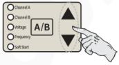

- Pulse brevemente ▼ para cambiar a la pantalla LED con parpadeo completo, es decir, el parámetro de “Restauración de la configuración predeterminada”. A continuación, pulse ⊕ y mantenga pulsado hasta que el controlador muestre “-----”, lo que indica que el controlador se ha restaurado.

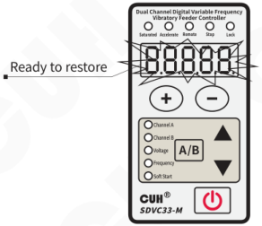

- Suelte ⊕; después de que el controlador muestre “CUH”, entrará en el estado de ajuste de la tensión de salida “U”. En este momento, todos los parámetros se han restaurado a la configuración predeterminada de fábrica.

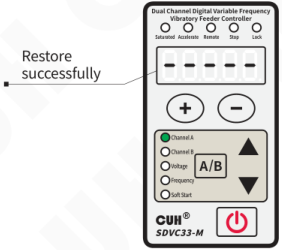

---

## Restauración individual de la configuración predeterminada del canal A/B:

- Mantenga pulsados **A/B** y **▲** simultáneamente para entrar en la interfaz de parámetros avanzados.

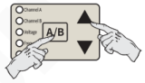

- Pulse brevemente **▼** para cambiar al parámetro “Restauración de la configuración predeterminada del canal actual”. A continuación, mantenga pulsado **⊕** hasta que el controlador muestre “-----”, lo que indica que el canal actual se ha restaurado.

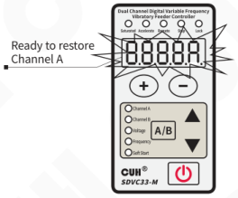

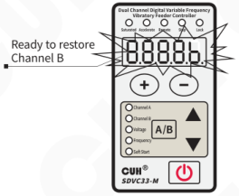

- Suelte **⊕**; después de que el controlador muestre “CUH”, entrará en el estado de ajuste de la tensión de salida “U”. En este momento, todos los parámetros del canal actual se han restaurado a la configuración predeterminada de fábrica.

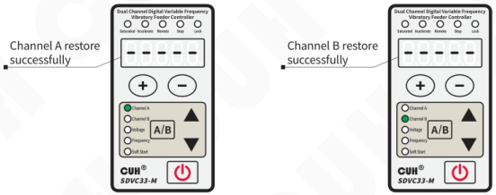

---

## Capítulo Ⅴ Descripción de las funciones avanzadas

Este capítulo presenta cómo utilizar las funciones avanzadas del controlador.

### 5.1 Control de velocidad remoto

El controlador admite señales analógicas externas para controlar la tensión de salida; las señales analógicas admiten potenciómetro, tensión de 1~5V y corriente de 4~20mA. Hay dos puertos de entrada analógica AA y bA. De forma predeterminada, AA controla el canal A y bA controla el canal B. También se puede ajustar mediante el parámetro cS, de modo que una señal pueda controlar la tensión de salida de dos canales al mismo tiempo.

El controlador también ha diseñado el parámetro de coeficiente de control remoto c para ampliar o reducir el efecto de la tensión de control remoto, que se puede ajustar de 0.5 a 2.0. Cuando se ajusta en 0.5, significa que el efecto de la tensión de control remoto para controlar la tensión de salida se reduce a la mitad, es decir, el control remoto máximo solo puede alcanzar la mitad de la tensión de salida máxima h. Cuando se ajusta en 2.0, significa que el efecto de la tensión de control remoto para controlar la tensión de salida se duplica, es decir, cuando la tensión de control remoto alcanza 3V, la tensión de salida ya ha alcanzado h; y si se aumenta la tensión de control remoto, la tensión de salida no podrá aumentar.

### Conexión de control por potenciómetro

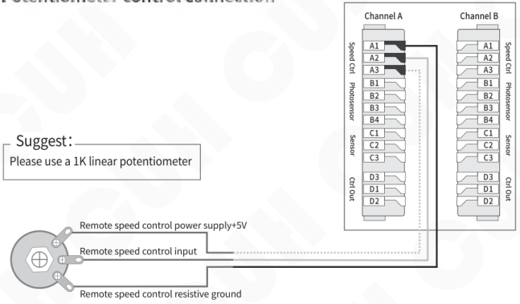

Cuando la señal de control de velocidad remoto entra en vigor, el indicador de control de velocidad se enciende y, al mismo tiempo, el ajuste de la tensión en el panel deja de ser efectivo.

---

## Conexión de control por tensión de 1~5V

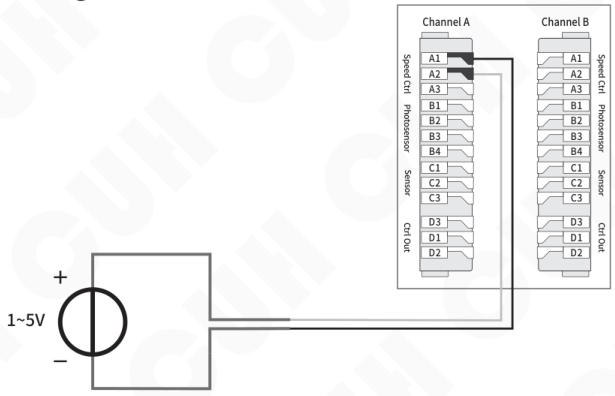

## Conexión de control por corriente de 4~20mA

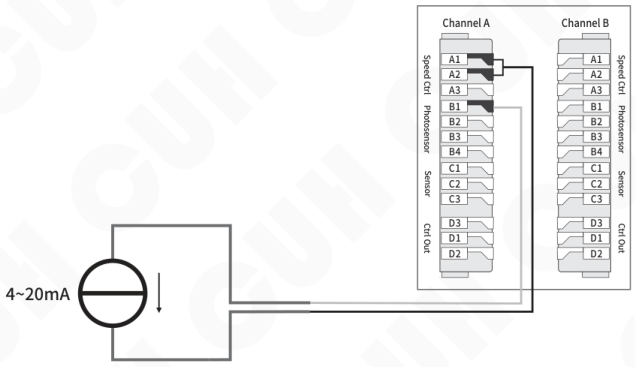

---

## 5.2 Detección fotoeléctrica inteligente

El puerto fotoeléctrico inteligente de este controlador admite sensores fotoeléctricos de barrera o de reflexión compuestos por diodos emisores de luz y fototransistores, y también se puede configurar para admitir sensores de conmutación NPN o PNP. El diagrama de cableado específico es el siguiente:

### Método de conexión del sensor fotoeléctrico

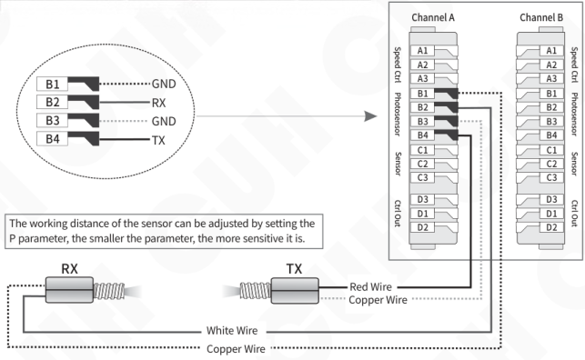

La distancia de trabajo del sensor se puede ajustar configurando el parámetro P; cuanto menor sea el parámetro, más sensible será.

### Método de conexión del sensor de conmutación

Configure el tipo NPN o PNP mediante el parámetro P.

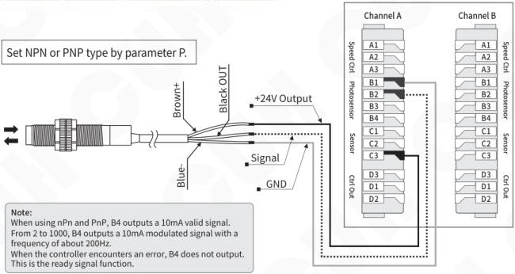

**Nota:**

Cuando se utilizan nPn y PnP, B4 emite una señal válida de 10mA.

De 2 a 1000, B4 emite una señal modulada de 10mA con una frecuencia de aproximadamente 200Hz.

Cuando el controlador encuentra un error, B4 no emite salida. Esta es la función de señal de preparación.

---

## 5.3 Sensor de conmutación

El puerto del sensor de conmutación puede admitir los modos NPN, PNP, Ut1 y Ut0, y los canales A y B se controlan de forma independiente.

**El modo Ut1 es un escaneo único**, es decir, antes de que la señal del sensor sea inválida, se cambian los niveles alto y bajo para detectar si el puerto es válido. Después de encontrar una señal válida, se determina el tipo de sensor del puerto y ya no se escanea.

**El modo Ut0 es un escaneo continuo**; independientemente del tipo de sensor, siempre detecta si el puerto está conectado a una señal válida cambiando los niveles alto y bajo.

### Método de conexión del sensor de conmutación

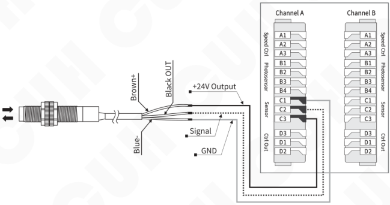

---

## 5.4 Salida de control

El puerto de salida de control puede admitir salida NPN, salida PNP y salida push-pull. Entre ellos:

- La salida NPN es válida con nivel bajo y la salida es inválida en estado de alta impedancia;
- La salida PNP es válida con nivel alto y la salida es inválida en estado de alta impedancia;
- La salida push-pull es válida con nivel alto e inválida con nivel bajo.

### 5.4.1 Método de cableado de la salida de control

**Conexión de salida NPN**

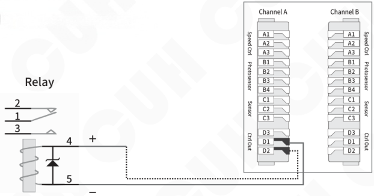

**Conexión de salida PNP o push-pull**

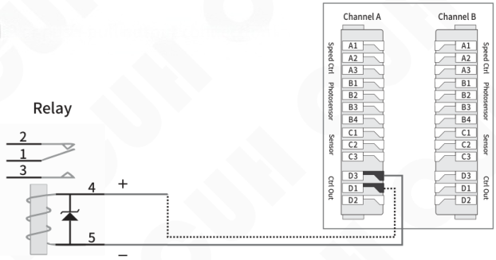

> Si se conecta un relé de 24V, asegúrese de confirmar los polos positivo y negativo de la bobina para garantizar que se conecten correctamente. Dado que la capacidad de corriente de salida de este puerto es de 350mA, el diodo de protección interno del relé cortocircuitará el puerto de este controlador tras una conexión inversa, activando la protección contra cortocircuitos Er07.

---

## 5.4.2 Fuente de señal de la salida de control y diagrama lógico

El control de la salida principal y de la salida de control se realiza mediante el resultado de la relación lógica entre dos fuentes de señal. Las siguientes fuentes de señal se pueden seleccionar de la lista de fuentes de señal.

| Fuente de señal | Significado |
|---|---|
| 0 | señal inválida |
| 1 | señal válida |
| Ab | Señal del puerto de detección fotoeléctrica inteligente del canal A |
| -Ab | Señal del puerto de detección fotoeléctrica inteligente del canal A invertida |
| Ac | Señal del puerto del sensor de conmutación del canal A |
| -Ac | Señal del puerto del sensor de conmutación del canal A invertida |
| Ad | Señal del puerto de salida de control del canal A |
| -Ad | Señal del puerto de salida de control del canal A invertida |
| Aq | Señal del puerto de salida de potencia principal del canal A |
| -Aq | Señal del puerto de salida de potencia principal del canal A invertida |
| bb | Señal del puerto de detección fotoeléctrica inteligente del canal B |
| -bb | Señal del puerto de detección fotoeléctrica inteligente del canal B invertida |
| bc | Señal del puerto del sensor de conmutación del canal B |
| -bc | Señal del puerto del sensor de conmutación del canal B invertida |
| bd | Señal del puerto de salida de control del canal B |
| -bd | Señal del puerto de salida de control del canal B invertida |
| bq | Señal del puerto de salida de potencia principal del canal B |
| -bq | Señal del puerto de salida de potencia principal del canal B invertida |

---

## Diagrama lógico de la salida de control

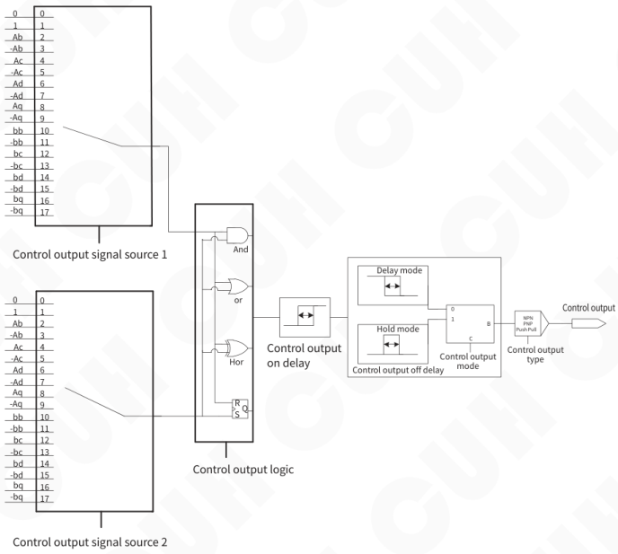

---

## 5.4.3 Descripción del modo de salida de control

Los clientes pueden elegir 2 modos de salida de control: modo de retardo y modo de retención.

**Modo de retardo:** significa que, después de que la señal de accionamiento de salida del controlador cambie de válida a inválida, la salida de control se apaga tras un período de tiempo de retardo de desconexión.

**Modo de retención:** después de que la señal de accionamiento de salida del controlador se vuelva válida, la salida de control permanece encendida durante el tiempo de retardo de desconexión y se apaga una vez superado dicho tiempo.

La diferencia entre los dos modos se expresa en forma de diagrama de temporización como se muestra a continuación, donde la señal de entrada es la señal de salida después del selector de relación lógica.

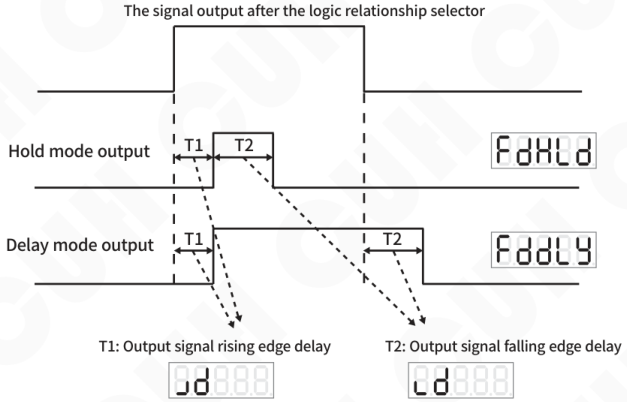

## 5.4.4 Función de control de la señal de salida principal

El control de la señal de salida principal es similar al de la salida de control. Después de seleccionar dos fuentes de señal para la operación de relación lógica, la señal de control se obtiene mediante la selección del modo de retardo de conexión/desconexión y el control de la dirección lógica. La señal de control se combina lógicamente con la señal de encendido/apagado del panel y luego se envía a la placa de potencia para controlar la salida principal.

El método de cableado, la fuente de señal y el diagrama lógico del control de la señal de salida principal pueden consultarse en la función de salida de control.

---

## 5.5 Límite de tensión de salida máxima

Cada canal del controlador puede ajustar el parámetro de límite de tensión de salida máxima h, y ni la tensión configurada en el panel ni la tensión de control remoto superarán este valor.

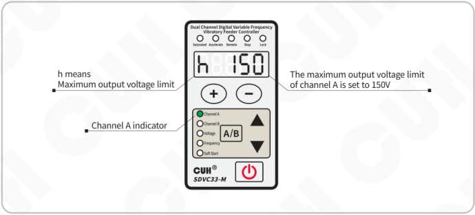

- h significa límite de tensión de salida máxima
- Indicador de canal A
- El límite de tensión de salida máxima del canal A está ajustado en 150V

## 5.6 Protección contra sobrecorriente ajustable

Para proteger la bobina electromagnética, el controlador ha diseñado un parámetro de corriente de protección contra sobrecorriente “oc” ajustable por el usuario, que se puede ajustar en el rango de 0.5A~3.5A.

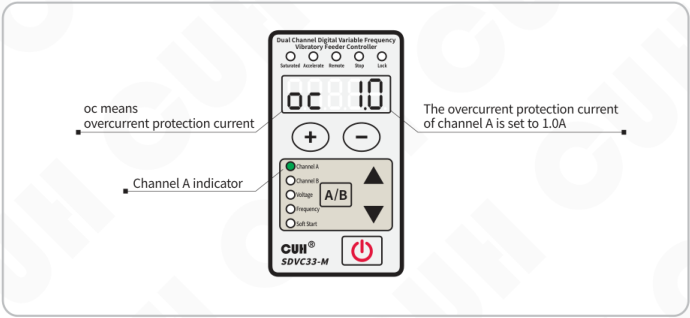

- oc significa corriente de protección contra sobrecorriente
- Indicador de canal A
- La corriente de protección contra sobrecorriente del canal A está ajustada en 1.0A

---

## 5.7 Ajuste del brillo del panel

El controlador adopta un nuevo chip controlador de pantalla digital, que permite a los usuarios ajustar el valor de brillo de la pantalla LED entre 1 y 32.

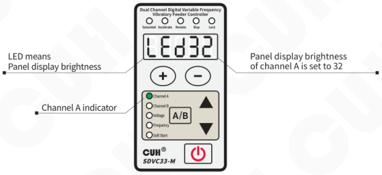

El brillo del panel se puede ajustar de forma independiente para el canal A y el canal B; el usuario puede ajustar previamente brillos diferentes para distinguir rápidamente si se encuentra actualmente en el canal A o en el canal B.

## 5.8 Función de monitoreo de salida

El controlador ha diseñado especialmente un conjunto de parámetros de monitoreo para supervisar el estado del controlador.

**Los parámetros de monitoreo que distinguen entre el canal A y el canal B incluyen:**

Corriente de salida AC, tensión del puerto de control de velocidad analógico AU, tensión de señal del puerto fotoeléctrico inteligente bU, puerto del sensor de conmutación cU, tensión del puerto de salida de control dU.

**Los parámetros de monitoreo que no distinguen entre el canal A y el canal B incluyen:**

Visualización de temperatura C, tensión del bus PU, tensión de salida de 24V nU, versión del software de la placa de control uc, versión del software de la placa de potencia uq.

---

## 5.9 Control conjunto de doble canal

La salida del canal A y del canal B del controlador se puede controlar de forma conjunta, y el parámetro Cb se puede utilizar para controlar el canal B: trabajo independiente, seguimiento de la frecuencia del canal A, seguimiento de la tensión del canal A y seguimiento de la tensión y la frecuencia del canal A.

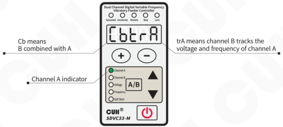

Nota: después de ajustar el seguimiento, la tensión y la frecuencia del canal B aún se pueden ajustar, pero no funcionarán. Funcionarán después de volver al modo independiente.

Ya sea que ajuste el canal A y el canal B para que emitan la misma frecuencia de forma independiente, o ajuste la frecuencia del canal B para que siga al canal A, las fases de las salidas de los dos canales siempre están bloqueadas. La diferencia de fase se puede controlar mediante el parámetro conjunto μ (B se refiere a la fase de A), y el rango de ajuste es -180°~180°. Esta función se puede utilizar para controlar un alimentador vibratorio vectorial de cuenco o las ocasiones de alimentación por relevo de un alimentador de cuenco vibratorio y un alimentador/transportador lineal.

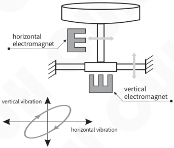

Diagrama esquemático del alimentador vibratorio vectorial

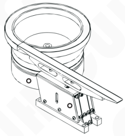

Diagrama esquemático del alimentador de cuenco y del alimentador lineal

---

## 5.10 Guardar y restaurar parámetros de usuario

Además del guardado automático de los parámetros de trabajo, el controlador también ha diseñado un conjunto de grupos de parámetros de usuario para guardar todos los parámetros configurables por el usuario. Mediante el guardado y la restauración de los parámetros de usuario, la recuperación es diferente de la función de restauración de la configuración de fábrica.

Ajuste al parámetro SP en el parámetro conjunto; se mostrará uP1. Mantenga pulsados ⊕ y ⊖ al mismo tiempo hasta que se muestre SAU, lo que indica que el guardado se ha realizado correctamente. Esto guardará los parámetros del canal A, del canal B y los parámetros conjuntos en el grupo de usuario.

Si necesita restaurar un grupo de trabajo a partir de un parámetro de grupo de usuario guardado, existen varias formas de restaurarlo:

**rP=1Ab:** los parámetros del grupo de usuario restauran los parámetros del grupo A y del grupo B al mismo tiempo.

**rP=1bA:** los parámetros del grupo de usuario restauran los parámetros del grupo A y del grupo B al mismo tiempo, pero se seleccionan de forma alterna durante la restauración, es decir, los datos guardados en el grupo A del grupo de usuario se restauran en el grupo de trabajo B, y los datos guardados en el grupo B del grupo de usuario se restauran en el grupo de trabajo A.

**rP=1A0:** los parámetros del grupo de usuario solo restauran el grupo A y utilizan los datos del grupo A del grupo de usuario para la restauración.

**rP=10A:** los parámetros del grupo de usuario solo restauran el grupo A y utilizan los datos del grupo B del grupo de usuario para la restauración.

**rP=1b0:** los parámetros del grupo de usuario solo restauran el grupo B y utilizan los datos del grupo B del grupo de usuario para la restauración.

**rP=10b:** los parámetros del grupo de usuario solo restauran el grupo B y utilizan los datos del grupo A del grupo de usuario para la restauración.

Seleccione el modo que necesita restaurar; mantenga pulsados ⊕ y ⊖ al mismo tiempo hasta que se muestre rES, lo que indica que la restauración se ha realizado correctamente.

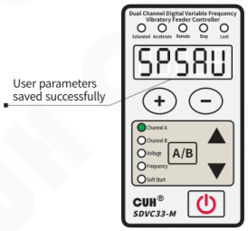

Diagrama de guardado correcto

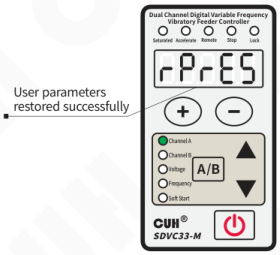

Diagrama de restauración correcta

---

# Capítulo Ⅵ Especificaciones técnicas

## 6.1 Dimensiones

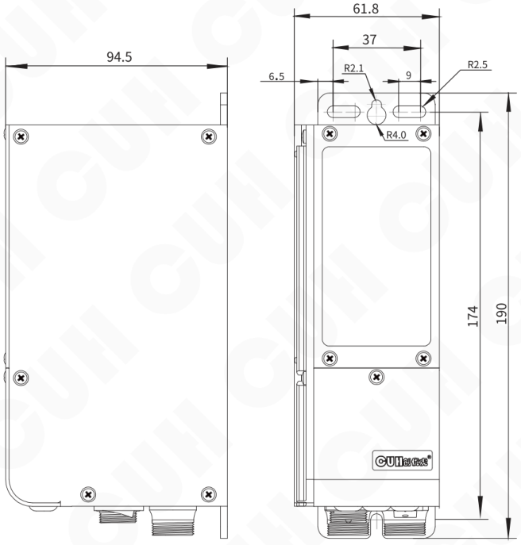

Dimensiones (unidad: mm)

| Rango de dimensiones | tolerancia |
|---|---|
| 0~3 | ±0.05 |
| 3~10 | ±0.1 |
| 10~30 | ±0.15 |
| 30~80 | ±0.2 |
| 80~180 | ±0.3 |
| >180 | ±0.5 |

Esta tabla de tolerancias es aplicable a todos los productos de esta serie.

---

## 6.2 Especificaciones técnicas

| Elemento | Mín. | Típico | Máx. | Unidad | Nota |
|---|---|---|---|---|---|
| Tensión de entrada | 85 | 220 | 250 | V | AC RMS |
| Rango de tensión de salida ajustable | 0 | —— | 260 | V | Inferior al 150% de la tensión de entrada |
| Precisión de ajuste de tensión | | 1 | | V | |
| Precisión de regulación de tensión | 0 | —— | 10 | % | ΔVout/ΔVin |
| Rango de corriente de salida ajustable | 0 | —— | 3.5 | A | La corriente combinada se puede distribuir de forma arbitraria. |
| Potencia de salida | 0 | —— | 770 | VA | |
| Frecuencia de salida | 5.0 | —— | 999.9 | Hz | |
| Precisión de ajuste de frecuencia | | 0.1 | | Hz | |
| Forma de onda de salida | | Sinusoidal | | | |
| Tiempo de arranque suave | 0 | —— | 10 | s | Valor predeterminado: 0.5 |
| Rango de tiempo de retardo de conexión/desconexión | 0 | —— | 99.9 | s | Valor predeterminado: 0.2 |
| Precisión del tiempo de retardo de conexión/desconexión | | 0.1 | | s | |
| Temperatura de activación de la protección contra sobrecalentamiento | —— | 65 | —— | °C | Retorno a la normalidad a 60°C |
| Corriente de salida de control de CC | 0 | —— | 350 | mA | Compatible con los canales A y B |
| Corriente de salida de 24V | —— | —— | 700 | mA | Suma de las salidas de los canales A y B |
| Tensión de salida de control de CC | 22 | 24 | 26 | V | |
| Señal de control analógica | | 4~20/1~5 | | mA/V | |
| Señal de control digital | | 24 | | V | Señal de conmutación |
| Método de ajuste | | 6 | | Botón | |
| Consumo de energía en espera | —— | 3 | —— | W | |
| Método de visualización | | 5 | | Dígito | LED |
| Peso | | 850 | | g | Sin accesorios |
| Dimensiones | | 190\*61.8\*94.5 ( L\*A\*H ) | | mm | |
| Grado de protección de entrada | | IP20 | | | |
| Temperatura ambiente | 0 | 25 | 40 | °C | Sin condensación |
| Humedad ambiente | 10 | 60 | 85 | % | Sin condensación |
| Temperatura ambiente de almacenamiento | -20 | 25 | 85 | °C | Sin condensación |
| Altitud aplicable | | <2000 | | m | |

## 6.3 Norma de referencia

Parámetros absolutos:  
Superar este estándar dañará el controlador; cúmplalo estrictamente.

| Elemento | Norma GB | Norma IEC | Grado | Requisito de la norma | Nota |
|---|---|---|---|---|---|
| Descarga electrostática | GB/T 17626.2-2006 | IEC 61000-4-2:2001 | 4 | ±8 kV | Descarga por contacto |
| | | | 4 | ±15 kV | Descarga de aire |
| Prueba de transitorios rápidos eléctricos | GB/T 17626.4-2008 | IEC 61000-4-4:2004 | 4 | ±4 kV | |
| Inmunidad a ondas de la línea de alimentación de CC | GB/T 17626.17-2005 | IEC 61000-4-17:2002 | 4 | 15% | Clase A |

> **Advertencia**  
> En un entorno residencial, este producto puede causar interferencias de radio, en cuyo caso pueden ser necesarias medidas de mitigación adicionales.

---

## Capítulo Ⅶ Apéndice

### 7.1 Tabla de parámetros

| Grupo de parámetros / Operación | Definición | Símbolo | Imagen del símbolo | Rango | Valor predeterminado |
|---|---|---|---|---|---|
| Parámetro de espera | Tensión de salida | U |  | 0~260 V | 150 |
| Parámetro básico Mantenga pulsado A/B | Frecuencia de salida | E |  | 5.0~999.9 Hz | 50.0 |
| Parámetro básico | Retardo de conexión del sensor fotoeléctrico inteligente | J |  | 0.0~99.9 s | 0.2 |
| Parámetro básico | Retardo de desconexión del sensor fotoeléctrico inteligente | L |  | 0.0~99.9 s | 0.2 |
| Parámetro básico | Arranque suave | t |  | 0.0~10.0 s | 0.5 |
| Parámetro básico | Ciclos de frenado/Parada suave | d |  | -10~0 ciclo (número de ciclos de frenado) 0.0~10.0 s (Parada suave) | 0.0 |
| Parámetro avanzado Mantenga pulsados A/B y ▲ | Sensibilidad del sensor fotoeléctrico inteligente | P |  | nPn, PnP, 2~1000 | 80 |
| Parámetro avanzado | Tipo de sensor del puerto C | ΓA |  | nPn, PnP ut1 (Escaneo único), ut0 (Escaneo continuo) | ut0 |
| Parámetro avanzado | Retardo de conexión del puerto C | J- |  | 0.0~99.9 s | 0.2 |
| Parámetro avanzado | Retardo de desconexión del puerto C | L- |  | 0.0~99.9 s | 0.2 |
| Parámetro avanzado | La primera fuente de señal del puerto de control D | E.d |  | 0, 1, Ab, -Ab, Ac, -Ac, Ad, -Ad, Aq, -Aq, bb, -bb, bc, -bc, bd, -bd, bq, -bq | A: 0 B: 0 |
| Parámetro avanzado | La segunda fuente de señal del puerto de control D | Ed |  | 0, 1, Ab, -Ab, Ac, -Ac, Ad, -Ad, Aq, -Aq, bb, -bb, bc, -bc, bd, -bd, bq, -bq | A: Aq B: bq |
| Parámetro avanzado | Operación lógica de las fuentes de señal del puerto de control D | ∩d |  | And, or, Hor, rS | or |
| Parámetro avanzado | Retardo de conexión del puerto D | Jd |  | 0.0~99.9 s | 0.0 |
| Parámetro avanzado | Retardo de desconexión del puerto D | Ld |  | 0.0~99.9 s | 0.0 |
| Parámetro avanzado | Modo de salida del puerto D | Fd |  | dLy (Modo de retardo), HLd (Modo de retención) | dLy |
| Parámetro avanzado | Dirección lógica del puerto D | ɔd |  | --- (Misma fase), -⁻- (Inversa) on (Normal Open), oFF (Normal Close)  | --- |
| Parámetro avanzado | Tipo de salida de control | Γd |  | nPn, PnP, PSP (Push & Pull) | nPn |
| Parámetro avanzado | La primera fuente de señal de la salida principal | E.q |  | 0, 1, Ab, -Ab, Ac, -Ac, Ad, -Ad, Aq, -Aq, bb, -bb, bc, -bc, bd, -bd, bq, -bq | A: Ab B: bb |
| Parámetro avanzado | La segunda fuente de señal de la salida principal | Eq |  | 0, 1, Ab, -Ab, Ac, -Ac, Ad, -Ad, Aq, -Aq, bb, -bb, bc, -bc, bd, -bd, bq, -bq | A: Ac B: bc |
| Parámetro avanzado | Operación lógica de las fuentes de señal de la salida principal | ∩q |  | And, or, Hor, rS | or |

| Parámetro | Definición | Símbolo | Imagen del símbolo | Rango | Valor predeterminado |
|---|---|---|---|---|---|
| Parámetro avanzado Mantenga pulsados A/B y ▲ | Retardo de conexión de la salida principal | J9 |  | 0.0~99.9 s | 0.0 |
| | Retardo de desconexión de la salida principal | L9 |  | 0.0~99.9 s | 0.0 |
| | Modo de salida de la salida principal | F9 |  | dLy (Modo de retardo), HLd (Modo de retención) | dLy |
| | Dirección lógica de la salida principal | Ↄ9 |  |  on (Normal Open), oFF (Normal Close) |  |
| | Límite de tensión de salida máxima | h |  | 0~260 V | 260 |
| | Corriente de protección contra sobrecorriente | bc |  | 0.5~3.5 A | 3.5 |
| | Índice de aceleración | y |  | 100~150 | 150 |
| | Índice de forma de onda | r |  | 0~100 | 100 |
| | Fuente de control de velocidad remoto | cS |  | AA (Puerto A de A), bA (Puerto A de B) | A: AA B: bA |
| | Coeficiente de control de velocidad remoto | c |  | 0.5~2.0 | 1.0 |
| | Brillo de la pantalla del panel | LEd |  | 1~32 | 16 |
| | Restauración de la configuración predeterminada del canal actual | 8.8.8.8.A. 8.8.8.8.b. |  | —— | —— |
| Parámetro de monitoreo Mantenga pulsados A/B y ▼ | Corriente de salida | AC |  | 0.00~3.50 A | —— |
| | Tensión de señal del puerto A | AU |  | 0.00~5.00 V | —— |
| | Tensión de señal del puerto B | bU |  | 0.00~5.00 V | —— |
| | Tensión de señal del puerto C | cU |  | 0.0~28.0 V | —— |
| | Tensión de salida del puerto D | dU |  | 0.0~28.0 V | —— |
| | Visualización de temperatura # | C |  | -20.0~85.0 ℃ | —— |
| | Tensión del bus interno # | PU |  | 0~400 V | —— |
| | Tensión en tiempo real del puerto de 24V # | nU |  | 0.0~28.0 V | —— |
| | Versión del software de la placa de control # | uc |  | —— | —— |
| | Versión del software de la placa de potencia # | u9 |  | —— | —— |

|  | Definición | Símbolo | Imagen del símbolo | Rango | Valor predeterminado |
|---|---|---|---|---|---|
| Parámetro conjunto  Mantenga pulsados ▲ y ▼ | B combinado con A # | Cb |  | Ind (independiente), trF (B sigue la frecuencia de A), trU (B sigue la tensión de A), trA (B sigue la tensión y la frecuencia de A) | Ind |
|  | # | Y |  | -180~180 ° | 0 |
|  | Modo de control del botón de encendido/apagado # | OF |  | Ind (independiente), Cob (combinado) | Ind |
|  | Guardado de parámetros de usuario # | SP |  | uP1 (guarda el grupo de usuario 1) | uP1 |
|  | Restauración de parámetros de usuario # | rP |  | 1Ab (El grupo de usuario 1 restaura los grupos A y B), 1bA (El grupo de usuario 1 restaura de forma cruzada los grupos A y B), 1A0 (El grupo de usuario 1 solo restaura el grupo A), 10A (El grupo de usuario 1 restaura de forma cruzada solo el grupo A), 1b0 (El grupo de usuario 1 solo restaura el grupo B), 10b (El grupo de usuario 1 restaura de forma cruzada solo el grupo B) | 1Ab |
|  | Restauración de la configuración predeterminada # | 8.8.8.8.8. |  | —— | —— |

Notas: los parámetros marcados con “#” no distinguen entre los grupos A y B.

## 7.2 Diagramas de circuito de entrada y salida

**Puerto A de control de velocidad remoto**

**Puerto B del fotosensor inteligente**

**Puerto C del sensor de conmutación**

**Puerto D de salida de control**

---

## 7.3 Sugerencias de solución de problemas y explicaciones de errores

| Código de error | Definición (fenómeno) | Métodos de solución de problemas |
|---|---|---|
| Er01A/Er01b | Cortocircuito del canal A/B (Ambos canales detienen las salidas) | ◆ Asegúrese de que la carga no esté en cortocircuito; a continuación, intente reiniciar la salida del controlador pulsando dos veces el botón de salida ON/OFF o vuelva a alimentar el controlador. |
| Er02 | Sobrecorriente combinada de los canales AB (Ambos canales pausan la salida y se reinician después de 2 s) | ◆ Reduzca adecuadamente la tensión de salida y, a continuación, reinicie la salida. |
| Er02A/Er02b | Sobrecorriente individual del canal A/B (El canal con sobrecorriente detiene la salida y se reinicia después de 2 s) | |
| Er02A./Er02b. | La sobrecorriente individual del canal A/B alcanza el máximo ajustado | |
| Er03 | Sobrecalentamiento o enfriamiento excesivo (Ambos canales detienen la salida y se recuperan automáticamente a -20℃~60℃) | ◆ Instale el controlador en un entorno bien ventilado o evite el frío extremo. |
| Er041/Er042 | Subtensión/sobretensión de la fuente de alimentación (Ambos canales detienen la salida y se recuperan automáticamente) | ◆ Asegúrese de que la tensión de entrada esté entre AC 85~250Vac. |
| Er05 | Comunicación interna anormal (Ambos canales detienen la salida) | ◆ Asegúrese de que no haya una fuente de alimentación externa conectada al puerto de alimentación de 24V o póngase en contacto con nuestro soporte técnico. |
| Er06 | Sensor de temperatura anormal (Ambos canales detienen la salida) | ◆ Asegúrese de que la temperatura de trabajo no sea inferior a -20℃ o póngase en contacto con nuestro soporte técnico. |
| Er07A/Er07b | Cortocircuito del puerto D del canal A/B (La salida de control del canal A/B se detiene y se intenta reiniciar después de 2 s) | ◆ Asegúrese de que la carga del puerto D no esté en cortocircuito y que la corriente no supere los 350mA. |
| Er10 | Salida de alimentación de 24V anormal (Se apaga la salida de 24V y se intenta reiniciar después de 2 s) | ◆ Asegúrese de que el puerto de 24V no esté en cortocircuito y que la corriente no supere los 700mA. |
| Er11 | Salida de alimentación de 5V anormal (La función de control de velocidad se cierra temporalmente y se restaura con el reinicio automático) | ◆ Asegúrese de que la alimentación de 5V del puerto A no esté en cortocircuito ni conectada a una tensión de alimentación externa superior a 5V. |
| Er12 | Tensión de la fuente de alimentación de 24V anormal (Ambos canales detienen la salida, la salida de control pasa a alta impedancia y se recupera automáticamente) | ◆ Asegúrese de que no haya una fuente de alimentación externa conectada al puerto de alimentación de 24V. |

# Capítulo Ⅷ Información de garantía del producto

## 8.1 Período de garantía

El período de garantía proporcionado por la empresa para este producto es de 3 años a partir de la fecha de entrega del producto en el lugar designado por el comprador.

## 8.2 Cobertura de la garantía

(1) Si se produce un fallo causado por nuestra empresa durante el período de garantía anterior, repararemos el producto de forma gratuita. Pero las siguientes situaciones no están cubiertas por la garantía:

a. Incumplimiento de las condiciones especificadas en el manual simplificado, el manual de usuario o los requisitos técnicos acordados específicamente entre el comprador y la empresa, operación inadecuada o fallos causados por un uso inadecuado.

b. Fallos que no se deben a un defecto del producto, sino al diseño del equipo o del software del comprador.

c. Fallos de funcionamiento causados por modificaciones o reparaciones no realizadas por el personal de nuestra empresa.

d. Fallos que se pueden evitar por completo con un mantenimiento correcto o la sustitución de las piezas de desgaste según la guía de operación simplificada o el manual de usuario.

e. Fallos causados, después del envío del producto desde nuestra empresa, por factores como cambios imprevistos en el nivel de la ciencia y la tecnología.

f. Fallos debidos a desastres naturales como incendios, terremotos o inundaciones, o a factores externos como una tensión anormal; la empresa no se hace responsable de la garantía.

(2) El alcance de la garantía se limita a las situaciones estipuladas en (1)，las pérdidas indirectas (como daños al equipo, oportunidades, pérdida de beneficios, etc.) u otras pérdidas; la empresa no asume ninguna responsabilidad.

## 8.3 Idoneidad del producto

El controlador de nuestra empresa está diseñado y producido para uso general en la industria de alimentación por vibración. Por lo tanto, este controlador de nuestra empresa no debe utilizarse para las siguientes aplicaciones y no es adecuado para su uso.

(1) Instalaciones que tienen un impacto grave en la vida y la propiedad, como centrales nucleares, aeropuertos, ferrocarriles, barcos, dispositivos motorizados y equipos médicos.

(2) Servicios públicos, incluidos electricidad, gas, suministro de agua, etc.

(3) Uso en exteriores en condiciones o entornos similares.

---

Nanjing CUH Science & Technology Co.,Ltd  
https://en.cuhnj.com  
Tel.:+86-25-84730411 / 84730415 / 84730416  
Fax:+86-25-84730426  
E-mail:sales@cuhnj.com  
Add.:Building 2, Xueyan Tech Park, Tuscity,  
No.9 Zhineng Rd, Jiangning, Nanjing, China

Document No.: IDP1000316

