## Controlador inteligente de frecuencia variable para alimentador vibratorio

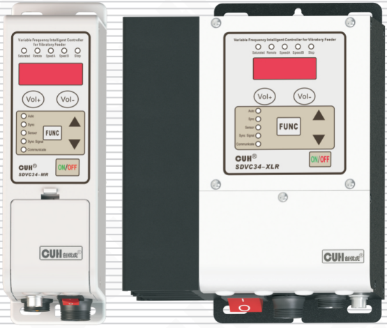

## Serie SDVC34
Controlador inteligente de frecuencia variable para alimentador vibratorio — Serie SDVC34
**Manual de instrucciones**

---

## Declaración de derechos de autor

Nanjing CUH Science & Technology CO., Ltd. se reserva todos los derechos.

Toda la información contenida en este manual del usuario es propiedad intelectual de nuestra empresa y está protegida por la ley de derechos de autor y otras leyes relacionadas. CUH disfruta y se reserva todos los derechos conferidos por la ley de derechos de autor y otras leyes. Sin el consentimiento por escrito de CUH, no se podrá copiar, traducir, imitar ni utilizar de ninguna otra forma parte o la totalidad de este manual del usuario.

## Exención de responsabilidad

Todo el contenido de este manual del usuario describe únicamente el método de uso de los productos relacionados producidos por nuestra empresa, y se describe de acuerdo con la tecnología existente y el estado proporcionado en el momento de su uso. Usted debe asumir los riesgos correspondientes al utilizar este producto. Salvo lo exigido por la ley, la empresa no asume ninguna responsabilidad expresa o implícita sobre el producto derivada de este manual del usuario, incluidos, entre otros, daños personales, daños materiales, pérdida de oportunidades, etc.

Usted comprende claramente los riesgos anteriores y acepta que, salvo lo exigido por la ley, la empresa no es responsable de ningún daño o pérdida directa o indirecta para usted (incluidos, entre otros, pérdidas tangibles de personal, propiedad, datos, etc., y pérdidas intangibles de reputación, oportunidades, etc.).

La empresa se reserva el derecho de modificar los productos aplicables a este manual del usuario sin previo o posterior aviso.

---

## Prefacio

Gracias por elegir el Controlador inteligente de frecuencia variable para alimentador vibratorio de la serie CUH SDVC34. (En lo sucesivo, “el controlador”). Esta serie de controladores utiliza componentes de alta calidad e incorpora la última tecnología electrónica, y está cuidadosamente diseñada con procesadores de señales digitales de alto rendimiento.

Este manual presenta el método de operación básico, la descripción técnica funcional y ejemplos de aplicación típicos de este producto. Proporciona a los usuarios información relevante sobre la instalación y depuración, el ajuste de parámetros, el diagnóstico de anomalías, la solución de problemas y el mantenimiento rutinario del controlador. Para garantizar la correcta instalación y uso de este controlador, lea atentamente este manual del usuario antes de la instalación y consérvelo adecuadamente.

Asegúrese de leer los siguientes símbolos para alertarle de las precauciones contra lesiones personales y daños al producto.

| | |
|---|---|
| ⚠ Peligro | El incumplimiento de este punto provocará lesiones personales o la muerte. |
| ⚠ Advertencia | El incumplimiento de este punto puede provocar lesiones personales o la muerte. |
| ⚠ Precaución | El incumplimiento de este punto puede provocar lesiones moderadas o leves a las personas. |
| Aviso | El incumplimiento de este punto provocará daños al producto y daños materiales. |
| ❗ Obligatorio | Indica las precauciones y restricciones de uso que deben observarse durante el uso. |

**Este manual se aplica a los siguientes modelos de controladores:**

Controlador inteligente de frecuencia variable para alimentador vibratorio

- SDVC34-MR　Corriente de salida de 3.0A (RS485)
- SDVC34-MRJ　Corriente de salida de 3.0A (RS485 y conteo)
- SDVC34-XLR　Corriente de salida de 6.0A (RS485)
- SDVC34-XLRJ　Corriente de salida de 6.0A (RS485 y conteo)

---

# Seguridad y precauciones

1. **⚠ Peligro** Este producto solo se utiliza para accionar equipos de alimentación vibratoria basados en electroimanes; no utilice este producto con el fin de proteger el cuerpo humano o partes del cuerpo humano, etc.

2. **⚠ Peligro** Este producto no está diseñado para usarse como producto antiexplosión; no lo utilice en ubicaciones peligrosas y/o entornos con gases potencialmente explosivos.

3. **⚠ Advertencia** Este producto se alimenta con la red de CA; no aplique una tensión de CA superior a 260Vac. Una tensión de entrada excesiva, como 380Vac, puede provocar que el producto explote o se incendie, causando graves accidentes de seguridad.

4. **⚠ Advertencia** Este producto se conecta a tierra a través del cable de alimentación. Asegúrese de que las instalaciones de distribución de energía del controlador estén bien conectadas a tierra; de lo contrario, la carcasa del controlador podría quedar cargada eléctricamente, provocando un accidente por descarga eléctrica.

5. **⚠ Advertencia** No introduzca alimentación de CA en la salida de este controlador; dañará el controlador.

6. **⚠ Advertencia** No enchufe ni desenchufe el cableado con corriente ni toque el contacto de cada terminal de cableado en el compartimento de cableado para evitar descargas eléctricas.

7. **Aviso** Evite controlar la salida de este producto cortando la alimentación mediante relés y otros dispositivos, ya que reducirá gravemente la vida útil del controlador.

8. **Aviso** El controlador está diseñado para funcionar en un entorno fresco y seco. Nunca haga funcionar el controlador en el exterior para evitar mojaduras e insolación. Utilice el controlador dentro de la temperatura especificada en las características eléctricas.

9. **❗ Obligatorio** Asegúrese de fijar este producto sobre una plataforma sólida, conectada de forma fiable a tierra y alejada de equipos vibratorios.

10. **❗ Obligatorio** Nunca utilice el controlador en condiciones que superen sus límites de diseño.

11. **❗ Obligatorio** Utilice el controlador estrictamente de acuerdo con este manual de instrucciones. No asumiremos ninguna responsabilidad civil o penal si el daño al equipo o las lesiones personales son causados por una operación incorrecta.

12. **❗ Obligatorio** Nunca abra la carcasa del controlador para evitar descargas eléctricas. Contacte con CUH si el controlador se avería. Nunca intente reparar el controlador usted mismo, ya que podría anular la garantía.

---

# Entorno de funcionamiento y almacenamiento

## Inspección antes del uso

Todos los controladores pasan por una rigurosa inspección de calidad antes de su entrega y se embalan con un embalaje a prueba de golpes. Después de desembalar, compruebe los siguientes puntos:

1. Si el controlador sufre daños durante el transporte.
2. Si el modelo del controlador coincide con su pedido.

## Entorno de ejecución

Siga las siguientes indicaciones para garantizar un mejor rendimiento y una mayor vida útil del controlador:

- ⚠ Entorno bien ventilado
- ⚠ Manténgalo alejado del agua, vapor, polvo y especialmente polvo aceitoso
- ⚠ Manténgalo alejado de gases y líquidos corrosivos o inflamables
- ⚠ Manténgalo alejado del polvo en suspensión y las partículas metálicas
- ⚠ Fíjelo firmemente para evitar vibraciones propias
- ⚠ Manténgalo alejado de interferencias electromagnéticas
- ⚠ Asegure una temperatura ambiente de 0~40 °C
- ⚠ Para uso a una altitud de 2000 m o inferior

---

# Contenido

- **Capítulo Ⅰ Instrucciones previas al uso — 1**
  - 1.1 Comprobación del contenido del paquete — 1
  - 1.2 Explicación de los indicadores — 2
  - 1.3 Explicación de los botones — 4
  - 1.4 Explicación de las partes externas — 4
  - 1.5 Explicación de los puertos de cableado — 5
  - 1.6 Explicación de la placa de características — 6
- **Capítulo Ⅱ Características — 7**
  - 2.1 Introducción del producto — 7
  - 2.2 Guía de selección — 8
    - 2.2.1 Explicación del modelo — 8
    - 2.2.2 Explicación de funciones — 8
- **Capítulo Ⅲ Guía de instalación — 9**
  - 3.1 Condiciones de uso del controlador — 9
  - 3.2 Método de operación de los botones — 9
  - 3.3 Instalación y uso — 10
- **Capítulo Ⅳ Ajuste de parámetros — 12**
  - 4.1 Parámetros comunes — 12
  - 4.2 Parámetros básicos — 12
  - 4.3 Parámetros avanzados — 13
  - 4.4 Parámetros de Auto/Sincronización — 18
- **Capítulo Ⅴ Modo de funcionamiento — 22**
  - 5.1 Modo manual — 22
    - 5.1.1 Ajuste de la tensión de salida en modo manual — 23
    - 5.1.2 Ajuste de la frecuencia de salida en modo manual — 23
  - 5.2 Modo automático — 24
    - 5.2.1 Instalación del sensor de vibración — 24

---

---

- 5.2.2 Ajuste de la velocidad de alimentación en modo automático — 26
- 5.2.3 Medición automática de frecuencia en modo automático — 26
- 5.3 Modo semiautomático — 27
  - 5.3.1 Instalación del sensor de vibración — 27
  - 5.3.2 Configuración del modo semiautomático — 27
  - 5.3.3 Ajuste de la velocidad de alimentación en modo semiautomático — 28
  - 5.3.4 Ajuste de la frecuencia de salida en modo semiautomático — 28
- 5.4 Modo de sincronización — 29
  - 5.4.1 Método de conexión del cable de señal de sincronización — 30
  - 5.4.2 Aplicaciones del modo de sincronización — 31
- 5.5 Modo de conteo — 35
  - 5.5.1 Método de uso — 36
  - 5.5.2 Método de conexión — 37
  - 5.5.3 Dirección lógica del pulso de conteo — 38
  - 5.5.4 Dirección lógica del reinicio de conteo — 38
  - 5.5.5 Explicación de los parámetros de conteo — 39

## Capítulo Ⅵ Control de señales — 41

- 6.1 Control ON/OFF de los puertos C — 41
  - 6.1.1 Método de conexión de los puertos C — 41
  - 6.1.2 Retardo de conexión/desconexión de los puertos C — 46
  - 6.1.3 Relación lógica del control ON/OFF de los puertos C — 47
- 6.2 Control ON/OFF de los puertos E — 48
  - 6.2.1 Método de conexión de los puertos E — 48
  - 6.2.2 Retardo de conexión/desconexión de los puertos E — 49
  - 6.2.3 Relación lógica del control ON/OFF de los puertos E — 50
- 6.3 Parámetros comunes de los puertos C y E — 51
  - 6.3.1 Relación lógica de los puertos C y E — 51
  - 6.3.2 Tipo de sensor de conmutación — 52
  - 6.3.3 Operación lógica de la salida principal — 53
- 6.4 Control de velocidad remoto — 54

---

---

- 6.5 Salida de control — 56
  - 6.5.1 Método de conexión de la salida de control — 56
  - 6.5.2 Relación lógica de la salida de control — 57
  - 6.5.3 Operación lógica de la salida de control — 58
- 6.6 Almacenamiento y salida de velocidades preajustadas — 59
- 6.7 Comunicación RS485 — 61
  - 6.7.1 Dirección de comunicación RS485 — 61
  - 6.7.2 Velocidad en baudios de la comunicación RS485 — 61
  - 6.7.3 Protocolo de comunicación RS485 — 62

**Capítulo Ⅶ Funciones de seguridad — 63**

**Capítulo Ⅷ Apéndice — 64**

- 8.1 Dimensiones — 64
- 8.2 Diagramas de circuito de entrada y salida — 67
- 8.3 Especificaciones técnicas — 70
- 8.4 Sugerencias de solución de problemas y explicación de errores — 71

**Capítulo Ⅸ Información de garantía del producto — 73**

- 9.1 Período de garantía — 73
- 9.2 Cobertura de la garantía — 73
- 9.3 Idoneidad del producto — 73

---

# Capítulo Ⅰ Instrucciones previas al uso

Este capítulo presenta el contenido del paquete del producto, la descripción de la apariencia del controlador y la información de la placa de características del controlador.

## 1.1 Comprobación del contenido del paquete

Antes de usar, compruebe la integridad del controlador y los accesorios. Si encuentra que el producto es defectuoso o está dañado, o que faltan accesorios, etc., póngase en contacto con nuestra empresa.

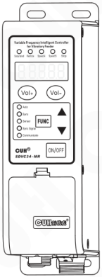

Controlador×1

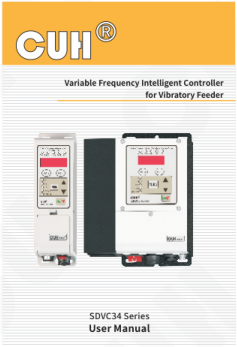

Manual de instrucciones×1

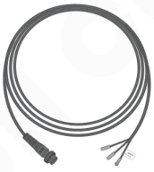

Cable de salida×1

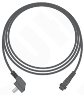

Cable de alimentación de entrada×1

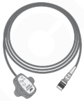

Sensor de vibración×1

---

## 1.2 Explicación de los indicadores

### Controlador con función RS485

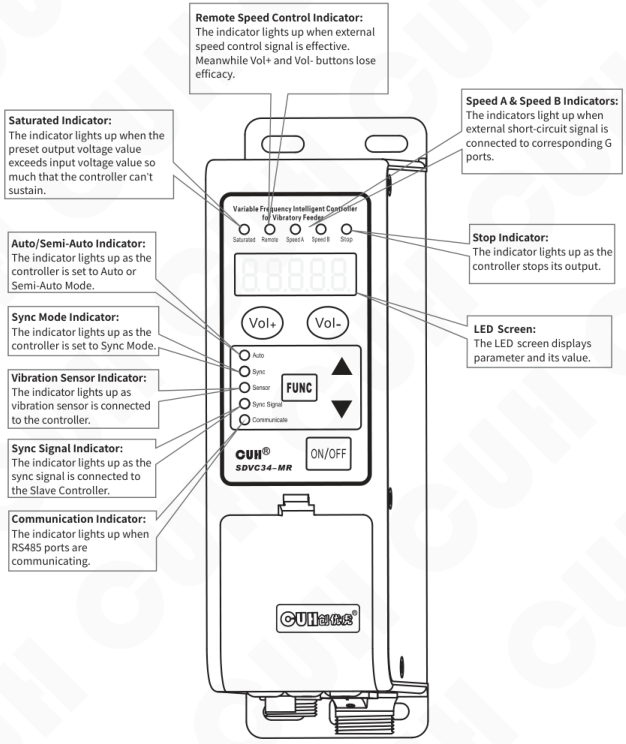

**Indicador de control de velocidad remoto:**
El indicador se ilumina cuando la señal externa de control de velocidad es efectiva. Mientras tanto, los botones Vol+ y Vol- dejan de ser eficaces.

**Indicador de saturación:**
El indicador se ilumina cuando el valor de tensión de salida preajustado supera tanto el valor de la tensión de entrada que el controlador no puede mantenerlo.

**Indicadores de velocidad A y velocidad B:**
Los indicadores se iluminan cuando se conecta una señal externa de cortocircuito a los puertos G correspondientes.

**Indicador Auto/Semiautomático:**
El indicador se ilumina cuando el controlador está ajustado en modo automático o semiautomático.

**Indicador de modo de sincronización:**
El indicador se ilumina cuando el controlador está ajustado en modo de sincronización.

**Indicador del sensor de vibración:**
El indicador se ilumina cuando el sensor de vibración está conectado al controlador.

**Indicador de señal de sincronización:**
El indicador se ilumina cuando la señal de sincronización está conectada al controlador esclavo.

**Indicador de comunicación:**
El indicador se ilumina cuando los puertos RS485 están comunicando.

**Indicador de parada:**
El indicador se ilumina cuando el controlador detiene su salida.

**Pantalla LED:**
La pantalla LED muestra el parámetro y su valor.

---

## Controlador con función RS485 y conteo

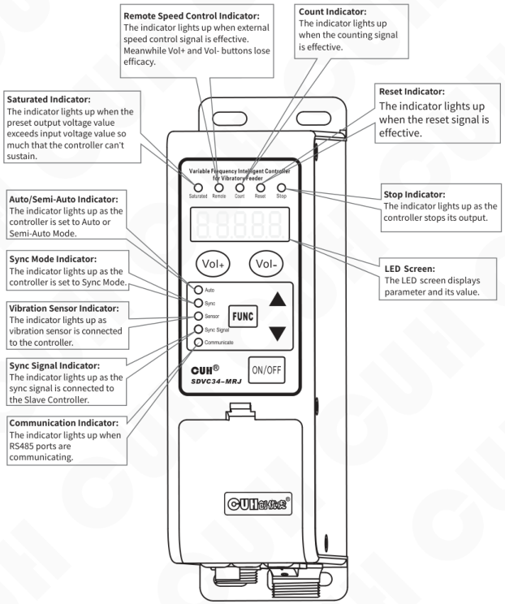

**Indicador de control de velocidad remoto:**  
El indicador se ilumina cuando la señal externa de control de velocidad es efectiva. Mientras tanto, los botones Vol+ y Vol- dejan de ser eficaces.

**Indicador de conteo:**  
El indicador se ilumina cuando la señal de conteo es efectiva.

**Indicador de saturación:**  
El indicador se ilumina cuando el valor de tensión de salida preajustado supera tanto el valor de la tensión de entrada que el controlador no puede mantenerlo.

**Indicador de reinicio:**  
El indicador se ilumina cuando la señal de reinicio es efectiva.

**Indicador Auto/Semiautomático:**  
El indicador se ilumina cuando el controlador está ajustado en modo automático o semiautomático.

**Indicador de parada:**  
El indicador se ilumina cuando el controlador detiene su salida.

**Indicador de modo de sincronización:**  
El indicador se ilumina cuando el controlador está ajustado en modo de sincronización.

**Pantalla LED:**  
La pantalla LED muestra el parámetro y su valor.

**Indicador del sensor de vibración:**  
El indicador se ilumina cuando el sensor de vibración está conectado al controlador.

**Indicador de señal de sincronización:**  
El indicador se ilumina cuando la señal de sincronización está conectada al controlador esclavo.

**Indicador de comunicación:**  
El indicador se ilumina cuando los puertos RS485 están comunicando.

---

## 1.3 Explicación de los botones

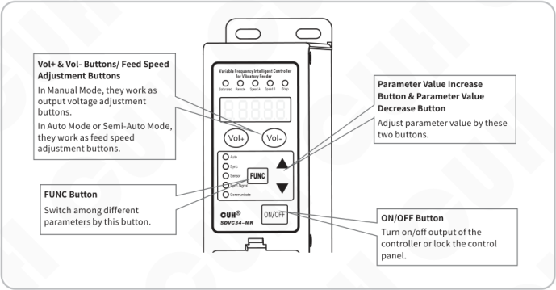

**Botones Vol+ y Vol- / Botones de ajuste de la velocidad de alimentación**

En modo manual, funcionan como botones de ajuste de la tensión de salida.

En modo automático o semiautomático, funcionan como botones de ajuste de la velocidad de alimentación.

**Botón FUNC**

Cambie entre diferentes parámetros con este botón.

**Botón de aumento del valor del parámetro y botón de disminución del valor del parámetro**

Ajuste el valor del parámetro con estos dos botones.

**Botón ON/OFF**

Encienda/apague la salida del controlador o bloquee el panel de control.

## 1.4 Explicación de las partes externas

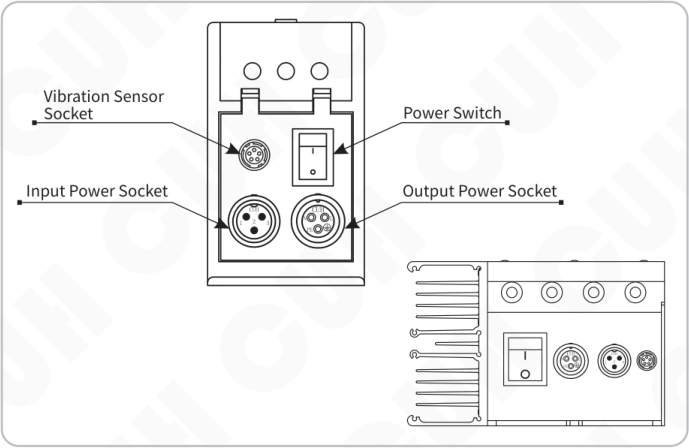

- Toma del sensor de vibración
- Toma de alimentación de entrada
- Interruptor de encendido
- Toma de alimentación de salida

---

## 1.5 Explicación de los puertos de cableado

### SDVC34-MR:

### SDVC34-MRJ:

---

### SDVC34-XLR:

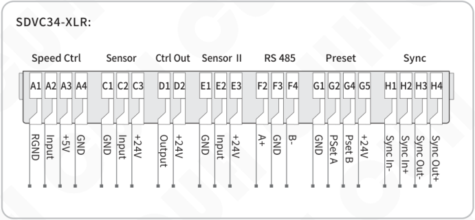

| Función | Puerto | Señal |
|---|---|---|
| Speed Ctrl | A1 | RGND |
| Speed Ctrl | A2 | Input |
| Speed Ctrl | A3 | +5V |
| Speed Ctrl | A4 | GND |
| Sensor | C1 | GND |
| Sensor | C2 | Input |
| Sensor | C3 | +24V |
| Ctrl Out | D1 | Output |
| Ctrl Out | D2 | +24V |
| Sensor Ⅱ | E1 | GND |
| Sensor Ⅱ | E2 | Input |
| Sensor Ⅱ | E3 | +24V |
| RS 485 | F2 | A+ |
| RS 485 | F3 | GND |
| RS 485 | F4 | B- |
| Preset | G1 | GND |
| Preset | G2 | PSet A |
| Preset | G4 | Pset B |
| Preset | G5 | +24V |
| Sync | H1 | Sync In- |
| Sync | H2 | Sync In+ |
| Sync | H3 | Sync Out- |
| Sync | H4 | Sync Out+ |

## 1.6 Explicación de la placa de características

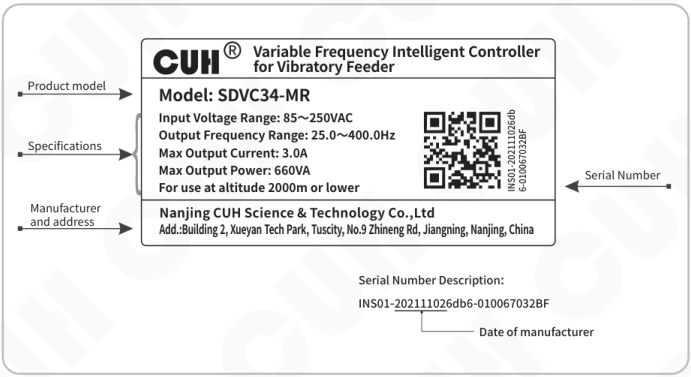

**CUH® — Controlador inteligente de frecuencia variable para alimentador vibratorio**

**Modelo de producto**

Modelo: SDVC34-MR

**Especificaciones**

- Rango de tensión de entrada: 85～250VAC
- Rango de frecuencia de salida: 25.0～400.0Hz
- Corriente máxima de salida: 3.0A
- Potencia máxima de salida: 660VA
- Para uso a una altitud de 2000 m o inferior

**Fabricante y dirección**

Nanjing CUH Science & Technology Co.,Ltd

Add.:Building 2, Xueyan Tech Park, Tuscity, No.9 Zhineng Rd, Jiangning, Nanjing, China

**Número de serie**

INS01-202111026db6-010067032BF

Descripción del número de serie:

INS01-<u>20211102</u>6db6-010067032BF

20211102 → Fecha de fabricación

---

## Capítulo Ⅱ Características

### 2.1 Introducción del producto

El controlador está diseñado especialmente para controlar el alimentador vibratorio en sistemas de automatización. Combinado con las últimas tecnologías electrónicas y un diseño elaborado, el controlador presenta las siguientes características convenientes y prácticas:

**Auto FM:** Modulación automática de la frecuencia de salida en tiempo real para garantizar que el alimentador vibratorio trabaje siempre a su mejor frecuencia de vibración.

**Control automático de velocidad constante:** Ajuste automático de la tensión de salida en tiempo real para garantizar una velocidad de alimentación preajustada constante independientemente del cambio de peso de los materiales en el alimentador vibratorio.

**Medición automática de frecuencia:** Mide y emite automáticamente la mejor frecuencia de vibración del alimentador vibratorio.

**Regulación automática de tensión:** Elimina tanto la variación de la velocidad de alimentación causada por la fluctuación de la tensión de red como el efecto de batido causado por la frecuencia de CA industrial.

**Sincronización de forma de onda:** Sincroniza la forma de onda de salida de los controladores esclavos con la del controlador maestro a la misma frecuencia y fase para evitar el efecto de batido.

**Control ON/OFF remoto:** El controlador dispone de 2 grupos de puertos de control ON/OFF. Se pueden conectar sensores de conmutación o PLC para encender/apagar el controlador. También se pueden configurar el tiempo de arranque suave, el retardo de conexión, el retardo de desconexión y la relación lógica del control ON/OFF.

**Reconocimiento automático del tipo de sensor de conmutación:** El controlador puede reconocer y adaptarse tanto a sensores de conmutación de tipo NPN como PNP.

**Arranque suave:** Para evitar un choque repentino al material de alimentación y al alimentador vibratorio, el controlador puede aumentar suavemente la tensión de salida/velocidad de alimentación de 0 al valor preajustado al arrancar.

**Velocidades preajustadas:** Se pueden almacenar y emitir 4 velocidades de alimentación preajustadas mediante una señal externa de cortocircuito.

**Aceleración:** El valor máximo de tensión de salida del controlador se puede aumentar hasta un 150% del valor de la tensión de entrada.

**Tensión de salida máxima ajustable:** La tensión de salida máxima ajustable se puede preajustar para proteger el alimentador vibratorio de daños causados por alta tensión.

**Índice de forma de onda:** Los usuarios pueden equilibrar la eficiencia y la potencia máxima ajustando este parámetro.

**Control de velocidad remoto:** La tensión de salida/velocidad de alimentación del controlador se puede ajustar de forma remota mediante un potenciómetro externo, un PLC o una señal de CC de 1~5V/4~20mA.

**Salida de control de 24V CC:** El controlador puede emitir alimentación de 24V CC asociada con la configuración de la relación lógica del control ON/OFF para accionar una electroválvula, un relé eléctrico u otros dispositivos externos.

**Conteo:** El controlador (solo SDVC34-MRJ) puede contar las piezas que pasan y desacelerar o detener automáticamente su salida cuando la cantidad de piezas que pasan alcanza el valor preajustado.

**Bloqueo del panel de control:** Bloquee todos los botones del panel de control pulsando el botón ON/OFF y manteniéndolo durante 2 segundos para evitar un mal uso.

**Bloqueo de parámetros:** Bloquee todos los parámetros excepto la tensión de salida/velocidad de alimentación mediante una contraseña definida por el usuario para evitar operaciones no autorizadas.

**Restablecimiento del controlador:** Restablece todos los parámetros del controlador a los valores de fábrica.

**Comunicación RS485:** Todos los parámetros se pueden ajustar a través de los puertos de comunicación RS485.

---

## 2.2 Guía de selección

### 2.2.1 Explicación del modelo

| Modelo de controlador | Potencia (VA) | Función |
|---|---|---|
| SDVC34-MR | 660 | RS485 |
| SDVC34-MRJ | 660 | RS485 y conteo |
| SDVC34-XLR | 1320 | RS485 |
| SDVC34-XLRJ | 1320 | RS485 y conteo |

### 2.2.2 Explicación de funciones

| Función | Común | Conteo | RS485 | RS485 y conteo |
|---|---|---|---|---|
| Control ON/OFF de los puertos C | √ | √ | √ | √ |
| Control de velocidad remoto | √ | √ | √ | √ |
| Salida de control | √ | √ | √ | √ |
| Velocidades preajustadas | √ | | √ | |
| Conteo | | √ | | √ |
| Control ON/OFF de los puertos E | | | √ | √ |
| Sincronización | | | √ | √ |
| RS 485 | | | √ | √ |
| Sensor de vibración | √ | √ | √ | √ |

---

# Capítulo Ⅲ Guía de instalación

Este capítulo presenta las condiciones necesarias para el uso del controlador y cómo instalarlo y conectarlo correctamente.

## 3.1 Condiciones de uso del controlador

El controlador se alimenta con CA de 110/220V, y la conexión a tierra de protección se realiza a través del enchufe del cable de alimentación. Proporcione una red eléctrica de 110V o 220V, 50Hz/60Hz y unas instalaciones de distribución que cumplan las normas, y asegúrese de que el cable de tierra de protección esté conectado correctamente.

**⚠ Advertencia** Nunca conecte el controlador a una alimentación de CA de 380V; esto causará daños graves e irreversibles al controlador, pudiendo provocar explosiones, incendios y otros incidentes de seguridad.

**⚠ Advertencia** Asegúrese de que el lado de la alimentación esté conectado a tierra de forma fiable. La carcasa metálica del controlador está conectada directamente al cable de tierra de protección. Una conexión a tierra deficiente provocará que la carcasa del controlador se cargue eléctricamente y cause un accidente por descarga eléctrica.

**Aviso** El funcionamiento prolongado generará calor y provocará que suba la temperatura de la carcasa. Instale el controlador en un entorno bien ventilado y fíjelo adecuadamente, alejado de fuentes de vibración.

**Aviso** La salida de este producto se forma por la rectificación e inversión de la red eléctrica, y no existe aislamiento entre su entrada y su salida. Por lo tanto, los polos de salida no se pueden conectar a la tierra de protección. Al conectar el electroimán, es necesario garantizar que la bobina del electroimán y la carcasa tengan una capacidad de aislamiento básica. De lo contrario, puede producirse una fuga de electricidad, lo que puede causar descargas eléctricas y daños al controlador.

**Aviso** Este producto es un controlador utilizado para accionar el electroimán. No debe conectarse a un alimentador vibratorio piezoeléctrico.

## 3.2 Método de operación de los botones

a. Una pulsación corta se define como un tiempo de pulsación superior a 0.1 e inferior a 2 segundos, y una pulsación larga se define como un tiempo de pulsación superior a 2 segundos.

b. Pulse brevemente `Vol+` o `Vol-` para ajustar la tensión de salida y la velocidad de alimentación del controlador en cualquier interfaz LED. El controlador volverá al parámetro anterior tras el ajuste de un parámetro común.

c. Mantenga pulsado `ON/OFF` para bloquear o desbloquear todos los botones del panel de control. En estado bloqueado, todos los botones no son ajustables.

d. Entre o salga de la interfaz de parámetros básicos manteniendo pulsado `FUNC`, cambie entre los parámetros básicos pulsando brevemente `FUNC`, y ajuste el valor del parámetro pulsando brevemente ▼ o ▲.

e. Entre o salga de la interfaz de parámetros avanzados manteniendo pulsados `FUNC` y ▲, cambie entre los parámetros avanzados pulsando brevemente `FUNC`, y ajuste el valor del parámetro pulsando brevemente ▼ o ▲.

f. Entre o salga de la interfaz de parámetros de Auto/Sincronización manteniendo pulsados `FUNC` y ▼, cambie entre los parámetros de auto/sincronización pulsando brevemente `FUNC`, y ajuste el valor del parámetro pulsando brevemente ▼ o ▲.

---

## 3.3 Instalación y uso

### Paso uno:

Abra la caja de embalaje y compruebe el controlador y todos los accesorios.

### Paso dos:

Conecte los terminales de cableado del cable de alimentación de salida a la bobina electromagnética del vibrador.

Alinee la muesca del conector de aviación del cable de salida con la marca triangular de la toma de salida del controlador, y luego apriete la tuerca después de conectar correctamente el cable de salida.

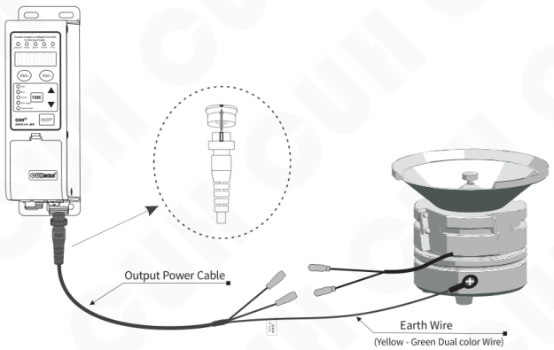

### Nota

1. Asegúrese de que las bobinas electromagnéticas del vibrador estén conectadas a los dos pines de salida del cable de alimentación de salida, y que la carcasa metálica del vibrador esté conectada a tierra de forma fiable.
2. Está prohibido conectar cargas piezoeléctricas a la salida de alimentación; de lo contrario, ¡puede causar un accidente de seguridad por descarga eléctrica!

---

### Paso tres:

Conecte el conector del cable de alimentación de entrada a la toma de alimentación de entrada del controlador.

Conecte primero el lado del controlador

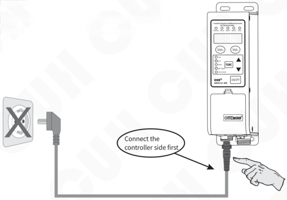

### Paso cuatro:

Después de confirmar que el interruptor está en la posición de apagado, conecte el enchufe del cable de alimentación de entrada a la toma de la red eléctrica.

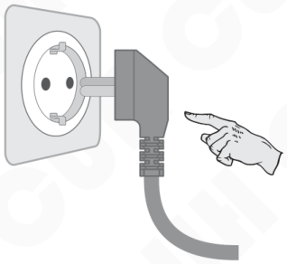

---

# Capítulo Ⅳ Ajuste de parámetros

Los parámetros del controlador se clasifican en 4 tipos según los diferentes métodos de ajuste: parámetros comunes, parámetros básicos, parámetros avanzados y parámetros de Auto/Sincronización.

## 4.1 Parámetros comunes

- Pulse `Vol+` o `Vol-` para ajustar los parámetros comunes.
- Los botones `Vol+` y `Vol-` están diseñados para ajustar únicamente los parámetros comunes.
- Los parámetros comunes se pueden ajustar pulsando `Vol+` o `Vol-` incluso cuando se muestra cualquier otro parámetro en la pantalla LED. El controlador volverá al parámetro anterior tras el ajuste de un parámetro común.

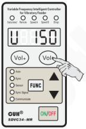

|  | Definición | Símbolo | Imagen del símbolo | Rango | Predeterminado |
|---|---|---|---|---|---|
| Parámetros comunes | Tensión de salida | U | 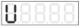 | 0~250 (V) | 150 |
| Parámetros comunes | Velocidad de alimentación | A |  | 0~3200 | 200 |
| Parámetros comunes | Bloqueo del teclado | a |  | —— | Valor de tensión actual/ Velocidad de alimentación actual |

## 4.2 Parámetros básicos

- Pulse `FUNC` y manténgalo pulsado durante 2 segundos para entrar en el estado de ajuste de parámetros básicos.
- Pulse `FUNC` repetidamente para cambiar cíclicamente entre los distintos parámetros.
- Pulse el botón ▲ o ▼ para ajustar el valor del parámetro.
- Vuelva a pulsar `FUNC` y manténgalo pulsado durante 2 segundos para salir del estado de ajuste de parámetros básicos.

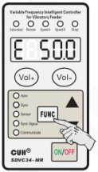

|  | Definición | Símbolo | Imagen del símbolo | Rango | Predeterminado |
|---|---|---|---|---|---|
| Parámetros básicos Mantenga pulsado `FUNC` | Frecuencia de salida | E | 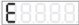 | 25.0~400.0 (Hz) | 50.0 |
| Parámetros básicos Mantenga pulsado `FUNC` | Retardo de conexión de los puertos C | J | 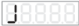 | 0.0~99.9 (s) | 0.2 |
| Parámetros básicos Mantenga pulsado `FUNC` | Retardo de desconexión de los puertos C | L | 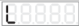 | 0.0~99.9 (s) | 0.2 |
| Parámetros básicos Mantenga pulsado `FUNC` | Tiempo de arranque suave | t |  | 0.0~10.0 (s) | 0.5 |
| Parámetros básicos Mantenga pulsado `FUNC` | Límite máximo de conteo (Controlador con función de conteo, sufijo J) | 3 | 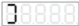 | 0~9999 | 0 |

---

## 4.3 Parámetros avanzados

- Pulse simultáneamente los botones `FUNC` y ▲ y manténgalos pulsados durante 2 segundos para entrar en el estado de ajuste de parámetros avanzados.
- Pulse `FUNC` repetidamente para cambiar cíclicamente entre los distintos parámetros.
- Pulse ▲ o ▼ para ajustar el valor del parámetro.
- Vuelva a pulsar simultáneamente los botones `FUNC` y ▲ y manténgalos pulsados durante 2 segundos para salir del estado de ajuste de parámetros avanzados.

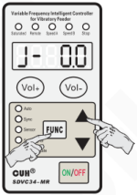

**Parámetros avanzados**  
Mantenga pulsados `FUNC` y ▲

| Definición | Símbolo | Imagen del símbolo | Rango | Predeterminado |
|---|---|---|---|---|
| Retardo de conexión del puerto E | J- |  | 0.0~99.9 (s) | 0.0 |
| Retardo de desconexión del puerto E | L- | 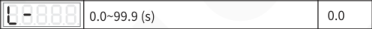 | 0.0~99.9 (s) | 0.0 |
| Retardo de conexión del puerto D | Jd | 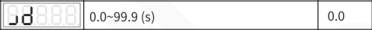 | 0.0~99.9 (s) | 0.0 |
| Retardo de desconexión del puerto D | Ld |  | 0.0~99.9 (s) | 0.0 |
| Tipo de puerto D | rd | 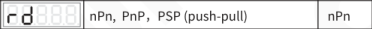 | nPn, PnP, PSP (push-pull) | nPn |
| Relación lógica del puerto C | F2 | 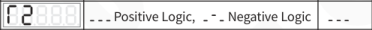 | Lógica positiva, Lógica negativa | Lógica positiva |
| Relación lógica del puerto E | F1 | 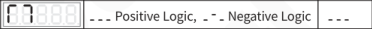 | Lógica positiva, Lógica negativa | Lógica positiva |
| Relación lógica de la salida de control | F3 | 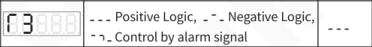 | Lógica positiva, Lógica negativa, Control por la señal de alarma | Lógica positiva |
| Operación lógica de la salida principal | F4 | 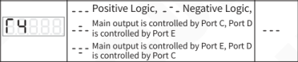 | Lógica positiva, Lógica negativa, La salida principal es controlada por el puerto C, el puerto D es controlado por el puerto E La salida principal es controlada por el puerto E, el puerto D es controlado por el puerto C | Lógica positiva |
| Operación lógica de la salida de control | F8 | 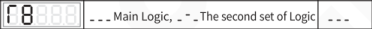 | Lógica principal, El segundo grupo de lógica | Lógica principal |
| Tipo de sensor de conmutación (Controlador con función RS485, sufijo R) | FA |  | Uto, nPn, PnP | Uto |
| Tipo de sensor de conmutación (Controlador con función de conteo, sufijo J) | FA |  | nPn, PnP | nPn |
| Relación lógica de los puertos C y E | ∩ | 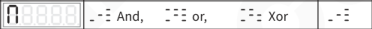 | And, or, Xor | And |
| Dirección lógica del pulso de conteo (Controlador con función de conteo, sufijo J) | Fb | 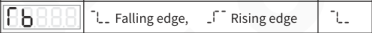 | Flanco descendente, Flanco ascendente | Flanco descendente |
| Dirección lógica del reinicio de conteo (Controlador con función de conteo, sufijo J) | FC | 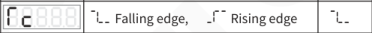 | Flanco descendente, Flanco ascendente | Flanco descendente |
| Porcentaje de velocidad al finalizar el conteo (Controlador con función de conteo, sufijo J) | u | 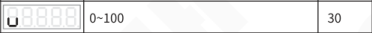 | 0~100 | 30 |
| Número de conteo al final (Controlador con función de conteo, sufijo J) | n |  | 0~255 | 3 |
| Tiempo antirrebote de conteo (Controlador con función de conteo, sufijo J) | U | 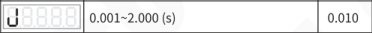 | 0.001~2.000 (s) | 0.010 |

### Parámetros avanzados

Mantenga pulsados **FUNC** y **▲**

| Definición | Símbolo | Imagen del símbolo | Rango | Predeterminado |
|---|---|---|---|---|
| Tensión de salida máxima ajustable | h | 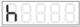 | 0~250 (V) | 250 |
| Límite inferior de frecuencia de salida | e |  | 25.0~390.0 (Hz) | 40.0 |
| Índice de aceleración | y | 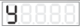 | 100~150 % | 120 |
| Índice de forma de onda | r | 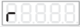 | 0~100 | 100 |
| Visualización de temperatura | C |  | -10.0~80.0 (°C) | Temperatura actual |
| Protocolo de comunicación | P | 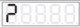 | ASC, rtu | rtu |
| Dirección de comunicación | Ver imagen del símbolo | 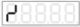 | 1~31 | 1 |
| Velocidad en baudios de comunicación | d | 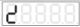 | 0.3~115.2 kbps | 9.6 |
| Contraseña de bloqueo de parámetros | q- | 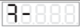 | 0~999 | - - - |
| Estado de funcionamiento tras el encendido | rd |  | Run, Stop, Seguir antes del apagado 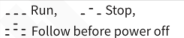 | - - - 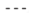 |
| Versión de software | Ur |  | —— | Versión actual |
| Tiempo de reinicio automático de conteo tras llenarse el contador (Controlador con función de conteo, sufijo J) | rE |  | 0.0~99.9 (s) | 0.0 |
| Restablecimiento del controlador | 8.8.8.8.8. | 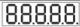 | —— | —— |

---

## Explicación de algunos parámetros avanzados

### Tensión de salida máxima ajustable: h

El rango de la tensión de salida es de 0 a 250 V. El parámetro h restringe la tensión de salida máxima a un valor determinado para proteger el alimentador vibratorio de la alta tensión causada por una operación incorrecta.

La tensión del control de velocidad remoto también se ve afectada por este parámetro.

### Límite inferior de frecuencia de salida: E.

El rango de la frecuencia de salida es de 25.0 a 390.0 (Hz). El parámetro E. restringe la frecuencia de salida mínima a un valor designado para proteger el alimentador vibratorio de una operación incorrecta.

### Porcentaje de velocidad al finalizar el conteo: u

Significa que cuando el conteo entra en el estado final de desaceleración, la velocidad de alimentación del controlador descenderá hasta el porcentaje de la velocidad inicial.

### Número de conteo al final: n

Se refiere al número total de conteos de distancia. Después de alcanzar el “número final”, el controlador entra en el modo de decremento de conteo.

### Tiempo antirrebote de conteo: J

El tiempo efectivo del nivel alto o del nivel bajo en el estado del contador.

### Índice de aceleración: y

Indica el porcentaje de la tensión de entrada que puede alcanzar la tensión de salida máxima. Tras el ajuste, la tensión de salida máxima seguirá sin superar el valor del parámetro h.

### Índice de forma de onda: r

El controlador puede equilibrar continuamente el rendimiento entre la máxima eficiencia, la máxima potencia y el mínimo ruido para satisfacer las mayores demandas de los clientes.

### Retardo de conexión/desconexión del puerto D: Jd y Ld

El rango del retardo de conexión/desconexión es de 0.0~99.9 s y el valor predeterminado es 0.0 s.

### Tipo de puerto D: rd

El puerto de salida de control puede admitir salida NPN, salida PNP y salida push-pull. En concreto:

La salida NPN es válida con nivel bajo y no es válida en estado de alta impedancia;

La salida PNP es válida con nivel alto y no es válida en estado de alta impedancia;

La salida push-pull es válida con nivel alto e inválida con nivel bajo.

---

### Operación lógica de la salida de control: Γ8

En cuanto a la lógica de la salida principal y la salida de control, el usuario puede configurar la señal de salida de control para que siga la señal de salida principal.

### Visualización de temperatura: C

Muestra la temperatura interna del controlador en tiempo real. Solo lectura.

### Contraseña de bloqueo de parámetros: 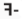

Bloquee todos los parámetros excepto el parámetro de tensión de salida U / el parámetro de velocidad de alimentación A mediante una contraseña definida por el usuario para evitar operaciones no autorizadas.

Active la función de bloqueo de parámetros estableciendo 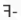 una contraseña; esta contraseña sigue funcionando después del apagado. Cuando el usuario entra en los parámetros avanzados, la pantalla LED mostrará 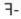 avisando de que se necesita la contraseña; si la contraseña es correcta, pulse brevemente `FUNC` para entrar en el ajuste de parámetros avanzados. Si la contraseña es incorrecta, se ignorará la pulsación breve de `FUNC`.

### Estado de funcionamiento tras el encendido: Γd

Indica el estado de funcionamiento del controlador tras el encendido.

### Versión de software: Ur

Muestra la versión de software actual del controlador. Solo lectura.

### Tiempo de reinicio automático de conteo tras llenarse el contador: ΓE

Este parámetro ΓE ajusta el tiempo de retardo de reinicio automático tras llenarse el contador; cuando se alcanza el tiempo de retardo, el contador se reinicia a cero y se iluminarán los indicadores de conteo y de reinicio.

---

## Parámetro de restablecimiento del controlador: 8.8.8.8.8.

Restablezca todos los parámetros a los valores de fábrica con este parámetro cuando sea necesario.

### Restablecimiento del controlador

**Paso 1:** Pulse simultáneamente los botones **FUNC** y ▲ y manténgalos pulsados durante 2 segundos para entrar en el estado de ajuste de parámetros avanzados.

**Paso 2:** Pulse **FUNC** para pasar al parámetro `8.8.8.8.8.` que parpadea en la pantalla LED.

**Paso 3:** Pulse el botón ▲ y manténgalo pulsado hasta que se muestre `-----` en la pantalla LED.

**Paso 4:** Suelte el botón ▲ para finalizar el proceso de restablecimiento del controlador; se muestra U150 en la pantalla LED.

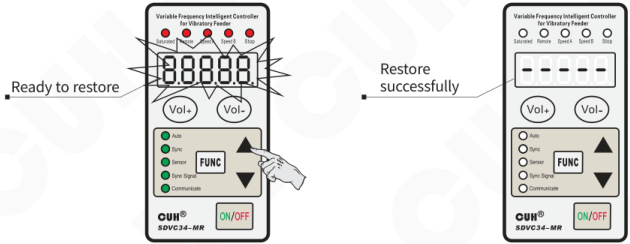

---

## 4.4 Parámetros de Auto/Sincronización

- Pulse simultáneamente los botones **FUNC** y ▼ y manténgalos pulsados durante 2 segundos para entrar en el estado de ajuste de parámetros de Auto/Sincronización.
- Pulse **FUNC** repetidamente para cambiar cíclicamente entre los distintos parámetros.
- Pulse ▲ o ▼ para ajustar el valor del parámetro.
- Vuelva a pulsar simultáneamente los botones **FUNC** y ▼ y manténgalos pulsados durante 2 segundos para salir del estado de ajuste de parámetros de Auto/Sincronización.

**Parámetros de Auto/Sincronización**  
Mantenga pulsados **FUNC** y ▼

| Definición | Símbolo | Imagen del símbolo | Rango | Predeterminado |
|---|---|---|---|---|
| Frecuencia central | F |  | 25.0~400.0 (Hz) | 100.0 |
| Desviación máxima en FM automática | n |  | 0.0~180.0 (Hz) | 30.0 |
| Método de ajuste de la tensión de salida | FS |  | Auto, Manual (símbolo correspondiente, ver la figura)  | - - - |
| Método de ajuste de la frecuencia de salida | FG |  | Auto, Manual, Sync (símbolo correspondiente, ver la figura)  | - - - |
| Índice de ajuste automático de la frecuencia de salida | iF |  | 0~200 | 20 |
| Índice de ajuste automático de amplitud | PA |  | 0~999 | 60 |
| Índice de ajuste automático de amplitud | iA |  | 0~999 | 50 |
| Visualización de la velocidad de alimentación | U |  | 0~H | 0 |
| Visualización de la tensión de salida | G |  | 0~h (V) | 150 |
| Límite inferior de tensión | GL |  | 0~250 (V) | 0 |
| Límite inferior de frecuencia | e |  | 25.0~400.0 (Hz) | 40.0 |
| Índice de amplitud máxima | P |  | 0~500 | 500 |
| Velocidad de alimentación máxima ajustable | H |  | 0~3200 | 1500 |
| Diferencia de fase | Y |  | -180~180 ° | 0 |
| Tensión de salida máxima en el proceso de medición automática de frecuencia | b |  | 0~250 (V) | 100 |
| Velocidad de búsqueda de frecuencia | SP |  | 1~7 | 5 |
| Volumen mínimo de ajuste de la velocidad de alimentación | c |  | 1~10 | 1 |
| Número del sensor de vibración | t |  | 0, 1, 2, 3, 4, 203, 204, 205, 206 | 205 |

---

## Explicación de los parámetros de Auto/Sincronización

### Método de ajuste de la tensión de salida: Γ5

Cuando el parámetro Γ5 se ajusta a `_-_`, el parámetro de tensión de salida U será visible mientras que el parámetro A permanece oculto. El parámetro de tensión de salida U se puede ajustar manualmente.

Cuando el parámetro Γ5 se ajusta a `___` y el sensor de vibración está conectado al controlador, el parámetro de velocidad de alimentación A será visible mientras que el parámetro U permanece oculto. La tensión de salida se ajustará automáticamente según la retroalimentación del sensor de vibración para garantizar una velocidad de alimentación preajustada constante.

> Cuando el sensor de vibración no está conectado al controlador, aunque el parámetro Γ5 esté ajustado a `___`, el parámetro U seguirá siendo visible y ajustable manualmente.

### Método de ajuste de la frecuencia de salida: Γ6

Cuando el parámetro Γ6 se ajusta a `_-_`, el parámetro de frecuencia de salida E se puede ajustar manualmente.

Cuando el parámetro Γ6 se ajusta a `___` y el sensor de vibración está conectado al controlador, el parámetro de frecuencia de salida E se ajustará automáticamente a la frecuencia de resonancia (mejor frecuencia de vibración) del alimentador vibratorio según la retroalimentación del sensor de vibración. La frecuencia de salida no se puede ajustar manualmente.

Cuando el parámetro Γ6 se ajusta a  y el cable de señal de sincronización está conectado entre los controladores maestro y esclavo, la frecuencia de salida del controlador esclavo siempre será coherente con la del controlador maestro. La frecuencia de salida del controlador esclavo no se puede ajustar manualmente.

> Cuando el sensor de vibración no está conectado al controlador, aunque el parámetro Γ6 esté ajustado a `___`, la frecuencia de salida seguirá ajustándose manualmente.

### Frecuencia central: F

La frecuencia central debe ajustarse en torno a la frecuencia de resonancia del alimentador vibratorio para que el controlador pueda encontrar la mejor frecuencia de vibración más rápidamente.

### Desviación máxima en FM automática: n

El rango de FM automática es (F ±n) Hz.

El valor n sugerido es de aproximadamente 30.0 Hz.

Si el parámetro n se ajusta demasiado grande, el alimentador vibratorio puede funcionar a una frecuencia de vibración inadecuada.

Si el parámetro n se ajusta demasiado pequeño, la flexibilidad del alimentador vibratorio puede verse afectada.

---

### Índice de ajuste automático de la frecuencia de salida: 1F

El proceso de FM automática funciona mediante el algoritmo PID. "IF" es un índice de integración de frecuencia.

Cuanto mayor sea el valor del parámetro "IF", más rápida será la modulación automática de la frecuencia de salida. Pero un valor de "IF" demasiado grande puede provocar oscilación de la frecuencia de salida.

### Índice de ajuste automático de la amplitud: PA

El controlador ajusta automáticamente la tensión de salida mediante el algoritmo PID. PA es un índice de proporción de velocidad.

Cuanto mayor sea el valor del parámetro PA, más rápido se ajustará automáticamente la tensión de salida. Pero un valor de PA demasiado grande puede provocar oscilación de la tensión de salida.

### Índice de ajuste automático de la amplitud: 1A

El controlador ajusta automáticamente la tensión de salida mediante el algoritmo PID. IA es un índice de integración de velocidad.

Cuanto mayor sea el valor del parámetro IA, más rápido se ajustará automáticamente la tensión de salida. Pero un valor de IA demasiado grande puede provocar oscilación de la tensión de salida.

### Visualización de la velocidad de alimentación: 

Este parámetro está diseñado para mostrar la velocidad de alimentación y no es ajustable.

### Visualización de la tensión de salida: G

Este parámetro está diseñado para mostrar la tensión de salida y no es ajustable.

### Límite inferior de tensión y límite inferior de frecuencia: GL y 

Cuando Γ3 se ajusta a  (control por señal de alarma), y el controlador está en modo automático (incluyendo solo tensión automática, solo frecuencia automática o totalmente automático) y funciona normalmente (sin señal externa y sin parada manual, sin arranque suave ni estados de fallo), si la tensión de salida es inferior al parámetro de límite inferior establecido por GL, o la frecuencia de salida es inferior al parámetro de límite inferior establecido por , entonces la salida de control de 24V es válida (la salida del puerto D1 es de nivel bajo). Si no se produce ninguna de estas situaciones, la salida no es válida (la salida del puerto D1 es de alta impedancia).

Los tres parámetros anteriores Γ3, GL y  pueden guardarse automáticamente después del ajuste, y pueden configurarse y leerse en la comunicación RS485.

### Índice de amplitud máxima: P

Ajuste el índice P para restringir la amplitud máxima del alimentador vibratorio.

### Velocidad de alimentación máxima ajustable: H

El rango de la velocidad de alimentación es de 0 a H. El parámetro H restringe la velocidad de alimentación máxima a un valor determinado para proteger el alimentador vibratorio de una tensión elevada causada por un uso incorrecto.

La velocidad de alimentación del control de velocidad remoto también se ve afectada por este parámetro.

### Diferencia de fase: 

Ajuste el parámetro  para cambiar la fase de la onda de salida; la diferencia de fase predeterminada es 0°.

---

## Tensión de salida máxima en el proceso de medición automática de frecuencia: b

La tensión de salida no superará el valor del parámetro b en el proceso de medición automática de frecuencia para proteger el alimentador vibratorio de daños.

## Velocidad de búsqueda de frecuencia: SP

El parámetro SP representa la velocidad de búsqueda de frecuencia. Cuanto mayor sea este valor, más rápida será la búsqueda de frecuencia. El parámetro SP va de 1 a 7.

## Volumen de ajuste mínimo de la velocidad de alimentación: c

El parámetro c representa el volumen de ajuste del parámetro de velocidad de alimentación A al pulsar una vez el botón Vol+ o Vol-. El parámetro c va de 1 a 10.

## Número de sensor de vibración: ├

El controlador es compatible con 8 modelos diferentes de sensores de vibración. Ajuste el parámetro ├ según el modelo del sensor para que, cuando se ajuste la velocidad de alimentación, el controlador emita el mismo valor de tensión independientemente del modelo de sensor de vibración conectado.

| Valor del parámetro | Modelo correspondiente | Especificación Aceleración eje X/eje Y/eje Z |
|---|---|---|
| 1 | SDVS20-1 | 16g/16g/16g |
| 2 | SDVS20-2 | 35g/35g/—— |
| 3 | SDVS20-3 | 50g/50g/—— |
| 4 | SDVS20-4 | 70g/70g/—— |
| 203 | SDVS203 | 8g/8g/8g |
| 204 | SDVS204 | 16g/16g/16g |
| 205 | SDVS205 | 32g/32g/32g |
| 206 | SDVS206 | 64g/64g/64g |

---

# CapítuloⅤ Modo de funcionamiento

El controlador puede configurarse para funcionar en uno de los siguientes cinco modos de funcionamiento según los requisitos específicos de la aplicación.

- **Modo manual:** Tanto la tensión de salida como la frecuencia de salida se ajustan manualmente.
- **Modo automático:** Tanto la tensión de salida como la frecuencia de salida se ajustan automáticamente según la retroalimentación del sensor de vibración para garantizar una velocidad de alimentación predefinida constante y la mejor frecuencia de vibración del alimentador vibratorio.
- **Modo semiautomático:** La tensión de salida se ajusta automáticamente según la retroalimentación del sensor de vibración para garantizar una velocidad de alimentación predefinida constante. La frecuencia de salida se ajusta manualmente.
- **Modo de sincronización:** En la configuración de sincronización, si la frecuencia de salida del controlador B es siempre constante con la del controlador A, definimos el controlador A como controlador maestro, el controlador B como controlador esclavo y el modo de funcionamiento del controlador B como modo de sincronización.
- **Modo de conteo:** El controlador (solo SDVC34-MRJ) puede contar las piezas que pasan y desacelerar o detener automáticamente su salida cuando la cantidad de piezas que pasan alcanza el valor predefinido.

| Modo de funcionamiento | Tensión de salida U — Método de ajuste | Tensión de salida U — Ajuste de Γ5 | Frecuencia de salida E — Método de ajuste | Frecuencia de salida E — Ajuste de Γ6 | Imagen del símbolo |
|---|---|---|---|---|---|
| Modo manual | Manual | `_ - _` | Manual | `_ - _` |  |
| Modo automático | Auto | `- - -` | Auto | `- - -` |  |
| Modo semiautomático | Auto | `- - -` | Manual | `_ - _` | [[vcrop:30:1]] / [[vcrop:30:0]] |
| Modo de sincronización | Manual o Auto | `_ - _` o `- - -` | Sincronización automática con el controlador maestro |  | [[vcrop:30:0]] / [[vcrop:30:1]] / [[vcrop:30:2]] |

## 5.1 Modo manual

En el modo manual, tanto la tensión de salida como la frecuencia de salida se ajustan manualmente.

| Modo de funcionamiento | Tensión de salida U — Método de ajuste | Tensión de salida U — Ajuste de Γ5 | Frecuencia de salida E — Método de ajuste | Frecuencia de salida E — Ajuste de Γ6 | Imagen del símbolo |
|---|---|---|---|---|---|
| Modo manual | Manual | `_ - _` | Manual | `_ - _` |  |

Para simplificar el funcionamiento, los parámetros Γ5 y Γ6 están ajustados de fábrica a `_ _ _`. Con este ajuste, el controlador funcionará en modo manual si el sensor de vibración no está conectado al controlador, o en modo automático si el sensor de vibración está conectado.

> - Si tanto Γ5 como Γ6 están ajustados a `_ - _`, el controlador funcionará en modo manual independientemente de si el sensor de vibración está conectado al controlador.
> - Si el sensor de vibración no está conectado al controlador, el controlador funcionará siempre en modo manual.

## 5.1.1 Ajuste de la tensión de salida en modo manual

El valor real de la tensión de salida del controlador puede mostrarse en la pantalla LED de forma digital y precisa.

- Encienda el interruptor de alimentación cuando el sensor de vibración no esté conectado al controlador.
- La pantalla LED muestra el parámetro de tensión de salida U y su valor.
- Ajuste el valor de U pulsando `Vol+` o `Vol-`.

## 5.1.2 Ajuste de la frecuencia de salida en modo manual

Con la ayuda de la tecnología DDS, la frecuencia de salida del controlador es siempre estable y de alta precisión independientemente del tiempo o los cambios de temperatura.

- Pulse `FUNC` y manténgalo pulsado durante 2 segundos para entrar en el estado de ajuste de parámetros básicos.
- La pantalla LED muestra el parámetro de frecuencia de salida E y su valor.
- Ajuste el valor de E pulsando los botones ▲ o ▼ cuando el sensor de vibración no esté conectado al controlador.

---

## 5.2 Modo automático

En el modo automático, el sensor de vibración debe estar conectado al controlador. La tensión de salida y la frecuencia de salida se ajustarán automáticamente según la retroalimentación del sensor de vibración para garantizar una velocidad de alimentación predefinida constante y la mejor frecuencia de vibración. La tensión de salida y la frecuencia de salida no pueden ajustarse manualmente.

De fábrica, cuando el sensor de vibración está conectado, el controlador funciona en modo automático

| Modo de funcionamiento | Tensión de salida U — Método de ajuste | Tensión de salida U — Ajuste de Γ5 | Frecuencia de salida E — Método de ajuste | Frecuencia de salida E — Ajuste de Γ6 |
|---|---|---|---|---|
| Modo automático | Auto | - - - | Auto | - - - |

> **Nota:** El controlador seguirá funcionando en modo manual si el sensor de vibración no está conectado.

### 5.2.1 Instalación del sensor de vibración

#### 5.2.1.1 Método de conexión del sensor de vibración

Conecte el conector del sensor de vibración a la toma del sensor de vibración del controlador.

**Nota: Conecte y desconecte el sensor de vibración con el controlador apagado.**

---

## 5.2.1.2 Guía de instalación del sensor de vibración

Fije el sensor de vibración a la superficie lisa del vibrador con la dirección de instalación arbitraria; los métodos de instalación del sensor de vibración se muestran a continuación:

- Método 1: como se muestra en la Fig. 1

  Ventaja: instalación sencilla

- Método 2: como se muestra en la Fig. 2

  Nota: No permita que el cuenco de alimentación presione el sensor de vibración.

- Método 3: suelde un soporte al vibrador y fije el sensor de vibración sobre el soporte. Como se muestra en la Fig. 3

  Las dimensiones recomendadas del soporte de vibración se muestran en la Fig. 4.

- Método de instalación no recomendado, como se muestra en la Fig. 5 y la Fig. 6.

  Si la ubicación de instalación no es adecuada, el sensor de vibración no puede retroalimentar con precisión la frecuencia de resonancia y el controlador buscará la frecuencia de resonancia continuamente.

---

## 5.2.2 Ajuste de la velocidad de alimentación en modo automático

- Encienda el interruptor de alimentación cuando el sensor de vibración esté conectado al controlador. El indicador del sensor de vibración se ilumina.
- La pantalla LED muestra el parámetro de velocidad de alimentación A y su valor.
- Ajuste el valor de A pulsando **Vol+** o **Vol-** hasta la velocidad de alimentación deseada.

## 5.2.3 Medición automática de frecuencia en modo automático

Mediante la medición automática de frecuencia, el controlador detecta la mejor frecuencia de vibración del alimentador vibratorio y ajusta automáticamente todos los parámetros relacionados. Lo único que el usuario debe hacer es ajustar el parámetro de velocidad de alimentación A; después, el controlador funcionará en el mejor estado.

- Pulse ▲ y ▼ simultáneamente y manténgalos pulsados durante 3 segundos cuando el sensor de vibración esté conectado al controlador para iniciar la medición automática de frecuencia. El parámetro de frecuencia de salida E y su valor se mostrarán en la pantalla LED durante el proceso de medición.
- Después del proceso de medición automática de frecuencia, el controlador ajustará automáticamente todos los parámetros relacionados, incluidos el parámetro de frecuencia central F, el desplazamiento máximo en FM automática n, el índice de ajuste automático de la frecuencia de salida IF, el índice de ajuste automático de la amplitud PA, el índice de ajuste automático de la amplitud IA y el parámetro de diferencia de fase ; el parámetro del método de ajuste de la tensión de salida Γ5 y el parámetro del método de ajuste de la frecuencia de salida Γ6 se ajustarán a \_\_\_.

> - Si la pantalla LED muestra Err02 en el momento en que comienza el proceso de medición automática de frecuencia, es normal, porque el parámetro b está ajustado demasiado alto.
> - Si desea cancelar el proceso de medición automática de frecuencia, pulse **ON/OFF**. Después, el controlador volverá al estado anterior a la medición automática de frecuencia.

**Después de ajustar la velocidad de alimentación y realizar la medición automática de frecuencia, el controlador funcionará en el mejor estado a la velocidad de alimentación deseada.**

---

## 5.3 Modo semiautomático

En el modo semiautomático, el sensor de vibración debe estar conectado al controlador y el parámetro Γ6 debe estar ajustado a `_-_`.

La tensión de salida se ajustará automáticamente según la retroalimentación del sensor de vibración para garantizar una velocidad de alimentación predefinida constante. La frecuencia de salida se ajustará manualmente.

| Modo de funcionamiento | Tensión de salida U — Método de ajuste | Tensión de salida U — Ajuste de Γ5 | Frecuencia de salida E — Método de ajuste | Frecuencia de salida E — Ajuste de Γ6 | Imagen del símbolo |
|---|---|---|---|---|---|
| Modo semiautomático | Auto | `---` | Manual | `_-_` | Γ5:  Γ6:  |

> **Nota:** El controlador seguirá funcionando en modo manual si el sensor de vibración no está conectado.

### 5.3.1 Instalación del sensor de vibración

Igual que en la sección 5.2.1.

### 5.3.2 Configuración del modo semiautomático

- Encienda el interruptor de alimentación cuando el sensor de vibración esté conectado al controlador. El indicador del sensor de vibración se ilumina.
- Pulse simultáneamente los botones `FUNC` y ▼ y manténgalos pulsados durante 2 segundos para entrar en el estado de ajuste de parámetros Auto/Sincronización.
- Pulse `FUNC` repetidamente para cambiar al parámetro del método de ajuste de la frecuencia de salida Γ6.
- Pulse los botones ▲ o ▼ para ajustar Γ6 a `_-_`.

---

### 5.3.3 Ajuste de la velocidad de alimentación en modo semiautomático

- Ajuste el valor de A pulsando Vol+ o Vol- hasta la velocidad de alimentación deseada.

### 5.3.4 Ajuste de la frecuencia de salida en modo semiautomático

- Pulse **FUNC** y manténgalo pulsado durante 2 segundos para entrar en el estado de ajuste de parámetros básicos.
- La pantalla LED muestra el parámetro de frecuencia de salida E y su valor.
- Ajuste el valor de E pulsando los botones ▲ o ▼.

---

## 5.4 Modo de sincronización

En el modo de sincronización, el cable de señal de sincronización debe estar conectado entre los controladores maestro y esclavo. La frecuencia de salida del controlador (controlador esclavo) es siempre coherente con la del controlador maestro. La tensión de salida del controlador (controlador esclavo) puede ajustarse manual o automáticamente.

| Modo de funcionamiento | Tensión de salida U — Método de ajuste | Tensión de salida U — Ajuste de Γ5 | Frecuencia de salida E — Método de ajuste | Frecuencia de salida E — Ajuste de Γ6 | Imagen del símbolo |
|---|---|---|---|---|---|
| Modo de sincronización | Manual o Auto | Dos ajustes de símbolo (ver imagen, unidos por "o") | Sincronización automática con el controlador maestro | Ver imagen | Γ5: ；Γ6:  |

El modo de sincronización se aplica a la situación en la que hay más de un controlador controlando varios alimentadores vibratorios en el sistema de alimentación; las salidas de los controladores no están sincronizadas y por ello interfieren entre sí (fenómeno de batido). El modo de sincronización está diseñado para eliminar el fenómeno de batido, ya que las formas de onda de salida de los controladores maestro y esclavo son exactamente síncronas.

El controlador S no está ajustado al modo de sincronización y las formas de onda de salida de los dos controladores no están sincronizadas.

El controlador S está ajustado al modo de sincronización y las formas de onda de salida de los dos controladores están completamente sincronizadas.

---

## 5.4.1 Método de conexión del cable de señal de sincronización

### Paso 1:

Abra las tapas de las cajas de los puertos de control de señal de ambos controladores.

### Paso 2:

Conecte el cable de señal de sincronización entre los controladores maestro y esclavo según el diagrama esquemático siguiente.

Un controlador maestro puede controlar varios controladores esclavos.

> El controlador esclavo detendrá su salida cuando la señal de sincronización sea inestable o no esté conectada. Y el indicador de sincronización se apagará.

---

## 5.4.2 Aplicaciones del modo de sincronización

### • Subpatrón 1

| Controlador | Tensión de salida U — Método de ajuste | Tensión de salida U — Ajuste de Γ5 | Frecuencia de salida E — Método de ajuste | Frecuencia de salida E — Ajuste de Γ6 | Imagen del símbolo |
|---|---|---|---|---|---|
| Controlador maestro | Manual | Ver imagen del símbolo | Manual | Ver imagen del símbolo | Γ5：；Γ6： |
| Controlador esclavo | Manual | Ver imagen del símbolo | Sincronización automática con el controlador maestro | Ver imagen del símbolo | Γ5：；Γ6： |

### • Subpatrón 2

| Controlador | Tensión de salida U — Método de ajuste | Tensión de salida U — Ajuste de Γ5 | Frecuencia de salida E — Método de ajuste | Frecuencia de salida E — Ajuste de Γ6 | Imagen del símbolo |
|---|---|---|---|---|---|
| Controlador maestro | Auto | — — — | Auto | — — — | Γ5、Γ6： |
| Controlador esclavo | Manual | Ver imagen del símbolo | Sincronización automática con el controlador maestro | Ver imagen del símbolo | Γ5：；Γ6： |

### • Subpatrón 3

| Controlador | Tensión de salida U — Método de ajuste | Tensión de salida U — Ajuste de Γ5 | Frecuencia de salida E — Método de ajuste | Frecuencia de salida E — Ajuste de Γ6 | Imagen del símbolo |
|---|---|---|---|---|---|
| Controlador maestro | Auto | — — — | Manual | Ver imagen del símbolo | Γ5：[[vcrop:40:0]]；Γ6：[[vcrop:40:1]] |
| Controlador esclavo | Manual | Ver imagen del símbolo | Sincronización automática con el controlador maestro | Ver imagen del símbolo | Γ5：[[vcrop:40:1]]；Γ6：[[vcrop:40:2]] |

### • Subpatrón 4

| Controlador | Tensión de salida U — Método de ajuste | Tensión de salida U — Ajuste de Γ5 | Frecuencia de salida E — Método de ajuste | Frecuencia de salida E — Ajuste de Γ6 | Imagen del símbolo |
|---|---|---|---|---|---|
| Controlador maestro | Manual | Ver imagen de Γ5 en la columna derecha | Manual | Ver imagen de Γ6 en la columna derecha | Γ5： Γ6： |
| Controlador esclavo | Auto | Ver imagen de Γ5 en la columna derecha | Sincronización automática con el controlador maestro | Ver imagen de Γ6 en la columna derecha | Γ5： Γ6： |

### • Subpatrón 5

| Controlador | Tensión de salida U — Método de ajuste | Tensión de salida U — Ajuste de Γ5 | Frecuencia de salida E — Método de ajuste | Frecuencia de salida E — Ajuste de Γ6 | Imagen del símbolo |
|---|---|---|---|---|---|
| Controlador maestro | Auto | --- | Auto | --- | Γ5、Γ6： |
| Controlador esclavo | Auto | --- | Sincronización automática con el controlador maestro | Ver imagen del símbolo | Γ5：[[vcrop:42:0]]；Γ6： |

### • Subpatrón 6

| Controlador | Tensión de salida U — Método de ajuste | Tensión de salida U — Ajuste de Γ5 | Frecuencia de salida E — Método de ajuste | Frecuencia de salida E — Ajuste de Γ6 | Imagen del símbolo |
|---|---|---|---|---|---|
| Controlador maestro | Auto | --- | Manual | Ver imagen del símbolo | Γ5：[[vcrop:42:0]]；Γ6： |
| Controlador esclavo | Auto | --- | Sincronización automática con el controlador maestro | Ver imagen del símbolo | Γ5：[[vcrop:42:0]]；Γ6：[[vcrop:42:1]] |

---

## 5.5 Modo de conteo

Ignore este capítulo si el controlador no dispone de la función de conteo.

Los modelos de la serie SDVC34 con sufijo J incorporan una función de conteo que puede contar las piezas que pasan y desacelerar o detener automáticamente su salida cuando la cantidad de piezas que pasan alcanza el valor predefinido.

**Función de desaceleración antes de la parada:** Como se muestra en el diagrama siguiente, el controlador emite la velocidad de alimentación normal ajustada por el usuario hasta que el número de conteo alcanza "J-C", momento en el que el controlador cambia instantáneamente a emitir una velocidad de alimentación inferior predefinida para evitar el exceso de alimentación. Cuando el número de conteo alcanza el valor objetivo de conteo J, el controlador detiene su salida inmediatamente.

La función de súper antirrebote del conteo se diseñó especialmente para resolver el problema de conteo erróneo de piezas en vibración, estableciendo el tiempo de duración de la señal de conteo. Solo cuando la señal de pulso de conteo ha durado al menos el tiempo b puede confirmarse. Esta función mejora eficazmente la fiabilidad del conteo.

Consulte el diagrama siguiente.

**Nota:**

El tiempo de estabilización antirrebote significa el tiempo de estabilización del nivel alto y del nivel bajo. Un pulso válido consiste en un nivel alto y un nivel bajo activos de forma continua; entonces, el contador se incrementa en uno.

---

## 5.5.1 Método de uso

Si la señal de reinicio del contador se vuelve inválida brevemente y luego se restaura a válida, el valor del contador se borra y el contador comienza de nuevo, lo que constituye un reinicio. Durante el breve período de tiempo (no superior a 2 segundos) en que se sale del estado de conteo, el controlador apagará temporalmente la salida. Por lo tanto, esta señal puede utilizarse como señal de reinicio del contador según sea necesario.

En el estado de conteo normal, el contador puede reiniciarse utilizando las teclas "▲" o "▼" del panel. La señal de pulso de conteo se introduce a través del puerto "N2" de la interfaz del controlador, y el valor del contador se muestra en el estado "". Si se utiliza `FUNC` para entrar en otros estados de ajuste de parámetros, el trabajo de conteo no se detendrá y el valor de conteo no se perderá.

> Solo hay una forma de que el controlador entre en el estado de conteo: mantener válida la señal de control de conteo (señal de habilitación/reinicio "N3"). Después de entrar en el estado de conteo, el estado inicial se muestra como "", y los indicadores de conteo y de reinicio se iluminan al mismo tiempo, lo que indica que la señal de pulso de conteo puede aceptarse y el conteo comienza.

---

## 5.5.2 Método de conexión

Método de cableado cuando el estado de ΓA es NPN

Método de cableado cuando el estado de ΓA es PNP

---

## 5.5.3 Dirección lógica del pulso de conteo

- Pulse simultáneamente los botones `FUNC` y ▲ y manténgalos pulsados durante 2 segundos para entrar en el estado de ajuste de parámetros avanzados.
- Pulse `FUNC` repetidamente para cambiar al parámetro Γb.
- Pulse los botones ▲ o ▼ para ajustar Γb.

> - Cuando el flanco activo de Γb se ajusta al flanco descendente, los pulsos de conteo se cuentan en el flanco descendente que cambia de "nivel alto" a "nivel bajo".
> - Cuando el flanco activo de Γb se ajusta al flanco ascendente, los pulsos de conteo se cuentan en el flanco ascendente que cambia de "nivel bajo" a "nivel alto".

## 5.5.4 Dirección lógica del reinicio de conteo

- Pulse simultáneamente los botones `FUNC` y ▲ y manténgalos pulsados durante 2 segundos para entrar en el estado de ajuste de parámetros avanzados.
- Pulse `FUNC` repetidamente para cambiar al parámetro Γc.
- Pulse los botones ▲ o ▼ para ajustar Γc.

> - Cuando el flanco activo de Γc se ajusta al flanco descendente y el pin de control de conteo no está conectado a ninguna señal, el controlador no entra en el estado de "conteo"; cuando la señal de este pin se lleva a "nivel bajo", el controlador entra en el estado de "conteo".
> - Cuando el flanco activo de Γc se ajusta al flanco ascendente y no hay ninguna señal conectada al pin de control de conteo, el controlador entra en el estado de "conteo"; cuando la señal de este pin se lleva a "nivel bajo", el controlador sale del estado de "conteo".

---

## 5.5.5 Explicación de los parámetros de conteo

### Límite máximo de conteo: 

- En el estado de conteo, pulse **FUNC** para entrar en el parámetro [[vcrop:47:0]].
- Pulse los botones ▲ o ▼ para ajustar el valor del parámetro.

Cuando el valor del contador alcanza este valor umbral, el conteo del controlador se satura, se detiene la salida del controlador y también se detiene la alimentación hasta que se reinicie el contador. Después de entrar en el estado de saturación de conteo, si el pulso de conteo continúa enviándose, el conteo continuará, pero la salida del controlador permanecerá detenida.

### Número de conteo al final: n

- Pulse simultáneamente los botones **FUNC** y ▲ y manténgalos pulsados durante 2 segundos para entrar en el estado de ajuste de parámetros avanzados.
- Pulse **FUNC** repetidamente para cambiar al parámetro n.
- Pulse los botones ▲ o ▼ para ajustar el valor del parámetro.

Cuando el número de valores de conteo desde el límite de conteo alcanza el número de conteo al final, el controlador entra en el estado final y la velocidad de alimentación se reduce a la velocidad final.

Cuando no se utiliza la función de desaceleración al final, ajustar este parámetro a 0 puede hacer que la función de desaceleración no sea efectiva.

---

## Porcentaje de velocidad al finalizar el conteo: u

- Pulse simultáneamente los botones `FUNC` y ▲ y manténgalos pulsados durante 2 segundos para entrar en el estado de ajuste de parámetros avanzados.
- Pulse `FUNC` repetidamente para cambiar al parámetro u.
- Pulse los botones ▲ o ▼ para ajustar el valor del parámetro.

Cuando el conteo entra en el estado final de conteo, la velocidad de alimentación del controlador disminuirá como un porcentaje de la velocidad inicial.

## Tiempo antirrebote de conteo: J

- Pulse simultáneamente los botones `FUNC` y ▲ y manténgalos pulsados durante 2 segundos para entrar en el estado de ajuste de parámetros avanzados.
- Pulse `FUNC` repetidamente para cambiar al parámetro J.
- Pulse los botones ▲ o ▼ para ajustar el valor del parámetro.

Dado que el tiempo antirrebote es el tiempo de estabilización de los niveles alto y bajo respectivamente, el valor de este parámetro debe ser inferior a:

$$
\frac{1}{2} \times \frac{1}{\text{el número máximo de conteos por segundo}}
$$

El conteo máximo por segundo debe basarse en la situación real y en la velocidad máxima posible del equipo específico durante el funcionamiento. Una sobreestimación de la velocidad hará que la función antirrebote no logre el efecto deseado, y un valor demasiado bajo dará lugar a conteos perdidos.

---

# Capítulo Ⅵ Control de señales

El control de señales incluye: control ON/OFF de los puertos C, control ON/OFF de los puertos E, control de velocidad remoto, almacenamiento y salida de velocidades preajustadas, comunicación RS485 y salida de control de 24V CC.

## 6.1 Control ON/OFF de los puertos C

La salida del controlador puede activarse o desactivarse mediante cualquier tipo de sensor de conmutación o PLC a través de los puertos C.

### 6.1.1 Método de conexión de los puertos C

**Método de conexión del sensor de proximidad**

**Paso 1:**

Abra las tapas de las cajas de los puertos de control de señal del controlador.

**Paso 2:**

Conecte el sensor de proximidad a los puertos C según el diagrama.

**Convención**

El cable azul representa el cable de tierra  
El cable negro representa el cable de señal  
El cable marrón representa el cable de alimentación

---

## Método de conexión del sensor fotoeléctrico de barrera

---

## Método de conexión del sensor fotoeléctrico reflectivo

---

## Método de conexión del sensor de fibra óptica de barrera

---

## Método de conexión del PLC

### Método de conexión de la salida NPN del PLC

### Método de conexión de la salida PNP del PLC

Nota: la salida de relé, la salida NPN y la salida PNP del PLC, cualquiera de ellas puede activar/desactivar el controlador.

Nota: cuando utilice un PLC para activar y desactivar el controlador, utilice un PLC de tipo de salida de 24V.

---

## 6.1.2 Retardo de conexión/desconexión de los puertos C

Si desea que el controlador comience a emitir después de un período de tiempo desde la recepción de la señal de control de conexión de los puertos C, ajuste el parámetro J.

Si desea que el controlador siga emitiendo durante un período de tiempo después de recibir la señal de control de desconexión de los puertos C, ajuste el parámetro L.

### Retardo de conexión de los puertos C

El período de tiempo desde que el controlador recibe la señal de control de conexión de los puertos C hasta que comienza a emitir.

- Pulse `FUNC` y manténgalo pulsado durante 2 segundos para entrar en el estado de ajuste de parámetros básicos.
- Pulse `FUNC` repetidamente para cambiar al parámetro J.
- Pulse los botones ▲ o ▼ para ajustar el valor. La unidad del parámetro es el segundo y la precisión de ajuste es 0.1.

### Retardo de desconexión de los puertos C

El período de tiempo desde que el controlador recibe la señal de control de desconexión de los puertos C hasta que corta la salida.

- Pulse `FUNC` y manténgalo pulsado durante 2 segundos para entrar en el estado de ajuste de parámetros básicos.
- Pulse `FUNC` repetidamente para cambiar al parámetro L.
- Pulse los botones ▲ o ▼ para ajustar el valor. La unidad del parámetro es el segundo y la precisión de ajuste es 0.1.

---

## 6.1.3 Relación lógica del control ON/OFF de los puertos C

De fábrica, el controlador funciona cuando los puertos C no reciben señal. Pero en otras aplicaciones el controlador debe detenerse cuando los puertos C no reciben señal.

Ajuste el parámetro Γ2 para cumplir cualquiera de los requisitos.

- Pulse simultáneamente los botones **FUNC** y ▲ y manténgalos pulsados durante 2 segundos para entrar en el estado de ajuste de parámetros avanzados.
- Pulse **FUNC** repetidamente para cambiar al parámetro Γ2.
- Pulse los botones ▲ o ▼ para cambiar la relación lógica.

El parámetro Γ2 está ajustado a `___` de fábrica.

- Cuando el parámetro Γ2 está ajustado a `___`, la salida del controlador estará activa cuando los puertos C no reciban señal.
- Cuando el parámetro Γ2 está ajustado a `_-_`, la salida del controlador estará desactivada cuando los puertos C no reciban señal.

---

## 6.2 Control ON/OFF de los puertos E

La salida del controlador puede activarse o desactivarse mediante cualquier tipo de sensor de conmutación o PLC a través de los puertos E.

El control ON/OFF de los puertos C y el control ON/OFF de los puertos E son independientes entre sí.

### 6.2.1 Método de conexión de los puertos E

**Método de conexión del sensor de proximidad**

**Paso 1:**

Abra las tapas de las cajas de los puertos de control de señal del controlador.

**Paso 2:**

Conecte el sensor de proximidad a los puertos E según el diagrama.

**Convención**

- El cable azul representa el cable de tierra
- El cable negro representa el cable de señal
- El cable marrón representa el cable de alimentación

El método de conexión de otros tipos de sensores de conmutación y PLC a los puertos E es similar al de los puertos C.

---

## 6.2.2 Retardo de conexión/desconexión de los puertos E

Si desea que el controlador comience a emitir después de un período de tiempo desde la recepción de la señal de control de conexión de los puertos E, ajuste el parámetro J-.

Si desea que el controlador siga emitiendo durante un período de tiempo después de recibir la señal de control de desconexión de los puertos E, ajuste el parámetro L-.

De fábrica, el retardo de conexión/desconexión de los puertos E es el mismo que el retardo de conexión/desconexión de los puertos C.

El retardo de conexión/desconexión de los puertos E también puede ajustarse de forma independiente ajustando el parámetro J- y el parámetro L-.

### Retardo de conexión de los puertos E

El período de tiempo desde que el controlador recibe la señal de control de conexión de los puertos E hasta que comienza a emitir.

- Pulse simultáneamente los botones **FUNC** y ▲ y manténgalos pulsados durante 2 segundos para entrar en el estado de ajuste de parámetros avanzados.
- Pulse **FUNC** para cambiar al parámetro J-.
- Pulse los botones ▲ o ▼ para ajustar el valor. La unidad del parámetro es el segundo y la precisión de ajuste es 0.1.

### Retardo de desconexión de los puertos E

El período de tiempo desde que el controlador recibe la señal de control de desconexión de los puertos E hasta que corta la salida.

- Pulse simultáneamente los botones **FUNC** y ▲ y manténgalos pulsados durante 2 segundos para entrar en el estado de ajuste de parámetros avanzados.
- Pulse **FUNC** para cambiar al parámetro L-.
- Pulse los botones ▲ o ▼ para ajustar el valor. La unidad del parámetro es el segundo y la precisión de ajuste es 0.1.

> Los parámetros J- y L- están ajustados a ___, lo que significa el mismo valor que el de los parámetros J y L.

---

## 6.2.3 Relación lógica del control ON/OFF de los puertos E

De fábrica, el controlador funciona cuando los puertos E no reciben señal. Pero en otras aplicaciones el controlador debe detenerse cuando los puertos E no reciben señal.

Ajuste el parámetro Γ7 para cumplir cualquiera de los requisitos.

- Pulse simultáneamente los botones **FUNC** y ▲ y manténgalos pulsados durante 2 segundos para entrar en el estado de ajuste de parámetros avanzados.
- Pulse **FUNC** repetidamente para cambiar al parámetro Γ7.
- Pulse los botones ▲ o ▼ para cambiar la relación lógica.

El parámetro Γ7 está ajustado a `___` de fábrica.

- Cuando el parámetro Γ7 está ajustado a `___`, la salida del controlador estará activa cuando los puertos E no reciban señal.
- Cuando el parámetro Γ7 está ajustado a `_-_`, la salida del controlador estará desactivada cuando los puertos E no reciban señal.

---

## 6.3 Parámetros comunes de los puertos C y E

### 6.3.1 Relación lógica de los puertos C y E

El parámetro Π determina la reacción del controlador cuando tanto los puertos C como los puertos E son efectivos.

- Pulse simultáneamente los botones `FUNC` y ▲ y manténgalos pulsados durante 2 segundos para entrar en el estado de ajuste de parámetros avanzados.
- Pulse `FUNC` repetidamente para cambiar al parámetro Π.
- Pulse los botones ▲ o ▼ para cambiar la relación lógica.

**Relación lógica: AND** 

La salida del controlador estará activa solo cuando ambos puertos requieran que el controlador funcione.

**Relación lógica: OR** 

La salida del controlador estará activa cuando uno o ambos puertos requieran que el controlador funcione.

**Relación lógica: XOR** 

La salida del controlador estará activa solo cuando uno de los puertos requiera que el controlador funcione y el otro requiera que se detenga.

La relación lógica predeterminada es AND.

---

## 6.3.2 Tipo de sensor de conmutación

El controlador puede reconocer automáticamente el tipo del sensor de conmutación, NPN o PNP.

Los usuarios también pueden ajustar manualmente el tipo del sensor de conmutación.

- Pulse simultáneamente los botones `FUNC` y ▲ y manténgalos pulsados durante 2 segundos para entrar en el estado de ajuste de parámetros avanzados.
- Pulse `FUNC` repetidamente para cambiar al parámetro ΓA.
- Pulse los botones ▲ o ▼ para cambiar el valor.

> **Uto:** Reconocimiento automático del tipo de sensor de conmutación
>
> **nPn:** Sensor de conmutación de tipo NPN
>
> **PnP:** Sensor de conmutación de tipo PNP

Nota: en los controladores con función de conteo, ΓA solo tiene dos estados, nPn y PnP.

---

## 6.3.3 Operación lógica de la salida principal

- Pulse simultáneamente los botones `FUNC` y ▲ y manténgalos pulsados durante 2 segundos para entrar en el estado de ajuste de parámetros avanzados.
- Pulse `FUNC` repetidamente para cambiar al parámetro Γ4.
- Pulse los botones ▲ o ▼ para cambiar el valor.

El parámetro Γ4 está ajustado a ___ de fábrica.

- Cuando el parámetro Γ4 está ajustado a , la salida principal y la salida de control están relacionadas. Controladas por la relación lógica entre el puerto C y el puerto E y el botón ON/OFF.
- Cuando el parámetro Γ4 está ajustado a , la salida principal y la salida de control están separadas. La salida principal está controlada por el botón ON/OFF. La salida de control está controlada por la relación lógica entre el puerto C y el puerto E.
- Cuando el parámetro Γ4 está ajustado a , la salida principal está controlada por el botón ON/OFF y el puerto C. La salida de control está controlada por el puerto E.
- Cuando el parámetro Γ4 está ajustado a , la salida principal está controlada por el botón ON/OFF y el puerto E. La salida de control está controlada por el puerto C.

---

## 6.4 Control de velocidad remoto

La tensión de salida/velocidad de alimentación puede controlarse de forma remota mediante un potenciómetro o una señal de control de CC de 1~5V/4~20mA.

Cuando la tensión del control de velocidad remoto supera 0.5V, pasa a ser efectiva para el controlador, mientras que los botones "Vol+" y "Vol-" dejan de ser eficaces.

Durante el proceso de control de velocidad remoto, el indicador de control de velocidad remoto se iluminará y la pantalla LED mostrará la tensión de salida/velocidad de alimentación y su valor.

### Método de conexión del potenciómetro de control de velocidad remoto

## Método de conexión del PLC de control de velocidad remoto

| Señal de control de velocidad remoto | Tensión de salida U/velocidad de alimentación A |
|---|---|
| Menos de 0.5V | Controlado por los botones Vol+ y Vol- |
| 0.5V~1V | Tensión de salida U=20V/velocidad de alimentación A=0 Controlado por la señal de control de velocidad remoto |
| 1~5V/4~20mA | La tensión de salida U/velocidad de alimentación A se controla linealmente mediante la señal de control de velocidad remoto |

## 6.5 Salida de control

El controlador puede emitir alimentación de control de 24V CC para accionar una válvula solenoide, un relé eléctrico o un PLC, etc., en coordinación con el control ON/OFF de los puertos C/puertos E.

### 6.5.1 Método de conexión de la salida de control

**Conexión a una válvula solenoide**

- El controlador puede accionar una válvula solenoide cuya tensión nominal es de 24V y cuya potencia nominal es de hasta 4W.

**Conexión a un relé eléctrico**

- El controlador puede accionar un relé eléctrico cuya tensión nominal es de 24V y cuya potencia nominal es de hasta 4W.

Nota: conecte correctamente los polos positivo y negativo del relé o la válvula solenoide: D2 se conecta al polo positivo, D1 se conecta al polo negativo. Una conexión invertida puede causar daños por cortocircuito en la salida de control.

---

## 6.5.2 Relación lógica de la salida de control

- Pulse simultáneamente los botones **FUNC** y ▲ y manténgalos pulsados durante 2 segundos para entrar en el estado de ajuste de parámetros avanzados.
- Pulse **FUNC** repetidamente para cambiar al parámetro Γ3.
- Pulse los botones ▲ o ▼ para cambiar la relación lógica.

El parámetro Γ3 está ajustado a ___ de fábrica.

- Si el parámetro Γ3 está ajustado a , la salida de control se activará cuando la salida del controlador esté activa.
- Si el parámetro Γ3 está ajustado a , la salida de control se desactivará cuando la salida del controlador esté activa.
- Si el parámetro Γ3 está ajustado a , la salida de control solo está relacionada con la señal de alarma definida por el parámetro "GL" (límite inferior de tensión) y "e" (límite inferior de frecuencia). Consulte el capítulo 4.4 para obtener más detalles.

---

## 6.5.3 Operación lógica de la salida de control

- Pulse simultáneamente los botones `FUNC` y ▲ y manténgalos pulsados durante 2 segundos para entrar en el estado de ajuste de parámetros avanzados.
- Pulse `FUNC` repetidamente para cambiar al parámetro Γ8.
- Pulse los botones ▲ o ▼ para cambiar el valor.

El parámetro Γ8 está ajustado a ___ de fábrica.

- Cuando Γ8 está ajustado a la lógica principal, la salida de control y la salida principal comparten los mismos ajustes de lógica.
- Cuando Γ8 está ajustado al segundo grupo de lógica, la salida de control está controlada por los ajustes del segundo grupo de lógica y la salida principal está controlada por los ajustes de la lógica principal.

---

## 6.6 Almacenamiento y salida de velocidades preajustadas

Esta función es adecuada para controladores sin función de conteo.

El controlador puede almacenar y emitir 4 velocidades preajustadas diferentes. Las 4 combinaciones ON/OFF del indicador de velocidad A y el indicador de velocidad B corresponden respectivamente a Velocidad 1, Velocidad 2, Velocidad 3y Velocidad 4.

| Velocidad preajustada | Puertos G1 y G2 — Indicador de velocidad A | Puertos G1 y G2 — Interruptor 1 | Puertos G3 y G4 — Indicador de velocidad B | Puertos G3 y G4 — Interruptor 2 |
|---|---|---|---|---|
| Velocidad 1 | ON | Cerrado | OFF | Abierto |
| Velocidad 2 | OFF | Abierto | ON | Cerrado |
| Velocidad 3 | ON | Cerrado | ON | Cerrado |
| Velocidad 4 | OFF | Abierto | OFF | Abierto |

> Modo de tensión manual, 4 velocidades de ajuste relacionadas con 4 ajustes de tensión U  
> Modo de frecuencia manual, 4 velocidades de ajuste relacionadas con 4 frecuencias de salida E  
> Modo de tensión automático, 4 velocidades de ajuste relacionadas con 4 velocidades de alimentación A  
> Modo de frecuencia automático, 4 velocidades de ajuste relacionadas con 4 frecuencias centrales F

### Método de conexión cuando ΓA está ajustado a NPN

---

## Método de conexión cuando ΓA está ajustado a PNP

### Almacenamiento de velocidades preajustadas

Tome el almacenamiento de la Velocidad 1 como ejemplo:

- Cierre K1, se ilumina el indicador de velocidad A; abra K2, se apaga el indicador de velocidad B.
- Para obtener la velocidad de alimentación deseada:
  - En el modo manual, ajuste el parámetro de tensión de salida U y el parámetro de frecuencia de salida E.
  - En el modo automático, ajuste el parámetro de velocidad de alimentación A.
  - En el modo semiautomático, ajuste el parámetro de velocidad de alimentación A y el parámetro de frecuencia de salida E.
- Después de que la salida del controlador se estabilice, pulse simultáneamente los botones `FUNC` y ▼ y manténgalos pulsados durante 2 segundos; en ese momento, se muestra "SAVE" en la pantalla LED, lo que indica que la Velocidad 1 se ha guardado.

### Salida de velocidades preajustadas

Tome la salida de la Velocidad 1 como ejemplo:

- Cierre K1 de nuevo, se ilumina el indicador de velocidad A; abra K2 de nuevo, se apaga el indicador de velocidad B.
- El controlador emitirá la Velocidad 1 al instante.

---

## 6.7 Comunicación RS485

Todos los parámetros del controlador pueden ajustarse de forma remota a través de los puertos de comunicación RS485.

### 6.7.1 Dirección de comunicación RS485

El parámetro  representa el número de ID del controlador en la comunicación RS485.  
Rango del parámetro: 1 a 31.  
Asegúrese de que las direcciones de comunicación de todos los controladores en la misma red sean diferentes para distinguir los controladores entre sí.

- Pulse simultáneamente los botones **FUNC** y ▲ y manténgalos pulsados durante 2 segundos para entrar en el estado de ajuste de parámetros avanzados.
- Pulse **FUNC** repetidamente para cambiar al parámetro [[vcrop:69:0]].
- Pulse los botones ▲ o ▼ para cambiar el valor.

### 6.7.2 Velocidad en baudios de la comunicación RS485

La velocidad en baudios de la comunicación RS485 puede ser: 3, 12, 24, 96, 192, 576 o 1152.  
Unidad: 0.1 Kbps.  
Valor predeterminado: 9.6 Kbps.  
Los controladores en la misma red deben utilizar la misma velocidad en baudios.

- Pulse simultáneamente los botones **FUNC** y ▲ y manténgalos pulsados durante 2 segundos para entrar en el estado de ajuste de parámetros avanzados.
- Pulse **FUNC** repetidamente para cambiar al parámetro .
- Pulse los botones ▲ o ▼ para cambiar el valor.

---

## 6.7.3 Protocolo de comunicación RS485

Selección del tipo de comunicación RS485: tipo Modbus ASCII y tipo Modbus RTU.

RTU predeterminado.

- Pulse simultáneamente los botones `FUNC` y ▲ y manténgalos pulsados durante 2 segundos para entrar en el estado de ajuste de parámetros avanzados.
- Pulse `FUNC` repetidamente para cambiar al parámetro .
- Pulse los botones ▲ o ▼ para cambiar el valor.

El protocolo de comunicación RS485 está disponible en la columna de descargas de nuestro sitio web oficial: **www.cuh-controller.com**

Nota: debido al número limitado de veces que se puede borrar la memoria no volátil del controlador, la instrucción de guardado 485 debe ejecutarse manualmente después de modificar los parámetros para evitar enviar con frecuencia instrucciones de guardado a través del programa.

---

# Capítulo Ⅶ Funciones de seguridad

### Regulación automática de tensión

Elimina tanto la variación de la velocidad de alimentación causada por la fluctuación de la tensión de red como el fenómeno de batido causado por la frecuencia de CA industrial.

### Protección contra cortocircuitos

Cuando la salida del controlador está en cortocircuito, el controlador detendrá su salida y mostrará Err01 en la pantalla LED hasta que se reinicie.

### Protección contra sobrecorriente

Si la corriente de salida supera su valor nominal por un uso incorrecto, el controlador detendrá su salida para garantizar la seguridad operativa y mostrará Err02 en la pantalla LED.

### Protección contra sobrecalentamiento

Si la temperatura interna del controlador supera los 65 °C, el controlador detendrá su salida para protegerse y mostrará Err03 en la pantalla LED hasta que la temperatura interna descienda por debajo de 60 °C.

### Protección contra sobrecarga

Cuando el sensor de vibración está conectado al controlador, si la amplitud de vibración supera el ajuste del índice de amplitud máxima, el controlador reducirá su salida para proteger el alimentador vibratorio.

### Protección contra sobretensión

Si la tensión de entrada es muy superior al rango de tensión de entrada nominal, el fusible dentro del controlador se fundirá para proteger el controlador de más daños. Póngase en contacto con nosotros para la reparación.

---

## Capítulo Ⅷ Apéndice

### 8.1 Dimensiones

SDVC34-MR/MRJ (unidad: mm)

| Rango de dimensiones | tolerancia |
|---|---|
| 0~3 | ±0.05 |
| 3~10 | ±0.1 |
| 10~30 | ±0.15 |
| 30~80 | ±0.2 |
| 80~180 | ±0.3 |
| >180 | ±0.5 |

Esta tabla de tolerancias es aplicable a todos los productos de esta serie.

---

## Serie SDVC34-XL (unidad: mm)

## Serie SDVC34-U (unidad: mm)

## 8.2 Diagramas de circuito de entrada y salida

### Puerto A: control de velocidad remoto

### Puerto C: sensor

### Puerto D: salida de control

---

### Puerto E: sensor Ⅱ

### Puerto F: RS485

### Puerto G: preajuste de velocidad

## Puerto H: sincronización

## Puerto N: conteo

---

## 8.3 Especificaciones técnicas

| Elemento | Mín. | Típico | Máx. | Unidad | Nota |
|---|---|---|---|---|---|
| Tensión de entrada | 85 | 220 | 250 | V | CA RMS |
| Rango de tensión de salida ajustable | 0 | —— | 250 | V | Inferior al 150% de la tensión de entrada |
| Precisión de ajuste de tensión | | 1 | | V | |
| Precisión de regulación de tensión | 0 | —— | 10 | % | ΔVout/ΔVin |
| Rango de corriente de salida ajustable | 0 | —— | 3 | A | SDVC34-MR/MRJ |
| Rango de corriente de salida ajustable | 0 | —— | 6 | A | SDVC34-XLR/XLRJ |
| Potencia de salida | 0 | —— | 660 | VA | SDVC34-MR/MRJ |
| Potencia de salida | 0 | —— | 1320 | VA | SDVC34-XLR/XLRJ |
| Frecuencia de salida | 25 | —— | 400 | Hz | |
| Precisión de ajuste de frecuencia | | 0.1 | | | |
| Forma de onda de salida | | Senoidal | | | |
| Tiempo de arranque suave | 0 | —— | 10 | s | Valor predeterminado: 0.5 |
| Rango de tiempo de retardo de conexión/desconexión | 0 | —— | 99.9 | s | Valor predeterminado: 0.2 |
| Precisión del tiempo de retardo de conexión/desconexión | | 0.1 | | s | |
| Temperatura de activación de la protección contra sobrecalentamiento | 60 | 65 | 65 | °C | |
| Comunicación digital | | ModBus 485 | | | |
| Tensión de salida de control CC | 22 | 24 | 26 | V | |
| Corriente de salida de control CC | 0 | —— | 350 | mA | |
| Señal de control analógica | | 1~5/ 4~20 | | V/ mA | Control de velocidad remoto |
| Señal de control digital | | 24 | | V | Señal de conmutación |
| Método de ajuste | | 6 | | Botón | |
| Consumo de energía en espera | —— | 5 | —— | W | |
| Método de visualización | | 5 | | Dígito | LED |
| Temperatura ambiente | 0 | 25 | 40 | °C | Sin condensación |
| Humedad ambiente | 10 | 60 | 85 | % | Sin condensación |
| Temperatura ambiente de almacenamiento | -20 | 25 | 65 | °C | Sin condensación |

## 8.4 Sugerencias de solución de problemas y explicación de errores

| Fenómeno de fallo | Sugerencias de solución de problemas | Imagen del símbolo |
|---|---|---|
| No hay visualización en la pantalla LED después del arranque | ◆ Asegúrese de que la toma de red tenga corriente. ◆ Asegúrese de que el cable de alimentación de entrada esté conectado de forma fiable. | |
| La pantalla LED muestra normalmente, pero el alimentador vibratorio no tiene salida ni sonido | ◆ Asegúrese de que el cable de alimentación de salida esté conectado de forma fiable. ◆ Asegúrese de que la tensión de salida no sea demasiado baja. ◆ Asegúrese de que el controlador no esté detenido por el botón ON/OFF cuando el indicador de parada esté encendido. ◆ Asegúrese de que el controlador no esté detenido por el ajuste de los parámetros Γ2 o Γ7 cuando el indicador de parada esté encendido. ◆ Restablezca el controlador. | |
| El control ON/OFF no funciona | ◆ Asegúrese de que la señal de control ON/OFF esté conectada correctamente al controlador. ◆ Asegúrese de que los parámetros Γ2, Γ7 y Π estén ajustados correctamente según su expectativa de control. ◆ Restablezca el controlador. | |
| Efecto de batido | ◆ Conecte el cable de señal de sincronización entre los controladores y ajuste el controlador esclavo al modo de sincronización. | |
| La pantalla LED muestra normalmente, se pueden oír sonidos del alimentador vibratorio, pero no hay salida | ◆ Asegúrese de que la frecuencia de salida no esté muy alejada de la frecuencia de resonancia del alimentador vibratorio. ◆ Restablezca el controlador. | |
| Err01 | **Protección contra cortocircuitos** ◆ Asegúrese de que el cable de alimentación de salida y el electroimán del vibrador no estén en cortocircuito. ◆ Desconecte el cable de alimentación de salida del controlador y encienda el interruptor de alimentación de nuevo. Si todavía se muestra Err01, póngase en contacto con nosotros para la reparación. |  |
| Err02 | **Protección contra sobrecorriente** ◆ Reduzca la tensión de salida del controlador. ◆ Asegúrese de que el entrehierro de la armadura del electroimán del vibrador no sea demasiado grande. |  |
| Err03 | **Protección contra sobrecalentamiento** ◆ Coloque el controlador en un entorno bien ventilado. |  |
| Err04 | ◆ Reservado, póngase en contacto con nosotros para la reparación. |  |
| Err05 | ◆ Comunicación interna anormal, póngase en contacto con nosotros para la reparación. |  |
| Err06 | ◆ Sensor de temperatura anormal, póngase en contacto con nosotros para la reparación. |  |
| Err07 | **Protección contra cortocircuitos del puerto D** ◆ Asegúrese de que la carga del puerto D no esté en cortocircuito y que la corriente no supere los 350mA |  |
| Err08 | ◆ Error de señal de sincronización, póngase en contacto con nosotros para la reparación. |  |

| Fenómeno de fallo | Imagen del símbolo | Sugerencias de solución de problemas |
|---|---|---|
| Err09 |  | Error de tipo de sensor de vibración ◆ El tipo de sensor de vibración conectado al controlador no coincide con el parámetro "tipo de sensor de vibración " establecido en el controlador. |
| Err10 |  | Salida de alimentación de 24V anormal ◆ No aplique una fuente de alimentación externa a la salida de alimentación de 24V. ◆ Asegúrese de que la corriente de carga de 24V no supere los 350mA. |
| Err11 |  | Salida de alimentación de 5V del puerto A anormal ◆ No aplique una fuente de alimentación externa a la salida de alimentación de 5V. ◆ No cortocircuite la salida de 5V con GND. |

## Capítulo Ⅸ Información de garantía del producto

### 9.1 Período de garantía

El período de garantía proporcionado por la empresa para este producto es de 3 años a partir de la fecha de entrega del producto en el lugar designado por el comprador.

### 9.2 Cobertura de la garantía

(1) Si se produce un fallo causado por nuestra empresa durante el período de garantía anterior, repararemos el producto de forma gratuita. Sin embargo, las siguientes situaciones no están cubiertas por la garantía:

a. Incumplimiento de las condiciones especificadas en el manual simple, el manual de usuario o los requisitos técnicos acordados específicamente entre el comprador y la empresa, operación inadecuada o fallo causado por un uso inadecuado.

b. El fallo no se debe a un defecto del producto, sino al diseño del equipo o del software del comprador.

c. Fallos causados por modificaciones o reparaciones no realizadas por el personal de la empresa.

d. El fallo que pueda evitarse por completo mediante el mantenimiento correcto o la sustitución de piezas de desgaste según la guía de operación simple o el manual de usuario.

e. Tras el envío del producto desde nuestra empresa, fallos causados por factores como cambios imprevistos en el nivel de ciencia y tecnología.

f. Debido a desastres naturales como incendios, terremotos, inundaciones o factores externos como fallos por tensión anormal, la empresa no se hace responsable de la garantía.

(2) El alcance de la garantía se limita a la situación estipulada en (1). Las pérdidas indirectas (como daños al equipo, oportunidades, pérdida de beneficios, etc.) u otras pérdidas no son responsabilidad de la empresa.

### 9.3 Idoneidad del producto

El controlador de nuestra empresa está diseñado y producido para uso general en la industria de alimentación vibratoria. Por lo tanto, este controlador de nuestra empresa no debe utilizarse para las siguientes aplicaciones y no es adecuado para su uso.

(1) Instalaciones que tienen un impacto grave en la vida y la propiedad, como centrales nucleares, aeropuertos, ferrocarriles, barcos, dispositivos motorizados y equipos médicos.

(2) Servicios públicos, incluidos electricidad, gas, suministro de agua, etc.

(3) Uso en exteriores en condiciones o entornos similares.

---

Nanjing CUH Science & Technology Co.,Ltd  
https://en.cuhnj.com  
Tel.:+86-25-84730411 / 84730415 / 84730416  
Fax:+86-25-84730426  
E-mail:sales@cuhnj.com  
Add.:Building 2, Xueyan Tech Park, Tuscity,  
No.9 Zhineng Rd, Jiangning, Nanjing, China

Document No.: IDP1000478

