**Controlador automático de frecuencia para alimentador vibratorio**

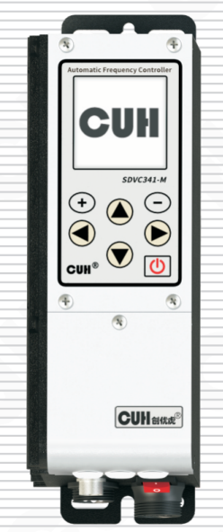

## SDVC341-M
Controlador automático de frecuencia para alimentador vibratorio  SDVC341-M
# Manual de usuario


---

## Declaración de derechos de autor

Nanjing CUH Science & Technology CO., Ltd. se reserva todos los derechos.

Toda la información contenida en este manual de usuario es conocimiento de nuestra empresa y está protegida por las leyes de derechos de autor y otras leyes relacionadas. CUH disfruta y se reserva todos los derechos conferidos por las leyes de derechos de autor y otras leyes. Sin el consentimiento por escrito de CUH, no se podrá copiar, traducir, imitar ni utilizar de otro modo parte o la totalidad de este manual de usuario.

## Exención de responsabilidad

Todos los contenidos de este manual de usuario solo describen el método de uso de los productos relacionados fabricados por nuestra empresa y se describen según la tecnología existente y el estado en que se le suministró en el momento de su uso. Usted debe asumir los riesgos correspondientes al utilizar este producto. Salvo lo exigido por la ley, la empresa no asume ninguna responsabilidad expresa o implícita por el producto derivada de este manual de usuario, incluidos, entre otros, lesiones personales, daños materiales, pérdida de oportunidades, etc.

Usted comprende claramente los riesgos anteriores y acepta que, salvo lo dispuesto por la ley, la empresa no es responsable de ningún daño o pérdida directa o indirecta que usted sufra (incluidos, entre otros, la pérdida tangible de personal, propiedad, datos, etc., y la pérdida intangible de reputación, oportunidades, etc.).

La empresa se reserva el derecho de modificar los productos aplicables en este manual de usuario sin notificación previa o posterior.

---


---

# Prefacio

Gracias por elegir el controlador automático de frecuencia para alimentador vibratorio de la serie CUH SDVC341 (en adelante, el controlador). Esta serie de controladores utiliza componentes de alta calidad e incorpora la tecnología electrónica más reciente, y está cuidadosamente diseñada con procesadores de señales digitales de alto rendimiento.

Este manual presenta el método de operación básico, la descripción técnica de las funciones y ejemplos de aplicaciones típicas de este producto. Proporciona a los usuarios información relevante sobre la instalación y puesta a punto, el ajuste de parámetros, el diagnóstico de anomalías, la solución de problemas y el mantenimiento rutinario del controlador. Para garantizar la instalación y el uso correctos de este controlador, lea atentamente este manual de usuario antes de la instalación y consérvelo adecuadamente.

Asegúrese de leer los símbolos siguientes, que le advierten sobre las precauciones contra lesiones personales y daños al producto.

| Símbolo | Descripción |
|---|---|
| Peligro | La no observancia de este punto<br>provocará lesiones personales o la muerte. |
| Advertencia | La no observancia de este punto<br>puede provocar lesiones personales o la muerte. |
| Precaución | La no observancia de este punto<br>puede provocar lesiones moderadas o leves a las personas. |
| Aviso | La no observancia de este punto<br>provocará daños al producto y daños materiales. |
| Obligatorio | Indica precauciones y restricciones de uso que deben<br>observarse durante el uso. |

**Este manual es adecuado para los siguientes modelos de controladores:**

◆ Controlador automático de frecuencia para alimentador vibratorio　　SDVC341-M (3.0A)

---


---

# Seguridad y precauciones

1. **Peligro** Este producto solo se utiliza para accionar equipos de alimentación vibratoria basados en electroimanes; no utilice este producto con el fin de proteger el cuerpo humano o partes del cuerpo humano, etc.

2. **Peligro** Este producto no está destinado a utilizarse como producto a prueba de explosiones; no lo utilice en lugares peligrosos y/o en entornos con gas potencialmente explosivo.

3. **Advertencia** Este producto se alimenta con corriente alterna de la red; no aplique una tensión de CA superior a 250Vac. Una tensión de entrada excesiva, como 380Vac, puede provocar que el producto explote o se incendie, con graves accidentes de seguridad como consecuencia.

4. **Advertencia** Este producto se conecta a tierra a través del cable de alimentación. Asegúrese de que las instalaciones de distribución de energía del controlador estén bien conectadas a tierra; de lo contrario, la carcasa del controlador podría quedar electrificada y provocar un accidente de descarga eléctrica.

5. **Advertencia** No introduzca alimentación de CA en la salida de este controlador; dañará el controlador.

6. **Advertencia** No conecte ni desconecte el cableado con tensión ni toque los contactos de los terminales de cableado en el compartimento de cableado para evitar descargas eléctricas.

7. **Aviso** Evite controlar la salida de este producto cortando la alimentación mediante relés y otros dispositivos, ya que esto reduce seriamente la vida útil del controlador.

8. **Aviso** El controlador está diseñado para trabajar en un entorno fresco y seco. Nunca utilice el controlador a la intemperie para evitar inundaciones e insolación. Haga funcionar el controlador dentro de las características eléctricas de temperatura especificadas.

9. **Obligatorio** Asegúrese de fijar este producto sobre una plataforma sólida conectada de forma fiable a tierra y alejada de equipos que vibren.

10. **Obligatorio** Nunca haga funcionar el controlador en condiciones que superen sus límites de diseño.

11. **Obligatorio** Utilice el controlador estrictamente de acuerdo con este manual de instrucciones. No asumiremos ninguna responsabilidad civil ni penal si los daños al equipo o las lesiones personales son consecuencia de una operación incorrecta.

12. **Obligatorio** Nunca abra la carcasa del controlador para evitar descargas eléctricas. Póngase en contacto con CUH si el controlador presenta algún fallo. No intente nunca reparar el controlador usted mismo, ya que ello podría anular la garantía.

---


---

# Entorno de funcionamiento y almacenamiento

## Inspección antes del uso

Cada controlador se somete a una rigurosa inspección de calidad antes de la entrega y se embala con embalaje antichoque; compruebe los siguientes elementos después de desembalar:

1. Si el controlador se ha dañado durante el transporte.
2. Si el modelo del controlador es el que usted ha pedido.

## Entorno de ejecución

Siga las notas siguientes para garantizar un mejor rendimiento y una mayor vida útil del controlador:

- ❗ Entorno bien ventilado
- ❗ Mantener alejado del agua, del vapor, del polvo y especialmente del polvo grasiento
- ❗ Mantener alejado de gases y líquidos corrosivos o inflamables
- ❗ Mantener alejado del polvo flotante y de las partículas metálicas
- ❗ Fijación firme para evitar vibraciones propias
- ❗ Mantener alejado de interferencias electromagnéticas
- ❗ Asegurar que la temperatura ambiente sea de 0~40 °C
- ❗ Para uso a una altitud de 2000 m o inferior

---


---

# Contenido

**Capítulo Ⅰ Instrucciones previas al uso** --------------------------------------------------1

1.1 Comprobación del contenido del paquete----------------------------------------------------------------1

1.2 Explicación de la placa de características del fabricante ----------------------------------------------------2

1.3 Condiciones de uso del controlador-----------------------------------------------------------2

1.4 Observaciones--------------------------------------------------------------------------------3

**Capítulo Ⅱ Introducción del producto**------------------------------------------------------4

2.1 Introducción del producto ------------------------------------------------------------------4

2.2 Teclado y puertos de E/S ------------------------------------------------------------------5

2.3 Guía de instalación del sensor de vibración --------------------------------------------------6

2.4 Descripción de los parámetros de la página principal ------------------------------------------------------7

2.5 Definición de los puertos de control de señales ------------------------------------------------------7

2.6 Operación del teclado ----------------------------------------------------------------------8

2.7 Diagrama de rotación de las interfaces de operación ------------------------------------------------8

**Capítulo Ⅲ Cableado de alimentación y operación básica**-----------------------------------------9

3.1 Cableado de alimentación---------------------------------------------------------------------------9

3.2 Operación básica------------------------------------------------------------------------11

**Capítulo Ⅳ Introducción detallada de las funciones**-------------------------------------------13

4.1 Ajustes de parámetros comunes -----------------------------------------------------------14

4.1.1 Tensión -----------------------------------------------------------------------------14

4.1.2 Frecuencia ---------------------------------------------------------------------------14

4.1.3 Velocidad de alimentación------------------------------------------------------------------------15

4.1.4 Tiempo de arranque suave/tiempo de parada suave------------------------------------------------------15

4.1.5 Tensión máxima/corriente máxima --------------------------------------------------15

4.1.6 Frecuencia de salida máxima/frecuencia de salida mínima--------------------------------15

4.1.7 Detección de carga ----------------------------------------------------------------------16

4.1.8 Alarma de falta de material-----------------------------------------------------------------------16

4.1.9 Alarma de parada ----------------------------------------------------------------------16

4.1.10 Brillo de la retroiluminación -------------------------------------------------------------16

4.1.11 Apagado de la retroiluminación-----------------------------------------------------------------------17

4.1.12 Idioma----------------------------------------------------------------------------17

4.2 Búsqueda automática de frecuencia resonante -------------------------------------------------17

4.2.1 Interfaz de búsqueda de frecuencia -------------------------------------------------------17

---


4.3 Velocidad de alimentación constante ----------------------------------------------------------------18

  4.3.1 Frecuencia central -------------------------------------------------------------18

  4.3.2 Desviación de frecuencia --------------------------------------------------------------18

  4.3.3 Integración de frecuencia ---------------------------------------------------------18

  4.3.4 Integración de amplitud ---------------------------------------------------------19

  4.3.5 Relación de amplitud ---------------------------------------------------------------19

  4.3.6 Fase automática --------------------------------------------------------------------19

  4.3.7 Corriente del proceso de búsqueda de frecuencia -------------------------------------------19

  4.3.8 Amplitud del proceso de búsqueda de frecuencia -----------------------------------------19

  4.3.9 Velocidad de alimentación máxima ------------------------------------------------------------19

  4.3.10 Desviación de fase del controlador esclavo ------------------------------------------------19

  4.3.11 Modo de control de la tensión de salida --------------------------------------------------20

  4.3.12 Modo de control de la frecuencia de salida ------------------------------------------------20

  4.3.13 Fuente de sincronización ------------------------------------------------------------------20

  4.3.14 Tipo de sensor de vibración --------------------------------------------------------20

  4.3.15 Velocidad de búsqueda automática de frecuencia resonante ----------------------------------------20

4.4 Parámetros de salida ------------------------------------------------------------------21

  4.4.1 Parámetros de la salida principal --------------------------------------------------------21

  4.4.2 Parámetros de la salida de control de CC --------------------------------------------------28

4.5 Control de señales ---------------------------------------------------------------------30

  4.5.1 Tipo de sensor -------------------------------------------------------------------30

  4.5.2 Lógica del puerto C/puerto E -----------------------------------------------------------31

  4.5.3 Retardo de conexión/desconexión del puerto C y del puerto E ----------------------------------31

  4.5.4 Lógica de velocidad A/lógica de velocidad B ---------------------------------------------------32

  4.5.5 Retardo de conexión/desconexión de velocidad A y de velocidad B --------------------------------32

4.6 Conteo de cantidad de material----------------------------------------------------------33

  4.6.1 Conteo de cantidad de material (o velocidad A/B) -------------------------------------33

  4.6.2 Cantidad objetivo ---------------------------------------------------------------34

  4.6.3 Velocidad terminal ----------------------------------------------------------------34

  4.6.4 Cantidad de velocidad terminal -------------------------------------------------------35

  4.6.5 Restablecer el valor de conteo a 0 -----------------------------------------------------35

  4.6.6 Prioridad RS -------------------------------------------------------------------35


4.7 Guardar ajustes ----------------------------------------------------------------36

&nbsp;&nbsp;&nbsp;&nbsp;4.7.1 Ajustes de recuperación ----------------------------------------------------------36

&nbsp;&nbsp;&nbsp;&nbsp;4.7.2 Guardar ajustes---------------------------------------------------------------36

&nbsp;&nbsp;&nbsp;&nbsp;4.7.3 Restauración de fábrica-------------------------------------------------------------37

&nbsp;&nbsp;&nbsp;&nbsp;4.7.4 Copiar ajustes --------------------------------------------------------------37

&nbsp;&nbsp;&nbsp;&nbsp;4.7.5 Contraseña de usuario -------------------------------------------------------------37

&nbsp;&nbsp;&nbsp;&nbsp;4.7.6 Introducir contraseña-------------------------------------------------------------37

4.8 Comunicación RS485-----------------------------------------------------------38

&nbsp;&nbsp;&nbsp;&nbsp;4.8.1 Tipo de comunicación --------------------------------------------------------38

&nbsp;&nbsp;&nbsp;&nbsp;4.8.2 Velocidad en baudios------------------------------------------------------------------39

&nbsp;&nbsp;&nbsp;&nbsp;4.8.3 Dirección del controlador esclavo---------------------------------------------------39

&nbsp;&nbsp;&nbsp;&nbsp;4.8.4 Resistencia del puerto/resistencia de sincronización-------------------------------------39

4.9 Red CUHBus-DS®---------------------------------------------------------40

&nbsp;&nbsp;&nbsp;&nbsp;4.9.1 Red de dispositivos ---------------------------------------------------------41

&nbsp;&nbsp;&nbsp;&nbsp;4.9.2 Función de sincronización--------------------------------------------------------------45

&nbsp;&nbsp;&nbsp;&nbsp;4.9.3 Compartición de señales ------------------------------------------------------------51

&nbsp;&nbsp;&nbsp;&nbsp;4.9.4 Copia de seguridad de datos----------------------------------------------------------------53

&nbsp;&nbsp;&nbsp;&nbsp;4.9.5 Datos de control remoto--------------------------------------------------------54

4.10 Supervisión del estado del controlador ------------------------------------------------54

4.11 Registro de errores -------------------------------------------------------------------55

4.12 Personalización de la página principal ----------------------------------------------------------55

**Capítulo Ⅴ Aplicaciones típicas** ----------------------------------------------56

&nbsp;&nbsp;&nbsp;&nbsp;5.1 ¿Cómo mantener dos alimentadores vibratorios funcionando a la misma frecuencia? ------------56

&nbsp;&nbsp;&nbsp;&nbsp;5.2 ¿Cómo encender/apagar el controlador B mediante un sensor conectado al controlador A? -----57

&nbsp;&nbsp;&nbsp;&nbsp;5.3 ¿Cómo encender/apagar dos controladores simultáneamente?---------------------------58

**Capítulo Ⅵ Preguntas frecuentes**-----------------------------------------59

&nbsp;&nbsp;&nbsp;&nbsp;6.1 Sin visualización al encender ----------------------------------------------------59

&nbsp;&nbsp;&nbsp;&nbsp;6.2 Sin vibración, sin ruido, visualización normal del controlador ---------------------------59

&nbsp;&nbsp;&nbsp;&nbsp;6.3 La señal de control no funciona-------------------------------------------------59

&nbsp;&nbsp;&nbsp;&nbsp;6.4 Sin vibración, ruido normal, la visualización del controlador es normal --------------------59

&nbsp;&nbsp;&nbsp;&nbsp;6.5 Seguimiento inestable de la frecuencia resonante-----------------------------------------59

&nbsp;&nbsp;&nbsp;&nbsp;6.6 Corrección lenta de la velocidad en el control de velocidad de alimentación constante ------------------------60


---

6.7 Cómo restablecer rápidamente el controlador a los valores de fábrica -------------------------60

**Capítulo Ⅶ Apéndice** ------------------------------------------------------------------------61

&nbsp;&nbsp;&nbsp;&nbsp;7.1 Dimensiones -------------------------------------------------------------------------------61

&nbsp;&nbsp;&nbsp;&nbsp;7.2 Especificaciones técnicas---------------------------------------------------------------62

&nbsp;&nbsp;&nbsp;&nbsp;7.3 Norma de referencia---------------------------------------------------------------------63

&nbsp;&nbsp;&nbsp;&nbsp;7.4 Lista de parámetros----------------------------------------------------------------------------64

&nbsp;&nbsp;&nbsp;&nbsp;&nbsp;&nbsp;&nbsp;&nbsp;7.4.1 Grupo de parámetros de interfaz -----------------------------------------------------64

&nbsp;&nbsp;&nbsp;&nbsp;&nbsp;&nbsp;&nbsp;&nbsp;7.4.2 Grupo de parámetros comunes-----------------------------------------------------65

&nbsp;&nbsp;&nbsp;&nbsp;&nbsp;&nbsp;&nbsp;&nbsp;7.4.3 Grupo de parámetros de la salida principal ------------------------------------------------66

&nbsp;&nbsp;&nbsp;&nbsp;&nbsp;&nbsp;&nbsp;&nbsp;7.4.4 Grupo de parámetros de velocidad estable-----------------------------------------------67

&nbsp;&nbsp;&nbsp;&nbsp;&nbsp;&nbsp;&nbsp;&nbsp;7.4.5 Grupo de parámetros de entrada de señales-------------------------------------------------68

&nbsp;&nbsp;&nbsp;&nbsp;&nbsp;&nbsp;&nbsp;&nbsp;7.4.6 Grupo de parámetros de la salida de control---------------------------------------------69

&nbsp;&nbsp;&nbsp;&nbsp;&nbsp;&nbsp;&nbsp;&nbsp;7.4.7 Grupo de parámetros de conteo de CC ------------------------------------------------70

&nbsp;&nbsp;&nbsp;&nbsp;&nbsp;&nbsp;&nbsp;&nbsp;7.4.8 Grupo de parámetros de comunicación -------------------------------------------71

&nbsp;&nbsp;&nbsp;&nbsp;&nbsp;&nbsp;&nbsp;&nbsp;7.4.9 Grupo de guardar ajustes--------------------------------------------------------------72

&nbsp;&nbsp;&nbsp;&nbsp;&nbsp;&nbsp;&nbsp;&nbsp;7.4.10 Grupo de parámetros de supervisión-------------------------------------------------73

&nbsp;&nbsp;&nbsp;&nbsp;&nbsp;&nbsp;&nbsp;&nbsp;7.4.11 Lista adjunta----------------------------------------------------------------------75

&nbsp;&nbsp;&nbsp;&nbsp;7.5 Diagramas de circuito de entrada y salida -------------------------------------------------76

&nbsp;&nbsp;&nbsp;&nbsp;7.6 Código de error---------------------------------------------------------------------------------78

&nbsp;&nbsp;&nbsp;&nbsp;7.7 Código de advertencia ----------------------------------------------------------------------------79

**Capítulo Ⅷ Información de garantía del producto**-------------------------------------80

&nbsp;&nbsp;&nbsp;&nbsp;8.1 Período de garantía -------------------------------------------------------------------------80

&nbsp;&nbsp;&nbsp;&nbsp;8.2 Cobertura de la garantía----------------------------------------------------------------------80

&nbsp;&nbsp;&nbsp;&nbsp;8.3 Idoneidad del producto----------------------------------------------------------------------80

---


# Capítulo Ⅰ Instrucciones previas al uso

Este capítulo presenta el contenido del embalaje del producto, la descripción del aspecto del controlador y la información de la placa de características del controlador.

## 1.1 Comprobación del contenido del paquete

Antes de usarlo, compruebe la integridad del controlador y de los accesorios. Si observa que el producto presenta defectos o daños, faltan accesorios, etc., póngase en contacto con nuestra empresa.


Contenido del paquete mostrado:

- Controlador×1
- Manual de usuario×1
- Cable de salida×1
- Cable de alimentación de entrada×1
- Sensor de vibración×1

---


## 1.2 Explicación de la placa de características del fabricante

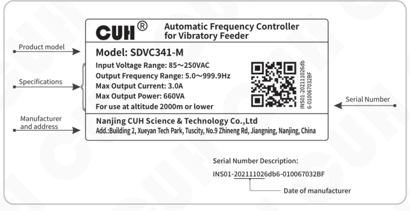

Información de la placa de características mostrada en la ilustración:

- Modelo del producto: **Model: SDVC341-M**
- Nombre del producto: **Controlador automático de frecuencia para alimentador vibratorio**
- Especificaciones:
  - Rango de tensión de entrada: **85~250VAC**
  - Rango de frecuencia de salida: **5.0~999.9Hz**
  - Corriente de salida máxima: **3.0A**
  - Potencia de salida máxima: **660VA**
  - Para uso a una altitud de **2000 m o inferior**
- Fabricante y dirección:
  - **Nanjing CUH Science & Technology Co., Ltd**
  - Dir.: **Building 2, Xueyan Tech Park, Tuscity, No.9 Zhineng Rd, Jiangning, Nanjing, China**
- Descripción del número de serie: **INS01-202111026db6-010067032BF**
  - Fecha de fabricación: **20211102**

## 1.3 Condiciones de uso del controlador

El controlador se alimenta con CA de 85V~250V y se conecta a tierra de protección a través del enchufe del cable de alimentación. Utilice una alimentación de red estándar y asegúrese de que el conductor de tierra de protección esté correctamente conectado.

> ⚠️ **Advertencia**  
> Nunca conecte el controlador a una alimentación de CA de 380V; esto causará daños graves e irreversibles al controlador, pudiendo provocar explosión, incendio y otros incidentes de seguridad.

> ⚠️ **Advertencia**  
> Asegúrese de que el lado de la alimentación esté conectado de forma fiable a tierra. La carcasa metálica del controlador está directamente conectada al conductor de tierra de protección. Una mala conexión a tierra hará que la carcasa del controlador quede electrificada y provoque un accidente de descarga eléctrica.

> **Aviso**  
> El funcionamiento prolongado genera calor y provoca un aumento de la temperatura de la carcasa. Instale el controlador en un entorno bien ventilado y fíjelo bien, alejado de fuentes de vibración.

> **Aviso**  
> Este producto es un controlador destinado a accionar el electroimán. No debe conectarse a un alimentador vibratorio piezoeléctrico.


---

## 1.4 Observaciones

Este manual de uso tiene una longitud aproximada de 28000 palabras y se espera que tarde una hora en leerlo por completo.

◆ Lea atentamente este manual antes de usar el producto para evitar daños al controlador por una operación inadecuada.

◆ Los usuarios pueden localizar rápidamente las funciones y los métodos de operación relevantes del controlador según el índice del manual.

◆ Los subtítulos de los capítulos y el texto enfatizado del documento son los elementos de parámetros mostrados realmente por el controlador, como la tensión.

◆ Los usuarios pueden consultar el "Capítulo Ⅴ Aplicaciones típicas" para familiarizarse rápidamente con este controlador.

◆ Los usuarios pueden buscar rápidamente los códigos de las etiquetas de funciones en la sección "7.4 Lista de parámetros".

◆ Pulsar ⊕ y ⊖ simultáneamente indica confirmación.

---


---

# Capítulo Ⅱ Introducción del producto

El contenido principal de este capítulo incluye una breve introducción y las características principales de este producto.

## 2.1 Introducción del producto

El controlador automático de frecuencia para alimentador vibratorio de la serie SDVC341 es un producto diseñado especialmente para sistemas de alimentación de gama alta.

Se proporciona un rendimiento único mediante el uso de la tecnología electrónica más reciente y métodos de procesamiento de señales. Sus características especiales incluyen:

- Incorpora la función de elevación con corrección del factor de potencia PFC y admite una tensión de salida máxima de 250V dentro del rango de tensión de entrada de 85~250V.
- Puede aplicarse un freno para detener rápidamente el alimentador vibratorio.
- Mediante la comunicación CUHBus-DS® se realiza la sincronización, la copia de seguridad y la recuperación de los parámetros de control remoto, como la tensión, la frecuencia y la fase, de cada controlador.
- Las señales de otros puertos de controladores pueden utilizarse para el control lógico mediante la comunicación CUHBus-DS®.
- La función de alarma de falta de material puede realizarse sin instalar sensores adicionales.
- Pueden emitirse señales acústicas de notas seleccionables a través del alimentador vibratorio.
- Amplía la frecuencia de salida a 5Hz~999.9Hz.
- El puerto de regulación de velocidad analógica admite los modos 0~5V, 1~5V, 0~10V, 4~20mA, etc.
- Incorpora la función de conteo, incluida la desaceleración por conteo y la parada por conteo.
- La búsqueda de frecuencia mejorada de amplitud constante garantiza que dos alimentadores vibratorios con una separación pequeña no colisionen durante el proceso de búsqueda de frecuencia.
- Admite los protocolos RS485 Modbus ASCII y RS485 Modbus RTU.
- La actualización del software puede realizarse a través de la interfaz RS485.
- Adopta una pantalla LCD de resolución 128 * 128 y admite tres idiomas: chino, inglés y alemán.
- Detecta las características de la corriente de carga para ayudar a los usuarios a diagnosticar fallos.
- El código de fallo puede almacenar los últimos 64 registros de fallos.

---


## 2.2 Teclado y puertos de E/S

### Explicación de la ventana y los botones

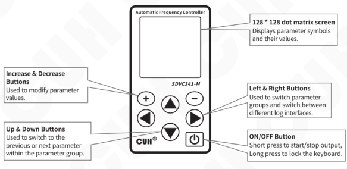

| Elemento | Explicación |
|---|---|
| Botones de aumento y disminución | Se utilizan para modificar los valores de los parámetros. |
| Botones arriba y abajo | Se utilizan para pasar al parámetro anterior o siguiente dentro del grupo de parámetros. |
| Botones izquierda y derecha | Se utilizan para cambiar de grupo de parámetros y alternar entre las distintas interfaces de registro. |
| Pantalla de matriz de puntos de 128 * 128 | Muestra los símbolos de los parámetros y sus valores. |
| Botón de encendido/apagado | Pulsación corta para iniciar/detener la salida, pulsación larga para bloquear el teclado. |

### Explicación de las partes externas

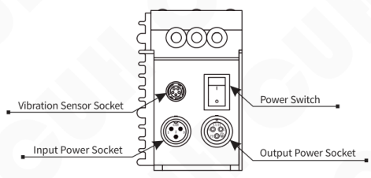

| Parte externa | Etiqueta mostrada en la figura |
|---|---|
| Socket del sensor de vibración | Vibration Sensor Socket |
| Socket de alimentación de entrada | Input Power Socket |
| Interruptor de alimentación | Power Switch |
| Socket de alimentación de salida | Output Power Socket |


---

## 2.3 Guía de instalación del sensor de vibración

Fije el sensor de vibración en la superficie lisa del vibrador con orientación de instalación arbitraria; los métodos de instalación del sensor de vibración se muestran a continuación:

- Método 1: como se muestra en la figura 2.3.1  
  Ventaja: instalación sencilla

- Método 2: como se muestra en la figura 2.3.2  
  Nota: no deje que el sensor de vibración quede presionado por el cuenco de alimentación.

- Método 3: suelde un soporte al vibrador y fije el sensor de vibración en el soporte. Como se muestra en la figura 2.3.3  
  Las dimensiones recomendadas del soporte de la vibración se muestran en la figura 2.3.4.

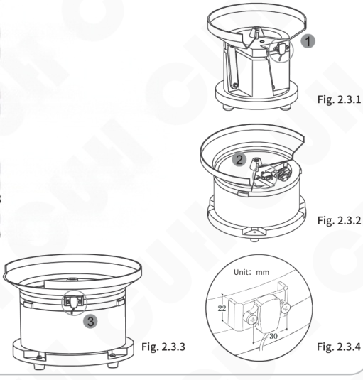

- Método de instalación no recomendado, como se muestra en las figuras 2.3.5 y 2.3.6.  
  Si la ubicación de la instalación no es adecuada, el sensor de vibración no puede realimentar la frecuencia resonante con precisión y el controlador ejecutará la búsqueda de la frecuencia resonante continuamente.

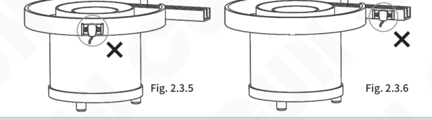

---


## 2.4 Descripción de los parámetros de la página principal

El controlador puede mostrar en la página principal el estado de la salida principal, el estado del bloqueo del teclado, el estado de los puertos, los parámetros de supervisión y el nombre de la interfaz. Dentro del estado de los puertos: el resaltado de X indica que el puerto es válido. X indica que el puerto es válido con nivel bajo, y X indica que el puerto es válido con nivel alto.

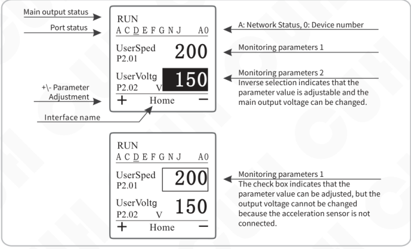

Etiquetas mostradas en el diagrama:

- Estado de la salida principal
- Estado de los puertos
- A: estado de la red, 0: número de dispositivo
- Parámetros de supervisión 1
- Parámetros de supervisión 2  
  La selección inversa indica que el valor del parámetro es ajustable y que se puede cambiar la tensión de la salida principal.
- Ajuste de parámetros con +/-
- Nombre de la interfaz
- Parámetros de supervisión 1  
  La casilla de verificación indica que el valor del parámetro puede ajustarse, pero no se puede cambiar la tensión de salida porque el sensor de aceleración no está conectado.

Valores de ejemplo de la página principal mostrados:

| Elemento | Contenido mostrado |
|---|---|
| Estado de la salida principal | RUN |
| Estado de los puertos | A C D E F G N J |
| Número de red / de dispositivo | A0 |
| Parámetro de supervisión 1 | UserSped / P2.01 / 200 |
| Parámetro de supervisión 2 | UserVoltg / P2.02 / V / 150 |
| Nombre de la interfaz | Home |
| Teclas de ajuste de parámetros | + / - |

## 2.5 Definición de los puertos de control de señales

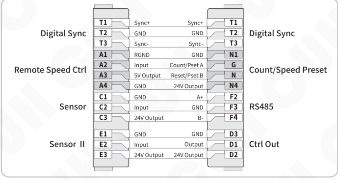

| Lado | Grupo de funciones | Puerto | Definición |
|---|---|---|---|
| Izquierda | Digital Sync | T1 | Sync+ |
| Izquierda | Digital Sync | T2 | GND |
| Izquierda | Digital Sync | T3 | Sync- |
| Izquierda | Remote Speed Ctrl | A1 | RGND |
| Izquierda | Remote Speed Ctrl | A2 | Input |
| Izquierda | Remote Speed Ctrl | A3 | 5V Output |
| Izquierda | Remote Speed Ctrl | A4 | GND |
| Izquierda | Sensor | C1 | GND |
| Izquierda | Sensor | C2 | Input |
| Izquierda | Sensor | C3 | 24V Output |
| Izquierda | Sensor II | E1 | GND |
| Izquierda | Sensor II | E2 | Input |
| Izquierda | Sensor II | E3 | 24V Output |
| Derecha | Digital Sync | T1 | Sync+ |
| Derecha | Digital Sync | T2 | GND |
| Derecha | Digital Sync | T3 | Sync- |
| Derecha | Count/Speed Preset | N1 | GND |
| Derecha | Count/Speed Preset | G | Count/Pset A |
| Derecha | Count/Speed Preset | N | Reset/Pset B |
| Derecha | Count/Speed Preset | N4 | 24V Output |
| Derecha | RS485 | F2 | A+ |
| Derecha | RS485 | F3 | GND |
| Derecha | RS485 | F4 | B- |
| Derecha | Ctrl Out | D3 | GND |
| Derecha | Ctrl Out | D1 | Output |
| Derecha | Ctrl Out | D2 | 24V Output |


---

## 2.6 Operación del teclado

a. Este controlador utiliza una pantalla de matriz de puntos de 128 * 128 para mostrar el contenido de los parámetros.

b. Según el tiempo de pulsación del botón, las acciones del botón se dividen en pulsación corta, pulsación larga, aceleración de nivel 1 y aceleración de nivel 2.

[Pulsación corta]: pulsar durante más de 0.1 segundos pero menos de 0.5 segundos.

[Pulsación larga]: pulsar durante más de 2 segundos.

[Aceleración de nivel 1]: pulsar durante más de 0.5 segundos pero menos de 2 segundos.

[Aceleración de nivel 2]: pulsar durante más de 2 segundos.

c. La función principal de ⊕ y ⊖ es modificar los valores de los parámetros.

d. Cambie entre los grupos de parámetros superior e inferior en la interfaz de ajuste de parámetros pulsando brevemente ◀ o ▶.

e. Alterne entre los parámetros superior e inferior de este grupo en la interfaz de ajuste de parámetros pulsando brevemente ▲ o ▼.

f. Pulse brevemente ⏻ para iniciar/detener la salida principal; pulse prolongadamente ⏻ para bloquear/desbloquear el teclado.

g. Entre en los distintos grupos de parámetros mediante las siguientes combinaciones de botones:

Pulsación larga de ▲+▼: entrar o salir de la interfaz de búsqueda de frecuencia.

Pulsación larga de ▲+◀: entrar o salir de la interfaz de ajuste de parámetros.

Pulsación larga de ▲+▶: entrar o salir de la interfaz de registro.

## 2.7 Diagrama de rotación de las interfaces de operación

En cualquier interfaz, mantenga pulsado **▲+▶** para entrar en la **Interfaz de registro**; vuelva a mantener pulsado para salir a la **Interfaz principal**.

En cualquier interfaz, mantenga pulsado **▲+▼** para entrar en la **Interfaz de búsqueda de frecuencia**; pulse brevemente el botón de parada para salir a la **Interfaz principal**.

En cualquier interfaz, mantenga pulsado **▲+◀** para entrar en la **Interfaz de ajuste de parámetros**; vuelva a mantener pulsado para salir a la **Interfaz principal**.

En cualquier interfaz, si no hay ninguna acción durante más de 5 minutos, se entra en la **Interfaz de espera**; pulse cualquier tecla para volver a la **Interfaz principal**.

---


---

# Capítulo Ⅲ Cableado de alimentación y operación básica

## 3.1 Cableado de alimentación

### Paso uno:

Abra la caja del embalaje y compruebe el controlador y todos los accesorios.

### Paso dos:

Conecte los terminales de cableado del cable de alimentación de salida a la bobina electromagnética del vibrador.

Alinee la muesca del enchufe aviación del cable de salida con la marca triangular del socket de salida del controlador y apriete la tuerca después de conectar correctamente el cable de salida.

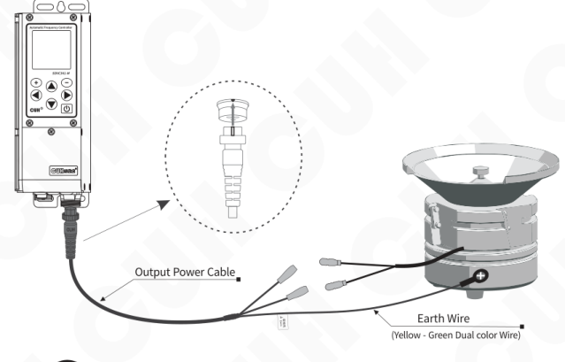

> **Nota**
>
> 1. Asegúrese de que las bobinas electromagnéticas del vibrador estén conectadas a los dos pines de salida del cable de alimentación de salida y de que la carcasa metálica del vibrador esté conectada de forma fiable a tierra.
>
> 2. Está prohibido conectar cargas piezoeléctricas a la salida de alimentación; de lo contrario, podría provocar un accidente de seguridad por descarga eléctrica.

---


---

### Paso tres:

Conecte el conector del cable de alimentación de entrada al socket de alimentación de entrada del controlador.

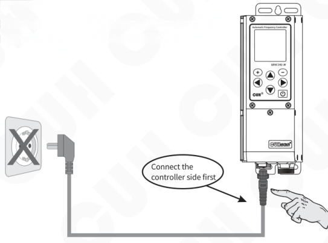

### Paso cuatro:

Después de confirmar que el interruptor está en la posición de apagado, conecte el enchufe del cable de alimentación de entrada a la toma de corriente de la red.

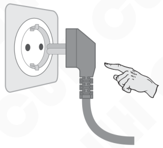

---


## 3.2 Operación básica

### Paso cinco:

Encienda el interruptor de alimentación del controlador; el controlador muestra la interfaz principal.

```text
RUN
A C D E F G N J     A0
─────────────────────
UserSped           200
P2.01
EffectCu          0.00
P10.05        A
+       Home       −
```

### Paso seis:

El alimentador vibratorio comienza a funcionar. Ajuste los valores de los parámetros de frecuencia y tensión del grupo de parámetros "2 Common" para seleccionar la velocidad de alimentación adecuada.

- Mantenga pulsados ▲ y ◀ para entrar en la interfaz de ajuste de parámetros; pulse brevemente ▶ para cambiar al grupo de parámetros "2 Common".
- Pulse brevemente ▲ o ▼ para colocar el cursor en el valor del parámetro de tensión.
- Pulse ⊕ o ⊖ para ajustar el valor del parámetro.
- Pulse brevemente ▲ o ▼ para colocar el cursor en el valor del parámetro de frecuencia.
- Pulse ⊕ o ⊖ para ajustar el valor del parámetro.

```text
RUN
A C D E F G N J     A0
─────────────────────
01.UserSped        200
02.UsrVoltg        150 V
03.UsrFrqnc       50.0 Hz
04.SoftStar        0.5 S
05.SoftStop        0.5 S
+      2Common      −
```

> ☺
>
> - La frecuencia a la que la vibración alcanza su máximo es la frecuencia natural del cuerpo vibrante.
> - Cada vibrador tiene su frecuencia mecánica de resonancia natural; ajuste la frecuencia de salida del controlador a esta frecuencia para lograr el mejor estado de funcionamiento.


### Paso siete:

Los clientes pueden conectar además el sensor de aceleración para realizar la búsqueda automática de frecuencia del controlador. (Nota: el usuario no necesita vaciar los materiales del plato de vibración)

Saque el sensor, conecte el enchufe del sensor al controlador y apriete la tuerca, y fije correctamente el cuerpo del sensor en el plato de vibración (véase el capítulo 2.3)

### Paso ocho:

- Mantenga pulsados ▲ y ▼ para entrar en la interfaz de búsqueda de frecuencia.
- En este momento, la pantalla muestra la curva de amplitud del plato de vibraciones durante el proceso de búsqueda de frecuencia (tres etapas) y muestra sincrónicamente los valores de tensión, corriente y aceleración en ese momento.
- Una vez completada la búsqueda de frecuencia, el controlador muestra "Save" para indicar que la búsqueda de frecuencia se ha realizado correctamente y que la frecuencia central se ha guardado. El controlador volverá automáticamente a la página principal.
- Los usuarios pueden ajustar aún más la velocidad de alimentación del alimentador vibratorio mediante ⊕ o ⊖.

| Estado mostrado | Indicadores | Frecuencia | Tensión | Corriente | Aceleración | Interfaz |
|---|---|---:|---:|---:|---:|---|
| RUN | A C D E F G N J A0 | 95Hz | 4V | 0.26A | 1.0g | SearchFr |
| RUN | A C D E F G N J A0 | 442Hz | 23V | 0.42A | 0.5g | SearchFr |
| RUN | A C D E F G N J A0 | 1033Hz | 54V | 0.46A | 0.3g | SearchFr |
| Save | A C D E F G N J A0 | 841Hz | 81V | 0.84A | 2.1g | SearchFr |

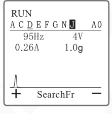

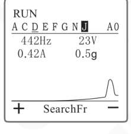

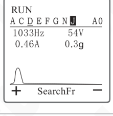

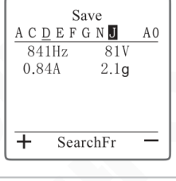


---

# Capítulo Ⅳ Introducción detallada de las funciones

Este capítulo presenta las funciones y los ajustes detallados del controlador.  
Mantenga pulsados ▲ y ◀ en cualquier interfaz para entrar en la interfaz de ajuste de parámetros.  
La interfaz de ajuste de parámetros incluye los diez grupos de parámetros siguientes.  
Pulse brevemente ◀ o ▶ para alternar entre los distintos grupos de parámetros.

```text
                         1EditHome
                             ↕
                          2Common
                             ↕
                         3M_output
                             ↕
                         4Stabilize
                             ↕
Short press ▶            5On&Off              Short press ▶
                             ↕
                         6DCoutput
                             ↕
                          7Counter
                             ↕
                           8Comm
                             ↕
                           9Save
                             ↕
                          10Monitor
```

Diagrama de rotación de los grupos de parámetros

---


## 4.1 Ajustes de parámetros comunes

Este capítulo presenta principalmente el ajuste y la regulación de los parámetros comunes básicos del controlador.

### 4.1.1 Tensión

Este controlador permite ajustar la tensión de salida directamente de forma digital en el panel. Dado que el controlador dispone de una función de salida estabilizada de tensión, este valor es el valor medio de rectificación de la tensión y no se ve afectado por la tensión de entrada. La tensión de salida puede mantenerse estable incluso en situaciones en las que la tensión de la red es inestable. Al mismo tiempo, el ajuste directo del valor de tensión también proporciona datos precisos para que los usuarios conozcan el funcionamiento del equipo.

» Entre en el grupo de parámetros comunes y busque el parámetro de ajuste de tensión.

» Pulse ⊕ o ⊖ para ajustar el valor del parámetro.

El rango de la tensión es 0~250V, el valor predeterminado es 150V y la precisión de ajuste es de 1V.

```text
RUN
A C D E F G N J    A0
01.UserSped     200
02.UsrVoltg     150 V
03.UsrFrqnc     50.0 Hz
04.SoftStar       0.5 S
05.SoftStop       0.5 S
+    2Common       −
```

### 4.1.2 Frecuencia

El controlador utiliza la tecnología de síntesis digital directa de frecuencia (DDS), que ofrece una precisión y una estabilidad de frecuencia muy elevadas, sin variar con el tiempo ni con la temperatura.

» Entre en el grupo de parámetros comunes y busque el parámetro de ajuste de frecuencia.

» Pulse ⊕ o ⊖ para ajustar el valor del parámetro.

El rango de la frecuencia es 5.0~999.9Hz, el valor predeterminado es 50.0Hz y la precisión de ajuste es de 0.1Hz.

```text
RUN
A C D E F G N J    A0
01.UserSped     200
02.UsrVoltg     150 V
03.UsrFrqnc     50.0 Hz
04.SoftStar       0.5 S
05.SoftStop       0.5 S
+    2Common       −
```

Los demás parámetros de este grupo pueden ajustarse según los pasos anteriores.


---

### 4.1.3 Velocidad de alimentación

**Velocidad de alimentación:** La velocidad de avance de los materiales en el alimentador vibratorio. Cuando el controlador está conectado al sensor de aceleración y el valor del parámetro "modo de tensión" es "automático", la velocidad de avance del material puede ajustarse mediante el parámetro de velocidad de alimentación, y el plato de vibración puede funcionar de forma estable a la velocidad de alimentación ajustada.

El rango de la velocidad de alimentación es 0~3200, el valor predeterminado es 200 y la precisión de ajuste es de 1.

### 4.1.4 Tiempo de arranque suave/tiempo de parada suave

**Tiempo de arranque suave:** El tiempo necesario para que el controlador aumente suavemente la tensión de salida desde 0V hasta la tensión de salida ajustada al arrancar desde el estado de parada.

El rango del tiempo de arranque suave es 0.0~40.0s, el valor predeterminado es 0.5 segundos y la precisión de ajuste es de 0.1 segundos.

**Tiempo de parada suave:** Cuando el controlador deja de funcionar, la tensión de salida desciende suavemente desde la tensión de salida ajustada hasta alcanzar 0V en el tiempo requerido.

El rango del tiempo de parada suave es -0.1~40.0s, el valor predeterminado es 0.5 segundos y la precisión de ajuste es de 0.1 segundos.

Cuando este controlador arranca o se detiene, la tensión de salida puede aumentar o disminuir suavemente para evitar que los equipos de vibración resulten dañados por impactos.

### 4.1.5 Tensión máxima/corriente máxima

**Tensión máxima:** El valor de tensión máxima que genera el controlador.

El rango de la tensión máxima es 0-250V, el valor predeterminado es 220V y la precisión de ajuste es de 1V.

**Corriente máxima:** El valor de corriente máxima que genera el controlador.

El rango de la corriente máxima es 0.1~3.0A, el valor predeterminado es 3.0A y la precisión de ajuste es de 0.1A.

Este controlador permite ajustar los valores límite de la tensión de salida máxima y de la corriente de salida máxima, lo que evita que los usuarios dañen los equipos de vibración por la salida accidental de una tensión o corriente excesivas.

### 4.1.6 Frecuencia de salida máxima/frecuencia de salida mínima

**Frecuencia de salida máxima:** Limita el valor superior del parámetro "frecuencia". El límite superior de la frecuencia durante la búsqueda de frecuencia también está limitado por el valor de este parámetro.

El rango de la frecuencia de salida máxima es 5.0~999.9Hz, el valor predeterminado es 400.0Hz y la precisión de ajuste es de 0.1Hz.

**Frecuencia de salida mínima:** Limita el valor inferior del parámetro "frecuencia". El límite inferior de la frecuencia durante la búsqueda de frecuencia también está limitado por el valor de este parámetro.

El rango de la frecuencia de salida mínima es 5.0~999.9Hz, el valor predeterminado es 40.0Hz y la precisión de ajuste es de 0.1Hz.

**Nota:** La diferencia entre la frecuencia de salida máxima y la frecuencia de salida mínima no debe ser inferior a 50.0Hz.

---


---

### 4.1.7 Detección de carga

El controlador puede detectar la inductancia, el valor de resistencia, la corriente de saturación, etc. del alimentador vibratorio de carga. Tras utilizar la función de detección de carga, los usuarios pueden consultar en el grupo de parámetros de supervisión los valores medidos relacionados con la carga. Ninguno por defecto.

| Parámetro | Significado |
|---|---|
| None | Sin detección |
| Valid | Inicia una prueba (cambia automáticamente al estado de no válido tras completarse y ya no realiza pruebas) |

### 4.1.8 Alarma de falta de material

Cuando el controlador está conectado a un acelerómetro y los valores de los parámetros "modo de tensión" y "modo de frecuencia" son ambos "automático", se activará la función de alarma de falta de material. Cuando el alimentador vibratorio está vacío o con poco material, los usuarios pueden buscar el parámetro "Alarma de falta de material" en el grupo de parámetros de supervisión y, al mismo tiempo, mantener pulsados <kbd>+</kbd> y <kbd>−</kbd> para registrar el valor medido de la "Alarma de falta de material" en el grupo de parámetros de supervisión, y ajustar el valor de la alarma de la "Alarma de falta de material" tomando como referencia el valor medido. También puede ajustar aún más el valor de la alarma mediante <kbd>+</kbd> o <kbd>−</kbd>.

Cuando el controlador detecta que el valor medido del alimentador vibratorio es inferior al valor de la alarma, activa su función de alarma.

El rango de la alarma de falta de material es 0~3000, el valor predeterminado es 10 y la precisión de ajuste es de 1.

Nota: Los usuarios pueden utilizar las señales de alarma como señales de origen de la salida principal o de la salida del puerto D para accionar distintos estados de salida del controlador.

### 4.1.9 Alarma de parada

**Alarma de parada:** Cuando el controlador deja de emitir salida, el controlador emite distintos efectos sonoros de alarma accionando el alimentador vibratorio, lo que se utiliza para advertir al usuario de la parada en entornos ruidosos. Se pueden seleccionar tres efectos sonoros o la desactivación (sin sonido). Ninguno por defecto.

| Parámetro | Significado |
|---|---|
| None | Desactivado |
| Sound 1 | Acciona el plato de vibración para emitir el sonido de alarma del efecto sonoro 1 |
| Sound 2 | Acciona el plato de vibración para emitir el sonido de alarma del efecto sonoro 2 |
| Sound 3 | Acciona el plato de vibración para emitir el sonido de alarma del efecto sonoro 3 |

### 4.1.10 Brillo de la retroiluminación

**Brillo de la retroiluminación:** Es decir, el brillo de la retroiluminación de la pantalla del controlador. El brillo de la retroiluminación de la pantalla puede ajustarse para adaptarse a las distintas condiciones de iluminación ambiental.

El rango del brillo de la retroiluminación es 20~100, el valor predeterminado es 100 y la precisión de ajuste es de 1.

---


### 4.1.11 Apagado de la retroiluminación

**Apagado de la retroiluminación:** Es decir, el tiempo de apagado de la retroiluminación. Cuando el controlador no realiza ninguna operación durante un tiempo determinado, apaga la retroiluminación de la pantalla. La retroiluminación de la pantalla puede volver a encenderse pulsando cualquier botón.

El rango de apagado de la retroiluminación es 1-30min, el valor predeterminado es 5min y la precisión de ajuste es de 1min. Cuando se ajusta a 31, significa brillo normal.

### 4.1.12 Idioma

**Idioma:** Es decir, el idioma mostrado en el panel de operación del controlador. El controlador incorpora tres idiomas: chino, inglés y alemán, lo que facilita el cambio a los usuarios de distintas regiones. Valor predeterminado: Englis.

| Parámetro | Significado |
|---|---|
| Englis | Interfaz en inglés |
| Chines | Interfaz en chino |
| German | Interfaz en alemán |

## 4.2 Búsqueda automática de frecuencia resonante

Este capítulo presenta cómo localizar rápidamente la frecuencia resonante del plato de vibración en la interfaz de búsqueda de frecuencia de este producto y lograr el funcionamiento del plato de vibración.

### 4.2.1 Interfaz de búsqueda de frecuencia

Cuando el sensor de aceleración está correctamente conectado al plato de vibración y tanto el "modo de tensión" como el "modo de frecuencia" están ajustados en "Auto", puede localizar rápidamente el valor de la frecuencia resonante del alimentador vibratorio entrando en la interfaz de búsqueda de frecuencia.

Para los pasos de operación, consulte el paso ocho del capítulo 3.2.


---

## 4.3 Velocidad de alimentación constante

Este capítulo presenta principalmente cómo ajustar los parámetros pertinentes del controlador y mantener las funciones que garantizan un funcionamiento fluido del controlador.

### 4.3.1 Frecuencia central

El rango de frecuencias que el controlador puede ajustar automáticamente es la "frecuencia central" ± la "desviación de frecuencia". La frecuencia central debe ajustarse cerca del punto de resonancia del equipo de vibración, de modo que el controlador pueda alcanzar el punto de funcionamiento óptimo lo más rápidamente posible al ajustar la frecuencia automáticamente.

> » Mantenga pulsados ▲ y ◀ para entrar en la interfaz de ajuste de parámetros; pulse brevemente ▶ para cambiar al grupo de parámetros "4 Stabilize".
>
> » Pulse brevemente ▲ o ▼ para cambiar al parámetro de frecuencia central.
>
> » Pulse ⊕ o ⊖ para ajustar el valor del parámetro.
>
> ```text
> RUN
> A C D E F G N J    A0
> 01.AutFCent 100.0 Hz
> 02.AutFRang  30.0 Hz
> 03.AutFIntg    20
> 04.AutAIntg   250
> 05.AutAProp   500
> +   4Stabilize   -
> ```
>
> El rango de la frecuencia central es 5.0~999.9Hz, el valor predeterminado es 100.0Hz y la precisión de ajuste es de 0.1Hz.

Los demás parámetros de este grupo pueden ajustarse según los pasos anteriores.

### 4.3.2 Desviación de frecuencia

El rango de frecuencias que el controlador puede ajustar automáticamente es la "frecuencia central" ± la "desviación de frecuencia". Esto se utiliza para definir un rango de búsqueda automática de frecuencia relativamente pequeño. El valor general de la desviación de frecuencia es de aproximadamente 30.0Hz. Si es demasiado grande, el equipo de vibración puede trabajar en un punto de funcionamiento inadecuado, y si es demasiado pequeño puede reducir la adaptabilidad del equipo de vibración.

El rango de la desviación de frecuencia es 0.0~180.0Hz, el valor predeterminado es 30.0Hz y la precisión de ajuste es de 0.1Hz.

### 4.3.3 Integración de frecuencia

El controlador ajusta automáticamente la frecuencia de salida mediante un algoritmo PID. Cuanto mayor sea este valor, más rápido podrá el controlador ajustar la frecuencia de salida, pero si es demasiado grande puede provocar oscilaciones de la frecuencia de salida.

El rango de la integración de frecuencia es 0-2000, el valor predeterminado es 20 y la precisión de ajuste es de 1.

---


---

### 4.3.4 Integración de amplitud

El controlador ajusta automáticamente la tensión de salida mediante un control PID. Cuanto mayor sea este valor, más rápido podrá el controlador ajustar la tensión de salida y reducir la amplitud y la frecuencia de oscilación de la tensión de salida. Sin embargo, si es demasiado grande, la amplitud de oscilación de la tensión de salida aumentará.

El rango de la integración de amplitud es 0~9999, el valor predeterminado es 250 y la precisión de ajuste es de 1.

### 4.3.5 Relación de amplitud

El controlador ajusta automáticamente la tensión de salida mediante un control PID. Cuanto mayor sea este valor, más rápido podrá el controlador ajustar la tensión de salida, pero si es demasiado grande provocará oscilaciones frecuentes de la tensión de salida.

El rango de la relación de amplitud es 0~9999, el valor predeterminado es 500 y la precisión de ajuste es de 1.

### 4.3.6 Fase automática

Este parámetro permite modificar la diferencia de fase entre la forma de onda de la corriente de salida y la señal del sensor de aceleración.

El rango de la fase automática es -180 °~180 °, el valor predeterminado es 0 ° y la precisión de ajuste es de 1 °.

### 4.3.7 Corriente del proceso de búsqueda de frecuencia

Ajusta la corriente de salida máxima del controlador durante la búsqueda automática de frecuencia, de modo que la corriente de salida real del plato de vibración no supere la corriente de búsqueda de frecuencia ajustada.

El rango de la corriente de búsqueda de frecuencia es 1.0~6.0A, el valor predeterminado es 3.0A y la precisión de ajuste es de 0.1A.

### 4.3.8 Amplitud del proceso de búsqueda de frecuencia

La amplitud máxima del controlador no superará este valor durante la búsqueda automática de frecuencia, para proteger la seguridad del equipo de vibración.

El rango de la amplitud de búsqueda de frecuencia es 0~3200, el valor predeterminado es 200 y la precisión de ajuste es de 1.

### 4.3.9 Velocidad de alimentación máxima

Ajuste este parámetro para limitar la velocidad de alimentación máxima ajustable y evitar que los usuarios dañen el equipo de vibración por la salida accidental de una tensión excesiva. Al utilizar la regulación remota de velocidad, el límite superior de la velocidad de alimentación también se ve afectado por este parámetro.

El rango de la velocidad máxima de alimentación es 0-4000, el valor predeterminado es 3200 y la precisión de ajuste es de 1.

### 4.3.10 Desviación de fase del controlador esclavo

La fase manual significa que la fase de la forma de onda de salida del controlador esclavo puede ajustarse manualmente para tener una desviación de fase fija respecto a la señal de sincronización emitida por el controlador maestro.

El rango de la fase manual es -180 °~180 °, el valor predeterminado es 0 ° y la precisión de ajuste es de 1 °.

---


### 4.3.11 Modo de control de la tensión de salida

Este parámetro se utiliza para cambiar el modo de salida de tensión del controlador a fin de lograr distintas formas de control de la salida. Valor predeterminado: Auto.

| Parámetro | Significado |
|---|---|
| Manuel | La tensión de salida se controla mediante el valor del parámetro "tensión" o mediante la entrada analógica de CC de la regulación remota de velocidad. |
| Auto | Cuando el sensor de aceleración está correctamente conectado al controlador, este ajusta automáticamente la tensión de salida a partir de los datos realimentados por el sensor de vibración, garantizando que la velocidad de alimentación del equipo de vibración se mantenga estable en el valor de "velocidad de alimentación". |

### 4.3.12 Modo de control de la frecuencia de salida

Este parámetro se utiliza para cambiar el modo de salida de frecuencia del controlador. Valor predeterminado: Auto.

| Parámetro | Significado |
|---|---|
| Manuel | La frecuencia de salida se controla mediante el valor del parámetro "frecuencia" |
| Auto | Cuando el sensor de aceleración está correctamente conectado al controlador, este ajusta automáticamente la frecuencia de salida a partir de los datos realimentados por el sensor de vibración, de modo que la frecuencia de vibración se encuentra en la frecuencia de funcionamiento óptima del equipo de vibración |
| SynV | Sincronización de frecuencia, sincronización de fase con el sensor de vibración |
| SynE | Sincronización de frecuencia, sincronización de fase con la corriente de la salida principal |

### 4.3.13 Fuente de sincronización

Cuando el usuario selecciona el modo de frecuencia manual o automático, este parámetro se utiliza para seleccionar la fuente de señal de sincronización del dispositivo. Ninguno por defecto.

| Parámetro | Significado |
|---|---|
| None | Sin sincronización |
| PhaseV | Sincronización con la fase del sensor de vibración |
| PhaseE | Sincronización con la fase de la corriente de la salida principal |

### 4.3.14 Tipo de sensor de vibración

El controlador admite sensores de vibración con distintos rangos. A la misma velocidad de alimentación, la tensión de salida de los sensores de vibración de distintos rangos varía para el controlador. Los usuarios deben ajustar este parámetro según el modelo real del sensor de vibración. Valor predeterminado: 205.

| Parámetro | Modelo correspondiente | Especificación aceleración eje X/eje Y/eje Z |
|---|---|---|
| 20-1 | 16g | 16g/16g/16g |
| 20-2 | 35g | 35g/35g/—— |
| 20-3 | 50g | 50g/50g/—— |
| 20-4 | 70g | 70g/70g/—— |
| 203 | 8g | 8g/8g/8g |
| 204 | 16g | 16g/16g/16g |
| 205 | 32g | 32g/32g/32g |
| 206 | 64g | 64g/64g/64g |

### 4.3.15 Velocidad de búsqueda automática de frecuencia resonante

El controlador admite 6 velocidades de búsqueda de frecuencia, desde lenta hasta rápida, en el rango de 0 a 5. La velocidad de búsqueda predeterminada es 3.


---

## 4.4 Parámetros de salida

Este capítulo se utiliza para presentar el ajuste y el uso de los parámetros de la salida principal y de los parámetros de la salida de control del controlador, a fin de lograr la función de salida ideal del controlador.

### 4.4.1 Parámetros de la salida principal

Este apartado presenta principalmente los ajustes de los parámetros de la salida principal del controlador.

> » Mantenga pulsados ▲ y ◀ para entrar en la interfaz de ajuste de parámetros; pulse brevemente ▶ para cambiar al grupo de parámetros "3 M_output".
>
> » Pulse brevemente ▲ o ▼ para cambiar entre los parámetros del grupo de la salida principal.
>
> » Pulse ⊕ o ⊖ para ajustar el valor del parámetro.
>
> Pantalla del controlador:
>
> ```text
> RUN
> A C D E F G N J    A0
> 01.MainLogc        On
> 02.MainSor1        In_PtC
> 03.MainSor1        In_PtE
> 04.MainUpDy        0.2 S
> 05.MainDnDy        0.2 S
> +   3M_output      −
> ```

Los demás parámetros de este grupo pueden ajustarse según los pasos anteriores.

### 4.4.1.1 Fuente principal 1/Fuente principal 2

"Fuente principal 1" y "Fuente principal 2" se refieren a la "señal de origen lógico de la salida principal 1" y a la "señal de origen lógico de la salida principal 2"; puede ajustar la señal de origen lógico de la salida principal mediante estos dos parámetros. Fuente principal 1 y fuente principal 2 en letras. La señal pasa primero por el juicio del tipo de señal del puerto, luego por el juicio de la dirección lógica y, finalmente, tras pasar por el retardo de conexión y el retardo de desconexión, se convierte en la señal de resultado del origen lógico de la salida principal 1/2.

---


---

El diagrama de flujo de señales es el siguiente:

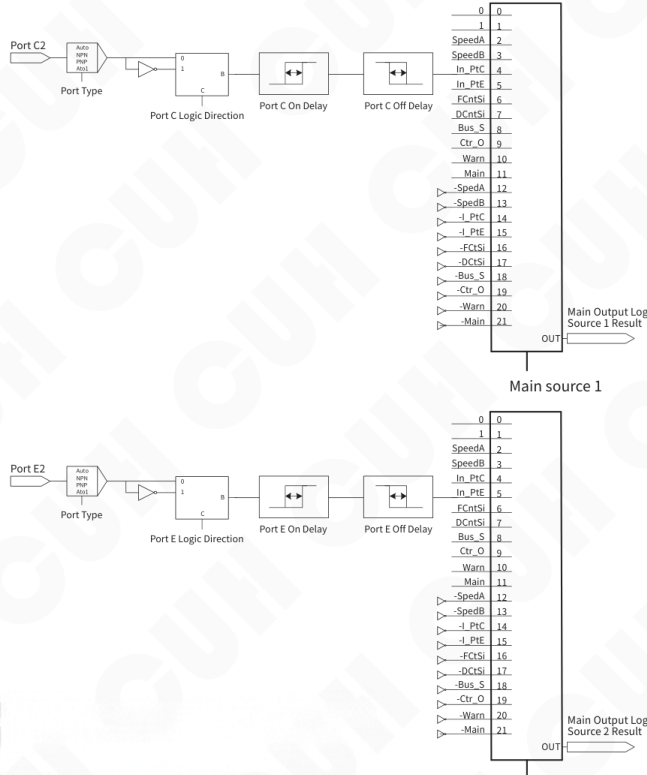

Para las opciones de fuente de señal de la fuente principal ½,  
consulte el capítulo 7.4.11 Apéndice.

**Figura 4.4.1.1**

Nota: El estado de la salida principal también está controlado por el botón de arranque/parada o por si el propio controlador se encuentra en estado de fallo. El nivel de control del botón de arranque/parada o del propio controlador es superior al de la señal lógica de la salida principal. Es decir: cuando el botón de arranque/parada está ajustado en parada, el controlador entra inmediatamente en el estado de parada; cuando se produce un fallo como cortocircuito, sobrecalentamiento, sobreintensidad, etc., el controlador también entra inmediatamente en el estado de parada. En este momento, la señal lógica de la salida principal no puede activar la salida principal del controlador.

---


## 4.4.1.2 Lógica principal

El resultado del origen lógico de la salida principal 1 y la unión del origen lógico de la salida principal 2, tras realizarse la operación lógica mediante la lógica de la salida principal, pasa por la dirección de la salida principal, luego por el retardo de conexión y el retardo de desconexión de la salida principal y, finalmente, por el modo de la salida principal, y se utiliza para accionar el estado de arranque/parada de la salida principal.

El diagrama de flujo de señales es el siguiente:

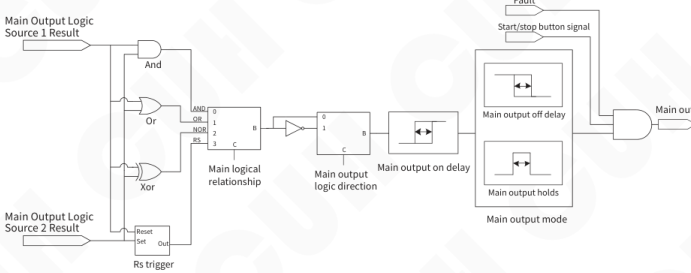

**Figura 4.4.1.2**

Este controlador permite ajustar la tabla de relaciones lógicas entre la fuente principal (lógica) 1 y la fuente principal 2 como se indica a continuación. Valor predeterminado: Or.

| Parámetro | Significado |
|---|---|
| And | AND lógico, la salida es válida cuando tanto la fuente principal 1 como la fuente principal 2 son válidas |
| Or | OR lógico, la salida es válida cuando al menos una de las fuentes principales 1 o 2 es válida |
| Xor | XOR lógico, válida cuando la fuente principal 1 y la fuente principal 2 están en estados diferentes; en caso contrario, no válida |
| RS | Bistable RS |

## 4.4.1.3 Dirección principal

Es decir, la dirección lógica de la salida principal; puede ajustarse la dirección de salida específica después de combinar lógicamente las señales. Para el diagrama de flujo de señales, véase la figura 4.4.1.2. Valor predeterminado: Const.

| Parámetro | Significado |
|---|---|
| Const | El estado tras la operación lógica de la salida principal no se invierte y por defecto corresponde al estado normal |
| Inv | El estado se invierte tras la operación lógica de la salida principal |
| On | El estado se mantiene en funcionamiento tras la operación lógica de la salida principal |
| Off | El estado se mantiene siempre detenido tras la operación lógica de la salida principal |


## 4.4.1.4 Retardo de conexión principal/Retardo de desconexión principal

Al utilizar otras señales externas, como sensores, para controlar el estado de la salida principal del dispositivo, en la mayoría de los casos es necesario un retardo después de que se emita la señal o de que la señal se restablezca antes de poder realizar la operación. Para este tipo de aplicaciones, esto puede lograrse ajustando los valores de tiempo del retardo de conexión y del retardo de desconexión. Para el diagrama de flujo de señales, véase la figura 4.4.1.2.

**Retardo de conexión principal:** Es decir, el retardo de conexión de la salida principal, que es el tiempo de retardo transcurrido desde la aplicación de una señal de control que hace que el controlador entre en estado de funcionamiento hasta el inicio real de la salida del controlador. El tiempo de retardo transcurrido durante este período se denomina retardo de conexión.

**Retardo de parada principal:** Es decir, el retardo de desconexión de la salida principal, a partir de la aplicación de una señal de control que hace que el controlador entre en estado de parada, hasta la detención real de la salida del controlador; el tiempo de retardo transcurrido durante este período se denomina retardo de desconexión.

El rango del retardo de conexión/desconexión principal es 0.0~99.9s, el valor predeterminado es 0.2s y la precisión de ajuste es de 0.1s.

## 4.4.1.5 Modo principal

Existen 2 modos de salida principal disponibles: modo de retardo y modo de retención. Para el diagrama de flujo de señales, consulte la figura 4.4.1.2. Valor predeterminado: Delay.

| Parámetro | Significado |
|---|---|
| Delay | Se refiere al estado de la salida principal tras la operación lógica, el estado de accionamiento de la salida principal después del retardo de conexión y del retardo de desconexión |
| Hold | Se refiere al estado tras la operación lógica de la salida principal. Después del retardo de conexión, el estado de funcionamiento se mantiene durante el tiempo del retardo de desconexión y luego cambia inmediatamente al estado de salida de parada |

La diferencia entre ambos modos se expresa en forma de diagrama de tiempos como se indica a continuación, donde la señal de entrada es una selección de relación lógica.

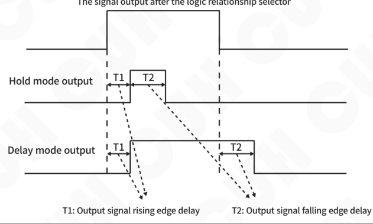


---

### 4.4.1.6 Índice de forma de onda

Este parámetro permite que el controlador equilibre entre la máxima eficiencia, la máxima potencia y el ruido mínimo para satisfacer las necesidades más exigentes de los clientes.

El rango del índice de forma de onda es 50~100, el valor predeterminado es 100 y la precisión de ajuste es de 1.

**Nota:**

1. Cuando el índice de forma de onda es 50, se obtiene la máxima eficiencia y el esfuerzo sobre el resorte es el mínimo.
2. Cuando el valor es 100, se puede obtener la máxima potencia de salida nominal y el ruido mínimo, pero el resorte estará sometido a un mayor esfuerzo.

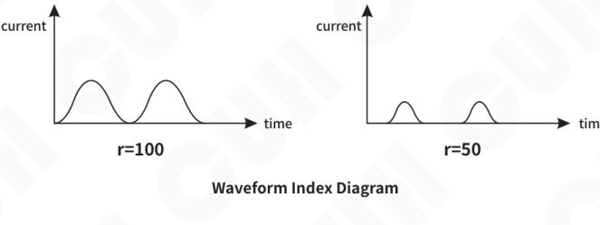

### 4.4.1.7 Corriente de CC

La salida de accionamiento del controlador puede ajustarse para superponer una componente de corriente continua sobre la corriente sinusoidal.

El rango de la corriente de CC es 0.0~2.00A, el valor predeterminado es 0.10A y la precisión de ajuste es de 0.01A.

### 4.4.1.8 Estado al encender

Ajusta el estado de funcionamiento del controlador después de encenderlo. Valor predeterminado: On.

| Parámetro | Significado |
|---|---|
| On | Después de encender el dispositivo, el estado de la tecla de encendido es en funcionamiento |
| Off | Después de encender el dispositivo, el estado de la tecla de encendido es detenido |
| Keep | Después de encender el dispositivo, el estado de la tecla de encendido se mantiene igual que antes de la última parada |

---


#### 4.4.1.9 Fuente de control remoto

La tensión de salida y la velocidad de alimentación del controlador pueden modificarse mediante los parámetros del panel o controlarse directamente mediante la magnitud de la señal de entrada de la fuente de control remoto. Los métodos de control opcionales incluyen: panel, entrada de CC de 4-20mA, entrada de CC de 1-5V, entrada de CC de 0-5V, entrada de CC de 0-10V, así como señal de bus de sincronización digital. Valor predeterminado: Panel.

**Conexión de control mediante potenciómetro**

Sugerencia: utilice un potenciómetro lineal de 1K

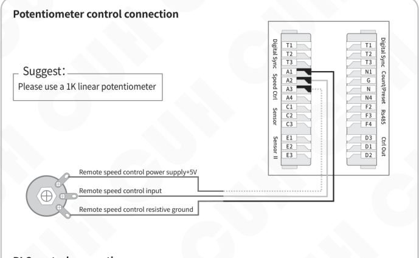

**Conexión de control mediante PLC**

- Entrada de CC de 1~5V/0~5V/0~10V
- Entrada de CC de 4~20mA

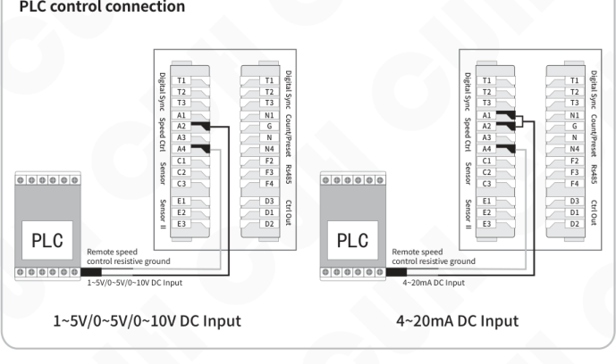


| Señal de control remoto | Señal de control remoto | Tensión de salida/Velocidad de alimentación |
|---|---|---|
| Panel |  | La tensión de salida y la velocidad de alimentación no están controladas por la señal de control remoto |
| 20mA | <2mA | Cuando el modo de tensión es Manual, tensión de salida = 0<br>Cuando el modo de tensión es Auto, velocidad de alimentación = 0<br>La pantalla LCD muestra la información de error "Remote control undervoltage" |
|  | 2mA~4mA | Tensión de salida = 0, velocidad de alimentación = 0 |
|  | 4mA~20mA | Control proporcional mediante la señal de control remoto（0%~100%）<br>Cuando el modo de tensión es Manual, tensión de salida = (Corriente de entrada - 4mA)/16 × tensión de salida máxima<br>Cuando el modo de tensión es Auto, velocidad de alimentación = (Corriente de entrada - 4mA)/16 × velocidad de alimentación máxima |
| 1~5V | Menos de 0.5V | Tensión de salida = 0, velocidad de alimentación = 0<br>La pantalla LCD muestra la información de error "Remote control undervoltage" |
|  | 0.5V~1V | Tensión de salida = 0, velocidad de alimentación = 0 |
|  | 1V~5V | Control proporcional mediante la señal de control remoto（0%~100%）<br>Cuando el modo de tensión es Manual, tensión de salida = (Tensión de entrada - 1V)/4 × tensión de salida máxima<br>Cuando el modo de tensión es Auto, velocidad de alimentación = (Tensión de entrada - 1V)/4 × velocidad de alimentación máxima |
| 0~5V | 0V~5V | Control proporcional mediante la señal de control remoto（0%~100%）<br>Cuando el modo de tensión es Manual, tensión de salida = Tensión de entrada/5 × tensión de salida máxima<br>Cuando el modo de tensión es Auto, velocidad de alimentación = Tensión de entrada/5 × velocidad de alimentación máxima |
| 0~10V | 0V~10V | Control proporcional mediante la señal de control remoto（0%~100%）<br>Cuando el modo de tensión es Manual, tensión de salida = Tensión de entrada/10 × tensión de salida máxima<br>Cuando el modo de tensión es Auto, velocidad de alimentación = Tensión de entrada/10 × velocidad de alimentación máxima |
| DigSym | Digital Sync | La tensión de la señal de control remoto es la tensión de entrada de control remoto de un dispositivo especificado en el bus (especificado mediante parámetros de sincronización de control remoto)<br>Control proporcional mediante la señal de tensión de entrada de control remoto de un dispositivo especificado en el bus, con un rango de tensión del 0% al 100%.<br>Cuando el modo de tensión es Manual, tensión de salida = Tensión de entrada/10 × tensión de salida máxima<br>Cuando el modo de tensión es Auto, velocidad de alimentación = Tensión de entrada/10 × velocidad de alimentación máxima |

#### 4.4.1.10 Coeficiente de control remoto

Cuando se selecciona una fuente de control remoto distinta de "panel" y "sync", puede utilizarse el coeficiente de control remoto para ampliar o reducir la magnitud de control de la señal de entrada de control remoto.

El rango del coeficiente de control remoto es 0.5~2.0, el valor predeterminado es 1.0 y la precisión de ajuste es de 0.1.

Ejemplo: el coeficiente de control remoto es 0.5; cuando la señal de entrada de control remoto es 2V, la tensión equivalente de entrada de control remoto obtenida por el controlador es 2V * 0.5=1V.

---


## 4.4.2 Parámetros de la salida de control de CC

Este apartado presenta principalmente los ajustes de los parámetros de la salida de control del controlador. El esquema del flujo de señales de la salida de control es el siguiente:

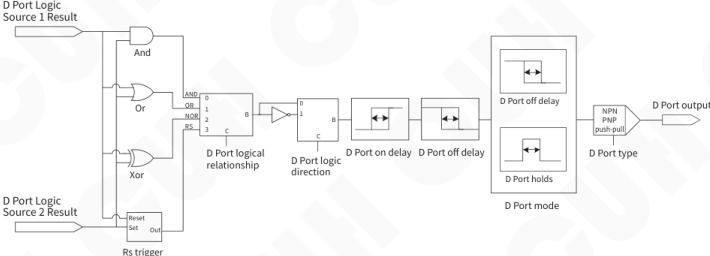

El método de ajuste de los parámetros de la salida de control es el siguiente:

- Mantenga pulsados ▲ y ◀ para entrar en la interfaz de ajuste de parámetros; pulse brevemente ▶ para cambiar al grupo de parámetros "6 DC output".
- Pulse brevemente ▲ o ▼ para cambiar entre los parámetros del grupo de parámetros de la salida de control.
- Pulse ⊕ o ⊖ para ajustar el valor del parámetro.

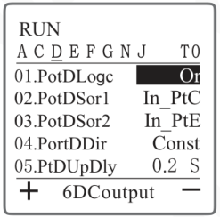

Los demás parámetros de este grupo pueden ajustarse según los pasos anteriores.

"Fuente del puerto D 1", "Fuente del puerto D 2", "Lógica del puerto D", "Dirección del puerto D", "Retardo de conexión D", "Retardo de desconexión D" y "Modo del puerto D"; los parámetros anteriores pueden consultarse en los ajustes de los parámetros de la salida principal.


## 4.4.2.1 Tipo de puerto D

La salida del puerto D admite tres tipos: salida NPN, salida PNP y salida push-pull.  
Valor predeterminado: Ou_P&P (Push-Pull).

| Parámetro | Significado |
|---|---|
| Ou_NPN | Cuando la señal de salida del puerto D es válida, el puerto D emite una señal de nivel bajo (0V) y, cuando no es válida, queda en alta impedancia |
| Ou_PNP | Cuando la señal de salida del puerto D es válida, el puerto D emite una señal de nivel alto (24V) y, cuando no es válida, queda en alta impedancia |
| Ou_P&P<br>(Push Pull) | Cuando la señal de salida del puerto D es válida, el puerto D emite una señal de nivel alto (24V). Cuando la señal de salida del puerto D no es válida, el puerto D emite una señal de nivel bajo (0V) |

El diagrama es el siguiente:

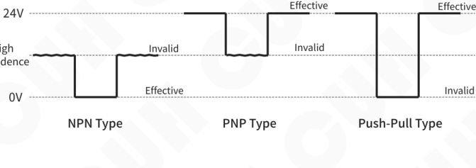


# 4.5 Control de señales

El controlador puede juzgar el estado del material en el alimentador vibratorio mediante un sensor externo y realizar las funciones "parada cuando está lleno de material" o "parada cuando está vacío de material" del controlador. El diagrama de flujo de señales del puerto es el siguiente:

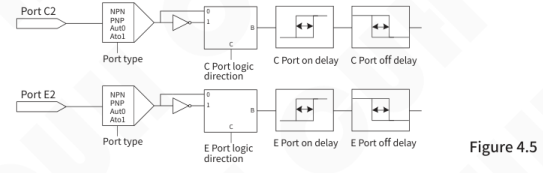

**Figura 4.5**

El método para ajustar los parámetros de entrada de señales es el siguiente:

- Mantenga pulsados ▲ y ◀ para entrar en la interfaz de ajuste de parámetros; pulse brevemente ▶ para cambiar al grupo de parámetros "5On&Off".
- Pulse brevemente ▲ o ▼ para cambiar entre los parámetros del grupo de parámetros de entrada de señales.
- Pulse ⊕ o ⊖ para ajustar el valor del parámetro.

```text
RUN
A C D E F G N J        A0
01.PortType        Auto
02.PortCDir        Const
03.PtCUpDly        0.2 S
04.PtCDnDly        0.2 S
05.PortEDir        Const
+     5On&Off        −
```

Los demás parámetros de este grupo pueden ajustarse según los pasos anteriores.

## 4.5.1 Tipo de sensor

El controlador permite ajustar el tipo de sensor de conmutación en "Auto", "NPN", "PNP" o "Ato1", o puede ajustarse manualmente según el tipo de sensor.

| Parámetro | Significado |
|---|---|
| Auto | Independientemente del tipo de sensor, se detecta siempre si el acceso al puerto es válido mediante el cambio de la señal de nivel alto y bajo; el valor predeterminado de fábrica es el reconocimiento automático |
| NPN | Sensor de tipo NPN |
| PNP | Sensor de tipo PNP |
| Ato1 | Antes de que la señal del sensor deje de ser válida, se detecta si el puerto es válido mediante el cambio de nivel alto y bajo. Una vez detectada una señal válida, se determina el tipo de sensor del puerto y ya no se explora |


## 4.5.2 Lógica del puerto C/puerto E

Este parámetro se utiliza para cambiar el puerto de entrada C y el puerto de entrada E del controlador entre "parada cuando está lleno de material" o "parada cuando está vacío de material".

Con los ajustes predeterminados de fábrica, cuando el puerto de entrada C/puerto E no recibe ninguna señal, el controlador se encuentra en estado "En funcionamiento" (es decir, parada cuando está lleno de material). Algunas aplicaciones especiales requieren que el controlador esté en estado de "parada" (es decir, parada cuando el material está vacío) cuando el puerto C/puerto E no recibe ninguna señal. Esto puede lograrse modificando este parámetro. Para el diagrama de flujo de señales, véase la figura 4.5.

| Parámetro | Significado |
|---|---|
| Const | Cuando no hay señal de control, el controlador está en estado de funcionamiento (parada cuando el material está lleno) |
| Inv | Cuando no hay señal de control, el controlador está en estado de parada (parada cuando está vacío) |

## 4.5.3 Retardo de conexión/desconexión del puerto C y del puerto E

El tiempo de retardo desde que se aplica una señal que pone el controlador en estado de funcionamiento hasta que el controlador considera válida la señal se denomina retardo de conexión.

El tiempo de retardo desde la aplicación de una señal que hace que el controlador entre en estado de parada hasta que el controlador considera válida la señal se denomina retardo de desconexión.

Para el diagrama de flujo de señales, véase la figura 4.5.

El rango del retardo de conexión/desconexión es 0.0~99.9s, el valor predeterminado es 0.2s y la precisión de ajuste es de 0.1s.

**Nota:** Al utilizar los puertos C y E para el control de arranque/parada, si es necesario retardar la operación durante un tiempo después de recibir la señal para garantizar que la señal sea estable, esto puede lograrse ajustando el retardo de conexión y el retardo de desconexión.


## 4.5.4 Lógica de velocidad A/lógica de velocidad B

El diagrama de flujo de señales es el siguiente:

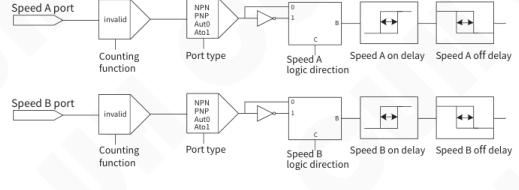

**Figura 4.5.4**

Este parámetro se utiliza para cambiar el estado de validez de los puertos de entrada para la velocidad A y la velocidad B del controlador. Este parámetro debe ajustarse en el grupo de parámetros de llenado de material. Valor predeterminado: Const.

| Parámetro | Significado |
|---|---|
| Const | Cuando no hay señal de control, la velocidad A y la velocidad B del controlador no son válidas |
| Inv | Cuando no hay señal de control, la velocidad A y la velocidad B del controlador son válidas |

## 4.5.5 Retardo de conexión/desconexión de velocidad A y de velocidad B

El período transcurrido desde la aplicación de una señal válida al puerto de velocidad A/B hasta que la velocidad se activa se denomina retardo de conexión.

El período transcurrido desde la aplicación de una señal no válida al puerto de velocidad A/B hasta que la velocidad se desactiva se denomina retardo de desconexión.

Para el diagrama de flujo de señales, véase la figura 4.5.4.

El rango del retardo de conexión/desconexión de velocidad A y B es 0.0~99.9s, el valor predeterminado es 0.2s y la precisión de ajuste es de 0.1s.


---

## 4.6 Conteo de cantidad de material

Este controlador incorpora una función de conteo que permite contar los pulsos de conteo y desacelerar o detener automáticamente cuando el número de pulsos alcanza el recuento total ajustado. También dispone de funciones especiales como la superantirrebote y la desaceleración final para evitar el sobreconteo. El diagrama de flujo de señales es el siguiente:

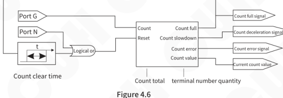

**Figura 4.6**

» Mantenga pulsados ▲ y ◀ para entrar en la interfaz de ajuste de parámetros; pulse brevemente ▶ para cambiar al grupo de parámetros "7Counter".

» Pulse brevemente ▲ o ▼ para cambiar entre los parámetros del grupo de conteo.

» Pulse ⊕ o ⊖ para ajustar el valor del parámetro.

```text
RUN
A C D E F G N J    A0
01.TotaCout       10
02.PrcntTrm       50 %
03.CotAhead        3
04.CotRstTm       0.0 S
05.CotPotSe       None
+    7Counter      −
```

Los demás parámetros de este grupo pueden ajustarse según los pasos anteriores.

### 4.6.1 Conteo de cantidad de material (o velocidad A/B)

Este parámetro se utiliza para activar y desactivar la función de conteo.

El valor predeterminado es None, es decir, la función de conteo está desactivada y, en ese momento, la función de velocidad A/B está activada.

Cuando el parámetro de la función de conteo es válido (está activado), la velocidad A y la velocidad B actúan como control de velocidad A/B y el controlador puede realizar más operaciones para la función de conteo. Para el diagrama de flujo de señales, véase la figura 4.6.

| Parámetro | Significado |
|---|---|
| None | Desactiva la función de conteo y activa la función de velocidad A/B |
| Valid | Utiliza el puerto de velocidad A como puerto de conteo y el puerto de velocidad B como puerto de borrado del conteo |

---


---

## 4.6.2 Cantidad objetivo

Una vez que el "valor de conteo actual" alcanza el límite, la señal de conteo completo es válida hasta que el contador se restablece. Tras entrar en el estado de conteo completo, si se siguen enviando pulsos de conteo, el conteo continuará, pero la señal de conteo completo seguirá siendo válida. Para el diagrama de flujo de señales, véase la figura 4.6.

El rango del recuento total es 0~9999, el valor predeterminado es 10 y la precisión de ajuste es de 1.

## 4.6.3 Velocidad terminal

**Velocidad terminal** significa que, cuando el conteo entra en el estado de desaceleración final, la velocidad de alimentación y la tensión del controlador descienden al porcentaje de la velocidad y la tensión iniciales; véase la figura 4.6.3.

Cuando el número contado se acerca al número total, el proceso de conteo está a punto de completarse. Para evitar que el movimiento a alta velocidad del material no pueda detenerse a tiempo y provoque un sobreconteo, el controlador reduce automáticamente la velocidad a la velocidad final ajustada por el usuario cuando el número restante es inferior al número final (la señal de desaceleración del conteo es válida). Cuando el valor de conteo alcanza el recuento total (la señal de conteo completo es válida), el controlador detiene inmediatamente la salida y el alimentador puede obtener un control de conteo preciso.

El rango de la velocidad terminal es 0~100%, el valor predeterminado es 50% y la precisión de ajuste es de 1%.

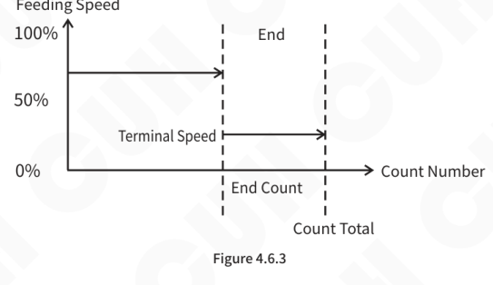

---


### 4.6.4 Cantidad de velocidad terminal

Número de secciones finales: Se refiere al número total de conteos de distancia. Tras alcanzar el "número final", el controlador entra en el modo de desaceleración del conteo.

En el estado de velocidad, la velocidad de alimentación y la tensión descienden a la velocidad terminal y a la tensión terminal. Cuando el valor de "Cantidad de segmentos finales" es 0, significa que no se utiliza la función de desaceleración final. Para el diagrama de flujo de señales, véase la figura 4.6.

El rango del número de últimos segmentos es de 0 a 9999, el valor predeterminado es 3 y la precisión de ajuste es de 1.

### 4.6.5 Restablecer el valor de conteo a 0

Cuando el conteo está completo, el controlador borrará automáticamente el valor de conteo transcurrido el retardo de "borrado del conteo". Cuando el valor de "Borrado del conteo" es 0.0s, significa que la función de restablecimiento automático retardado del conteo está desactivada.

El rango del tiempo de restablecimiento del conteo es 0.0~999.9s, el valor predeterminado es 0.0s y la precisión de ajuste es de 0.1s.

### 4.6.6 Prioridad RS

Se utiliza para ajustar la prioridad del puerto del bistable RS. Valor predeterminado: Same.

| Parámetro | Significado |
|---|---|
| Same | El puerto R y el puerto S tienen la misma prioridad. Cuando hay señales en los puertos R y S, el controlador informa de una advertencia de "error RS principal" o "error RS de control" |
| Reset | Prioridad de restablecimiento. Cuando hay señales en los puertos R y S, la señal del puerto R tiene prioridad, es decir, la señal de restablecimiento tiene prioridad |
| Set | Prioridad de activación. Cuando hay señales en los puertos R y S, la señal del puerto S tiene prioridad, es decir, la señal de activación tiene prioridad |
| Revers | Cuando hay señales en los puertos R y S, el resultado actual de la salida lógica se invierte |


---

## 4.7 Guardar ajustes

Este capítulo presenta principalmente cómo utilizar las funciones de almacenamiento de parámetros y de recuperación de parámetros del controlador.

### 4.7.1 Ajustes de recuperación

Además del grupo de trabajo, el controlador puede leer 3 conjuntos diferentes de parámetros preestablecidos, denominados "User 1", "User 2" y "User 3" respectivamente.

Cuando el usuario modifica los parámetros, los parámetros del controlador se guardan por defecto en el grupo de trabajo. Cuando el controlador se vuelve a encender, los parámetros se leen automáticamente del grupo de trabajo y se restablecen los valores de los parámetros anteriores a la última parada. Al mismo tiempo, el usuario puede seleccionar manualmente entre "UsrD1", "UsrD2" y "UsrD3" para leer otro archivo guardado manualmente de los tres grupos. Los datos se envían al grupo de trabajo del controlador, lo que le permite cambiar el estado de funcionamiento inmediatamente.

| Parámetro | Significado |
|---|---|
| None | Desactivado |
| UsrD1 | Parámetro definido por el usuario 1 |
| UsrD2 | Parámetro definido por el usuario 2 |
| UsrD3 | Parámetro definido por el usuario 3 |

### 4.7.2 Guardar ajustes

El controlador puede guardar 4 conjuntos diferentes de parámetros preestablecidos, denominados "Work", "UsrD1", "UsrD2" y "UsrD3".

Cuando el usuario modifica los parámetros, los parámetros del controlador se guardan automáticamente por defecto en "Work". Cuando el controlador se vuelve a encender, los parámetros se leen automáticamente del grupo de trabajo y se restablecen los valores de los parámetros anteriores a la última parada. Los usuarios pueden guardar manualmente los parámetros del grupo de trabajo en "UsrD1", "UsrD2" y "UsrD3".

| Parámetro | Significado |
|---|---|
| None | Desactivado |
| Work | Grupo de trabajo predeterminado |
| UsrD1 | Parámetro definido por el usuario 1 |
| UsrD2 | Parámetro definido por el usuario 2 |
| UsrD3 | Parámetro definido por el usuario 3 |

---


---

### 4.7.3 Restauración de fábrica

Utilice los parámetros de restablecimiento para restaurar todos los parámetros del grupo de trabajo a los valores predeterminados de fábrica.

Después de seleccionar "RWork" en "Reset Parameters", mantenga pulsados ⊕ y ⊖ al mismo tiempo; transcurridos más de dos segundos, la interfaz de visualización cambia a la interfaz de espera y los parámetros se restablecen correctamente.

| Parámetro | Significado |
|---|---|
| None | Desactivado |
| Rwork | Restablece los parámetros del grupo de trabajo a los valores de fábrica. (User 1, User 2 y User 3 no se restablecerán) |

### 4.7.4 Copiar ajustes

El controlador puede sustituir el grupo de parámetros de este controlador por los datos de los dos controladores de la red de los que ha hecho copia de seguridad, para copiar rápidamente los parámetros de los dos controladores.

Seleccione el número de ID del controlador cuya copia desea realizar para llevar a cabo la función de copia de los datos del controlador. El rango de selección de los parámetros de copia es 1~8.

### 4.7.5 Contraseña de usuario

Los usuarios pueden definir por sí mismos la contraseña de los parámetros. Una vez bloqueado, el usuario solo puede operar en el "Grupo de parámetros de supervisión" y en la "Página principal".

Cuando el usuario ajusta la "contraseña de usuario" con un valor distinto de 0, significa que la función de bloqueo de parámetros avanzados está activada. En ese caso, es necesario introducir la contraseña al entrar en el grupo de parámetros desde la página principal. Después de que el usuario "introduzca la contraseña" y pulse ▼ + ▲, si la "contraseña introducida" y la "contraseña de usuario" son diferentes, el usuario solo podrá entrar en el grupo de parámetros de supervisión. Solo cuando la contraseña sea correcta podrá el usuario entrar en los demás grupos de parámetros.

El rango de selección de la contraseña de usuario es 0~9999.

### 4.7.6 Introducir contraseña

Si la "contraseña introducida" y la "contraseña de usuario" son diferentes, el usuario solo puede operar en la "Página principal" y en el "Grupo de parámetros de supervisión". Solo cuando la contraseña sea correcta podrá el usuario entrar en los demás grupos de parámetros.

El rango de selección para introducir la contraseña es 0~9999.

---


## 4.8 Comunicación RS485

Este controlador admite la comunicación RS485. Siguiendo el modo de protocolo Modbus de tipo ASCII y RTU, todos los parámetros y estados del controlador pueden modificarse y leerse de forma remota.

El protocolo de comunicación RS485 local "SDVC341 Series 485 Register Address Table 1.02" puede descargarse desde la zona de descargas del sitio web de nuestra empresa: www.cuhnj.com.

> » Mantenga pulsados ▲ y ◀ para entrar en la interfaz de ajuste de parámetros; pulse brevemente ▶ para cambiar al grupo de parámetros "8Comm".
>
> » Pulse brevemente ▲ o ▼ para cambiar entre los parámetros del grupo de parámetros de comunicación.
>
> » Pulse ⊕ o ⊖ para ajustar el valor del parámetro.
>
> ```text
> RUN
> A C D E F G N J      A0
> 01.485type       RTU
> 02.BaudRate    115.2 K
> 03.485SlvID      1
> 04.Enab485R    None
> 05.DigSynAd      1
> +      8Comm      -
> ```

Los demás parámetros de este grupo pueden ajustarse según los pasos anteriores.

### 4.8.1 Tipo de comunicación

Selección del tipo de comunicación RS485, tipo Modbus ASCII y tipo Modbus RTU. Valor predeterminado: RTU.

| Parámetro | Significado |
|---|---|
| ASCⅡ | Tipo Modbus ASCII |
| RTU | Tipo Modbus RTU |


## 4.8.2 Velocidad en baudios

Distintas opciones de velocidad en baudios para la comunicación RS485. Valor predeterminado: 115.2K.

| Parámetro | Significado |
|---|---|
| 0.3K | 0.3 Kbps |
| 1.2K | 1.2 Kbps |
| 2.4K | 2.4 Kbps |
| 9.6K | 9.6 Kbps |
| 19.2K | 19.2 Kbps |
| 57.6K | 57.6 Kbps |
| 115.2K | 115.2 Kbps |

## 4.8.3 Dirección del controlador esclavo

Ajusta el número de dirección del esclavo en la comunicación RS485.

El número de esclavo va de 1 a 31. Valor predeterminado: 1.

## 4.8.4 Resistencia del puerto/resistencia de sincronización

El puerto de comunicación RS485/puerto de sincronización digital incorpora una función de resistencia de adaptación (120Ω). Valor predeterminado: None.

| Parámetro | Significado |
|---|---|
| None | No utiliza la resistencia de adaptación (120Ω) |
| Valid | Utiliza la resistencia de adaptación (120Ω) |


---

## 4.9 Red CUHBus-DS®

El controlador SDVC341-M adopta el protocolo de bus de comunicación serie por bus LAN (CUHBus-DS®). Permite formar una red de hasta 8 dispositivos en la misma red. Entre los controladores conectados en red se pueden implementar las siguientes funciones:

**Funciones de sincronización:** La frecuencia, la fase, el ajuste de la velocidad por control remoto y otros parámetros de cualquier controlador de la red pueden ser coherentes con la salida de cualquier otro controlador de la red o desviarse de ella.

**Compartición de señales:** Cualquier señal de estado de cualquier controlador de la red puede compartirse como fuente de señal de entrada de cualquier otro controlador. Esto permite que cualquier controlador de la red disponga de fuentes de señal más ricas además de las locales y que las genere mediante operaciones lógicas para implementar una lógica de funcionamiento del controlador más compleja en la instalación del usuario.

**Copia de seguridad de datos:** Los datos de cualquier controlador de la red se copiarán en los otros dos controladores de la red. Cualquier controlador de la red puede sustituirse perfectamente mediante sustitución y conexión, y los datos del controlador sustituido pueden utilizarse para continuar el funcionamiento.

> ☺
>
> **Este sistema de red tiene las siguientes características:**
>
> - Es fácil de ampliar y se pueden añadir rápidamente nuevos dispositivos a la red.
> - La red es equivalente, con un conjunto de terminales de comunicación CUHBus-DS® equivalentes a izquierda y derecha para facilitar la conexión del usuario.
> - El dispositivo admite la conexión en caliente, y la ampliación de controladores puede añadirse o eliminarse sin cortar la alimentación durante el funcionamiento estable del sistema de controladores.

---


---

## 4.9.1 Red de dispositivos

Este capítulo presenta principalmente la conexión rápida en red entre varios controladores, cómo añadir un nuevo controlador a la red ya establecida y cómo eliminar un controlador de la red.

### 4.9.1.1 Red de dispositivos

Un solo controlador constituye por sí mismo una red. Cuando las líneas de señal CUHBus-DS® de los controladores están correctamente conectadas y se realizan operaciones sencillas, varios dispositivos pueden formar una nueva red de comunicación síncrona digital.

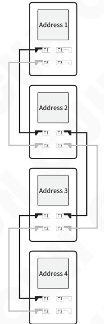

---


**Pasos:**

1. Conecte entre sí todas las señales T1 de los controladores y todas las señales T3 entre sí, como se muestra en la figura anterior.

2. Cuando el nuevo dispositivo se enciende, el nuevo controlador entrará automáticamente en el "grupo de parámetros de comunicación".

3. En el grupo de parámetros de comunicación, ajuste el número de dispositivo de comunicación síncrona digital local; "DigSynAd" admite cualquier valor de [1~8]. No es necesario ajustarlo; el programa generará automáticamente un número.

4. En el grupo de parámetros de comunicación, ajuste el valor del parámetro "EnNetwok " a "Expand" y, a continuación, mantenga pulsados ⊕ y ⊖ al mismo tiempo para confirmar.

5. Una vez añadido correctamente, el valor del parámetro "EnNetwok " del nuevo dispositivo cambiará automáticamente a "Online", lo que indica que el nuevo dispositivo se ha añadido correctamente.

El usuario puede comprobar si la red se ha conectado correctamente consultando los parámetros de estado de conexión en red de los dispositivos, así como consultar el número total de dispositivos de la red y el número de dispositivos en línea.

Nota: Solo conectar la línea de señal CUHBus-DS® sin pasar por los ajustes no cuenta como incorporación a la red.

**Método de confirmación mediante visualización:**

1. En el grupo de parámetros de supervisión, el valor del parámetro "DevicNum" es [1~8], lo que indica el número total de dispositivos de la red.

2. En el grupo de parámetros de supervisión, el valor del parámetro "OnlinNum" es [1~8], lo que indica cuántos controladores hay actualmente en línea en la red.

**Resistencia de sincronización:**

El puerto de comunicación CUHBus-DS® incorpora una función de resistencia de adaptación (120Ω), que puede estar desactivada o activa.

| Parámetro | Significado |
|---|---|
| None | No utiliza la resistencia de adaptación (120Ω) |
| Valid | Utiliza la resistencia de adaptación (120Ω) |


## 4.9.1.2 Incorporación de dispositivos

El usuario puede añadir un nuevo controlador a la red existente siguiendo los pasos de ampliación e incorporación que se indican a continuación.

El nuevo controlador, una vez incorporado, puede llamar a la señal de cualquier controlador de la red y actuar como fuente de señal de cualquier otro controlador de la red, enriqueciendo las fuentes de señal del sistema.

**Pasos:**

1. Conecte las interfaces T1 y T3 de CUHBus-DS® del nuevo dispositivo a la red original completa; los puertos admiten la conexión en caliente.

2. Cuando el nuevo dispositivo se enciende, el nuevo controlador entrará automáticamente en el "grupo de parámetros de comunicación".

3. En el grupo de parámetros de comunicación, ajuste el número de dispositivo de comunicación síncrona digital local; "DigSynAd" admite cualquier valor de [1~8]. No es necesario ajustarlo; el programa generará automáticamente un número.

4. En el grupo de parámetros de comunicación, ajuste el valor del parámetro "EnNetwok " a "Expand" y, a continuación, mantenga pulsados ⊕ y ⊖ al mismo tiempo para confirmar.

5. Una vez añadido correctamente, el valor del parámetro "EnNetwok " del nuevo dispositivo cambiará automáticamente a "Online", lo que indica que el nuevo dispositivo se ha añadido correctamente.

El usuario puede comprobar si la red se ha conectado correctamente consultando los parámetros de estado de conexión en red de los dispositivos, así como consultar el número total de dispositivos de la red y el número de dispositivos en línea.

Nota: Solo conectar la línea de señal CUHBus-DS® sin pasar por los ajustes no cuenta como incorporación a la red.

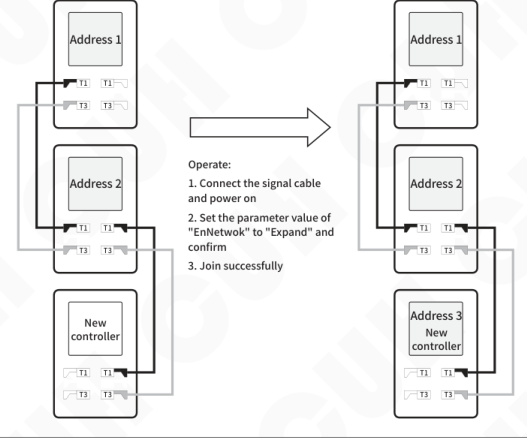


---

## 4.9.1.3 Eliminación de dispositivos

Cuando sea necesario eliminar permanentemente un controlador de la red, utilice la función de eliminación de un controlador de la red. La eliminación de un controlador de la red puede iniciarse desde cualquier controlador de la red. Los controladores restantes tras la eliminación se reorganizarán en una nueva red completa.

Sin embargo, si el controlador se retira directamente (incluido un corte de alimentación) sin eliminarlo, los datos del controlador se seguirán conservando en la red. En ese momento, la red se encuentra en un estado degradado y no se pueden añadir nuevos controladores. Debe eliminarse manualmente a través del controlador para mantener la integridad de la red y completar la ampliación e incorporación de nuevos controladores.

**Pasos para eliminar un controlador:**

1. Entre en el "grupo de parámetros de comunicación" a través de cualquier controlador de la red.
2. Modifique el valor del parámetro "DeltDevi" a la dirección del dispositivo de red que debe eliminarse.
3. Después de modificar el valor, mantenga pulsados ⊕ y ⊖ para confirmar la eliminación del dispositivo.
4. Una vez completada la eliminación, el valor del parámetro "DeltDevi" cambia a un valor no seleccionable, lo que indica que el dispositivo se ha eliminado correctamente.
5. En ese momento, compruebe el nuevo estado de la red en el dispositivo en funcionamiento y confirme el número de controladores de la nueva red.

Ejemplo: Elimine el controlador de dirección 3 de la red.

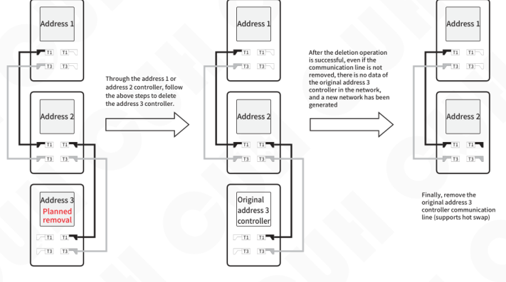

---


---

## 4.9.2 Función de sincronización

La frecuencia, la fase o la velocidad controlada remotamente de cualquier controlador de la red puede seguir a otro controlador maestro de forma coherente o con una determinada desviación. Sin embargo, varios controladores no pueden seguirse entre sí; de lo contrario, sus salidas se volverán inestables.

Ejemplo 1: El controlador de dirección 3 sigue la frecuencia de salida del controlador de dirección 1, de modo que los dos alimentadores vibratorios que accionan funcionan a la misma frecuencia.

Ejemplo 2: Si el controlador de dirección 3 ya está siguiendo la frecuencia de salida del controlador de dirección 1, el controlador de dirección 1 no puede ajustarse para seguir la frecuencia de salida del controlador de dirección 3. Esto significa que los controladores no pueden seguirse entre sí.

➢ **Sincronización de frecuencia**

El método para ajustar la sincronización de frecuencia es el siguiente:

1. Los dos o más controladores entre los que se requiere la sincronización de frecuencia y a cuya frecuencia se va a sincronizar deben formar la misma red de comunicación síncrona digital; consulte el capítulo "Red de dispositivos".

2. Ajuste el valor del parámetro "FrqncSyn" en el grupo de parámetros de comunicación del controlador cuya frecuencia se sincroniza al número de dirección "Digital Sync" del controlador sincronizado (frecuencia).

3. Vaya al grupo de parámetros de velocidad estable del controlador cuya frecuencia se sincroniza y ajuste "FrqncMod" a "SynV" o "SynE".

➢ **Sincronización de velocidad por control remoto**

El método para ajustar la sincronización del control de velocidad por control remoto es el siguiente:

1. Los dos o más controladores entre los que se requiere la sincronización por control remoto y a cuya sincronización por control remoto va a realizarse deben formar la misma red de comunicación síncrona digital; consulte el capítulo "Red de dispositivos".

2. Ajuste el valor del parámetro "RemotSyn" en el grupo de parámetros de comunicación del controlador cuya sincronización por control remoto se realiza al número de dirección "Digital Sync" del controlador sincronizado (control remoto).

3. Ajuste el valor del parámetro "CtrlSour" en el grupo de parámetros de la salida principal a "DigSym".

➢ **Modo de funcionamiento maestro/esclavo**

El usuario puede ajustar el controlador para que funcione en uno de los dos modos de funcionamiento siguientes según las necesidades de la aplicación:

Modo maestro: en el que un controlador controla de forma independiente una placa de vibración de carga.

Modo esclavo: cuando dos o más controladores deben funcionar de forma síncrona, se utiliza un controlador como controlador maestro que funciona en modo maestro como referencia de frecuencia. Todos los demás controladores funcionan en modo esclavo, actuando como controladores esclavos y funcionando de forma síncrona con el controlador maestro.

---


## Modo maestro

El controlador que funciona en modo maestro, en adelante denominado controlador maestro, modifica los parámetros del grupo de parámetros de velocidad estable. Los parámetros "modo de tensión" y "modo de frecuencia" permiten ajustar el controlador al modo de funcionamiento correspondiente. El modo de tensión y el modo de frecuencia tienen las siguientes combinaciones:

| Modo de funcionamiento | Método de control<br>de la tensión | Método de control<br>de la frecuencia | Necesidad de sensor de vibración |
|---|---|---|---|
| Totalmente Manuel | Manuel | Manuel | No |
| Totalmente automático | Auto | Auto | Sí |
| Tensión automática | Auto | Manuel | Sí |
| Frecuencia automática | Manuel | Auto | Sí |

■ **Modo totalmente manual**

En este modo, la tensión de salida y la frecuencia de salida del controlador se ajustan manualmente.

**Nota:** Aunque el parámetro "Modo de tensión" o "Modo de frecuencia" esté ajustado en "Auto", el controlador seguirá funcionando en modo totalmente manual si el sensor de vibración no está conectado.

■ **Modo totalmente automático**

El controlador ajustará automáticamente la tensión de salida y la frecuencia de salida basándose en los datos devueltos por el sensor de vibración para garantizar que la velocidad de alimentación del equipo de vibración se mantenga estable cerca del valor ajustado de "velocidad de alimentación" y que la frecuencia de vibración se encuentre en la frecuencia de funcionamiento óptima del equipo de vibración. La tensión de salida y la frecuencia de salida no están controladas por los parámetros "tensión" y "frecuencia".

**Nota:** El ajuste predeterminado de fábrica del controlador es el modo totalmente automático, pero si el sensor de vibración no está insertado correctamente, el controlador seguirá en el estado totalmente manual. El controlador no cambiará al estado totalmente automático hasta que el sensor de vibración esté insertado correctamente.

■ **Modo de tensión automática**

En este modo, el controlador ajustará automáticamente la tensión de salida basándose en los datos devueltos por el sensor de vibración para garantizar que la velocidad de alimentación del equipo de vibración se mantenga estable en el valor ajustado. La frecuencia de salida la ajusta manualmente el usuario. El controlador debe estar conectado a un sensor de vibración para que este modo funcione correctamente.

■ **Modo de frecuencia automática**

En este modo, el controlador ajustará automáticamente la frecuencia de salida basándose en los datos devueltos por el sensor de vibración para que la frecuencia de vibración se encuentre en la frecuencia de funcionamiento óptima del equipo de vibración, y la tensión de salida se ajusta manualmente. El controlador debe estar conectado a un sensor de vibración para que este modo funcione correctamente.


## Modo esclavo

Cuando hay varios controladores conectados en red, cualquiera de ellos puede seleccionar el modo esclavo. En este modo, la frecuencia de salida del controlador esclavo es siempre estrictamente coherente con la frecuencia de salida del controlador maestro. El controlador que funciona en modo esclavo se denomina en adelante controlador esclavo.

El modo de sincronización de frecuencia se utiliza en situaciones en las que hay varios controladores en un sistema de alimentación y sus frecuencias y fases de salida deben sincronizarse. Mediante el modo síncrono, los controladores maestro y esclavo pueden generar formas de onda totalmente síncronas, eliminando así las interferencias mutuas entre las salidas de los controladores.

Cuando el controlador M funciona en modo maestro y el controlador S funciona en modo esclavo (modo síncrono), las formas de onda de salida de los dos controladores están completamente sincronizadas. Como se muestra a continuación:

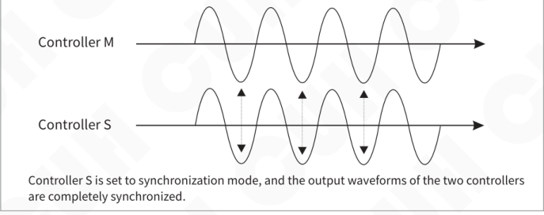

Si el controlador S no está ajustado en modo esclavo (modo SynV o SynE), las formas de onda de salida de los dos controladores no están sincronizadas. Como se muestra a continuación:

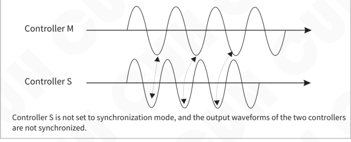


---

Para los equipos mecánicos que requieren una alineación precisa, dos o más equipos de vibración pueden necesitar tener fases físicamente coherentes, pero cada equipo tiene una frecuencia resonante diferente. Ajustando el modo de frecuencia a "SynV", el controlador puede ajustar automáticamente las fases de cada equipo según las condiciones de vibración para lograr la coherencia. Si el modo de frecuencia es "SynE", el usuario ajusta manualmente el valor de compensación de fase.

Modifique los parámetros "modo de tensión" y "modo de frecuencia" del grupo de parámetros de velocidad estable para ajustar el controlador al "modo de funcionamiento" correspondiente. El modo de tensión y el modo de frecuencia tienen las siguientes combinaciones:

| Modo de funcionamiento | Método de tensión | Método de frecuencia | Control de fase | Necesidad de sensor de vibración |
|---|---|---|---|---|
| Tensión automática<br>Fase automática | Auto | SynV | Auto | Sí |
| Tensión automática<br>Fase manual | Auto | SynE | Ajuste manual | Sí |
| Tensión manual<br>Fase automática | Manuel | SynV | Auto | Sí |
| Tensión manual<br>Fase manual | Manuel | SynE | Ajuste manual | No |

☺

> **Nota:**
>
> 1. Aunque los parámetros "Modo de tensión" y "Modo de frecuencia" estén ajustados en "Auto" y "SynV", si el sensor de vibración no está conectado, el controlador seguirá funcionando en el estado de tensión manual y fase manual.
>
> 2. La tensión automática se refiere a un controlador esclavo conectado a un sensor de vibración que ajusta automáticamente la tensión de salida para estabilizar la velocidad de alimentación cerca del valor ajustado por el usuario.
>
> 3. La fase automática significa que el controlador esclavo conectado al sensor de vibración corrige automáticamente la fase de la forma de onda de salida basándose en la señal de realimentación del sensor, de modo que la señal de sincronización generada por el controlador esclavo y el controlador maestro estén en fase.
>
> 4. La fase manual se refiere a la fase de la forma de onda de salida del controlador esclavo, que puede ajustarse manualmente para que presente una desviación de fase fija respecto a la forma de onda de salida del controlador maestro.

---


---

## Método de conexión del cable de señal de sincronización entre los controladores maestro y esclavo

Basta con conectar los controladores maestro y esclavo a la misma red de comunicación síncrona digital y luego conectarlos en red. Ajuste el valor del parámetro "sincronización de frecuencia" del grupo de parámetros de comunicación del controlador esclavo al número de dirección de "sincronización digital" del controlador maestro. A continuación, cambie el "modo de frecuencia" del grupo de parámetros de velocidad estable a "vibración síncrona" o "eléctrico síncrono".

### Escenarios de aplicación en los que tanto el controlador maestro como el esclavo están conectados a sensores de vibración

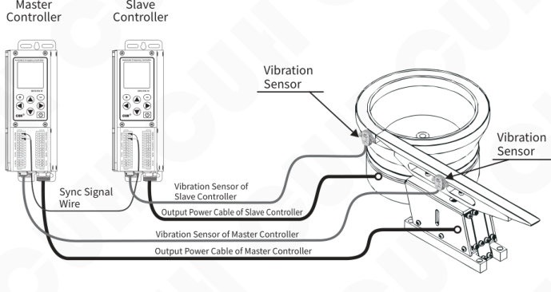

> 1. Si el controlador esclavo funciona en el modo de tensión manual y fase manual, el controlador esclavo no necesita estar conectado a un sensor de vibración.
>
> 2. Si el controlador maestro funciona en modo totalmente manual, el controlador maestro no necesita estar conectado a un sensor de vibración.

---


**■ Modo de tensión automática y fase automática**

En este modo, el controlador debe estar conectado a un sensor de vibración. El controlador ajustará automáticamente la tensión de salida basándose en los datos devueltos por el sensor de vibración para garantizar que la velocidad de alimentación del equipo de vibración se mantenga estable en el valor ajustado. La frecuencia y la fase de la forma de onda de salida son coherentes con las del controlador maestro, o presentan una diferencia de fase ajustada mediante el parámetro "Fase automática".

**■ Modo de tensión automática y fase manual**

En este modo, el controlador debe estar conectado a un sensor de vibración. El controlador ajustará automáticamente la tensión de salida basándose en los datos devueltos por el sensor de vibración para garantizar que la velocidad de alimentación del equipo de vibración se mantenga estable en el valor ajustado. La frecuencia de salida es coherente con la del controlador maestro. La forma de onda de salida difiere de la forma de onda de salida del controlador maestro en un valor fijo de diferencia de fase, que se ajusta mediante el parámetro "Fase manual".

**■ Modo de tensión manual y fase automática**

En este modo, el controlador debe estar conectado a un sensor de vibración. La tensión de salida del controlador se ajusta manualmente. La frecuencia y la fase de la forma de onda de salida son coherentes con las del controlador maestro, o presentan una diferencia de fase ajustada mediante el parámetro "Fase automática".

**■ Modo de tensión manual y fase manual**

En este modo, la tensión de salida del controlador se ajusta manualmente y la frecuencia de salida es coherente con la del controlador maestro. La forma de onda de salida difiere de la forma de onda de salida del controlador maestro en un valor fijo de diferencia de fase, que se ajusta mediante el parámetro "Fase manual".

> ☺
>
> 1. El modo de fase automática requiere ajustar el valor del parámetro "modo de frecuencia" del controlador esclavo a "SynV".
>
> 2. El modo de fase manual requiere ajustar el valor del parámetro "modo de frecuencia" del controlador esclavo a "SynE".


---

## 4.9.3 Compartición de señales

Una vez conectados los dispositivos en red, el controlador puede llamar a cualquier señal de cualquier otro controlador de la red para disponer de puertos de llamada de señal más ricos.

La fuente de señal de un controlador de la red puede elegirse entre cualquier puerto de cualquier controlador de la red. Además, puede realizarse un control lógico complejo mediante operaciones lógicas AND, OR, XOR o RS.

Pasos de operación para llamar a otras fuentes de señal desde la salida principal del controlador:

➢ **Seleccione el controlador que necesita la fuente de señal de red, entre en el grupo de la salida principal y complete los siguientes ajustes:**

1. Ajuste el parámetro "MainSor1" o el parámetro "MainSor2" a "Bus".
2. Ajuste el parámetro "MainLogc" a uno de los valores "And", "Or", "Xor" y "RS".
3. Ajuste el parámetro "MainDire" de este controlador a uno de los valores "Const", "Inv", "On" u "Off".
4. Ajuste los tiempos "MainUpDy" y "MainDnDy" de este controlador.
5. Ajuste el parámetro "MainMode" de este controlador a uno de los valores "Delay" o "Hold".

➢ **Vaya al grupo de comunicación y complete los siguientes ajustes:**

6. Ajuste el "BSigMID1" de este controlador a la dirección del controlador al que se va a seguir (el número del controlador puede consultarse mediante la sincronización digital).
7. Ajuste el "BSigMID2" de este controlador a la dirección del controlador al que se va a seguir.
8. Ajuste el número de bit de estado específico del "BSigM_B1" de este controlador. Debe consultar los "bits de estado 1~16" del controlador al que se sigue y seleccionar el número de secuencia del bit de estado que necesita la máquina.
9. Ajuste el número de bit de estado específico del "BSigM_B2" de este controlador. Debe consultar los "bits de estado 1~16" del controlador al que se sigue y seleccionar el número de secuencia del bit de estado que necesita la máquina.

Cualquier controlador puede enviar 16 de sus propios estados al bus, que pueden configurarse de forma independiente mediante el "bit de estado 1" ~ "bit de estado 16"; por defecto, el "bit de estado 1" ~ "bit de estado 16" coinciden con los primeros 16 bits del capítulo "7.4.11 Lista adjunta".

Cualquier controlador puede llamar a la señal del bus (por defecto). Para el significado y los detalles, consulte el capítulo "7.4.11 Lista adjunta".

---


---

Ejemplo: Después de conectarse en red, el controlador de dirección 3 llama a la señal del puerto C del dispositivo del sistema de control de dirección 1 y a la señal del puerto C del dispositivo del sistema de control de dirección 2, y realiza una operación lógica OR; cuando se detecta que cualquiera de las señales es válida, la salida principal del controlador de dirección 3 se detiene.

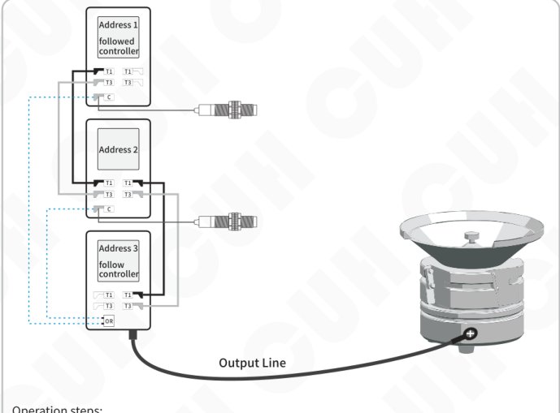

Pasos de operación:

1. Ajuste el grupo de parámetros de la salida principal del controlador de dirección 3: "MainSor1" en "bus" y "MainSor2" en "bus".
2. Ajuste el parámetro "MainLogc" del controlador de dirección 3 a "And".
3. Ajuste el parámetro "MainDire" (dirección de la salida principal) del controlador de dirección 3 a "Const".
4. Ajuste los tiempos "MainUpDy" y "MainDnDy" del controlador de dirección 3 al valor de tiempo necesario. El valor predeterminado es 0.2 segundos.
5. Ajuste el "MainMode" (modo de la salida principal) del controlador de dirección 3 a "Delay".
6. Ajuste el "BSigMID1" del "grupo de parámetros de comunicación" del controlador de dirección 3 a "1" (especifica el controlador de dirección 1).
7. Ajuste el "BSigMID2" del controlador de dirección 3 a "2" (especifica el controlador de dirección 2).
8. Ajuste el "BSigM_B1" del controlador de dirección 3 a "4" (especifica la señal del puerto C).
9. Ajuste el "BSigM_B2" del controlador de dirección 3 a "4" (especifica la señal del puerto C).
10. El ajuste se ha completado. Para los ajustes de la salida de control del puerto D del controlador, consulte los ajustes de la salida principal del controlador.

---


---

## 4.9.4 Copia de seguridad de datos

Cuando todos los controladores están conectados en red, todos los controladores de la red pueden hacer copia de seguridad de los datos de los demás. Cada controlador hace copia de seguridad de los otros dos controladores de la red. Cuando un controlador de la red original falla, el usuario puede sustituir rápidamente el controlador averiado por un controlador nuevo. Todos los parámetros del controlador nuevo serán coherentes con los del controlador anterior a la sustitución.

Cuando fallan menos de 3 controladores numerados adyacentes en la red, la operación de sustitución puede realizarse con éxito. Sin embargo, cuando fallan 3 o más controladores numerados, no se pueden restaurar los datos de todas las máquinas.

➢ **Pasos para que un controlador nuevo se incorpore a la red como dispositivo de sustitución:**

1. Apague el dispositivo que va a sustituirse y retire el cable de comunicación CUHBus-DS®.
2. Conecte la interfaz CUHBus-DS® del dispositivo nuevo a la red original.
3. Cuando el dispositivo nuevo se enciende, el nuevo controlador de acceso entrará automáticamente en el "grupo de parámetros de comunicación".
4. Ajuste el parámetro "DigSynAd" (dirección de sincronización digital local). Dado que esta red está incompleta, el valor de este parámetro solo mostrará el número del dispositivo que debe sustituirse.
5. Ajuste el valor del parámetro "EnNetwok " a "Replace" y, a continuación, mantenga pulsados ⊕ y ⊖ al mismo tiempo para confirmar.
6. Una vez realizada la sustitución con éxito, el valor del parámetro "EnNetwok " del nuevo dispositivo cambiará automáticamente a "Online".

Ejemplo 1: La red original está formada por los controladores de dirección 1, dirección 2 y dirección 3. Dado que la dirección 3 ha fallado, es necesario sustituir el dispositivo original por un dispositivo nuevo y restaurar todos los ajustes del dispositivo original.

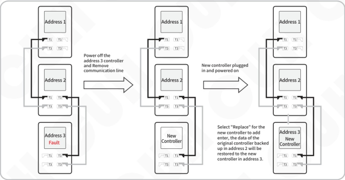

Ejemplo 2: En la red hay cuatro controladores con las direcciones 1, 2, 3 y 4. Entre ellos, han fallado los controladores de las direcciones 2, 3 y 4. Sin embargo, dado que cada dispositivo de la red hace copia de seguridad de los datos de un máximo de dos controladores, el controlador de la dirección 4 no puede completar la restauración de los datos. Para los ajustes de sustitución de los controladores de las direcciones 2 y 3, consulte el caso anterior.

Ejemplo 3: En la red hay originalmente cinco máquinas con las direcciones 1, 2, 3, 4 y 5. Entre ellas, las direcciones 1, 2 y 4 están averiadas (tres unidades no consecutivas). Puede cambiar la dirección 5 para restaurar los datos de los controladores de dirección 1 y dirección 2, y restaurar los datos del controlador de dirección 4 desde la dirección 3, con lo que se restauran los datos de todos los controladores averiados. Para los ajustes de sustitución de los controladores, consulte el caso anterior.

---


## 4.9.5 Datos de control remoto

El usuario puede elegir enviar fuentes de datos a la red de sincronización, pudiendo elegir entre tensión manual, tensión por control remoto, velocidad manual y velocidad por control remoto.

| Parámetro | Significado |
|---|---|
| ManVol | La tensión manual se refiere a la tensión ajustada por el usuario en el panel |
| RemVol | La tensión por control remoto se refiere a la tensión ajustada a través del puerto de control de velocidad remoto |
| ManSpd | La velocidad manual se refiere a la velocidad de alimentación ajustada por el usuario en el panel |
| RemSpd | La velocidad por control remoto se refiere a la velocidad de alimentación ajustada a través del puerto de control de velocidad remoto |

## 4.10 Supervisión del estado del controlador

En el grupo de parámetros de supervisión se pueden leer en tiempo real el estado de funcionamiento del controlador y los valores de los parámetros.

Para consultar los elementos de parámetros legibles, consulte el capítulo "Lista de parámetros", grupo de parámetros 10, grupo de parámetros de supervisión.

```text
┌────────────────────────────┐
│ RUN                        │
│ A C D E F G N J      A0   │
│ 01.Voltage        150  V   │
│ 02.Frequenc       50.0 Hz  │
│ 03.SpeedNow          0     │
│ 04.VoltgOut     223.8 V   │
│ 05.EffectCu      0.00 A   │
│ +    10Monitor        −   │
└────────────────────────────┘
```


## 4.11 Registro de errores

El controlador puede registrar 64 conjuntos de registros en bucle para facilitar la consulta posterior del momento en que se produjo el problema y de la información específica. En cualquier interfaz, mantenga pulsados ▲ y ▶ para entrar en el grupo de interfaces de registro, que se muestra de la siguiente manera:

```text
┌────────────────────────┐
│ RUN                    │
│ A C D E F G N J     A0 │
│      0 H   0 M    1 S  │
│ Err CodeError       01 │  } Las dos líneas superiores muestran el registro de fallos
│ 01.Voltage       150 V │
│ 02.Frequenc     50.0Hz │  } Las tres líneas siguientes muestran
│ 03.SpeedNow         0  │    el grupo de parámetros de supervisión
│ +       Note        −  │
└────────────────────────┘
```

## 4.12 Personalización de la página principal

Para facilitar el uso eficiente y rápido del controlador por parte del usuario, este puede realizar operaciones de personalización en el grupo de parámetros de interfaz. Extrayendo como máximo 16 de todos los parámetros, se colocan como elementos de supervisión en el grupo de parámetros de interfaz y el usuario puede realizar operaciones rápidas en la interfaz principal.

Ejemplo: Seleccione 1. UsrVoltg (P2.02), 2. UsrFrqnc (P2.03), 3. UserSped (P2.01), 4. SoftStar (P2.04), SoftStop (P2.05); hay cinco parámetros en la interfaz principal. Los pasos son los siguientes:

```text
» Mantenga pulsados ▲ y ◀ para                ┌────────────────────────┐
  entrar en la interfaz de ajuste             │ RUN                    │
  de parámetros; pulse brevemente             │ A C D E F G N J     A0 │
  ▶ para cambiar al grupo "1EditHome".        │ 01.Monit  1     P2.02 │
                                               │ 02.Monit  2     P2.03 │
» Pulse brevemente ▲ o ▼ para                 │ 03.Monit  3     P2.01 │
  cambiar entre los distintos                 │ 04.Monit  4     P2.04 │
  elementos de supervisión.                   │ 05.Monit  5     P2.05 │
                                               │ +    1EditHome      −  │
» Pulse ⊕ o ⊖ para seleccionar               └────────────────────────┘
  las etiquetas de función que
  deben ajustarse.

Nota: Las etiquetas de función pueden consultarse a través del capítulo "Lista de parámetros".
      Si el valor del elemento de supervisión está en blanco, significa que no hay elemento de supervisión.
```

Una vez completada la operación, si el usuario necesita ajustar los valores de los parámetros de tensión, frecuencia, velocidad de alimentación, tiempo de arranque suave y tiempo de parada suave, entre en el elemento de supervisión específico del grupo de parámetros de la interfaz "Página principal" y complete el ajuste de los parámetros mediante ⊕ o ⊖.


# Capítulo Ⅴ Aplicaciones típicas

## 5.1 ¿Cómo mantener dos alimentadores vibratorios funcionando a la misma frecuencia?

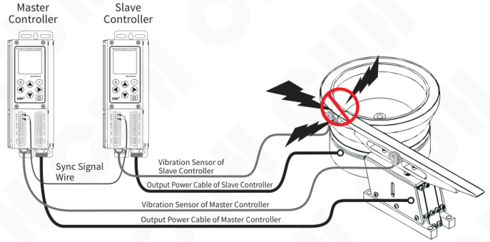

Esta sección presenta la conexión en red de dos controladores SDVC341 y la realización de que un vibrador directo y un vibrador circular funcionen a la misma frecuencia, para evitar la colisión entre las placas debida a frecuencias de funcionamiento incoherentes.

1. Conecte correctamente el cable de alimentación y el cable de salida del controlador.
2. Extraiga el sensor al que va a seguirse el controlador, conecte el enchufe del sensor al controlador y apriete la tuerca, y fije correctamente el cuerpo del sensor en la placa de vibración (para más detalles, consulte "2.3 Guía de instalación del sensor de vibración").
3. Abra la tapa del compartimento de cableado del equipo, conecte entre sí todas las señales T1 de los controladores y conecte entre sí todas las señales T3.
4. Después de encender los dos dispositivos, uno de los controladores entrará automáticamente en el "grupo de parámetros de comunicación".
5. En el grupo de parámetros de comunicación del controlador, el programa generará automáticamente un número de dispositivo de comunicación de sincronización digital. La "sincronización digital" admite cualquier valor [1~8]. El usuario también puede cambiar este valor.
6. En el grupo de parámetros de comunicación, ajuste el parámetro "EnNetwok " a "Expand" y, a continuación, mantenga pulsados ⊕ y ⊖ al mismo tiempo para confirmar.
7. Una vez añadido correctamente el controlador seguidor, el valor del parámetro "EnNetwok" cambia automáticamente a "Online", lo que indica que la conexión en red se ha realizado correctamente.
8. El usuario mantiene pulsados ▲ y ◀ para entrar en la interfaz de ajuste de parámetros; pulsando brevemente ◀ o ▶ cambia al grupo de parámetros de comunicación, para ver y anotar la dirección de sincronización digital de cada controlador.
9. Ajuste el valor del parámetro "FrqncSyn" del controlador seguidor en el grupo de parámetros de comunicación al número de dirección "DigSynAd" del controlador al que se sigue.

Una vez completados los ajustes anteriores, un controlador puede seguir la salida de otro controlador a la misma frecuencia.

---


## 5.2 ¿Cómo encender/apagar el controlador B mediante un sensor conectado al controlador A?

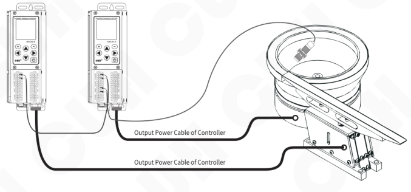

Esta sección presenta la conexión en red de dos controladores SDVC341 y la realización de que la salida principal del controlador controlado se controle mediante la señal del puerto C de otro controlador de control principal, de modo que, aunque el sensor no esté conectado directamente al controlador controlado, el controlador pueda funcionar mediante la señal de la red. Las fuentes de señal del controlador se enriquecen considerablemente.

1. Conecte correctamente el cable de alimentación y el cable de salida del controlador.

2. Abra la tapa del compartimento de cableado del equipo, conecte entre sí todas las señales T1 de los controladores y conecte entre sí todas las señales T3.

3. Después de encender los dos dispositivos, uno de los controladores entrará automáticamente en el "grupo de parámetros de comunicación".

4. En el grupo de parámetros de comunicación del controlador, el programa generará automáticamente un número de dispositivo de comunicación síncrona digital; la "sincronización digital" admite cualquier valor [1~8]. El usuario también puede cambiar este valor.

5. El usuario mantiene pulsados ▲ y ◀ para entrar en la interfaz de ajuste de parámetros; pulsando brevemente ◀ o ▶ cambia al grupo de parámetros de comunicación, para ver y anotar la dirección de sincronización digital de cada controlador.

6. El controlador controlado cambia al grupo de parámetros de la salida principal según el método anterior, y los parámetros se ajustan de la siguiente manera:

"MainSor1" en "Bus", "MainSor2" en "Bus", "MainLogc" en "And", "MainDire" en "Const", "MainUpDy" y "MainDnDy" se ajustan al valor de tiempo necesario, con un valor predeterminado de 0.2 segundos, y "MainMode" se ajusta a "Delay".

7. El controlador controlado cambia al grupo de parámetros de comunicación según el método anterior, y los parámetros se ajustan de la siguiente manera:

"BSigMID1" se ajusta a "X" (X: es el número de bit de sincronización digital del controlador cuya señal se debe llamar), "BSigM_B1" se ajusta a "4" (señal del puerto C de entrada de material) y "BSigM_B2" se ajusta a "0" (0 indica una señal no válida).

Una vez completados los ajustes anteriores, la salida de un controlador queda controlada por la señal del puerto C de otro controlador.


## 5.3 ¿Cómo encender/apagar dos controladores simultáneamente?

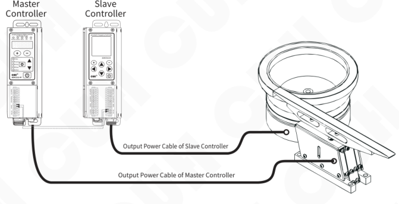

Esta sección presenta el arranque y la parada síncronos de un controlador de vibración directa (que utiliza SDVC311) y un controlador de disco (que utiliza SDVC341). Los controladores de distintas series también pueden completar la función de arranque y parada síncronos.

1. Conecte correctamente el cable de alimentación y el cable de salida del controlador.

2. Abra la tapa del compartimento de cableado del dispositivo, conecte D1 del SDVC341 a C2 del SDVC311 y conecte D3 del SDVC341 a C1 del SDVC311.

3. Después de encender los dos dispositivos, mantenga pulsados ▲ y ◀ para entrar en la interfaz de ajuste de parámetros; pulsando brevemente ◀ o ▶ cambia al grupo de parámetros de la salida de control.

4. En el grupo de parámetros de la salida de control, ajuste los parámetros de la siguiente manera:

"PotDLogc" se ajusta a "Or", "PotDSor1" se ajusta a "Main", "PotDType" se ajusta a "Ou_PNP"; los demás valores predeterminados permanecen sin cambios.

Con lo anterior, los ajustes se han completado para lograr que un controlador de vibración directa (que utiliza SDVC311) y un controlador de alimentador vibratorio (que utiliza SDVC341) mantengan el arranque y la parada sincronizados.

---


---

# Capítulo Ⅵ Preguntas frecuentes

## 6.1 Sin visualización al encender

Solución:

◆ Compruebe si el enchufe de alimentación tiene corriente.

◆ Compruebe si el enchufe de alimentación está conectado de forma fiable al enchufe.

## 6.2 Sin vibración, sin ruido, visualización normal del controlador

Solución:

◆ Compruebe si el cable de alimentación de salida está correctamente conectado al controlador y al alimentador vibratorio.

◆ Compruebe si los valores de los parámetros de tensión de salida y de frecuencia de salida del controlador son adecuados.

◆ Compruebe si el controlador está detenido por alguna señal de control.

◆ Compruebe si el controlador está detenido por algún ajuste de apagado lógico de parámetros.

## 6.3 La señal de control no funciona

Solución:

◆ Compruebe si la señal de control está conectada de forma fiable.

◆ Compruebe si el cable de tierra de la señal de control está conectado al puerto GND del controlador.

◆ Compruebe si la lógica de la señal de control está ajustada correctamente.

## 6.4 Sin vibración, ruido normal, la visualización del controlador es normal

Solución:

◆ Ajuste los parámetros conforme a este manual de usuario.

## 6.5 Seguimiento inestable de la frecuencia resonante

Solución:

◆ Aumente adecuadamente el valor de integración de frecuencia, pero tenga en cuenta que un valor excesivo puede provocar oscilaciones en la frecuencia de salida.

---


---

## 6.6 Corrección lenta de la velocidad en el control de velocidad de alimentación constante

Solución:

◆ Ajuste adecuadamente el valor de integración de amplitud, pero tenga en cuenta que si es demasiado grande, la amplitud de oscilación de la tensión de salida aumentará.

## 6.7 Cómo restablecer rápidamente el controlador a los valores de fábrica

Debido a las potentes funciones de este controlador, existe un gran número de parámetros de control que el usuario puede ajustar. Para los principiantes, es posible que el estado de funcionamiento normal del controlador no se restaure tras varias modificaciones de los ajustes. Utilice esta función para restaurar rápidamente un estado de parámetros caótico a los valores predeterminados de fábrica.

Solución:

◆ Mantenga pulsados ▲ y ◀ para entrar en la interfaz de ajuste de parámetros; pulse brevemente ◀ o ▶ para cambiar al grupo de parámetros de guardado.

◆ Cambie a los parámetros de restablecimiento de ajustes y seleccione los parámetros del grupo de trabajo. Mantenga pulsados ⊕ y ⊖ al mismo tiempo durante más de dos segundos para cambiar a la interfaz de espera. En ese momento, todos los parámetros del grupo de trabajo se restauran a los valores predeterminados de fábrica (los ajustes de User 1, User 2 y User 3 permanecen sin cambios).

Si el usuario ha guardado previamente parámetros en "User 1", "User 2" o "User 3", los ajustes del usuario también pueden restaurarse.

---


# Capítulo Ⅶ Apéndice

## 7.1 Dimensiones

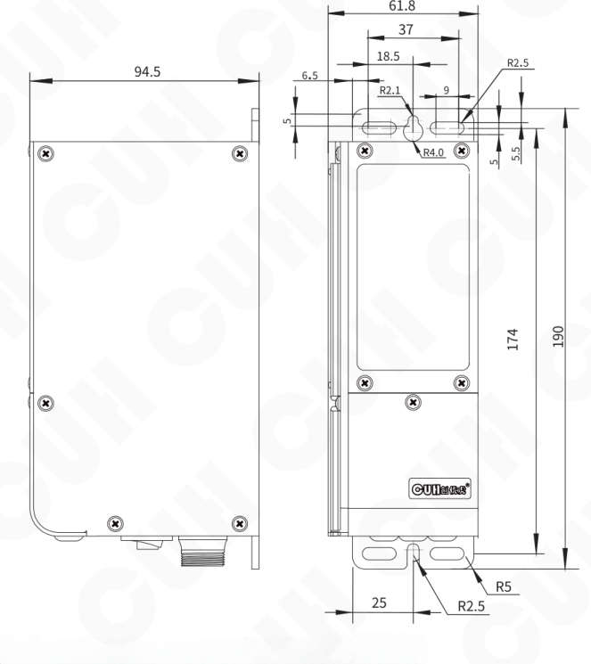

| Rango de dimensiones | tolerancia |
|---|---:|
| 0~3 | ±0.05 |
| 3~10 | ±0.1 |
| 10~30 | ±0.15 |
| 30~80 | ±0.2 |
| 80~180 | ±0.3 |
| >180 | ±0.5 |

Esta tabla de tolerancias es aplicable a todos los productos de esta serie.


## 7.2 Especificaciones técnicas

| Elemento | Mín | Típico | Máx | Unidad | Nota |
|---|---:|---:|---:|---|---|
| Tensión de entrada | 85 | 220 | 250 | V | AC RMS |
| Rango de tensión de salida ajustable | 0 | —— | 250 | V |  |
| Precisión de ajuste de tensión |  | 1 |  | V |  |
| Precisión de regulación de tensión | 0 | —— | 10 | % | ΔVout/ΔVin |
| Rango de corriente de salida ajustable | 0 | —— | 3.0 | A |  |
| Potencia de salida | 0 | —— | 660 | VA |  |
| Frecuencia de salida | 5.0 | —— | 999.9 | Hz |  |
| Precisión de ajuste de frecuencia |  | 0.1 |  | Hz |  |
| Forma de onda de salida |  | Senoidal |  |  |  |
| Tiempo de arranque suave | 0 | —— | 40.0 | s | Valor predeterminado: 0.5 |
| Rango del tiempo de retardo de conexión/desconexión | 0.0 | —— | 99.9 | s | Valor predeterminado: 0.2 |
| Precisión del tiempo de retardo de conexión/desconexión |  | 0.1 |  | s |  |
| Temperatura de disparo de la protección contra sobrecalentamiento | 60 | 65 | 65 | ℃ |  |
| Comunicación de sincronización |  | CUHBus-DS® |  |  |  |
| Comunicación digital |  | ModBUS485/Digital Sync |  |  |  |
| Corriente de salida de control de CC | 0 | —— | 350 | mA |  |
| Tensión de salida de control de CC | 22 | 24 | 26 | V |  |
| Señal de control analógica |  | 4~20 |  | mA | corriente de control de velocidad remoto |
|  |  | 1~5/0~5/0~10 |  | V | tensión de control de velocidad remoto |
| Señal de control digital |  | 24 |  | V | Señal de conmutación |
| Método de ajuste |  | 7 |  | Botón |  |
| Consumo en espera | —— | —— | 5 | W |  |
| Método de visualización |  | 128*128 |  |  | Visualización matricial |
| Grado de protección contra ingreso |  | IP20 |  |  |  |
| Temperatura ambiente | 0 | 25 | 40 | ℃ |  |
| Humedad ambiente | 10 | 60 | 85 | % | Sin condensación |
| Temperatura ambiente de almacenamiento | -20 | 25 | 65 | ℃ |  |


## 7.3 Norma de referencia

**Parámetros absolutos:**  
Superar estos valores dañará el controlador; cumpla estrictamente con ellos.

| Elemento | Norma GB | Norma IEC | Grado | Requisito de la norma | Nota |
|---|---|---|---|---|---|
| Descarga<br>electrostática | GB/T 17626.2-2006 | IEC 61000-4-2:2001 | 4 | ±8 kV | Descarga de<br>contacto |
|  |  |  | 4 | ±15 kV | Descarga en aire |
| Ensayo de transitorios<br>eléctricos rápidos | GB/T 17626.4-2008 | IEC 61000-4-4:2004 | 4 | ±4 kV |  |
| Inmunidad a ondas en la línea<br>de alimentación de CC | GB/T 17626.17-2005 | IEC 61000-4-17:2002 | 4 | 15% | Clasificación A |

> **Advertencia**  
> En un entorno residencial, este producto puede provocar interferencias de radio, en cuyo caso pueden requerirse medidas adicionales de mitigación.


## 7.4 Lista de parámetros

### 7.4.1 Grupo de parámetros de interfaz

| Función | Parámetro | Visualización | Rango de valores/Elemento de enumeración | Valor predeterminado |
|---|---|---|---|---|
| P1.01 | Elemento de supervisión 1 | 01.Monit1 | Grupo de parámetros 2~Grupo de parámetros 10 | P2.01 |
| P1.02 | Elemento de supervisión 2 | 02.Monit2 | Grupo de parámetros 2~Grupo de parámetros 10 | P10.05 |
| P1.03 | Elemento de supervisión 3 | 03.Monit3 | Grupo de parámetros 2~Grupo de parámetros 10 | P2.02 |
| P1.04 | Elemento de supervisión 4 | 04.Monit4 | Grupo de parámetros 2~Grupo de parámetros 10 | P2.03 |
| P1.05 | Elemento de supervisión 5 | 05.Monit5 | Grupo de parámetros 2~Grupo de parámetros 10 |  |
| P1.06 | Elemento de supervisión 6 | 06.Monit6 | Grupo de parámetros 2~Grupo de parámetros 10 |  |
| P1.07 | Elemento de supervisión 7 | 07.Monit7 | Grupo de parámetros 2~Grupo de parámetros 10 |  |
| P1.08 | Elemento de supervisión 8 | 08.Monit8 | Grupo de parámetros 2~Grupo de parámetros 10 |  |
| P1.09 | Elemento de supervisión 9 | 09.Monit9 | Grupo de parámetros 2~Grupo de parámetros 10 |  |
| P1.10 | Elemento de supervisión 10 | 10.Monit10 | Grupo de parámetros 2~Grupo de parámetros 10 |  |
| P1.11 | Elemento de supervisión 11 | 11.Monit11 | Grupo de parámetros 2~Grupo de parámetros 10 |  |
| P1.12 | Elemento de supervisión 12 | 12.Monit12 | Grupo de parámetros 2~Grupo de parámetros 10 |  |
| P1.13 | Elemento de supervisión 13 | 13.Monit13 | Grupo de parámetros 2~Grupo de parámetros 10 |  |
| P1.14 | Elemento de supervisión 14 | 14.Monit14 | Grupo de parámetros 2~Grupo de parámetros 10 |  |
| P1.15 | Elemento de supervisión 15 | 15.Monit15 | Grupo de parámetros 2~Grupo de parámetros 10 |  |
| P1.16 | Elemento de supervisión 16 | 16.Monit16 | Grupo de parámetros 2~Grupo de parámetros 10 |  |


## 7.4.2 Grupo de parámetros comunes

| Función | Parámetro | Visualización | Rango de valores/Elemento de enumeración | Valor predeterminado |
|---|---|---|---|---|
| P2.01 | Velocidad de alimentación ajustada por el usuario | 01.UserSped | 0~3200 | 200 |
| P2.02 | Tensión ajustada por el usuario | 02.UsrVoltg | 0~250 V | 150 |
| P2.03 | Frecuencia ajustada por el usuario | 03.UsrFrqnc | 5.0~999.9 Hz | 50.0 |
| P2.04 | Tiempo de arranque suave | 04.SoftStar | 0.0~40.0 s | 0.5 |
| P2.05 | Tiempo de parada suave | 05.SoftStop | -0.1~40.0 s | 0.5 |
| P2.06 | Tensión de salida máxima | 06.MaxVoltg | 0~250 V | 220 |
| P2.07 | Corriente de salida máxima | 07.MaxCurre | 0.1~3.0 A | 3.0 |
| P2.08 | Frecuencia de salida máxima | 08.MaxFre | 5.0~999.9 Hz | 400.0 |
| P2.09 | Frecuencia de salida mínima | 09.MiniFre | 5.0~999.9 Hz | 40.0 |
| P2.10 | Detección de carga | 10.Measure | None, Valid | None |
| P2.11 | Alarma de falta de material | 11.LowAlrm | 0~3000 | 10 |
| P2.12 | Alarma de parada | 12.AlrmShut | None, Sound1, Sound2, Sound3 | None |
| P2.13 | Brillo de la retroiluminación | 13.Brightne | 20~100 % | 100 |
| P2.14 | Tiempo de apagado de la retroiluminación | 14.Off_time | 1~30 Mi, 31 (constantemente encendido) | 5 |
| P2.15 | Idioma | 15.Language | Englis, Chines, German | Englis |


## 7.4.3 Grupo de parámetros de la salida principal

| Función | Parámetro | Visualización | Rango de valores/Elemento de enumeración | Valor predeterminado |
|---|---|---|---|---|
| P3.01 | Lógica del puerto de salida principal | 01.MainLogc | And, Or, Xor, RS | Or |
| P3.02 | Lógica del puerto de salida principal<br>Fuente de entrada 1 | 02.MainSor1 | Véase el apéndice 7.4.11 | In_PtC |
| P3.03 | Lógica del puerto de salida principal<br>Fuente de entrada 2 | 03.MainSor2 | Véase el apéndice 7.4.11 | In_PtE |
| P3.04 | Retardo de subida de la salida principal | 04.MainUpDy | 0.0~99.9 s | 0.2 |
| P3.05 | Retardo de bajada de la salida principal | 05.MainDnDy | 0.0~99.9 s | 0.2 |
| P3.06 | Dirección lógica<br>de la salida principal | 06.MainDire | Const, Inv, On, Off | Const |
| P3.07 | Modo de la salida principal | 07.MainMode | Delay, Hold | Delay |
| P3.08 | Índice de forma de onda | 08.WavFmInd | 50~100 | 100 |
| P3.09 | Corriente continua | 09.DCCurent | 0.0~2.00 A | 0.10 |
| P3.10 | Estado al encender | 10.PowOnSta | On, Off, Keep | On |
| P3.11 | Fuente de control remoto | 11.CtrlSour | Panel, 20mA, 1-5V, 0-5V, 0-10V, DigSym | Panel |
| P3.12 | Coeficiente de control remoto | 12.CtrlCoef | 0.5~2.0 | 1.0 |


## 7.4.4 Grupo de parámetros de velocidad estable

| Función | Parámetro | Visualización | Rango de valores/Elemento de enumeración | Valor predeterminado |
|---|---|---|---|---|
| P4.01 | Frecuencia automática<br>Frecuencia central | 01.AutFCent | 5.0~999.9 Hz | 100.0 |
| P4.02 | Frecuencia automática<br>Rango de ajuste | 02.AutFRang | 0.0~180.0 Hz | 30.0 |
| P4.03 | Frecuencia automática<br>Integral de ajuste | 03.AutFIntg | 0~2000 | 20 |
| P4.04 | Amplitud automática<br>Integral de ajuste | 04.AutAIntg | 0~9999 | 250 |
| P4.05 | Amplitud automática<br>Proporción de ajuste | 05.AutAProp | 0~9999 | 500 |
| P4.06 | Fase automática | 06.AutoPhas | -180~180 ° | 0 |
| P4.07 | Búsqueda automática<br>Corriente máxima de frecuencia | 07.AutSrhCM | 1.0~6.0 A | 3.0 |
| P4.08 | Búsqueda automática<br>Amplitud máxima de frecuencia | 08.AutSrhAM | 0~3200 | 200 |
| P4.09 | Búsqueda automática<br>de frecuencia | 09.AutSpedM | 0~4000 | 3200 |
| P4.10 | Fase ajustada por el usuario | 10.UserPhas | -180~180 ° | 0 |
| P4.11 | Modo de tensión | 11.VoltgMod | Manuel, Auto | Auto |
| P4.12 | Modo de frecuencia | 12.FrqncMod | Manuel, Auto, SynV, SynE | Auto |
| P4.13 | Fuente de sincronización | 13.SynSourc | None, PhaseV, PhaseE | None |
| P4.14 | Tipo de sensor de aceleración | 14.AcSnsrTp | 20-1, 20-2, 20-3, 20-4, 203, 204, 205, 206 | 205 |
| P4.15 | Velocidad de búsqueda de frecuencia | 15.SrhSpeed | 0~5 | 3 |


## 7.4.5 Grupo de parámetros de entrada de señales

| Función | Parámetro | Visualización | Rango de valores/Elemento de enumeración | Valor predeterminado |
|---|---|---|---|---|
| P5.01 | Tipo de sensor de conmutación | 01.PortType | Auto, NPN, PNP, Ato1 (reconocimiento automático único) | Auto |
| P5.02 | Dirección lógica del puerto C | 02.PortCDir | Const, Inv | Const |
| P5.03 | Retardo de subida del puerto C | 03.PtCUpDly | 0.0~99.9 s | 0.2 |
| P5.04 | Retardo de bajada del puerto C | 04.PtCDnDly | 0.0~99.9 s | 0.2 |
| P5.05 | Dirección lógica del puerto E | 05.PortEDir | Const, Inv | Const |
| P5.06 | Retardo de subida del puerto E | 06.PtEUpDly | 0.0~99.9 s | 0.2 |
| P5.07 | Retardo de bajada del puerto E | 07.PtEDnDly | 0.0~99.9 s | 0.2 |
| P5.08 | Dirección lógica de velocidad A | 08.SpedADir | Const, Inv | Const |
| P5.09 | Retardo de subida de velocidad A | 09.SpdAUpDy | 0.0~99.9 s | 0.2 |
| P5.10 | Retardo de bajada de velocidad A | 10.SpdADnDy | 0.0~99.9 s | 0.2 |
| P5.11 | Dirección lógica de velocidad B | 11.SpedBDir | Const, Inv | Const |
| P5.12 | Retardo de subida de velocidad B | 12.SpdBUpDy | 0.0~99.9 s | 0.2 |
| P5.13 | Retardo de bajada de velocidad B | 13.SpdBDnDy | 0.0~99.9 s | 0.2 |


## 7.4.6 Grupo de parámetros de la salida de control de CC

| Función | Parámetro | Visualización | Rango de valores/Elemento de enumeración | Valor predeterminado |
|---|---|---|---|---|
| P6.01 | Relación lógica del puerto D | 01.PotDLogc | And, Or, Xor, RS | Or |
| P6.02 | Fuente de entrada lógica 1 del puerto D | 02.PotDSor1 | Véase el apéndice 7.4.11 | In_PtC |
| P6.03 | Fuente de entrada lógica 2 del puerto D | 03.PotDSor2 | Véase el apéndice 7.4.11 | In_PtE |
| P6.04 | Dirección lógica del puerto D | 04.PortDDir | Const, Inv, On, Off | Const |
| P6.05 | Retardo de subida del puerto D | 05.PtDUpDly | 0.0~99.9 s | 0.2 |
| P6.06 | Retardo de bajada del puerto D | 06.PtDDnDly | 0.0~99.9 s | 0.2 |
| P6.07 | Tipo de salida del puerto D | 07.PotDType | Ou_PNP, Ou_NPN, Ou_P&P (push-pull) | Ou_P&P |
| P6.08 | Modo de salida del puerto D | 08.PotDMode | Delay, Hold | Delay |


## 7.4.7 Grupo de parámetros de conteo

| Función | Parámetro | Visualización | Rango de valores/Elemento de enumeración | Valor predeterminado |
|---|---|---|---|---|
| P7.01 | Recuento total | 01.TotaCout | 0~9999 | 10 |
| P7.02 | Porcentaje de velocidad<br>de alimentación terminal | 02.PrcntTrm | 0~100 % | 50 |
| P7.03 | Anticipación del final del conteo | 03.CotAhead | 0~9999 | 3 |
| P7.04 | Tiempo de restablecimiento<br>automático del conteo | 04.CotRstTm | 0.0~999.9 s | 0.0 |
| P7.05 | Selección del puerto de conteo | 05.CotPotSe | None, Valid | None |
| P7.06 | Prioridad del puerto del bistable RS | 06.RSPriori | Same, Reset, Set, Revers | Same |

---


## 7.4.8 Grupo de parámetros de comunicación

| Función | Parámetro | Visualización | Rango de valores/Elemento de enumeración | Valor predeterminado |
|---|---|---|---|---|
| P8.01 | Tipo de comunicación 485BUS | 01.485type | ASCII, RTU | RTU |
| P8.02 | Velocidad en baudios de la comunicación 485 | 02.BaudRate | 0.3, 1.2, 2.4, 9.6, 19.2, 57.6, 115.2 Kbps | 115.2 |
| P8.03 | Número de identificación del esclavo de la comunicación 485 | 03.485SlvID | 1~31 | 1 |
| P8.04 | Habilitar resistencia del puerto de comunicación 485 | 04.Enab485R | None, Valid | None |
| P8.05 | Dirección de sincronización digital local | 05.DigSynAd | 1~8 |  |
| P8.06 | Habilitar resistencia del puerto de comunicación de sincronización digital | 06.EnabSynR | None, Valid | None |
| P8.07 | Dirección de señal de bus de la fuente de entrada lógica 1 del puerto de salida principal | 07.BSigMID1 | 1~8 |  |
| P8.08 | Dirección de señal de bus de la fuente de entrada lógica 2 del puerto de salida principal | 08.BSigMID2 | 1~8 |  |
| P8.09 | Dirección de señal de bus de la fuente de entrada lógica 1 del puerto D | 09.BSgD_ID1 | 1~8 |  |
| P8.10 | Dirección de señal de bus de la fuente de entrada lógica 2 del puerto D | 10.BSgD_ID2 | 1~8 |  |
| P8.11 | Dirección de bit de señal de bus de la fuente de entrada lógica 1 del puerto de salida principal | 11.BSigM_B1 | 1~16 | 5 |
| P8.12 | Dirección de bit de señal de bus de la fuente de entrada lógica 2 del puerto de salida principal | 12.BSigM_B2 | 1~16 | 6 |
| P8.13 | Dirección de bit de señal de bus de la fuente de entrada lógica 1 del puerto D | 13.BSigD_B1 | 1~16 | 5 |
| P8.14 | Dirección de bit de señal de bus de la fuente de entrada lógica 2 del puerto D | 14.BSigD_B2 | 1~16 | 6 |
| P8.15 | Señal de dirección de bit de la señal de bus local 1 | 15.LBSig_B1 | Véase el apéndice 7.4.11 | 0 |
| P8.16 | Señal de dirección de bit de la señal de bus local 2 | 16.LBSig_B2 | Véase el apéndice 7.4.11 | 1 |
| P8.17 | Señal de dirección de bit de la señal de bus local 3 | 17.LBSig_B3 | Véase el apéndice 7.4.11 | SpeedA |
| P8.18 | Señal de dirección de bit de la señal de bus local 4 | 18.LBSig_B4 | Véase el apéndice 7.4.11 | SpeedB |
| P8.19 | Señal de dirección de bit de la señal de bus local 5 | 19.LBSig_B5 | Véase el apéndice 7.4.11 | In_PtC |
| P8.20 | Señal de dirección de bit de la señal de bus local 6 | 20.LBSig_B6 | Véase el apéndice 7.4.11 | In_PtE |
| P8.21 | Señal de dirección de bit de la señal de bus local 7 | 21.LBSig_B7 | Véase el apéndice 7.4.11 | FCntSi |
| P8.22 | Señal de dirección de bit de la señal de bus local 8 | 22.LBSig_B8 | Véase el apéndice 7.4.11 | DCntSi |
| P8.23 | Señal de dirección de bit de la señal de bus local 9 | 23.LBSig_B9 | Véase el apéndice 7.4.11 | Ctr_O |
| P8.24 | Señal de dirección de bit de la señal de bus local 10 | 24.LBSigB10 | Véase el apéndice 7.4.11 | Warn |
| P8.25 | Señal de dirección de bit de la señal de bus local 11 | 25.LBSigB11 | Véase el apéndice 7.4.11 | Main |
| P8.26 | Señal de dirección de bit de la señal de bus local 12 | 26.LBSigB12 | Véase el apéndice 7.4.11 | -SpeedA |
| P8.27 | Señal de dirección de bit de la señal de bus local 13 | 27.LBSigB13 | Véase el apéndice 7.4.11 | -SpeedB |
| P8.28 | Señal de dirección de bit de la señal de bus local 14 | 28.LBSigB14 | Véase el apéndice 7.4.11 | -In_PtC |
| P8.29 | Señal de dirección de bit de la señal de bus local 15 | 29.LBSigB15 | Véase el apéndice 7.4.11 | -In_PtE |
| P8.30 | Señal de dirección de bit de la señal de bus local 16 | 30.LBSigB16 | Véase el apéndice 7.4.11 | -FCtSi |
| P8.31 | Habilitar función de incorporación a la red | 31.EnNetwok | Online, Offlin, Expand, Replace |  |
| P8.32 | Número de máquina de eliminación de la red | 32.DeltDevi | 1~8 |  |
| P8.33 | Número de sincronización de frecuencia local | 33.FrqncSyn | 1~8 |  |
| P8.34 | Número de sincronización de regulación de velocidad por control remoto local | 34.RemotSyn | 1~8 |  |
| P8.35 | Datos de control remoto | 35.RemotDat | ManVol, RemVol, ManSpd, RemSpd | ManVol |


---

## 7.4.9 Grupo de parámetros de guardado

| Función | Parámetro | Visualización | Rango de valores/Elemento de enumeración | Valor predeterminado |
|---|---|---|---|---|
| P9.01 | Leer todos los parámetros del<br>grupo de usuario | 01.ReadALLF | None, UsrD1, UsrD2, UsrD3 | None |
| P9.02 | Guardar todos los parámetros en el<br>grupo de usuario | 02.SaveALLT | None, Work, UsrD1, UsrD2, UsrD3 | None |
| P9.03 | Número de identificación del esclavo | 03.RestorAL | None, RWork (grupo de trabajo predeterminado) | None |
| P9.04 | Utilizar la copia de seguridad de los<br>datos locales del bus para<br>restaurar los datos locales | 04.RDatFrBs | 1~8 |  |
| P9.05 | Contraseña de usuario | 05.PassWord | 0~9999 | 0 |
| P9.06 | Establecer contraseña | 06.SetWord | 0~9999 | 0 |

---


## 7.4.10 Grupo de parámetros de supervisión

| Función | Parámetro | Visualización | Rango de valores/Elemento de enumeración | Valor predeterminado |
|---|---|---|---|---|
| P10.01 | Tensión de salida | 01.Voltage | 0~250 V |  |
| P10.02 | Frecuencia de salida | 02.Frequenc | 5.0~999.9 Hz |  |
| P10.03 | Velocidad de alimentación medida actualmente | 03.SpeedNow | 0~4000 |  |
| P10.04 | Tensión de salida actual | 04.VoltgOut | 0.0~250.0 V |  |
| P10.05 | Valor de corriente eficaz | 05.EffectCu | 0.0~9.99 A |  |
| P10.06 | Corriente máxima actual | 06.CurrentM | 0.0~9.99 A |  |
| P10.07 | Potencia activa | 07.PowActiv | 0.0~999.9 W |  |
| P10.08 | Potencia reactiva | 08.PowReact | 0.0~999.9 Var |  |
| P10.09 | Temperatura | 09.Temperat | -20.0~85.0 ℃ |  |
| P10.10 | Valor de inductancia | 10.Inductan | 0.0~9.999 H |  |
| P10.11 | Valor de resistencia | 11.Resistan | 0.0~999.9 Ω |  |
| P10.12 | Frecuencia de sincronización externa | 12.SynchrFr | 5.0~999.9 Hz |  |
| P10.13 | Número de conteo actual | 13.CoutNumb | 0~9999 |  |
| P10.14 | Corriente de saturación | 14.SatCurre | 0.0~9.9 A |  |
| P10.15 | Estado de la señal de entrada del puerto C | 15.Sig-PotC | 0~1 |  |
| P10.16 | Estado de la señal de entrada del puerto E | 16.Sig-PotE | 0~1 |  |
| P10.17 | Estado de salida del puerto D | 17.Sig-PotD | 0~1 |  |
| P10.18 | Estado de la señal de entrada del puerto G | 18.Sig-PotG | 0~1 |  |
| P10.19 | Estado de la señal de entrada del puerto N | 19.Sig-PotN | 0~1 |  |
| P10.20 | Estado de la salida principal | 20.Sig-Main | 0~1 |  |
| P10.21 | Tensión de entrada del puerto C | 21.Vol-PotC | 0.0~26.0 V |  |
| P10.22 | Tensión de entrada del puerto E | 22.Vol-PotE | 0.0~26.0 V |  |
| P10.23 | Tensión de salida del puerto D | 23.Vol-PotD | 0.0~26.0 V |  |
| P10.24 | Tensión de entrada del puerto G | 24.Vol-PotG | 0.0~26.0 V |  |
| P10.25 | Tensión de entrada del puerto N | 25.Vol-PotN | 0.0~26.0 V |  |
| P10.26 | Tensión de entrada de control remoto | 26.Vol-Remo | 0.0~10.0 V |  |
| P10.27 | Tensión de alimentación de 24V | 27.Vol-24V | 0.0~26.0 V |  |
| P10.28 | Tensión de alimentación de 5V | 28.Vol-5V | 0.0~6.0 V |  |
| P10.29 | Tensión de bus de entrada actual | 29.Vol-Bus | 0.0~390.0 V |  |
| P10.30 | Valor eficaz de la tensión de entrada | 30.Vol-Inpt | 0.0~280.0 V |  |
| P10.31 | Fase automática restante | 31.PhaseRem | -180~180 ° |  |
| P10.32 | Sobrecarga automática del sensor | 32.Overload | 0~1 |  |
| P10.33 | Aceleración | 33.Accelera | 0~64 g |  |
| P10.34 | Número de dispositivos | 34.DevicNum | 1~8 unidades |  |
| P10.35 | Número en línea | 35.OnlinNum | 1~8 unidades |  |
| P10.36 | Alarma de falta de material | 36.LowAlarm | 0~3000 |  |
| P10.37 | Horas de funcionamiento | 37.WorkHour | 0~9999 (unidades: 8h) |  |
| P10.38 | Amplitud X | 38.Amp-X | 0~9999 um |  |
| P10.39 | Amplitud Y | 39.Amp-Y | 0~9999 um |  |


| Función | Parámetro | Visualización | Rango de valores/Elemento de enumeración | Valor predeterminado |
|---|---|---|---|---|
| P10.40 | Amplitud Z | 40.Amp-Z | 0~9999 um |  |
| P10.41 | Suma de amplitudes | 41.Amp-Sum | 0~9999 um |  |
| P10.42 | Número de versión del firmware principal | 42.Vr-Main | 0~9999 |  |
| P10.43 | Número de versión del firmware esclavo | 43.Vr-Slave | 0~9999 |  |


### 7.4.11 Lista adjunta

La lista de definiciones de fuentes de señal es la siguiente:

| Número de serie | Significado | Visualización |
|---:|---|---|
| 0 | 0 | 0 |
| 1 | 1 | 1 |
| 2 | Puerto de velocidad A | SpeedA |
| 3 | Puerto de velocidad B | SpeedB |
| 4 | Puerto de entrada C | In_PtC |
| 5 | Puerto de entrada E | In_PtE |
| 6 | Señal de conteo completo | FCntSi |
| 7 | Señal de conteo de desaceleración | DCntSi |
| 8 | Señal de bus | Bus_S |
| 9 | Salida de control | Ctr_O |
| 10 | Advertencia | Warn |
| 11 | Salida principal | Main |
| 12 | Puerto de velocidad A invertido | -SpedA |
| 13 | Puerto de velocidad B invertido | -SpedB |
| 14 | Puerto de entrada C invertido | -I_PtC |
| 15 | Puerto de entrada E invertido | -I_PtE |
| 16 | Señal de conteo completo invertida | -FCtSi |
| 17 | Señal de conteo de desaceleración invertida | -DCtSi |
| 18 | Señal de bus invertida | -Bus_S |
| 19 | Salida de control invertida | -Ctr_O |
| 20 | Advertencia invertida | -Warn |
| 21 | Salida principal invertida | -Main |

La tabla comparativa del estado de conexión en red de los dispositivos es la siguiente:

| Visualización | Estado de conexión en red del dispositivo |
|---|---|
| A | Todos los dispositivos de la red están en línea |
| B | Al menos un dispositivo de la red está fuera de línea |
| C | Este dispositivo no es un dispositivo de esta red |
| D | Eliminando dispositivo |
| E | Ampliando para incorporar dispositivos |
| F | Control de red competitivo |
| R | Sustituyendo dispositivo que se incorpora |
| S | Este dispositivo está desconectado de la red |


## 7.5 Diagramas de circuito de entrada y salida

### Puerto A de control de velocidad remoto

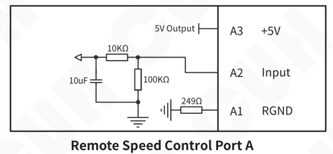

| Terminal | Señal |
|---|---|
| A3 | +5V |
| A2 | Input |
| A1 | RGND |

### Puerto C de sensor de conmutación

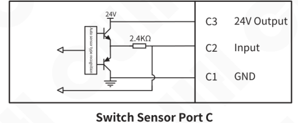

| Terminal | Señal |
|---|---|
| C3 | 24V Output |
| C2 | Input |
| C1 | GND |

### Puerto E de sensor de conmutación

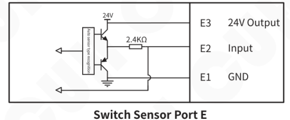

| Terminal | Señal |
|---|---|
| E3 | 24V Output |
| E2 | Input |
| E1 | GND |

### Puerto D de salida de control

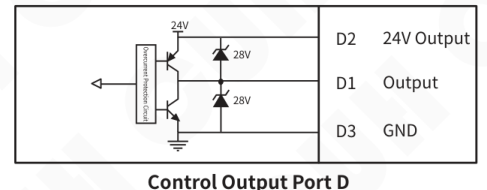

| Terminal | Señal |
|---|---|
| D2 | 24V Output |
| D1 | Output |
| D3 | GND |

---


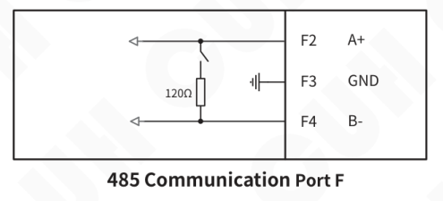

**Puerto F de comunicación 485**

| Terminal | Señal |
|---|---|
| F2 | A+ |
| F3 | GND |
| F4 | B- |

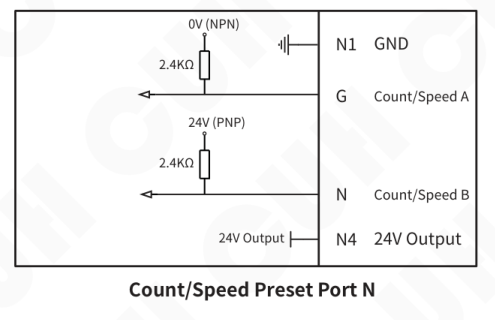

**Puerto N de preajuste de conteo/velocidad**

| Terminal | Señal |
|---|---|
| N1 | GND |
| G | Count/Speed A |
| N | Count/Speed B |
| N4 | 24V Output |

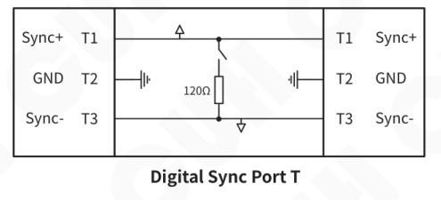

**Puerto T de sincronización digital**

| Terminal | Señal |
|---|---|
| T1 | Sync+ |
| T2 | GND |
| T3 | Sync- |


## 7.6 Código de error

El diagnóstico de fallos de este controlador se divide en códigos de error y códigos de advertencia, y muestra cada código por turnos.

**Código de error:** Es necesario detener la máquina inmediatamente y esperar a que el fallo desaparezca antes de cancelar la visualización.

**Código de advertencia:** No es necesario detener la máquina. Espere a que desaparezca la señal de advertencia antes de cancelar la visualización.

### Tabla de códigos de error

| Código de error | Visualización | Significado | Método de exclusión |
|---|---|---|---|
| Error01 | Short | Cortocircuito | Compruebe si la línea de salida principal está en cortocircuito y vuelva a cablearla |
| Error02 | OvrCurrt | Sobrecorriente | Reduzca la tensión de salida o aumente la frecuencia de salida |
| Error03 | OverHot | Sobrecalentamiento | Coloque el controlador en una zona bien ventilada y con buena disipación de calor |
| Error04 | UndrCool | Enfriamiento insuficiente | Coloque el controlador en un lugar donde la temperatura ambiente sea superior a -20℃ |
| Error05 | CommErr | Error de comunicación | Póngase en contacto con el soporte técnico de la empresa |
| Error06 | TSnerErr | Error del sensor de temperatura | Póngase en contacto con el soporte técnico de la empresa |
| Error07 | OverVolt | Sobretensión | La tensión de red de entrada no puede superar el valor eficaz de 250V |
| Error08 | UndrVolt | Subtensión | La tensión de red de entrada no puede ser inferior al valor eficaz de 85V |
| Error09 | LoadErr | Desconexión de la carga | Compruebe si la línea de salida está correctamente conectada al plato vibratorio |
| Error10 | Send_Seed | Fallo al enviar la semilla | Póngase en contacto con el soporte técnico de la empresa |
| Error11 | Send_Exit | Fallo al ejecutar el comando para salir del arranque | Póngase en contacto con el soporte técnico de la empresa |
| Error14 | SynchEr0 | El bus CUHBus-DS® tiene 2 o más hosts | 1. Si se produce una alarma, ponga el dispositivo fuera de línea y luego vuelva a ponerlo en línea.<br>2. Después de apagar el dispositivo recién añadido, conecte el cable CUHBus-DS® al dispositivo de red. |
| Error15 | SynchEr1 | Error de bus | Compruebe si la línea de comunicación CUHBus-DS® está correctamente conectada y organice la red correctamente |
| Error16 | SynchEr2 | El dispositivo de sincronización no está en línea | La red de comunicación de sincronización, el dispositivo de sincronización de frecuencia o el dispositivo de sincronización de control remoto no está en línea |


## 7.7 Código de advertencia

Tabla de códigos de advertencia

| Código de advertencia | Visualización | Significado | Método de exclusión |
|---|---|---|---|
| Warn01 | Saturate | Saturación de la salida | Reduzca la tensión de salida |
| Warn02 | decline | Ralentización del conteo | Estado de desaceleración del conteo |
| Warn03 | CND | Fin del conteo | Estado de fin del conteo |
| Warn04 | FrqncyLo | Frecuencia de salida demasiado baja | Aumente el valor del parámetro de desviación de frecuencia |
| Warn05 | FrqncyHi | Frecuencia de salida demasiado alta | Aumente el valor del parámetro de desviación de frecuencia |
| Warn06 | LoMAlarm | Falta de material | Reduzca el valor del parámetro de alarma de falta de material o añada material a la bandeja de material |
| Warn07 | PortDErr | Sobrecorriente de salida del puerto D | Reduzca la carga de control del puerto de salida |
| Warn08 | RemotLow | Tensión/corriente de entrada del control remoto demasiado baja | Aumente la tensión o la corriente de entrada del control remoto |
| Warn09 | MRSErr | Error de lógica RS de la salida principal | Cuando la lógica de salida es un bistable RS, las señales de la fuente principal 1 y de la fuente principal 2 no pueden ser válidas al mismo tiempo |
| Warn10 | 24VErr | Error de 24V | No conecte la alimentación externa de 24V al puerto de salida del controlador |
| Warn11 | 5VErr | Error de 5V | No conecte la alimentación externa de 5V al puerto de salida del controlador |
| Warn12 | CtrlRSErr | Error de lógica RS de la salida de control | Cuando la lógica del puerto D es un bistable RS, las señales de la fuente 1 del puerto D y de la fuente 2 del puerto D no pueden ser válidas al mismo tiempo |
| Warn13 | OverLoad | Sobrecarga del sensor de aceleración | Sustituya el sensor de aceleración por otro con un rango adecuado |
| Warn14 | AcceleEr | Fallo del sensor de aceleración | El sensor está dañado; sustitúyalo por uno nuevo |
| Warn15 | EEPErr | Error al guardar los parámetros | Confirme que la línea de comunicación CUHBus-DS® está correctamente conectada y que la conexión en red se ha realizado correctamente. |


# Capítulo VIII Información de garantía del producto

## 8.1 Período de garantía

El período de garantía que la empresa ofrece para este producto es de 3 años a partir de la fecha de entrega del producto en el lugar designado por el comprador.

## 8.2 Cobertura de la garantía

(1) Si se produce un fallo causado por nuestra empresa durante el período de garantía anterior, repararemos el producto de forma gratuita. Sin embargo, las siguientes situaciones no están cubiertas por la garantía:

&nbsp;&nbsp;&nbsp;&nbsp;a. Fallo debido al incumplimiento de las condiciones especificadas en el manual simplificado, el manual de usuario o los requisitos técnicos acordados específicamente entre el comprador y la empresa, a una operación incorrecta o a un uso indebido.

&nbsp;&nbsp;&nbsp;&nbsp;b. El fallo no se debe a un defecto del producto, sino al diseño del equipo o del software del comprador.

&nbsp;&nbsp;&nbsp;&nbsp;c. Fallos de funcionamiento causados por modificaciones o reparaciones no realizadas por el personal de la empresa.

&nbsp;&nbsp;&nbsp;&nbsp;d. Fallos que pueden evitarse por completo mediante un mantenimiento correcto o la sustitución de las piezas de desgaste conforme a la guía de operación simplificada o al manual de usuario.

&nbsp;&nbsp;&nbsp;&nbsp;e. Tras el envío del producto desde nuestra empresa, fallo causado por factores como cambios imprevistos en el nivel de la ciencia y la tecnología.

&nbsp;&nbsp;&nbsp;&nbsp;f. En caso de fallos debidos a catástrofes naturales como incendios, terremotos o inundaciones, o a factores externos como tensiones anormales, la empresa no asume la responsabilidad de la garantía.

(2) El alcance de la garantía se limita a la situación estipulada en (1). La empresa no asume ninguna responsabilidad por las pérdidas indirectas (como daños en equipos, oportunidades perdidas, pérdida de beneficios, etc.) ni por otras pérdidas.

## 8.3 Idoneidad del producto

El controlador de nuestra empresa está diseñado y fabricado para un uso general en la industria de alimentación vibratoria. Por lo tanto, este controlador de nuestra empresa no debe utilizarse para las siguientes aplicaciones y no es idóneo para tales usos.

(1) Instalaciones que tienen un impacto grave en la vida y la propiedad, como centrales nucleares, aeropuertos, ferrocarriles, barcos, dispositivos motorizados y equipos médicos.

(2) Servicios públicos, incluidos la electricidad, el gas y el suministro de agua, etc.

(3) Uso en exteriores en condiciones o entornos similares.

---


|  |  |
|---|---|
|  | Nanjing CUH Science & Technology Co.,Ltd<br>https://en.cuhnj.com<br>Tel.:+86-25-84730411 / 84730415 / 84730416<br>Fax:+86-25-84730426<br>E-mail:sales@cuhnj.com<br>Add.:Building 2, Xueyan Tech Park, Tuscity,<br>No.9 Zhineng Rd, Jiangning, Nanjing, China |

<div align="right">Document No.: IDP1000504</div>


