## Controlador automático inteligente para alimentador vibratorio

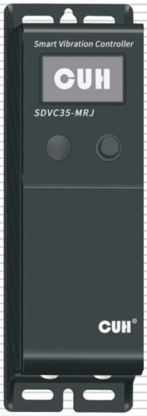

## Serie SDVC35
Controlador automático inteligente para alimentador vibratorio — Serie SDVC35
## Manual de instrucciones

## Prefacio

Gracias por elegir el controlador inteligente digital de alimentador vibratorio CUH.

(En lo sucesivo, “el controlador”).

Este manual incluye notas para la instalación, la depuración, el ajuste de parámetros, el mantenimiento y la solución de problemas del controlador. Lea atentamente este manual antes de operar el controlador y consérvelo adecuadamente.

**Este manual se aplica a los siguientes modelos**

- SDVC35-MRJ　( Corriente de salida 3A )
- SDVC35-LRJ　( Corriente de salida 4.5A )

---

## Aviso:

1. Nunca enchufe ni desenchufe el cable ni toque las tomas de corriente en ningún caso mientras el controlador esté alimentado, para evitar descargas eléctricas u otros accidentes.
2. Nunca conecte el controlador a 380V CA, ya que puede causar daños irreparables. (disponemos de productos diseñados para 380V CA)
3. Nunca conmute la entrada del controlador cortando la alimentación para activar/desactivar la salida; de lo contrario, podría reducir la vida útil del controlador.
4. El controlador está diseñado para funcionar en un entorno fresco y seco. Nunca utilice el controlador en el exterior para evitar mojaduras e insolación. Utilice el controlador dentro del rango de temperatura especificado en las características eléctricas.
5. Nunca utilice el controlador en condiciones que superen sus límites de diseño.
6. Utilice el controlador estrictamente de acuerdo con este manual. No asumiremos ninguna responsabilidad civil o penal si se producen daños en el equipo o lesiones personales por un uso incorrecto.

> Nunca abra la carcasa del controlador para evitar descargas eléctricas. Contacte con CUH si el controlador se avería. Nunca intente reparar el controlador usted mismo, ya que podría anular la garantía.

---

## Entorno de funcionamiento y almacenamiento

### Inspección antes del uso

Todos los controladores pasan una rigurosa inspección de calidad antes de su entrega y se embalan con un embalaje a prueba de golpes. Después de desembalar, compruebe los siguientes puntos:

1. Si el controlador presenta daños en su aspecto exterior.
2. Si el modelo del controlador es el que ha pedido.

### Entorno de ejecución

Siga las siguientes indicaciones para garantizar un mejor rendimiento y una mayor vida útil del controlador:

- ⚠ Entorno bien ventilado
- ⚠ Manténgalo alejado del agua, vapor, polvo y especialmente polvo aceitoso
- ⚠ Manténgalo alejado de gases y líquidos corrosivos o inflamables
- ⚠ Manténgalo alejado del polvo en suspensión y las partículas metálicas
- ⚠ Fíjelo firmemente para evitar vibraciones propias
- ⚠ Manténgalo alejado de interferencias electromagnéticas
- ⚠ Asegure una temperatura ambiente de 0~40 ℃
- ⚠ Para uso a una altitud de 2000 m o inferior

---

# Contenido

- **Capítulo I　Características — 1**
  - 1.1　Características principales — 1
  - 1.2　Otras características — 1
- **Capítulo II　Guía de instalación — 3**
  - 2.1　Descripción de las partes externas — 3
  - 2.2　Descripción de la instalación — 5
  - 2.3　Instalación del sensor de vibración — 7
  - 2.4　Búsqueda automática de la frecuencia de resonancia — 9
- **Capítulo III　Descripción de la HMI — 10**
  - 3.1　Interfaz de espera — 10
  - 3.2　Interfaz de entrada de contraseña — 13
  - 3.3　Interfaz de grupos de funciones — 14
  - 3.4　Interfaz de visualización del proceso de búsqueda de la frecuencia de resonancia — 16
- **Capítulo IV　Descripción de funciones — 17**
  - 4.1　Control ON/OFF de las entradas digitales C y E — 17
  - 4.2　Función de conteo — 20
  - 4.3　Señal de control de la salida principal — 24
  - 4.4　Salidas de control DC puerto D y puerto P — 28
  - 4.5　Control de velocidad remoto — 33
  - 4.6　Modo principal — 35
  - 4.7　Modo de sincronización — 39
  - 4.8　Función de parámetros preajustados — 44
  - 4.9　Restauración de los ajustes de fábrica — 45
  - 4.10　Comunicación RS485 — 46
  - 4.11　Comunicación Ethernet — 48
  - 4.12　Prueba de carga — 48
  - 4.13　Monitorización del estado de funcionamiento — 49
- **Capítulo V　Función de seguridad — 50**

---

---

Apéndice A: Dimensiones — 51

Apéndice B: Descripción de los puertos eléctricos — 52

Apéndice C: Especificación eléctrica — 53

Apéndice D: Sugerencias de solución de problemas y explicación de errores — 55

Apéndice E: Descripción de advertencias y errores y sugerencias de solución de problemas — 56

Apéndice F: Descripción del estado de funcionamiento y del tipo de tarjeta de red — 57

Apéndice G: Método de conexión de sensores de conmutación y PLC a las entradas digitales — 58

Apéndice H: Tabla de parámetros — 61

---

# Capítulo I Características

## 1.1 Características principales

**Pantalla OLED:** Ofrece tres idiomas, chino, inglés y alemán, así como una interfaz de funcionamiento amigable.

**Búsqueda automática de la frecuencia de resonancia:** Proporciona búsqueda con sensor o sin sensor para encontrar la frecuencia de resonancia de la carga.

**Control automático de velocidad constante:** Ajuste automático de la tensión de salida en tiempo real para garantizar una velocidad de alimentación preajustada constante, independientemente de los cambios de peso de los materiales en el alimentador vibratorio.

**Salida sincronizada de varios controladores:** Sincroniza la forma de onda de salida de los controladores esclavos con la del controlador maestro a la misma frecuencia y fase para evitar el fenómeno de batido.

**Salida de control doble push-pull:** El controlador puede emitir alimentación de 24V DC asociada al ajuste de la relación lógica del control ON/OFF para accionar un solenoide, un relé eléctrico u otros dispositivos externos.

**Comunicación Ethernet:** Permite ajustar todos los parámetros y monitorizar los estados de funcionamiento del controlador. Compatible con los protocolos de comunicación EtherCAT y Profinet.

**Actualización de firmware:** Admite la actualización de firmware en línea para ofrecer los últimos resultados de I+D de nuestra empresa.

**Detección de carga:** Mide la inductancia, la corriente máxima y la resistencia de la carga.

## 1.2 Otras características

El controlador está especialmente diseñado para controlar alimentadores vibratorios en sistemas de automatización. Combinado con la última tecnología electrónica y un diseño cuidado, el controlador ofrece las siguientes características cómodas y prácticas:

**Regulación automática de tensión:** Elimina la variación de velocidad causada por las fluctuaciones de la tensión de red y el fenómeno de batido causado por la frecuencia de CA industrial.

**Control ON/OFF con dos sensores de conmutación:** Se pueden conectar 2 sensores de conmutación o un PLC para activar/desactivar el controlador.

**Reconocimiento automático del tipo de sensor de conmutación:** El controlador puede reconocer automáticamente el tipo de sensor de conmutación NPN/PNP.

**Arranque suave:** Para evitar sacudidas repentinas al alimentador vibratorio, el controlador puede aumentar suavemente la tensión de salida/velocidad de alimentación de 0 al valor preajustado en el arranque.

---

---

**Preajuste de parámetros:** Se pueden seleccionar 4 conjuntos de parámetros preajustados.

**Función de aceleración:** El valor máximo de tensión de salida del controlador se puede incrementar hasta el 150% del valor de la tensión de entrada ( Excepto en el estado de seguimiento automático sin sensor ).

**Tensión de salida máxima ajustable:** La tensión de salida máxima ajustable se puede preajustar para proteger la carga de daños causados por una tensión demasiado alta.

**Índice de forma de onda:** Representa el ciclo de trabajo equivalente de la corriente de salida sinusoidal dentro de un ciclo. Un valor de parámetro más alto corresponde a un ciclo de trabajo equivalente mayor. Este parámetro se puede ajustar para equilibrar la eficiencia de funcionamiento y la potencia de salida máxima del controlador.

**Corriente DC:** Componente de offset DC de la señal de corriente de salida sinusoidal.

**Control de velocidad remoto:** La tensión de salida del controlador se puede ajustar mediante un potenciómetro externo o una señal DC de 4~20mA, 0~5V, 1~5V, 0~10V.

**Conteo:** Cuando el número de conteo de las piezas alcanza el valor preajustado, la velocidad de alimentación se ralentiza o se reduce a cero.

**Salida ON/OFF:** Pulse brevemente el botón ON/OFF para poner en marcha/detener el controlador.

**Bloqueo del teclado:** Mantenga pulsado el botón ON/OFF para bloquear el teclado.

**Contraseña de parámetros:** El usuario puede establecer la autoridad mediante contraseña para impedir el ajuste de parámetros (como la tensión de salida y la velocidad de alimentación).

**Función de guardado de parámetros:** El usuario puede hacer que el controlador trabaje con cualquiera de los cuatro conjuntos de parámetros preajustados y guardados en User Data, ajustados mediante los parámetros "SavedALLTo" y "ReadALLFrm" de la Función 8 del controlador.

**Restauración de los ajustes de fábrica:** Esta función permite al operador restaurar todos los parámetros a los valores predeterminados de fábrica.

**Comunicación Rs485:** Todos los parámetros se pueden ajustar y monitorizar de forma remota.

**Interfaz de espera OLED autodefinible:** El usuario puede seleccionar los parámetros que necesita mostrar en la interfaz de espera.

**Salida de señal de alarma:** La señal de alarma se puede emitir a través del puerto de salida de control o del puerto de comunicación para su procesamiento automático.

---

# Capítulo Ⅱ Guía de instalación

## 2.1 Descripción de las partes externas

### 2.1.1 Descripción del exterior

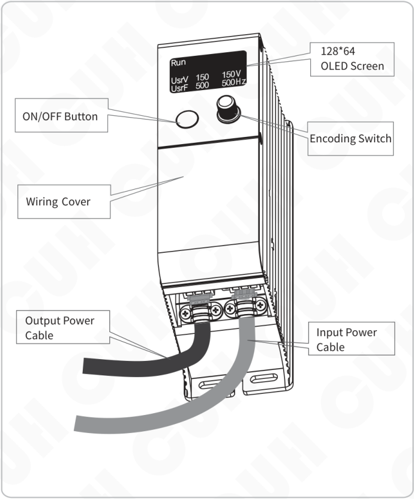

## 2.1.2 Descripción de los terminales

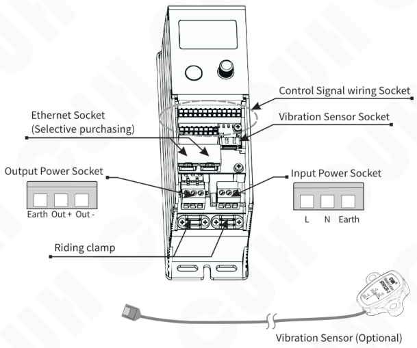

- Toma de cableado de señal de control
- Toma del sensor de vibración
- Toma Ethernet (compra opcional)
- Toma de salida de potencia: Tierra / Out + / Out -
- Toma de entrada de potencia: L / N / Tierra
- Abrazadera de fijación
- Sensor de vibración (opcional)

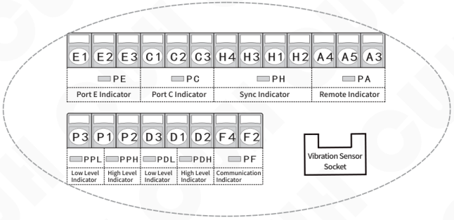

Terminales de la fila superior (de izquierda a derecha): E1, E2, E3, C1, C2, C3, H4, H3, H1, H2, A4, A5, A3.

| PE | PC | PH | PA |
|---|---|---|---|
| Indicador del puerto E | Indicador del puerto C | Indicador de sincronización | Indicador remoto |

Terminales de la fila inferior (de izquierda a derecha): P3, P1, P2, D3, D1, D2, F4, F2.

| PPL | PPH | PDL | PDH | PF |
|---|---|---|---|---|
| Indicador de nivel bajo | Indicador de nivel alto | Indicador de nivel bajo | Indicador de nivel alto | Indicador de comunicación |

Toma del sensor de vibración

**Nota:** El puerto D o el puerto P es una salida de alta impedancia cuando el indicador de nivel alto y el indicador de nivel bajo están encendidos.

---

## 2.2 Descripción de la instalación

### Paso uno:

Abra la caja del embalaje y compruebe el controlador y todos los accesorios.

### Paso dos:

Conecte los terminales de cableado del cable de salida de potencia a la bobina electromagnética del vibrador.

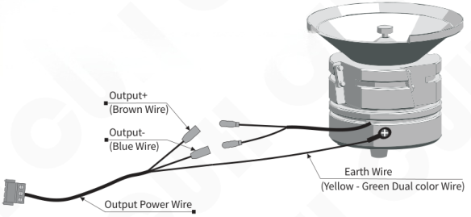

- Output+ (cable marrón)
- Output- (cable azul)
- Cable de tierra (cable bicolor amarillo - verde)
- Cable de salida de potencia

> Nota: Asegúrese de que la bobina electromagnética del vibrador esté conectada al cable de fase y al cable neutro del cable de salida de potencia, y de que la carcasa del vibrador esté conectada a tierra de forma fiable.

### Paso tres:

Abra la tapa.

Conecte el conector del cable de salida de potencia a la toma del controlador y fije el cable de salida de potencia a la carcasa del controlador con la abrazadera de fijación.

No realice esta operación con el equipo alimentado, para evitar descargas eléctricas.

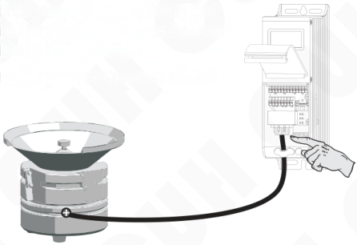

---

## Paso cuatro:

Conecte el conector del cable de entrada de potencia a la toma de entrada de potencia del controlador y fije el cable de entrada de potencia a la carcasa del controlador con la abrazadera de fijación.

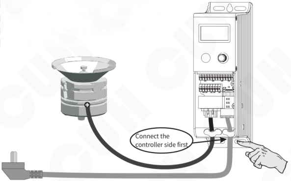

Conecte primero el lado del controlador

## Paso cinco:

Conecte el enchufe del cable de entrada de potencia a la toma de la red eléctrica.

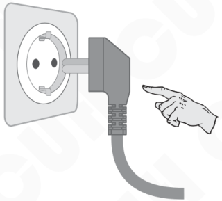

El controlador se enciende y la pantalla OLED muestra la interfaz de arranque durante un momento; después, la OLED muestra la interfaz de espera.

---

## 2.3 Instalación del sensor de vibración

### 2.3.1 Método de conexión del sensor de vibración

- Apague el controlador y conecte el conector del sensor de vibración a la toma del sensor de vibración del controlador.
- Fije el sensor de vibración cerca de la armadura del vibrador. El método y la ubicación de instalación se muestran a continuación:

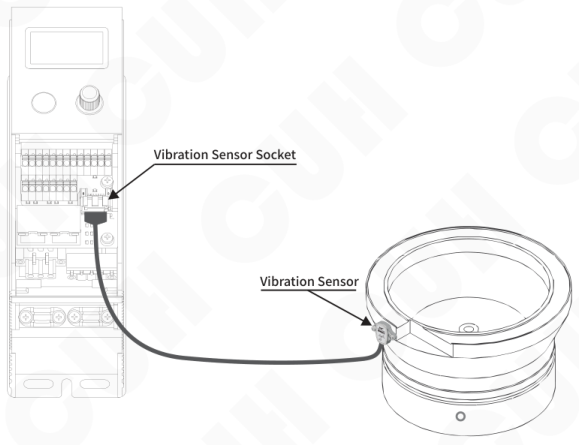

---

## 2.3.2 Instalación del sensor de vibración en el vibrador

Fije el sensor de vibración a la superficie lisa del vibrador, con dirección de instalación arbitraria. Los métodos de instalación del sensor de vibración se muestran a continuación:

- Método 1: Como se muestra en la Fig. 1

  Ventaja: Instalación sencilla

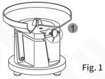

- Método 2: Como se muestra en la Fig. 2

  Nota: No deje que el sensor de vibración quede presionado por el cuenco de alimentación.

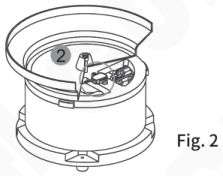

- Método 3: suelde un soporte en el vibrador y fije el sensor de vibración al soporte. Como se muestra en la Fig. 3

  En la Fig. 4 se muestran las dimensiones recomendadas del soporte del sensor de vibración.

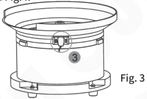

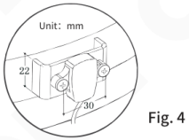

- Método de instalación no recomendado, como se muestra en la Fig. 5 y la Fig. 6.

  Si la ubicación de instalación no es adecuada, el sensor de vibración no podrá realimentar la frecuencia de resonancia con precisión y el controlador ejecutará la búsqueda de la frecuencia de resonancia de forma continua.

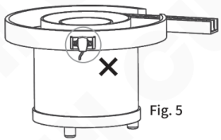

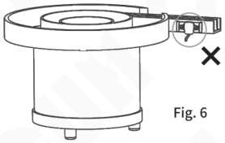

---

## 2.4 Búsqueda automática de la frecuencia de resonancia

### 2.4.1 Búsqueda automática de la frecuencia de resonancia sin sensor

El controlador dispone de la función de búsqueda automática de la frecuencia de resonancia sin sensor; el usuario solo necesita ajustar el parámetro "Usr_Voltag" para que el vibrador trabaje en las mejores condiciones.

Inicie la función de búsqueda automática de la frecuencia de resonancia sin sensor ajustando el parámetro "AtoSnsrTyp " en "Auto" en el Grupo de funciones 3 y "AutoSerch_ " en "Star" en el Grupo de funciones 1.

Nota: La función de búsqueda automática de la frecuencia de resonancia sin sensor solo es válida cuando el controlador funciona en Modo principal, y el sensor de vibración debe estar conectado cuando el controlador funciona en Modo de sincronización.

### 2.4.2 Búsqueda automática de la frecuencia de resonancia con sensor

Mediante la función de búsqueda automática de la frecuencia de resonancia con sensor de vibración, el controlador puede hacer que el vibrador trabaje a la mejor frecuencia y los parámetros relacionados del controlador se pueden ajustar automáticamente. El usuario solo necesita ajustar el parámetro de velocidad de alimentación para que el vibrador funcione de la mejor manera.

Después de conectar el sensor de vibración, encienda el controlador y este podrá comprobar automáticamente si la frecuencia de resonancia del vibrador está dentro del rango preajustado del controlador; si no está dentro del rango, el controlador iniciará la búsqueda automática de la frecuencia de resonancia.

**Pasos de la búsqueda automática de la frecuencia de resonancia:**

- Mantenga pulsado el conmutador codificador en la interfaz de espera para entrar en la interfaz de parámetros de grupos de funciones.
- Ajuste el parámetro "AutoSerch_" del Grupo de funciones 1 a "Start" y pulse brevemente el conmutador codificador para iniciar el proceso de búsqueda automática de la frecuencia de resonancia.
- Cuando finaliza el proceso de búsqueda automática de la frecuencia de resonancia, el resultado de la frecuencia de resonancia y "Save" mostrados en la OLED indican que el parámetro se ha guardado.

Tras el proceso de búsqueda automática de la frecuencia de resonancia, el vibrador puede funcionar con normalidad. Pulse brevemente o gire el conmutador codificador para volver a la interfaz anterior.

> 1. El proceso de búsqueda automática de la frecuencia de resonancia debe realizarse con el cuenco de alimentación vacío.
> 2. Cancele la operación de búsqueda de frecuencia durante el proceso de búsqueda automática de la frecuencia de resonancia pulsando brevemente el botón "ON/OFF".
> 3. Si la OLED muestra "OverCurrent" durante el proceso de búsqueda automática de la frecuencia de resonancia, significa que "AtoSrhVMax" está ajustado demasiado alto, pero el proceso de búsqueda automática de la frecuencia de resonancia no se ve afectado.

---

## Capítulo Ⅲ Descripción de la HMI

### 3.1 Interfaz de espera

A continuación, se muestra la interfaz de espera:

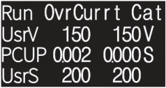

El controlador entrará en la interfaz de espera cuando no se opere el controlador durante más de 2 minutos.

En la interfaz de espera hay 4 filas de visualización y la primera fila se utiliza para indicar el estado de funcionamiento, la información de error o alarma del controlador.

1. El área izquierda de la primera fila de visualización se utiliza para indicar la marcha/parada del controlador.
2. El área derecha de la primera fila de visualización se utiliza para indicar el tipo de tarjeta de red.
3. El área central de la primera fila de visualización se utiliza para indicar la advertencia/error del controlador.

Todos los elementos de las tres áreas se explican respectivamente en los apéndices F y E.

De la 2.ª a la 4.ª fila de visualización se utilizan para ajustar parámetros y el usuario puede seleccionar hasta tres parámetros mostrados en la interfaz de espera.

Cada fila de visualización de la interfaz de espera tiene 4 elementos: nombre del parámetro, valor de ajuste/estado del parámetro, valor de prueba actual/valor de salida, unidad. El ejemplo de la interfaz de espera es el siguiente:

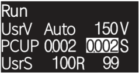

La segunda fila de visualización es el parámetro de tensión de salida, y "Auto" significa que este parámetro se ajusta automáticamente por el controlador, y la tensión de salida real es 150V.

La tercera fila de visualización es el parámetro de retardo de conexión del puerto C, y el valor de ajuste es 0.002S; el tercer elemento es el valor en tiempo real del proceso de retardo. Cuando el proceso de retardo ha finalizado, el valor en tiempo real se mostrará en vídeo inverso.

La cuarta fila de visualización es el parámetro de velocidad de alimentación, y el valor de ajuste es 100, y la velocidad de alimentación en tiempo real es 99. La "R" detrás del valor de ajuste significa que la velocidad de alimentación está controlada por el puerto de control remoto.

---

Los parámetros que se pueden mostrar en la interfaz de espera se indican a continuación.

| Elemento | Descripción |
|---|---|
| UsrV | Tensión de salida |
| UsrF | Frecuencia de salida |
| UsrS | Velocidad de alimentación |
| Cout | Valor de conteo actual |
| PCUp | Retardo de subida del puerto C |
| PCDn | Retardo de bajada del puerto C |
| PEUp | Retardo de subida del puerto E |
| PEDn | Retardo de bajada del puerto E |
| PDUp | Retardo de subida del puerto D |
| PDDn | Retardo de bajada del puerto D |
| PPUp | Retardo de subida del puerto P |
| PPDn | Retardo de bajada del puerto P |
| MaUp | Retardo de subida del control principal |
| MaDn | Retardo de bajada del control principal |
| BusV | Tensión del bus de alimentación |
| CurE | Corriente de salida RMS |
| CurM | Corriente de salida máxima |
| PwrA | Potencia activa |
| PwrR | Potencia reactiva |
| Temp | Temperatura |
| SynF | La frecuencia de la señal de sincronización externa |
| Remo | Tensión de entrada remota |
| PCV | Tensión de entrada del puerto C |
| PEV | Tensión de entrada del puerto E |
| PDV | Tensión de salida del puerto D |
| PPV | Tensión de salida del puerto P |

---

---

### 3.1.1 Método de ajuste de parámetros de la interfaz de espera

Cuando el usuario necesite ajustar el valor del parámetro, pulse brevemente el conmutador codificador y el valor de ajuste de la segunda fila de visualización se mostrará en vídeo inverso con fondo blanco; a continuación, gire el conmutador codificador para ajustar el valor de ajuste. Pulse brevemente el conmutador codificador para cambiar la interfaz de ajuste del valor de ajuste entre las tres filas de visualización y ajuste el valor del parámetro girando el conmutador codificador.

Nota:

Si el valor de ajuste es "Auto", el valor del parámetro no se puede ajustar manualmente.

Si hay una "R" detrás del valor de ajuste, el valor del parámetro no se puede ajustar manualmente, como "Voltage" y "Feeding speed".

Si la contraseña está configurada para bloquear el ajuste de parámetros, no hay respuesta al pulsar brevemente el conmutador codificador.

### 3.1.2 Ahorro de energía de la OLED en la interfaz de espera

Si no hay ninguna operación durante más de 2 minutos en la interfaz de espera, el brillo de la OLED disminuirá para entrar en el estado de ahorro de energía con el fin de prolongar la vida útil de la OLED. Pulse brevemente o gire el conmutador codificador para salir del estado de ahorro de energía.

---

## 3.2 Interfaz de entrada de contraseña

Cuando "Passsword 1" o "Passsword 2" no son cero, el permiso de operación para el ajuste de parámetros está bloqueado. Mantenga pulsado el conmutador codificador en la interfaz de espera y la OLED mostrará la interfaz de entrada de contraseña para recordar al usuario que introduzca la contraseña.

La interfaz de entrada de contraseña se muestra a continuación:

Ajuste el valor de la contraseña girando el conmutador codificador y pulse brevemente el conmutador codificador para confirmar la contraseña introducida. Si la contraseña es correcta, se entra en la interfaz de grupos de funciones.

El objeto controlado por la contraseña 1 y la contraseña 2 se muestra a continuación:

| Objeto controlado | Contraseña 2 | Contraseña 1 |
|---|---|---|
| Botón ON/OFF | ○ | ○ |
| Interfaz de espera | ○ | √ |
| Grupo de funciones 1 y Grupo de funciones 9 | √ | √ |
| Otros grupos de funciones | × | √ |
| Explicación | cuando no hay permiso, se pueden operar el botón ON/OFF y los parámetros de la interfaz de espera.  cuando hay permiso, se pueden operar los parámetros del Grupo de funciones 1 y del Grupo de funciones 9, el botón ON/OFF y los parámetros de la interfaz de espera. | cuando no hay permiso, se puede operar el botón ON/OFF.  cuando hay permiso, se pueden operar todas las funciones. |

Nota: ○ significa no controlado，√ significa controlado，× significa sin permiso.

---

## 3.3 Interfaz de grupos de funciones

La interfaz de grupos de funciones se utiliza para ajustar todos los parámetros del controlador. Hay 9 grupos de funciones cuyos parámetros se pueden ajustar y 1 grupo de funciones cuyos parámetros solo se pueden leer.

La primera fila de visualización de la interfaz de grupos de funciones se utiliza para indicar el estado de funcionamiento, la información de error o alarma del controlador. De la 2.ª a la 4.ª fila de visualización es el área que muestra los parámetros del grupo de funciones, y la interfaz se muestra a continuación:

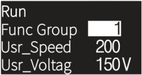

### 3.3.1 Selección del grupo de funciones

Después de entrar en la interfaz de grupos de funciones manteniendo pulsado el conmutador codificador en la interfaz de espera, el cursor estará en el valor de "Function Group" y gire el conmutador codificador para ajustar el valor y cambiar entre "Function Group 0" y "Function Group 9".

Todos los parámetros del grupo de funciones se explican en el apéndice H.

### 3.3.2 Método de ajuste de parámetros del grupo de funciones

Hay 3 métodos para cambiar de parámetro en la interfaz de grupos de funciones:

1. Pulse brevemente el conmutador codificador para cambiar entre parámetros.
2. Pulse el conmutador codificador y manténgalo pulsado no más de 2s, y gire simultáneamente el conmutador codificador para cambiar entre parámetros.

---

3.Pulse el conmutador codificador y manténgalo pulsado más de 2.5s hasta que la fila de visualización del parámetro se muestre en vídeo inverso y luego suéltelo.

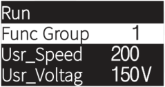

Gire el conmutador codificador para seleccionar el parámetro.

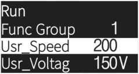

Después de seleccionar el parámetro, pulse brevemente el conmutador codificador para entrar en el estado de ajuste del parámetro.

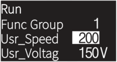

Este método de ajuste es adecuado para cambiar entre varios parámetros.

**Todos los parámetros del grupo de funciones se explican en el apéndice H.**

---

## 3.4 Interfaz de visualización del proceso de búsqueda de la frecuencia de resonancia

Cuando se inicia el proceso de búsqueda automática de la frecuencia de resonancia, la OLED muestra la curva de frecuencia frente a aceleración, como se muestra a continuación. La dirección horizontal de la curva es la frecuencia, cuyo rango es de 25Hz a 400Hz, y la dirección vertical de la curva es la aceleración

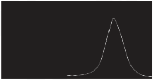

Después de finalizar el proceso de búsqueda automática de la frecuencia de resonancia, el resultado de la frecuencia de resonancia y "Save" se muestran en la OLED para indicar que los parámetros se han guardado, como se muestra a continuación.

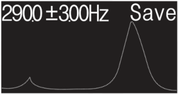

---

# Capítulo Ⅳ Descripción de funciones

## 4.1 Control ON/OFF de las entradas digitales C y E

Hay dos entradas digitales, C y E, que pueden reconocer automáticamente el tipo NPN/PNP del sensor conectado para activar/desactivar el controlador; el dispositivo conectado a los puertos puede ser un sensor de proximidad, un sensor fotoeléctrico, un sensor de fibra o un PLC, etc.

### 4.1.1 Diagrama del circuito eléctrico del puerto C y del puerto E

Diagrama del circuito eléctrico del puerto C

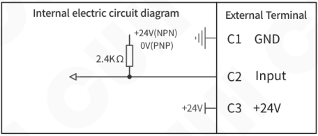

El diagrama del circuito eléctrico del puerto E es el mismo que el del puerto C

### 4.1.2 Método de uso

Tome el sensor de proximidad como ejemplo; su método de conexión se muestra a continuación:

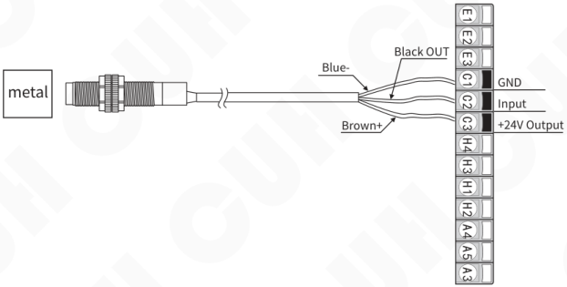

Los métodos de conexión de otros sensores de conmutación se muestran en el apéndice G.

---

## 4.1.3 Diagrama de flujo de señal del puerto C y del puerto E

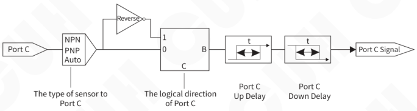

El diagrama de flujo de señal del puerto E es el mismo que el del puerto C

## 4.1.4 Descripción de los parámetros relacionados

Los parámetros del puerto C se ajustan en el Grupo de funciones 4, y los parámetros del puerto E se ajustan en el Grupo de funciones 5.

**Parámetro "PortCType_"**

El controlador puede reconocer automáticamente el tipo NPN/PNP del sensor conectado (el valor predeterminado de fábrica es Auto).

**Parámetro "PortCDir__"**

De fábrica, el controlador funciona cuando el puerto C no recibe señal. En algunas aplicaciones especiales, el controlador debe detenerse cuando el puerto C no recibe señal ajustando el parámetro "PortCDir__".

Cuando "PortCDir__" está ajustado en "Const" y el puerto C no recibe señal, el controlador se pone en marcha.

Cuando "PortCDir__" está ajustado en "Revrs" y el puerto C no recibe señal, el controlador se detiene.

---

---

### Parámetro "PortCUpDly"

El retardo de subida del puerto C significa el periodo de tiempo desde que la señal de arranque recibida por el puerto C es válida hasta que el controlador se pone en marcha.

### Parámetro "PortCDnDly"

El retardo de bajada del puerto C significa el periodo de tiempo desde que la señal de parada recibida por el puerto C es válida hasta que el controlador se detiene.

Nota: cuando el puerto C se utiliza para arrancar/detener el controlador, es necesario ajustar el tiempo de retardo del puerto C para eliminar el rebote de la señal.

---

## 4.2 Función de conteo

### 4.2.1 Diagrama de flujo de señal de la función de conteo

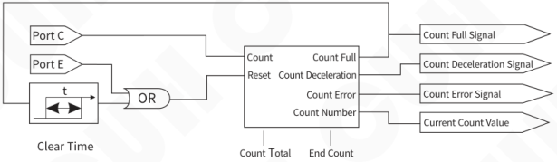

El controlador dispone de la función de conteo integrada, que puede contar los pulsos. Cuando el número de pulsos contados alcanza el Total de conteo preajustado, la velocidad de alimentación se ralentizará o se reducirá a cero.

### 4.2.2 Función de deceleración final

Para eliminar el exceso de conteo de la función de conteo causado por una velocidad de alimentación alta que no se puede detener con prontitud, se deben ajustar la velocidad de alimentación final y el conteo final. La velocidad de alimentación se reduce hasta la velocidad de alimentación final cuando el número de conteo restante se aproxima al conteo final preajustado, que es menor que el Total de conteo; y cuando el número de conteo alcanza el Total de conteo, la velocidad de alimentación se detiene a tiempo para un conteo preciso.

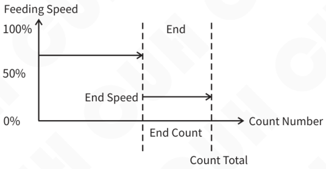

---

## 4.2.3 Función súper anti-rebote

La función súper anti-rebote está diseñada especialmente para resolver el conteo erróneo causado por la condición de alimentación por vibración. Mediante el ajuste del tiempo de estabilización de la señal de conteo se consigue la función súper anti-rebote, de modo que el pulso de conteo se considera válido después del tiempo de estabilización de la señal de conteo; la precisión del tiempo de estabilización de la señal de conteo es de milisegundos.

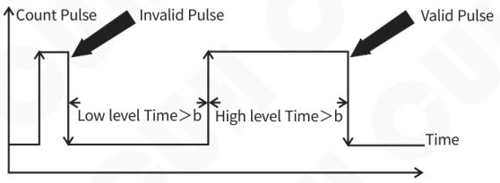

Nota: El tiempo de estabilización anti-rebote significa el tiempo de estabilización del nivel alto y del nivel bajo. Un pulso válido se compone de un nivel alto y un nivel bajo continuamente activos; entonces el contador incrementa en uno.

### Método de ajuste del tiempo de estabilización de la señal de conteo

El puerto C es el puerto de entrada del pulso de conteo del contador. "PortCUpDly " y "PortCDnDly " son respectivamente el tiempo de estabilización del nivel alto y del nivel bajo del pulso de conteo .

El puerto E es el puerto de entrada del pulso de reinicio del contador. "PortEUpDly" y "PortEDnDly" son respectivamente el tiempo de estabilización del nivel alto y del nivel bajo del pulso de reinicio.

---

## 4.2.4 Función de reinicio del contador por temporizador

Cuando el número de conteo alcanza el Total de conteo, después de un tiempo de retardo ajustado por "Clear Time" en el Grupo de funciones 1, el contador se reinicia y vuelve a contar.

Cuando el valor de "Clear Time" es 0.0s, la función de reinicio del contador por temporizador está deshabilitada.

## 4.2.5 Método de uso del conteo

El controlador incorpora un contador; el puerto C es el puerto de conteo del contador y el puerto E es el puerto de reinicio del contador.

El estado del contador puede controlar la salida de control principal, la salida del puerto D y la salida del puerto P.

- Cuando el valor de "Main Logic" ajustado en el Grupo de funciones 2 es "Count", la salida de control principal está controlada por la señal de conteo completo.
- Cuando el valor de "Port D Logic" ajustado en el Grupo de funciones 6 es "END", la salida del puerto D está controlada por la señal de conteo completo.  
  Cuando el valor de "Port P Logic" ajustado en el Grupo de funciones 7 es "END", la salida del puerto P está controlada por la señal de conteo completo.
- Cuando el valor de "Port D Logic" ajustado en el Grupo de funciones 6 es "Near", la salida del puerto D está controlada por la señal de deceleración de conteo.  
  Cuando el valor de "Port P Logic" ajustado en el Grupo de funciones 7 es "Near", la salida del puerto P está controlada por la señal de deceleración de conteo.

---

## 4.2.6 Descripción de los parámetros relacionados

### Parámetro "CountNumbr"

"CountNumbr", el conteo ya realizado por el contador, se comprueba en el Grupo de funciones 9.

### Parámetro "TotalCount"

Después de que "CountNumbr" alcance "TotalCount", que es el valor esperado ajustado en el Grupo de funciones 1, la señal de conteo completo del contador es válida hasta que el contador se reinicie; el contador puede seguir contando hasta que se reinicie.

### Parámetro "CountAhead"

"CountAhead" se ajusta en el Grupo de parámetros 2; significa el número restante del contador que no ha alcanzado el "TotalCount". Cuando "CountNumbr" alcanza "CountAhead", la velocidad de alimentación disminuye hasta el "PrcntTrmnl" ajustado en el Grupo de funciones 2.

### Parámetro "PrcntTrmnl"

"PrcntTrmnl" se ajusta en el Grupo de funciones 2; significa que cuando "CountNumbr" alcanza "CountAhead", la velocidad de alimentación disminuye hasta la velocidad inicial multiplicada por "PrcntTrmnl".

### Parámetro "Clear Time"

Cuando el número de conteo alcanza el Total de conteo, después de un tiempo de retardo ajustado por "Clear Time" en el Grupo de funciones 1, el contador se reinicia y vuelve a contar.

Cuando el valor de "Clear Time" es 0.0s, la función de reinicio del contador por temporizador está deshabilitada.

### La dirección del puerto de entrada del pulso de conteo

La dirección del puerto de entrada del pulso de conteo es la misma que "PortCDir_" ajustado en el Grupo de funciones 4.

### La dirección del puerto de entrada del pulso de reinicio

La dirección del puerto de entrada del pulso de reinicio es la misma que "PortEDir_" ajustado en el Grupo de funciones 5.

---

## 4.3 Señal de control de la salida principal

La señal de control de la salida principal se utiliza para activar/desactivar la salida principal del controlador, y todos los parámetros del control de la salida principal se ajustan en el Grupo de funciones 2.

### 4.3.1 Diagrama de flujo de señal de la señal de control de la salida principal

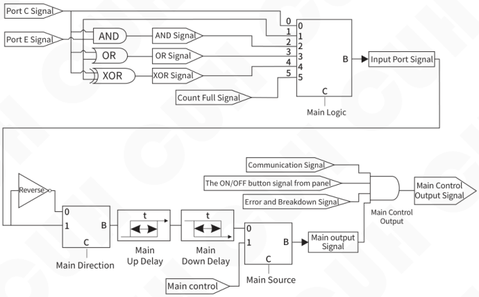

---

## 4.3.2 Descripción de la señal

### Señal de comunicación

La señal de comunicación proviene de RS485 o Ethernet.

Cuando la señal de parada se envía al controlador por RS485 o Ethernet, el controlador se detiene.

Cuando la señal de arranque se envía al controlador por RS485 o Ethernet, el controlador se pone en marcha.

### La señal del botón ON/OFF del panel

La señal de control proviene del botón ON/OFF del panel. Conmute el controlador a ON u OFF pulsando brevemente el botón ON/OFF del panel.

El estado de funcionamiento del controlador al encenderlo se establece mediante el parámetro "PowrOnStat" del Grupo de funciones 2.

Cuando "PowrOnStat" está ajustado en "ON", el controlador inicia la salida principal al encenderse.

Cuando "PowrOnStat" está ajustado en "OFF", el controlador detiene la salida principal al encenderse.

### Señal de error y avería

Cuando se produce alguna de las fallas, como sobrecorriente, cortocircuito, sobrecalentamiento, etc., el controlador se detiene.

Cuando la operación de borrado y conteo se producen simultáneamente en el proceso de conteo, el controlador se detiene.

### Señal de salida principal

La señal de salida principal es la señal del puerto de entrada ajustada mediante "MainDir_", "MainUpDely", "MainDwnDly" y "MainSrc_".

### Señal del puerto de entrada

La fuente de la señal del puerto de entrada se selecciona ajustando el valor de "MainLogic_ " en el Grupo de funciones 2. Los valores de "MainLogic_ " son "Port C", "Port E", "AND", "OR", "XOR", "Count".

---

## 4.3.3 Descripción de los parámetros relacionados

### Parámetro "MainLogic_ "

- Cuando el valor de "MainLogic_ " es "Port C", significa que la fuente de la señal del puerto de entrada proviene de la señal del puerto C.

  Cuando la señal del puerto C solicita al controlador entrar en el estado de marcha, la señal del puerto de entrada solicita arrancar el controlador.

  Cuando la señal del puerto C solicita al controlador entrar en el estado de parada, la señal del puerto de entrada solicita detener el controlador.

- Cuando el valor de "MainLogic_ " es "Port E", significa que la fuente de la señal del puerto de entrada proviene de la señal del puerto E.

  Cuando la señal del puerto E solicita al controlador entrar en el estado de marcha, la señal del puerto de entrada solicita arrancar el controlador.

  Cuando la señal del puerto E solicita al controlador entrar en el estado de parada, la señal del puerto de entrada solicita detener el controlador.

- Cuando el valor de "MainLogic_ " es "AND", "OR" o "XOR", significa que la fuente de la señal del puerto de entrada proviene del resultado de la operación lógica entre el puerto C y el puerto E.

  "AND" significa que las señales del puerto C y del puerto E solicitan ambas detener el controlador, y la señal del puerto de entrada detiene el controlador.

  "OR" significa que la señal del puerto C o del puerto E solicita detener el controlador, y la señal del puerto de entrada detiene el controlador.

  "XOR" significa que las solicitudes de operación del puerto C y del puerto E son diferentes, y la señal del puerto de entrada detiene el controlador.

- Cuando el valor de "MainLogic_ " es "Count", significa que la señal del puerto de entrada proviene de la señal de conteo completo del contador.

  Cuando la señal de conteo completo es válida, el controlador detiene la salida principal y se muestra "CND" en la pantalla.

  Cuando la señal de conteo completo no es válida, el controlador activa la salida principal.

---

### Parámetro "MainDir_"

"Main Direction" indica si la señal del puerto de entrada necesita invertirse.

Cuando el valor de "Main Direction" es "Normal ON", significa que la señal del puerto de entrada no necesita invertirse.

Cuando el valor de "Main Direction" es "Normal OFF", significa que la señal del puerto de entrada necesita invertirse.

### Parámetro "MainUpDely "

Main Up Delay significa el periodo de tiempo desde la solicitud de arranque del controlador hasta que la señal de solicitud se considera válida.

### Parámetro "MainDwnDly"

Main Down Delay significa el periodo de tiempo desde la solicitud de parada del controlador hasta que la señal de solicitud se considera válida.

### Parámetro "MainSrc_"

La señal de salida principal proviene de la "Señal del puerto de entrada" o del "Control principal".

Cuando el valor de "MainSrc_" es "Local", significa que la señal de salida principal proviene de la "Señal del puerto de entrada".

Cuando el valor de "MainSrc_" es "Remot", significa que la señal de salida principal proviene de "MainCtrl_".

### Parámetro "MainCtrl_"

"MainCtrl_" tiene dos estados: detener la salida del controlador y arrancar la salida del controlador.

Cuando el valor de "MainCtrl_" es "OFF", significa detener la salida del controlador.

Cuando el valor de "MainCtrl_" es "ON", significa arrancar la salida del controlador.

---

## 4.4 Salidas de control DC puerto D y puerto P

Hay dos puertos de salida de 24V DC: el puerto D y el puerto P, para accionar el solenoide, el PLC u otros dispositivos externos.

El principio de funcionamiento y el método de ajuste de parámetros del puerto P y del puerto D son los mismos.

### 4.4.1 Diagrama del circuito eléctrico del puerto D y del puerto P

Diagrama del circuito eléctrico del puerto D

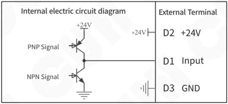

El diagrama del circuito eléctrico del puerto P es el mismo que el del puerto D.

---

## 4.4.2 Método de uso

Método de cableado del solenoide

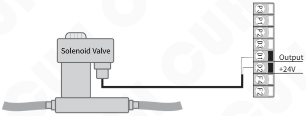

Método de cableado del relé eléctrico

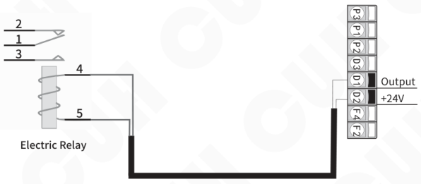

El método de cableado del puerto D y del puerto P son los mismos.

---

## 4.4.3 Diagrama de flujo de señal del puerto D y del puerto P

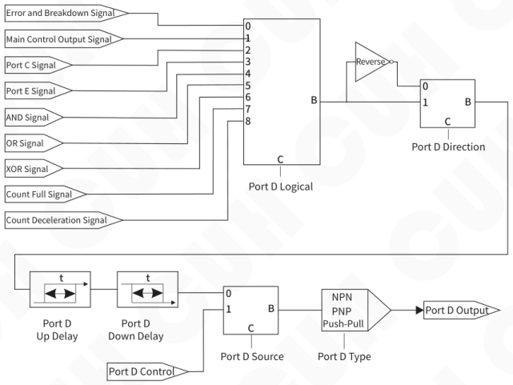

Los diagramas de flujo de señal del puerto D y del puerto P son los mismos.

## 4.4.4 Descripción de los parámetros relacionados

Los parámetros del puerto D se ajustan en el Grupo de funciones 6, y los parámetros del puerto P se ajustan en el Grupo de funciones 7.

### Parámetro "PortDLogic"

La fuente del puerto D se selecciona ajustando el valor de "PortDLogic" en el Grupo de funciones 6. Los valores de "PortDLogic" son "Error", "Main", "Port C", "Port E", "AND", "OR", "XOR", "Count", "Near".

- Cuando el valor de "PortDLogic" es "Error", significa que la fuente de la señal del puerto D proviene del estado de avería del controlador o del error de conteo del modo de contador.

Cuando se produce alguna de las fallas, como sobrecorriente, cortocircuito, sobrecalentamiento, etc., se solicita desactivar el puerto D.

Cuando la operación de borrado y conteo se producen simultáneamente en el proceso de conteo, se solicita desactivar el puerto D.

Cuando no se produce ninguna falla ni error de conteo, se solicita activar el puerto D.

---

---

- Cuando el valor de "PortDLogic" es "Main", significa que la fuente de la señal del puerto D proviene del control principal.

  Cuando la señal del control principal está en estado de marcha, se solicita activar el puerto D.

  Cuando la señal del control principal está en estado de parada, se solicita desactivar el puerto D.

- Cuando el valor de "PortDLogic" es "Port C", significa que la fuente de la señal del puerto D proviene de la señal del puerto C.

  Cuando la señal del puerto C solicita al controlador entrar en el estado de marcha, se solicita activar el puerto D.

  Cuando la señal del puerto C solicita al controlador entrar en el estado de parada, se solicita desactivar el puerto D.

- Cuando el valor de "PortDLogic" es "Port E", significa que la fuente de la señal del puerto D proviene de la señal del puerto E.

  Cuando la señal del puerto E solicita al controlador entrar en el estado de marcha, se solicita activar el puerto D.

  Cuando la señal del puerto E solicita al controlador entrar en el estado de parada, se solicita desactivar el puerto D.

- Cuando el valor de "PortDLogic" es "AND", "OR" o "XOR", significa que la fuente de la señal del puerto D proviene del resultado de la operación lógica entre el puerto C y el puerto E.

  "AND" significa que las señales del puerto C y del puerto E solicitan ambas detener el controlador, y se solicita desactivar la señal de entrada del puerto D.

  "OR" significa que la señal del puerto C o del puerto E solicita detener el controlador, y se solicita desactivar la salida del puerto D.

  "XOR" significa que las solicitudes de operación del puerto C y del puerto E son diferentes, y se solicita desactivar la salida del puerto D .

- Cuando el valor de "PortDLogic" es "END", significa que la fuente de la señal del puerto D proviene de la señal de conteo completo del contador.

  Cuando la señal de conteo completo es válida, se solicita desactivar la salida del puerto D .

- Cuando el valor de "PortDLogic" es "Near", significa que la fuente de la señal del puerto D proviene de la señal de deceleración de conteo del contador.

  Cuando la señal de deceleración de conteo es válida, se solicita desactivar la salida del puerto D .

---

### Parámetro "PortDDir_"

"PortDDir__ " indica si la señal del puerto D necesita invertirse.
Cuando el valor de "PortDDir_" es "Normal ON", significa que la señal de entrada del puerto D no necesita invertirse.

Cuando el valor de "PortDDir_" es "Normal OFF", significa que la señal de entrada del puerto D necesita invertirse.

### Parámetro "PortDUpDly"

Port D Up Delay significa el periodo de tiempo desde la solicitud de activación de la salida del puerto D hasta que la señal de solicitud se considera válida.

### Parámetro "PortDDnDly"

Port D Down Delay significa el periodo de tiempo desde la solicitud de activación de la salida del puerto D hasta que la señal de solicitud se considera válida.

### Parámetro "PortDSrc_"

La fuente de la señal de salida del puerto D proviene de la "Señal de entrada del puerto D" o del "Estado de salida del puerto D".

Cuando el valor de "PortDSrc__ " es "Local", significa que la fuente de la señal de salida del puerto D proviene de la "Señal de entrada del puerto D".

Cuando el valor de "PortDSrc__ " es "Remot", significa que la fuente de la señal de salida del puerto D proviene del "Estado de salida del puerto D".

### Parámetro "PortDCtrl_"

"PortDCtrl_" tiene dos estados: detener y arrancar la salida del puerto D.

Cuando el valor de "PortDCtrl_" es "OFF", significa detener la salida del puerto D.Cuando el valor de "PortDCtrl_" es "ON", significa arrancar la salida del puerto D.

### Parámetro "PortDType_ "

Hay tres tipos de puerto D: NPN, PNP y Ps&Pu .

- El tipo NPN significa que emite nivel bajo cuando la salida del puerto D es válida, y emite un estado de alta impedancia cuando la salida del puerto D no es válida.
- El tipo Ps&Pu significa que emite nivel alto cuando la salida del puerto D es válida, y emite nivel bajo cuando la salida del puerto D no es válida.
- El tipo PNP significa que emite nivel alto cuando la salida del puerto D es válida, y emite un estado de alta impedancia cuando la salida del puerto D no es válida.

---

## 4.5 Control de velocidad remoto

La tensión de salida del controlador se puede ajustar mediante un potenciómetro externo o una señal DC de 4~20mA, 0~5V, 1~5V, 0~10V, de modo que el usuario puede ajustarla fácilmente con un potenciómetro, un PLC y otros dispositivos externos.

### 4.5.1 Diagrama del circuito eléctrico del puerto A del control de velocidad remoto

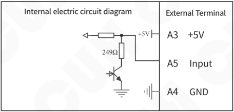

### 4.5.2 Tipo de señal de control remoto

Se pueden configurar 6 tipos de señal de control remoto: "Panel", 20mA, 1~5V, 0~5V, 0~10V, meter.

El tipo de señal de control remoto se ajusta mediante el valor de "control source" en el Grupo de funciones 2 (el valor predeterminado es "Panel").

---

| Tipo de señal de control remoto | Señal de control remoto | Tensión de salida/Velocidad de alimentación |
|---|---|---|
| Panel | | La tensión de salida y la velocidad de alimentación no están controladas por la señal de control remoto |
| 20mA | <2mA | Cuando el modo de tensión es manual, tensión de salida = 0 Cuando el modo de tensión es automático, velocidad de alimentación = 0 La pantalla LCD muestra la información de error "<2mA Err" |
| | 2mA~4 mA | Tensión de salida = 0, velocidad de alimentación = 0 |
| | 4 mA ~20mA | Control proporcional mediante la señal de control remoto (0%~100%) Cuando el modo de tensión es manual, tensión de salida = (corriente de entrada - 4mA)/16 × Tensión de salida máxima Cuando el modo de tensión es automático, velocidad de alimentación = (corriente de entrada - 4mA)/16 × Velocidad de alimentación máxima |
| 1~5V | <0.5V | Tensión de salida = 0, velocidad de alimentación = 0 La pantalla LCD muestra la información de error "<0.5V Err" |
| | 0.5V~1V | Tensión de salida = 0, velocidad de alimentación = 0 |
| | 1V~5V | Control proporcional mediante la señal de control remoto (0%~100%) Cuando el modo de tensión es manual, tensión de salida = (tensión de entrada 1V)/4 × Tensión de salida máxima Cuando el modo de tensión es manual, tensión de salida = (tensión de entrada 1V)/4 × Tensión de salida máxima |
| 0~5V | 0V~5V | Control proporcional mediante la señal de control remoto (0%~100%) Cuando el modo de tensión es manual, tensión de salida = tensión de entrada/5 × Tensión de salida máxima Cuando el modo de tensión es automático, velocidad de alimentación = tensión de entrada/5 × Velocidad de alimentación máxima |
| 0~10V | 0V~10V | Control proporcional mediante la señal de control remoto (0%~100%) Cuando el modo de tensión es manual, tensión de salida = tensión de entrada/10 × Tensión de salida máxima Cuando el modo de tensión es automático, velocidad de alimentación = tensión de entrada/10 × Velocidad de alimentación máxima |
| Meter (potenciómetro) | Relación de división del potenciómetro <4% | Tensión de salida = 0, velocidad de alimentación = 0 |
| | La relación de división del potenciómetro es 4%~96% | Control proporcional mediante la señal de control remoto (0%~100%) Cuando el modo de tensión es manual, tensión de salida = ((relación de división - 4%)/92%)× Tensión de salida máxima Cuando el modo de tensión es automático, velocidad de alimentación = ((tensión de entrada tensión interna × 4%)/tensión interna × 92%) × Velocidad de alimentación máxima |

## 4.6 Modo principal

Modo principal: la ocasión en que el controlador acciona el vibrador de forma independiente.

Mediante el ajuste de los parámetros "Voltage mode" y "Frequency Mode" se establece el modo principal del controlador; la combinación se define a continuación:

| Modo principal | Modo de tensión | Modo de frecuencia | Sensor de vibración conectado |
|---|---|---|---|
| Modo totalmente manual | Manual | Manual | No |
| Modo totalmente automático | Automatic | Automatic | Sí |
| Modo semiautomático de tensión | Automatic | Manual | Sí |
| Modo semiautomático de frecuencia | Manual | Automatic | Sí |

### 4.6.1 Modo totalmente manual

La tensión de salida y la frecuencia de salida del controlador se ajustan manualmente.

**Método de ajuste de la tensión de salida**

Desplace el cursor al valor "Usr_Voltag" en el Grupo de funciones 1 y ajuste el valor de tensión de salida girando el conmutador codificador.

**Método de ajuste de la frecuencia de salida**

Desplace el cursor al valor "Usr_Frqncy" en el Grupo de funciones 1 y ajuste el valor de frecuencia de salida girando el conmutador codificador.

> Nota:
>
> Salvo indicación especial en este manual, la tensión es la tensión media rectificada.
>
> Este controlador dispone de la función de regulación automática de tensión.

---

## 4.6.2 Modo totalmente automático

El controlador ajusta automáticamente la tensión de salida y la frecuencia de salida según los datos del sensor de vibración para estabilizar la velocidad de alimentación del vibrador, que se ajusta mediante "User_Speed" en el Grupo de funciones 1.

### Método de ajuste de la velocidad de alimentación

Desplace el cursor al valor "User_Speed" en el Grupo de funciones 1 y ajuste el valor de velocidad de alimentación girando el conmutador codificador.

### Descripción de otros parámetros relacionados

**"AtoFCenter”**

El rango de ajuste automático de frecuencia del controlador es "AtoFCenter ± AtoFRange_", y la frecuencia central debe ajustarse cerca de la frecuencia de resonancia del vibrador.

**"AtoFRange_"**

El rango de ajuste automático de frecuencia del controlador es "AtoFCenter ± AtoFRange_", y el rango de frecuencia recomendado es 30.0Hz. Un valor excesivo del rango de frecuencia hace que el vibrador no pueda trabajar a la mejor frecuencia, y un valor demasiado pequeño puede reducir la adaptabilidad del vibrador.

**"AtoFIntgrl”**

Ajusta automáticamente la frecuencia de salida del controlador mediante el algoritmo PID; cuanto mayor es el valor integral de frecuencia del PID, más rápido se ajusta la frecuencia de salida, pero un valor excesivo puede provocar oscilaciones en la frecuencia de salida.

**"AtoAProptn”**

Ajusta automáticamente la tensión de salida del controlador mediante el algoritmo PID; cuanto mayor es el valor proporcional de amplitud del PID, más rápido se ajusta la tensión de salida, pero un valor excesivo puede provocar oscilaciones en la tensión de salida.

**"AtoAIntgrl”**

Ajusta automáticamente la tensión de salida del controlador mediante el algoritmo PID; cuanto mayor es el valor integral de amplitud del PID, más se reducen la frecuencia y la amplitud de las oscilaciones de la tensión de salida, pero un valor excesivo puede aumentar la amplitud de las oscilaciones de la tensión de salida.

---

### "AtoSnsrMax”

Limite la amplitud de salida máxima ajustando "AtoSnsrMax" para evitar dañar el vibrador.

### "AutoPhase”

Ajuste la fase de la forma de onda ajustando el parámetro "AutoPhase".

### "AtoSpedMax”

El rango de ajuste de la velocidad de alimentación va de 0 a "AtoSpedMax".

### "AtoSrhVMax”

Limite la tensión de salida en el proceso de búsqueda automática de la frecuencia de resonancia para evitar dañar el dispositivo vibratorio.

### "AtoSnsrTyp"

El controlador admite varios tipos de sensor de vibración, y la tensión de salida del controlador es diferente según el tipo a la misma velocidad de alimentación.

| Valor técnico | Tipo de sensor de vibración | Aceleración en dirección X/Y/Z |
|---|---|---|
| 16g | SDVS20-1 | 16g/16g/16g |
| 35g | SDVS20-2 | 35g/35g/- |
| 50g | SDVS20-3 | 50g/50g/- |
| 70g | SDVS20-4 | 70g/70g/- |
| Auto | Ninguno | Ninguno |

### "Speed_Now_”

Indica la velocidad de alimentación en tiempo real a través de "Speed_Now_" en el Grupo de funciones 9, para ayudar al usuario a observar el estado de funcionamiento del dispositivo.

### "VoltagOut_"

Indica la tensión de salida en tiempo real en el Grupo de funciones 9 para ayudar al usuario a observar el estado de funcionamiento del dispositivo.

Nota: El controlador está ajustado de fábrica al modo totalmente automático, pero el controlador trabaja en el modo totalmente manual cuando el sensor de vibración no está conectado o no está bien conectado.

Compruebe si la tensión de salida y la frecuencia de salida son "auto" en la interfaz de espera para confirmar que el controlador trabaja en el modo totalmente automático.

---

## 4.6.3 Semiautomático de tensión

El controlador ajusta automáticamente la tensión de salida según los datos del sensor de vibración para garantizar la velocidad de alimentación, pero la frecuencia de salida se ajusta manualmente.

**Método de ajuste de la velocidad de alimentación**

Desplace el cursor al valor "User_Speed" en el Grupo de funciones 1 y ajuste el valor de frecuencia de salida girando el conmutador codificador.

**Método de ajuste de la frecuencia de salida**

Desplace el cursor al valor "Usr_Frq ncy" en el Grupo de funciones 1 y ajuste el valor de frecuencia de salida girando el conmutador codificador.

## 4.6.4 Semiautomático de frecuencia

El controlador ajusta automáticamente la frecuencia de salida según los datos del sensor de vibración para hacer que el dispositivo vibratorio trabaje a la frecuencia de resonancia, pero la tensión de salida se ajusta manualmente.

**Método de ajuste de la tensión de salida**

Desplace el cursor al valor "Usr_Voltag" en el Grupo de funciones 1 y ajuste el valor de tensión de salida girando el conmutador codificador.

---

## 4.7 Modo de sincronización

Modo de sincronización: cuando hay más de un controlador controlando varios alimentadores en el sistema de alimentación, las salidas de los controladores deben ser síncronas, y solo un controlador necesita trabajar en modo principal, mientras que los demás siguen en tiempo real la frecuencia de salida del controlador en modo principal (controlador maestro).

El modo de sincronización se aplica a la situación en la que más de un controlador controla varios alimentadores en el sistema de alimentación. Las salidas de los controladores no son síncronas, por lo que interfieren entre sí (fenómeno de batido). El modo de sincronización está diseñado para eliminar el fenómeno de batido, ya que la forma de onda de salida de los controladores maestro y esclavo es exactamente síncrona.

Cuando el controlador M trabaja en modo principal y el controlador S trabaja en modo de sincronización, las formas de onda de salida de los dos controladores están totalmente sincronizadas, como se muestra a continuación:

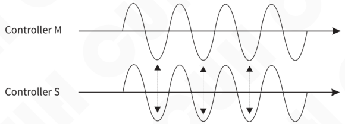

El controlador S está ajustado en modo de sincronización; las formas de onda de salida de los dos controladores son síncronas.

Si el controlador S no está ajustado en modo de sincronización, las formas de onda de salida de los dos controladores no están sincronizadas.

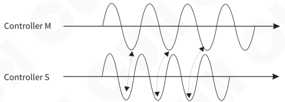

El controlador S no está ajustado en modo de sincronización; las formas de onda de salida de los dos controladores no son síncronas.

---

## Método de cableado del modo de sincronización entre los controladores maestro y esclavo

Conecte el cable de señal de sincronización entre los controladores maestro y esclavo para garantizar que la frecuencia de salida de los controladores maestro y esclavo esté sincronizada.

### Diagrama del circuito del puerto de señal de sincronización

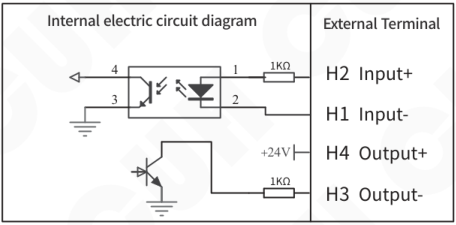

### Diagrama de cableado de la señal de sincronización entre el controlador maestro y el esclavo

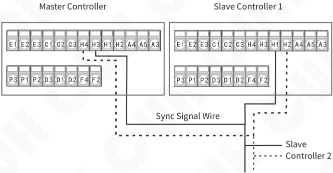

---

Mediante el ajuste de los parámetros "VoltagMode" y "FrqncyMode" en el Grupo de funciones 3 se establece el modo esclavo del controlador; la combinación se define a continuación:

| Modo de sincronización | Modo de tensión | Modo de frecuencia | Control de fase | Sensor de vibración conectado |
|---|---|---|---|---|
| Modo de tensión automática y fase automática | Manual | Slave C | Manual | Sí |
| Modo de tensión automática y fase manual | Manual | Slave M | Automatic | Sí |
| Modo de tensión manual y fase automática | Automatic | Slave C | Manual | Sí |
| Modo de tensión manual y fase manual | Automatic | Slave M | Automatic | No |

> "Auto" del modo de tensión significa que la tensión de salida se ajusta automáticamente para estabilizar la "velocidad de alimentación" del vibrador que usted ajuste.
>
> "Slave C" del modo de frecuencia significa que la fase de la forma de onda de salida del controlador esclavo se ajusta automáticamente para sincronizarse con el controlador maestro según los datos de realimentación del sensor de vibración.
>
> "Slave M" del modo de frecuencia significa ajustar manualmente la diferencia de fase de la forma de onda de salida del controlador esclavo respecto al controlador maestro.

---

Situación en la que tanto el controlador maestro como el controlador esclavo tienen conectados los sensores de vibración

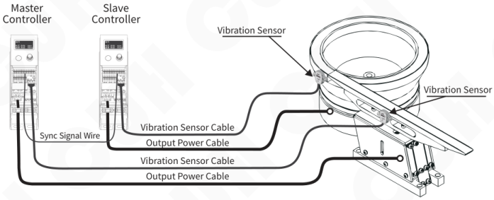

1. Si el controlador esclavo trabaja en el modo de tensión manual y fase manual, no es necesario conectar el sensor de vibración.
2. Si el controlador maestro trabaja en el modo totalmente manual, no es necesario conectar el sensor de vibración.

## 4.7.1 Modo de tensión automática y fase automática

El controlador ajusta automáticamente la tensión de salida según los datos de realimentación del sensor de vibración para estabilizar la "velocidad de alimentación" del vibrador que usted ajuste, y la frecuencia y la fase de la forma de onda de salida del controlador esclavo son las mismas que las del controlador maestro.

### Método de ajuste de la velocidad de alimentación

Desplace el cursor al valor "User Speed" en el Grupo de funciones 1 y ajuste el valor de velocidad de alimentación girando el conmutador codificador.

---

## 4.7.2 Modo de tensión automática y fase manual

El controlador ajusta automáticamente la tensión de salida según los datos de realimentación del sensor de vibración para estabilizar la velocidad de alimentación del vibrador que usted ajuste, y la frecuencia de salida del controlador esclavo es la misma que la del controlador maestro, y la diferencia de fase de la forma de onda de salida del controlador esclavo respecto al controlador maestro es fija.

**Método de ajuste de la velocidad de alimentación**

Desplace el cursor al valor "User_Speed" en el Grupo de funciones 1 y ajuste el valor de velocidad de alimentación girando el conmutador codificador.

**Método de ajuste de la fase manual**

Desplace el cursor al valor "UserPhase_" en el Grupo de funciones 3 y ajuste el valor "UserPhase_" girando el conmutador codificador.

## 4.7.3 Modo de tensión manual y fase automática

Ajuste manualmente la tensión de salida del controlador, pero la frecuencia de salida y la fase de la forma de onda de salida del controlador esclavo son las mismas que las del controlador maestro mediante ajuste automático.

**Método de ajuste de la tensión de salida**

Desplace el cursor al valor "Usr_Voltag" en el Grupo de funciones 1 y ajuste el valor de tensión de salida girando el conmutador codificador.

## 4.7.4 Modo de tensión manual y fase manual

Ajuste manualmente la tensión de salida del controlador; la frecuencia de salida del controlador esclavo es la misma que la del controlador maestro, y la diferencia de fase de la forma de onda de salida del controlador esclavo respecto al controlador maestro es fija.

**Método de ajuste de la tensión de salida**

Desplace el cursor al valor "Usr_Voltag " en el Grupo de funciones 1 y ajuste el valor de tensión de salida girando el conmutador codificador.

**Método de ajuste de la fase manual**

Desplace el cursor al valor "UserPhase_" en el Grupo de funciones 3 y ajuste el valor "User phase" girando el conmutador codificador.

**Nota: Aunque "VoltagMode" y "FrqncyMode" estén ajustados en "Auto" y "Slave C", el controlador trabaja en el modo de tensión manual y fase manual porque el sensor de vibración no está conectado.**

---

## 4.8 Función de parámetros preajustados

El controlador puede guardar y restaurar todos los parámetros del controlador en "Work", "UsrD1 ", "UsrD2" y "UsrD3".

### 4.8.1 Restauración de los parámetros preajustados

Restaure los parámetros desde "UsrD1", "UsrD2" o "UsrD3", lo cual se ajusta mediante el valor de "ReadALLFrm" en el Grupo de funciones 8, y pulse brevemente el conmutador codificador para finalizar la operación de restauración .

### 4.8.2 Guardar parámetros preajustados

Guarde los parámetros en "Work", "UsrD1", "UsrD2" o "UsrD3", lo cual se ajusta mediante el valor de "SavedALLTo" en el Grupo de funciones 8, y pulse brevemente el conmutador codificador para finalizar la operación de guardado.

**Nota:**

1. Todos los parámetros ajustados se guardan en "Work" de forma predeterminada, por lo que no es necesario realizar la operación de guardado después de ajustar los parámetros cada vez.
2. Después de seleccionar el valor de "SavedALLTo", es necesario pulsar brevemente el conmutador codificador una vez para finalizar la operación de guardado.

---

## 4.9 Restauración de los ajustes de fábrica

- En la interfaz de espera, mantenga pulsado el conmutador codificador para entrar en la interfaz de grupos de parámetros.
- Ajuste el valor de "RestorALL" en el Grupo de funciones 8 a "Work".
- Pulse brevemente el conmutador codificador una vez para finalizar la operación de restauración de los ajustes de fábrica.
- Cuando el valor de "RestorALL" cambia de "Work" a "None", significa que la operación de restauración de los ajustes de fábrica ha finalizado.

---

## 4.10 Comunicación RS485

El controlador admite el modo RTU y el modo ASCII del protocolo Modbus para la comunicación RS485, y todos los parámetros del controlador se pueden ajustar y monitorizar de forma remota.

### 4.10.1 Diagrama del circuito eléctrico de la comunicación RS485 (puerto F)

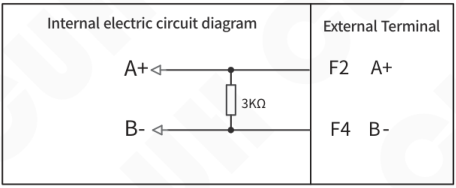

### 4.10.2 Dirección de comunicación de la comunicación RS485

La dirección de comunicación, ajustada mediante el valor de "Slave_ID" (el valor predeterminado es 1) en el Grupo de parámetros 8, representa el número de ID del controlador en la comunicación RS485 y su rango es 1~31 para garantizar que todos los controladores se distingan entre sí en la misma red.

### 4.10.3 Velocidad en baudios de la comunicación RS485

La velocidad en baudios de la comunicación RS485, ajustada mediante el valor de "Baud_Rate" en el Grupo de parámetros 8, puede ser: 3, 12, 24, 96, 192, 576 o 1152. Unidad: 0.1Kbps. El valor predeterminado es: 115.2 Kbps.

Los controladores de la misma red deben utilizar la misma velocidad en baudios.

### 4.10.4 Protocolo de comunicación RS485

El "CUH Modbus Communication Protocol " y la "Address Table of Coil and Register of SDVC35 series for Modbus protocol" se pueden descargar desde nuestro sitio web oficial: en.cuhnj.com

---

### 4.10.5 Actualización de firmware

La actualización de firmware del controlador es compatible a través de la interfaz de comunicación RS485.

**El software de aplicación que se ejecuta en el ordenador para actualizar el firmware y el archivo de firmware son los siguientes:**

1. UpdateFirmwareUi.exe
2. Archivo de firmware: SDVC35K4.10_enc.script (versión actual)

El software de aplicación y el archivo de firmware más reciente se pueden descargar en nuestro sitio web oficial: en.cuhnj.com

**El convertidor necesario, conectado entre el ordenador y el controlador, para actualizar el firmware:**

Convertidor USB a RS485

**Los pasos para actualizar el firmware:**

1. Conecte el puerto RS485 del convertidor al controlador y el puerto USB del convertidor al ordenador.
2. Consulte el puerto serie USB (COM) que ha reconocido el convertidor USB a RS485.
3. Inicie UpdateFirmwareUi.exe.
4. Seleccione en UpdateFirmwareUi.exe el puerto COM recordado en el paso 2
5. Seleccione la velocidad en baudios 115200.
6. Haga clic en el botón Open a la derecha de la velocidad en baudios en el software de aplicación para abrir el puerto serie. El estado de éxito o fallo de la apertura del puerto serie se mostrará en el cuadro de estado.
7. Haga clic en el botón Open a la derecha de Firmware File en el software de aplicación para cargar el archivo de firmware más reciente.
8. Mantenga pulsado el botón ON/OFF del controlador hasta que el controlador se encienda y todos los LED verdes del puerto de conexión se iluminen.
9. Haga clic en el botón Update en el software de aplicación para actualizar el firmware. El progreso se mostrará en el cuadro de estado. Una vez finalizada la actualización, “Firmware download OK!” se mostrará en el cuadro de estado.
10. Una vez finalizada la actualización, realice una vez la operación de restauración de los ajustes de fábrica.

---

## 4.11 Comunicación Ethernet

El controlador es compatible con EtherCAT y Profinet, y todos los parámetros del controlador se pueden ajustar y monitorizar de forma remota.

Los protocolos EtherCAT y Profinet admiten el modo de comunicación periódico y aperiódico. El tiempo de comunicación periódica de Ethernet es de 5ms o más, y el tiempo de comunicación periódica típico es de 10ms.

La longitud del mensaje del modo de comunicación periódico (la longitud del búfer de entrada-salida) es de hasta 5760 bytes.

La longitud del mensaje del modo de comunicación aperiódico (la longitud del búfer del buzón de envío y del buzón de recepción) es de hasta 1596 bytes.

Los archivos del protocolo de comunicación Ethernet "Hilscher NETX51 RE ECS V4.2.X-EtherCATSlave-20160520.xml" y "GSDML-V2.31-HILSCHER-NETX51-RE PNS-Profinet_20160912.xml" se pueden descargar desde nuestro sitio web oficial: en.cuhnj.com

Cuando se utilizan Ethernet y RS485 al mismo tiempo, el controlador responde por turnos y se guarda el estado de la última instrucción.

## 4.12 Prueba de carga

El controlador puede probar el inductor, la corriente máxima y la impedancia del vibrador.

Inicie la función de prueba de carga ajustando el parámetro "Measure" en "valid"; la prueba de carga finaliza cuando el parámetro "Measure" se ajusta automáticamente en "Invalid".

El usuario puede consultar el resultado de la prueba de carga en el Grupo de funciones 9.

---

## 4.13 Monitorización del estado de funcionamiento

El usuario puede consultar el estado de funcionamiento del controlador mediante los parámetros del Grupo de funciones 9.

**Monitorización en tiempo real de la alimentación interna de 5V y 24V:** La tensión de la alimentación de 5V y 24V se muestra mediante los parámetros "5V_Power_" y "24V_Power_".

**Monitorización en tiempo real del estado de la salida principal:** El estado de la salida principal se muestra mediante el parámetro "MainOutPut ".

**Monitorización en tiempo real del estado de las entradas digitales:** El estado y la tensión del puerto C y del puerto E se muestran mediante los parámetros "PortC_" y "PortCInput    ", "PortE_" y "PortEInput".

**Monitorización en tiempo real del estado de las salidas de control DC de 24V:** El estado y la tensión del puerto D y del puerto P se muestran mediante los parámetros "PortD_" y "PortD_Out_ ", "PortP_" y "PortP_Out_ ".

**Monitorización en tiempo real de la frecuencia de sincronización:** Cuando el controlador funciona en modo de sincronización, la frecuencia de sincronización que sigue al controlador maestro se puede mostrar mediante el parámetro "SynchrFrqy".

**Monitorización en tiempo real de la temperatura interna del controlador:** La temperatura del controlador se muestra mediante el parámetro "Temperatur" y el controlador se detendrá cuando la temperatura supere los 65 ℃.

**Monitorización en tiempo real del estado del sensor de vibración:** El estado del sensor de vibración se muestra mediante los parámetros "AtoSnsrVld" y "AtoSnsrOvr " para comprobar si el sensor de vibración es válido y si el sensor de vibración está sobrecargado.

---

## Capítulo Ⅴ Función de seguridad

### Protección contra cortocircuitos

Cuando la salida del controlador está en cortocircuito, el controlador detendrá su salida y se mostrará "ShortCircuit" en la OLED hasta que se reinicie el controlador o se pulse brevemente el botón ON/OFF en el panel del controlador.

### Protección contra sobrecorriente

Cuando la corriente de salida supera su valor nominal por un error de operación, el controlador detendrá la salida para garantizar la seguridad de funcionamiento y se mostrará "OverCurrent" en la OLED.

### Protección contra sobrecalentamiento

Cuando la temperatura interna del controlador supera los 65℃, el controlador detendrá su salida para protegerse y se mostrará "OverHot" en la OLED hasta que la temperatura interna descienda por debajo de 60℃.

### Protección contra sobrecarga

Cuando el sensor de vibración está conectado al controlador, si la amplitud de vibración supera el valor de ajuste establecido mediante el valor de "AtoSnsrMax" en el Grupo de parámetros 3, el controlador reducirá su salida para proteger el alimentador vibratorio y se mostrará "OverLoad" en la OLED.

### Protección contra sobretensión

Cuando la tensión de entrada es superior al valor nominal, el controlador se apagará automáticamente hasta que la tensión de entrada vuelva a la normalidad.

### Protección contra sobretensión extrema

Cuando la tensión de entrada supera ampliamente la tensión límite de protección y la tensión de pico alcanza los 430V, el fusible del controlador se fundirá para proteger el controlador de daños mayores. Contacte con nosotros para la reparación.

---

## Apéndice A: Dimensiones

Dimensiones del SDVC35 (unidad: mm)

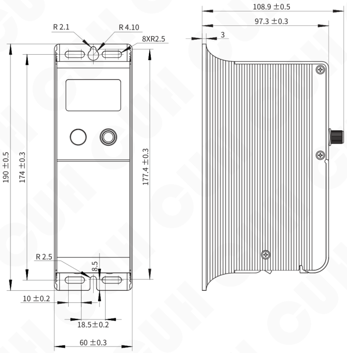

---

## Apéndice B: Descripción de los puertos eléctricos

| Sensor | | | Sensor | | | Sync | | | | Speed Ctrl | | |
|---|---|---|---|---|---|---|---|---|---|---|---|---|
| PortE | | | PortC | | | PortH | | | | PortA | | |
| E1 | E2 | E3 | C1 | C2 | C3 | H4 | H3 | H1 | H2 | A4 | A5 | A3 |
| GND | Input | +24V | GND | Input | +24V | Sync Out+ | Sync Out- | Sync In- | Sync In+ | GND | Input | +5V |

| Ctrl Out | | | Ctrl Out | | | RS485 | | |
|---|---|---|---|---|---|---|---|---|
| PortP | | | PortD | | | PortF | | |
| P3 | P1 | P2 | D3 | D1 | D2 | F4 | F2 |
| GND | Output | +24V | GND | Output | +24V | B- | A+ |

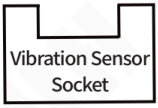

---

## Apéndice C: Especificación eléctrica

| Elemento | Rango: mín. | Rango: típico | Rango: máx. | Unidad | Nota |
|---|---|---|---|---|---|
| Tensión de entrada | 85 | 220 | 250 | V | CA RMS |
| Rango de tensión de salida ajustable | 0 | —— | 260 | V | Inferior al 150% de la tensión de entrada |
| Precisión de ajuste de tensión | | 1 | | V | |
| Precisión de regulación de tensión | 0 | —— | 10 | % | ΔVout/ΔVin |
| Tiempo de respuesta de la regulación de tensión | | Tiempo real | | s | Regulación de tensión para cada forma de onda |
| Rango de corriente de salida ajustable | 0 | —— | 3 | A | SDVC35-MRJ |
| Rango de corriente de salida ajustable | 0 | —— | 4.5 | A | SDVC35-LRJ |
| Potencia de salida | 0 | —— | 660 | VA | SDVC35-MRJ |
| Potencia de salida | 0 | —— | 990 | VA | SDVC35-LRJ |
| Frecuencia de salida | 25 | —— | 400 | Hz | |
| Precisión de ajuste de frecuencia | | 0.1 | | Hz | |
| Forma de onda de salida | | Senoidal | | | |
| Tiempo de arranque suave | 0 | —— | 10 | s | Valor predeterminado: 0.5 |
| Rango de tiempo de retardo de activación/desactivación | 0 | —— | 20 | s | Valor predeterminado: 0.2 |
| Precisión del tiempo de retardo de activación/desactivación | | 0.1 | | s | |
| Temperatura de activación de la protección contra sobrecalentamiento | 60 | 65 | 65 | °C | |
| Comunicación digital | | Comunicación ModBUS485 | | | |
| Comunicación digital | | EtherCAT | | | Opcional uno |
| Comunicación digital | | Profinet | | | Opcional uno |
| Corriente de salida de control DC | 0 | —— | 200 | mA | Salida doble de 24V |
| Tensión de salida de control DC | 22 | 24 | 26 | V | Salida doble de 24V |
| Señal de control analógica | | 4~20 | | mA | 1 canal de corriente para control de velocidad remoto |
| Señal de control analógica | | 1~5/0~5/0~10 | | V | 3 canales de tensión para control de velocidad remoto |
| Señal de control digital | | 24 | | V | Señal de conmutación |
| Método de ajuste | | 1 botón + 1 codificador rotativo | | | |
| Consumo de energía en espera | —— | —— | 3 | W | |
| Método de visualización | | 128\*64 | | | Pantalla matricial OLED |
| Temperatura ambiente | 0 | 25 | 40 | °C | Sin condensación |
| Humedad ambiente | 10 | 60 | 85 | % | Sin condensación |
| Temperatura ambiente de almacenamiento | -20 | 25 | 65 | °C | Sin condensación |

## Parámetros absolutos:

Superar el estándar dañará el controlador; respételo estrictamente.

| Elemento | Norma GB | Norma IEC | Requisito de la norma | Nivel alcanzado del producto CUH | Nota |
|---|---|---|---|---|---|
| Descarga electrostática | GB/T 17626.2-2006 | IEC 61000-4-2:2001 | 4 kV | ±8 kV | Descarga por contacto |
| | | | 8 kV | ±15 kV | Descarga de aire |
| Ensayo de transitorios rápidos eléctricos | GB/T 17626.4-2008 | IEC 61000-4-4:2004 | 2 kV | ±4 kV | |
| Sobretensión eléctrica | GB/T 17626.5-2008 | IEC 61000-4-5:2005 | 1 kV | ±4 kV | Acoplamiento línea-línea |
| | | | 2 kV | ±2 kV | Acoplamiento línea-tierra |

---

## Apéndice D: Sugerencias de solución de problemas y explicación de errores

| | Fenómeno de falla | Sugerencias de solución de problemas |
|---|---|---|
| 1 | Sin visualización después de encender | • Asegúrese de que la toma de corriente tenga tensión • Asegúrese de que el cable de entrada de potencia esté conectado de forma fiable a la toma de corriente |
| 2 | Visualización normal, pero sin salida | • Asegúrese de que la tensión de salida no sea pequeña • Asegúrese de que el estado de funcionamiento del controlador no sea “Man”, controlado mediante la pulsación del botón “ON/OFF” del panel • Asegúrese de que el estado de funcionamiento del controlador no sea “STP”, controlado por el puerto C/E • Asegúrese de que el estado de funcionamiento del controlador no sea “STP”, controlado por el parámetro de dirección lógica del puerto C/E • Restablezca el controlador mediante la restauración de los ajustes de fábrica ajustada en el Grupo de funciones 8 |
| 3 | El puerto C/E no puede funcionar normalmente | • Asegúrese de que el cable de señal de control ON/OFF esté conectado correctamente al puerto C/E • Asegúrese de que todos los parámetros del puerto C/E que ha ajustado sean correctos • Restablezca el controlador mediante la restauración de los ajustes de fábrica ajustada en el Grupo de funciones 8 |
| 4 | Fenómeno de batido | • Conecte el cable de señal de sincronización entre los controladores y ajuste el controlador esclavo en modo de sincronización |
| 5 | Visualización normal, se oyen sonidos del alimentador vibratorio pero sin salida | • Asegúrese de que la frecuencia de salida no esté muy alejada de la frecuencia de resonancia del alimentador vibratorio • Restablezca el controlador mediante la restauración de los ajustes de fábrica ajustada en el Grupo de funciones 8 |

---

## Apéndice E: Descripción de advertencias y errores y sugerencias de solución de problemas

| Visualización de falla | Tipo de falla | Sugerencias de solución de problemas |
|---|---|---|
| 24VErr | Error de alimentación interna de 24V | Fallo de la alimentación interna de 24V del controlador; contacte con nosotros para la reparación |
| 5VErr | Error de alimentación interna de 5V | Fallo de la alimentación interna de 5V del controlador; contacte con nosotros para la reparación |
| <2mA Err | La corriente de entrada de la señal de control remoto es demasiado baja en el puerto A | La corriente de entrada de la señal de control remoto es demasiado baja en el puerto A; asegúrese de que sea mayor que 2mA |
| <0.5V Err | La tensión de entrada de la señal de control remoto es demasiado baja en el puerto A | La tensión de entrada de la señal de control remoto es demasiado baja en el puerto A; asegúrese de que sea mayor que 0.5V |
| CommErr(1~5) | Error de comunicación | Contacte con nosotros para la reparación |
| decline | Deceleración de conteo | Cuando el número de conteo alcanza el "End Count" que usted ha ajustado, la tensión de salida (o la velocidad de alimentación) disminuye |
| EEPErr | Error al guardar los parámetros preajustados | Contacte con nosotros para la reparación |
| FrqncyHi | La frecuencia de referencia de sincronización es demasiado alta | La frecuencia de entrada de la señal de sincronización del controlador esclavo es superior a 400Hz Asegúrese de que la frecuencia de la señal de sincronización esté entre 25 Hz y 400 Hz |
| FrqncyLo | La frecuencia de referencia de sincronización es demasiado baja | La frecuencia de entrada de la señal de sincronización del controlador esclavo es inferior a 25Hz Asegúrese de que la frecuencia de la señal de sincronización esté entre 25 Hz y 400 Hz |
| OverHot | Sobrecalentamiento | La temperatura interna del controlador supera los 65℃ Asegúrese de que el controlador funcione en un entorno bien ventilado |
| OverLoad | Sobrecarga del sensor de vibración | El sensor de vibración ha detectado que la aceleración supera su valor de amplitud absoluta |
| OvrCurrt | Sobrecorriente | La corriente de salida del controlador supera los 3A |
| OvrVoltg | Sobretensión | La tensión de salida del controlador supera los 260V Asegúrese de que el rango de tensión de entrada esté entre 85V y 260V |
| PortDErr | Error del puerto D | La desviación de tensión de salida del puerto D supera los 3V Asegúrese de que la potencia de carga del puerto D no supere los 4.8W |
| PortPErr | Error del puerto P | La desviación de tensión de salida del puerto P supera los 3V Asegúrese de que la potencia de carga del puerto P no supere los 4.8W |
| Saturate | Saturación de salida | Cuando la tensión de salida del controlador es mayor que la tensión de entrada, el controlador entra en el estado de saturación |
| Save | Guardado de parámetros preajustados | Después de la operación de búsqueda automática de la frecuencia de resonancia, sus parámetros relacionados se han guardado correctamente |
| SenorErr | Avería del sensor de vibración | La señal del sensor de vibración es anómala; contacte con nosotros para la reparación |
| SenTypEr | Error de tipo de sensor de vibración | El tipo de sensor de vibración conectado al controlador no coincide con el parámetro "tipo de sensor de vibración" ajustado en el controlador |
| Short | Cortocircuito | La salida del controlador está en cortocircuito; asegúrese de que el terminal de salida no esté en cortocircuito |
| SynchErr | Error de señal de sincronización | El cable de señal de sincronización no está conectado al controlador esclavo Asegúrese de que el cable de señal de sincronización esté conectado correctamente al controlador |
| UndrVolt | Subtensión | La tensión de entrada del controlador es inferior a 85V. Asegúrese de que el rango de tensión de entrada esté entre 85V y 260V |
| UpgradeSlv | Actualización de firmware | El firmware se está actualizando; el controlador vuelve a la normalidad después de la actualización |

## Apéndice F: Descripción del estado de funcionamiento y del tipo de tarjeta de red

Los estados de funcionamiento del controlador se muestran a continuación:

| Estado mostrado del controlador | Tipo de estado | Descripción |
|---|---|---|
| RUN | El controlador está en marcha | La salida del controlador es válida |
| MAN | El controlador está detenido | Pulse brevemente el botón “ON/OFF” para conmutar el estado de marcha/parada de la salida del controlador |
| CND | El proceso de conteo ha finalizado para detener el controlador | Cuando el proceso de conteo finaliza, la salida del controlador se detiene |
| RMT | Detener la salida del controlador de forma remota | Detenga la salida del controlador de forma remota mediante comunicación RS485 o Ethernet |
| STP | El puerto C/E detiene la salida del controlador | Detenga la salida del controlador mediante la entrada digital puerto C/E |
| Lok | Bloqueo del teclado | El botón ON/OFF y el codificador están deshabilitados; mantenga pulsado el conmutador codificador para desbloquear el teclado |
| ERR | Detención de la salida del controlador causada por fallo de conteo | Cuando el valor de "Main Logic" es "Count", si la operación de borrado y conteo se produce simultáneamente en el proceso de conteo, la salida del controlador se detiene |

Los estados de red se muestran a continuación:

| Estado mostrado del controlador | Tipo de estado | Descripción |
|---|---|---|
| Wit | No hay tarjeta de red conectada | |
| Cat | Tarjeta de red EtherCAT conectada | |
| Pro | Tarjeta de red Profinet conectada | |

---

## Apéndice G: Método de conexión de sensores de conmutación y PLC a las entradas digitales

### Método de conexión del sensor NPN

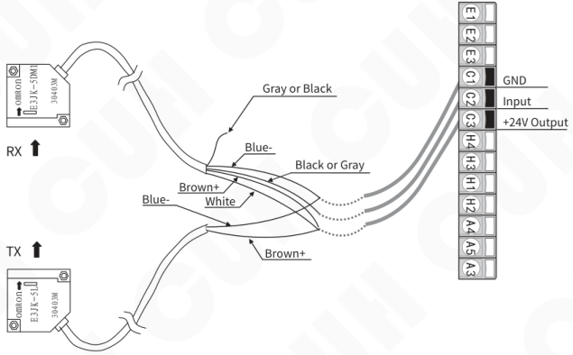

### Método de conexión del sensor de barrera fotoeléctrica

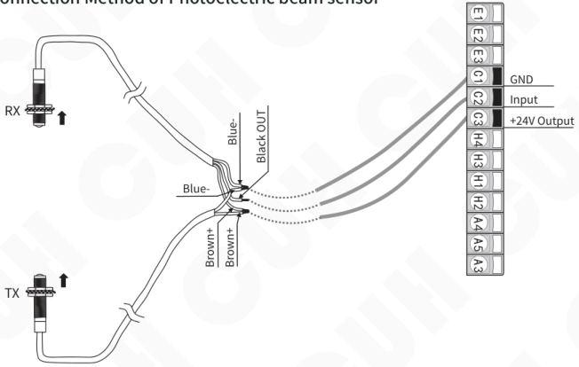

## Método de conexión del sensor de barrera de fibra óptica

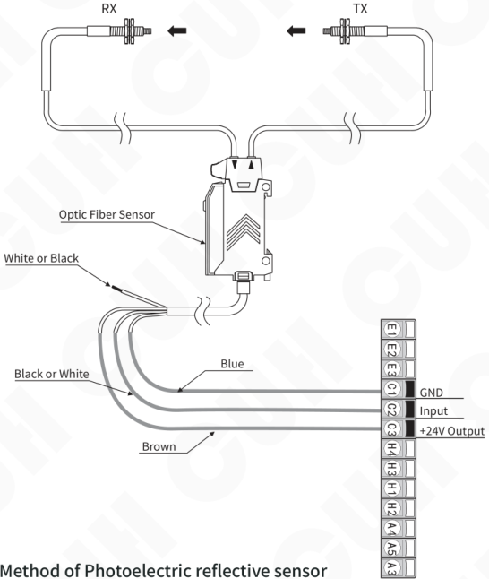

## Método de conexión del sensor reflectivo fotoeléctrico

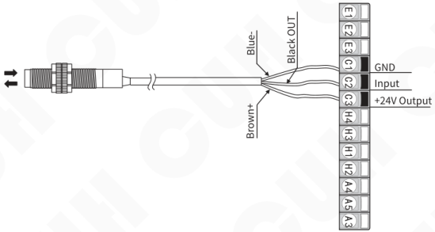

## Método de conexión de la salida NPN del PLC al puerto C

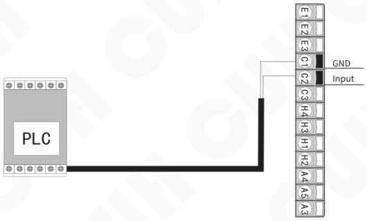

## Método de conexión de la salida PNP del PLC al puerto C

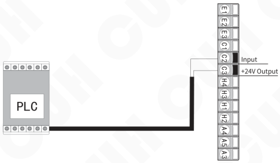

La salida de relé, la salida NPN y la salida PNP del PLC, cualquiera de ellas puede activar/desactivar el controlador.

**Nota: Cuando se utiliza la señal de control del PLC para activar/desactivar el controlador, la tensión de la señal de entrada no debe superar los 24V.**

## Apéndice H: Tabla de parámetros

### La función de cada grupo de parámetros

| Nombre del grupo de parámetros | Descripción |
|---|---|
| Grupo de funciones 0 | Los elementos que se pueden seleccionar para mostrar en la interfaz de espera |
| Grupo de funciones 1 | Parámetros básicos |
| Grupo de funciones 2 | Parámetros del control de salida principal |
| Grupo de funciones 3 | Parámetros de la función automática/de sincronización |
| Grupo de funciones 4 | Parámetros del control del puerto C |
| Grupo de funciones 5 | Parámetros del control del puerto E |
| Grupo de funciones 6 | Parámetros del control del puerto D |
| Grupo de funciones 7 | Parámetros del control del puerto P |
| Grupo de funciones 8 | Parámetros avanzados |
| Grupo de funciones 9 | Parámetros del estado de funcionamiento del controlador |

---

Todos los parámetros del Grupo de funciones 0 se muestran a continuación:

| Elemento | Mín. | Predeterminado | Máx. | Unidad/Enum | Descripción |
|---|---|---|---|---|---|
| MonitPart1 | —— | None | —— | None | La fila LCD correspondiente se muestra en blanco en la interfaz de espera |
| | | | | UsrV | Tensión de salida |
| | | | | UsrF | Frecuencia de salida |
| | | | | UsrS | Velocidad de alimentación |
| | | | | Cout | Valor de conteo actual |
| | | | | PCUP | Retardo de conexión del puerto C |
| | | | | PCDn | Retardo de desconexión del puerto C |
| | | | | PEUp | Retardo de conexión del puerto E |
| | | | | PEDn | Retardo de desconexión del puerto E |
| | | | | PDUP | Retardo de conexión del puerto D |
| | | | | PDDn | Retardo de desconexión del puerto D |
| | | | | PPUP | Retardo de conexión del puerto P |
| | | | | PPDn | Retardo de desconexión del puerto P |
| | | | | MaUP | Retardo de conexión del control principal |
| | | | | MaDn | Retardo de desconexión del control principal |
| | | | | InV | Tensión de entrada |
| | | | | CurE | Corriente de salida RMS |
| | | | | CurM | Corriente de salida máxima |
| | | | | PwrA | Potencia activa |
| | | | | PwrR | Potencia reactiva |
| | | | | Temp | Temperatura |
| | | | | SynF | La frecuencia de la señal de sincronización externa |
| | | | | Remo | Tensión de entrada remota |
| | | | | PCV | Tensión de salida del puerto C |
| | | | | PEV | Tensión de salida del puerto E |
| | | | | PDV | Tensión de salida del puerto D |
| | | | | PPV | Tensión de salida del puerto P |
| MonitPart2 | —— | UsrV | —— | Igual que MonitPart1 | |
| MonitPart3 | —— | UsrF | —— | Igual que MonitPart1 | |

Todos los parámetros del Grupo de funciones 1 se muestran a continuación:

| Elemento | Mín. | Predeterminado | Máx. | Unidad/Enum |
|---|---|---|---|---|
| User_Speed | 0 | 200 | 3200 | |
| Usr_Voltag | 0 | 150 | 260 | V |
| Usr_Frqncy | 25.0 | 50.0 | 400.0 | Hz |
| TotalCount | 1 | 1 | 9999 | |
| Clear Time | 0 | 0 | 999.9 | s |
| AutoSerch_ | —— | Idle | —— | Idle Start |
| PassWord2_ | 0 | 0 | 9999 | |
| Language | —— | Englsh | —— | Englsh 中文 dt |

---

Todos los parámetros del Grupo de funciones 2 se muestran a continuación:

| Elemento | Mín. | Predeterminado | Máx. | Unidad/Enum |
|---|---|---|---|---|
| SoftStart_ | 0 | 0.2 | 9.9 | s |
| SoftStop__ | 0 | 0.2 | 9.9 | s |
| MainUpDely | 0 | 0.2 | 9999 | 0.1s |
| MainDwnDly | 0 | 0.2 | 9999 | 0.1s |
| MainLogic_ | —— | AND | —— | PortC PortE AND OR XOR Count |
| MainDir___ | —— | Const | —— | Const Revrs |
| MainCtrl__ | —— | On | —— | On Off |
| MainSrc___ | —— | Local | —— | Local Remot |
| PowrOnStat | —— | On | —— | On Off Keep |
| PrcntTrmnl | 0 | 50 | 100 | % |
| CountAhead | 0 | 0 | 9999 | |
| CtrlSource | —— | Panel | —— | Panel 20mA 1~5V 0~5V 0~10V Meter |
| AccelrIndx | 100 | 100 | 150 | % |
| MaxVoltage | 0 | 150.0 | 260.0 | V |
| WavFomIndx | 50 | 100 | 100 | % |
| CmpnstCurt | —— | Valid | —— | Valid None |
| DCCurrent | 0 | 0.1 | 3 | A |

---

Todos los parámetros del Grupo de funciones 3 se muestran a continuación:

| Elemento | Mín. | Predeterminado | Máx. | Unidad/Enum |
|---|---|---|---|---|
| AtoFCenter | 25.0 | 100.0 | 400.0 | Hz |
| AtoFRange_ | 0 | 30.0 | 180.0 | Hz |
| VoltagMode | —— | Auto | —— | Manul Auto |
| FrqncyMode | —— | Auto | —— | Manul Auto SlavC SlavM |
| AtoFIntgrl | 0 | 20 | 2000 | 1 |
| AtoAIntgrl | 0 | 400 | 9999 | 1 |
| AtoAProptn | 0 | 500 | 9999 | 1 |
| AtoSnsrTyp | 16g | 16g | 70g | 16g 35g 50g 70g Auto |
| AtoSrhVMax | 0 | 100.0 | 260.0 | V |
| AtoSnsrMax | 0 | 100 | 100 | % |
| AtoSpedMax | 0 | 3200 | 4000 | |
| AutoPhase_ | -180 | 0 | 180 | ° |
| UserPhase_ | -180 | 0 | 180 | |
| Measure | —— | None | —— | None Valid |

Todos los parámetros del Grupo de funciones 4 se muestran a continuación:

| Elemento | Mín. | Predeterminado | Máx. | Unidad/Enum |
|---|---|---|---|---|
| PortCUpDly | 0 | 0.002 | 9.999 | s |
| PortCDnDly | 0 | 0.002 | 9.999 | s |
| PortCDir__ | —— | Const | —— | Const |
| | | | | Revrs |
| PortCType_ | —— | Auto | —— | NPN |
| | | | | Auto |
| | | | | PNP |

---

Todos los parámetros del Grupo de funciones 5 se muestran a continuación:

| Elemento | Mín. | Predeterminado | Máx. | Unidad/Enum |
|---|---|---|---|---|
| PortEUpDly | 0 | 0.002 | 9.999 | s |
| PortEDnDly | 0 | 0.002 | 9.999 | s |
| PortEDir__ | —— | Const | —— | Const |
| | | | | Revrs |
| PortEType__ | —— | Auto | —— | NPN |
| | | | | Auto |
| | | | | PNP |

---

Todos los parámetros del Grupo de funciones 6 se muestran a continuación:

| Elemento | Mín. | Predeterminado | Máx. | Unidad/Enum |
|---|---|---|---|---|
| PortDUpDly | 0 | 0.0 | 999.9 | s |
| PortDDnDly | 0 | 0.0 | 999.9 | s |
| PortDDir__ | —— | Const | —— | Const |
| | | | | Revrs |
| PortDLogic | —— | Error | —— | Error |
| | | | | Main |
| | | | | PortC |
| | | | | PortE |
| | | | | And |
| | | | | Or |
| | | | | Xor |
| | | | | End |
| | | | | Near |
| PortDCtrl_ | —— | On | —— | On |
| | | | | Off |
| PortDSrc__ | —— | Local | —— | Local |
| | | | | Remot |
| PortDType_ | —— | Ps&Pu | —— | NPN |
| | | | | Ps&Pu |
| | | | | PNP |

Todos los parámetros del Grupo de funciones 7 se muestran a continuación:

| Elemento | Mín. | Predeterminado | Máx. | Unidad/Enum |
|---|---|---|---|---|
| PortPUpDly | 0 | 0.0 | 999.9 | 0.1s |
| PortPDnDly | 0 | 0.0 | 999.9 | 0.1s |
| PortPDir__ | —— | Const | —— | Const |
| | | | | Revrs |
| PortPLogic | —— | Error | —— | Error |
| | | | | Main |
| | | | | PortC |
| | | | | PortE |
| | | | | And |
| | | | | Or |
| | | | | Xor |
| | | | | End |
| | | | | Near |
| PortPCtrl_ | —— | On | —— | On |
| | | | | Off |
| PortPSrc__ | —— | Local | —— | Local |
| | | | | Remot |
| PortPType_ | —— | Ps&Pu | —— | NPN |
| | | | | Ps&Pu |
| | | | | PNP |

---

Todos los parámetros del Grupo de funciones 8 se muestran a continuación:

| Elemento | Mín. | Predeterminado | Máx. | Unidad/Enum |
|---|---|---|---|---|
| Slave_ID | 1 | 1 | 31 | |
| Baud_Rate | 0.3K | 115.2 K | 115.2 K | 0.3 Kbps |
| | | | | 1.2 Kbps |
| | | | | 2.4 Kbps |
| | | | | 9.6 Kbps |
| | | | | 19.2 Kbps |
| | | | | 57.6 Kbps |
| | | | | 115.2 Kbps |
| ReadALLFrm | —— | None | —— | None |
| | | | | UsrD1 |
| | | | | UsrD2 |
| | | | | UsrD3 |
| SavedALLTo | —— | None | —— | None |
| | | | | Work |
| | | | | UsrD1 |
| | | | | UsrD2 |
| | | | | UsrD3 |
| RestorALL | —— | None | —— | None |
| | | | | RWork |
| PassWord1_ | 0 | 0 | 9999 | |

Todos los parámetros del Grupo de funciones 9 se muestran a continuación:

| Elemento | Mín. | Máx. | Unidad | Descripción |
|---|---|---|---|---|
| BusVoltage | 0 | 380.0 | V | Tensión de bus (valor medio) |
| Speed_Now_ | 0 | 4000 | 1 | Prueba real |
| VoltagOut_ | 0 | 260.0 | V | Valor medio de la rectificación |
| AtoVltgOut | 0 | 260.0 | V | Cálculo automático de la tensión de salida |
| SynchrFrqy | 25.0 | 400.0 | Hz | La frecuencia de la señal de sincronización externa |
| AtoFrqyOut | 25.0 | 400.0 | Hz | Frecuencia de salida automática |
| EffectCurt | 0 | 9.999 | A | |
| CurrentMax | 0 | 9.999 | A | |
| AtoPhasRem | -180 | 180 | ° | Resto de fase automático |
| MainOutPut | 0 | 1 | | |
| RemotInput | 0 | 10.0 | V | |
| 5V_Power_ | 0 | 6.0 | V | |
| PortC_____ | 0 | 1 | | |
| PortCInput | 0 | 26.0 | V | |
| PortE_____ | 0 | 1 | | |
| PortEInput | 0 | 26.0 | V | |
| PortD_____ | 0 | 1 | | |
| PortD_Out_ | 0 | 26.0 | V | |
| PortP_____ | 0 | 1 | | |
| PortP_Out_ | 0 | 26.0 | V | |
| 24V_Power_ | 0 | 26.0 | V | |
| PowrAvtive | 0 | 9999 | W | |
| PowrReactv | 0 | 9999 | W | |
| Temperatur | 0 | 85.0 | °C | |
| Inductance | 0 | 9.999 | H | |
| Resistance | 0 | 9999 | Ω | |
| Saturatn | 0 | 9.999 | A | |
| AtoSnsrVld | —— | —— | | |
| AtoSnsrOvr | —— | —— | | |
| AtoDistrtn | 0 | 100 | % | |
| CountNumbr | 0 | 9999 | | |
| Flag______ | 0 | FFFF | | HEX |
| FwVrsnMain | 0 | 9999 | | |
| FwVrsnSlav | 0 | 9999 | | |

Nanjing CUH Science & Technology Co.,Ltd  
https://en.cuhnj.com  
Tel.:+86-25-84730411 / 84730415 / 84730416  
Fax:+86-25-84730426  
E-mail:sales@cuhnj.com  
Add.:Building 2, Xueyan Tech Park, Tuscity,  
No.9 Zhineng Rd, Jiangning, Nanjing, China

Document No.: IDP1000482

