## Controlador digital de frecuencia variable para alimentador vibratorio piezoeléctrico

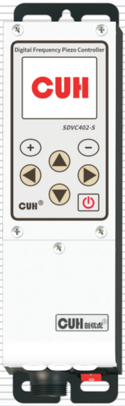

## SDVC402-S
Controlador digital de frecuencia variable para alimentador vibratorio piezoeléctrico　 SDVC402-S
## Manual de instrucciones

---

## Declaración de derechos de autor

Nanjing CUH Science & Technology CO., Ltd. se reserva todos los derechos.

Toda la información contenida en este manual del usuario es propiedad intelectual de nuestra empresa y está protegida por la ley de derechos de autor y otras leyes relacionadas. CUH disfruta y se reserva todos los derechos conferidos por la ley de derechos de autor y otras leyes. Sin el consentimiento por escrito de CUH, no se podrá copiar, traducir, imitar ni utilizar de ninguna otra forma parte o la totalidad de este manual del usuario.

## Exención de responsabilidad

Todo el contenido de este manual del usuario describe únicamente el método de uso de los productos relacionados producidos por nuestra empresa, y se describe de acuerdo con la tecnología existente y el estado proporcionado en el momento de su uso. Usted debe asumir los riesgos correspondientes al utilizar este producto. Salvo lo exigido por la ley, la empresa no asume ninguna responsabilidad expresa o implícita sobre el producto derivada de este manual del usuario, incluidos, entre otros, daños personales, daños materiales, pérdida de oportunidades, etc.

Usted comprende claramente los riesgos anteriores y acepta que, salvo lo exigido por la ley, la empresa no es responsable de ningún daño o pérdida directa o indirecta para usted (incluidos, entre otros, pérdidas tangibles de personal, propiedad, datos, etc., y pérdidas intangibles de reputación, oportunidades, etc.).

La empresa se reserva el derecho de modificar los productos aplicables a este manual del usuario sin previo o posterior aviso.

---

## Prefacio

Gracias por elegir el Controlador digital de frecuencia variable para alimentador vibratorio piezoeléctrico CUH SDVC402-S. (En lo sucesivo, “el controlador”). Esta serie de controladores utiliza componentes de alta calidad e incorpora la última tecnología electrónica, y está cuidadosamente diseñada con procesadores de señales digitales de alto rendimiento.

Este manual presenta el método de operación básico, la descripción técnica funcional y ejemplos de aplicación típicos de este producto. Proporciona a los usuarios información relevante sobre la instalación y depuración, el ajuste de parámetros, el diagnóstico de anomalías, la solución de problemas y el mantenimiento rutinario del controlador. Para garantizar la correcta instalación y uso de este controlador, lea atentamente este manual del usuario antes de la instalación y consérvelo adecuadamente.

Asegúrese de leer los siguientes símbolos para alertarle de las precauciones contra lesiones personales y daños al producto.

| | |
|---|---|
| ⚠ Peligro | El incumplimiento de este punto provocará lesiones personales o la muerte. |
| ⚠ Advertencia | El incumplimiento de este punto puede provocar lesiones personales o la muerte. |
| ⚠ Precaución | El incumplimiento de este punto puede provocar lesiones moderadas o leves a las personas. |
| Aviso | El incumplimiento de este punto provocará daños al producto y daños materiales. |
| ❗ Obligatorio | Indica las precauciones y restricciones de uso que deben observarse durante el uso. |

**Este manual se aplica a los siguientes modelos de controladores:**

- Controlador digital de frecuencia variable para alimentador vibratorio piezoeléctrico  
  SDVC402-S (150mA)

---

# Seguridad y precauciones

1. **⚠ Peligro** Este producto solo se utiliza para accionar equipos de alimentación vibratoria piezoeléctricos; no utilice este producto con el fin de proteger el cuerpo humano o partes del cuerpo humano, etc.

2. **⚠ Peligro** Este producto no está diseñado para usarse como producto antiexplosión; no lo utilice en ubicaciones peligrosas y/o entornos con gases potencialmente explosivos.

3. **⚠ Advertencia** Este producto se alimenta con la red de CA; no aplique una tensión de CA superior a 250Vac. Una tensión de entrada excesiva, como 300Vac, puede provocar que el producto explote o se incendie, causando graves accidentes de seguridad.

4. **⚠ Advertencia** Este producto se conecta a tierra a través del cable de alimentación. Asegúrese de que las instalaciones de distribución de energía del controlador estén bien conectadas a tierra; de lo contrario, la carcasa del controlador podría quedar cargada eléctricamente, provocando un accidente por descarga eléctrica.

5. **⚠ Advertencia** No introduzca alimentación de CA en la salida de este controlador; dañará el controlador.

6. **⚠ Advertencia** No enchufe ni desenchufe el cableado con corriente ni toque el contacto de cada terminal de cableado en el compartimento de cableado para evitar descargas eléctricas.

7. **Aviso** Evite controlar la salida de este producto cortando la alimentación mediante relés y otros dispositivos, ya que reducirá gravemente la vida útil del controlador.

8. **Aviso** El controlador está diseñado para funcionar en un entorno fresco y seco. Nunca haga funcionar el controlador en el exterior para evitar mojaduras e insolación. Utilice el controlador dentro de la temperatura especificada en las características eléctricas.

9. **❗ Obligatorio** Asegúrese de fijar este producto sobre una plataforma sólida, conectada de forma fiable a tierra y alejada de equipos vibratorios.

10. **❗ Obligatorio** Nunca utilice el controlador en condiciones que superen sus límites de diseño.

11. **❗ Obligatorio** Utilice el controlador estrictamente de acuerdo con este manual de instrucciones. No asumiremos ninguna responsabilidad civil o penal si el daño al equipo o las lesiones personales son causados por una operación incorrecta.

12. **❗ Obligatorio** Nunca abra la carcasa del controlador para evitar descargas eléctricas. Contacte con CUH si el controlador se avería. Nunca intente reparar el controlador usted mismo, ya que podría anular la garantía.

---

---

## Entorno de funcionamiento y almacenamiento

### Inspección antes del uso

Todos los controladores pasan por una rigurosa inspección de calidad antes de su entrega y se embalan con un embalaje a prueba de golpes. Después de desembalar, compruebe los siguientes puntos:

1. Si el controlador sufre daños durante el transporte.
2. Si el modelo del controlador coincide con su pedido.

### Entorno de ejecución

Siga las siguientes indicaciones para garantizar un mejor rendimiento y una mayor vida útil del controlador:

- ⚠ Entorno bien ventilado
- ⚠ Manténgalo alejado del agua, vapor, polvo y especialmente polvo aceitoso
- ⚠ Manténgalo alejado de gases y líquidos corrosivos o inflamables
- ⚠ Manténgalo alejado del polvo en suspensión y las partículas metálicas
- ⚠ Fíjelo firmemente para evitar vibraciones propias
- ⚠ Manténgalo alejado de interferencias electromagnéticas
- ⚠ Asegure una temperatura ambiente de 0~40 °C
- ⚠ Para uso a una altitud de 2000 m o inferior

---

# Contenido

- Capítulo Ⅰ Instrucciones previas al uso — 1
  - 1.1 Comprobación del contenido del paquete — 1
  - 1.2 Teclado y puertos de E/S — 2
  - 1.3 Descripción de los parámetros de la página de inicio — 3
  - 1.4 Explicación de los puertos de cableado — 3
  - 1.5 Explicación de la placa de características — 4
- Capítulo Ⅱ Características — 5
- Capítulo Ⅲ Guía de instalación — 7
  - 3.1 Condiciones de uso del controlador — 7
  - 3.2 Método de operación de los botones — 7
  - 3.3 Instalación y uso — 8
- Capítulo Ⅳ Breve descripción de funciones — 12
  - 4.1 Tensión de salida — 12
  - 4.2 Frecuencia de salida — 13
  - 4.3 Tiempo de arranque suave — 14
  - 4.4 Interruptor de salida — 14
  - 4.5 Límite de la tensión de salida máxima — 15
  - 4.6 Bloqueo del teclado — 16
  - 4.7 Configuración del estado de funcionamiento al encender — 17
  - 4.8 Restauración de la configuración predeterminada — 18
- Capítulo Ⅴ Sensores y control de señales — 19
  - 5.1 Detección fotoeléctrica inteligente — 19
    - 5.1.1 Método de cableado del sensor fotoeléctrico inteligente — 19
    - 5.1.2 Retardo de conexión/desconexión del sensor fotoeléctrico inteligente — 20
    - 5.1.3 Dirección lógica del sensor fotoeléctrico inteligente — 21
  - 5.2 Método de uso del sensor de conmutación — 22
    - 5.2.1 Método de cableado del sensor de conmutación de proximidad NPN — 22
    - 5.2.2 Retardo de conexión/desconexión del sensor de conmutación — 26
    - 5.2.3 Dirección lógica del sensor de conmutación — 27
    - 5.2.4 Tipo de sensor de conmutación — 28

---

---

- 5.3 Salida de control — 29
- 5.4 Control de velocidad remoto — 30

## Capítulo Ⅵ Introducción detallada de funciones — 32

- 6.1 Personalización de la página de inicio — 33
- 6.2 Ajustes de parámetros comunes — 34
  - 6.2.1 Tensión — 34
  - 6.2.2 Frecuencia — 34
  - 6.2.3 Tiempo de arranque suave/tiempo de parada suave — 35
  - 6.2.4 Tensión de salida máxima/tensión de salida mínima — 35
  - 6.2.5 Frecuencia de salida máxima/frecuencia de salida mínima — 35
  - 6.2.6 Tiempo de apagado de la retroiluminación — 36
  - 6.2.7 Idioma — 36
- 6.3 Parámetros de salida — 37
  - 6.3.1 Parámetros de salida principal — 37
    - 6.3.1.1 Fuente principal 1/fuente principal 2 — 37
    - 6.3.1.2 Lógica principal — 39
    - 6.3.1.3 Retardo de conexión/desconexión principal — 40
    - 6.3.1.4 Modo principal — 40
    - 6.3.1.5 Dirección principal — 41
    - 6.3.1.6 Estado al encender — 41
  - 6.3.2 Parámetros de salida de control DC — 42
    - 6.3.2.1 Modo de salida del puerto D — 44
    - 6.3.2.2 Tipo de puerto D — 45
- 6.4 Control de señales — 46
  - 6.4.1 Sensibilidad del puerto B — 47
  - 6.4.2 Dirección lógica del puerto B/puerto C — 47
  - 6.4.3 Retardo de conexión/desconexión del puerto B y del puerto C — 47
- 6.5 Guardar ajustes — 48
  - 6.5.1 Recuperación de ajustes — 48
  - 6.5.2 Guardar ajustes — 48
  - 6.5.3 Restauración de fábrica — 49

---

---

- 6.5.4 Tipo y número de máquina local — 49
- 6.5.5 Contraseña de usuario — 49
- 6.6 Monitorización del estado del controlador — 50

## Capítulo Ⅶ Apéndice — 51

- 7.1 Dimensiones — 51
- 7.2 Especificaciones técnicas — 52
- 7.3 Norma de referencia — 53
- 7.4 Lista de parámetros — 54
- 7.5 Diagramas de circuito de entrada y salida — 56
- 7.6 Códigos de error y advertencia — 57

## Capítulo Ⅷ Información de garantía del producto — 58

- 8.1 Período de garantía — 58
- 8.2 Cobertura de la garantía — 58
- 8.3 Idoneidad del producto — 58

---

# Capítulo Ⅰ Instrucciones previas al uso

Este capítulo presenta el contenido del paquete del producto, la descripción del aspecto del controlador y la información de la placa de características del controlador.

## 1.1 Comprobación del contenido del paquete

Antes de usarlo, compruebe la integridad del controlador y los accesorios. Si observa que el producto presenta defectos o daños, o que faltan accesorios, etc., póngase en contacto con nuestra empresa.

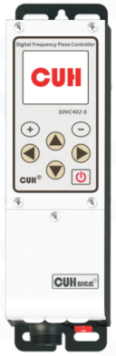

Controlador×1

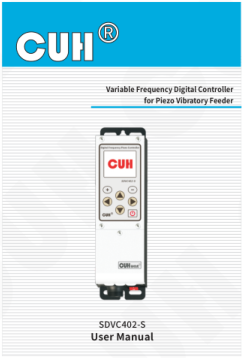

Manual del usuario×1

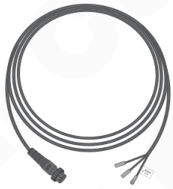

Cable de salida×1

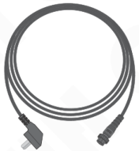

Cable de entrada de potencia×1

---

## 1.2 Teclado y puertos de E/S

### Explicación de la pantalla y los botones

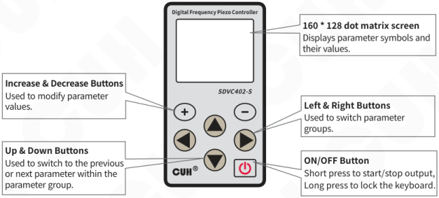

**Pantalla de matriz de puntos de 160 * 128**  
Muestra los símbolos de los parámetros y sus valores.

**Botones de aumento y reducción**  
Se utilizan para modificar los valores de los parámetros.

**Botones arriba y abajo**  
Se utilizan para cambiar al parámetro anterior o siguiente dentro del grupo de parámetros.

**Botones izquierda y derecha**  
Se utilizan para cambiar entre grupos de parámetros.

**Botón ON/OFF**  
Pulsación corta para iniciar/detener la salida, pulsación larga para bloquear el teclado.

### Explicación de las partes externas

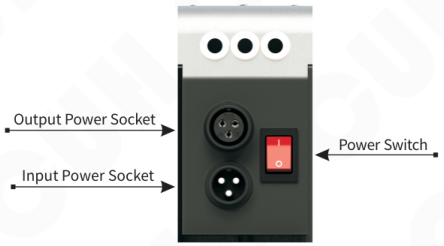

- Zócalo de salida de potencia
- Zócalo de entrada de potencia
- Interruptor de alimentación

---

## 1.3 Descripción de los parámetros de la página de inicio

El controlador puede mostrar en la página de inicio el estado de la salida principal, el estado del bloqueo del teclado, el estado de los puertos, los parámetros de monitorización y el nombre de la interfaz. Dentro del estado de los puertos:

X resaltado indica que el puerto es válido. <u>X</u> indica que el puerto es válido a nivel bajo, y X̅ indica que el puerto es válido a nivel alto.

## 1.4 Explicación de los puertos de cableado

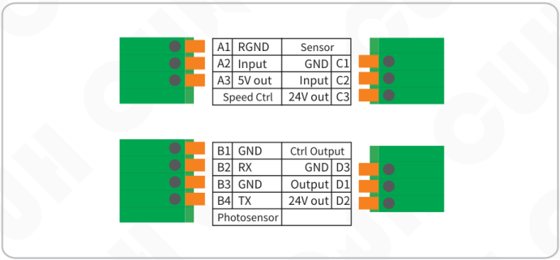

| | | | |
|---|---|---|---|
| A1 | RGND | Sensor | |
| A2 | Input | GND | C1 |
| A3 | 5V out | Input | C2 |
| Speed Ctrl | | 24V out | C3 |

| | | | |
|---|---|---|---|
| B1 | GND | Ctrl Output | |
| B2 | RX | GND | D3 |
| B3 | GND | Output | D1 |
| B4 | TX | 24V out | D2 |
| Photosensor | | | |

---

## 1.5 Explicación de la placa de características

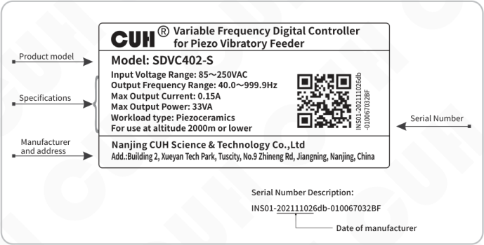

**CUH® Variable Frequency Digital Controller for Piezo Vibratory Feeder**

**Modelo de producto**

Modelo: SDVC402-S

**Especificaciones**

- Rango de tensión de entrada: 85～250VAC
- Rango de frecuencia de salida: 40.0～999.9Hz
- Corriente máxima de salida: 0.15A
- Potencia máxima de salida: 33VA
- Tipo de carga: Piezocerámicas
- Para uso a una altitud de 2000 m o inferior

**Fabricante y dirección**

Nanjing CUH Science & Technology Co.,Ltd

Add.:Building 2, Xueyan Tech Park, Tuscity, No.9 Zhineng Rd, Jiangning, Nanjing, China

**Número de serie**

INS01-202111026db-010067032BF

**Descripción del número de serie:**

INS01-<u>20211102</u>6db-010067032BF

Fecha de fabricación → 20211102

---

## Capítulo Ⅱ Características

El controlador está especialmente diseñado para controlar alimentadores vibratorios en sistemas de automatización. Combinado con la última tecnología electrónica y un diseño elaborado, el controlador ofrece las siguientes características prácticas y convenientes:

**Ajuste de frecuencia:** el rango de frecuencia de salida es de 40.0Hz a 999.9Hz.

**Ajuste de tensión:** el rango de tensión de salida es de 0V a 220V.

**Estabilización automática de tensión:** el controlador puede eliminar la variación de velocidad de alimentación causada por la fluctuación de la tensión de red.

**Detección fotoeléctrica inteligente:** nuestro sensor fotoeléctrico inteligente adaptativo puede ayudar a detener el controlador cuando las piezas están llenas o la pieza está vacía, y cumplir las funciones de ajuste del tiempo de arranque suave, retardo de conexión, retardo de desconexión y ajuste de la relación lógica.

**Sensor de conmutación:** se puede conectar un sensor de conmutación adaptativo o un PLC para activar/desactivar el controlador.

**Control de velocidad remoto:** la tensión de salida del controlador puede controlarse mediante un potenciómetro externo, un PLC o una señal DC de 1~5V/4~20mA.

**Interruptor de salida:** botón ON/OFF en el panel que permite iniciar y detener al instante, facilitando la depuración del dispositivo por parte del usuario.

**Bloqueo del teclado:** mantenga pulsado el botón ON/OFF durante 2 segundos para bloquear todos los botones y evitar operaciones falsas.

**Estado al encender:** mediante el ajuste de este parámetro, los usuarios pueden determinar cómodamente el estado de funcionamiento del controlador al arrancar.

**Salida de control:** la señal de salida de control emitida por el transistor puede coordinar un solenoide u otros dispositivos externos con el controlador.

**Limitación de la salida máxima:** el valor máximo de tensión de salida puede preajustarse para proteger el equipo de daños causados por un uso indebido.

**Restauración de la configuración predeterminada:** esta función permite al usuario restaurar todos los ajustes de parámetros predeterminados y reiniciar el controlador.

**Pantalla LCD:** adopta una pantalla en color de 160* 128 de resolución y admite los idiomas chino e inglés.

**Guardado y lectura de grupos de parámetros:** se pueden guardar y leer hasta 4 grupos de parámetros de usuario.

---

---

CUH concede gran importancia a la gestión de la calidad del producto y al rendimiento de seguridad. Además de los componentes de alta calidad que utilizamos y el riguroso sistema de control de calidad, CUH ha tenido en cuenta los posibles accidentes que los usuarios pueden encontrar y proporciona las siguientes funciones de protección para maximizar la practicidad del controlador.

**Protección contra cortocircuitos:** si la salida del controlador se cortocircuita, el controlador detendrá su salida hasta que se reinicie.

**Protección contra sobrecarga de corriente:** el controlador detendrá su salida para garantizar la seguridad de funcionamiento del equipo cuando la corriente de operación supere su valor nominal.

**Protección contra sobrecalentamiento:** el controlador detendrá su salida para protegerse cuando la temperatura de funcionamiento sea demasiado alta.

Los controladores CUH cumplen estrictamente con la certificación CE.

---

# Capítulo Ⅲ Guía de instalación

Este capítulo presenta las condiciones necesarias para el uso del controlador y cómo instalarlo y conectarlo correctamente.

## 3.1 Condiciones de uso del controlador

El controlador se alimenta con CA de 85V~250V y se conecta a una toma de tierra de protección a través del enchufe del cable de alimentación. Utilice una fuente de alimentación de red estándar y asegúrese de que el cable de tierra de protección esté correctamente conectado.

**⚠ Advertencia** Nunca conecte el controlador a una alimentación de CA de 380V; esto causará daños graves e irreversibles al controlador, y posiblemente provocará explosiones, incendios y otros incidentes de seguridad.

**⚠ Advertencia** Asegúrese de que el lado de la fuente de alimentación esté conectado a tierra de forma fiable. La carcasa metálica del controlador está conectada directamente al cable de tierra de protección. Una conexión a tierra deficiente hará que la carcasa del controlador se cargue eléctricamente y provocará un accidente por descarga eléctrica.

**Aviso** El funcionamiento prolongado genera calor y hace que aumente la temperatura de la carcasa. Instale el controlador en un entorno bien ventilado y fíjelo bien, lejos de fuentes de vibración.

**Aviso** Este producto es un controlador utilizado para accionar el alimentador vibratorio piezoeléctrico.

## 3.2 Método de operación de los botones

a. Según el tiempo de pulsación del botón, las acciones del botón se dividen en pulsación corta, pulsación larga, primera aceleración y segunda aceleración.

b. La pulsación corta define un tiempo de pulsación mayor de 0.1 y menor de 2 segundos, y la pulsación larga define un tiempo de pulsación mayor de 2 segundos.

c. ⊕ y ⊖ se utilizan para modificar los valores de los parámetros. ▲ y ▼ se utilizan para seleccionar diferentes parámetros.

d. Cambie entre los grupos de parámetros superiores e inferiores en la interfaz de ajuste de parámetros pulsando brevemente ◀ o ▶.

e. Cambie entre los parámetros superiores e inferiores de este grupo en la interfaz de ajuste de parámetros pulsando brevemente ▲ o ▼.

f. Pulse brevemente ⏻ para iniciar/detener la salida principal, mantenga pulsado ⏻ para bloquear/desbloquear el teclado.

g. Si no se realiza ninguna acción durante más de 5 minutos en cualquier interfaz, se entrará en la interfaz de página de inicio.

---

## 3.3 Instalación y uso

### Paso uno:

Abra la caja de embalaje y compruebe el controlador y todos los accesorios.

### Paso dos:

Conecte los terminales de cableado del cable de salida de potencia a los electrodos del vibrador piezoeléctrico.

Alinee la muesca del conector de aviación del cable de salida con la marca triangular del zócalo de salida del controlador, y luego apriete la tuerca después de conectar correctamente el cable de salida.

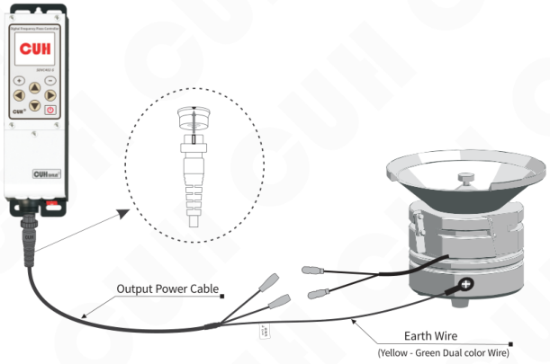

> **Nota**
>
> Asegúrese de que los electrodos del vibrador piezoeléctrico estén conectados a los dos pines de salida del cable de salida de potencia, y que la carcasa metálica del vibrador esté conectada a tierra de forma fiable.

---

### Paso tres:

Conecte el conector del cable de entrada de potencia al zócalo de entrada de potencia del controlador.

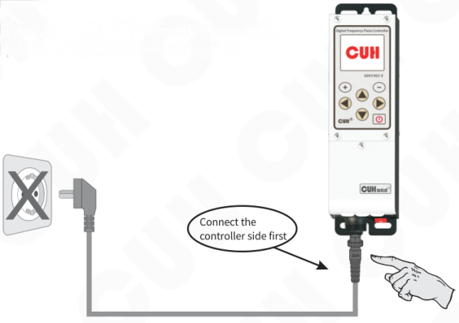

Conecte primero el lado del controlador

### Paso cuatro:

Después de confirmar que el interruptor está en la posición de apagado, conecte el enchufe del cable de entrada de potencia a la toma de corriente de la red.

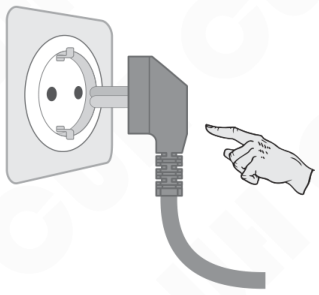

---

## Paso cinco:

- Encienda el interruptor de alimentación del controlador; el controlador muestra la interfaz de inicio.
- Pulse ⊕ o ⊖ para ajustar el valor de tensión de salida entre 30 y 80.

**Nota:** la selección inversa indica que el valor del parámetro es ajustable.

## Paso seis:

- En la interfaz de inicio, pulse brevemente ▼ para entrar en el estado de ajuste de la frecuencia de salida.
- Pulse ⊕ o ⊖ para encontrar la frecuencia natural del alimentador vibratorio, también llamada frecuencia de resonancia.

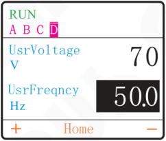

- La frecuencia a la que la vibración alcanza su máximo es la frecuencia natural del cuerpo vibrante.
- Cada vibrador tiene su frecuencia de resonancia mecánica natural; ajuste la frecuencia de salida del controlador a esta frecuencia para lograr el mejor estado de funcionamiento.

---

## Paso siete:

- Después de encontrar la frecuencia natural del alimentador vibratorio, utilice ⊕ y ⊖ para ajustar la tensión hasta alcanzar la mejor velocidad de alimentación.

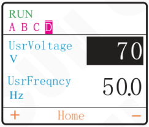

El alimentador vibratorio debería funcionar ahora. Para obtener más instrucciones de control, consulte los capítulos siguientes.

---

## Capítulo Ⅳ Breve descripción de funciones

Este capítulo presenta los ajustes básicos de los parámetros.

### 4.1 Tensión de salida

Este controlador puede ajustar directamente la tensión de salida de forma digital en el panel. Dado que el controlador tiene una función de salida estabilizada en tensión, este valor es el valor medio de rectificación de la tensión y no se verá afectado por la tensión de entrada. La tensión de salida puede mantenerse estable incluso en situaciones en las que la tensión de red es inestable. Al mismo tiempo, el ajuste directo del valor de tensión también proporciona datos precisos para que los usuarios comprendan el funcionamiento del equipo.

- Encienda el interruptor de alimentación del controlador.
- El controlador entra en el parámetro de tensión de salida. La pantalla LCD muestra el parámetro de tensión de salida y el valor predeterminado es 150.
- Pulse ⊕ o ⊖ para ajustar el valor del parámetro.

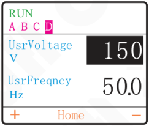

El rango de tensión es 0~220V, la precisión de ajuste es 1V.

El valor medio rectificado de la tensión de salida del controlador puede ajustarse de forma directa y digital a través del teclado. Gracias a la función única de estabilización de tensión, la tensión de salida del controlador no fluctuará como lo hace la tensión de entrada, de modo que el vibrador puede mantener un funcionamiento estable en caso de tensión de red inestable.

---

## 4.2 Frecuencia de salida

El controlador utiliza tecnología de síntesis digital directa de frecuencia (DDS), que tiene una precisión y estabilidad de frecuencia muy altas, y no cambia con el tiempo ni la temperatura.

- En la interfaz de inicio, pulse brevemente ▼ para entrar en el estado de ajuste de la frecuencia de salida.
- La pantalla LCD muestra el parámetro de frecuencia y el valor predeterminado es 50.0.
- Pulse ⊕ o ⊖ para ajustar el valor del parámetro.

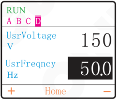

El rango de frecuencia es 40.0～999.9Hz, la precisión de ajuste es 0.1Hz.

---

- En la interfaz de inicio, pulse brevemente ◀ y ▶ para cambiar a otros grupos de parámetros.
- En los grupos de parámetros sin monitorización, el controlador sale automáticamente a la interfaz de inicio tres minutos después de finalizar la operación.
- En los grupos de parámetros con monitorización, el controlador sale automáticamente a la interfaz de inicio diez minutos después de finalizar la operación.

---

## 4.3 Tiempo de arranque suave

Para evitar un choque repentino en la bobina del vibrador, el controlador puede aumentar gradualmente la tensión de salida de 0 al valor preajustado al arrancar.

**Tiempo de arranque suave:** el período de tiempo que tarda el controlador en aumentar suavemente su tensión de salida de 0 al valor preajustado al arrancar.

- Pulse brevemente ▶ para cambiar al grupo de parámetros "2 Common".
- Pulse brevemente ▼ para cambiar al parámetro de arranque suave y el valor predeterminado es 0.5.
- Pulse ⊕ o ⊖ para ajustar el valor del parámetro.

**RUN**  
A B C **D**

| Parámetro | Valor |
|---|---|
| 01.UsrVoltage | 150 V |
| 02.UsrFreqncy | 50.0 Hz |
| 03.SoftStarT | **0.5 s** |
| 04.SoftStopT | 0.0 s |
| 05.MaxVoltage | 220 V |

＋　2Common　－

El rango de arranque suave es 0.0～10.0s, la precisión de ajuste es 0.1s.

## 4.4 Interruptor de salida

El interruptor de salida táctil del panel puede iniciar o detener de forma fácil y rápida la salida del controlador.

- Utilice ⏻ en el panel del controlador para controlar el arranque o la parada de la salida de la unidad. La pantalla muestra el signo "MAN", lo que significa que entra en el estado de parada.

**MAN**  
A B C **D**

| Parámetro | Valor |
|---|---|
| UsrVoltage | 150 V |
| UsrFreqncy | **50.0 Hz** |

＋　Home　－

> Gracias al interruptor táctil y a la tecnología de control de señal digital, no se generará ninguna chispa que deteriore el contacto. Como resultado, la vida útil del controlador y del vibrador se prolongará considerablemente.

---

## 4.5 Límite de la tensión de salida máxima

El controlador puede ajustar la tensión máxima de salida, lo que puede evitar que el usuario, por un manejo indebido, emita una tensión excesiva y dañe el equipo de vibración.

La tensión de control remoto no superará este valor.

- Entre en el grupo de parámetros "2 Common".
- Pulse brevemente ⏷ para cambiar al parámetro de tensión máxima y el valor predeterminado es 220.
- Pulse ⊕ o ⊖ para ajustar el valor del parámetro.

**RUN**  
A　B　C　**D**

| Parámetro | Valor |
|---|---|
| 01.UsrVoltage | 150 V |
| 02.UsrFreqncy | 50.0 Hz |
| 03.SoftStarT | 0.5 s |
| 04.SoftStopT | 0.0 s |
| 05.MaxVoltage | **220** V |

＋　　2Common　　－

El rango de tensión máxima es 0～220V, la precisión de ajuste es 1V.

> - En ningún caso la tensión de salida del controlador puede ni podrá superar el valor ajustado de este parámetro.
> - El ajuste predeterminado de fábrica de este parámetro es la tensión de salida máxima posible de la máquina.

---

## 4.6 Bloqueo del teclado

Cuando los parámetros del controlador están ajustados, la función de bloqueo del teclado puede bloquear todos los botones del panel para evitar un manejo indebido.

Incluso si se apaga y se vuelve a encender, el estado del bloqueo del teclado permanece en el estado en que se encontraba la última vez que se apagó.

- Mantenga pulsado ⏻ durante 2 segundos para bloquear todos los botones del panel. La pantalla muestra el signo "Lock".
- Mantenga pulsado ⏻ de nuevo durante 2 segundos para desbloquear.

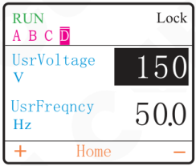

> El estado de bloqueo del teclado no desaparecerá al apagar el equipo.

---

## 4.7 Configuración del estado de funcionamiento al encender

Para evitar cortes de energía repentinos en condiciones normales y posteriores reanudaciones, o por requisitos especiales sobre el estado de encendido del controlador, puede ajustar este parámetro para configurar el estado de encendido del controlador como en marcha, en parada o según el estado del último apagado.

- Entre en el grupo de parámetros "3 M_output".
- Pulse brevemente ⏷ para cambiar al parámetro de estado de encendido y el valor predeterminado es On.
- Pulse ⊕ o ⊖ para ajustar el valor del parámetro.

RUN  
A B C D

| Parámetro | Valor |
|---|---|
| 04.MainUpDly | 0.0 s |
| 05.MainDnDly | 0.0 s |
| 06.MainMode | Delay |
| 07.MainDirect | Revrs |
| 08.PowerOnSta | On |

＋　3M_output　－

**On:** indica que el estado de encendido es activado.

**Off:** indica que el estado de encendido es desactivado.

**Hold:** indica que el estado de encendido sigue el estado del último apagado. (Si el controlador detuvo la salida en el último apagado, la próxima vez que se encienda el controlador, este estará apagado; mientras que si el controlador estaba emitiendo salida en el último apagado, el controlador estará encendido la próxima vez que se encienda)

---

## 4.8 Restauración de la configuración predeterminada

El usuario puede restaurar rápidamente el controlador al estado predeterminado de fábrica.

Debido a las potentes funciones del controlador, se pueden ajustar muchos parámetros. Los principiantes pueden tener dificultades para restaurar el controlador a su estado de funcionamiento normal después de modificar varios parámetros. Utilice esta función para restaurar rápidamente el estado desordenado de los parámetros al ajuste predeterminado de fábrica.

- Entre en el grupo de parámetros "7Save".
- Pulse brevemente ⏷ para cambiar al parámetro RestorALL y el valor predeterminado es "None".
- Pulse brevemente ⊕ para cambiar el valor del parámetro a "Work".
- Pulse ⊕ y ⊖ simultáneamente durante 2 segundos; el controlador restablecerá todos los parámetros y se reiniciará.

RUN  
A B C **D**

| Parámetro | Valor |
|---|---|
| 01.ReadALLFrm | None |
| 02.SaveALLTo | None |
| 03.RestorALL | **None** |
| 04.LoadType | None |
| 05.MachineNum | None |

＋　7Save　－

RUN  
A B C **D**

| Parámetro | Valor |
|---|---|
| 01.ReadALLFrm | None |
| 02.SaveALLTo | None |
| 03.RestorALL | **Work** |
| 04.LoadType | None |
| 05.MachineNum | None |

＋　7Save　－

---

# Capítulo Ⅴ Sensores y control de señales

El controlador puede ser controlado por muchos tipos de señales y sensores externos. Este capítulo explica principalmente el método de uso del sensor fotoeléctrico inteligente, los sensores de conmutación de proximidad y el PLC.

## 5.1 Detección fotoeléctrica inteligente

Combinado con el sensor fotoeléctrico SDVC-S1, se puede lograr la función de detección fotoeléctrica inteligente. El sensor SDVC-S1 puede filtrar la interferencia de la luz de fondo que afecta a la sensibilidad del controlador. Como resultado, el controlador puede funcionar de forma fiable sin ajuste manual de sensibilidad.

### 5.1.1 Método de cableado del sensor fotoeléctrico inteligente

**Paso 1:**

Abra las placas de cubierta del controlador.

**Paso 2:**

Conecte el sensor SDVC-S1 a los terminales del controlador según el diagrama.

> La distancia de trabajo del sensor puede ajustarse mediante el parámetro "PortBLimit" del grupo de parámetros 4PhotoSen; cuanto menor sea el valor del parámetro, más sensible será.

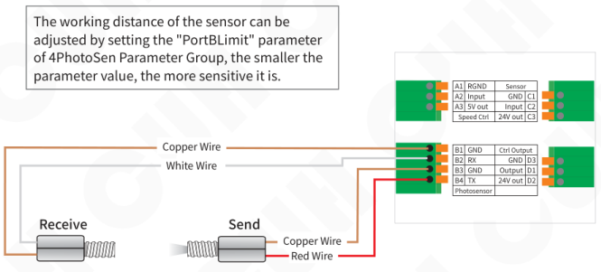

| | | | |
|---|---|---|---|
| A1 | RGND | Sensor | |
| A2 | Input | GND | C1 |
| A3 | 5V out | Input | C2 |
| Speed Ctrl | | 24V out | C3 |

| | | | |
|---|---|---|---|
| B1 | GND | Ctrl Output | |
| B2 | RX | GND | D3 |
| B3 | GND | Output | D1 |
| B4 | TX | 24V out | D2 |
| Photosensor | | | |

**Aviso:**

En los ajustes predeterminados de fábrica, la dirección lógica "PortBDirec" de este sensor es normalmente abierta.

---

## 5.1.2 Retardo de conexión/desconexión del sensor fotoeléctrico inteligente

Cuando se utiliza un sensor o PLC para conectar o desconectar la salida principal del controlador, la acción puede retrasarse un período de tiempo después de que se dé o se restablezca la señal de control. El tiempo de retardo puede ajustarse mediante los dos parámetros siguientes.

**PortBUpDly:** el período de tiempo que transcurre desde que el controlador recibe una señal de control de arranque hasta que emite realmente salida.

- Entre en el grupo de parámetros "4PhotoSen".
- Pulse brevemente ⊖⃤ para cambiar al parámetro de retardo de conexión del puerto B y el valor predeterminado es 0.2.
- Pulse ⊕ o ⊖ para ajustar el valor del parámetro.

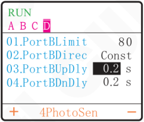

El rango de retardo de conexión del puerto B es 0.0～99.9s, la precisión de ajuste es 0.1s.

**PortBDnDly:** el período de tiempo que transcurre desde que el controlador recibe una señal de control de parada hasta que corta realmente la salida.

- Entre en el grupo de parámetros "4PhotoSen".
- Pulse brevemente ⊖⃤ para cambiar al parámetro de retardo de desconexión del puerto B y el valor predeterminado es 0.2.
- Pulse ⊕ o ⊖ para ajustar el valor del parámetro.

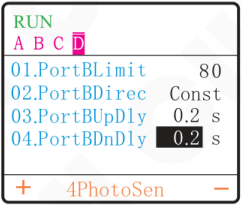

El rango de retardo de desconexión del puerto B es 0.0～99.9s, la precisión de ajuste es 0.1s.

---

## 5.1.3 Dirección lógica del sensor fotoeléctrico inteligente

En circunstancias normales, el extremo receptor no recibe señal óptica y el controlador funciona de forma predeterminada. Pero en algunas aplicaciones especiales el controlador debe detenerse cuando el extremo receptor no recibe señal óptica. El ajuste de este parámetro puede satisfacer este tipo de aplicación.

- Entre en el grupo de parámetros "4PhotoSen".
- Pulse brevemente ⏷ para cambiar al parámetro de dirección lógica del puerto B y el ajuste predeterminado es "Const".
- Pulse ⊕ o ⊖ para ajustar los ajustes del parámetro.

**RUN**  
A B C **D**

| Parámetro | Valor |
|---|---|
| 01.PortBLimit | 80 |
| 02.PortBDirec | **Const** |
| 03.PortBUpDly | 0.2 s |
| 04.PortBDnDly | 0.2 s |

＋　4PhotoSen　－

**RUN**  
A B C **D**

| Parámetro | Valor |
|---|---|
| 01.PortBLimit | 80 |
| 02.PortBDirec | **Inv** |
| 03.PortBUpDly | 0.2 s |
| 04.PortBDnDly | 0.2 s |

＋　4PhotoSen　－

- Cuando el parámetro "PortBDirec" se ajusta a "Const", es decir, no se recibe señal óptica, el controlador funciona.
- Cuando el parámetro "PortBDirec" se ajusta a "Inv", es decir, no se recibe señal óptica, el controlador se detiene.

---

## 5.2 Método de uso del sensor de conmutación

El controlador puede funcionar con todo tipo de sensores, como sensores de conmutación, sensores de conmutación ópticos y sensores de fibra óptica.

### 5.2.1 Método de cableado del sensor de conmutación de proximidad NPN

**Paso 1:**

Abra las placas de cubierta del controlador.

**Paso 2:**

Conecte el sensor de conmutación de proximidad NPN a los terminales del controlador según el diagrama.

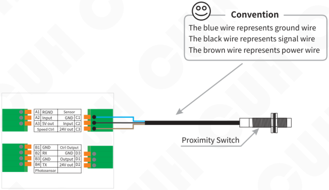

**Convención**

- El cable azul representa el cable de tierra
- El cable negro representa el cable de señal
- El cable marrón representa el cable de alimentación

Interruptor de proximidad

| | | | |
|---|---|---|---|
| A1 | RGND | Sensor | |
| A2 | Input | GND | C1 |
| A3 | 5V out | Input | C2 |
| Speed Ctrl | | 24V out | C3 |

| | | | |
|---|---|---|---|
| B1 | GND | Ctrl Output | |
| B2 | RX | GND | D3 |
| B3 | GND | Output | D1 |
| B4 | TX | 24V out | D2 |
| Photosensor | | | |

---

## Método de cableado del sensor de barrera NPN

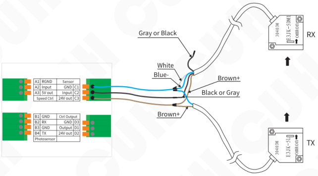

## Método de cableado del sensor de barrera

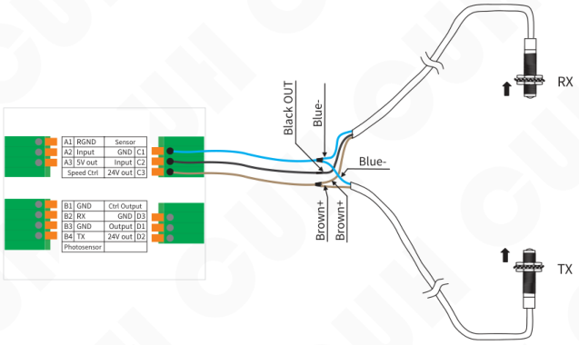

---

## Método de cableado del sensor de barrera de fibra óptica

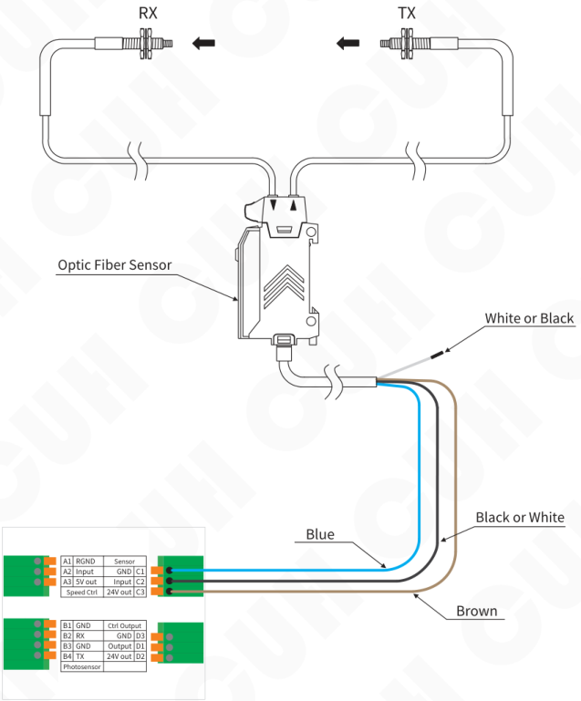

| | | | |
|---|---|---|---|
| A1 | RGND | Sensor | |
| A2 | Input | GND | C1 |
| A3 | 5V out | Input | C2 |
| Speed Ctrl | | 24V out | C3 |

| | | | |
|---|---|---|---|
| B1 | GND | Ctrl Output | |
| B2 | RX | GND | D3 |
| B3 | GND | Output | D1 |
| B4 | TX | 24V out | D2 |
| Photosensor | | | |

## Método de cableado del sensor de barrera

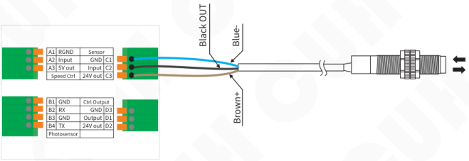

| | | | |
|---|---|---|---|
| A1 | RGND | Sensor | |
| A2 | Input | GND | C1 |
| A3 | 5V out | Input | C2 |
| Speed Ctrl | | 24V out | C3 |

| | | | |
|---|---|---|---|
| B1 | GND | Ctrl Output | |
| B2 | RX | GND | D3 |
| B3 | GND | Output | D1 |
| B4 | TX | 24V out | D2 |
| Photosensor | | | |

Etiquetado de los cables: Black OUT, Blue-, Brown+.

## Método de cableado del PLC

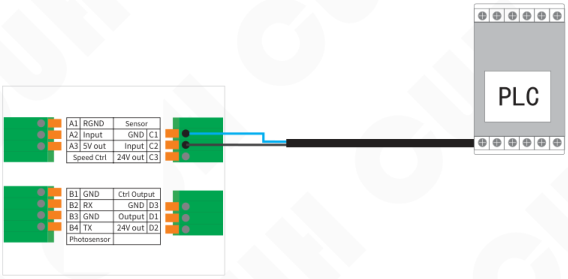

| | | | |
|---|---|---|---|
| A1 | RGND | Sensor | |
| A2 | Input | GND | C1 |
| A3 | 5V out | Input | C2 |
| Speed Ctrl | | 24V out | C3 |

| | | | |
|---|---|---|---|
| B1 | GND | Ctrl Output | |
| B2 | RX | GND | D3 |
| B3 | GND | Output | D1 |
| B4 | TX | 24V out | D2 |
| Photosensor | | | |

> Puede utilizar la salida de relé del PLC o la salida NPN del PLC.

---

## 5.2.2 Retardo de conexión/desconexión del sensor de conmutación

De forma predeterminada, el sensor fotoeléctrico inteligente y el sensor de conmutación comparten el mismo tiempo de retardo de conexión y de desconexión. Los operadores también pueden ajustar de forma independiente el tiempo de retardo de conexión y de desconexión para el sensor de conmutación.

**PortCUpDly:** el período de tiempo que transcurre desde que el controlador recibe una señal de control de arranque hasta que emite realmente salida.

- Entre en el grupo de parámetros "5On/Off".
- Pulse brevemente ⏷ para cambiar al parámetro de retardo de conexión del puerto C y el valor predeterminado es 0.2.
- Pulse ⊕ o ⊖ para ajustar el valor del parámetro.

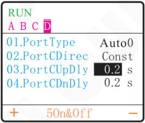

El rango de retardo de conexión del puerto C es 0.0～99.9s, la precisión de ajuste es 0.1s.

**PortCDnDly:** el período de tiempo que transcurre desde que el controlador recibe una señal de control de parada hasta que corta realmente la salida.

- Entre en el grupo de parámetros "5On/Off".
- Pulse brevemente ⏷ para cambiar al parámetro de retardo de desconexión del puerto C y el valor predeterminado es 0.2.
- Pulse ⊕ o ⊖ para ajustar el valor del parámetro.

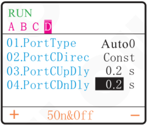

El rango de retardo de desconexión del puerto C es 0.0～99.9s, la precisión de ajuste es 0.1s.

---

## 5.2.3 Dirección lógica del sensor de conmutación

En circunstancias normales, el controlador no recibe señal del sensor de conmutación y funciona de forma predeterminada. Pero en algunas aplicaciones especiales el controlador debe detenerse cuando no recibe señal del sensor de conmutación. El ajuste de este parámetro puede satisfacer este tipo de aplicación.

- Entre en el grupo de parámetros "5On/Off".
- Pulse brevemente ⏷ para cambiar al parámetro de dirección lógica del puerto C y el ajuste predeterminado es "Const".
- Pulse ⊕ o ⊖ para ajustar los ajustes del parámetro.

RUN  
A B C **D**

| Parámetro | Valor |
|---|---|
| 01.PortType | Auto0 |
| 02.PortCDirec | **Const** |
| 03.PortCUpDly | 0.2 s |
| 04.PortCDnDly | 0.2 s |

＋　5On&Off　－

RUN  
A B C **D**

| Parámetro | Valor |
|---|---|
| 01.PortType | Auto0 |
| 02.PortCDirec | **Inv** |
| 03.PortCUpDly | 0.2 s |
| 04.PortCDnDly | 0.2 s |

＋　5On&Off　－

- Cuando el parámetro "PortCDirec" se ajusta a "Const", es decir, no se recibe señal, el controlador funciona.
- Cuando el parámetro "PortCDirec" se ajusta a "Inv", es decir, no se recibe señal, el controlador se detiene.

---

## 5.2.4 Tipo de sensor de conmutación

El puerto del sensor de conmutación puede admitir los modos NPN, PNP, Auto1 y Auto0, y puede configurarse manualmente según el tipo de sensor.

**NPN:** sensor de conmutación NPN.

**PNP:** sensor de conmutación PNP.

**Auto1:** exploración única; es decir, antes de que la señal del sensor no sea válida, se cambian los niveles alto y bajo para detectar si el puerto es válido. Después de encontrar una señal válida, se determina el tipo de sensor del puerto y ya no se explora más.

**Auto0:** exploración continua; independientemente del tipo de sensor, siempre detecta si el puerto está conectado a una señal válida cambiando los niveles alto y bajo.

- Entre en el grupo de parámetros "5On/Off".
- Ajuste el parámetro de tipo de sensor del puerto C; el ajuste predeterminado es "Auto0".
- Pulse ⊕ o ⊖ para ajustar los ajustes del parámetro.

RUN  
A B C **D**

| Parámetro | Ajuste |
|---|---|
| 01.PortType | **Auto0** |
| 02.PortCDirec | Const |
| 03.PortCUpDly | 0.2 s |
| 04.PortCDnDly | 0.2 s |

＋　5On&Off　－

---

## 5.3 Salida de control

El controlador puede emitir una señal de control de baja tensión para cooperar con otros dispositivos, como una válvula solenoide, un PLC o un relé eléctrico.

El puerto de salida de control puede admitir salida NPN, salida PNP y salida push-pull. El método de cableado es el siguiente.

### Método de cableado de la salida NPN

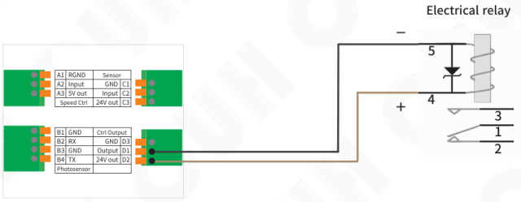

### Método de cableado de salida PNP o push-pull

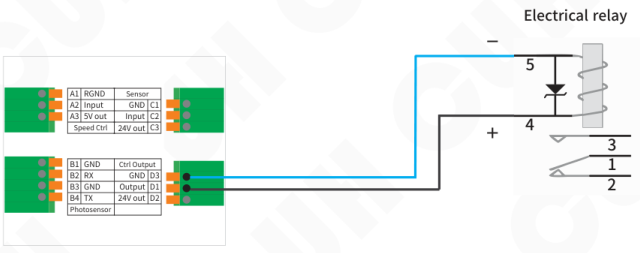

> Si conecta un relé de 24V, asegúrese de confirmar los polos positivo y negativo de la bobina para verificar que estén conectados correctamente. Debido a que la capacidad de corriente de salida de este puerto es limitada, el diodo de protección interno del relé cortocircuitará el puerto de este controlador tras una conexión inversa, activando la protección contra cortocircuitos.

---

## 5.4 Control de velocidad remoto

El controlador admite una señal analógica externa para controlar la tensión de salida; la señal analógica admite potenciómetro, tensión de 1~5V y corriente de 4~20mA. De este modo, se puede lograr fácilmente un control de velocidad remoto externo mediante un PLC, un DCS u otros medios.

- Cuando la entrada es inferior a 0.5V, el control de velocidad remoto no es efectivo.
- Cuando la entrada es superior a 0.5V e inferior a 1V, el control de velocidad remoto es efectivo y la tensión de salida es “MinVoltage” (predeterminado: 0V).
- Cuando la entrada es superior a 1V e inferior a 5V, la tensión de salida se controla proporcionalmente mediante la señal de control remoto (0%~100%), y la tensión máxima no supera “MaxVoltage” (predeterminado: 220V).

### Método de cableado del control por potenciómetro

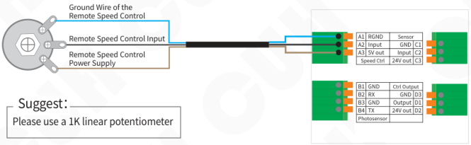

**Sugerencia:** Utilice un potenciómetro lineal de 1K

### Método de cableado del control por tensión de 1~5V

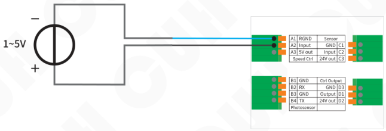

---

## Método de cableado del control por corriente de 4~20mA

- Cuando la entrada es inferior a 2mA, el control de velocidad remoto no es efectivo.
- Cuando la entrada es superior a 2mA e inferior a 4mA, el control de velocidad remoto es efectivo y la tensión de salida es “MinVoltage” (predeterminado: 0V).
- Cuando la entrada es superior a 4mA e inferior a 20mA, la tensión de salida se controla proporcionalmente mediante la señal de control remoto (0%~100%), y la tensión máxima no supera “MaxVoltage” (predeterminado: 220V).

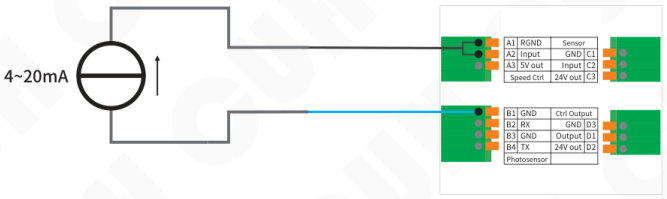

| | | | |
|---|---|---|---|
| A1 | RGND | Sensor | |
| A2 | Input | GND | C1 |
| A3 | 5V out | Input | C2 |
| Speed Ctrl | | 24V out | C3 |

| | | | |
|---|---|---|---|
| B1 | GND | Ctrl Output | |
| B2 | RX | GND | D3 |
| B3 | GND | Output | D1 |
| B4 | TX | 24V out | D2 |
| Photosensor | | | |

---

# Capítulo Ⅵ Introducción detallada de funciones

Este capítulo presenta las funciones y los ajustes detallados del controlador.

Pulse brevemente ▶ para entrar en la interfaz de ajuste de parámetros desde la interfaz de inicio. La interfaz de ajuste de parámetros incluye los siguientes ocho grupos de parámetros. Pulse brevemente ◀ o ▶ para cambiar entre los diferentes grupos de parámetros.

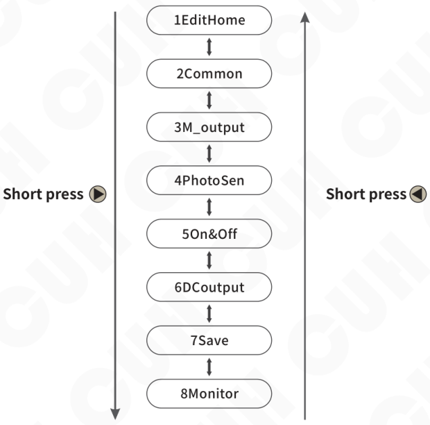

Diagrama de rotación de grupos de parámetros

---

## 6.1 Personalización de la página de inicio

Para facilitar a los usuarios el uso eficiente y rápido del controlador, los usuarios pueden realizar operaciones personalizadas en el grupo de parámetros de interfaz. Extrayendo como máximo 16 de todos los parámetros, se colocan como elemento de detección en el grupo de parámetros de interfaz, y el usuario puede realizar operaciones rápidas en la interfaz principal.

Ejemplo: Seleccione 1. UsrVoltage (P2.01), 2. UsrFreqncy (P2.02), 3. CurrentOut (P8.02), 4. SoftStarT (P2.03), SoftStopT (P2.04); hay cinco parámetros en la interfaz principal. Los pasos son los siguientes:

- En la interfaz de inicio, pulse brevemente ⏵ para entrar directamente en el grupo de parámetros "1EditHome".
- Pulse brevemente ▲ o ▼ para cambiar entre los diferentes elementos de monitorización.
- Pulse ⊕ o ⊖ para seleccionar las etiquetas de función que se deben ajustar respectivamente.

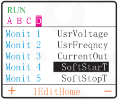

Nota: Las etiquetas de función se pueden consultar en el capítulo "Lista de parámetros".  
Si el valor del elemento de monitorización está en blanco, significa que no hay elemento de monitorización.

Una vez completada la operación, si el usuario necesita ajustar los valores de los parámetros de tensión, frecuencia, corriente de salida, tiempo de arranque suave y tiempo de parada suave, entre en el elemento de monitorización específico en el grupo de parámetros de la interfaz "Inicio" y mediante ⊕ o ⊖ se puede completar el ajuste del parámetro.

---

## 6.2 Ajustes de parámetros comunes

Este capítulo presenta principalmente el ajuste y la regulación de los parámetros comunes básicos del controlador.

### 6.2.1 Tensión

Este controlador puede ajustar directamente la tensión de salida digitalmente en el panel. Esta función puede eliminar la variación en la velocidad de alimentación causada por las fluctuaciones de la tensión de alimentación. La regulación de tensión también puede eliminar el efecto de batido causado por la corriente alterna de frecuencia de red.

- Entre en el grupo de parámetros "2Common" y busque los parámetros de ajuste de tensión.
- Pulse ⊕ o ⊖ para ajustar el valor del parámetro.

El rango de tensión es 0~220V, el valor predeterminado es 150V y la precisión de ajuste es 1V.

RUN  
A B C **D**

| Parámetro | Valor |
|---|---|
| 01.UsrVoltage | **150** V |
| 02.UsrFreqncy | 50.0 Hz |
| 03.SoftStarT | 0.5 s |
| 04.SoftStopT | 0.0 s |
| 05.MaxVoltage | 220 V |

＋　2Common　－

### 6.2.2 Frecuencia

El controlador tiene una precisión y estabilidad de frecuencia muy altas, y no cambia con el tiempo ni la temperatura.

- Entre en el grupo de parámetros "2Common" y busque los parámetros de ajuste de frecuencia.
- Pulse ⊕ o ⊖ para ajustar el valor del parámetro.

El rango de frecuencia es 40.0~999.9Hz, el valor predeterminado es 50.0Hz y la precisión de ajuste es 0.1Hz.

RUN  
A B C **D**

| Parámetro | Valor |
|---|---|
| 01.UsrVoltage | 150 V |
| 02.UsrFreqncy | **50.0** Hz |
| 03.SoftStarT | 0.5 s |
| 04.SoftStopT | 0.0 s |
| 05.MaxVoltage | 220 V |

＋　2Common　－

**Los demás parámetros de este grupo de parámetros se pueden ajustar según los pasos anteriores.**

---

## 6.2.3 Tiempo de arranque suave/tiempo de parada suave

**Tiempo de arranque suave:** El tiempo necesario para que el controlador aumente suavemente la tensión de salida de 0V a la tensión de salida ajustada al arrancar desde un estado de parada.

El rango de tiempo de arranque suave es 0.0~10.0s, el valor predeterminado es 0.5s y la precisión de ajuste es 0.1s.

**Tiempo de parada suave:** Cuando el controlador deja de funcionar, la tensión de salida desciende suavemente desde la tensión de salida ajustada hasta alcanzar el tiempo necesario para llegar a 0V.

El rango de tiempo de parada suave es 0.0~10.0s, el valor predeterminado es 0.5s y la precisión de ajuste es 0.1s.

Cuando este controlador arranca o se detiene, la tensión de salida se puede aumentar o disminuir suavemente para evitar que el equipo de vibración se dañe por el impacto.

## 6.2.4 Tensión de salida máxima/tensión de salida mínima

**Tensión de salida máxima:** El valor de tensión máximo que emite el controlador.

El rango de tensión máxima es 0-220V, el valor predeterminado es 220V y la precisión de ajuste es 1V.

**Tensión de salida mínima:** El valor de tensión mínimo que emite el controlador.

El rango de tensión mínima es 0-220V, el valor predeterminado es 0V y la precisión de ajuste es 1V.

Este controlador puede establecer los valores límite de tensión de salida máxima y tensión de salida mínima, lo que puede evitar que los usuarios dañen el equipo de vibración al emitir accidentalmente una tensión excesiva.

## 6.2.5 Frecuencia de salida máxima/frecuencia de salida mínima

**Frecuencia de salida máxima:** Limita el valor límite superior del parámetro "UsrFreqncy".

El rango de frecuencia de salida máxima es 40.0~999.9Hz, el valor predeterminado es 999.9Hz y la precisión de ajuste es 0.1Hz.

**Frecuencia de salida mínima:** Limita el valor límite inferior del parámetro "UsrFreqncy".

El rango de frecuencia de salida mínima es 40.0~999.9Hz, el valor predeterminado es 40.0Hz y la precisión de ajuste es 0.1Hz.

---

## 6.2.6 Tiempo de apagado de la retroiluminación

**Tiempo de apagado de la retroiluminación:** Es decir, el tiempo de apagado de la retroiluminación. Cuando el controlador no realiza ninguna operación durante un período de tiempo, el controlador apagará la retroiluminación de la pantalla. Se puede activar de nuevo la retroiluminación de la pantalla pulsando cualquier botón.

El rango de apagado de la retroiluminación es 1-30min, el valor predeterminado es On y la precisión de ajuste es 1min.

## 6.2.7 Idioma

**Idioma:** Es decir, el idioma que se muestra en el panel de operación del controlador. El controlador tiene dos idiomas incorporados: chino e inglés, lo que facilita el cambio a los usuarios de diferentes regiones. Predeterminado: Chines.

| Parámetro | Significado |
|---|---|
| Englis | Interfaz en inglés. |
| Chines | Interfaz en chino. |

---

## 6.3 Parámetros de salida

Este capítulo se utiliza para presentar el ajuste y el uso de los parámetros de salida principal y los parámetros de salida de control del controlador para lograr la función de salida ideal del controlador.

### 6.3.1 Parámetros de salida principal

Este resumen presenta principalmente los ajustes de los parámetros de salida principal del controlador.

- Pulse brevemente ⏵ para cambiar al grupo de parámetros "3 M_output".
- Pulse brevemente ⏶ o ⏷ para cambiar de parámetro en el grupo de parámetros de salida principal.
- Pulse ⊕ o ⊖ para ajustar el valor del parámetro.

RUN  
A　B　C　**D**

| Parámetro | Valor |
|---|---|
| 01.MainSourc1 | **PortB** |
| 02.MainSourc2 | PortC |
| 03.MainLogic | Or |
| 04.MainUpDly | 0.0 s |
| 05.MainDnDly | 0.0 s |

＋　3M_output　－

Los demás parámetros de este grupo de parámetros se pueden ajustar según los pasos anteriores.

### 6.3.1.1 Fuente principal 1/fuente principal 2

"MainSourc1" y "MainSourc2" se refieren a la "señal de fuente principal 1" y la "señal de fuente lógica principal 2"; puede ajustar la señal de origen de la lógica de salida principal mediante estos dos parámetros. Las señales de la fuente principal 1 y la fuente principal 2 pasan primero por el juicio del tipo de señal del puerto, luego por el juicio de dirección lógica y, finalmente, tras pasar por el retardo de conexión y el retardo de desconexión, se convierten en la señal de resultado de la fuente lógica de salida principal 1/2.

---

El diagrama de flujo de señal es el siguiente:

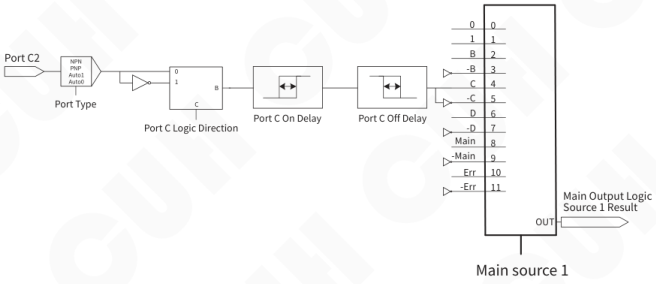

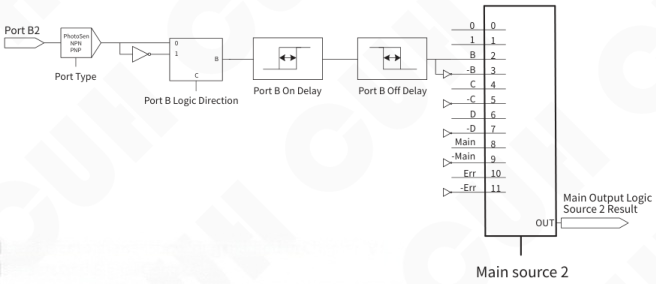

Nota: Consulte el método de cableado del sensor en el Capítulo Ⅴ "Sensores y control de señales".

**Figura 6.3.1.1**

Nota: El estado de salida principal también está controlado por si el botón de inicio/parada o el propio controlador se encuentran en estado de fallo. El nivel de control de fallo del botón de inicio/parada o del propio controlador es superior a la señal lógica de salida principal. Es decir: cuando el botón de inicio/parada está ajustado en parada, el controlador entrará inmediatamente en estado de parada; cuando se produce un fallo como cortocircuito, sobretemperatura, sobrecorriente, etc., el controlador también entrará inmediatamente en estado de parada. En este momento, la señal lógica de salida principal no puede activar la salida principal del controlador.

---

## 6.3.1.2 Lógica principal

Los resultados de la Fuente principal 1 y la Fuente 2 se procesan mediante el operador lógico, luego pasan por el módulo de dirección lógica, después pasan por el retardo de conexión y el retardo de desconexión de la salida principal y, finalmente, pasan por el modo de salida principal, y se utilizan para accionar el estado de arranque/parada de la salida principal.

El diagrama de flujo de señal es el siguiente:

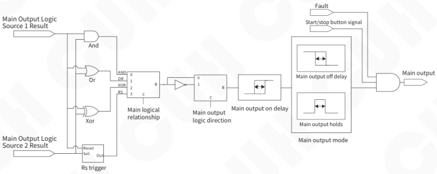

Figura 6.3.1.2

Este controlador puede establecer la tabla de relación lógica entre la fuente principal (lógica) 1 y la fuente principal 2 como se muestra a continuación. Predeterminado: Or.

| Parámetro | Significado |
|---|---|
| And | Lógica AND; la salida no es válida cuando tanto la fuente principal 1 como la fuente principal 2 son válidas. |
| Or | Lógica OR; la salida no es válida cuando al menos una de la fuente principal 1 o la fuente principal 2 es válida. |
| Xor | Lógica XOR; la salida no es válida cuando la fuente principal 1 y la fuente principal 2 están en estados diferentes; de lo contrario, es válida. |
| RS | Biestable RS. |

## 6.3.1.3 Retardo de conexión/desconexión principal

Cuando se utilizan otras señales externas, como sensores, para controlar el estado de salida principal del dispositivo, en la mayoría de los casos se requiere un retardo después de que se da la señal o de que se restaura la señal antes de poder realizar la operación. Para este tipo de aplicaciones, esto se puede lograr ajustando los valores de tiempo del retardo de conexión y del retardo de desconexión. Para el diagrama de flujo de señal, consulte la Figura 6.3.1.2.

**Retardo de conexión principal:** Es decir, el retardo de conexión de la salida principal es el tiempo de retardo transcurrido desde la aplicación de una señal de control que hace que el controlador entre en estado de funcionamiento hasta que la salida real del controlador comienza. El tiempo de retardo transcurrido durante este período se denomina retardo de conexión.

**Retardo de desconexión principal:** Es decir, el retardo de desconexión de la salida principal; desde la aplicación de una señal de control que hace que el controlador entre en estado de parada hasta que la salida real del controlador se detiene, el tiempo de retardo transcurrido durante este período se denomina retardo de desconexión.

El rango de retardo de conexión/desconexión principal es 0.0~99.9s, el valor predeterminado es 0.0s y la precisión de ajuste es 0.1s.

## 6.3.1.4 Modo principal

Hay 2 modos de salida principal disponibles: modo de retardo y modo de retención. Para el diagrama de flujo de señal, consulte la Figura 6.3.1.2. Predeterminado: Delay.

| Parámetro | Significado |
|---|---|
| Delay | Se refiere al estado de la salida principal tras la operación lógica, el estado que acciona la salida principal después del retardo de conexión y el retardo de desconexión. |
| Hold | Se refiere al estado tras la operación lógica de la salida principal. Después del retardo de conexión, el estado de parada se mantiene durante el tiempo de retardo de desconexión y, a continuación, cambia inmediatamente al estado de salida en funcionamiento. |

La diferencia entre los dos modos se expresa en forma de diagrama de temporización como se muestra a continuación, donde la señal de entrada es una selección de relación lógica.

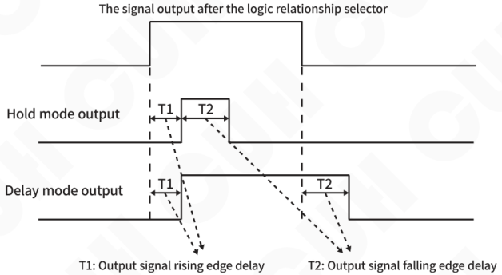

---

## 6.3.1.5 Dirección principal

Es decir, la dirección lógica de la salida principal; la dirección de salida específica se puede ajustar después de que las señales se combinen lógicamente. Para el diagrama de flujo de señal, consulte la Figura 6.3.1.2. Predeterminado: Revrs.

| Parámetro | Significado |
|---|---|
| Const | El estado no se invierte tras la operación lógica de la salida principal. |
| Revrs | El estado se invierte tras la operación lógica de la salida principal. |
| On | El estado permanece en funcionamiento tras la operación lógica de la salida principal. |
| Off | El estado permanece siempre detenido tras la operación lógica de la salida principal. |

## 6.3.1.6 Estado al encender

Ajuste el estado de funcionamiento del controlador después del encendido. Predeterminado: On.

| Parámetro | Significado |
|---|---|
| On | Después de encender el dispositivo, el estado de la tecla de interruptor es en funcionamiento. |
| Off | Después de encender el dispositivo, el estado de la tecla de interruptor es detenido. |
| Hold | Después de encender el dispositivo, el estado de la tecla de interruptor permanece igual que antes del último apagado. |

---

## 6.3.2 Parámetros de salida de control DC

Este resumen presenta principalmente los ajustes de los parámetros de salida de control del controlador.
El diagrama esquemático del flujo de señal de la salida de control es el siguiente:

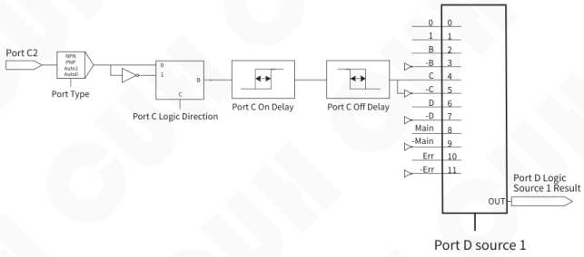

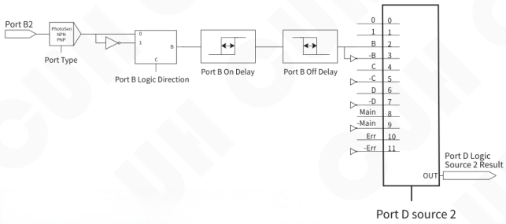

Nota: Consulte el método de cableado del sensor en el Capítulo Ⅴ "Sensores y control de señales".

---

El resultado de la fuente lógica 1 del puerto D y el resultado de la fuente lógica 2 del puerto D, tras la operación lógica, pasan por la dirección de salida del puerto D, luego pasan por el retardo de conexión y el retardo de desconexión de la salida del puerto D, pasan por el modo del puerto D y, finalmente, pasan por el tipo de salida del puerto D, y se utilizan para accionar el estado de arranque/parada de la salida de control.

El diagrama de flujo de señal es el siguiente:

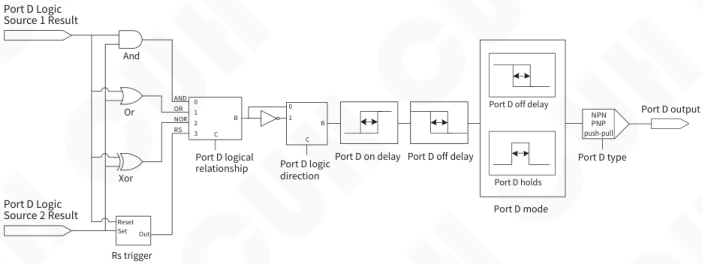

El método de ajuste de los parámetros de salida de control es el siguiente:

- Pulse brevemente ▶ para cambiar al grupo de parámetros "6DCoutput".
- Pulse brevemente ▲ o ▼ para cambiar de parámetro en el grupo de parámetros de salida de control.
- Pulse ⊕ o ⊖ para ajustar el valor del parámetro.

**RUN**  
A　B　C　**D**

| Parámetro | Valor |
|---|---|
| 01.PortDSour1 | 0 |
| 02.PortDSour2 | Main |
| 03.PortDLogic | Or |
| 04.PortDUpDly | 0.0 s |
| 05.PortDDnDly | 0.0 s |

＋　6DCoutput　－

**Los demás parámetros de este grupo de parámetros se pueden ajustar según los pasos anteriores.**

"PortDSour1", "PortDSour2", "PortDLogic", "PortDDirec", "PortDUpDly" y "PortDDnDly"; los parámetros anteriores pueden consultarse en los ajustes de los parámetros de salida principal.

---

## 6.3.2.1 Modo de salida del puerto D

Los clientes pueden elegir 4 modos de salida de control: modo de retardo, modo de retención, Cycle1 y Cycle2. Predeterminado: Delay.

| Parámetro | Significado |
|---|---|
| Delay | Se refiere al estado de la salida de control tras la operación lógica, el estado que acciona la salida de control después del retardo de conexión y el retardo de desconexión. |
| Hold | Se refiere al estado tras la operación lógica de la salida de control. Después del retardo de conexión, el estado de parada se mantiene durante el tiempo de retardo de desconexión y, a continuación, cambia inmediatamente al estado de salida en funcionamiento. |
| Cycle1/Cycle2 | La duración de la señal de nivel alto se ajusta mediante "PortDUpDly". La duración de la señal de nivel bajo se ajusta mediante "PortDDnDly". |

En el modo Cycle1, la tecla de interruptor no puede detener la salida de control, y en el modo Cycle2, la tecla de interruptor puede detener la salida de control.

La diferencia entre los cuatro modos se expresa en forma de diagrama de temporización como se muestra a continuación, donde la señal de entrada es la señal de salida después del selector de relación lógica.

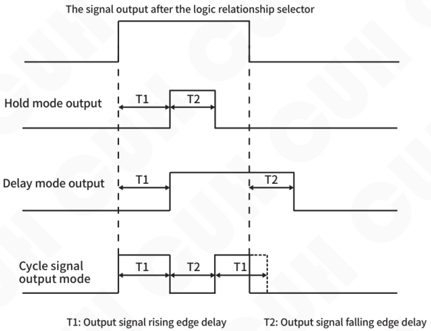

## 6.3.2.2 Tipo de puerto D

La salida del puerto D puede admitir tres tipos: salida NPN, salida PNP y salida push-pull. Predeterminado: Ou_P&P (Push-Pull).

| Parámetro | Significado |
|---|---|
| Ou_NPN | Cuando la señal de salida del puerto D es válida, el puerto D emite una señal de nivel bajo (0V) y, cuando no es válida, presenta alta impedancia. |
| Ou_PNP | Cuando la señal de salida del puerto D es válida, el puerto D emite una señal de nivel alto (24V) y, cuando no es válida, presenta alta impedancia. |
| Ou_P&P (Push Pull) | Cuando la señal de salida del puerto D es válida, el puerto D emite una señal de nivel alto (24V). Cuando la señal de salida del puerto D no es válida, el puerto D emite una señal de nivel bajo (0V). |

El diagrama es el siguiente:

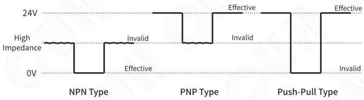

---

## 6.4 Control de señales

El controlador puede determinar el estado del material en el alimentador vibratorio a través de un sensor externo y realizar la función del controlador de "parada cuando hay material lleno" o "parada cuando no hay material". El diagrama de flujo de señal del puerto es el siguiente:

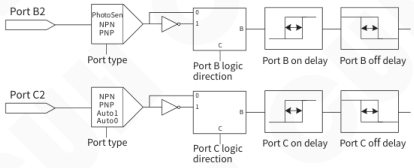

Figura 6.4

El método para ajustar los parámetros del sensor fotoeléctrico inteligente es el siguiente:

- Pulse brevemente ▶ para cambiar al grupo de parámetros "4PhotoSen".
- Pulse brevemente ▲ o ▼ para cambiar de parámetro en el grupo de parámetros del sensor fotoeléctrico inteligente.
- Pulse ⊕ o ⊖ para ajustar el valor del parámetro.

**RUN**  
A B C **D**

| Parámetro | Valor |
|---|---|
| 01.PortBLimit | 80 |
| 02.PortBDirec | Const |
| 03.PortBUpDly | 0.2 s |
| 04.PortBDnDly | 0.2 s |

＋　4PhotoSen　－

El método para ajustar los parámetros del sensor de conmutación es el siguiente:

- Pulse brevemente ▶ para cambiar al grupo de parámetros "5On&Off".
- Pulse brevemente ▲ o ▼ para cambiar de parámetro en el grupo de parámetros del sensor de conmutación.
- Pulse ⊕ o ⊖ para ajustar el valor del parámetro.

**RUN**  
A B C **D**

| Parámetro | Valor |
|---|---|
| 01.PortType | Auto0 |
| 02.PortCDirec | Const |
| 03.PortCUpDly | 0.2 s |
| 04.PortCDnDly | 0.2 s |

＋　5On&Off　－

**Los demás parámetros de este grupo de parámetros se pueden ajustar según los pasos anteriores.**

---

## 6.4.1 Sensibilidad del puerto B

El controlador puede ajustar el tipo de señal del puerto B a 1~1000 (sensibilidad del sensor fotoeléctrico inteligente), sensores de conmutación de tipo "NPN" y de tipo "PNP". El valor predeterminado es 80.

| Parámetro | Significado |
|---|---|
| 1~1000 | El puerto B está conectado a señales de sensor fotoeléctrico inteligente, con un rango de 1 a 1000. Cuanto menor sea el valor, más débil será la intensidad de la señal óptica reconocida. Los extremos emisor y receptor podrán estar más separados. |
| NPN | Sensor de tipo NPN. |
| PNP | Sensor de tipo PNP. |

## 6.4.2 Dirección lógica del puerto B/puerto C

Este parámetro se utiliza para cambiar el puerto de entrada B y el puerto de entrada C del controlador a "parada cuando hay material lleno" o "parada cuando no hay material". Predeterminado: Const.

Cuando el puerto de entrada de conmutación B/puerto C, en la configuración predeterminada de fábrica, no recibe ninguna señal, el controlador se encuentra en estado "En funcionamiento" (es decir, parada cuando hay material lleno). Algunas aplicaciones especiales requieren que el controlador esté en estado "detenido" (es decir, parada cuando no hay material) cuando el puerto B/puerto C no recibe ninguna señal. Esto se puede lograr modificando este parámetro. Consulte la Figura 6.4 para el diagrama de flujo de señal.

| Parámetro | Significado |
|---|---|
| Const | Cuando no hay señal de control, el controlador está en estado de funcionamiento (parada cuando hay material lleno). |
| Inv | Cuando no hay señal de control, el controlador está en estado de parada (parada cuando no hay material). |

## 6.4.3 Retardo de conexión/desconexión del puerto B y del puerto C

El tiempo de retardo desde que se aplica una señal para poner el controlador en estado de funcionamiento hasta que el controlador considera la señal como válida se denomina retardo de conexión.

El tiempo de retardo desde la aplicación de una señal que hace que el controlador entre en estado de parada hasta que el controlador considera la señal como válida se denomina retardo de desconexión.

Para el diagrama de flujo de señal, consulte la Figura 6.4.

El rango de retardo de conexión/desconexión es 0.0~99.9s, el valor predeterminado es 0.2s y la precisión de ajuste es 0.1s.

**Nota:** Cuando se utilizan los puertos B y C para realizar el control de arranque/parada, si es necesario retardar la operación durante un período de tiempo después de recibir la señal para garantizar que la señal sea estable, esto se puede lograr ajustando el retardo de conexión y el retardo de desconexión.

---

## 6.5 Guardar ajustes

Este capítulo presenta principalmente cómo utilizar las funciones de almacenamiento de parámetros y de recuperación de parámetros del controlador.

### 6.5.1 Recuperación de ajustes

Además del grupo de trabajo, el controlador puede leer 3 conjuntos diferentes de parámetros preestablecidos, denominados "UsrD1", "UsrD2" y "UsrD3" respectivamente. Predeterminado: None.

Cuando el usuario modifica los parámetros, los parámetros del controlador se guardan en el grupo de trabajo de forma predeterminada. Cuando el controlador se enciende de nuevo, los parámetros se leerán automáticamente del grupo de trabajo y se restaurarán los valores de los parámetros anteriores al último apagado. Al mismo tiempo, los usuarios pueden seleccionar manualmente entre "UsrD1", "UsrD2", "UsrD3" y leer otro archivo guardado manualmente por los tres grupos. Los datos se envían al grupo de trabajo del controlador, lo que permite al controlador cambiar el estado de trabajo inmediatamente.

| Parámetro | Significado |
|---|---|
| None | No válido |
| UsrD1 | Parámetro establecido por el usuario 1 |
| UsrD2 | Parámetro establecido por el usuario 2 |
| UsrD3 | Parámetro establecido por el usuario 3 |

### 6.5.2 Guardar ajustes

El controlador puede guardar 4 conjuntos diferentes de parámetros preestablecidos, denominados "Work", "UsrD1", "UsrD2" y "UsrD3". Predeterminado: None.

Cuando el usuario modifica los parámetros, los parámetros del controlador se guardan automáticamente en "Work" de forma predeterminada. Cuando el controlador se enciende de nuevo, los parámetros se leerán automáticamente del grupo de trabajo y se restaurarán los valores de los parámetros anteriores al último apagado. Los usuarios pueden guardar manualmente los parámetros del grupo de trabajo en "UsrD1", "UsrD2", "UsrD3".

| Parámetro | Significado |
|---|---|
| None | No válido |
| Work | Grupo de trabajo predeterminado |
| UsrD1 | Parámetro establecido por el usuario 1 |
| UsrD2 | Parámetro establecido por el usuario 2 |
| UsrD3 | Parámetro establecido por el usuario 3 |

---

## 6.5.3 Restauración de fábrica

Utilice la función de restablecimiento de parámetros para restaurar todos los parámetros del grupo de trabajo a los valores predeterminados de fábrica. Predeterminado: None.

Después de seleccionar "Work" en "RestorALL", mantenga pulsados ⊕ y ⊖ al mismo tiempo; tras más de dos segundos, la interfaz de visualización cambia a la interfaz de espera y los parámetros se restauran correctamente.

| Parámetro | Significado |
|---|---|
| None | No válido |
| Work | Restaura los parámetros del grupo de trabajo a la configuración de fábrica. (UsrD1, UsrD2 y UsrD3 no se restaurarán) |

## 6.5.4 Tipo y número de máquina local

**Identificador de máquina local:** Se utiliza para mostrar el identificador del dispositivo en la página de inicio.

Los valores opcionales del identificador de máquina local son "Circ ", "Line" y "Soli". Predeterminado: None.

**Número de identificación:** Se utiliza para numerar la máquina local.

El rango del número de identificación es de 1 a 1000. Predeterminado: None.

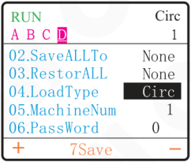

## 6.5.5 Contraseña de usuario

Los usuarios pueden configurar la contraseña de parámetros por sí mismos. Después del bloqueo, el usuario solo puede operar en "SetWord" y en la "Página de inicio".

Cuando el usuario establece la "contraseña de usuario" en un valor distinto de 0, significa que la función de bloqueo de parámetros avanzados está habilitada. En este momento, se debe introducir la contraseña al entrar en el grupo de parámetros desde la página de inicio. Después de que el usuario introduzca la contraseña en "SetWord" y mantenga pulsados ⊕ y ⊖ simultáneamente durante más de 2 segundos, confirme la contraseña introducida. Solo cuando la contraseña sea correcta, el usuario podrá entrar en otros grupos de parámetros.

El rango de selección de la contraseña de usuario es 0~9999. Predeterminado: 0.

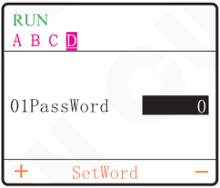

---

## 6.6 Monitorización del estado del controlador

En el grupo de parámetros de monitorización, el estado de funcionamiento y los valores de los parámetros del controlador se pueden leer en tiempo real.

Para los elementos de parámetros legibles, consulte el capítulo "Lista de parámetros", grupo de parámetros "8Monitor".

RUN  
A B C **D**

| | |
|---|---:|
| 01.Temperatur | 50 ℃ |
| 02.CurrentOut | 20 mA |
| 03.Vol_Remote | **0.5 V** |
| 04.Vol_PortB | 100 |
| 05.Vol-PortC | 0.5 V |

＋　8Monitor　－

---

## Capítulo Ⅶ Apéndice

### 7.1 Dimensiones

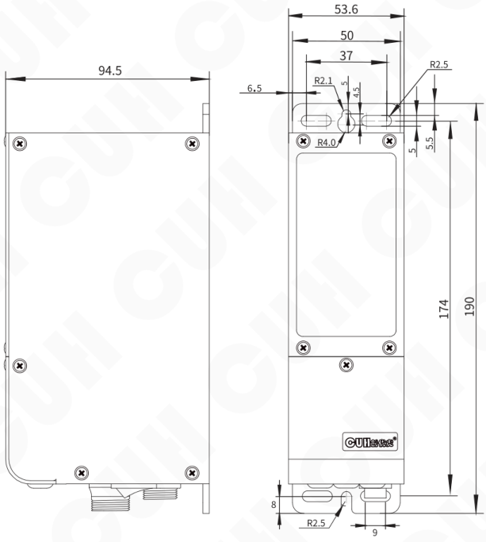

Dimensiones (unidad: mm)

| Rango de dimensiones | tolerancia |
|---|---|
| 0~3 | ±0.05 |
| 3~10 | ±0.1 |
| 10~30 | ±0.15 |
| 30~80 | ±0.2 |
| 80~180 | ±0.3 |
| >180 | ±0.5 |

Esta tabla de tolerancias es aplicable a todos los productos de esta serie.

---

## 7.2 Especificaciones técnicas

| Elemento | Mín | Típico | Máx | Unidad | Nota |
|---|---|---|---|---|---|
| Tensión de entrada | 85 | 220 | 250 | V | CA RMS |
| Rango de tensión de salida ajustable | 0 | —— | 220 | V | CA RMS |
| Precisión de ajuste de tensión | | 1 | | V | |
| Rango de corriente de salida ajustable | 0 | —— | 150 | mA | |
| Potencia de salida | 0 | —— | 33 | VA | |
| Frecuencia de salida | 40.0 | —— | 999.9 | Hz | |
| Precisión de ajuste de frecuencia | | 0.1 | | Hz | |
| Forma de onda de salida | | Senoidal | | | |
| Tiempo de arranque suave | 0 | —— | 10.0 | s | Valor predeterminado: 0.5 |
| Rango de tiempo de retardo de conexión/desconexión | 0.0 | —— | 99.9 | s | Valor predeterminado: 0.2 |
| Precisión del tiempo de retardo de conexión/desconexión | | 0.1 | | s | |
| Temperatura de activación de la protección contra sobretemperatura | 60 | 65 | 65 | °C | |
| Corriente de salida de control DC | 0 | —— | 350 | mA | |
| Tensión de salida de control DC | 22 | 24 | 26 | V | |
| Señal de control analógica | | 1~5 | | V | tensión de control de velocidad remoto |
| Señal de control analógica | | 4~20 | | mA | corriente de control de velocidad remoto |
| Señal de control digital | | 24 | | V | Señal de conmutación |
| Método de ajuste | | 7 | | Botón | |
| Consumo de energía en espera | —— | —— | 5 | W | |
| Método de visualización | | 160*128 | | | Pantalla matricial |
| Grado de protección de entrada | | IP20 | | | |
| Temperatura ambiente | 0 | 25 | 40 | °C | Sin condensación |
| Humedad ambiente | 10 | 60 | 85 | % | Sin condensación |
| Temperatura ambiente de almacenamiento | -20 | 25 | 65 | °C | Sin condensación |

## 7.3 Norma de referencia

**Parámetros absolutos:**  
Superar el estándar dañará el controlador; respételo estrictamente.

| Elemento | Norma GB | Norma IEC | Grado | Requisito de la norma | Nota |
|---|---|---|---|---|---|
| Descarga electrostática | GB/T 17626.2-2006 | IEC 61000-4-2:2001 | 4 | ±8 kV | Descarga por contacto |
| | | | 4 | ±15 kV | Descarga por aire |
| Prueba de transitorios eléctricos rápidos | GB/T 17626.4-2008 | IEC 61000-4-4:2004 | 4 | ±4 kV | |
| Inmunidad a ondulación de la línea de alimentación DC | GB/T 17626.17-2005 | IEC 61000-4-17:2002 | 4 | 15% | Clasificación A |

> **Warning**  
> En un entorno residencial, este producto puede causar interferencias de radio, en cuyo caso pueden ser necesarias medidas de mitigación adicionales.

---

## 7.4 Lista de parámetros

| | Parámetro | Visualización | Rango de valores/Elementos de enumeración | Predeterminado |
|---|---|---|---|---|
| Grupo de parámetros 1EditHome | Elemento de monitorización 1 | Monit 1 | Grupo de parámetros 2~Grupo de parámetros 8 | UsrVoltage |
| | Elemento de monitorización 2 | Monit 2 | Grupo de parámetros 2~Grupo de parámetros 8 | UsrFreqncy |
| | Elemento de monitorización 3 | Monit 3 | Grupo de parámetros 2~Grupo de parámetros 8 | CurrentOut |
| | Elemento de monitorización 4 | Monit 4 | Grupo de parámetros 2~Grupo de parámetros 8 | |
| | Elemento de monitorización 5 | Monit 5 | Grupo de parámetros 2~Grupo de parámetros 8 | |
| | Elemento de monitorización 6 | Monit 6 | Grupo de parámetros 2~Grupo de parámetros 8 | |
| | Elemento de monitorización 7 | Monit 7 | Grupo de parámetros 2~Grupo de parámetros 8 | |
| | Elemento de monitorización 8 | Monit 8 | Grupo de parámetros 2~Grupo de parámetros 8 | |
| | Elemento de monitorización 9 | Monit 9 | Grupo de parámetros 2~Grupo de parámetros 8 | |
| | Elemento de monitorización 10 | Monit 10 | Grupo de parámetros 2~Grupo de parámetros 8 | |
| | Elemento de monitorización 11 | Monit 11 | Grupo de parámetros 2~Grupo de parámetros 8 | |
| | Elemento de monitorización 12 | Monit 12 | Grupo de parámetros 2~Grupo de parámetros 8 | |
| | Elemento de monitorización 13 | Monit 13 | Grupo de parámetros 2~Grupo de parámetros 8 | |
| | Elemento de monitorización 14 | Monit 14 | Grupo de parámetros 2~Grupo de parámetros 8 | |
| | Elemento de monitorización 15 | Monit 15 | Grupo de parámetros 2~Grupo de parámetros 8 | |
| | Elemento de monitorización 16 | Monit 16 | Grupo de parámetros 2~Grupo de parámetros 8 | |
| Grupo de parámetros 2Common | Tensión establecida por el usuario | 01.UsrVoltage | 0~220 V | 150 |
| | Frecuencia establecida por el usuario | 02.UsrFreqncy | 40.0~999.9 Hz | 50.0 |
| | Tiempo de arranque suave | 03.SoftStarT | 0.0~10.0 s | 0.5 |
| | Tiempo de parada suave | 04.SoftStopT | 0.0~10.0 s | 0.0 |
| | Tensión de salida máxima | 05.MaxVoltage | 0~220 V | 220 |
| | Tensión de salida mínima | 06.MinVoltage | 0~220 V | 0 |
| | Frecuencia de salida máxima | 07.MaxFreqncy | 40.0~999.9 Hz | 999.9 |
| | Frecuencia de salida mínima | 08.MinFreqncy | 40.0~999.9 Hz | 40.0 |
| | Tiempo de apagado de la retroiluminación | 09.Off_time | On, 1~30 Mi | On |
| | Idioma | 10.Language | Chines, Englis | Chines |
| Grupo de parámetros 3M_output | Fuente de entrada lógica de salida principal 1 | 01.MainSourc1 | 0, 1, PortB, -PortB, PortC, -PortC, PortD, -PortD, Main, -Main, Err, -Err | PortB |
| | Fuente de entrada lógica de salida principal 2 | 02.MainSourc2 | 0, 1, PortB, -PortB, PortC, -PortC, PortD, -PortD, Main, -Main, Err, -Err | PortC |
| | Lógica del puerto de salida principal | 03.MainLogic | And, Or, Xor, RS | Or |
| | Retardo de conexión de la salida principal | 04.MainUpDly | 0.0~99.9 s | 0.0 |
| | Retardo de desconexión de la salida principal | 05.MainDnDly | 0.0~99.9 s | 0.0 |
| | Modo de salida principal | 06.MainMode | Delay, Hold | Delay |
| | Dirección lógica de la salida principal | 07.MainDirect | Const, Revrs, On, Off | Revrs |
| | Estado al encender | 08.PowerOnSta | On, Off, Hold | On |

| | Parámetro | Visualización | Rango de valores/Elementos de enumeración | Predeterminado |
|---|---|---|---|---|
| Grupo de parámetros 4PhotoSen | Sensibilidad del sensor fotoeléctrico inteligente | 01.PortBLimit | PNP, NPN, 1~1000 | 80 |
| Grupo de parámetros 4PhotoSen | Dirección lógica del puerto B | 02.PortBDirec | Const, Inv | Const |
| Grupo de parámetros 4PhotoSen | Retardo de conexión del puerto B | 03.PortBUpDly | 0.0~99.9 s | 0.2 |
| Grupo de parámetros 4PhotoSen | Retardo de desconexión del puerto B | 04.PortBDnDly | 0.0~99.9 s | 0.2 |
| Grupo de parámetros 5On&Off | Tipo de sensor del puerto C | 01.PortType | NPN, PNP, Auto1, Auto0 | Auto0 |
| Grupo de parámetros 5On&Off | Dirección lógica del puerto C | 02.PortCDirec | Const, Inv | Const |
| Grupo de parámetros 5On&Off | Retardo de conexión del puerto C | 03.PortCUpDly | 0.0~99.9 s | 0.2 |
| Grupo de parámetros 5On&Off | Retardo de desconexión del puerto C | 04.PortCDnDly | 0.0~99.9 s | 0.2 |
| Grupo de parámetros 6DCoutput | Fuente de entrada lógica del puerto D 1 | 01.PortDSour1 | 0, 1, PortB, -PortB, PortC, -PortC, PortD, -PortD, Main, -Main, Err, -Err | 0 |
| Grupo de parámetros 6DCoutput | Fuente de entrada lógica del puerto D 2 | 02.PortDSour2 | 0, 1, PortB, -PortB, PortC, -PortC, PortD, -PortD, Main, -Main, Err, -Err | Main |
| Grupo de parámetros 6DCoutput | Relación lógica del puerto D | 03.PortDLogic | And, Or, Xor, RS | Or |
| Grupo de parámetros 6DCoutput | Retardo de conexión del puerto D | 04.PortDUpDly | 0.0~99.9 s | 0.0 |
| Grupo de parámetros 6DCoutput | Retardo de desconexión del puerto D | 05.PortDDnDly | 0.0~99.9 s | 0.0 |
| Grupo de parámetros 6DCoutput | Modo de salida del puerto D | 06.PortDMode | Delay, Hold, Cycle1, Cycle2 | Delay |
| Grupo de parámetros 6DCoutput | Dirección lógica del puerto D | 07.PortDDirec | Const, Revrs, On, Off | Const |
| Grupo de parámetros 6DCoutput | Tipo de salida de control | 08.PortDType | Ou_NPN, Ou_PNP, Ou_P&P | Ou_NPN |
| Grupo de parámetros 7Save | Leer todos los parámetros del grupo de usuario | 01.ReadALLFrm | None, UsrD1, UsrD2, UsrD3 | None |
| Grupo de parámetros 7Save | Guardar todos los parámetros en el grupo de usuario | 02.SaveALLTo | None, Work, UsrD1, UsrD2, UsrD3 | None |
| Grupo de parámetros 7Save | Restauración de la configuración predeterminada | 03.RestorALL | None, Work | None |
| Grupo de parámetros 7Save | Identificador de máquina local | 04.LoadType | None, Circ, Line, Soli | None |
| Grupo de parámetros 7Save | Número de identificación | 05.MachineNum | None, 1~1000 | None |
| Grupo de parámetros 7Save | Contraseña de usuario | 06.PassWord | 0~9999 | 0 |
| Grupo de parámetros 8Monitor | Temperatura | 01.Temperatur | -20~85 ℃ | —— |
| Grupo de parámetros 8Monitor | Corriente de salida | 02.CurrentOut | 0.0~150 mA | —— |
| Grupo de parámetros 8Monitor | Tensión de señal del puerto A | 03.Vol_Remote | 0.0~5.0 V | —— |
| Grupo de parámetros 8Monitor | Tensión de señal del puerto B | 04.Vol_PortB | 0~999 | —— |
| Grupo de parámetros 8Monitor | Tensión de señal del puerto C | 05.Vol-PortC | 0.0~26.0 V | —— |
| Grupo de parámetros 8Monitor | Tensión de señal del puerto D | 06.Vol-PortD | 0.0~26.0 V | —— |
| Grupo de parámetros 8Monitor | Tensión en tiempo real del puerto de 5V | 07.Vol-5V | 0.0~6.0 V | —— |
| Grupo de parámetros 8Monitor | Tensión en tiempo real del puerto de 24V | 08.Vol-24V | 0.0~26.0 V | —— |
| Grupo de parámetros 8Monitor | Versión del software de la placa de control | 09.Version | 0~99.99 | —— |

| | Parámetro | Visualización | Rango de valores/Elementos de enumeración | Predeterminado |
|---|---|---|---|---|
| SetWord | Contraseña | 01PassWord | 0~9999 | 0 |

## 7.5 Diagramas de circuito de entrada y salida

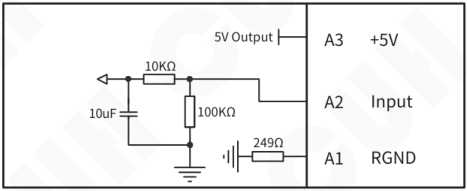

**Control de velocidad remoto del puerto A**

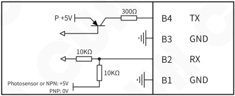

**Sensor fotoeléctrico inteligente del puerto B**

**Sensor de conmutación del puerto C**

**Salida de control del puerto D**

---

## 7.6 Códigos de error y advertencia

| Visualización de error | Solución de problemas |
|---|---|
| Short | Confirme si la línea de salida principal está en cortocircuito y vuelva a cablearla. |
| MainOrCu | Reduzca la tensión de salida o aumente la frecuencia de salida. |
| OverHot | Coloque el controlador en una zona bien ventilada y con disipación de calor. |
| OverCold | Coloque el controlador en un lugar donde la temperatura ambiente sea superior a -20℃. |
| PotDOrCu | Asegúrese de que la carga del puerto D no esté en cortocircuito y de que la corriente no supere 350mA; a continuación, intente reiniciar la salida del puerto D. |
| 24VErr | Asegúrese de que el puerto de 24V no esté en cortocircuito y de que la corriente no supere 400mA. |
| 5VErr | Asegúrese de que la alimentación de 5V del puerto A no esté en cortocircuito y de que no esté conectada a una tensión de alimentación externa superior a 5V. |
| MainRSEr | Asegúrese de que las dos señales de entrada del biestable RS no estén activas simultáneamente. |
| PotDRSEr | Asegúrese de que las dos señales de entrada del biestable RS no estén activas simultáneamente. |

---

## Capítulo Ⅷ Información de garantía del producto

### 8.1 Período de garantía

El período de garantía que ofrece la empresa para este producto es de 3 años a partir de la fecha de entrega del producto en el lugar designado por el comprador.

### 8.2 Cobertura de la garantía

(1) Si durante el período de garantía anterior se produce un fallo causado por nuestra empresa, repararemos el producto sin cargo alguno. Sin embargo, las siguientes situaciones no están cubiertas por la garantía:

 a. Incumplimiento de las condiciones especificadas en el manual simplificado, el manual del usuario o los requisitos técnicos acordados específicamente entre el comprador y la empresa, operación inadecuada o fallo causado por un uso indebido.

 b. El fallo no se debe a un defecto del producto, sino al diseño del equipo o software del comprador.

 c. Averías causadas por modificaciones o reparaciones no realizadas por el personal de la empresa.

 d. El fallo que podría evitarse totalmente mediante un mantenimiento correcto o la sustitución de piezas de desgaste según la guía de operación simplificada o el manual del usuario.

 e. Después del envío del producto desde nuestra empresa, fallo causado por factores como cambios imprevistos en el nivel de ciencia y tecnología.

 f. Debido a desastres naturales como incendios, terremotos, inundaciones, o factores externos como fallos por tensión anormal, la empresa no es responsable de la garantía.

(2) El alcance de la garantía se limita a la situación estipulada en (1); en cuanto a las pérdidas indirectas (como daños al equipo, oportunidades, pérdida de beneficios, etc.) u otras pérdidas, la empresa no asume ninguna responsabilidad.

### 8.3 Idoneidad del producto

El controlador de nuestra empresa está diseñado y producido para uso general en la industria de alimentación vibratoria. Por lo tanto, este controlador de nuestra empresa no debe utilizarse para las siguientes aplicaciones y no es adecuado para su uso.

(1) Instalaciones que tienen un impacto grave en la vida y la propiedad, como centrales nucleares, aeropuertos, ferrocarriles, barcos, dispositivos motorizados y equipos médicos.

(2) Servicios públicos, incluidos electricidad, gas, suministro de agua, etc.

(3) Uso en exteriores en condiciones o entornos similares.

---

Nanjing CUH Science & Technology Co.,Ltd  
https://en.cuhnj.com  
Tel.:+86-25-84730411 / 84730415 / 84730416  
Fax:+86-25-84730426  
E-mail:sales@cuhnj.com  
Add.:Building 2, Xueyan Tech Park, Tuscity,  
No.9 Zhineng Rd, Jiangning, Nanjing, China

Document No.: IDP1000542

