Controlador digital de frecuencia variable para alimentador vibratorio piezoeléctrico

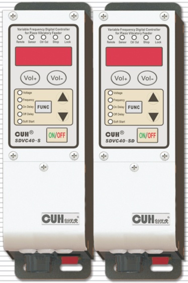

## Serie SDVC40
Controlador digital de frecuencia variable para alimentador vibratorio piezoeléctrico　　**Serie SDVC40**
## Manual de instrucciones

---

## Prefacio

Gracias por elegir los controladores digitales inteligentes de alimentador vibratorio **CUH**. (En lo sucesivo, se abreviará como «el controlador»).

Este manual de instrucciones incluye notas para la instalación, puesta en servicio, ajuste de parámetros, mantenimiento y solución de problemas del controlador. Lea este manual de instrucciones con atención antes de operar el controlador y consérvelo adecuadamente.

### Este manual de instrucciones se aplica a los siguientes modelos:

- Controlador digital de frecuencia variable para alimentador vibratorio piezoeléctrico  
  SDVC40-S (Salida 220V, 150mA)

- Controlador digital de frecuencia variable para alimentador vibratorio piezoeléctrico  
  SDVC40-SD (Salida 50V, 600mA)

---

# Aviso

- Nunca realice conexiones en caliente ni toque los contactos en ningún caso para evitar descargas eléctricas u otros accidentes.
- Nunca conecte el controlador a 380 V CA, ya que puede causar daños irreparables. (Elija productos diseñados para 380 V CA cuando sea necesario.)
- Nunca conmute la entrada del controlador cortando la alimentación mediante un relé, un PLC u otros dispositivos; de lo contrario, la vida útil del controlador puede reducirse gravemente.
- El controlador está diseñado para funcionar en un entorno fresco y seco. Nunca lo haga funcionar al aire libre para evitar mojaduras o exposición al sol. Utilice el controlador dentro del rango de temperatura que exigen sus características eléctricas.
- Nunca utilice el controlador en condiciones que excedan sus límites de diseño.
- Utilice el controlador de acuerdo estrictamente con este manual de instrucciones. No asumiremos ninguna responsabilidad civil o penal si el daño al equipo o las lesiones personales son causados por una operación incorrecta.

> **!**
>
> Nunca abra la carcasa del controlador para evitar descargas eléctricas. Contacte con CUH si el controlador se avería.
>
> Nunca intente modificar el controlador, ya que las placas de circuito de estado sólido del interior no se pueden reparar y no hay ninguna pieza ajustable.

---

# Entorno de funcionamiento

## Inspección antes de su uso

Cada controlador pasa por una rigurosa inspección de calidad antes de su entrega y se embala con un embalaje a prueba de golpes.

## Compruebe los siguientes elementos después del desembalaje:

- Si el controlador presenta daños en su apariencia
- Si el modelo del controlador es exactamente el que solicitó

## Entorno de operación

Siga las notas siguientes para garantizar un mejor rendimiento y una mayor vida útil del controlador.

- Entorno bien ventilado
- Manténgalo alejado del agua, el vapor, el polvo y, especialmente, el polvo aceitoso
- Manténgalo alejado de gases y líquidos corrosivos o inflamables
- Manténgalo alejado del polvo en suspensión y las partículas metálicas
- Fíjelo firmemente para evitar vibraciones propias
- Manténgalo alejado de las interferencias electromagnéticas
- Utilícelo dentro del rango de temperatura de 0 °C a 40 °C
- Para uso a una altitud de 2000 m o inferior

---

# Contenido

| Contenido | Página |
|---|---:|
| **Capítulo I Características** | 1 |
| **Capítulo II Guía de instalación** | 3 |
| **Capítulo III Descripción de los componentes** | 7 |
| 3.1 Descripción del panel de control | 7 |
| 3.2 Descripción de los indicadores de estado | 8 |
| 3.3 Descripción de la interfaz de E/S | 8 |
| **Capítulo IV Descripción de las funciones** | 9 |
| 4.1 Ajuste de la tensión de salida | 9 |
| 4.2 Ajuste de la frecuencia de salida | 10 |
| 4.3 Arranque suave | 11 |
| 4.4 Botón de conmutación de salida | 11 |
| 4.5 Limitación de tensión máxima de salida | 12 |
| 4.6 Bloqueo del teclado | 13 |
| 4.7 Ajuste del estado de funcionamiento al encender | 14 |
| 4.8 Restauración de la configuración predeterminada | 15 |
| **Capítulo V Sensores y control de señales** | 16 |
| 5.1 Detección fotoeléctrica inteligente | 16 |
| 5.1.1 Método de conexión del sensor fotoeléctrico inteligente | 16 |
| 5.1.2 Ajuste del tiempo de retardo de arranque y del tiempo de retardo de parada del sensor fotoeléctrico inteligente | 17 |
| 5.1.3 Ajuste de la relación lógica del sensor fotoeléctrico inteligente | 18 |
| 5.2 Método de uso del sensor de conmutación NPN (parada cuando las piezas están llenas) | 19 |
| 5.2.1 Método de conexión del sensor de proximidad NPN | 19 |
| 5.2.2 Método de conexión del sensor de conmutación de contrarradiación NPN | 20 |
| 5.2.3 Método de conexión del sensor fotoeléctrico de contrarradiación | 20 |
| 5.2.4 Método de conexión del sensor de contrarradiación de fibra óptica | 21 |
| 5.2.5 Método de conexión del sensor fotoeléctrico de reflexión | 22 |
| 5.3 Ajuste del tiempo de retardo de arranque y del tiempo de retardo de parada del sensor de conmutación NPN | 23 |
| 5.4 Ajuste de la relación lógica del sensor de conmutación NPN (parada cuando las piezas están llenas) | 24 |
| 5.5 Ajuste de la relación lógica de la señal de control | 25 |
| 5.6 Método de conexión del PLC superior que controla el controlador del alimentador vibratorio | 26 |
| 5.7 Salida de control | 27 |
| 5.7.1 Método de conexión de la salida de control | 27 |
| 5.7.2 Ajuste de la relación lógica de la salida de control | 28 |
| 5.8 Control de velocidad remoto | 29 |
| **Capítulo VI Funciones de seguridad** | 30 |
| 6.1 Estabilización automática de tensión | 30 |
| 6.2 Protección contra cortocircuito | 30 |
| 6.3 Protección contra sobrecarga de corriente | 30 |
| 6.4 Protección contra sobrecalentamiento | 30 |

---

---

## Apéndice

- Apéndice A: Dimensiones — 31
- Apéndice B: Definición de la interfaz de salida — 32
- Apéndice C: Definición de la interfaz de señal — 32
- Apéndice D: Tabla de funciones — 33
- Apéndice E: Especificación eléctrica — 34
- Apéndice F: Consejos de solución de problemas y explicación de errores — 35

---

# Capítulo I Características

El controlador está especialmente diseñado para controlar alimentadores vibratorios en sistemas de automatización. Combinado con la última tecnología electrónica y un diseño elaborado, el controlador ofrece las siguientes características prácticas y convenientes:

**Ajuste de frecuencia:** La frecuencia de salida va de 40.0Hz a 400.0Hz.

**Ajuste de tensión:** SDVC40-S: La tensión de salida va de 0V a 260V.  
SDVC40-SD: La tensión de salida va de 0.0V a 50.0V.

**Estabilización automática de tensión:** El controlador puede eliminar la variación de la velocidad de alimentación causada por la fluctuación de la tensión de red.

**Arranque suave:** Para evitar sacudidas repentinas a las piezas, el controlador puede aumentar suavemente la tensión de salida de 0 al valor preajustado al arrancar.

**Detección fotoeléctrica inteligente:** Nuestro sensor fotoeléctrico inteligente adaptativo puede ayudar a detener el controlador cuando las piezas están llenas o cuando no hay piezas, y realizar las funciones de ajuste del tiempo de arranque suave, retardo de arranque, retardo de parada y ajuste de la relación lógica.

**Parada cuando las piezas están llenas:** Un sensor de conmutación NPN puede ayudar a detener el controlador cuando las piezas están llenas y realizar las funciones de ajuste del tiempo de arranque suave, retardo de arranque, retardo de parada y ajuste de la relación lógica.

**Control de velocidad remoto:** La tensión de salida del controlador puede controlarse mediante un potenciómetro externo, un PLC o una señal de control de tensión de 1V a 5V.

**Salida de control:** La señal de salida de control emitida desde el transistor puede coordinar una electroválvula u otros dispositivos externos con el controlador.

**Bloqueo del teclado:** Mantenga pulsado el botón ON/OFF durante 2 segundos para bloquear todos los botones y evitar operaciones erróneas.

**Limitación de salida máxima:** El valor máximo de tensión de salida puede preajustarse para proteger el equipo de daños causados por un uso incorrecto.

**Restauración de la configuración predeterminada:** Esta función permite al usuario restaurar todos los valores predeterminados de los parámetros y reiniciar el controlador.

---

---

**CUH** concede gran importancia a la gestión de la calidad del producto y al rendimiento de seguridad. Además de los componentes de alta calidad que utilizamos y del riguroso sistema de control de calidad, **CUH** ha tenido en cuenta los posibles accidentes que los usuarios pueden encontrar y proporciona las siguientes funciones de protección para maximizar la practicidad del controlador.

**Protección contra cortocircuito:** Si la salida del controlador se cortocircuita, el controlador detendrá su salida hasta que se reinicie.

**Protección contra sobrecarga de corriente:** El controlador detendrá su salida para garantizar la seguridad de funcionamiento de los equipos cuando la corriente de operación supere su valor nominal.

**Protección contra sobrecalentamiento:** El controlador detendrá su salida para protegerse cuando la temperatura de operación sea demasiado alta.

Los controladores **CUH** cumplen estrictamente con la certificación CE.

---

## Capítulo II Guía de instalación

### Paso uno:

Abra la caja de embalaje y compruebe el aspecto exterior del controlador; asegúrese de que el modelo del controlador es exactamente el que solicitó.

### Paso dos:

Conecte el cable de salida de potencia incluido en la caja de embalaje a las bobinas electromagnéticas del vibrador.

Conecte el enchufe del cable de salida de potencia a la toma de salida del controlador.

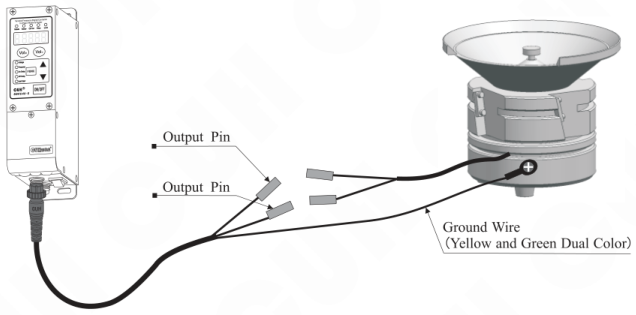

### Aviso

Asegúrese de que las bobinas electromagnéticas del vibrador estén conectadas a los dos pines de salida del cable de salida de potencia y de que las bobinas electromagnéticas estén conectadas a tierra de forma fiable; de lo contrario, pueden producirse accidentes de seguridad graves.

---

## Paso tres:

Conecte el cable de entrada de potencia al controlador y apriete la tuerca de alimentación.

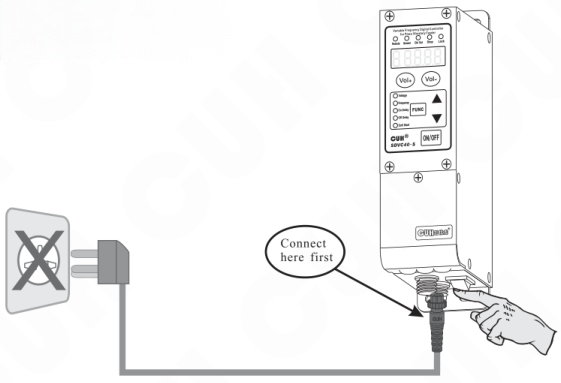

Conecte aquí primero

## Paso cuatro:

Conecte el enchufe del cable de entrada de potencia a la toma de corriente.

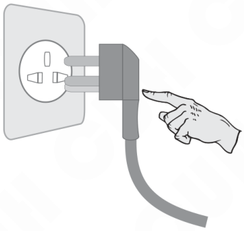

---

## Paso cinco:

Ajuste la tensión de salida del controlador a un valor entre 30 y 80 (representado por la letra U)

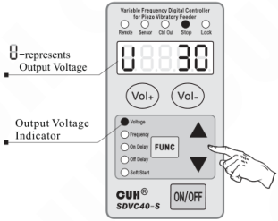

## Paso seis:

Mantenga pulsado el botón `FUNC` durante 2 segundos para entrar en el estado de ajuste de los parámetros básicos.

El indicador de frecuencia de salida del panel se ilumina y el LED muestra el valor de frecuencia actual (E). Pulse el botón ▲ o ▼ para ajustar el valor del parámetro de 400Hz a 40Hz para encontrar la frecuencia de resonancia del vibrador y mantenga este valor.

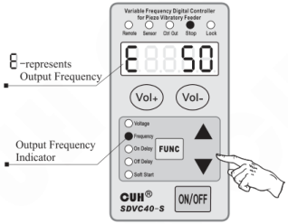

- La frecuencia de resonancia del vibrador es el valor de frecuencia que produce la máxima amplitud.
- Cada vibrador tiene su propia frecuencia de resonancia mecánica natural; ajuste la frecuencia de salida del controlador a esta frecuencia para garantizar las mejores condiciones de trabajo.

---

## Paso siete:

Después de ajustar la frecuencia de salida del controlador a la frecuencia de resonancia mecánica natural del vibrador, ajuste la tensión de salida del controlador pulsando el botón **Vol+** o **Vol-** para cambiar la velocidad de alimentación.

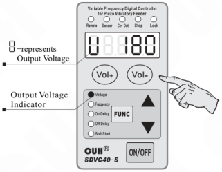

Después de los siete pasos anteriores, el controlador puede funcionar correctamente. Consulte los demás capítulos si necesita funciones de control avanzadas.

---

# Capítulo III Descripción de los componentes

## 3.1 Descripción del panel de control

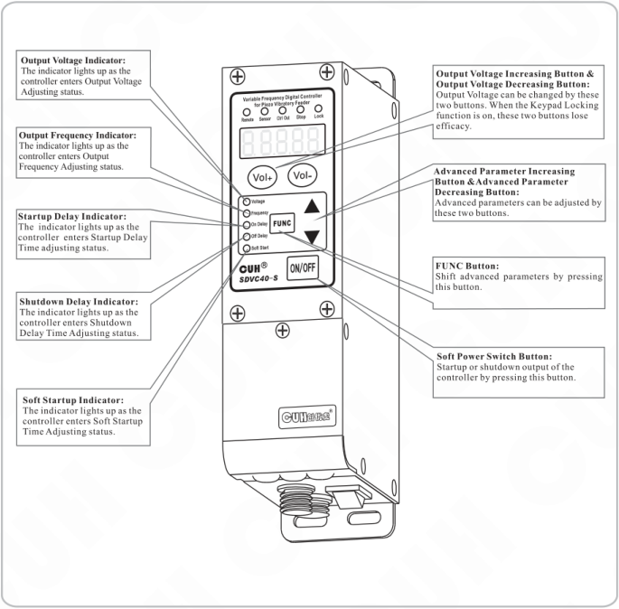

**Indicador de tensión de salida:**  
El indicador se ilumina cuando el controlador entra en el estado de ajuste de la tensión de salida.

**Indicador de frecuencia de salida:**  
El indicador se ilumina cuando el controlador entra en el estado de ajuste de la frecuencia de salida.

**Indicador de retardo de arranque:**  
El indicador se ilumina cuando el controlador entra en el estado de ajuste del tiempo de retardo de arranque.

**Indicador de retardo de parada:**  
El indicador se ilumina cuando el controlador entra en el estado de ajuste del tiempo de retardo de parada.

**Indicador de arranque suave:**  
El indicador se ilumina cuando el controlador entra en el estado de ajuste del tiempo de arranque suave.

**Botón de aumento de tensión de salida y botón de disminución de tensión de salida:**  
La tensión de salida puede cambiarse con estos dos botones. Cuando la función de bloqueo del teclado está activada, estos dos botones dejan de ser eficaces.

**Botón de aumento de parámetros avanzados y botón de disminución de parámetros avanzados:**  
Los parámetros avanzados pueden ajustarse con estos dos botones.

**Botón FUNC:**  
Cambie entre parámetros avanzados pulsando este botón.

**Botón de interruptor suave de encendido/apagado:**  
Encienda o apague la salida del controlador pulsando este botón.

---

## 3.2 Descripción de los indicadores de estado

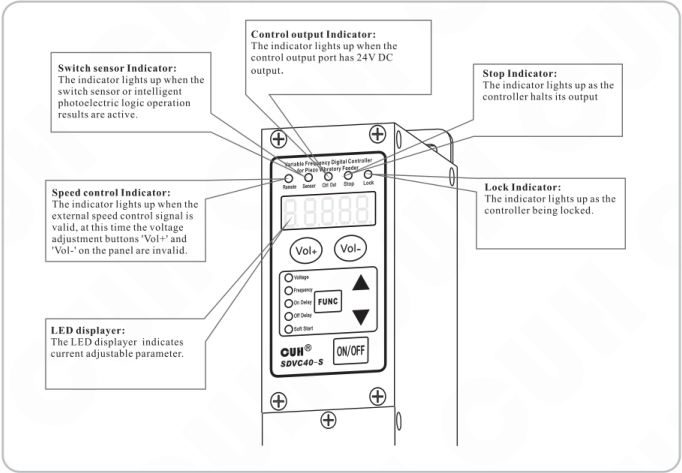

- **Indicador de sensor de conmutación:** El indicador se ilumina cuando el sensor de conmutación o los resultados de la operación lógica fotoeléctrica inteligente están activos.
- **Indicador de salida de control:** El indicador se ilumina cuando el puerto de salida de control tiene salida de 24 V CC.
- **Indicador de parada:** El indicador se ilumina cuando el controlador detiene su salida
- **Indicador de control de velocidad:** El indicador se ilumina cuando la señal de control de velocidad externa es válida; en este momento, los botones de ajuste de tensión «Vol+» y «Vol-» del panel no son válidos.
- **Indicador de bloqueo:** El indicador se ilumina cuando el controlador está bloqueado.
- **Pantalla LED:** La pantalla LED indica el parámetro ajustable actual.

## 3.3 Descripción de la interfaz de E/S

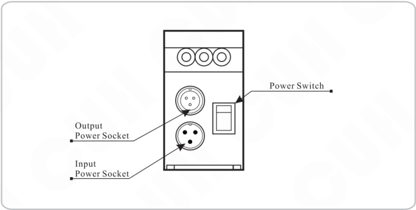

- Interruptor de alimentación
- Toma de salida de potencia
- Toma de entrada de potencia

---

# Capítulo IV Descripción de las funciones

## 4.1 Ajuste de la tensión de salida

La tensión de salida puede ajustarse de forma directa y digital a través del panel de control. Gracias a la función exclusiva de estabilización de tensión, la tensión de salida del controlador no fluctuará como lo hace la tensión de entrada, y un vibrador puede trabajar de forma estable en un entorno de tensión de entrada inestable.

- Encienda el interruptor de alimentación
- El indicador de tensión de salida se ilumina cuando el controlador entra en el estado de ajuste de la tensión de salida, mientras el LED muestra el símbolo de tensión U y el valor de tensión previamente ajustado.
- Ajuste el valor de la tensión de salida pulsando el botón **Vol+** o **Vol-**.

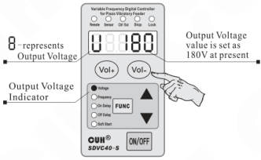

SDVC40-S: La tensión de salida va de 0V ~ 260V  
SDVC40-SD: La tensión de salida va de 0.0V ~ 50.0V

> La tensión de salida puede ajustarse en cualquier estado de ajuste de parámetros básicos o avanzados pulsando el botón **Vol+** o **Vol-**. El controlador vuelve al estado de ajuste de parámetros anterior después de ajustar la tensión de salida.

---

## 4.2 Ajuste de la frecuencia de salida

El controlador se fabrica con la tecnología DDS y su salida tiene una alta precisión y estabilidad de frecuencia que no cambia con el tiempo ni la temperatura.

- Mantenga pulsado el botón **FUNC** durante 2 segundos para entrar en el estado de ajuste de los parámetros básicos.
- El indicador de frecuencia del panel se ilumina y el LED muestra el símbolo de frecuencia de salida E y el valor actual de frecuencia de salida.
- Pulse el botón ▲ o ▼ para ajustar el valor del parámetro.

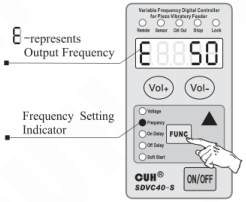

La frecuencia de salida del controlador va de 40Hz a 400Hz.

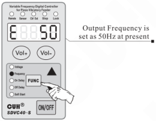

- La frecuencia de salida (E), el tiempo de retardo de arranque, el tiempo de retardo de parada y el tiempo de arranque suave pueden ajustarse tras entrar en el estado de ajuste de los parámetros básicos manteniendo pulsado el botón **FUNC** durante 2 segundos.
- El controlador volverá automáticamente al estado de ajuste de la tensión de salida 1 minuto después de la operación de ajuste.
- Mantenga pulsado el botón **FUNC** durante 2 segundos de nuevo para salir del estado de ajuste de los parámetros básicos.

---

## 4.3 Arranque suave

Para evitar sacudidas repentinas a las piezas, el controlador puede aumentar suavemente la tensión de salida de 0 al valor preajustado al arrancar.

Tiempo de arranque suave ( t ): El período de tiempo que tarda el controlador en aumentar suavemente la tensión de salida de 0 al valor preajustado al arrancar.

- Mantenga pulsado el botón `FUNC` durante 2 segundos para entrar en el estado de ajuste de los parámetros básicos.
- Pulse el botón `FUNC` repetidamente hasta cambiar al estado de ajuste del tiempo de arranque suave (t), cuando el indicador de arranque suave se ilumine.
- Pulse el botón ▲ o ▼ para ajustar el valor del parámetro. La unidad del parámetro es el segundo y la precisión numérica es 0.1.

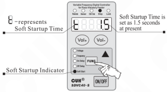

El tiempo de arranque suave ajustable va de 0.1 segundos a 9.9 segundos.

## 4.4 Botón de conmutación de salida

El botón de interruptor táctil del panel puede encender/apagar rápidamente y con facilidad la salida del controlador.

- Pulse el botón `ON/OFF` para encender/apagar la salida del controlador. El indicador de parada se ilumina cuando la salida del controlador se apaga.

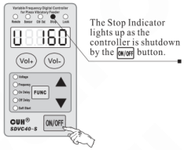

> Gracias a la tecnología de interruptor táctil y control de señal digital, no se generará ninguna chispa que deteriore el contacto. Como resultado, la vida útil del controlador y del vibrador se prolongará enormemente.

---

## 4.5 Limitación de tensión máxima de salida

La tensión máxima de salida del controlador puede ajustarse para evitar daños al vibrador. La función de control de velocidad remoto se ve afectada por este parámetro.

- Mantenga pulsados simultáneamente los botones `FUNC` y ▲ durante 2 segundos para entrar en el estado de ajuste de los parámetros avanzados.
- Pulse el botón `FUNC` repetidamente hasta cambiar al estado de limitación de tensión máxima de salida (h).
- Pulse el botón ▲ o ▼ para ajustar el valor del parámetro.

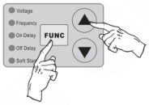

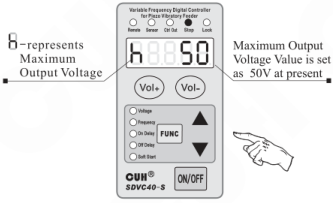

- El valor de la tensión de salida no puede exceder este valor de parámetro en ningún caso.
- El valor predeterminado de este parámetro está configurado como el valor máximo de tensión de salida ajustable.

### Método de salida del estado de ajuste de los parámetros avanzados

- El controlador volverá automáticamente al estado de ajuste de la tensión de salida un minuto después del ajuste de los parámetros avanzados.
- Mantenga pulsados los botones `FUNC` y ▲ durante 2 segundos para volver al estado de ajuste de la tensión de salida.
- Mantenga pulsado el botón `FUNC` durante 2 segundos para volver al estado de ajuste de los parámetros básicos.

---

## 4.6 Bloqueo del teclado

La función de bloqueo del teclado puede bloquear todos los botones del panel para evitar errores de operación.

- Mantenga pulsado el botón `ON/OFF` durante 2 segundos para bloquear todos los botones del panel, mientras el indicador de bloqueo del teclado se ilumina.
- Mantenga pulsado el botón `ON/OFF` durante 2 segundos en el modo de bloqueo para desbloquear el teclado.

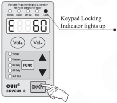

---

## 4.7 Ajuste del estado de funcionamiento al encender

Con el fin de prevenir cortes de energía repentinos en condiciones normales y reconexiones posteriores, o requisitos especiales sobre el estado de encendido del controlador, puede ajustar este parámetro para configurar el estado de encendido del controlador como en marcha, parado o siguiendo el estado del último apagado.

- Mantenga pulsados simultáneamente los botones **FUNC** y ▲ durante 2 segundos para entrar en el estado de ajuste de los parámetros avanzados.
- Pulse el botón **FUNC** repetidamente hasta cambiar al estado de funcionamiento al encender (Γd).
- Pulse el botón ▲ o ▼ para ajustar el valor del parámetro.

> 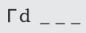 Indica que el estado de encendido está activo.
>
> 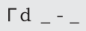 Indica que el estado de encendido está desactivado.
>
> 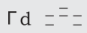 Indica que el estado de encendido sigue el estado del último apagado. (Si el controlador detuvo su salida en el último apagado, la próxima vez que se encienda el controlador permanecerá apagado; si el controlador estaba en salida en el último apagado, se encenderá la próxima vez que se encienda.)

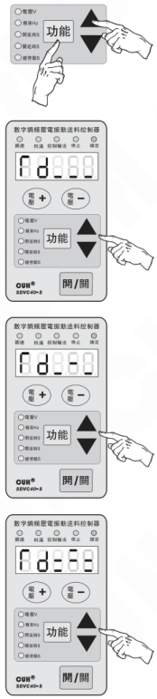

---

## 4.8 Restauración de la configuración predeterminada

Esta función permite al operador restaurar todos los valores predeterminados de los parámetros.

Debido a las abundantes funciones del controlador, muchos parámetros pueden ajustarse. Para evitar la circunstancia de que, tras demasiadas modificaciones por parte de un principiante, el controlador no pueda funcionar correctamente, esta función permite al operador restaurar la configuración predeterminada del controlador de una manera sencilla.

- Mantenga pulsados simultáneamente los botones **FUNC** y **▲** durante 2 segundos para entrar en el estado de ajuste de los parámetros avanzados.

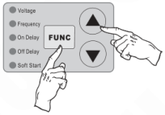

- Pulse el botón **FUNC** repetidamente hasta que 88888 parpadee en la pantalla LED, y luego mantenga pulsado el botón **▲** hasta que se muestre -----, lo que significa que la configuración predeterminada se ha restaurado correctamente

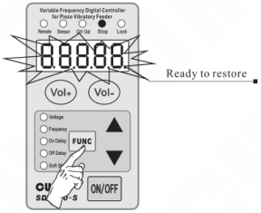

- Después de soltar el botón **▲**, el controlador entra en el estado de ajuste de la tensión de salida (U). En este momento, todos los parámetros se han restaurado a los valores predeterminados.

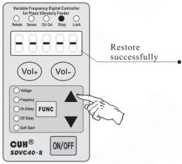

---

# Capítulo V Sensores y control de señales

El controlador puede controlarse mediante muchos tipos de señales y sensores externos. Este capítulo explica principalmente el método de uso del sensor fotoeléctrico inteligente, los sensores de conmutación de proximidad y el PLC.

## 5.1 Detección fotoeléctrica inteligente

Combinada con el sensor fotoeléctrico SDVC-S1, puede lograrse la función de detección fotoeléctrica inteligente. El sensor SDVC-S1 puede filtrar la interferencia de la luz de fondo que afecta a la sensibilidad del controlador. Como resultado, el controlador puede funcionar de forma fiable sin ajuste manual de sensibilidad.

### 5.1.1 Método de conexión del sensor fotoeléctrico inteligente SDVC-S1

**Paso 1:**

Abra la placa de cubierta superior del controlador.

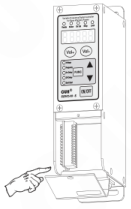

**Paso 2:**

Conecte el sensor SDVC-S1 a los terminales del controlador según el diagrama.

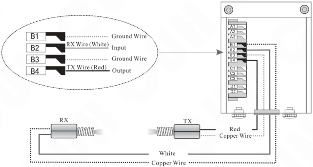

**Aviso:**

La relación lógica predeterminada del sensor está configurada como sin piezas.

---

## 5.1.2 Ajuste del tiempo de retardo de arranque y del tiempo de retardo de parada del sensor fotoeléctrico inteligente

En la mayoría de las aplicaciones reales, la salida del controlador debe retrasarse durante un período de tiempo cuando el arranque o la parada del controlador se controlan mediante señales externas. Las funciones de ajuste del tiempo de retardo de arranque y del tiempo de retardo de parada hicieron posible este tipo de aplicación. Además, las sacudidas a las piezas al arrancar el controlador pueden eliminarse ajustando el tiempo de arranque suave.

### Retardo de arranque (J)

El período de tiempo que transcurre desde que el controlador recibe una señal de control de arranque hasta que emite salida.

- Mantenga pulsado el botón **FUNC** durante 2 segundos para entrar en el estado de ajuste de los parámetros básicos.
- Pulse el botón **FUNC** repetidamente hasta cambiar al estado de ajuste del tiempo de retardo de arranque (J), cuando el indicador de retardo de arranque del panel se ilumine.
- Ajuste el parámetro pulsando el botón ▲ o ▼. La unidad del parámetro es el segundo y la precisión numérica es 0.1.

El rango ajustable del parámetro va de 0.0 a 9.9 segundos  
El valor predeterminado del parámetro es 0.2 segundos

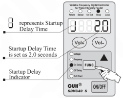

### Retardo de parada (L)

El período de tiempo que transcurre desde que el controlador recibe una señal de control de parada hasta que corta la salida

- Mantenga pulsado el botón **FUNC** durante 2 segundos para entrar en el estado de ajuste de los parámetros básicos.
- Pulse el botón **FUNC** repetidamente hasta cambiar al estado de ajuste del tiempo de retardo de parada (L), cuando el indicador de retardo de parada del panel se ilumine.
- Ajuste el parámetro pulsando el botón ▲ o ▼. La unidad del parámetro es el segundo y la precisión numérica es 0.1.

El rango ajustable del parámetro va de 0.0 a 9.9 segundos  
El valor predeterminado del parámetro es 0.2 segundos

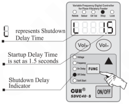

---

## 5.1.3 Ajuste de la relación lógica del sensor fotoeléctrico inteligente

En circunstancias normales, el extremo receptor no recibe señal óptica y el controlador funciona de forma predeterminada. Pero en algunas aplicaciones especiales, el controlador debe detenerse cuando el extremo receptor no recibe señal óptica. El ajuste de este parámetro puede realizar este tipo de aplicación.

- Mantenga pulsados simultáneamente los botones **FUNC** y ▲ durante 2 segundos para entrar en el estado de ajuste de los parámetros avanzados.
- Pulse el botón **FUNC** repetidamente hasta cambiar al estado de ajuste de la relación lógica del sensor fotoeléctrico inteligente.
- Ajuste el parámetro pulsando el botón ▲ o ▼.

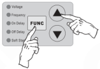

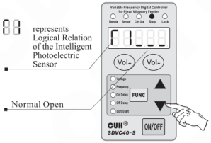

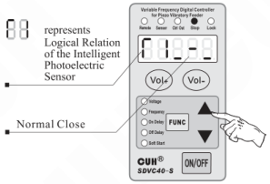

- Cuando la relación lógica se ajusta como Normal Open, es decir, no se recibe señal óptica, el controlador funciona.
- Cuando la relación lógica se ajusta como Normal Close, es decir, no se recibe señal óptica, el controlador se detiene.

---

## 5.2 Método de uso del sensor de conmutación NPN

El controlador puede funcionar con todo tipo de sensores, como sensores de conmutación, sensores ópticos de conmutación y sensores de fibra óptica.

### 5.2.1 Método de conexión del sensor de proximidad NPN

**Paso 1:**

Abra la placa de cubierta superior del controlador.

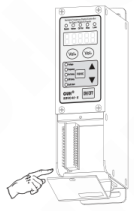

**Paso 2:**

Conecte el sensor de proximidad NPN a los terminales del controlador según el diagrama.

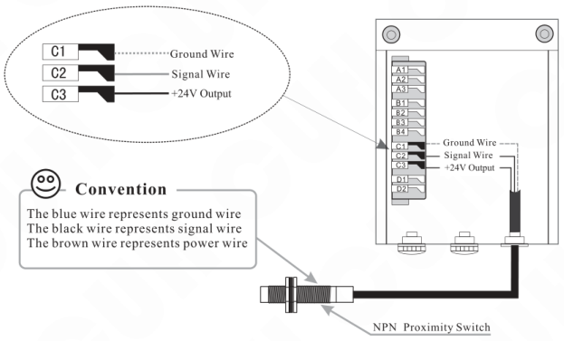

**Convención**

El cable azul representa el cable de tierra  
El cable negro representa el cable de señal  
El cable marrón representa el cable de alimentación

---

### 5.2.2 Método de conexión del sensor de conmutación de contrarradiación NPN

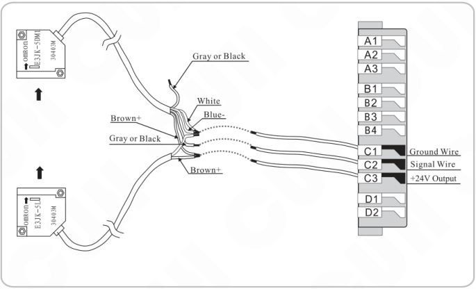

### 5.2.3 Método de conexión del sensor fotoeléctrico de contrarradiación

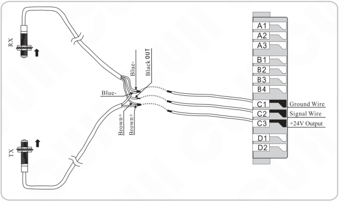

---

## 5.2.4 Método de conexión del sensor de contrarradiación de fibra óptica

---

## 5.2.5 Método de conexión del sensor fotoeléctrico de reflexión

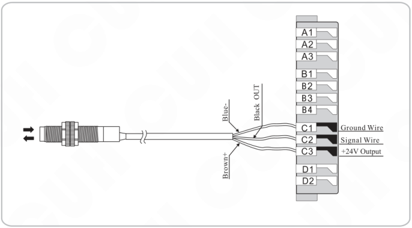

## 5.3 Ajuste del tiempo de retardo de arranque y del tiempo de retardo de parada del sensor de conmutación NPN

De forma predeterminada, el sensor fotoeléctrico inteligente y el sensor de conmutación comparten el mismo tiempo de retardo de arranque y tiempo de retardo de parada. El operador también puede ajustar de forma independiente el tiempo de retardo de arranque y el tiempo de retardo de parada para el sensor de conmutación.

### Retardo de arranque (J-)

El período de tiempo que transcurre desde que el controlador recibe una señal de control de arranque hasta que emite salida.

- Mantenga pulsados simultáneamente los botones **FUNC** y **▲** durante 2 segundos para entrar en el estado de ajuste de los parámetros avanzados.
- Pulse el botón **FUNC** repetidamente hasta cambiar al estado de ajuste del tiempo de retardo de arranque (J- ---), cuando el indicador de retardo de arranque del panel se ilumine.
- Ajuste el parámetro pulsando el botón **▲** o **▼**. La unidad del parámetro es el segundo y la precisión numérica es 0.1.

El retardo de arranque está configurado como J- --- de forma predeterminada

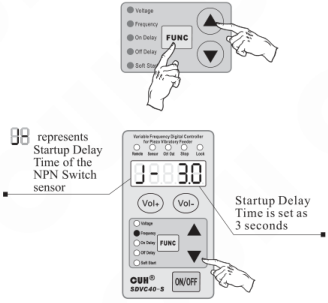

### Retardo de parada (L-)

El período de tiempo que transcurre desde que el controlador recibe una señal de control de parada hasta que corta la salida.

- Mantenga pulsados simultáneamente los botones **FUNC** y **▲** durante 2 segundos para entrar en el estado de ajuste de los parámetros avanzados.
- Pulse el botón **FUNC** repetidamente hasta cambiar al estado de ajuste del tiempo de retardo de parada (L-), cuando el indicador de retardo de parada del panel se ilumine.
- Ajuste el parámetro pulsando el botón **▲** o **▼**. La unidad del parámetro es el segundo y la precisión numérica es 0.1.

El retardo de parada está configurado como L- --- de forma predeterminada

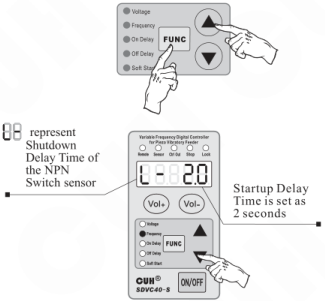

> ➔ Cuando los valores de J- y L- se ajustan a 0, el tiempo de retardo de arranque y el tiempo de retardo de parada del sensor de conmutación serán los mismos que el tiempo de retardo de arranque y el tiempo de retardo de parada del sensor fotoeléctrico inteligente.
>
> ➔ El tiempo de retardo de arranque y el tiempo de retardo de parada del sensor fotoeléctrico inteligente no se verán afectados por los parámetros J- o L-.

---

## 5.4 Ajuste de la relación lógica del sensor de conmutación NPN (parada cuando las piezas están llenas)

En circunstancias normales, el controlador no recibe señal del sensor de conmutación NPN y funciona de forma predeterminada. Pero en algunas aplicaciones especiales, el controlador debe detenerse cuando no recibe señal del sensor de conmutación NPN. El ajuste de este parámetro puede realizar este tipo de aplicación.

- Mantenga pulsados simultáneamente los botones **FUNC** y ▲ durante 2 segundos para entrar en el estado de ajuste de los parámetros avanzados.
- Pulse el botón **FUNC** repetidamente hasta cambiar al estado de ajuste de la relación lógica del sensor de conmutación NPN (Γ 2).
- Ajuste el parámetro pulsando el botón ▲ o ▼.

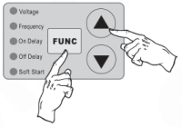

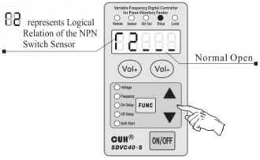

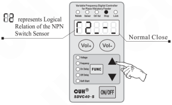

- Cuando la relación lógica se ajusta como Normal Open, es decir, no se recibe señal, el controlador funciona.
- Cuando la relación lógica se ajusta como Normal Close, es decir, no se recibe señal, el controlador se detiene.

---

## 5.5 Ajuste de la relación lógica de la señal de control

El controlador puede ajustar la relación lógica del sensor fotoeléctrico inteligente y del sensor de conmutación cuando funcionan simultáneamente.

- Mantenga pulsados simultáneamente los botones **FUNC** y ▲ durante 2 segundos para entrar en el estado de ajuste de los parámetros avanzados.
- Pulse el botón **FUNC** repetidamente hasta cambiar al estado de ajuste de la relación lógica de la señal de control.
- Ajuste el parámetro pulsando el botón ▲ o ▼.

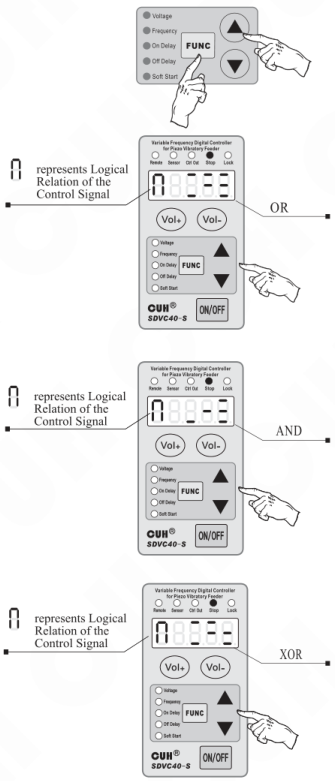

- Relación lógica AND: El controlador funciona solo cuando tanto el sensor fotoeléctrico inteligente como el sensor de conmutación NPN solicitan al controlador que funcione.
- Relación lógica OR: El controlador funciona cuando el sensor fotoeléctrico inteligente o el sensor de conmutación NPN solicitan al controlador que funcione.
- Relación lógica XOR: El controlador funciona solo cuando el sensor fotoeléctrico inteligente y el sensor de conmutación NPN emiten la señal de control opuesta.

---

## 5.6 Método de conexión del PLC superior que controla el controlador del alimentador vibratorio

### Método de conexión del PLC de control

### Paso uno:
Abra la placa de cubierta superior del controlador.

### Paso dos:
Conecte el PLC a los terminales del controlador según el diagrama.

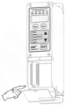

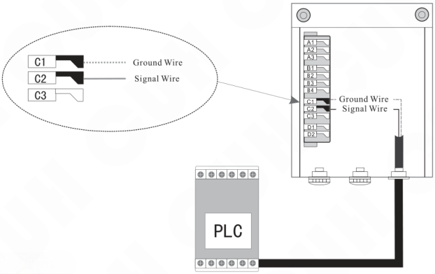

> La salida de relé o la salida NPN del PLC es compatible con el controlador.

---

## 5.7 Salida de control

El controlador puede emitir una señal de control de baja tensión para cooperar con otros dispositivos, como una electroválvula, un PLC o un relé eléctrico.

### 5.7.1 Método de conexión de la salida de control

#### Método de conexión de la electroválvula

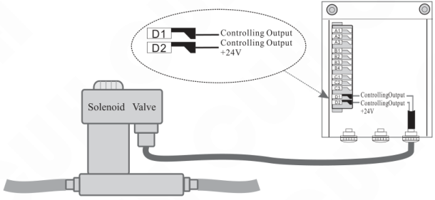

- El controlador puede accionar directamente una electroválvula cuya tensión nominal sea de 24 V y cuya potencia nominal sea inferior a 4 W.
- Utilice una fuente de alimentación externa para electroválvulas de alta potencia.

#### Método de conexión del relé eléctrico

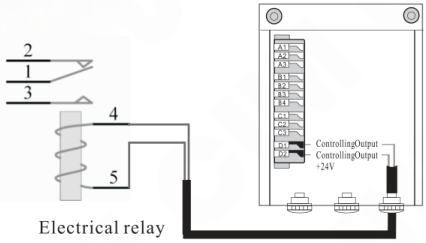

- El controlador puede accionar directamente un relé eléctrico cuya tensión nominal sea de 24 V y cuya potencia nominal sea inferior a 4 W.

---

## 5.7.2 Ajuste de la relación lógica de la salida de control

- Mantenga pulsados simultáneamente los botones **FUNC** y ▲ durante 2 segundos para entrar en el estado de ajuste de los parámetros avanzados.
- Pulse el botón **FUNC** repetidamente hasta cambiar al estado de ajuste de la relación lógica de la salida de control (Γ3).
- Ajuste el parámetro pulsando el botón ▲ o ▼.

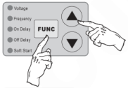

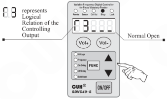

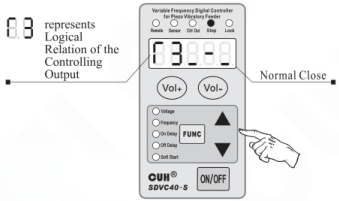

> - Cuando la relación lógica se ajusta como Normal Open, la salida de control funciona mientras el controlador está en funcionamiento.
> - Cuando la relación lógica se ajusta como Normal Close, la salida de control no funciona mientras el controlador está en funcionamiento.

---

## 5.8 Control de velocidad remoto

La función de control de velocidad remoto permite al operador controlar la tensión de salida mediante un potenciómetro externo o una señal de control de 1 V a 5 V. Así, el control de velocidad remoto externo puede lograrse fácilmente mediante un PLC, un DCS u otros medios.

La función de control de velocidad remoto se activa en el controlador cuando la señal de control supera 0.5 V. Mientras tanto, el indicador de control de velocidad remoto del panel se ilumina y los botones Vol+ y Vol- pierden su eficacia. La pantalla LED muestra la tensión de salida actual si el controlador funciona en el estado de ajuste de la tensión de salida.

### Método de conexión del potenciómetro externo

**Nota:** Seleccione un potenciómetro lineal con una resistencia de 1k.

### Método de conexión del PLC

---

## Capítulo VI Funciones de seguridad

### 6.1 Estabilización automática de tensión

La función de estabilización digital de tensión incorporada puede eliminar la variación de la velocidad de alimentación causada por la fluctuación de la tensión de red.

### 6.2 Protección contra cortocircuitos

Si la salida del controlador se cortocircuita, el controlador detendrá su salida hasta que se reinicie.

### 6.3 Protección contra sobrecarga de corriente

El controlador detendrá su salida para garantizar la seguridad de funcionamiento de los equipos cuando la corriente de funcionamiento supere su valor nominal.

### 6.4 Protección contra sobrecalentamiento

El controlador detendrá su salida para protegerse cuando la temperatura de funcionamiento sea demasiado alta.

---

# Apéndice

## Apéndice A: Dimensiones

Dimensiones exteriores del modelo de controlador: (Unidad: mm)

---

## Apéndice B: Definición de la interfaz de salida

### Aviso:

A: Asegúrese de que las bobinas electromagnéticas del vibrador estén conectadas a los dos pines de salida del zócalo del cable de salida de potencia y de que la carcasa del vibrador esté conectada a tierra de forma fiable; de lo contrario, podrían producirse accidentes de seguridad.

B: Después de soldar, asegúrese de que la zona desnuda esté envuelta con cinta aislante o tubo termorretráctil antes de insertarla en el zócalo del cable de salida de potencia, para evitar fugas eléctricas o cortocircuitos.

## Apéndice C: Definición de la interfaz de señal

---

## Apéndice D: Tabla de funciones

| Controlador | Carácter mostrado | Símbolo de la pantalla digital |
|---|---|---|
| U | Tensión de salida |  |
| E | Frecuencia de salida |  |
| J | Tiempo de retardo de arranque del sensor fotoeléctrico inteligente |  |
| L | Tiempo de retardo de parada del sensor fotoeléctrico inteligente |  |
| t | Arranque suave |  |
| L- | Tiempo de retardo de parada del sensor de conmutación NPN |  |
| J- | Tiempo de retardo de arranque del sensor de conmutación NPN |  |
| r1 | Relación lógica del sensor fotoeléctrico inteligente |  |
| r2 | Relación lógica del sensor de conmutación NPN |  |
| r3 | Relación lógica de la salida de control |  |
| rd | Estado de funcionamiento al encender |  |
| A | Relación lógica de la señal de control |  |
| h | Tensión de salida máxima |  |
| 8.8.8.8.8. | Restauración de la configuración predeterminada |  |

---

## Apéndice E: Especificación eléctrica

| Elemento | Rango mín. | Rango típ. | Rango máx. | Unidad | Descripción |
|---|---|---|---|---|---|
| Tensión de entrada | 85 | 220 | 260 | V | AC RMS |
| Rango de tensión de salida ajustable | 0 | —— | 220 | V | SDVC40-S |
| Rango de tensión de salida ajustable | 0.0 | —— | 50.0 | V | SDVC40-SD |
| Precisión de ajuste de tensión | | 1 | | V | SDVC40-S |
| Precisión de ajuste de tensión | | 0.1 | | V | SDVC40-SD |
| Precisión de regulación de tensión | 0 | —— | 10 | % | ΔVout/ΔVin |
| Tiempo de respuesta de la regulación de tensión | 0.0025 | —— | 0.025 | s | el período de la tensión de salida |
| Rango de corriente de salida ajustable | 0 | —— | 150 | mA | SDVC40-S |
| Rango de corriente de salida ajustable | 0 | —— | 600 | mA | SDVC40-SD |
| Potencia de salida | 0 | —— | 33 | VA | SDVC40-S |
| Potencia de salida | 0 | —— | 30 | VA | SDVC40-SD |
| Frecuencia de salida | 40 | —— | 400 | Hz | |
| Precisión de ajuste de frecuencia | | 0.1 | | Hz | |
| Forma de onda de salida | | Onda sinusoidal | | | |
| Tiempo de arranque suave | 0 | —— | 10 | s | Valor de fábrica predeterminado:0.5 |
| Rango del tiempo de retardo de encendido/apagado | 0 | —— | 20 | s | Valor de fábrica predeterminado:0.2 |
| Precisión del tiempo de retardo de encendido/apagado | | 0.1 | | s | |
| Temperatura de activación de la protección contra sobrecalentamiento | 60 | —— | 65 | °C | |
| Tensión de salida de control CC | 22 | 24 | 26 | V | |
| Corriente de salida de control CC | 0 | —— | 200 | mA | |
| Señal de control analógica | | 1-5 | | V | Tensión de control de velocidad remoto |
| Señal de control digital | | 24 | | V | Señal de conmutación |
| Método de ajuste | | 6 | | Botón | |
| Consumo de energía en espera | —— | 4 | —— | W | |
| Método de visualización | | 5 | | Dígito | Tubos digitales LED |
| Temperatura ambiente | 0 | 25 | 40 | °C | Sin condensación |
| Humedad ambiente | 10 | 60 | 85 | % | Sin condensación |

---

## Apéndice F: Consejos de solución de problemas y explicación de errores

Los siguientes consejos pueden ayudar a resolver los problemas que pueda encontrar.

| | | | Símbolo de la pantalla digital |
|---|---|---|---|
| 1 | Sin visualización tras encender | ◆ Asegúrese de que la toma de corriente tenga corriente ◆ Asegúrese de que el cable de entrada de potencia esté conectado de forma fiable a la toma de corriente | |
| 2 | Visualización normal pero sin salida | ◆ Asegúrese de que el cable de entrada de potencia y el cable de salida de potencia estén firmemente conectados ◆ Asegúrese de que el valor del parámetro de tensión de salida no sea demasiado pequeño ◆ Asegúrese de que el controlador no esté detenido por la señal de control ◆ Asegúrese de que el controlador no esté detenido por los parámetros configurados como Normal Close | |
| 3 | La señal de control pierde su eficacia | ◆ Asegúrese de que la señal de control se introduzca correctamente ◆ Asegúrese de que el cable de tierra de la señal de control esté correctamente conectado al controlador ◆ Asegúrese de que la relación lógica de la señal de control esté configurada correctamente según sus expectativas | |
| 4 | Fenómeno de batido | ◆ Evite el acoplamiento de vibraciones entre los vibradores ◆ Aumente la frecuencia de resonancia de los vibradores | |
| 5 | Visualización normal, sin salida, pero se oye un sonido | ◆ Ajuste todos los parámetros según lo indicado en este manual | |
| 6 | Err01 | ◆ Salida en cortocircuito; asegúrese de que el cable de salida de potencia y la bobina no estén en cortocircuito |  |
| 7 | Err02 | ◆ Sobrecorriente de salida; reduzca el valor de la tensión de salida y asegúrese de que el entrehierro de la armadura no sea demasiado grande |  |
| 8 | Err03 | ◆ Sobrecalentamiento; coloque el controlador en un entorno bien ventilado |  |
| 9 | Err04 | ◆ Reservado, póngase en contacto con nosotros |  |
| 10 | Err05 | ◆ Reservado, póngase en contacto con nosotros |  |

---

Nanjing CUH Science & Technology Co.,Ltd  
https://en.cuhnj.com  
Tel.:+86-25-84730411 / 84730415 / 84730416  
Fax:+86-25-84730426  
E-mail:sales@cuhnj.com  
Add.:Building 2, Xueyan Tech Park, Tuscity,  
No.9 Zhineng Rd, Jiangning, Nanjing, China

