## Controlador inteligente de frecuencia variable para alimentador vibratorio piezoeléctrico

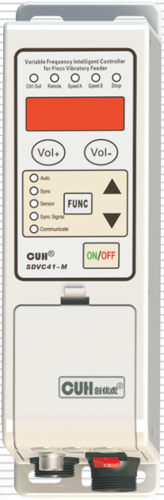

## Serie SDVC41
Controlador inteligente de frecuencia variable para alimentador vibratorio piezoeléctrico　 Serie SDVC41
## Manual de instrucciones

---

## Prefacio

Gracias por elegir el controlador inteligente digital de alimentador vibratorio CUH.

(En lo sucesivo, “el controlador”).

Este manual incluye notas para la instalación, la depuración, el ajuste de parámetros, el mantenimiento y la solución de problemas del controlador. Lea atentamente este manual antes de operar el controlador y consérvelo adecuadamente.

---

---

## Aviso:

1. Nunca enchufe ni desenchufe los cables ni toque las tomas de corriente mientras el controlador esté encendido, para evitar descargas eléctricas u otros accidentes.
2. Nunca conecte el controlador a 380V AC, ya que puede causar daños irreparables. (disponemos de productos diseñados para 380V AC)
3. Nunca conmute la entrada del controlador cortando la alimentación para encender/apagar la salida; de lo contrario, puede reducir la vida útil del controlador.
4. Nunca utilice el controlador en condiciones que excedan sus límites de diseño.
5. Utilice el controlador siguiendo estrictamente este manual. No asumiremos ninguna responsabilidad civil ni penal si el daño al equipo o las lesiones personales son causados por una operación incorrecta.

> Nunca abra la carcasa del controlador para evitar descargas eléctricas. Contacte con CUH si el controlador se avería. Nunca intente reparar el controlador usted mismo, ya que podría anular la garantía.

---

## Entorno de funcionamiento y almacenamiento

### Inspección antes del uso

Todos los controladores se someten a una rigurosa inspección de calidad antes de su entrega y se embalan con protección anticaídas. Compruebe los siguientes puntos después de desembalar:

1. Si el controlador presenta daños en el aspecto exterior.
2. Si el modelo del controlador es el que ha solicitado.

### Entorno de funcionamiento

Siga las notas siguientes para garantizar un mejor rendimiento y una mayor vida útil del controlador:

- ⚠ Entorno bien ventilado
- ⚠ Manténgalo alejado del agua, el vapor, el polvo y, especialmente, el polvo aceitoso
- ⚠ Manténgalo alejado de gases y líquidos corrosivos o inflamables
- ⚠ Manténgalo alejado del polvo en suspensión y las partículas metálicas
- ⚠ Fíjelo firmemente para evitar vibraciones propias
- ⚠ Manténgalo alejado de interferencias electromagnéticas
- ⚠ Asegúrese de que la temperatura ambiente sea de 0~40 ℃
- ⚠ Para uso a una altitud de 2000 m o inferior

---

# Contenido

- Capítulo I　Características — 1
- Capítulo II　Guía de instalación — 2
- Capítulo III　Descripción de los componentes — 4
  - 3.1　Descripción de los indicadores — 4
  - 3.2　Descripción de los botones — 5
  - 3.3　Descripción de las interfaces de E/S y accesorios — 5
  - 3.4　Descripción de los puertos de control de señal — 6
- Capítulo IV　Ajuste de parámetros — 7
  - 4.1　Parámetros comunes — 7
  - 4.2　Parámetros básicos — 7
  - 4.3　Parámetros avanzados — 8
  - 4.4　Parámetros de Auto/Sincronización — 9
- Capítulo V　Modo de funcionamiento — 10
  - 5.1　Modo manual — 10
  - 5.2　Modo automático — 12
  - 5.3　Modo semiautomático — 18
  - 5.4　Modo de sincronización — 20
- Capítulo VI　Control de señal — 27
  - 6.1　Control ON/OFF de los puertos C — 27
  - 6.2　Control ON/OFF de los puertos E — 34
  - 6.3　Parámetros comunes de los puertos C y E — 37
  - 6.4　Control de velocidad remoto — 39
  - 6.5　Almacenamiento y salida de velocidades preajustadas — 41
  - 6.6　Comunicación RS485 — 42
  - 6.7　Salida de control de 24V DC — 43
- Capítulo VII　Funciones de seguridad — 45

---

---

Apéndice A: Dimensiones ------------------------------------------------------46

Apéndice B: Definición de los puertos de control de señal -----------------------------47

Apéndice C: Especificaciones eléctricas ---------------------------------------50

Apéndice D: Sugerencias de solución de problemas y explicación de errores -51

Restablecimiento del controlador -----------------------------------------------------------------52

---

# CapítuloⅠ Características

El controlador está especialmente diseñado para controlar alimentadores vibratorios piezoeléctricos en sistemas de automatización. Combinado con las últimas tecnologías electrónicas y un diseño esmerado, el controlador ofrece las siguientes características prácticas y convenientes:

**Carga:** El controlador se adapta a cargas resistivas, inductivas y, especialmente, capacitivas, como un vibrador piezoeléctrico.

**FM automática:** Modulación automática de la frecuencia de salida en tiempo real para garantizar que el alimentador vibratorio trabaje siempre a su mejor frecuencia de vibración.

**Control automático de velocidad constante:** Ajuste automático de la tensión de salida en tiempo real para garantizar una velocidad de alimentación preajustada constante, independientemente de los cambios de peso de los materiales en el alimentador vibratorio.

**Medición automática de frecuencia:** Mide y emite automáticamente la mejor frecuencia de vibración del alimentador vibratorio.

**Regulación automática de tensión:** Elimina tanto la variación de la velocidad de alimentación causada por la fluctuación de la tensión de red como el efecto de batido causado por la frecuencia industrial de CA.

**Sincronización de formas de onda:** Sincroniza la forma de onda de salida de los controladores esclavos con la del controlador maestro a la misma frecuencia y fase para evitar el efecto de batido.

**Control ON/OFF remoto:** El controlador dispone de 2 grupos de puertos de control ON/OFF. Se pueden conectar sensores de conmutación o PLC para encender/apagar el controlador. También se pueden configurar el tiempo de arranque suave, el retardo de conexión, el retardo de desconexión y la relación lógica del control ON/OFF.

**Reconocimiento automático del tipo de sensor de conmutación:** El controlador puede reconocer y adaptarse tanto a sensores de conmutación tipo NPN como PNP.

**Arranque suave:** Para evitar impactos repentinos en el material de alimentación y el alimentador vibratorio, el controlador puede aumentar suavemente la tensión de salida/velocidad de alimentación de 0 al valor preajustado durante el arranque.

**Velocidades preajustadas:** Se pueden almacenar y emitir 4 velocidades de alimentación preajustadas mediante una señal externa de cortocircuito.

**Tensión de salida máxima ajustable:** La tensión de salida máxima ajustable se puede preajustar para proteger el alimentador vibratorio de daños causados por alta tensión.

**Control de velocidad remoto:** La tensión de salida/velocidad de alimentación del controlador se puede ajustar de forma remota mediante un potenciómetro externo, un PLC o una señal DC de 1~5V/4~20mA.

**Salida de control de 24V DC:** El controlador puede emitir alimentación de 24V DC asociada a la configuración de la relación lógica del control ON/OFF para accionar una válvula solenoide, un relé eléctrico u otros dispositivos externos.

**Bloqueo del panel de control:** Bloquee todos los botones del panel de control pulsando el botón ON/OFF y manteniéndolo pulsado 2 segundos para evitar errores de operación.

**Bloqueo de parámetros:** Bloquee todos los parámetros excepto la tensión de salida/velocidad de alimentación mediante una contraseña definida por el usuario para evitar operaciones no autorizadas.

**Restablecimiento del controlador: restablece** todos los parámetros del controlador a los valores de fábrica.

**Comunicación RS485:** Todos los parámetros se pueden ajustar a través de los puertos de comunicación RS485.

---

## CapítuloⅡ Guía de instalación

### Primer paso:

Abra la caja de embalaje y compruebe el controlador y todos los accesorios.

### Segundo paso:

Conecte los terminales de cableado del cable de salida a los electrodos del vibrador piezoeléctrico.

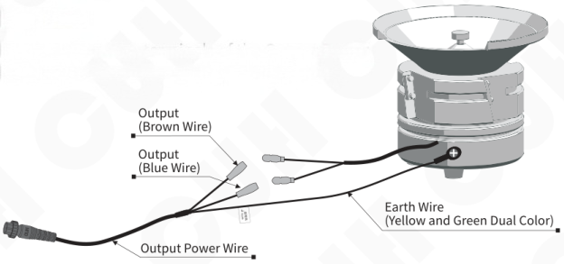

> Nota: Asegúrese de que los electrodos del vibrador piezoeléctrico estén conectados al cable de fase y al neutro del cable de salida, y de que la carcasa del alimentador esté conectada a tierra de forma fiable; de lo contrario, puede producirse un accidente grave.

### Tercer paso:

Conecte el conector del cable de salida a la toma de salida del controlador.

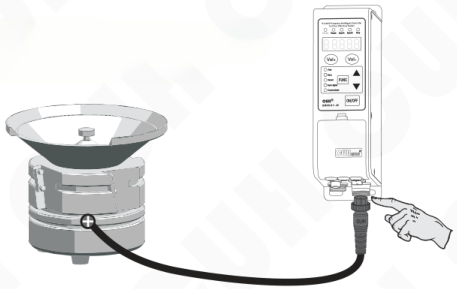

---

## Cuarto paso:

Conecte el conector del cable de alimentación de entrada a la toma de alimentación de entrada del controlador.

Conecte primero el lado del controlador

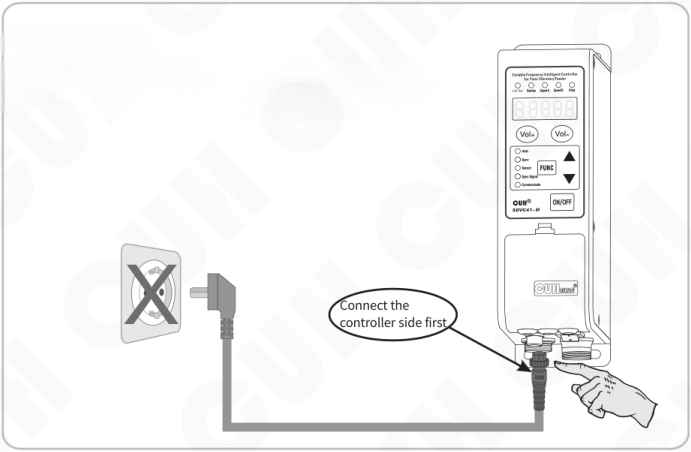

## Quinto paso:

Conecte el enchufe del cable de alimentación de entrada a la toma de la red eléctrica.

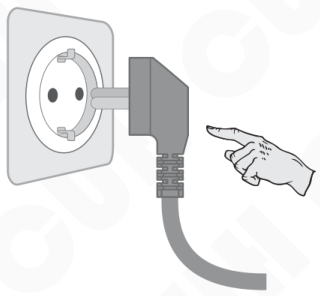

## Capítulo Ⅲ Descripción de los componentes

### 3.1 Descripción de los indicadores

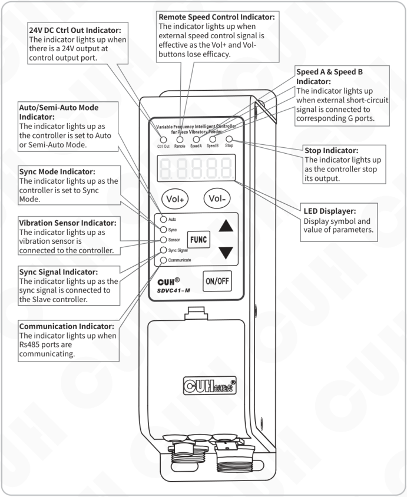

**Indicador de salida de control de 24V DC:**  
El indicador se enciende cuando hay una salida de 24V en el puerto de salida de control.

**Indicador de control de velocidad remoto:**  
El indicador se enciende cuando la señal de control de velocidad externa es efectiva y los botones Vol+ y Vol- dejan de funcionar.

**Indicador de velocidad A y velocidad B:**  
El indicador se enciende cuando se conecta una señal externa de cortocircuito a los puertos G correspondientes.

**Indicador de modo automático/semiautomático:**  
El indicador se enciende cuando el controlador está ajustado en modo automático o semiautomático.

**Indicador de parada:**  
El indicador se enciende cuando el controlador detiene su salida.

**Indicador de modo de sincronización:**  
El indicador se enciende cuando el controlador está ajustado en modo de sincronización.

**Pantalla LED:**  
Muestra el símbolo y el valor de los parámetros.

**Indicador del sensor de vibración:**  
El indicador se enciende cuando el sensor de vibración está conectado al controlador.

**Indicador de señal de sincronización:**  
El indicador se enciende cuando la señal de sincronización está conectada al controlador esclavo.

**Indicador de comunicación:**  
El indicador se enciende cuando los puertos RS485 están comunicándose.

---

## 3.2 Descripción de los botones

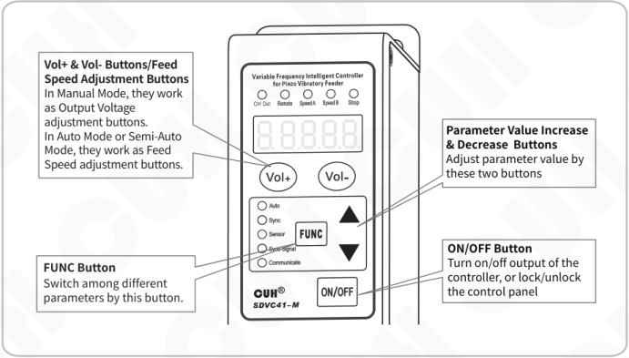

**Botones Vol+ y Vol-/Botones de ajuste de la velocidad de alimentación**  
En modo manual, funcionan como botones de ajuste de la tensión de salida.  
En modo automático o semiautomático, funcionan como botones de ajuste de la velocidad de alimentación.

**Botones de aumento y disminución del valor de los parámetros**  
Ajuste el valor de los parámetros con estos dos botones

**Botón FUNC**  
Cambie entre diferentes parámetros con este botón.

**Botón ON/OFF**  
Enciende/apaga la salida del controlador, o bloquea/desbloquea el panel de control

## 3.3 Descripción de las interfaces de E/S y accesorios

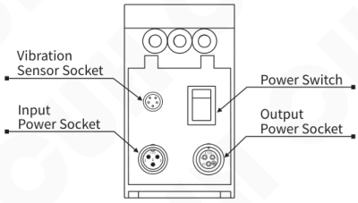

- Toma del sensor de vibración
- Toma de alimentación de entrada
- Interruptor de alimentación
- Toma de salida

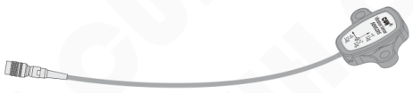

Sensor de vibración

---

## 3.4 Descripción de los puertos de control de señal

### Descripción del cableado de los puertos de control de señal

Para la descripción del cableado de los puertos C -C1, C2 y C3-, consulte el capítulo 6.1.

Para la descripción del cableado de los puertos E -E1, E2 y E3-, consulte el capítulo 6.2.

Para la descripción del cableado de los puertos A -A1, A2, A3 y A4-, consulte el capítulo 6.4.

Para la descripción del cableado de los puertos H -H1, H2, H3 y H4-, consulte el capítulo 5.4.1.

Para la descripción del cableado de los puertos G -G1, G2, G3 y G4-, consulte el capítulo 6.5.

Para la descripción del cableado de los puertos F -F1, F2 y F3-, consulte el capítulo 6.6.

Para la descripción del cableado de los puertos D -D1 y D2-, consulte el capítulo 6.7.

---

# Capítulo Ⅳ Ajuste de parámetros

Los parámetros del controlador se clasifican en 4 tipos según los diferentes métodos de ajuste: parámetros comunes, parámetros básicos, parámetros avanzados y parámetros de Auto/Sincronización.

## 4.1 Parámetros comunes

- Pulse el botón "Vol+" o "Vol-" para ajustar los parámetros comunes.
- Los botones "Vol+" y "Vol-" están diseñados para ajustar únicamente los parámetros comunes.
- Los parámetros comunes se pueden ajustar pulsando el botón "Vol+" o "Vol-" incluso cuando se muestra cualquier otro parámetro en la pantalla LED. El controlador volverá al parámetro anterior después del ajuste del parámetro común.

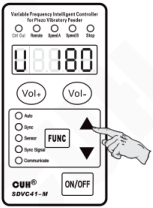

| Parámetros comunes | Símbolo | Imagen del símbolo | Rango | Valor predeterminado |
|---|---|---|---|---|
| Tensión de salida | U | 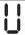 | 20~220 V | 150 |
| Velocidad de alimentación | A |  | 0~3200 | 200 |
| Bloqueo del teclado | a |  | \ | Valor de tensión actual/Velocidad de alimentación actual |

## 4.2 Parámetros básicos

- Pulse el botón "FUNC" y manténgalo pulsado 2 segundos para entrar en el estado de ajuste de parámetros básicos.
- Pulse el botón "FUNC" repetidamente para cambiar cíclicamente entre los diferentes parámetros.
- Pulse el botón ▲ o ▼ para ajustar el valor del parámetro.
- Pulse el botón "FUNC" de nuevo y manténgalo pulsado 2 segundos para salir del estado de ajuste de parámetros básicos.

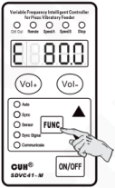

| Parámetros comunes | Símbolo | Imagen del símbolo | Rango | Valor predeterminado |
|---|---|---|---|---|
| Frecuencia de salida | E | 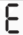 | 40.0~400.0 Hz | 50.0 |
| Retardo de conexión de los puertos C | J | 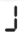 | 0.0~20.0 s | 0.2 |
| Retardo de desconexión de los puertos C | L |  | 0.0~20.0 s | 0.2 |
| Tiempo de arranque suave | t | 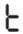 | 0.0~10.0 s | 0.5 |

---

## 4.3 Parámetros avanzados

- Pulse los botones "FUNC" y ▲ simultáneamente y manténgalos pulsados 2 segundos para entrar en el estado de ajuste de parámetros avanzados.
- Pulse el botón "FUNC" repetidamente para cambiar cíclicamente entre los diferentes parámetros.
- Pulse el botón ▲ o ▼ para ajustar el valor del parámetro.
- Pulse los botones "FUNC" y ▲ simultáneamente de nuevo y manténgalos pulsados 2 segundos para salir del estado de ajuste de parámetros avanzados.

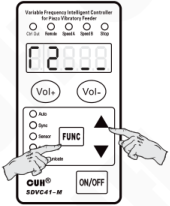

| Parámetros comunes | Símbolo | Imagen del símbolo | Rango | Valor predeterminado |
|---|---|---|---|---|
| Retardo de conexión de los puertos E | J- |  | 0.0~20.0 s | --- |
| Retardo de desconexión de los puertos E | L- |  | 0.0~20.0 s | --- |
| Relación lógica de los puertos C | Γ2 | 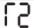 | `___` Lógica positiva　`_-_` Lógica negativa | --- |
| Relación lógica de los puertos E | Γ7 |  | `___` Lógica positiva　`_-_` Lógica negativa | --- |
| Relación lógica de la salida de control de 24V | Γ3 |  | `___` Lógica positiva　`_-_` Lógica negativa Afectado por la señal de alarma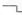 | --- |
| Si la salida del controlador está o no controlada por la señal de control ON/OFF | Γ4 | 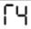 | `___` Relevante,　`_-_` No relevante | --- |
| Conmutación del grupo de parámetros lógicos predeterminado/alternativo | Γ8 | 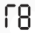 | `___` Grupo de parámetros lógicos predeterminado `_-_` Grupo de parámetros lógicos alternativo `_=_` Clave de configuración del parámetro lógico alternativo | --- |
| Tipo de sensor de conmutación | ΓA |  | Uto: Automático nPn: Sensor tipo NPN PnP: Sensor tipo PNP | Uto |
| Relación lógica de los puertos C y E | Π | 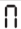 | OR, AND, XOR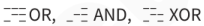 | AND |
| Tensión de salida máxima ajustable | h | 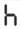 | 20~220 V | 220 |
| Visualización de temperatura | C | 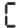 | -10.0~80.0 ℃ | Temperatura actual |
| Protocolo Modbus RS485 | Ver figura | 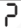 | ASC, rtu | rtu |
| Dirección de comunicación | Ver figura | 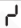 | 1~31 | 1 |
| Velocidad en baudios de comunicación | Ver figura |  | 0.3, 1.2, 2.4, 9.6, 19.2, 57.6, 115.2 kbps | 9.6 |
| Contraseña de bloqueo de parámetros | Ver figura | 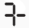 | 0~999 | --- |
| Estado de salida del controlador tras el encendido | Γd | 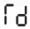 | `___` On,　`_-_` Off,　Keep | --- |
| Versión de firmware | Ur |  | \ | Versión actual |
| Restablecimiento del controlador | 8.8.8.8.8. | 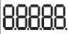 | Listo para restablecer Restablecimiento completado 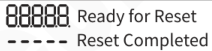 | \ |

---

## 4.4 Parámetros de Auto/Sincronización

- Pulse los botones "FUNC" y ▼ simultáneamente y manténgalos pulsados 2 segundos para entrar en el estado de ajuste de parámetros de Auto/Sincronización.
- Pulse el botón "FUNC" repetidamente para cambiar cíclicamente entre los diferentes parámetros.
- Pulse el botón ▲ o ▼ para ajustar el valor del parámetro.
- Pulse los botones "FUNC" y ▼ simultáneamente de nuevo y manténgalos pulsados 2 segundos para salir del estado de ajuste de parámetros de Auto/Sincronización.

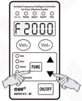

| Parámetros comunes | Símbolo | Imagen del símbolo | Rango | Valor predeterminado |
|---|---|---|---|---|
| Frecuencia central | F |  | 40.0~400.0 Hz | 100.0 |
| Desviación máxima en FM automática | n | 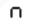 | 0.0~180.0 Hz | 30.0 |
| Método de ajuste de la tensión de salida | r5 |  | ___Auto　_-_Manual | ___ |
| Método de ajuste de la frecuencia de salida | r6 | 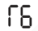 | ___Auto　_-_Manual　☰ Sync | ___ |
| Índice de ajuste automático de la frecuencia de salida | IF |  | 0~200 | 20 |
| Índice de ajuste automático de amplitud | PA |  | 0~999 | 60 |
| Índice de ajuste automático de amplitud | IA |  | 0~999 | 20 |
| Visualización de la velocidad de alimentación | U | 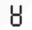 | 0~H | 0 |
| Visualización de la tensión de salida | G | 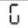 | 20~h V | 150 |
| Límite inferior de tensión | GL |  | 0~220 V | 0 |
| Límite inferior de frecuencia | e | 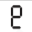 | 40.0~400.0 Hz | 40.0 |
| Índice de amplitud máxima | P | 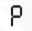 | 0~500 | 500 |
| Velocidad de alimentación máxima ajustable | H | 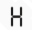 | 0~3200 | 1500 |
| Diferencia de fase | γ | 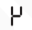 | -180~180 ° | 0 |
| Tensión de salida máxima en el proceso de medición automática de frecuencia | b | 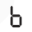 | 20~220 V | 100 |
| Velocidad de búsqueda de frecuencia | SP | 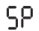 | 1~5 | 5 |
| Volumen de ajuste mínimo de la velocidad de alimentación | c | 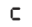 | 1~10 | 1 |
| Número de sensor de vibración | t | 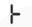 | 0, 1, 2, 3, 4, 203, 204, 205, 206 | 205 |

# CapítuloⅤ Modo de funcionamiento

El controlador se puede configurar para funcionar en uno de los cuatro modos de funcionamiento siguientes según los requisitos de aplicación específicos.

- **Modo manual:** Tanto la tensión de salida como la frecuencia de salida se ajustan manualmente.
- **Modo automático:** Tanto la tensión de salida como la frecuencia de salida se ajustan automáticamente según la retroalimentación del sensor de vibración para garantizar una velocidad de alimentación preajustada constante y la mejor frecuencia de vibración del alimentador vibratorio.
- **Modo semiautomático:** La tensión de salida se ajusta automáticamente según la retroalimentación del sensor de vibración para garantizar una velocidad de alimentación preajustada constante. La frecuencia de salida se ajusta manualmente.
- **Modo de sincronización:** En la configuración de sincronización, si la frecuencia de salida del controlador B es siempre constante con la del controlador A. Definimos el controlador A como controlador maestro, el controlador B como controlador esclavo y el modo de funcionamiento del controlador B como modo de sincronización.

| Modo de funcionamiento | Tensión de salida U — Método de ajuste | Tensión de salida U — Ajuste de Γ5 | Frecuencia de salida E — Método de ajuste | Frecuencia de salida E — Ajuste de Γ6 | Imagen del símbolo |
|---|---|---|---|---|---|
| Modo manual | Manual | ₋⁻₋ | Manual | ₋⁻₋ | Γ5 / Γ6: 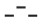 |
| Modo automático | Auto | _ _ _ | Auto | _ _ _ | Γ5 / Γ6: 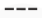 |
| Modo semiautomático | Auto | _ _ _ | Manual | ₋⁻₋ | Γ5: [[vcrop:16:1]]; Γ6: [[vcrop:16:0]] |
| Modo de sincronización | Manual o Auto | ₋⁻₋ or _ _ _ | Sincronización automática con el controlador maestro |  | Γ5: [[vcrop:16:0]] or [[vcrop:16:1]]; Γ6: 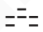 |

## 5.1 Modo manual

En modo manual, tanto la tensión de salida como la frecuencia de salida se ajustan manualmente.

| Modo de funcionamiento | Tensión de salida U — Método de ajuste | Tensión de salida U — Ajuste de Γ5 | Frecuencia de salida E — Método de ajuste | Frecuencia de salida E — Ajuste de Γ6 | Imagen del símbolo |
|---|---|---|---|---|---|
| Modo manual | Manual | ₋⁻₋ | Manual | ₋⁻₋ | Γ5 / Γ6: [[vcrop:16:0]] |

Para simplificar la operación, los parámetros Γ5 y Γ6 están configurados en _ _ _ de fábrica. Con esta configuración, el controlador funcionará en modo manual si el sensor de vibración no está conectado al controlador, o en modo automático si el sensor de vibración está conectado.

---

**Nota:**

Si tanto Γ5 como Γ6 están configurados en _ - _, el controlador funcionará en modo manual independientemente de si el sensor de vibración está conectado o no.

Si el sensor de vibración no está conectado al controlador, el controlador funcionará siempre en modo manual.

### 5.1.1 Ajuste del parámetro de tensión de salida U en modo manual

El valor real de la tensión de salida del controlador se puede mostrar en la pantalla LED de forma digital y precisa.

- Encienda el interruptor de alimentación cuando el sensor de vibración no esté conectado al controlador.
- La pantalla LED muestra el parámetro de tensión de salida U y su valor.
- Ajuste el valor de U pulsando el botón "Vol+" o "Vol-".

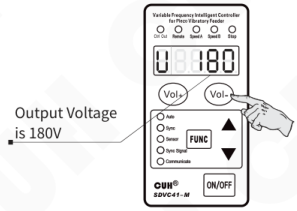

### 5.1.2 Ajuste del parámetro de frecuencia de salida E en modo manual

Gracias a la tecnología DDS, la frecuencia de salida del controlador es siempre estable y de alta precisión, independientemente de los cambios de tiempo o temperatura.

- Pulse el botón "FUNC" y manténgalo pulsado 2 segundos para entrar en el estado de ajuste de parámetros básicos.
- La pantalla LED muestra el parámetro de frecuencia de salida E y su valor.
- Ajuste el valor de E pulsando el botón ▲ o ▼ cuando el sensor de vibración no esté conectado al controlador.

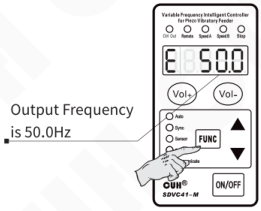

## 5.2 Modo automático

En modo automático, el sensor de vibración debe estar conectado al controlador. La tensión de salida y la frecuencia de salida se ajustarán automáticamente según la retroalimentación del sensor de vibración para garantizar una velocidad de alimentación preajustada constante y la mejor frecuencia de vibración. La tensión de salida y la frecuencia de salida no se pueden ajustar manualmente.

De fábrica, cuando el sensor de vibración está conectado, el controlador funciona en modo automático.

| Modo de funcionamiento | Tensión de salida U — Método de ajuste | Tensión de salida U — Ajuste de Γ5 | Frecuencia de salida E — Método de ajuste | Frecuencia de salida E — Ajuste de Γ6 |
|---|---|---|---|---|
| Modo automático | Auto | --- | Auto | --- |

**Nota:**

El controlador seguirá funcionando en modo manual si el sensor de vibración no está conectado.

### 5.2.1 Instalación del sensor de vibración

#### 5.2.1.1 Método de conexión del sensor de vibración

Conecte el conector del sensor de vibración a la toma del sensor de vibración del controlador.

Instale firmemente el cabezal del sensor de vibración sobre una superficie segura y uniforme del alimentador vibratorio.

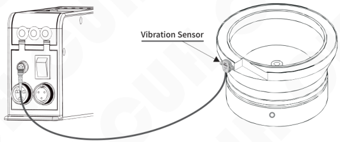

**Nota: Enchufe y desenchufe el sensor de vibración con el controlador apagado.**

---

## 5.2.1.2 Instalación del sensor de vibración en el vibrador

Fije el sensor de vibración a la superficie lisa del vibrador; la dirección de instalación es arbitraria. Los métodos de instalación del sensor de vibración se muestran a continuación:

- Método 1: Como se muestra en la Fig. 1

  Ventaja: Instalación sencilla

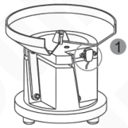

Fig. 1

- Método 2: Como se muestra en la Fig. 2

  Nota: No permita que el sensor de vibración quede presionado por el cuenco de alimentación.

Fig. 2

- Método 3: suelde un soporte al vibrador y fije el sensor de vibración sobre el soporte. Como se muestra en la Fig. 3

  Las dimensiones recomendadas del soporte del sensor de vibración se muestran en la Fig. 4.

Fig. 3

Fig. 4

- Método de instalación no recomendado, como se muestra en la Fig. 5 y la Fig. 6.

  Si la ubicación de instalación no es adecuada, el sensor de vibración no podrá retroalimentar con precisión la frecuencia de resonancia y el controlador se mantendrá buscando la frecuencia de resonancia continuamente.

Fig. 5

Fig. 6

---

## 5.2.2 Ajuste del parámetro de velocidad de alimentación A en modo automático

- Encienda el interruptor de alimentación cuando el sensor de vibración esté conectado al controlador. El indicador del sensor de vibración se enciende.
- La pantalla LED muestra el parámetro de velocidad de alimentación A y su valor.
- Ajuste el valor de A pulsando el botón "Vol+" o "Vol-" hasta la velocidad de alimentación deseada.

## 5.2.3 Medición automática de frecuencia en modo automático

Mediante la medición automática de frecuencia, el controlador detecta la mejor frecuencia de vibración del alimentador vibratorio y configura automáticamente todos los parámetros relacionados. Lo único que debe hacer el usuario es configurar el parámetro de velocidad de alimentación A; el controlador funcionará entonces en su mejor estado.

- Pulse los botones ▲ y ▼ simultáneamente y manténgalos pulsados 3 segundos con el sensor de vibración conectado al controlador para iniciar la medición automática de frecuencia. Durante el proceso de medición, la pantalla LED mostrará el parámetro de frecuencia de salida E y su valor.
- Después del proceso de medición automática de frecuencia, el controlador configurará automáticamente todos los parámetros relacionados, incluidos el parámetro de frecuencia central F, el parámetro de desviación máxima en FM automática n, el índice de ajuste automático de la frecuencia de salida IF, el índice de ajuste automático de amplitud PA, el índice de ajuste automático de amplitud IA, el parámetro de diferencia de fase μ, el parámetro del método de ajuste de la tensión de salida Γ5 y el parámetro del método de ajuste de la frecuencia de salida Γ6 se configurarán en \_\_\_.

> - Si la pantalla LED muestra Err02 en el momento de iniciarse el proceso de medición automática de frecuencia, es normal, porque el parámetro b está configurado demasiado alto.
> - Si desea cancelar el proceso de medición automática de frecuencia, pulse el botón ON/OFF. El controlador volverá entonces al estado anterior a la medición automática de frecuencia.

**Después de configurar la velocidad de alimentación y realizar la medición automática de frecuencia, el controlador funcionará en su mejor estado a la velocidad de alimentación deseada.**

---

## 5.2.4 Explicación de los parámetros de Auto/Sincronización

(En cuanto al método de ajuste, el rango de valores y la unidad de los parámetros de Auto/Sincronización, consulte la sección 4.4.)

### 5.2.4.1 Parámetro del método de ajuste de la tensión de salida Γ5

Cuando el parámetro Γ5 está configurado en `_-_`, el parámetro de tensión de salida U será visible mientras que el parámetro A permanecerá oculto. El parámetro de tensión de salida U se puede ajustar manualmente.

Cuando el parámetro Γ5 está configurado en `___` y el sensor de vibración está conectado al controlador, el parámetro de velocidad de alimentación A será visible mientras que el parámetro U permanecerá oculto. La tensión de salida se ajustará automáticamente según la retroalimentación del sensor de vibración para garantizar una velocidad de alimentación preajustada constante.

**Nota:**

Cuando el sensor de vibración no está conectado al controlador, aunque el parámetro Γ5 esté configurado en `___`, el parámetro U seguirá siendo visible y ajustable manualmente.

### 5.2.4.2 Parámetro del método de ajuste de la frecuencia de salida Γ6

Cuando el parámetro Γ6 está configurado en `_-_`, el parámetro de frecuencia de salida E se puede ajustar manualmente.

Cuando el parámetro Γ6 está configurado en `___` y el sensor de vibración está conectado al controlador, el parámetro de frecuencia de salida E se ajustará automáticamente a la frecuencia de resonancia (mejor frecuencia de vibración) del alimentador vibratorio según la retroalimentación del sensor de vibración. La frecuencia de salida no se puede ajustar manualmente.

Cuando el parámetro Γ6 está configurado en  y el cable de señal de sincronización está conectado entre los controladores maestro y esclavo. La frecuencia de salida del controlador esclavo será siempre coherente con la del controlador maestro. La frecuencia de salida del controlador esclavo no se puede ajustar manualmente.

**Nota:**

Cuando el sensor de vibración no está conectado al controlador, aunque el parámetro Γ6 esté configurado en `___`, la frecuencia de salida seguirá ajustándose manualmente.

Si el parámetro n se configura demasiado grande, el alimentador vibratorio puede funcionar a una frecuencia de vibración inadecuada.

Si el parámetro n se configura demasiado pequeño, la flexibilidad del alimentador vibratorio puede verse afectada.

### 5.2.4.3 Parámetro de frecuencia central F

La frecuencia central debe configurarse en torno a la frecuencia de resonancia del alimentador vibratorio para que el controlador pueda encontrar la mejor frecuencia de vibración más rápidamente.

### 5.2.4.4 Índice de ajuste automático de la frecuencia de salida n

El rango de la FM automática es (F ±n) Hz.  
Se sugiere un valor de n en torno a 30.0Hz.  
Si el parámetro n se configura demasiado grande, el alimentador vibratorio puede funcionar a una frecuencia de vibración inadecuada.  
Si el parámetro n se configura demasiado pequeño, la flexibilidad del alimentador vibratorio puede verse afectada.

---

### 5.2.4.5 Índice de ajuste automático de la frecuencia de salida IF

El proceso de FM automática se ejecuta mediante un algoritmo PID. "IF" es un índice de integración de frecuencia.

Cuanto mayor sea el valor del parámetro "IF", más rápida será la modulación automática de la frecuencia de salida. Pero un valor de "IF" demasiado grande puede causar oscilación de la frecuencia de salida.

### 5.2.4.6 Índice de ajuste automático de amplitud PA

El controlador ajusta la tensión de salida automáticamente mediante un algoritmo PID. PA es un índice de proporción de velocidad.

Cuanto mayor sea el valor del parámetro PA, más rápida será la regulación automática de la tensión de salida. Pero un valor de PA demasiado grande puede causar oscilación de la tensión de salida.

### 5.2.4.7 Índice de ajuste automático de amplitud IA

El controlador ajusta la tensión de salida automáticamente mediante un algoritmo PID. IA es un índice de integración de velocidad.

Cuanto mayor sea el valor del parámetro IA, más rápida será la regulación automática de la tensión de salida. Pero un valor de IA demasiado grande puede causar oscilación de la tensión de salida.

### 5.2.4.8 Parámetro de visualización de la velocidad de alimentación 

El parámetro  se utiliza para visualizar la velocidad de alimentación y no es ajustable.

### 5.2.4.9 Parámetro de visualización de la tensión de salida G

El parámetro G se utiliza para visualizar la tensión de salida y no es ajustable.

### 5.2.4.10 Parámetro de límite inferior de tensión GL

El parámetro GL se utiliza para alarmar cuando la tensión de salida es inferior al valor GL.

Si se cumple y Γ3 está configurado como , se activará el puerto D.

### 5.2.4.11 Parámetro de límite inferior de frecuencia 

El parámetro  se utiliza para alarmar cuando la frecuencia de salida es inferior al valor de .

Si se cumple y Γ3 está configurado como , se activará el puerto D.

### 5.2.4.12 Índice de amplitud máxima P

Configure el índice P para restringir la amplitud máxima del alimentador vibratorio.

### 5.2.4.13 Parámetro de velocidad de alimentación máxima ajustable H

El rango de la velocidad de alimentación es de 0 a H. El parámetro H restringe la velocidad de alimentación máxima a un valor determinado para proteger el alimentador vibratorio de la alta tensión causada por una operación incorrecta.

La velocidad de alimentación del control de velocidad remoto también se ve afectada por este parámetro.

### 5.2.4.14 Parámetro de diferencia de fase 

Ajuste el parámetro  para cambiar la fase de la onda de salida; la diferencia de fase predeterminada es 0°.

---

### 5.2.4.15 Tensión de salida máxima en el proceso de medición automática de frecuencia, parámetro b

La tensión de salida no superará el valor del parámetro b durante el proceso de medición automática de frecuencia, para proteger el alimentador vibratorio de daños.

### 5.2.4.16 Parámetro de velocidad de búsqueda de frecuencia SP

El parámetro SP representa la velocidad de búsqueda de frecuencia. Cuanto mayor sea este valor, más rápida será la búsqueda de frecuencia.

### 5.2.4.17 Volumen mínimo de ajuste de la velocidad de alimentación, parámetro c

El parámetro c representa el volumen de ajuste del parámetro de velocidad de alimentación A al pulsar una vez el botón Vol+ o Vol-. El parámetro c varía de 1 a 10.

### 5.2.4.18 Parámetro de número del sensor de vibración ├

El controlador es compatible con 8 modelos diferentes de sensores de vibración. Configure el parámetro ├ según el modelo del sensor para que, cuando se ajuste la velocidad de alimentación, el controlador emita el mismo valor de tensión independientemente del modelo de sensor de vibración conectado.

| Valor del parámetro | Modelo | Especificación (aceleración del eje x/eje y/eje z) |
|---|---|---|
| 1 | SDVS20-1 | 16g/16g/16g |
| 2 | SDVS20-2 | 35g/35g/—— |
| 3 | SDVS20-3 | 50g/50g/—— |
| 4 | SDVS20-4 | 70g/70g/—— |
| 203 | SDVS203 | 8g/8g/8g |
| 204 | SDVS204 | 16g/16g/16g |
| 205 | SDVS205 | 32g/32g/32g |
| 206 | SDVS206 | 64g/64g/64g |

---

## 5.3 Modo semiautomático

En el modo semiautomático, el sensor de vibración debe estar conectado al controlador y el parámetro Γ6 debe configurarse como `_-_`.

La tensión de salida se ajustará automáticamente según la retroalimentación del sensor de vibración para garantizar una velocidad de alimentación preajustada constante. La frecuencia de salida se ajustará manualmente.

| Modo de funcionamiento | Tensión de salida U — Método de ajuste | Tensión de salida U — Ajuste de Γ5 | Frecuencia de salida E — Método de ajuste | Frecuencia de salida E — Ajuste de Γ6 |
|---|---|---|---|---|
| Modo semiautomático | Automático | `___` | Manual | `_-_` |

**Nota:**

El controlador seguirá funcionando en modo manual si el sensor de vibración no está conectado.

### 5.3.1 Instalación del sensor de vibración

Igual que en la sección 5.2.1.

### 5.3.2 Configuración del modo semiautomático

- Encienda el interruptor de alimentación cuando el sensor de vibración esté conectado al controlador. El indicador del sensor de vibración se enciende.
- Pulse los botones "FUNC" y ▼ simultáneamente y manténgalos pulsados 2 segundos para entrar en el estado de ajuste de parámetros de Auto/Sincronización.
- Pulse el botón "FUNC" repetidamente para pasar al parámetro del método de ajuste de la frecuencia de salida Γ6.
- Pulse el botón ▲ o ▼ para configurar Γ6 como `_-_`.

---

## 5.3.3 Ajuste del parámetro de velocidad de alimentación A en modo semiautomático

- Ajuste el valor de A pulsando el botón "Vol+" o "Vol-" hasta la velocidad de alimentación deseada.

## 5.3.4 Ajuste del parámetro de frecuencia de salida E en modo semiautomático

- Pulse el botón "FUNC" y manténgalo pulsado 2 segundos para entrar en el estado de ajuste de parámetros básicos.
- La pantalla LED muestra el parámetro de frecuencia de salida E y su valor.
- Ajuste el valor de E pulsando el botón ▲ o ▼.

---

## 5.4 Modo de sincronización

En el modo de sincronización, el cable de señal de sincronización debe conectarse entre el controlador maestro y el controlador esclavo. La frecuencia de salida del controlador (controlador esclavo) siempre es coherente con la del controlador maestro. La tensión de salida del controlador (controlador esclavo) se puede ajustar manual o automáticamente.

| Modo de funcionamiento | Tensión de salida U — Método de ajuste | Tensión de salida U — Ajuste de Γ5 | Frecuencia de salida E — Método de ajuste | Frecuencia de salida E — Ajuste de Γ6 |
|---|---|---|---|---|
| Modo de sincronización | Manual o automático |  | Sincronización automática con el controlador maestro |  |

El modo de sincronización se aplica a la situación en la que hay más de un controlador controlando varios alimentadores vibratorios en el sistema de alimentación; las salidas de los controladores no están sincronizadas, por lo que interfieren entre sí (efecto de batido). El modo de sincronización está diseñado para eliminar el efecto de batido, ya que las formas de onda de salida de los controladores maestro y esclavo son exactamente síncronas.

El controlador B no está configurado en modo de sincronización; las formas de onda de salida de los dos controladores no son síncronas.

El controlador B está configurado en modo de sincronización; las formas de onda de salida de los dos controladores son síncronas.

---

## 5.4.1 Método de conexión del cable de señal de sincronización entre el controlador maestro y el esclavo

### Primer paso:

Abra las placas de cubierta de las cajas de los puertos de control de señal de ambos controladores.

### Segundo paso:

Conecte el cable de señal de sincronización entre el controlador maestro y el esclavo según el diagrama esquemático siguiente.

> El controlador esclavo detendrá su salida cuando la señal de sincronización sea inestable o no esté conectada. Y el indicador de sincronización se apagará.

**Un controlador maestro puede controlar varios controladores esclavos.**

---

## 5.4.2 Aplicaciones del modo de sincronización

### Subpatrón 1

| Controlador | Tensión de salida U — Método de ajuste | Tensión de salida U — Ajuste de Γ5 | Frecuencia de salida E — Método de ajuste | Frecuencia de salida E — Ajuste de Γ6 |
|---|---|---|---|---|
| Controlador maestro | Manual |  | Manual | [[vcrop:28:0]] |
| Controlador esclavo | Manual | [[vcrop:28:0]] | Sincronización automática con el controlador maestro |  |

Cuando el parámetro Γ6 se configura como [[vcrop:28:1]], su frecuencia de salida será controlada por el controlador maestro.

---

## Subpatrón 2

| Controlador | Tensión de salida U — Método de ajuste | Tensión de salida U — Ajuste de Γ5 | Frecuencia de salida E — Método de ajuste | Frecuencia de salida E — Ajuste de Γ6 | Imagen del símbolo |
|---|---|---|---|---|---|
| Controlador maestro | Automático | --- | Automático | --- | Γ5、Γ6： |
| Controlador esclavo | Manual | Imagen del símbolo | Sincronización automática con el controlador maestro | Imagen del símbolo | Γ5：；Γ6： |

## Subpatrón 3

| Controlador | Tensión de salida U — Método de ajuste | Tensión de salida U — Ajuste de Γ5 | Frecuencia de salida E — Método de ajuste | Frecuencia de salida E — Ajuste de Γ6 |  |
|---|---|---|---|---|---|
| Controlador maestro | Automático | --- | Manual | Imagen del símbolo | Γ5：[[vcrop:29:0]]；Γ6：[[vcrop:29:1]] |
| Controlador esclavo | Manual | Imagen del símbolo | Sincronización automática con el controlador maestro | Imagen del símbolo | Γ5：[[vcrop:29:1]]；Γ6：[[vcrop:29:2]] |

## Subpatrón 4

| Controlador | Tensión de salida U — Método de ajuste | Tensión de salida U — Ajuste de Γ5 | Frecuencia de salida E — Método de ajuste | Frecuencia de salida E — Ajuste de Γ6 | Imagen del símbolo |
|---|---|---|---|---|---|
| Controlador maestro | Manual | Ver la columna derecha Γ5 | Manual | Ver la columna derecha Γ6 | Γ5：；Γ6： |
| Controlador esclavo | Automático | Ver la columna derecha Γ5 | Sincronización automática con el controlador maestro | Ver la columna derecha Γ6 | Γ5：；Γ6： |

## Subpatrón 5

| Controlador | Tensión de salida U — Método de ajuste | Tensión de salida U — Ajuste de Γ5 | Frecuencia de salida E — Método de ajuste | Frecuencia de salida E — Ajuste de Γ6 | Imagen del símbolo |
|---|---|---|---|---|---|
| Controlador maestro | Automático | --- | Automático | --- | Γ5、Γ6： |
| Controlador esclavo | Automático | --- | Sincronización automática con el controlador maestro | Ver la imagen del símbolo gráfico | Γ5：[[vcrop:31:0]]；Γ6： |

## Subpatrón 6

| Controlador | Tensión de salida U — Método de ajuste | Tensión de salida U — Ajuste de Γ5 | Frecuencia de salida E — Método de ajuste | Frecuencia de salida E — Ajuste de Γ6 | Imagen del símbolo |
|---|---|---|---|---|---|
| Controlador maestro | Automático | --- | Manual | Ver la imagen del símbolo gráfico | Γ5：[[vcrop:31:0]]；Γ6： |
| Controlador esclavo | Automático | --- | Sincronización automática con el controlador maestro | Ver la imagen del símbolo gráfico | Γ5：[[vcrop:31:0]]；Γ6：[[vcrop:31:1]] |

## 5.4.3 Explicación de algunos parámetros avanzados

### 5.4.3.1 Parámetro de tensión de salida máxima ajustable 

El rango de la tensión de salida es de 0 a h V. El parámetro h restringe la tensión de salida máxima a un valor determinado para proteger el alimentador vibratorio de la alta tensión causada por una operación incorrecta.

La tensión del control de velocidad remoto también se ve afectada por este parámetro.

### 5.4.3.2 Parámetro de visualización de temperatura 

Muestra la temperatura interna del controlador en tiempo real. Solo lectura.

### 5.4.3.3 Parámetro de restablecimiento del controlador 

Restablezca todos los parámetros a los valores de fábrica con este parámetro cuando sea necesario.

### 5.4.3.4 Contraseña de bloqueo de parámetros 

Bloquee todos los parámetros excepto el parámetro de tensión de salida U / el parámetro de velocidad de alimentación A mediante una contraseña definida por el usuario para evitar operaciones no autorizadas.

---

# Capítulo Ⅵ Control de señal

El control de señal incluye: control ON/OFF de los puertos C, control ON/OFF de los puertos E, control de velocidad remoto, almacenamiento y salida de velocidades preajustadas, comunicación RS485 y salida de control de 24V DC.

## 6.1 Control ON/OFF de los puertos C

La salida del controlador se puede encender o apagar mediante cualquier tipo de sensor de conmutación o PLC a través de los puertos C.

### 6.1.1 Método de conexión de diferentes tipos de sensores de conmutación y PLC a los puertos C

#### 6.1.1.1 Método de conexión del sensor de proximidad a los puertos C

**Paso 1:**

Abra las placas de cubierta de las cajas de los puertos de control de señal del controlador.

**Paso 2:**

Conecte el sensor de proximidad a los puertos C según el diagrama.

**Convención**

El cable azul representa el cable de tierra  
El cable negro representa el cable de señal  
El cable marrón representa el cable de alimentación

---

### 6.1.1.2 Método de conexión del sensor fotoeléctrico de barrera a los puertos C

---

### 6.1.1.3 Método de conexión del sensor fotoeléctrico reflexivo a los puertos C

---

### 6.1.1.4 Método de conexión del sensor de fibra óptica de barrera a los puertos C

---

### 6.1.1.5 Método de conexión del PLC a los puertos C

Método de conexión de la salida NPN del PLC a los puertos C

Método de conexión de la salida PNP del PLC a los puertos C

> Nota: La salida de relé, la salida NPN y la salida PNP del PLC, cualquiera de ellas puede encender/apagar el controlador.

## 6.1.2 Parámetro de retardo de conexión de los puertos C J y parámetro de retardo de desconexión de los puertos C L

Si desea que el controlador comience a emitir después de un período de tiempo desde la recepción de la señal de control de conexión de los puertos C, ajuste el parámetro J.

Si desea que el controlador siga emitiendo durante un período de tiempo después de recibir la señal de control de desconexión de los puertos C, ajuste el parámetro L.

### Parámetro de retardo de conexión de los puertos C J

El período de tiempo desde que el controlador recibe la señal de control de conexión de los puertos C hasta que comienza a emitir.

- Pulse el botón "FUNC" y manténgalo pulsado 2 segundos para entrar en el estado de ajuste de parámetros básicos.
- Pulse el botón "FUNC" repetidamente para pasar al parámetro J.
- Pulse el botón ▲ o ▼ para ajustar el valor de J. La unidad del parámetro es el segundo y la precisión de ajuste es 0.1.

### Parámetro de retardo de desconexión de los puertos C L

El período de tiempo desde que el controlador recibe la señal de control de desconexión de los puertos C hasta que corta la salida.

- Pulse el botón "FUNC" y manténgalo pulsado 2 segundos para entrar en el estado de ajuste de parámetros básicos.
- Pulse el botón "FUNC" repetidamente para pasar al parámetro L.
- Pulse el botón ▲ o ▼ para ajustar el valor de L. La unidad del parámetro es el segundo y la precisión de ajuste es 0.1.

---

## 6.1.3 Parámetro de relación lógica del control ON/OFF de los puertos C Γ2

De fábrica, el controlador funciona cuando los puertos C no reciben señal. Pero en otras aplicaciones, el controlador debe detenerse cuando los puertos C no reciben señal.

Ajuste el parámetro Γ2 para cumplir cualquiera de los requisitos.

- Pulse los botones "FUNC" y ▲ simultáneamente y manténgalos pulsados 2 segundos para entrar en el estado de ajuste de parámetros avanzados.
- Pulse el botón "FUNC" repetidamente para pasar al parámetro Γ2.
- Pulse el botón ▲ o ▼ para cambiar la relación lógica.

El parámetro Γ2 está configurado como `___` de fábrica.

- Cuando el parámetro Γ2 está configurado como `___`, la salida del controlador se activará cuando los puertos C no reciban señal.
- Cuando el parámetro Γ2 está configurado como `_-_`, la salida del controlador se desactivará cuando los puertos C no reciban señal.

---

## 6.2 Control ON/OFF de los puertos E

La salida del controlador se puede encender o apagar mediante cualquier tipo de sensor de conmutación o PLC a través de los puertos E.

El control ON/OFF de los puertos C y el control ON/OFF de los puertos E son independientes entre sí.

### 6.2.1 Método de conexión de diferentes tipos de sensores de conmutación y PLC a los puertos E

### 6.2.1.1 Método de conexión del sensor de proximidad a los puertos E

**Paso 1:**

Abra las placas de cubierta de las cajas de los puertos de control de señal del controlador.

**Paso 2:**

Conecte el sensor de proximidad a los puertos C según el diagrama.

**Convención**

El cable azul representa el cable de tierra  
El cable negro representa el cable de señal  
El cable marrón representa el cable de alimentación

### 6.1.1.2 El método de conexión de otros tipos de sensores de conmutación y PLC a los puertos E es similar al de los puertos C

---

## 6.2.2 Parámetro de retardo de conexión de los puertos E J- y parámetro de retardo de desconexión de los puertos E L-

Si desea que el controlador comience a emitir después de un período de tiempo desde la recepción de la señal de control de conexión de los puertos E, ajuste el parámetro J-.

Si desea que el controlador siga emitiendo durante un período de tiempo después de recibir la señal de control de desconexión de los puertos E, ajuste el parámetro L-.

El retardo de conexión/desconexión de los puertos E es el mismo que el retardo de conexión/desconexión de los puertos C de fábrica.
El retardo de conexión/desconexión de los puertos E también se puede configurar de forma independiente ajustando el parámetro J- y el parámetro L-.

### Parámetro de retardo de conexión de los puertos E J-

El período de tiempo desde que el controlador recibe la señal de control de conexión de los puertos E hasta que comienza a emitir.

- Pulse los botones "FUNC" y ▲ simultáneamente y manténgalos pulsados 2 segundos para entrar en el estado de ajuste de parámetros avanzados.
- Pulse el botón "FUNC" para pasar al parámetro J-.
- Pulse el botón ▲ o ▼ para ajustar el valor de J-. La unidad del parámetro es el segundo y la precisión de ajuste es 0.1.

El parámetro J- está configurado como \_\_\_ de fábrica, lo que significa el mismo valor que el del parámetro J.

### Parámetro de retardo de desconexión de los puertos E L-

El período de tiempo desde que el controlador recibe la señal de control de desconexión de los puertos E hasta que corta la salida.

- Pulse los botones "FUNC" y ▲ simultáneamente y manténgalos pulsados 2 segundos para entrar en el estado de ajuste de parámetros avanzados.
- Pulse el botón "FUNC" para pasar al parámetro L-.
- Pulse el botón ▲ o ▼ para ajustar el valor de L-. La unidad del parámetro es el segundo y la precisión de ajuste es 0.1.

El parámetro L- está configurado como \_\_\_ de fábrica, lo que significa el mismo valor que el del parámetro L.

---

## 6.2.3 Parámetro de relación lógica del control ON/OFF de los puertos E Γ7

De fábrica, el controlador funciona cuando los puertos E no reciben señal. Pero en otras aplicaciones, el controlador debe detenerse cuando los puertos E no reciben señal.

Ajuste el parámetro Γ7 para cumplir cualquiera de los requisitos.

- Pulse los botones "FUNC" y ▲ simultáneamente y manténgalos pulsados 2 segundos para entrar en el estado de ajuste de parámetros avanzados.
- Pulse el botón "FUNC" repetidamente para pasar al parámetro Γ7.
- Pulse el botón ▲ o ▼ para cambiar la relación lógica.

El parámetro Γ7 está configurado como `___` de fábrica.

> - Cuando el parámetro Γ7 está configurado como `___`, la salida del controlador se activará cuando los puertos E no reciban señal.
> - Cuando el parámetro Γ7 está configurado como `_-_`, la salida del controlador se desactivará cuando los puertos E no reciban señal.

---

## 6.3 Parámetros comunes de los puertos C y E

### 6.3.1 Parámetro de relación lógica Π de los puertos C y E

El parámetro Π determina la reacción del controlador cuando tanto los puertos C como los puertos E son efectivos.

- Pulse los botones "FUNC" y ▲ simultáneamente y manténgalos pulsados 2 segundos para entrar en el estado de ajuste de parámetros avanzados.
- Pulse el botón "FUNC" repetidamente para pasar al parámetro Π.
- Pulse el botón ▲ o ▼ para cambiar la relación lógica.

La relación lógica predeterminada es AND.

**Relación lógica: AND** 

La salida del controlador se activará solo cuando ambos puertos requieran que el controlador funcione.

**Relación lógica: OR** 

La salida del controlador se activará cuando uno o ambos puertos requieran que el controlador funcione.

**Relación lógica: XOR** 

La salida del controlador se activará solo cuando uno de los puertos requiera que el controlador funcione y el otro requiera que se detenga.

---

## 6.3.2 Parámetro de tipo de sensor de conmutación ΓA

El controlador puede reconocer automáticamente el tipo de sensor de conmutación, NPN o PNP.

Los usuarios también pueden configurar manualmente el tipo de sensor de conmutación.

- Pulse los botones "FUNC" y ▲ simultáneamente y manténgalos pulsados 2 segundos para entrar en el estado de ajuste de parámetros avanzados.
- Pulse el botón "FUNC" repetidamente para pasar al parámetro ΓA.
- Pulse el botón ▲ o ▼ para cambiar el valor de ΓA.

**Uto:** Reconocimiento automático del tipo de sensor de conmutación

**nPn:** Sensor de conmutación tipo NPN

**PnP:** Sensor de conmutación tipo PNP

## 6.3.3 Si la salida del controlador está o no controlada por la señal de control ON/OFF, parámetro Γ4

- Pulse los botones "FUNC" y ▲ simultáneamente y manténgalos pulsados 2 segundos para entrar en el estado de ajuste de parámetros avanzados.
- Pulse el botón "FUNC" repetidamente para pasar al parámetro Γ4.
- Pulse el botón ▲ o ▼ para cambiar el valor de Γ4.

`___` significa relevante

`_-_` significa no relevante

El parámetro Γ4 está configurado como `___` de fábrica.

---

## 6.4 Control de velocidad remoto

La tensión de salida/velocidad de alimentación se puede controlar de forma remota mediante un potenciómetro o una señal de control DC de 1~5V/4~20mA.

Cuando la tensión del control de velocidad remoto supera 0.5V, se vuelve efectiva para el controlador, mientras que los botones "Vol+" y "Vol-" dejan de funcionar.

Durante el proceso de control de velocidad remoto, el indicador de control de velocidad remoto se encenderá y la pantalla LED mostrará la tensión de salida/velocidad de alimentación y su valor.

### Método de conexión del potenciómetro de control de velocidad remoto

**Nota:** Seleccione un potenciómetro de linealidad con una resistencia de 1 KΩ.

---

## Método de conexión del PLC de control de velocidad remoto

| Señal de control de velocidad remoto | Tensión de salida/Velocidad de alimentación |
|---|---|
| Menos de 0.5V | Controlado por los botones Vol+ y Vol- |
| 0.5V-1V | Tensión de salida: 20V/Velocidad de alimentación: 0 Controlado por la señal de control de velocidad remoto |
| 1~5V/4~20mA | Tensión de salida/Velocidad de alimentación controlada linealmente por la señal de control de velocidad remoto |

## 6.5 Almacenamiento y salida de velocidades preajustadas

El controlador puede almacenar y emitir 4 velocidades preajustadas diferentes. Las 4 combinaciones ON/OFF del indicador de velocidad A y del indicador de velocidad B corresponden respectivamente a la velocidad 1, la velocidad 2, la velocidad 3 y la velocidad 4.

| Velocidad preajustada | Puertos G1 y G2 — Indicador de velocidad A | Puertos G1 y G2 — Interruptor 1 | Puertos G3 y G4 — Indicador de velocidad B | Puertos G3 y G4 — Interruptor 2 |
|---|---|---|---|---|
| Velocidad 1 | ON | Cerrado | OFF | Abierto |
| Velocidad 2 | OFF | Abierto | ON | Cerrado |
| Velocidad 3 | ON | Cerrado | ON | Cerrado |
| Velocidad 4 | OFF | Abierto | OFF | Abierto |

### Método de conexión de las velocidades preajustadas

### Almacenamiento de velocidades preajustadas

- Tome como ejemplo el almacenamiento de la velocidad 1:
- Cierre S1, el indicador de velocidad A se enciende; abra S2, el indicador de velocidad B se apaga.

Para obtener la velocidad de alimentación deseada:

En modo manual, ajuste el parámetro de tensión de salida U y el parámetro de frecuencia de salida E.

En modo automático, ajuste el parámetro de velocidad de alimentación A.

En modo semiautomático, ajuste el parámetro de velocidad de alimentación A y el parámetro de frecuencia de salida E.

- La velocidad 1 se almacena automáticamente.

### Salida de velocidades preajustadas

- Tome como ejemplo la salida de la velocidad 1:
- Cierre S1 de nuevo, el indicador de velocidad A se enciende; abra S2 de nuevo, el indicador de velocidad B se apaga.

El controlador emitirá la velocidad 1 al instante.

---

## 6.6 Comunicación RS485

Todos los parámetros del controlador se pueden ajustar de forma remota a través de los puertos de comunicación RS485.

### 6.6.1 Parámetro de dirección de comunicación RS485 

El parámetro [[vcrop:48:0]] representa el número de ID del controlador en la comunicación RS485.  
Rango del parámetro: 1 a 31.  
Asegúrese de que las direcciones de comunicación de todos los controladores de la misma red sean diferentes para distinguir los controladores entre sí.

- Pulse los botones "FUNC" y ▲ simultáneamente y manténgalos pulsados 2 segundos para entrar en el estado de ajuste de parámetros avanzados.
- Pulse el botón "FUNC" repetidamente para pasar al parámetro [[vcrop:48:0]].
- Pulse el botón ▲ o ▼ para cambiar el valor de [[vcrop:48:0]].

### 6.6.2 Parámetro de velocidad en baudios de comunicación RS485 

La velocidad en baudios de comunicación RS485 puede ser: 3, 12, 24, 96, 192, 576 o 1152.  
Unidad: 0.1 Kbps.  
Valor predeterminado: 9.6 Kbps.  
Los controladores de la misma red deben utilizar la misma velocidad en baudios.

- Pulse los botones "FUNC" y ▲ simultáneamente y manténgalos pulsados 2 segundos para entrar en el estado de ajuste de parámetros avanzados.
- Pulse el botón "FUNC" repetidamente para pasar al parámetro [[vcrop:48:2]].
- Pulse el botón ▲ o ▼ para cambiar el valor de [[vcrop:48:2]].

### 6.6.3 Protocolo de comunicación RS485

El protocolo de comunicación RS485 está disponible en la columna de descargas de nuestro sitio web oficial: **www.cuh-controller.com**

Nota: Debido al número limitado de veces que se puede borrar la memoria no volátil del controlador, la instrucción de guardado 485 debe ejecutarse manualmente después de modificar los parámetros, para evitar enviar con frecuencia instrucciones de guardado a través del programa.

---

## 6.7 Salida de control de 24V DC

El controlador puede emitir alimentación de control de 24V DC para accionar una válvula solenoide, un relé eléctrico o un PLC, etc., en coordinación con el control ON/OFF de los puertos C/puertos E.

El indicador de salida de control del panel frontal se encenderá cuando haya una salida de señal de 24V entre D1 y D2.

### 6.7.1 Método de conexión de la salida de control de 24V DC

Conexión a una válvula solenoide:

- El controlador puede accionar una válvula solenoide cuya tensión nominal sea de 24V y potencia nominal de hasta 4W.

Conexión a un relé eléctrico:

- El controlador puede accionar un relé eléctrico cuya tensión nominal sea de 24V y potencia nominal de hasta 4W.

Nota: Conecte correctamente los polos positivo y negativo del relé o de la válvula solenoide: D2 se conecta al polo positivo y D1 al polo negativo. La inversión de la conexión puede causar daños por cortocircuito a la salida de control.

---

## 6.7.2 Relación lógica de la salida de control de 24V DC

- Pulse los botones "FUNC" y ▲ simultáneamente y manténgalos pulsados 2 segundos para entrar en el estado de ajuste de parámetros avanzados.
- Pulse el botón "FUNC" repetidamente para pasar al parámetro Γ3.
- Pulse el botón ▲ o ▼ para cambiar la relación lógica.

- Si el parámetro Γ3 está configurado como `___`, la salida de control de 24V DC estará encendida cuando la salida del controlador esté encendida.
- Si el parámetro Γ3 está configurado como `_-_`, la salida de control de 24V DC estará apagada cuando la salida del controlador esté encendida.

---

## Capítulo Ⅶ Funciones de seguridad

### Regulación automática de tensión

Elimina tanto la variación de la velocidad de alimentación causada por la fluctuación de la tensión de red como el efecto de batido causado por la frecuencia industrial de CA.

### Protección contra cortocircuitos

Cuando la salida del controlador está en cortocircuito, el controlador detendrá su salida y mostrará Err01 en la pantalla LED hasta que se reinicie.

### Protección contra sobrecorriente

Si la corriente de salida supera su valor nominal por una operación incorrecta, el controlador detendrá su salida para garantizar la seguridad de funcionamiento y mostrará Err02 en la pantalla LED.

### Protección contra sobrecalentamiento

Si la temperatura interna del controlador supera los 65°C, el controlador detendrá su salida para protegerse y mostrará Err02 en la pantalla LED hasta que la temperatura interna descienda por debajo de 60°C.

### Protección contra sobrecarga

Cuando el sensor de vibración está conectado al controlador, si la amplitud de vibración supera el ajuste del índice de amplitud máxima, el controlador reducirá su salida para proteger el alimentador vibratorio.

### Protección contra sobretensión

Si la tensión de entrada es muy superior al rango de tensión de entrada nominal, el fusible interno del controlador se fundirá para proteger el controlador de daños mayores. Contáctenos para su reparación.

---

## Apéndice A: Dimensiones

SDVC41-M　Unidad: mm

## Apéndice B: Definición de los puertos de control de señal

### Puerto A: Control de velocidad remoto

### Puerto C: Control ON/OFF

### Puerto D: Salida de control de 24V DC

---

## Puerto E: Control ON/OFF

| Puerto | Señal |
|---|---|
| E1 | GND |
| E2 | Input |
| E3 | +24V |

## Puerto F: Interfaz de comunicación RS485

| Puerto | Señal |
|---|---|
| F2 | A+ |
| F3 | GND |
| F4 | B- |

## Puerto G: Velocidades preajustadas

| Puerto | Señal |
|---|---|
| G1 | GND |
| G2 | Input |
| G5 | +24V |
| G4 | Input |
| G3 | GND |

---

## Puerto H: Sincronización

---

## Apéndice C: Especificaciones eléctricas

| Elemento | Rango: Mín | Rango: Típico | Rango: Máx | Unidad | Nota |
|---|---|---|---|---|---|
| Tensión de entrada | 85 | 220 | 250 | V | AC RMS |
| Rango de tensión de salida ajustable | 20 | —— | 220 | V | |
| Precisión de ajuste de tensión | | 1 | | V | |
| Precisión de regulación de tensión | 0 | —— | 10 | % | ΔVout/ΔVin |
| Tiempo de respuesta de la regulación de tensión | 0.0025 | —— | 0.025 | s | el período de la tensión de salida |
| Rango de corriente de salida ajustable | 0 | —— | 300 | mA | |
| Potencia de salida | 0 | —— | 66 | VA | |
| Frecuencia de salida | 40 | —— | 400 | Hz | |
| Precisión de ajuste de frecuencia | | 0.1 | | Hz | |
| Forma de onda de salida | | Senoidal | | | |
| Tiempo de arranque suave | 0 | —— | 10 | s | Valor predeterminado: 0.5 |
| Rango de tiempo de retardo de conexión/desconexión | 0 | —— | 20 | s | Valor predeterminado: 0.2 |
| Precisión del tiempo de retardo de conexión/desconexión | | 0.1 | | s | |
| Temperatura de activación de la protección contra sobrecalentamiento | 60 | 65 | 65 | °C | |
| Comunicación digital | | Comunicación ModBUS485 | | | |
| Corriente de salida de control de CC | 0 | —— | 200 | mA | |
| Tensión de salida de control de CC | 22 | 24 | 26 | V | |
| Señal de control analógica | | 1~5/4~20 | | V/mA | Señal de control de velocidad remoto |
| Señal de control digital | | 24 | | V | Señal de conmutación |
| Método de ajuste | | 6 | | Botón | |
| Consumo de energía en espera | —— | 3 | —— | W | |
| Método de visualización | | 5 | | Dígito | LED |
| Temperatura ambiente | 0 | 25 | 40 | °C | Sin condensación |
| Humedad ambiente | 10 | 60 | 85 | % | Sin condensación |
| Temperatura ambiente de almacenamiento | -20 | 25 | 65 | °C | Sin condensación |

## Apéndice D: Sugerencias de solución de problemas y explicación de errores

| Fenómeno de fallo | Sugerencias de solución de problemas | Imagen del símbolo |
|---|---|---|
| La pantalla LED no muestra nada tras encender | ● Asegúrese de que la toma de la red eléctrica tenga corriente. ● Asegúrese de que el cable de alimentación de entrada esté conectado de forma fiable. | |
| La pantalla LED se visualiza con normalidad, pero el alimentador vibratorio no tiene salida ni sonido | ● Asegúrese de que el cable de salida esté conectado de forma fiable. ● Asegúrese de que la tensión de salida no sea demasiado baja. ● Asegúrese de que el controlador no esté detenido por el botón ON/OFF cuando el indicador de parada esté encendido. ● Asegúrese de que el controlador no esté detenido por la señal de control ON/OFF cuando el indicador de parada esté encendido. ● Asegúrese de que el controlador no esté detenido por el ajuste de los parámetros Γ2 o Γ7 cuando el indicador de parada esté encendido. ● Restablezca el controlador. | |
| El control ON/OFF no funciona | ● Asegúrese de que la señal de control ON/OFF esté conectada correctamente al controlador. ● Asegúrese de que los parámetros Γ2, Γ7 y Π estén configurados correctamente según su expectativa de control. ● Restablezca el controlador. | |
| Efecto de batido | ● Conecte el cable de señal de sincronización entre los controladores y configure el controlador esclavo en modo de sincronización. | |
| La pantalla LED se visualiza con normalidad, se oyen sonidos del alimentador vibratorio, pero no hay salida | ● Asegúrese de que la frecuencia de salida no esté muy alejada de la frecuencia de resonancia del alimentador vibratorio. ● Restablezca el controlador. | |
| La pantalla LED muestra Err01 | **Protección contra cortocircuitos** ● Asegúrese de que el cable de salida y el electroimán del vibrador no estén en cortocircuito. ● Desconecte el cable de salida del controlador y vuelva a encender el interruptor de alimentación. Si Err01 sigue apareciendo en la pantalla LED, contáctenos para su reparación. |  |
| La pantalla LED muestra Err02 | **Protección contra sobrecorriente** ● Reduzca la tensión de salida del controlador. ● Asegúrese de que el entrehierro de la armadura del electroimán del vibrador no sea demasiado grande. |  |
| La pantalla LED muestra Err03 | **Protección contra sobrecalentamiento** ● Coloque el controlador en un entorno bien ventilado. |  |
| La pantalla LED muestra Err04 | ● Reservado, contáctenos para su reparación. |  |
| La pantalla LED muestra Err05 | ● Reservado, contáctenos para su reparación. |  |
| La pantalla LED muestra Err06 | ● Reservado, contáctenos para su reparación. |  |

## Restablecimiento del controlador

**Paso 1:** Pulse los botones "FUNC" y ▲ simultáneamente y manténgalos pulsados 2 segundos para entrar en el estado de ajuste de parámetros avanzados.

**Paso 2:** Pulse el botón "FUNC" 16 veces para pasar al parámetro  que parpadea en la pantalla LED.

**Paso 3:** Pulse el botón ▲ y manténgalo pulsado hasta que aparezca  en la pantalla LED.

**Paso 4:** Suelte el botón ▲ para finalizar el proceso de restablecimiento del controlador; se muestra U150 en la pantalla LED.

---

Nanjing CUH Science & Technology Co.,Ltd  
https://en.cuhnj.com  
Tel.:+86-25-84730411 / 84730415 / 84730416  
Fax:+86-25-84730426  
E-mail:sales@cuhnj.com  
Add.:Building 2, Xueyan Tech Park, Tuscity,  
No.9 Zhineng Rd, Jiangning, Nanjing, China

Document No.: IDP1000544

