## Contrôleur numérique de moteur asynchrone triphasé

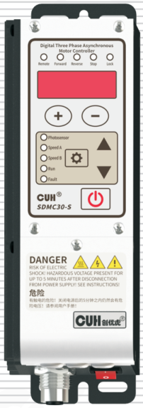

## SDMC30-S

## Manuel d'utilisation

---

## Mention de droits d'auteur

Nanjing CUH Science & Technology CO., Ltd. se réserve tous les droits.

Toutes les informations contenues dans ce manuel d'utilisation constituent le savoir-faire de notre société et sont protégées par le droit d'auteur et les autres lois applicables. CUH jouit et se réserve tous les droits conférés par le droit d'auteur et les autres lois. Sans le consentement écrit de CUH, il est interdit de copier, traduire, imiter ou autrement exploiter tout ou partie de ce manuel d'utilisation.

## Clause de non-responsabilité

Toutes les informations contenues dans ce manuel d'utilisation décrivent uniquement la méthode d'utilisation des produits apparentés fabriqués par notre société ; elles sont décrites selon l'état de la technique et l'état du produit au moment de sa mise à votre disposition. Vous devez assumer les risques correspondants lors de l'utilisation de ce produit. Sauf disposition légale contraire, la société n'assume aucune responsabilité expresse ou implicite pour le produit au titre de ce manuel d'utilisation, y compris, mais sans s'y limiter, les dommages corporels, les dommages matériels, la perte d'opportunités, etc.

Vous comprenez clairement les risques ci-dessus et acceptez que, sauf disposition légale impérative, la société ne soit pas responsable de tout dommage ou perte direct ou indirect vous concernant (y compris, mais sans s'y limiter, les pertes tangibles de personnes, de biens, de données, etc. ainsi que les pertes immatérielles de réputation, d'opportunités, etc.).

La société se réserve le droit de modifier les produits concernés par ce manuel d'utilisation sans préavis.

---

# Avant-propos

Merci d'avoir choisi le contrôleur numérique de moteur asynchrone triphasé de la série CUH SDMC30 (ci-après dénommé « le contrôleur »). Cette série de contrôleurs utilise des composants de haute qualité, intègre les dernières technologies électroniques et a été soigneusement conçue avec des processeurs de signaux numériques hautes performances.

Ce manuel présente la méthode d'utilisation de base, la description technique des fonctions et des exemples d'application typiques de ce produit. Il fournit aux utilisateurs des informations pertinentes sur l'installation et la mise en service, le réglage des paramètres, le diagnostic des anomalies, le dépannage et la maintenance de routine du contrôleur. Afin de garantir une installation et une utilisation correctes de ce contrôleur, veuillez lire attentivement ce manuel d'utilisation avant l'installation et le conserver soigneusement.

Assurez-vous de lire les symboles suivants, qui vous alertent sur les précautions à prendre contre les blessures corporelles et les dommages au produit.

|  |  |
|---|---|
| ⚠ Danger | Le non-respect de ce point entraînera des blessures corporelles ou la mort. |
| ⚠ Avertissement | Le non-respect de ce point peut entraîner des blessures corporelles ou la mort. |
| ⚠ Attention | Le non-respect de ce point peut entraîner des blessures modérées ou légères. |
| Avis | Le non-respect de ce point entraînera des dommages au produit et des dommages matériels. |
| ❗ Obligatoire | Indique les précautions et les restrictions d'utilisation à respecter impérativement pendant l'utilisation. |

**Ce manuel s'applique aux modèles de contrôleurs suivants :**

- Contrôleur numérique de moteur asynchrone triphasé SDMC30-S

  (Entrée monophasée 85~250VAC, sortie triphasée 0~220Vrmn/0.2kW)

---

# Environnement d'utilisation et de stockage

## Inspection avant utilisation

Chaque contrôleur fait l'objet d'un contrôle qualité rigoureux avant la livraison et est emballé dans un emballage antichoc. Veuillez vérifier les éléments suivants après le déballage :

1. Si le contrôleur a été endommagé pendant le transport.
2. Si le modèle du contrôleur correspond à celui que vous avez commandé.

## Environnement de fonctionnement

Veuillez respecter les consignes ci-dessous afin de garantir de meilleures performances et une durée de vie plus longue du contrôleur :

- ⚠ Environnement bien ventilé
- ⚠ Tenir à l'écart de l'eau, des écoulements, de la poussière et particulièrement de la poussière huileuse
- ⚠ Tenir à l'écart des gaz et des liquides corrosifs ou inflammables
- ⚠ Tenir à l'écart des poussières en suspension et des particules métalliques
- ⚠ Fixer fermement pour éviter les vibrations propres
- ⚠ Tenir à l'écart des interférences électromagnétiques
- ⚠ S'assurer que la température ambiante est de 0~40 ℃
- ⚠ Pour une utilisation à une altitude de 2000 m ou moins

---

# Sommaire

**Chapitre Ⅰ Avant utilisation — 1**

- 1.1 Vérification du contenu de l'emballage — 1
- 1.2 Description des indicateurs et des boutons — 2
- 1.3 Description des pièces externes — 3
- 1.4 Description des ports de signal — 3
- 1.5 Description de la plaque signalétique — 4

**Chapitre Ⅱ Présentation du produit — 5**

- 2.1 Présentation du produit — 5

**Chapitre Ⅲ Guide d'installation — 6**

- 3.1 Conditions d'utilisation du contrôleur — 6
- 3.2 Méthode d'utilisation des boutons — 6
- 3.3 Installation et utilisation — 7

**Chapitre Ⅳ Description des fonctions de base — 11**

- 4.1 Fréquence de consigne — 11
- 4.2 Marche avant et marche arrière — 12
- 4.3 Arrêt d'urgence — 13
- 4.4 Temps de démarrage progressif — 14
- 4.5 Temps d'arrêt progressif/Freinage DC — 14
- 4.6 Verrouillage du clavier — 15
- 4.7 Restauration des paramètres par défaut — 16

**Chapitre Ⅴ Description des fonctions avancées — 17**

- 5.1 Démarrage/arrêt du moteur et contrôle de la direction — 17
- 5.2 Échange du sens de rotation du moteur et interdiction de la marche arrière — 18
- 5.3 Arrêt d'urgence du moteur — 19
- 5.4 Réglage de la courbe V/F du moteur — 21
- 5.5 Protection contre la surpuissance du moteur — 22

---

# Chapitre Ⅰ Avant utilisation

Ce chapitre présente le contenu de l'emballage du produit, la description de l'apparence du contrôleur ainsi que les informations de la plaque signalétique du contrôleur.

## 1.1 Vérification du contenu de l'emballage

Avant utilisation, veuillez vérifier l'intégrité du contrôleur et des accessoires. Si vous constatez que le produit est défectueux ou endommagé, que des accessoires manquent, etc., veuillez contacter notre société.

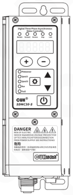

Contrôleur×1

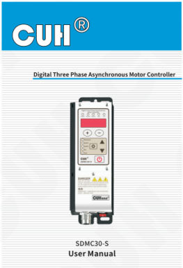

Manuel d'utilisation×1

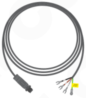

Câble de sortie×1

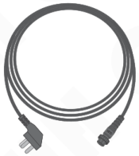

Cordon d'alimentation d'entrée×1

---

## 1.2 Description des indicateurs et des boutons

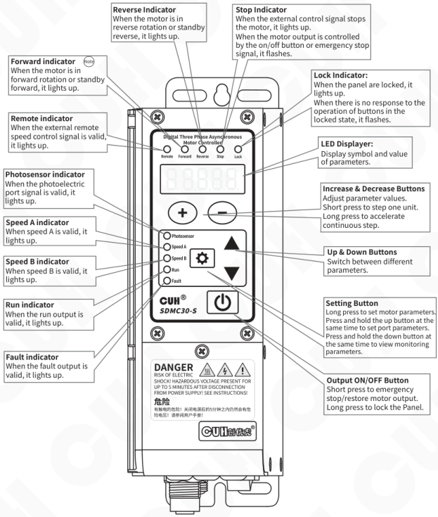

### Indicateurs

- **Indicateur de marche arrière**  
  Lorsque le moteur tourne en marche arrière ou est en attente de marche arrière, il s'allume.
- **Indicateur de marche avant** (Remarque)  
  Lorsque le moteur tourne en marche avant ou est en attente de marche avant, il s'allume.
- **Indicateur de commande à distance**  
  Lorsque le signal externe de commande de vitesse à distance est valide, il s'allume.
- **Indicateur de capteur photoélectrique**  
  Lorsque le signal du port photoélectrique est valide, il s'allume.
- **Indicateur de vitesse A**  
  Lorsque la vitesse A est valide, il s'allume.
- **Indicateur de vitesse B**  
  Lorsque la vitesse B est valide, il s'allume.
- **Indicateur de marche**  
  Lorsque la sortie de marche est valide, il s'allume.
- **Indicateur de défaut**  
  Lorsque la sortie de défaut est valide, il s'allume.
- **Indicateur d'arrêt**  
  Lorsque le signal de commande externe arrête le moteur, il s'allume.  
  Lorsque la sortie du moteur est commandée par le bouton marche/arrêt ou le signal d'arrêt d'urgence, il clignote.
- **Indicateur de verrouillage :**  
  Lorsque le panneau est verrouillé, il s'allume.  
  Lorsqu'il n'y a pas de réponse à l'actionnement des boutons en état verrouillé, il clignote.

### Affichage et boutons

- **Afficheur LED :**  
  Affiche le symbole et la valeur des paramètres.
- **Boutons d'augmentation et de diminution**  
  Permettent d'ajuster les valeurs des paramètres.  
  Une brève pression fait varier d'une unité.  
  Une pression longue accélère le défilement continu.
- **Boutons Haut et Bas**  
  Permettent de passer d'un paramètre à un autre.
- **Bouton de réglage**  
  Une pression longue permet de régler les paramètres du moteur.  
  Maintenez simultanément le bouton Haut pour régler les paramètres de port.  
  Maintenez simultanément le bouton Bas pour afficher les paramètres de surveillance.
- **Bouton marche/arrêt de sortie**  
  Une brève pression permet l'arrêt d'urgence/la restauration de la sortie du moteur.  
  Une pression longue verrouille le panneau.

### Avertissement du panneau

**DANGER**  
RISQUE D'ÉLECTROCUTION ! TENSION DANGEREUSE PRÉSENTE PENDANT JUSQU'À 5 MINUTES APRÈS LA DÉCONNEXION DE L'ALIMENTATION ! VOIR LES INSTRUCTIONS !

### Remarque

1. Définition : le sens de rotation avant désigne le sens de rotation observé depuis le côté de la ligne de bornes, conformément à l'entraînement du moteur. La norme IEC60034-8 détermine le sens de rotation du moteur.
2. Lorsque deux phases quelconques du câblage sont permutées, le moteur tourne dans le sens antihoraire, c'est-à-dire que les sens avant et arrière sont inversés.

---

## 1.3 Description des pièces externes

> ⚠️ **Danger**
>
> Lors de l'installation du cordon de sortie, alignez la direction de la broche PE et insérez la fiche ; ne forcez pas l'insertion sans avoir confirmé la direction.
>
> En cas d'insertion dans le mauvais sens, une haute tension subsistera sur le boîtier du moteur, **ce qui peut entraîner la mort ou des blessures graves.**

> ⚠️ **Danger**
>
> 1. Ce produit appartient à la classe de protection I et la fiche à trois broches du cordon d'alimentation sert à la mise à la terre de protection. Veuillez vous assurer que la prise connectée est correctement mise à la terre.
> 2. En l'absence de connexion de mise à la terre de sécurité ou en cas de connexion défectueuse, une haute tension subsiste sur le boîtier du contrôleur, et tout contact avec le contrôleur **peut entraîner la mort ou des blessures graves.**

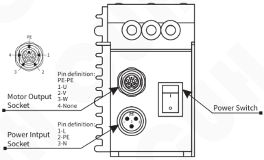

**Prise de sortie moteur**

Définition des broches :
- PE-PE
- 1-U
- 2-V
- 3-W
- 4-Aucune

**Prise d'entrée d'alimentation**

Définition des broches :
- 1-L
- 2-PE
- 3-N

**Interrupteur d'alimentation**

## 1.4 Description des ports de signal

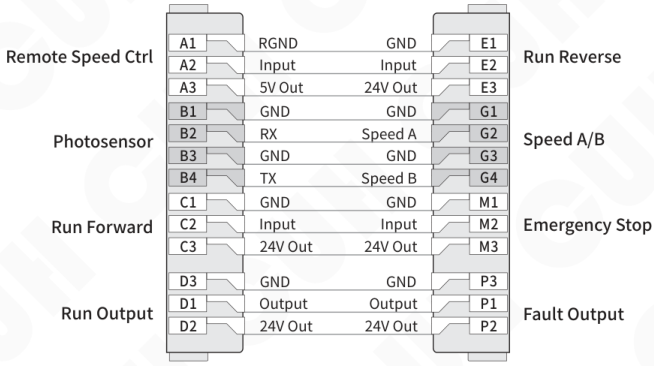

| Fonction | Broche | Définition | Définition | Broche | Fonction |
|---|---|---|---|---|---|
| Commande de vitesse à distance | A1 | RGND | GND | E1 | Marche arrière |
| | A2 | Entrée | Entrée | E2 | |
| | A3 | Sortie 5V | Sortie 24V | E3 | |
| Capteur photoélectrique | B1 | GND | GND | G1 | Vitesse A/B |
| | B2 | RX | Vitesse A | G2 | |
| | B3 | GND | GND | G3 | |
| | B4 | TX | Vitesse B | G4 | |
| Marche avant | C1 | GND | GND | M1 | Arrêt d'urgence |
| | C2 | Entrée | Entrée | M2 | |
| | C3 | Sortie 24V | Sortie 24V | M3 | |
| Sortie de marche | D3 | GND | GND | P3 | Sortie de défaut |
| | D1 | Sortie | Sortie | P1 | |
| | D2 | Sortie 24V | Sortie 24V | P2 | |

---

## 1.5 Description de la plaque signalétique

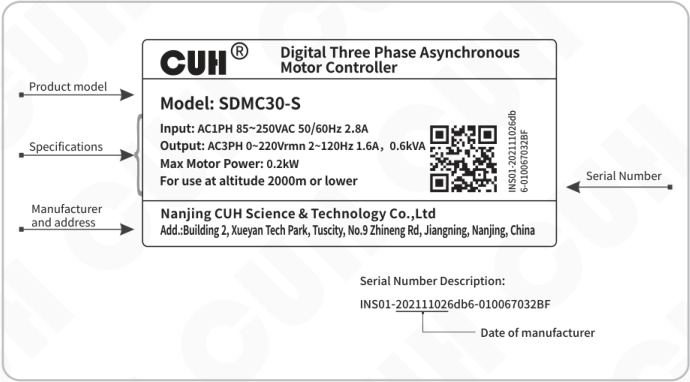

**CUH® — Contrôleur numérique de moteur asynchrone triphasé**

- **Modèle du produit**
  - Modèle : SDMC30-S
- **Spécifications**
  - Entrée : AC1PH 85~250VAC 50/60Hz 2.8A
  - Sortie : AC3PH 0~220Vrmn 2~120Hz 1.6A，0.6kVA
  - Puissance maximale du moteur : 0.2kW
  - Pour une utilisation à une altitude de 2000 m ou moins
- **Fabricant et adresse**
  - Nanjing CUH Science & Technology Co.,Ltd
  - Add.:Building 2, Xueyan Tech Park, Tuscity, No.9 Zhineng Rd, Jiangning, Nanjing, China
- **Numéro de série**
  - INS01-202111026db6-010067032BF

**Description du numéro de série :**

INS01-202111026db6-010067032BF

- 20211102 → Date de fabrication

---

## Chapitre Ⅱ Présentation du produit

Ce chapitre présente principalement une brève introduction et les principales caractéristiques de ce produit.

### 2.1 Présentation du produit

Les contrôleurs numériques de moteur asynchrone triphasé de la série SDMC30 sont des variateurs de fréquence compacts et silencieux, entièrement statiques et sans ventilateur, qui offrent des performances uniques grâce à l'emploi des dernières technologies électroniques et à une conception soignée. Idéaux pour les applications en environnement industriel, leurs atouts comprennent :

- Le mode de sortie en ondes sinusoïdales pures triphasées à modulation de largeur d'impulsion vectorielle dans l'espace (SVPWM) permet d'obtenir un rendement élevé et un faible niveau sonore du moteur.
- La courbe V/F peut être personnalisée pour s'adapter aux différents types d'applications de charge du moteur.
- Le port photoélectrique prend en charge les capteurs photoélectriques ainsi que les capteurs à commutation NPN et PNP.
- La sortie de marche et la sortie de défaut servent à indiquer l'état de fonctionnement et l'état de défaut du contrôleur.
- Le port de sortie prend en charge les modes NPN, PNP et push-pull.
- La fonction anti-calage empêche le moteur de caler à cause d'une surcharge pendant l'accélération, la décélération et le fonctionnement.
- La fonction de freinage DC permet de freiner rapidement pour arrêter la rotation du moteur lors de l'arrêt ou de l'arrêt d'urgence.
- Prise en charge de fonctions complètes de protection du moteur telles que la surcharge/la surintensité/le calage/le manque de phase.
- La fonction de réglage de la luminosité du panneau prend en charge 32 niveaux de réglage.
- La fonction d'interdiction de la marche arrière permet de verrouiller le moteur contre la rotation inverse.
- Fonction d'arrêt d'urgence : choix entre coupure sûre du couple, commande de freinage de sécurité et arrêt de sécurité de catégorie 1.
- Fonction de signal de disponibilité : émet un signal modulé ou un signal valide via le port de transmission B4 du dispositif photoélectrique intelligent pour indiquer que le contrôleur est en état de disponibilité. Lorsque le contrôleur rencontre une erreur, le signal de disponibilité devient invalide.
- La fonction de commande à distance prend en charge les entrées 1~5V, 0~5V, 0~10V et 4~20mA.
- La fonction de coefficient de commande à distance permet de doubler l'effet de la tension de commande à distance ou de le réduire de moitié.
- La fonction vitesse AB prend en charge deux signaux de commutation pour commander jusqu'à quatre vitesses du moteur.
- De riches sources de signaux de commande, relations logiques, temporisations de commutation et modes de sortie permettent de réaliser des applications complexes.
- De riches fonctions de surveillance permettent de surveiller la température, la fréquence de sortie, la puissance de sortie et la tension des ports de signal.
- Les fonctions de protection complètes comprennent également : la protection contre les courts-circuits de la sortie moteur, la protection contre les surcharges du contrôleur, la protection contre la surchauffe et le refroidissement excessif, la protection contre les sous-tensions/surtensions de l'alimentation, la protection contre les courts-circuits de la sortie de marche et de la sortie de défaut, la protection contre les courts-circuits de la sortie 24V et la protection contre les courts-circuits de la sortie 5V de régulation de vitesse.

---

# Chapitre Ⅲ Guide d'installation

Ce chapitre présente les conditions nécessaires à l'utilisation du contrôleur ainsi que la manière de l'installer et de le raccorder correctement.

## 3.1 Conditions d'utilisation du contrôleur

Le contrôleur est alimenté en courant alternatif 220V et la liaison de mise à la terre de protection est réalisée par la fiche du cordon d'alimentation. Veuillez prévoir une alimentation secteur et des installations de distribution 220V, 50Hz/60Hz conformes aux normes et vous assurer que le fil de mise à la terre de protection est correctement raccordé.

**⚠ Avertissement** Ne connectez jamais le contrôleur à une alimentation secteur 380V ; cela causerait des dommages graves et irréversibles au contrôleur, pouvant entraîner une explosion, un incendie et d'autres incidents de sécurité.

**⚠ Avertissement** Assurez-vous que le côté alimentation est correctement mis à la terre. Le boîtier métallique du contrôleur est directement relié au fil de mise à la terre de protection. Une mise à la terre défectueuse entraînera l'électrification du boîtier du contrôleur et provoquera un accident d'électrocution.

**Avis** Un fonctionnement prolongé génère de la chaleur et fait augmenter la température du boîtier. Veuillez installer le contrôleur dans un environnement bien ventilé et bien le fixer, à l'écart des sources de vibration.

**Avis** Le port de sortie moteur de ce produit est formé par redressement et ondulation du secteur, sans liaison d'isolement intermédiaire. Par conséquent, le pôle de sortie ne peut pas être relié à la terre de protection. Lors du raccordement du moteur, assurez-vous qu'il existe une isolation de base entre la bobine du moteur et le carter. Sinon, cela provoquera une fuite de courant, pouvant entraîner une électrocution et endommager le contrôleur.

## 3.2 Méthode d'utilisation des boutons

Ce contrôleur utilise des symboles de paramètres à affichage numérique à 5 chiffres, et 10 indicateurs rouges montrent l'état du contrôleur ou du port de signal.

Ce contrôleur adopte un fonctionnement à 6 boutons, dont la méthode d'utilisation est la suivante :

 a. L'action des boutons se divise en pression courte et pression longue (premier niveau d'accélération, deuxième niveau d'accélération) selon la durée d'appui.

 b. La pression courte correspond à un temps d'appui supérieur à 0.1 et inférieur à 2 secondes ; la pression longue correspond à un temps d'appui supérieur à 2 secondes.

 c. ⊕ et ⊖ servent à régler les valeurs des paramètres ; ▼ et ▲ servent à sélectionner différents paramètres.

 d. Une pression courte sur ⏻ arrête d'urgence la sortie moteur ; une pression longue verrouille/déverrouille le panneau.

 e. Une pression longue sur ⚙ permet d'entrer/sortir de l'interface des paramètres du moteur.

 f. Une pression longue sur ⚙ et ▲ permet d'entrer/sortir de l'interface des paramètres de port.

 g. Une pression longue sur ⚙ et ▼ permet d'entrer/sortir de l'interface des paramètres de surveillance. Appuyez sur ⊕ et ⊖ dans cette interface pour ajuster temporairement la fréquence de consigne.

---

## 3.3 Installation et utilisation

### Étape un :

Ouvrez la boîte d'emballage et vérifiez le contrôleur ainsi que tous les accessoires.

### Étape deux :

Sortez le cordon de sortie, raccordez le bornier du cordon de sortie aux bornes du moteur et choisissez le câblage en triangle ou en étoile selon la plaque signalétique du moteur. Confirmez également que le fil de terre jaune et vert est correctement relié au carter métallique du moteur.

### Câblage en triangle

Lorsque le contrôleur est raccordé à un moteur △230V/Y 400V, le câblage en triangle est utilisé.

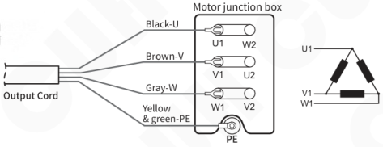

### Câblage en étoile

Lorsque le contrôleur est raccordé à un moteur △120V/Y 230V, le câblage en étoile est utilisé.

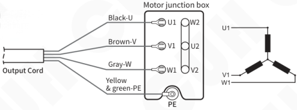

### Remarque

- Selon les réglementations IEC60446 :
  1. Le noir L1, le marron L2 et le gris L3 sont utilisés en priorité pour les conducteurs de phase AC.
  2. Le conducteur de protection PE doit être identifié par une combinaison bicolore jaune-vert.
- Ce contrôleur délivre une tension de ligne triphasée de 220V, adaptée aux moteurs couplés en triangle 220~240V ou en étoile 220~240V. En cas de raccordement d'un moteur 380V, une chute importante du couple se produira.

### ⚠ Danger

Assurez-vous impérativement que le carter du moteur est correctement relié au fil PE. Dans le cas contraire, le carter serait mis sous tension, ce qui peut entraîner la mort ou des blessures graves.

### ⚠ Avertissement

Veuillez raccorder les borniers du moteur dans l'ordre UVW ; si l'ordre est incorrect, le moteur risque de tourner à l'envers et de provoquer un danger mécanique.

---

## Étape trois :

Raccordez la fiche de sortie à la prise de sortie moteur du contrôleur et serrez l'écrou.

Ensuite, sortez le cordon d'alimentation, insérez la fiche aviation du cordon d'alimentation dans la prise d'entrée d'alimentation du contrôleur et serrez l'écrou de la fiche.

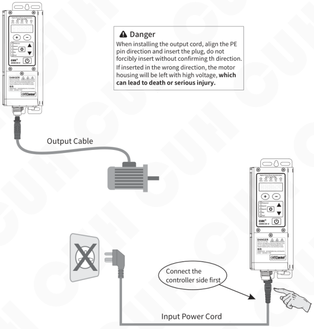

> ⚠ **Danger**
>
> Lors de l'installation du cordon de sortie, alignez la direction de la broche PE et insérez la fiche ; ne forcez pas l'insertion sans avoir confirmé la direction.
>
> En cas d'insertion dans le mauvais sens, une haute tension subsistera sur le boîtier du moteur, **ce qui peut entraîner la mort ou des blessures graves.**

> ⚠ **Danger**
>
> Afin d'éviter tout risque d'électrocution, ne procédez pas au câblage lorsque l'appareil est sous tension ; coupez impérativement l'alimentation de la machine et effectuez le câblage 5 minutes après l'extinction de l'afficheur numérique. En cas de non-respect, **il existe un risque de mort ou de blessures graves.**

---

### Étape quatre :

Après avoir confirmé que l'interrupteur est en position d'arrêt, branchez la fiche du câble d'alimentation d'entrée sur la prise secteur.

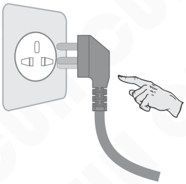

### Étape cinq :

Allumez l'interrupteur d'alimentation ; la fréquence de consigne « F 50.0 » doit alors s'afficher et les indicateurs de marche avant et d'arrêt sont allumés. Le moteur ne tourne pas à ce moment.

F signifie fréquence de consigne

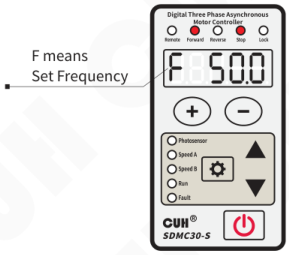

---

## Étape six :

Connectez le signal de commande de marche avant ou de marche arrière au contrôleur ; le témoin d'arrêt du contrôleur s'éteint alors, le témoin de marche s'allume et le moteur accélère progressivement jusqu'à la fréquence de 50Hz.

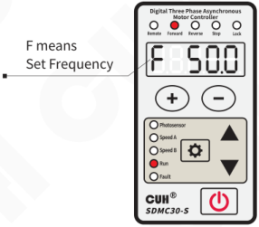

## Étape sept :

Utilisez ⊕ et ⊖ pour ajuster la fréquence jusqu'à la vitesse optimale maximale du moteur.

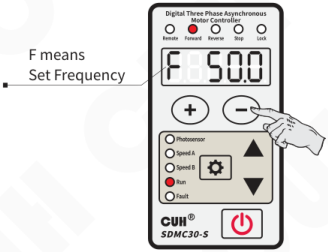

---

## Chapitre Ⅳ Description des fonctions de base

Ce chapitre présente comment utiliser les fonctions de base de ce produit.

### 4.1 Fréquence de consigne

Ce contrôleur permet de régler numériquement la fréquence de sortie directement sur le panneau. Grâce à la technologie de synthèse numérique directe de fréquence (DDS), il offre une précision et une stabilité de fréquence très élevées, qui ne varient ni avec le temps ni avec la température.

- Allumez l'interrupteur d'alimentation du contrôleur.
- Le contrôleur entre dans l'état de veille du paramètre de fréquence de consigne F ; les indicateurs de marche avant et d'arrêt du contrôleur s'allument et l'afficheur LED indique le paramètre F et sa valeur.
- Appuyez sur ⊕ ou ⊖ pour régler la valeur du paramètre.

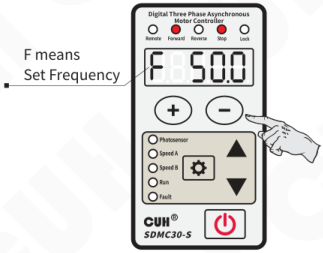

La plage de fréquence de consigne est de 2.0~120.0Hz

> - La plage dans laquelle la fréquence de consigne F peut être réglée est limitée par la fréquence minimale « r » et la fréquence maximale « y ».

---

## 4.2 Marche avant et marche arrière

Ce contrôleur dispose d'un port de marche avant C et d'un port de marche arrière E ; lorsque le signal de port est invalide, le moteur ne tourne pas et le témoin d'arrêt est allumé.

Lorsque le signal du port de marche avant C est valide, le moteur tourne en marche avant : l'indicateur d'arrêt est éteint, l'indicateur de marche avant et l'indicateur de marche sont allumés.

- Appuyez sur ⚙ et maintenez pendant 2 secondes pour entrer dans l'interface des paramètres du moteur.
- Utilisez ▲ et ▼ pour passer à l'état de réglage de la source de commande de démarrage/arrêt avant 1 « P1 ».
- Appuyez sur ⊕ ou ⊖ pour régler la valeur du paramètre. Le réglage par défaut de ce paramètre est C.

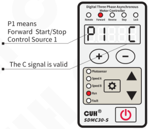

Lorsque le signal du port de marche arrière E est valide, le moteur tourne en marche arrière : l'indicateur d'arrêt est éteint, l'indicateur de marche arrière et l'indicateur de marche sont allumés.

- Appuyez sur ⚙ et maintenez pendant 2 secondes pour entrer dans l'interface des paramètres du moteur.
- Utilisez ▲ et ▼ pour passer à l'état de réglage de la source de commande de marche arrière 1 « Π1 ».
- Appuyez sur ⊕ ou ⊖ pour régler la valeur du paramètre. Le réglage par défaut de ce paramètre est E.

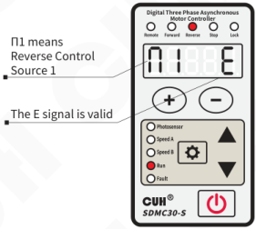

Remarque :

1. Lorsque les signaux des ports de marche avant et de marche arrière sont valides en même temps, le contrôleur signale l'erreur Er15 « conflit marche avant/marche arrière » et le moteur ne tourne pas.
2. Si le câblage est réalisé conformément aux instructions de câblage du moteur, selon la définition du sens de rotation du moteur de la norme IEC60034-8, le sens de rotation avant désigne la rotation dans le sens horaire observée depuis le côté de l'entraînement du moteur.

---

## 4.3 Arrêt d'urgence

En cas d'urgence, le contrôleur peut entrer en état d'arrêt d'urgence afin d'arrêter rapidement le moteur. Il peut entrer dans cet état en appuyant sur le bouton d'alimentation du panneau ou en rendant valide le signal du port d'arrêt d'urgence. À ce moment, l'indicateur d'arrêt clignote et « Ar02 » s'affiche pour l'arrêt d'urgence.

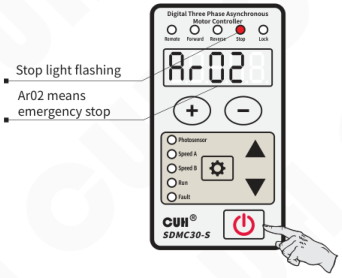

- L'état d'arrêt d'urgence déclenché en appuyant sur le bouton d'alimentation du panneau peut être libéré en appuyant à nouveau sur ce bouton.
- L'état d'arrêt d'urgence déclenché par le signal du port d'arrêt d'urgence est effectif ; en plus de supprimer le signal du port d'arrêt d'urgence, vous devez également appuyer sur le bouton d'alimentation du panneau pour libérer l'état d'arrêt d'urgence.

> Le mode d'arrêt d'urgence peut être sélectionné via le paramètre Sq : coupure sûre du couple, commande de freinage de sécurité et arrêt de sécurité de catégorie 1. Pour les fonctions détaillées, veuillez vous référer à la description des fonctions avancées.

---

## 4.4 Temps de démarrage progressif

Lorsque ce contrôleur démarre depuis l'état d'arrêt, la fréquence de sortie du moteur peut augmenter progressivement jusqu'à la fréquence de consigne afin d'éviter les chocs sur le moteur et les équipements en fonctionnement.

Temps de démarrage progressif (t) : lorsque le moteur démarre depuis l'état d'arrêt, le temps nécessaire pour que la fréquence de sortie du contrôleur augmente progressivement de la fréquence la plus basse jusqu'à la fréquence de consigne est appelé temps de démarrage progressif.

- Appuyez sur ⚙ et maintenez pendant 2 secondes pour entrer dans l'interface des paramètres du moteur.
- Utilisez ▲ et ▼ pour passer à l'état de réglage du temps de démarrage progressif « t ».
- Appuyez sur ⊕ ou ⊖ pour régler la valeur du paramètre.

La plage du temps de démarrage progressif est de 0.0~99.9 secondes

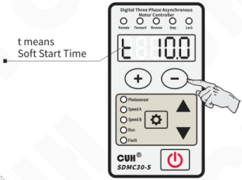

## 4.5 Temps d'arrêt progressif/Freinage DC

Lorsque le contrôleur s'arrête depuis l'état de fonctionnement, la fréquence de sortie du moteur peut diminuer progressivement jusqu'à la fréquence la plus basse afin d'éviter les chocs sur le moteur et les équipements en fonctionnement.

Temps d'arrêt progressif (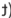) : lorsque le moteur s'arrête depuis l'état de fonctionnement, le temps nécessaire pour que la fréquence de sortie du contrôleur diminue progressivement de la fréquence de consigne jusqu'à la fréquence la plus basse est appelé temps d'arrêt progressif.

- Appuyez sur ⚙ et maintenez pendant 2 secondes pour entrer dans l'interface des paramètres du moteur.
- Utilisez ▲ et ▼ pour passer à l'état de réglage du temps d'arrêt progressif « [[vcrop:22:2]] ».
- Appuyez sur ⊕ ou ⊖ pour régler la valeur du paramètre.

La plage du temps d'arrêt progressif est de 0.0~99.9 secondes  
La plage du temps de freinage DC est de -0.0~-99.9 secondes

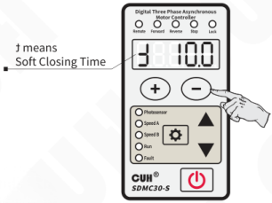

---

## 4.6 Verrouillage du clavier

Une fois les paramètres du contrôleur réglés, la fonction de verrouillage du clavier permet de verrouiller tous les boutons du panneau afin d'éviter les fausses manœuvres.

Même après extinction puis rallumage, l'état du verrouillage du clavier reste celui qu'il avait lors de la dernière extinction.

- Appuyez sur ⏻ et maintenez pendant 2 secondes pour verrouiller tous les boutons du panneau. L'indicateur de verrouillage s'allume.
- Appuyez à nouveau sur ⏻ et maintenez pendant 2 secondes pour déverrouiller.

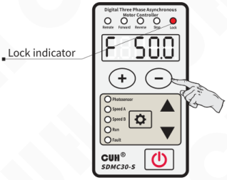

> Lorsque le contrôleur est verrouillé, les boutons ne répondent pas et l'indicateur de verrouillage clignote.

---

## 4.7 Restauration des paramètres par défaut

L'utilisateur peut rapidement restaurer le contrôleur à l'état d'usine.

En raison des fonctions puissantes du contrôleur, de nombreux paramètres sont réglables. Pour les débutants, il peut être difficile de rétablir l'état de fonctionnement normal du contrôleur après plusieurs réglages et modifications. Utilisez cette fonction pour restaurer rapidement l'état de paramètres désordonné vers les réglages par défaut d'usine.

- Maintenez simultanément ⚙ et ▲ pour entrer dans l'interface des paramètres de port.

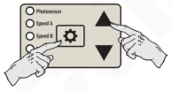

- Appuyez brièvement sur ▲ pour passer à l'affichage entièrement clignotant sur l'afficheur LED, c'est-à-dire le paramètre « Restauration des paramètres par défaut ». Ensuite, appuyez sur ⊕ et maintenez jusqu'à ce que le contrôleur affiche « ----- », indiquant que le contrôleur a été restauré.

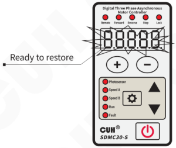

- Relâchez ⊕ ; après que le contrôleur affiche « CUH », il entre ensuite dans l'interface de veille normale. À ce stade, tous les paramètres ont été restaurés aux réglages par défaut d'usine.

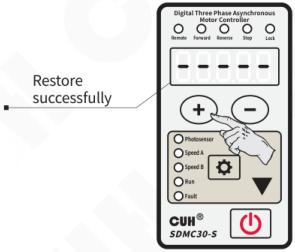

> Avant d'effectuer une réinitialisation d'usine, l'utilisateur doit appuyer sur ⏻ pour mettre le contrôleur en état d'arrêt d'urgence ; le témoin d'arrêt clignote alors.

---

## Chapitre Ⅴ Description des fonctions avancées

Ce chapitre présente principalement comment utiliser les fonctions avancées de ce produit.

### 5.1 Démarrage/arrêt du moteur et contrôle de la direction

Ce contrôleur est conçu avec un signal de démarrage/arrêt avant et un signal de démarrage/arrêt arrière pour contrôler le démarrage/arrêt et la direction du moteur. Le signal de démarrage/arrêt avant dispose de 2 sources de signal et d'une unité de calcul logique, tout comme le signal arrière. Ces deux signaux peuvent être sélectionnés pour contrôler le démarrage/arrêt ainsi que la marche avant/marche arrière du moteur. Voir la figure ci-dessous pour les relations logiques spécifiques.

Les sources de contrôle de démarrage/arrêt avant et arrière comprennent respectivement : 0, 1, b, -b, C, -C, E, -E, SA, -SA, Sb, -Sb, ES, -ES, od, -od, oP, -oP.

Les relations logiques comprennent : And, or, Xor, déclencheurs RS.

Il existe deux valeurs pour les modes de contrôle avant et arrière :

- **Fr=0 signifie :** le signal de démarrage/arrêt avant est utilisé pour contrôler le démarrage et l'arrêt avant, tout comme le signal arrière
- **Fr=1 signifie :** le signal de démarrage/arrêt avant est utilisé pour contrôler le démarrage et l'arrêt, mais le signal arrière est utilisé pour contrôler la direction.

Remarque : lorsque Fr=0 et que les signaux avant et arrière sont tous deux valides en même temps, le conflit avant/arrière Er15 est déclenché et le moteur s'arrête.

---

## 5.2 Échange du sens de rotation du moteur et interdiction de la marche arrière

Dans les applications pratiques, s'il est nécessaire de changer le sens de rotation du moteur ou d'interdire au moteur de tourner dans une certaine direction en raison de limitations du système mécanique ou du câblage, le paramètre Ph (Phase) peut être utilisé pour l'échange de direction.

- **Lorsque Ph=Abc,** cela signifie le sens standard, c'est-à-dire que la marche avant est dans le sens horaire vu depuis l'extrémité d'entraînement du moteur.
- **Lorsque Ph=Acb,** cela signifie que le sens est échangé, c'est-à-dire que la marche avant est dans le sens antihoraire vu depuis l'extrémité d'entraînement du moteur.
- **Lorsque Ph=A.b.c.,** cela signifie que la marche arrière est interdite dans le sens standard, c'est-à-dire que le moteur ne peut tourner que dans le sens horaire ; lorsqu'une commande d'inversion apparaît, il ne répond pas et affiche l'avertissement Ar08 d'interdiction de marche arrière.
- **Lorsque Ph=A.c.b.,** cela signifie que l'échange de direction interdit la marche avant, c'est-à-dire que le moteur ne peut tourner que dans le sens antihoraire, et ne répond pas lorsque la commande de marche avant apparaît, et affiche l'avertissement Ar08 d'interdiction de marche arrière.

La figure ci-dessous montre un moteur dans le sens horaire, avec l'arbre tournant dans le sens horaire depuis l'extrémité d'entraînement et la direction d'observation allant de l'extrémité d'entraînement à l'extrémité non entraînante.

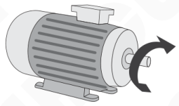

La figure ci-dessous montre un moteur dans le sens antihoraire, avec l'arbre tournant dans le sens antihoraire depuis l'extrémité d'entraînement.

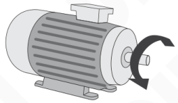

---

## 5.3 Arrêt d'urgence du moteur

Ce contrôleur peut arrêter d'urgence le moteur ; cette source d'arrêt peut être activée efficacement en appuyant sur le bouton d'alimentation du panneau ou sur l'interrupteur d'arrêt d'urgence externe.

La source d'arrêt d'urgence peut sélectionner différentes sources de signal ; par défaut, il s'agit du signal du port d'arrêt d'urgence. Le bouton d'alimentation du panneau est toujours une source d'arrêt d'urgence efficace.

Selon le mode d'arrêt d'urgence, le paramètre Sq peut sélectionner différentes stratégies d'arrêt d'urgence :

- **Sq=Sto,** le contrôleur coupe immédiatement l'alimentation du moteur, et le moteur décélère et s'arrête selon l'inertie.
- **Sq=Sbc,** le moteur s'arrête par freinage DC, et le temps de freinage est déterminé par le temps d'arrêt progressif. Le port de sortie de défaut émet un état d'arrêt d'urgence et n'est pas contrôlé par la source de signal ; un relais de frein de sécurité doit être utilisé.
- **Sq=SS1,** le moteur décélère ou freine pour s'arrêter selon l'action définie par le temps d'arrêt progressif.

### Méthode de connexion de l'interrupteur d'arrêt d'urgence

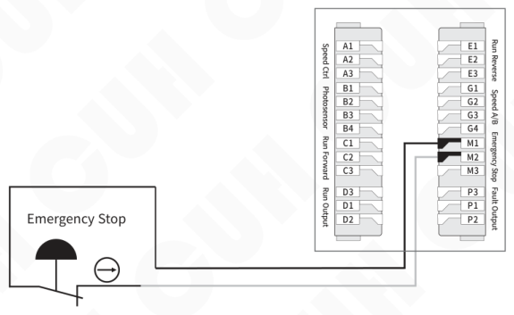

---

### Sto : Arrêt de couple sécurisé

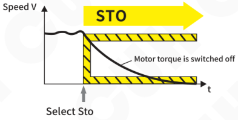

### Sbc : Commande de frein de sécurité

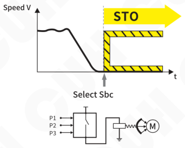

### SS1 : Arrêt de sécurité de catégorie 1

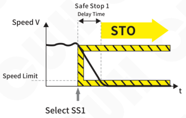

---

## 5.4 Réglage de la courbe V/F du moteur

Ce contrôleur peut personnaliser la courbe V/F pour s'adapter à différentes charges de moteur.

Elle est définie par la fréquence maximale y, la fréquence nominale b, la tension nominale h, la fréquence intermédiaire n, la tension intermédiaire o, la fréquence minimale r et la tension minimale u.

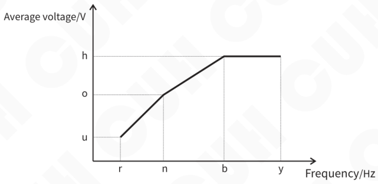

**Remarque :** en raison de la nature inductive de la charge du moteur, les tensions de ligne de sortie sont calibrées sur la valeur moyenne redressée Vrmn afin de maintenir le courant dans la section linéaire de la courbe V/F. En général, la valeur efficace Vrms d'une onde sinusoïdale standard est 1.11 fois celle de la moyenne redressée Vrmn.

---

**Schéma de protection contre le dépassement de la limite supérieure de puissance du moteur**

Le contrôleur surveille la puissance électrique du moteur en temps réel. Lorsque la puissance dépasse la valeur de la puissance électrique nominale Po du moteur multipliée par le coefficient d'excès de puissance rc, la protection de dépassement de puissance du moteur Er02P est déclenchée. L'intégrateur de surchauffe électronique du moteur entre directement en saturation. Le contrôleur réduit la fréquence de sortie jusqu'à ce que la puissance de sortie descende à la puissance définie par le coefficient de déclassement de puissance rL. À ce moment, l'intégrateur est réinitialisé. Une fois la réinitialisation terminée, il revient au fonctionnement à la fréquence définie et redémarre un nouveau cycle de protection.

---

## 5.6 Commande à distance de la vitesse du moteur

En plus de régler la fréquence via le panneau, ce contrôleur peut également contrôler la fréquence de sortie via des signaux analogiques externes. Le signal analogique prend en charge les signaux de potentiomètre, 1~5V, 4~20mA, 0~5V et 0~10V, qui peuvent être définis par le paramètre de source de commande à distance A.

- **A=PAd :** indique que la fréquence de consigne est contrôlée uniquement par les boutons du panneau.
- **A=1-5V :** indique que l'entrée externe 1-5V définit la fréquence entre la fréquence minimale r et la fréquence maximale y. Lorsque la tension est de 0-0.5V, la commande à distance est invalide et la fréquence de consigne est contrôlée par le panneau. La commande à distance est valide à 0.5-1V, mais le contrôleur ne fonctionnera pas.
- **A=0-5V :** indique que l'entrée externe 0-5V, la fréquence de consigne est entre la fréquence minimale r et la fréquence maximale y.
- **A=0-10 :** indique que l'entrée externe 0-10V, la fréquence de consigne est entre la fréquence minimale r et la fréquence maximale y.

Ce contrôleur est également conçu avec un paramètre de coefficient de commande à distance c pour amplifier ou réduire l'effet de la tension de commande à distance, qui peut être ajusté dans la plage de 0.5~2.0. Lorsqu'il est réglé sur 0.5, cela signifie que l'effet de la commande à distance de la fréquence de consigne par ajustement de la valeur de tension est réduit de moitié, c'est-à-dire qu'il ne peut élever à distance que jusqu'à la moitié de la fréquence maximale y. Lorsqu'il est réglé sur 2.0, cela signifie que l'effet de la tension de commande à distance contrôlant la tension de sortie est doublé. C'est-à-dire que la fréquence de consigne a déjà atteint y lorsque la tension de commande à distance n'atteint que la moitié. Si la tension de commande à distance est augmentée davantage, la tension de sortie ne peut plus être augmentée.

### Méthode de connexion du potentiomètre

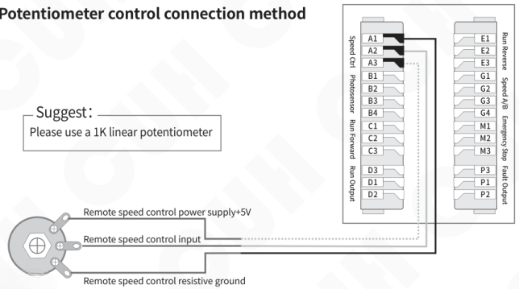

Lorsque le potentiomètre est connecté, l'indicateur de commande à distance s'allume ; le réglage de fréquence depuis le panneau est alors invalide.

---

## Méthode de connexion du contrôle de tension 1~5V

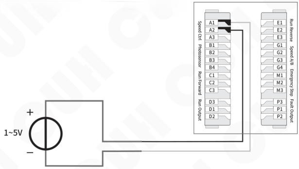

## Méthode de connexion du contrôle de courant 4~20mA

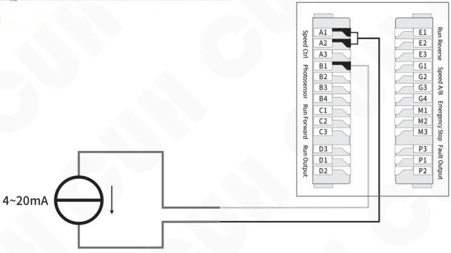

1. Sélectionnez A=1-5V, prend en charge l'entrée potentiomètre, 1~5V, 4~20mA.
2. Lors de la sélection de 0~5V ou 0~10V, la méthode de câblage est la même que 1-5V.

---

## 5.7 Préréglage numérique de la vitesse du moteur

La fonction de préréglage de vitesse est une fonction qui sélectionne directement une vitesse prédéterminée via des signaux de contrôle externes ou internes. Elle constitue un système de contrôle avec jusqu'à quatre vitesses.

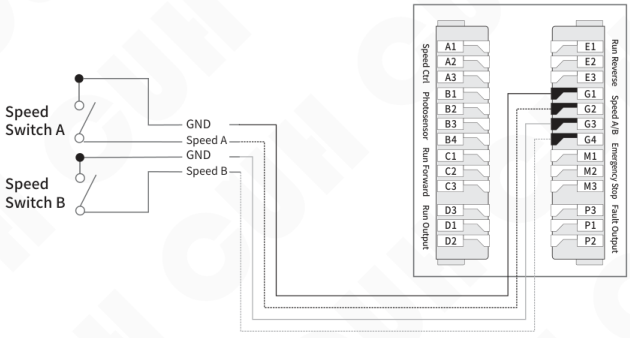

Par défaut, la source de préréglage de vitesse 1 sélectionne le port de vitesse externe A SA, et la source de préréglage de vitesse 2 sélectionne le port de vitesse externe B Sb. Selon le scénario d'application, la source de signal peut être modifiée pour commuter entre différentes vitesses.

Chaque source de préréglage de vitesse dispose d'un indicateur correspondant sur le panneau, qui s'allume lorsque la source est active. La combinaison des deux états d'indicateur compte 4 états (AB tous deux éteints, A allumé B éteint, A éteint B allumé, AB tous deux allumés).

Grâce à la combinaison de signaux, le contrôleur entre dans l'état de préréglage de vitesse correspondant, et la fréquence de consigne du contrôleur peut être ajustée par ⊕ et ⊖. Cette fréquence sera automatiquement mémorisée ; le signal de contrôle de préréglage de vitesse ramènera le contrôleur à la valeur de fréquence de consigne mémorisée dès son entrée dans cet état, à tout moment.

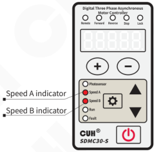

---

## 5.8 Capteur de commutation

Le contrôleur est conçu avec quatre interfaces de capteur de commutation : marche avant et marche arrière, vitesse AB et arrêt d'urgence. Ces interfaces peuvent prendre en charge les modes NPN, PNP, Ut1 et Ut0, et peuvent être définies via le paramètre de type de capteur de commutation ΓA.

- **Le mode Ut1 est un balayage unique,** c'est-à-dire qu'avant que le signal du capteur soit invalide, les niveaux haut et bas sont modifiés pour détecter si le port est valide. Après avoir trouvé un signal valide, le type de capteur du port est déterminé et n'est plus balayé.
- **Le mode Ut0 est un balayage continu,** quel que soit le type de capteur, il détecte toujours si le port est connecté à un signal valide en modifiant les niveaux haut et bas.

Le retard de commutation de chaque quantité de commutation peut également être défini par les paramètres correspondants, voir le tableau des paramètres pour plus de détails.

### Méthode de connexion du capteur de commutation

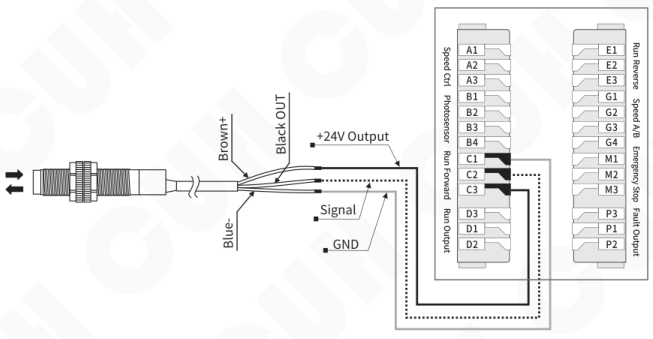

---

## 5.9 Port de capteur photoélectrique intelligent

Le port photoélectrique intelligent de ce contrôleur prend en charge les capteurs photoélectriques à faisceau traversant ou à réflexion composés de diodes électroluminescentes et de phototriodes, et peut également être réglé pour prendre en charge les capteurs de commutation NPN ou PNP via le paramètre de sensibilité photoélectrique intelligente P.

### Méthode de connexion du capteur photoélectrique

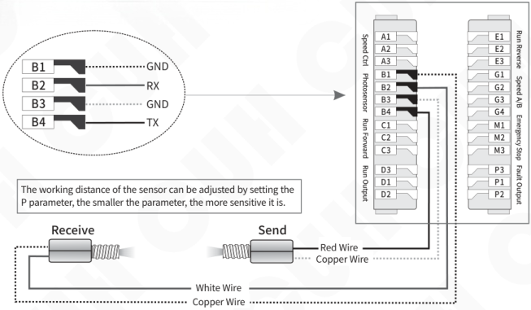

La distance de travail du capteur peut être ajustée en réglant le paramètre P ; plus le paramètre est petit, plus il est sensible.

### Méthode de connexion du capteur de commutation

Définissez le type NPN ou PNP via le paramètre P

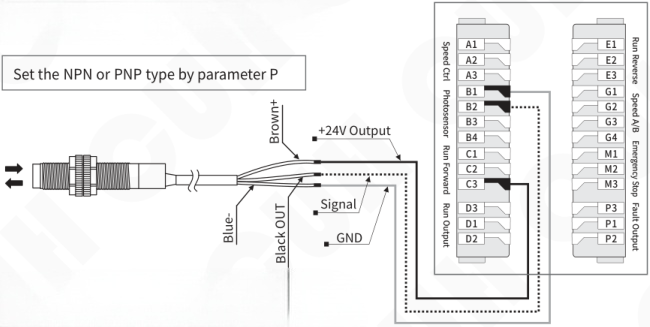

**Remarque :**

Lorsque la valeur P est nPn ou PnP, B4 émet un signal valide de 10mA.

De 2 à 1000, B4 émet un signal modulé de 10mA avec une fréquence d'environ 200Hz.

Lorsque le contrôleur rencontre une erreur, B4 n'émet pas. C'est la fonction de signal de disponibilité.

---

## 5.10 Port de sortie de marche/sortie de défaut

Les ports de sortie de marche et de sortie de défaut peuvent prendre en charge la sortie NPN, la sortie PNP et la sortie push-pull. Parmi lesquels :

- La sortie NPN est valide à l'état bas, et la sortie est invalide en état haute impédance.
- La sortie PNP est valide à l'état haut, et la sortie est invalide en état haute impédance.
- La sortie push-pull est valide à l'état haut, et invalide à l'état bas.

### 5.10.1 Méthode de câblage de la sortie de marche/sortie de défaut

**Méthode de connexion de la sortie NPN**

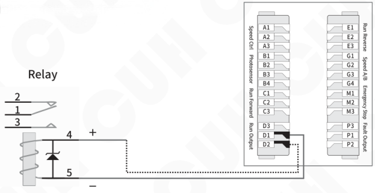

**Méthode de connexion de la sortie PNP ou push-pull**

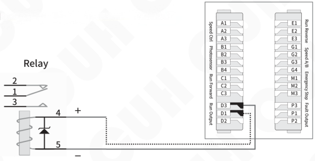

> Si vous connectez un relais 24V, assurez-vous de confirmer les pôles positif et négatif de la bobine pour vous assurer qu'ils sont correctement connectés. Étant donné que la capacité de courant de sortie de ce port est de 350mA, la diode de protection interne du relais court-circuitera le port de ce contrôleur après inversion, déclenchant la protection contre les courts-circuits Er07d/P.

---

## 5.10.2 Source de signal et schéma logique de la sortie de marche/sortie de défaut

Le contrôle de la sortie de marche/sortie de défaut est le résultat de la relation logique entre les deux sources, et les sources suivantes peuvent être sélectionnées dans la liste des sources.

Liste de signification des sources de signal :

| Source de signal | Signification |
|---|---|
| 0 | Signal invalide |
| 1 | Signal valide |
| b | Signal du port photoélectrique intelligent |
| -b | Inversion du signal du port photoélectrique intelligent |
| C | Signal du port de marche avant |
| -C | Inversion du signal du port de marche avant |
| E | Signal du port de marche arrière |
| -E | Inversion du signal du port de marche arrière |
| SA | Signal du port de vitesse A |
| -SA | Inversion du signal du port de vitesse A |
| Sb | Signal du port de vitesse B |
| -Sb | Inversion du signal du port de vitesse B |
| ES | Signal du port d'arrêt d'urgence |
| -ES | Inversion du signal du port d'arrêt d'urgence |
| od | Signal du port de sortie de marche |
| -od | Inversion du signal du port de sortie de marche |
| oP | Signal du port de sortie de défaut |
| -oP | Inversion du signal du port de sortie de défaut |
| oq | Signal de sortie moteur |
| -oq | Inversion du signal de sortie moteur |
| Er | Signal de défaut quelconque |
| -Er | Inversion du signal de défaut quelconque |
| Ar | Signal d'avertissement quelconque |
| -Ar | Inversion du signal d'avertissement quelconque |

---

## Schéma logique de la sortie de marche/sortie de défaut :

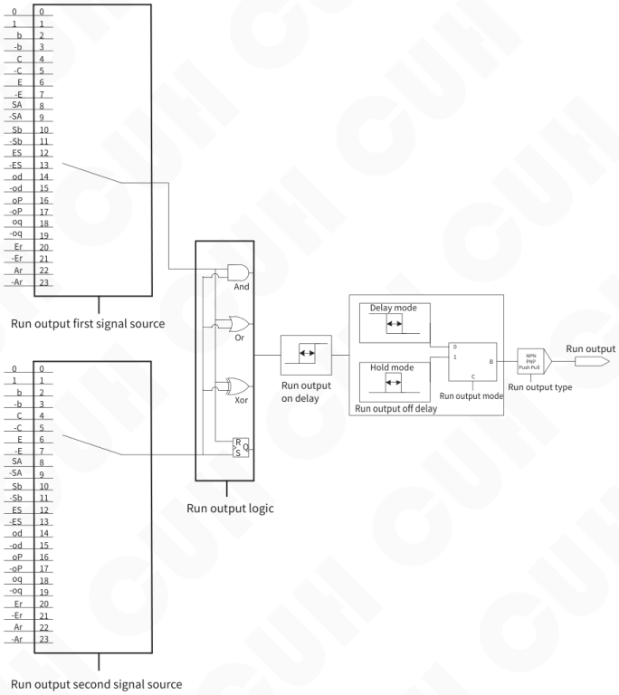

Remarque : le schéma logique de la sortie de défaut est cohérent avec le schéma logique de la sortie de marche.

---

## 5.10.3 Description des modes de la sortie de marche/sortie de défaut

Il existe 2 modes disponibles pour la sortie de marche/sortie de défaut : le mode retard, le mode maintien.

**Mode retard :** cela signifie qu'après que le signal pilotant la sortie de marche/sortie de défaut passe de valide à invalide, la sortie de marche/sortie de défaut se désactive après une certaine durée de temporisation de désactivation.

**Mode maintien :** cela signifie qu'après que le signal pilotant la sortie de marche/sortie de défaut devient valide, la sortie de marche/sortie de défaut reste ouverte pendant le temps de temporisation de désactivation, et se désactive après dépassement du temps de temporisation de désactivation.

La différence entre les deux modes est exprimée sous la forme d'un diagramme de temporisation comme suit, où le signal d'entrée est le signal émis après le sélecteur de relation logique.

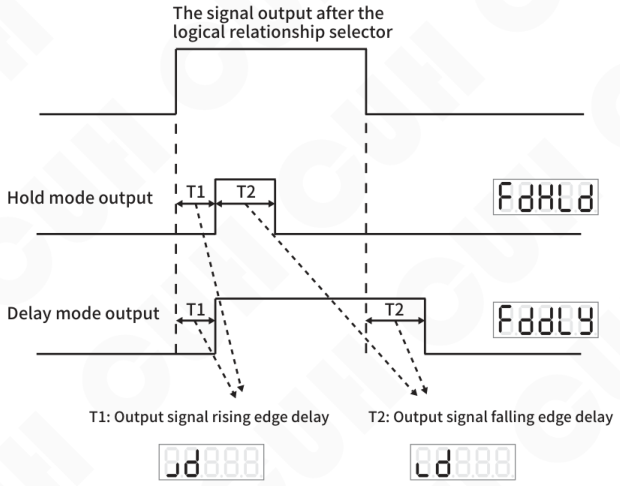

---

## 5.11 Mise sous tension et état de fonctionnement

La fonction de réglage de l'état de fonctionnement à la mise sous tension vous permet de spécifier l'état du bouton d'alimentation après la mise sous tension, en ajustant le paramètre d'état de fonctionnement PS.

- **PS=run,** indique que le bouton d'alimentation du contrôleur est en fonctionnement après la mise sous tension.
- **PS=stP,** indique que le bouton d'alimentation du contrôleur est à l'état d'arrêt après la mise sous tension.
- **PS=FoL,** indique que le bouton d'alimentation du contrôleur est dans l'état de la dernière mise hors tension après la mise sous tension.

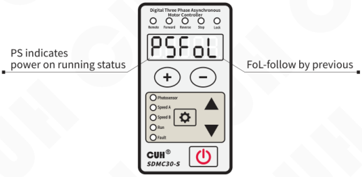

> FoL représente l'état avant la mise hors tension du contrôleur.
>
> Si le contrôleur est en état d'arrêt d'urgence avec le voyant d'arrêt clignotant avant la mise hors tension, il restera dans cet état lors de la prochaine mise sous tension.

---

## 5.12 Réglage de la luminosité du panneau

Ce contrôleur utilise une nouvelle puce de pilotage d'affichage numérique, qui permet aux utilisateurs de régler la valeur de luminosité de l'affichage entre 1 et 32 via le paramètre LEd.

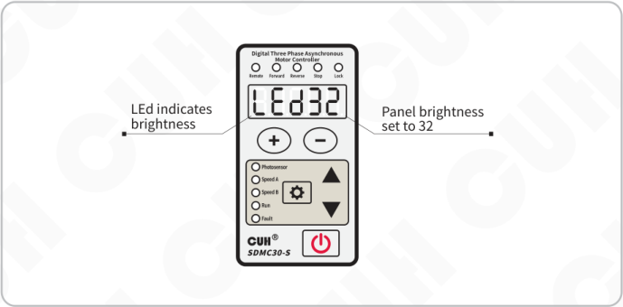

# Chapitre Ⅵ Caractéristiques techniques

## 6.1 Dimensions　(unité : mm)

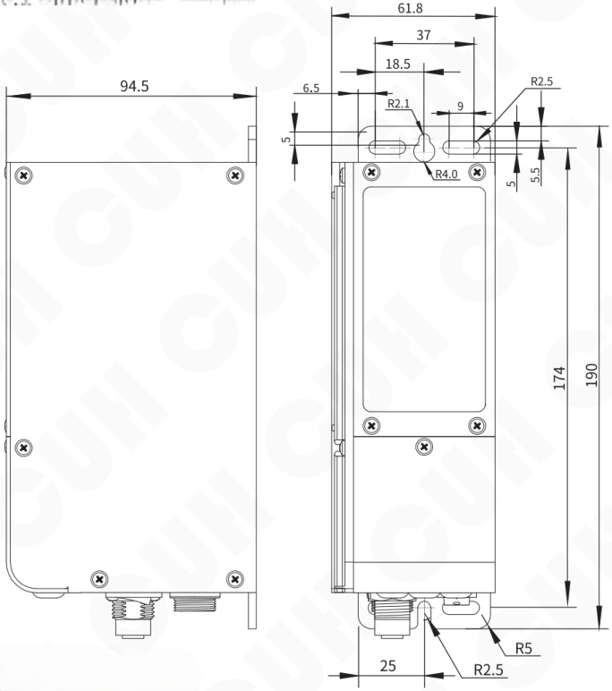

| Plage de dimensions | tolérance |
|---|---|
| 0~3 | ±0.05 |
| 3~10 | ±0.1 |
| 10~30 | ±0.15 |
| 30~80 | ±0.2 |
| 80~180 | ±0.3 |
| >180 | ±0.5 |

> **！Obligatoire**
>
> Assurez-vous de fixer le produit sur une plateforme solide si nécessaire, et fixez les trous de montage supérieur et inférieur du contrôleur. Installez-le à l'écart de la mise à la terre de l'équipement vibrant.

Ce tableau de tolérances est applicable à tous les produits de cette série.

---

## 6.2 Caractéristiques techniques

| Élément | Min. | Typique | Max. | Unité | Remarque |
|---|---|---|---|---|---|
| Tension d'entrée | 85 | 220 | 250 | V | 50/60Hz CA RMS |
| Tension de ligne de sortie | 0 | 200 | 220 | Vrmn | Moyenne redressée |
| Courant d'entrée RMS | —— | —— | 2.8 | A | |
| Pic de courant d'entrée | —— | —— | 8.0 | A | |
| Plage de réglage du courant de sortie | 0 | —— | 1.6 | A | Moyenne redressée |
| Capacité de sortie | 0 | —— | 600 | VA | |
| Fréquence de sortie | 2.0 | —— | 120.0 | Hz | |
| Précision de réglage de fréquence | | 0.1 | | Hz | |
| Forme d'onde de sortie | | Onde sinusoïdale vectorielle | | | |
| Puissance de moteur applicable | —— | —— | 0.2 | kW | 1/4HP |
| Température de déclenchement de la protection contre la surchauffe | —— | 65 | —— | °C | Retour à la normale à 60°C |
| Courant de sortie de commande DC | 0 | —— | 350 | mA | |
| Courant de sortie 24V | —— | —— | 700 | mA | |
| Tension de sortie de commande DC | 22 | 24 | 26 | V | |
| Signal de commande analogique | | 4~20 / 1~5、0~5、0~10 | | mA / V | Contrôlé par le paramètre A |
| Signal de commande numérique | | 24 | | V | Signal de commutation |
| Méthode de réglage | | 6 | | Bouton | |
| Consommation d'énergie en veille | —— | 3 | —— | W | |
| Méthode d'affichage | | 5 | | Chiffre | LED |
| Poids | | 830 | | g | Sans accessoire |
| Dimensions | | 190\*61.8\*94.5 ( L\*W\*H ) | | mm | |
| Indice de protection | | IP20 | | | |
| Température ambiante | -10 | 25 | 40 | °C | Sans condensation |
| Humidité ambiante | 10 | 60 | 85 | % | Sans condensation |
| Température ambiante de stockage | -20 | 25 | 85 | °C | Sans condensation |
| Altitude applicable | | <2000 | | m | |

# Chapitre Ⅶ Annexe

## 7.1 Tableau des paramètres

| Paramètre | Définition | Symbole | image du symbole | Plage | Défaut |
|---|---|---|---|---|---|
| Paramètre en veille | Fréquence de consigne | F |  | 2.0~120.0 (Hz) (limitée par r et y) | 50.0 |
| Paramètre du moteur — Maintenez appuyé ⚙ | Source de contrôle de démarrage/arrêt avant 1 | F1 | 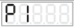 | 0, 1, b, -b, C, -C, E, -E, SA, -SA, Sb, -Sb, ES, -ES, od, -od, oP, -oP | C |
| Paramètre du moteur | Source de contrôle de démarrage/arrêt avant 2 | F2 |  | 0, 1, b, -b, C, -C, E, -E, SA, -SA, Sb, -Sb, ES, -ES, od, -od, oP, -oP | -b |
| Paramètre du moteur | Relation logique de démarrage/arrêt avant | FA |  | And, or, Xor, rS | And |
| Paramètre du moteur | Source de contrôle de marche arrière 1 | A1 |  | 0, 1, b, -b, C, -C, E, -E, SA, -SA, Sb, -Sb, ES, -ES, od, -od, oP, -oP | E |
| Paramètre du moteur | Source de contrôle de marche arrière 2 | A2 |  | 0, 1, b, -b, C, -C, E, -E, SA, -SA, Sb, -Sb, ES, -ES, od, -od, oP, -oP | -b |
| Paramètre du moteur | Relation logique de marche arrière | AA |  | And, or, Xor, rS | And |
| Paramètre du moteur | Mode de contrôle avant et arrière | Fr |  | 0 (La source de contrôle avant est utilisée pour démarrer et arrêter la rotation avant, et la source de contrôle arrière est utilisée pour contrôler le démarrage et l'arrêt de la rotation arrière) 1 (La source de contrôle avant est utilisée pour contrôler le démarrage et l'arrêt, la source de contrôle arrière est utilisée pour contrôler la marche avant et arrière) | 0 |
| Paramètre du moteur | Source d'arrêt d'urgence | Eq |  | 0, 1, b, -b, C, -C, E, -E, SA, -SA, Sb, -Sb, ES, -ES, od, -od, oP, -oP, oq, -oq, Er, -Er, Ar, -Ar | ES |
| Paramètre du moteur | Type d'arrêt d'urgence | Sq |  | Sto: Arrêt de couple sécurisé, Sbc: Commande de frein de sécurité, SS1: Arrêt de sécurité de catégorie 1　(Remarque 1) | Sto |
| Paramètre du moteur | Temps de démarrage progressif | t |  | 0.0~99.9 (s) | 10.0 |
| Paramètre du moteur | Temps d'arrêt progressif | d |  | Temps de freinage DC : -0.0~-99.9 (s) Temps d'arrêt progressif : 0.0~99.9 (s) | 10.0 |
| Paramètre du moteur | Fréquence maximale | y |  | 2.0~120.0 (Hz) | 50.0 |
| Paramètre du moteur | Fréquence nominale | b |  | 45.0~65.0 (Hz) | 50.0 |
| Paramètre du moteur | Tension nominale | h |  | 70~220 (Vrmn) | 200 |
| Paramètre du moteur | Fréquence intermédiaire | n |  | r~b (Hz) | 10.0 |
| Paramètre du moteur | Tension intermédiaire | o |  | u~h (Vrmn) | 40 |
| Paramètre du moteur | Fréquence minimale | r |  | 2.0~n (Hz) | 2.0 |
| Paramètre du moteur | Tension minimale | u |  | 0~o (Vrmn) | 8 |
| Paramètre du moteur | Puissance électrique nominale du moteur | Pn |  | 0.01~0.20 (kW) | 0.20 |
| Paramètre du moteur | Facteur d'excès de puissance | rc |  | 100~150 (%) | 150 |
| Paramètre du moteur | Coefficient de courant de freinage | cb |  | 10~150 (%) | 100 |
| Paramètre du moteur | Seuil de surchauffe de puissance électrique | oL |  | 0~90 (fois*secondes) Remarques : si la puissance électrique nominale du moteur est dépassée sans dépasser la limite supérieure de la puissance du moteur, si l'intégrale par seconde dépasse ce réglage, il entrera en état de protection électronique contre la surchauffe. | 30 |
| Paramètre du moteur | Facteur de déclassement de puissance | rL |  | 0~90(%) 0 signifie arrêt, 90 signifie réduire à 90% de la puissance nominale. | 0 |
| Paramètre du moteur | Échange du sens de rotation (Remarque 2) | Ph |  | Abc: sens standard, Acb: échange de sens, A.b.c. : l'inversion du sens standard est interdite (marche avant uniquement), A.c.b. : l'échange de sens interdit la marche avant (marche arrière uniquement) | AbC |
| Paramètre du moteur | État de fonctionnement à la mise sous tension | PS |  | run: en fonctionnement, stp: à l'arrêt, FoL: enregistrer le dernier état | FoL |

**Paramètre de port**  
Maintenez appuyés ⚙ et ▲

| Définition | Symbole | image du symbole | Plage | Défaut |
|---|---|---|---|---|
| Sensibilité photoélectrique intelligente | P |  | nPn, PnP, 2~1000 | nPn |
| Retard d'activation du capteur photoélectrique intelligent | J |  | 0.0~99.9 (s) | 0.2 |
| Retard de désactivation du capteur photoélectrique intelligent | L |  | 0.0~99.9 (s) | 0.2 |
| Type de capteur de commutation | rA |  | nPn, PnP, Ut1: Balayage unique, Ut0: Balayage continu | Ut0 |
| Retard d'activation de marche avant | JC |  | 0.0~99.9 (s) | 0.2 |
| Retard de désactivation de marche avant | LC |  | 0.0~99.9 (s) | 0.2 |
| Retard d'activation de marche arrière | JE |  | 0.0~99.9 (s) | 0.2 |
| Retard de désactivation de marche arrière | LE |  | 0.0~99.9 (s) | 0.2 |
| Retard d'activation de vitesse A/B | JG |  | 0.0~99.9 (s) | 0.2 |
| Retard de désactivation de vitesse A/B | LG |  | 0.0~99.9 (s) | 0.2 |
| Retard d'activation d'arrêt d'urgence | JJ |  | 0.0~99.9 (s) | 0.2 |
| Retard de désactivation d'arrêt d'urgence | LL |  | 0.0~99.9 (s) | 0.2 |
| Source de préréglage de vitesse 1 | S1 |  | 0, 1, b, -b, C, -C, E, -E, SA, -SA, Sb, -Sb, ES, -ES, od, -od, oP, -oP, oq, -oq, Er, -Er, Ar, -Ar | SA |
| Source de préréglage de vitesse 2 | S2 |  | 0, 1, b, -b, C, -C, E, -E, SA, -SA, Sb, -Sb, ES, -ES, od, -od, oP, -oP, oq, -oq, Er, -Er, Ar, -Ar | Sb |
| Source de signal de sortie de marche 1 | Ed |  | 0, 1, b, -b, C, -C, E, -E, SA, -SA, Sb, -Sb, ES, -ES, od, -od, oP, -oP, oq, -oq, Er, -Er, Ar, -Ar | oq |
| Source de signal de sortie de marche 2 | td |  | 0, 1, b, -b, C, -C, E, -E, SA, -SA, Sb, -Sb, ES, -ES, od, -od, oP, -oP, oq, -oq, Er, -Er, Ar, -Ar | 0 |
| Relation logique de sortie de marche | Ad |  | And, or, Xor, rS | or |
| Retard d'activation de sortie de marche | Jd |  | 0.0~99.9 (s) | 0.0 |
| Retard de désactivation de sortie de marche | Ld |  | 0.0~99.9 (s) | 0.0 |
| Mode de sortie de marche | Fd |  | dLy (mode retard), HLd (mode maintien) | dLy |
| Direction logique de sortie de marche | Sd |  | `---` En phase, `-﹉-` inversé, on (normalement ouvert), oFF (normalement fermé) | `---` |
| Type de sortie de marche | rd |  | nPn, PnP, PSP (push-pull) | nPn |
| Source de signal de sortie de défaut 1 | EP |  | 0, 1, b, -b, C, -C, E, -E, SA, -SA, Sb, -Sb, ES, -ES, od, -od, oP, -oP, oq, -oq, Er, -Er, Ar, -Ar | Er (signal d'erreur) |
| Source de signal de sortie de défaut 2 | 2P |  | 0, 1, b, -b, C, -C, E, -E, SA, -SA, Sb, -Sb, ES, -ES, od, -od, oP, -oP, oq, -oq, Er, -Er, Ar, -Ar | Ar (signal d'avertissement) |
| Relation logique de sortie de défaut | AP |  | And, or, Xor, rS | or |
| Retard d'activation de sortie de défaut | JP |  | 0.0~99.9 (s) | 0.0 |
| Retard de désactivation de sortie de défaut | LP |  | 0.0~99.9 (s) | 0.0 |
| Mode de sortie de défaut | FP |  | dLy (mode retard), HLd (mode maintien) | dLy |
| Direction logique de sortie de défaut | SP |  | `---` En phase, `-﹉-` inversé, on (normalement ouvert), oFF (normalement fermé) | `---` |
| Type de sortie de défaut | rP |  | nPn, PnP, PSP (push-pull) | nPn |

Symbole d'affichage de la direction logique：

| | Définition | Symbole | image du symbole | Plage | Défaut |
|---|---|---|---|---|---|
| Paramètre de port | Source de commande à distance | A |  | Pad (contrôlé par boutons), 1-5V, 0-5V, 0-10 | 1-5V |
| Paramètre de port | Coefficient de commande à distance | r |  | 0.50~2.00 | 1.00 |
| Paramètre de port | Luminosité du panneau | LEd |  | 1~32 | 16 |
| Paramètre de port | Restauration des paramètres par défaut | 8.8.8.8.8. |  | —— | —— |
| Paramètre de surveillance Maintenez appuyés ⚙ et ▼ | Température du contrôleur | C |  | -20.0~85.0 (℃) | —— |
| Paramètre de surveillance | Fréquence de sortie | E |  | 2.0~120.0 (Hz) | —— |
| Paramètre de surveillance | Puissance active du système (contrôleur + moteur) | qP |  | 0.00~0.40 (kW) | —— |
| Paramètre de surveillance | Courant du bus | AC |  | 0.00~3.50 (A) | —— |
| Paramètre de surveillance | Tension de sortie | dU |  | 0~250 (V) | —— |
| Paramètre de surveillance | Tension du bus | PU |  | 0~400 (V) | —— |
| Paramètre de surveillance | Tension de sortie 24V | nU |  | 0.0~28.0 (V) | —— |
| Paramètre de surveillance | Tension du port de commande à distance | AU |  | 0.0~10.0 (V) | —— |
| Paramètre de surveillance | Tension du signal photoélectrique intelligent | bU |  | 0~999 | —— |
| Paramètre de surveillance | Tension du signal de marche avant | tU |  | 0.0~28.0 (V) | —— |
| Paramètre de surveillance | Tension du port de sortie de marche | dU |  | 0.0~28.0 (V) | —— |
| Paramètre de surveillance | Tension du signal de marche arrière | EU |  | 0.0~28.0 (V) | —— |
| Paramètre de surveillance | Tension du port de vitesse A | SA |  | 0.0~28.0 (V) | —— |
| Paramètre de surveillance | Tension du port de vitesse B | Sb |  | 0.0~28.0 (V) | —— |
| Paramètre de surveillance | Tension du port d'arrêt d'urgence | SU |  | 0.0~28.0 (V) | —— |
| Paramètre de surveillance | Tension du port de sortie de défaut | FU |  | 0.0~28.0 (V) | —— |
| Paramètre de surveillance | Version de la carte de commande | uc |  | —— | —— |
| Paramètre de surveillance | Version de la carte de puissance | uq |  | —— | —— |

Remarque 1 : lorsque STo, le contrôleur coupe immédiatement l'alimentation du moteur, et le moteur décélère et s'arrête selon l'inertie.

Lorsque Sbc, le moteur freine jusqu'à l'arrêt par freinage DC, et le temps de freinage est confirmé par le temps d'arrêt progressif. Le port de sortie de défaut émet un état d'arrêt d'urgence, qui n'est pas contrôlé par la source de signal, et doit utiliser un relais de frein de sécurité.

Lorsque SS1, le moteur décélère ou freine jusqu'à l'arrêt selon l'action définie par le temps d'arrêt progressif.

Remarque 2 : selon IEC60034-8, le sens standard est défini comme suit : le sens horaire observé depuis le côté de l'entraînement du moteur ; ce paramètre n'affecte pas l'état des indicateurs de marche avant et de marche arrière.

---

## 7.2 Schémas de circuit d'entrée et de sortie

**Port de commande de vitesse à distance A**

**Port de capteur photoélectrique intelligent B**

**Port de sortie de marche D/Port de sortie de défaut P**

---

| Port | Fonction |
|---|---|
| C3/E3/M3 | Sortie 24V |
| C2/E2/M2/G2/G4 | Entrée |
| C1/E1/M1/G1/G3 | GND |

**Port de marche avant C/Port de marche arrière E/**  
**Port d'arrêt d'urgence M/Port de préréglage de vitesse G**

---

## 7.3 Code d'erreur

| Code d'erreur | Signification | Conditions d'apparition | Réponse du contrôleur | Méthodes de dépannage |
|---|---|---|---|---|
| Er01 | Court-circuit de la sortie principale | Sortie en court-circuit entre phases ou entre phase et PE | Arrêtez la sortie principale, appuyez brièvement sur le bouton ON/OFF pour effacer. | ◆ Court-circuitez l'interrupteur de sortie ou éteignez l'interrupteur de sortie deux fois, puis rallumez. |
| Er02H | Surchauffe électronique du moteur | Le moteur dépasse le seuil de surchauffe de puissance électrique | Arrêtez et redémarrez automatiquement ou fonctionnez à puissance nominale réduite selon le réglage du facteur de déclassement de puissance. | ◆ Réduisez de manière appropriée le réglage de fréquence de fonctionnement du moteur. |
| Er02P | La puissance du moteur dépasse la limite | La puissance de sortie dépasse le coefficient d'excès de puissance | Arrêtez et redémarrez automatiquement ou fonctionnez à puissance nominale réduite selon le réglage du facteur de déclassement de puissance. | ◆ Réduisez de manière appropriée le réglage de fréquence de fonctionnement du moteur. |
| Er03L | Sous-refroidissement | La température du contrôleur est inférieure à -20°C | Arrêtez la sortie principale. La sortie redémarre automatiquement lorsque la température revient à la normale. | ◆ Évitez d'activer le contrôleur à des températures extrêmement froides. |
| Er03H | Surchauffe | La température du contrôleur est supérieure à 65°C | Arrêtez la sortie principale. La sortie redémarre automatiquement lorsque la température revient à la normale. | ◆ Installez ce contrôleur dans un environnement bien ventilé. |
| Er04L | Sous-tension | La tension moyenne du bus est inférieure à 77V | Arrêtez la sortie principale. La sortie est automatiquement restaurée lorsque la tension d'alimentation est normale. | ◆ Assurez-vous que la tension d'entrée est comprise entre 85V~250V. |
| Er04H | Surtension | La tension moyenne du bus est supérieure à 390V | Arrêtez la sortie principale. La sortie est automatiquement restaurée lorsque la tension d'alimentation est normale. | ◆ Assurez-vous que la tension d'entrée est comprise entre 85V~250V. |
| Er05 | Anomalie de communication interne | Aucune réponse reçue de la carte de puissance pendant 2 secondes consécutives | Arrêtez la sortie principale. Éliminée automatiquement lorsque la communication est rétablie | ◆ Assurez-vous que le port d'alimentation 24V n'est connecté à aucune alimentation externe ou contactez notre support technique. |
| Er06 | Anomalie du capteur de température | Impossible de lire la température | Arrêtez la sortie principale et essayez de lire la température pendant 2 secondes. | ◆ Contactez notre support technique. |
| Er07d/P | Court-circuit du port de sortie de marche/défaut | Le courant de sortie dépasse 350mA ou court-circuit | Sortie de marche/défaut désactivée dans les 5ms, Essayez de redémarrer la sortie après 2 secondes. | ◆ Assurez-vous que la charge n'est pas en court-circuit et que le courant ne dépasse pas 350mA |
| Er10 | Court-circuit de sortie 24V | La sortie 24V est en court-circuit ou en surintensité au-delà de 700mA | Arrêtez la sortie 24V et rallumez pour redémarrer la sortie. | ◆ Assurez-vous que la sortie 24V n'est pas en court-circuit ou que la sortie ne dépasse pas 700mA. |
| Er11 | Anomalie de sortie 5V | La sortie 5V dépasse la plage de ±10% | La commande de vitesse à distance échoue, elle peut se rétablir automatiquement | ◆ Assurez-vous que la sortie 5V n'a pas été court-circuitée ou connectée à une tension externe. |
| Er12 | Anomalie de tension 24V | Vérifiez si la tension interne 24V est comprise entre 22~26V | Le port de sortie de commande présente une haute impédance, il peut se rétablir automatiquement | ◆ Assurez-vous que le port de sortie d'alimentation 24V ou le port de sortie de commande n'est connecté à aucune alimentation externe |
| Er13 | Phase manquante en entrée (modèles à entrée triphasée uniquement) | L'entrée d'alimentation triphasée présente une phase manquante | Arrêtez la sortie principale | ◆ Mettez hors tension pour éliminer la phase manquante de l'entrée, puis remettez sous tension. |
| Er14 | Phase manquante en sortie | Déséquilibre du courant de phase de sortie supérieur à 50% | Arrêtez la sortie principale | ◆ Mettez hors tension pour éliminer la phase manquante de la sortie, puis remettez sous tension. |
| Er15 | Conflit de marche avant et arrière | Les signaux de marche avant et arrière sont donnés en même temps | La sortie principale est arrêtée, elle sera automatiquement rétablie après la suppression du conflit | ◆ Assurez-vous que les signaux de marche avant et arrière ne sont pas donnés en même temps. |

## Chapitre Ⅷ Informations sur la garantie du produit

### 8.1 Période de garantie

La période de garantie fournie par l'entreprise pour ce produit est de 3 ans à compter de la date de livraison du produit au lieu désigné par l'acheteur.

### 8.2 Couverture de la garantie

(1) Si une panne causée par notre entreprise survient pendant la période de garantie ci-dessus, nous réparerons le produit gratuitement. Cependant, les situations suivantes ne sont pas couvertes par la garantie :

a. Non-respect des conditions spécifiées dans le manuel simple, le manuel d'utilisation ou les exigences techniques convenues spécifiquement entre l'acheteur et l'entreprise, opération inappropriée ou panne causée par une mauvaise utilisation.

b. Panne non due à un défaut du produit, mais à la conception de l'équipement ou du logiciel de l'acheteur.

c. Dysfonctionnements causés par des modifications ou réparations non effectuées par le personnel de l'entreprise.

d. La panne qui pourrait être totalement évitée par un entretien correct ou le remplacement des pièces d'usure conformément au guide d'utilisation simple ou au manuel d'utilisation.

e. Après l'expédition du produit depuis notre entreprise, elle est causée par des facteurs tels que des changements imprévus du niveau de la science et de la technologie.

f. En raison de catastrophes naturelles telles que l'incendie, le tremblement de terre, l'inondation, ou de facteurs externes tels qu'une panne de tension anormale, l'entreprise n'est pas responsable de la garantie.

(2) L'étendue de la garantie est limitée à la situation stipulée au (1)，les pertes indirectes (telles que dommages à l'équipement, opportunités, perte de bénéfices, etc.) ou d'autres pertes, l'entreprise n'assume aucune responsabilité.

### 8.3 Adéquation du produit

Le contrôleur de notre entreprise est conçu et produit pour un usage général dans l'industrie de commande de moteur. Par conséquent, ce contrôleur de notre entreprise ne doit pas être utilisé pour les applications suivantes et n'est pas adapté à son utilisation.

(1) Installations ayant un impact grave sur la vie et les biens, telles que les centrales nucléaires, les aéroports, les chemins de fer, les navires, les dispositifs motorisés et les équipements médicaux.

(2) Services publics, y compris l'électricité, le gaz, l'approvisionnement en eau, etc.

(3) Utilisation en extérieur dans des conditions ou environnements similaires.

---

Nanjing CUH Science & Technology Co.,Ltd  
https://en.cuhnj.com  
Tel.:+86-25-84730411 / 84730415 / 84730416  
Fax:+86-25-84730426  
E-mail:sales@cuhnj.com  
Add.:Building 2, Xueyan Tech Park, Tuscity,  
No.9 Zhineng Rd, Jiangning, Nanjing, China

Document No.: IDP1000330

