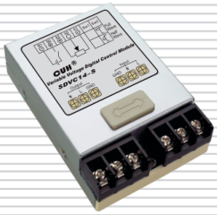
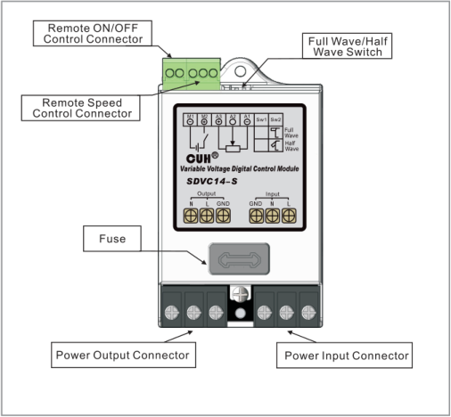
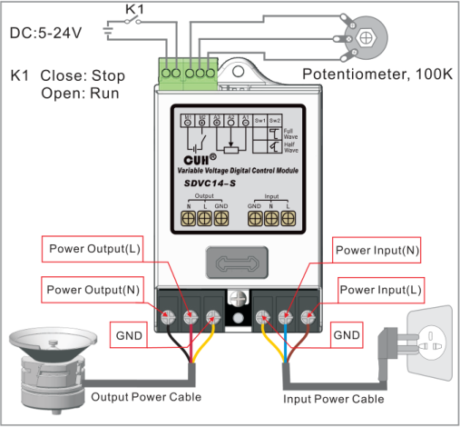
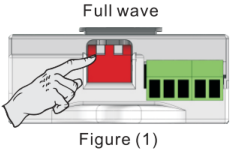
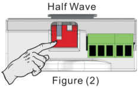

CUH

# Module de commande numérique à tension variable pour alimentateur vibrant

Modèle : SDVC14-S

## Présentation générale :

## Câblage :

## Interrupteur onde complète/demi-onde :

La forme d'onde/la fréquence de sortie peut être commutée

Si la fréquence du réseau est de 50/60Hz, la fréquence de sortie sera de 100/120Hz lorsque l'interrupteur est réglé comme indiqué sur la Figure (1)

Si la fréquence du réseau est de 50/60Hz, la fréquence de sortie sera de 50/60Hz lorsque l'interrupteur est réglé comme indiqué sur la Figure (2)

## Caractéristiques :

1) Régulation automatique de tension : Le circuit interne de régulation numérique de tension peut réduire la variation de vitesse d'alimentation causée par la fluctuation de la tension du réseau.

2) Démarrage progressif : Le contrôleur augmente progressivement la tension de sortie de 0 à la valeur préréglée lors de la mise sous tension afin d'éviter toute secousse soudaine.

3) Commande linéaire de tension : L'angle de rotation du potentiomètre externe est linéaire avec la tension de sortie du module de commande.

4) Connecteurs de commande de signal : Le module de commande dispose de connecteurs pour la commande marche/arrêt à distance et la commande de vitesse à distance.

5) Conception de circuit optimisée pour garantir la stabilité et une longue durée de vie.

6) Protection contre la surchauffe : Si la température interne du module de commande devient trop élevée, le module de commande arrête sa sortie pour se protéger.

7) Protection contre la surintensité : Si le courant de sortie dépasse sa valeur nominale, le module de commande arrête sa sortie pour se protéger lui-même et la charge.

8) Protection par fusible contre les courts-circuits : Si la sortie du module de commande est court-circuitée, le fusible interne fond pour protéger le module de commande et la charge.

## Spécifications :

| Élément | Plage : Min | Plage : Typique | Plage : Max | Unité | Description |
|---|---|---|---|---|---|
| Tension d'entrée | 150 | 220 | 260 | V | AC RMS |
| Plage ajustable de tension de sortie | 35 | —— | Vin-10 | V | Demi-onde |
| | 45 | —— | Vin-5 | | Onde complète |
| Temps de réponse de la régulation de tension | 0 | 0.01 | 0.02 | s | |
| Plage ajustable de courant de sortie | 0.1 | —— | 4 | A | |
| Puissance de sortie | 22 | —— | 880 | VA | |
| Fréquence de sortie | 45 | 50/60 | 65 | Hz | Demi-onde |
| | 90 | 100/120 | 130 | Hz | Onde complète |
| Forme d'onde de sortie | | Sinus découpé en phase | | | |
| Temps de démarrage progressif | 0.5 | 0.65 | 0.7 | s | |
| Température de déclenchement de la protection contre la surchauffe | 58 | 60 | 66 | ℃ | |
| Tension de commande marche/arrêt à distance | 5 | —— | 24 | V | |
| Capacité du fusible | | 6.3 | | A | |
| Température ambiante | 0 | 25 | 40 | ℃ | Sans condensation |
| Humidité ambiante | 10 | 60 | 85 | % | |

## Dimensions et poids :

Dimensions : 102(L)mm X 63(W)mm X 27(H)mm  
Poids : 92g

Nanjing CUH Science & Technology Co.,Ltd  
https://en.cuhnj.com  
Tel.:+86-25-84730411 / 84730415 / 84730416  
Fax:+86-25-84730426  
E-mail:sales@cuhnj.com  
Add.:Building 2, Xueyan Tech Park, Tuscity,  
No.9 Zhineng Rd, Jiangning, Nanjing, China

Document NO. : SDVC14SSMSEN_1.04

