## Contrôleur numérique à tension variable pour alimentateur vibrant

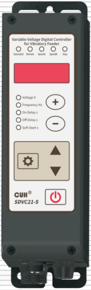

## SDVC21-S

## Manuel d'utilisation

---

## Mention de droits d'auteur

Nanjing CUH Science & Technology Co., Ltd. se réserve tous les droits.

Toutes les informations contenues dans ce manuel d'utilisation constituent le savoir-faire de notre société et sont protégées par le droit d'auteur et les autres lois applicables. CUH jouit et se réserve tous les droits conférés par le droit d'auteur et les autres lois. Sans le consentement écrit de CUH, il est interdit de copier, traduire, imiter ou autrement exploiter tout ou partie de ce manuel d'utilisation.

## Clause de non-responsabilité

Toutes les informations contenues dans ce manuel d'utilisation décrivent uniquement la méthode d'utilisation des produits apparentés fabriqués par notre société ; elles sont décrites selon l'état de la technique et l'état du produit au moment de sa mise à votre disposition. Vous devez assumer les risques correspondants lors de l'utilisation de ce produit. Sauf disposition légale contraire, la société n'assume aucune responsabilité expresse ou implicite pour le produit au titre de ce manuel d'utilisation, y compris, mais sans s'y limiter, les dommages corporels, les dommages matériels, la perte d'opportunités, etc.

Vous comprenez clairement les risques ci-dessus et acceptez que, sauf disposition légale impérative, la société ne soit pas responsable de tout dommage ou perte direct ou indirect vous concernant (y compris, mais sans s'y limiter, les pertes tangibles de personnes, de biens, de données, etc. ainsi que les pertes immatérielles de réputation, d'opportunités, etc.).

La société se réserve le droit de modifier les produits concernés par ce manuel d'utilisation sans préavis.

---

## Avant-propos

Merci d'avoir choisi le contrôleur d'alimentation par vibration à régulation numérique de tension CUH SDVC21-S. (Ci-après dénommé « le contrôleur »). Cette série de contrôleurs utilise des composants de haute qualité, intègre les dernières technologies électroniques et a été soigneusement conçue avec des processeurs de signaux numériques hautes performances.

Ce manuel présente la méthode de fonctionnement de base, la description technique fonctionnelle et des exemples d'application typiques de ce produit. Il fournit aux utilisateurs des informations pertinentes sur l'installation et la mise en service, le réglage des paramètres, le diagnostic des anomalies, le dépannage et la maintenance de routine du contrôleur. Afin de garantir l'installation et l'utilisation correctes de ce contrôleur, veuillez lire attentivement ce manuel d'utilisation avant l'installation et le conserver soigneusement.

Assurez-vous de lire les symboles suivants, qui vous alertent sur les précautions à prendre contre les blessures corporelles et les dommages au produit.

| | |
|---|---|
| ⚠ Danger | Le non-respect de ce point entraînera des blessures corporelles ou la mort. |
| ⚠ Avertissement | Le non-respect de ce point peut entraîner des blessures corporelles ou la mort. |
| ⚠ Attention | Le non-respect de ce point peut entraîner des blessures modérées ou légères aux personnes. |
| Avis | Le non-respect de ce point entraînera des dommages au produit et des dommages matériels. |
| ❗ Obligatoire | Indique les précautions et les restrictions d'utilisation à respecter impérativement pendant l'utilisation. |

**Ce manuel s'applique aux modèles de contrôleurs suivants :**

- Contrôleur numérique à tension variable pour alimentateur vibrant　SDVC21-S (5A)

---

## Sécurité et précautions

1. **⚠ Danger** Ce produit est uniquement destiné à entraîner des équipements d'alimentation par vibration à base d'électroaimants ; ne l'utilisez pas dans le but de protéger le corps humain ou des parties du corps humain, etc.

2. **⚠ Danger** Ce produit n'est pas destiné à être utilisé comme produit antidéflagrant ; ne l'utilisez pas dans des emplacements dangereux et/ou des environnements à atmosphère explosible.

3. **⚠ Avertissement** Ce produit est alimenté par le secteur en courant alternatif ; veuillez ne pas appliquer une tension alternative supérieure à 260Vac. Une tension d'entrée excessive, telle que 380Vac, peut faire exploser le produit ou provoquer un incendie, entraînant de graves accidents de sécurité.

4. **⚠ Avertissement** Ce produit est mis à la terre par le cordon d'alimentation. Veuillez vous assurer que les installations de distribution d'énergie du contrôleur sont correctement mises à la terre ; sinon, le boîtier du contrôleur peut être sous tension, entraînant un accident d'électrocution.

5. **⚠ Avertissement** Ne pas appliquer d'alimentation alternative sur la sortie de ce contrôleur, cela endommagerait le contrôleur.

6. **⚠ Avertissement** Ne branchez ni ne débranchez le câblage sous tension et ne touchez pas les contacts de chaque borne de connexion du compartiment de câblage, afin d'éviter une électrocution.

7. **Avis** Veuillez éviter de commander la sortie de ce produit en coupant l'alimentation par des relais ou d'autres dispositifs ; sinon, la durée de vie du contrôleur serait gravement réduite.

8. **Avis** Le contrôleur est conçu pour fonctionner dans un environnement frais et sec. Ne faites jamais fonctionner le contrôleur à l'extérieur afin d'éviter toute immersion et tout ensoleillement. Utilisez le contrôleur dans la plage de température spécifiée dans les caractéristiques électriques.

9. **❗ Obligatoire** Assurez-vous de fixer ce produit sur une plateforme solide, correctement mise à la terre et éloignée des équipements vibrants.

10. **❗ Obligatoire** Ne faites jamais fonctionner le contrôleur dans des conditions dépassant ses limites de conception.

11. **❗ Obligatoire** Utilisez le contrôleur strictement conformément à ce manuel d'instructions. Nous n'assumerons aucune responsabilité civile ou pénale si des dommages à l'équipement ou des blessures corporelles sont causés par une utilisation incorrecte.

12. **❗ Obligatoire** N'ouvrez jamais le boîtier du contrôleur afin d'éviter une électrocution. Contactez CUH si le contrôleur tombe en panne. N'essayez jamais de réparer le contrôleur vous-même, ce qui pourrait annuler la garantie.

---

## Environnement de fonctionnement et de stockage

### Inspection avant utilisation

Chaque contrôleur subit un contrôle qualité rigoureux avant sa livraison et est emballé dans un emballage anti-choc. Veuillez vérifier les points suivants après le déballage :

1. Si le contrôleur a été endommagé pendant le transport.
2. Si le modèle du contrôleur est bien celui que vous avez commandé.

### Environnement d'exécution

Veuillez respecter les notes ci-dessous afin de garantir de meilleures performances et une durée de vie plus longue du contrôleur :

- ⚠ Environnement bien ventilé
- ⚠ Tenir à l'écart de l'eau, de la vapeur, de la poussière et surtout de la poussière huileuse
- ⚠ Tenir à l'écart des gaz et liquides corrosifs ou inflammables
- ⚠ Tenir à l'écart des poussières en suspension et des particules métalliques
- ⚠ Fixation ferme pour éviter les vibrations propres
- ⚠ Tenir à l'écart des interférences électromagnétiques
- ⚠ Assurer une température ambiante de 0~40 ℃
- ⚠ Pour une utilisation à une altitude de 2000 m ou moins

---

# Table des matières

- **Chapitre Ⅰ Avant utilisation — 1**
  - 1.1 Vérification du contenu de l'emballage — 1
  - 1.2 Explication des indicateurs, des boutons et des pièces externes — 2
  - 1.3 Explication des ports de câblage — 3
  - 1.4 Explication de la plaque signalétique — 3
- **Chapitre Ⅱ Caractéristiques — 4**
- **Chapitre Ⅲ Guide d'installation — 6**
  - 3.1 Conditions d'utilisation du contrôleur — 6
  - 3.2 Méthode d'utilisation des boutons — 6
  - 3.3 Installation et utilisation — 7
- **Chapitre Ⅳ Description des fonctions de base — 9**
  - 4.1 Tension de sortie — 9
  - 4.2 Fréquence de sortie — 10
  - 4.3 Temps de démarrage progressif — 11
  - 4.4 Interrupteur de sortie — 11
  - 4.5 Limite de tension de sortie maximale — 12
  - 4.6 Verrouillage du clavier — 12
  - 4.7 Restauration des réglages d'usine — 13
- **Chapitre Ⅴ Capteurs et contrôle des signaux — 14**
  - 5.1 Détection photoélectrique intelligente — 14
    - 5.1.1 Méthode de câblage du capteur photoélectrique intelligent — 14
    - 5.1.2 Retard d'enclenchement/de déclenchement du capteur photoélectrique intelligent — 15
    - 5.1.3 Réglage de la direction logique du capteur photoélectrique intelligent — 16
  - 5.2 Méthode d'utilisation du capteur de commutation NPN — 17
    - 5.2.1 Méthode de câblage du capteur de commutation NPN — 17
    - 5.2.2 Retard d'enclenchement/de déclenchement du capteur de commutation NPN — 18
    - 5.2.3 Réglage de la direction logique du capteur de commutation NPN — 19
  - 5.3 Méthode d'utilisation du deuxième capteur de commutation NPN — 20
    - 5.3.1 Méthode de câblage du deuxième capteur de commutation NPN — 20
    - 5.3.2 Retard d'enclenchement/de déclenchement du deuxième capteur de commutation NPN — 21
    - 5.3.3 Réglage de la direction logique du deuxième capteur de commutation NPN — 22
  - 5.4 Réglage de la relation logique du signal de contrôle — 23
  - 5.5 Sortie de contrôle — 24
    - 5.5.1 Méthode de câblage de la sortie de contrôle — 24
    - 5.5.2 Réglage de la direction logique de la sortie de contrôle — 26
  - 5.6 Contrôle de vitesse à distance — 27
  - 5.7 Commutation de vitesse préréglée — 28
- **Chapitre Ⅵ Fonctions de sécurité — 29**
  - 6.1 Stabilisation numérique automatique de tension — 29
  - 6.2 Protection contre les courts-circuits — 29
  - 6.3 Protection contre la surcharge de courant — 29
  - 6.4 Protection contre la surchauffe — 29
- **Chapitre Ⅶ Spécifications techniques — 30**
  - 7.1 Dimensions — 30
  - 7.2 Spécifications techniques — 31
  - 7.3 Norme de référence — 32
  - 7.4 Tableau des paramètres — 33
  - 7.5 Suggestions de dépannage et explications des erreurs — 34
- **Chapitre Ⅷ Informations de garantie du produit — 35**
  - 8.1 Période de garantie — 35
  - 8.2 Couverture de la garantie — 35
  - 8.3 Adéquation du produit — 35

---

# Chapitre Ⅰ Avant utilisation

Ce chapitre présente le contenu de l'emballage du produit, la description de l'apparence du contrôleur et les informations de la plaque signalétique du contrôleur.

## 1.1 Vérification du contenu de l'emballage

Avant utilisation, veuillez vérifier l'intégrité du contrôleur et des accessoires. Si vous constatez que le produit est défectueux ou endommagé, que des accessoires manquent, etc., veuillez contacter notre société.

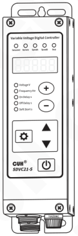

Contrôleur×1

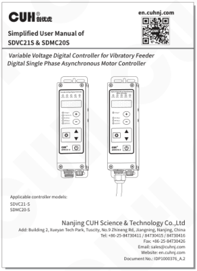

Manuel d'utilisation×1

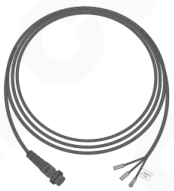

Câble de sortie×1

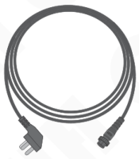

Cordon d'alimentation d'entrée×1

---

## 1.2 Explication des indicateurs, des boutons et des pièces externes

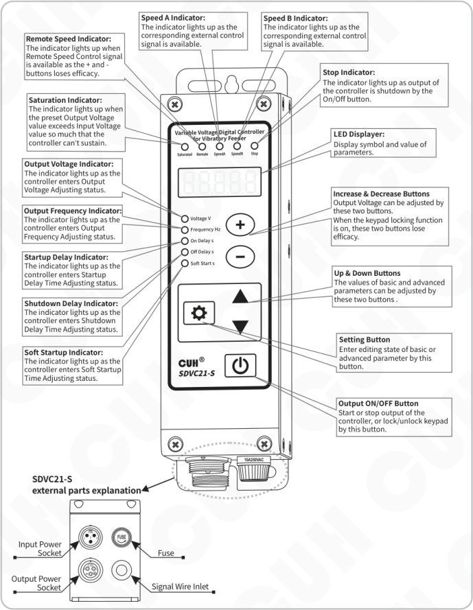

### Indicateurs et affichage

**Indicateur de vitesse à distance :**  
L'indicateur s'allume lorsque le signal de contrôle de vitesse à distance est disponible, auquel cas les boutons + et - n'ont plus d'effet.

**Indicateur de vitesse A :**  
L'indicateur s'allume lorsque le signal de contrôle externe correspondant est disponible.

**Indicateur de vitesse B :**  
L'indicateur s'allume lorsque le signal de contrôle externe correspondant est disponible.

**Indicateur d'arrêt :**  
L'indicateur s'allume lorsque la sortie du contrôleur est arrêtée par le bouton de marche/arrêt.

**Indicateur de saturation :**  
L'indicateur s'allume lorsque la valeur de tension de sortie préréglée dépasse tellement la valeur de tension d'entrée que le contrôleur ne peut pas la maintenir.

**Afficheur LED :**  
Affiche le symbole et la valeur des paramètres.

**Indicateur de tension de sortie :**  
L'indicateur s'allume lorsque le contrôleur entre en état de réglage de la tension de sortie.

**Indicateur de fréquence de sortie :**  
L'indicateur s'allume lorsque le contrôleur entre en état de réglage de la fréquence de sortie.

**Indicateur de retard de démarrage :**  
L'indicateur s'allume lorsque le contrôleur entre en état de réglage du temps de retard de démarrage.

**Indicateur de retard d'arrêt :**  
L'indicateur s'allume lorsque le contrôleur entre en état de réglage du temps de retard d'arrêt.

**Indicateur de démarrage progressif :**  
L'indicateur s'allume lorsque le contrôleur entre en état de réglage du temps de démarrage progressif.

### Boutons

**Boutons d'augmentation et de diminution**  
La tension de sortie peut être ajustée à l'aide de ces deux boutons.  
Lorsque la fonction de verrouillage du clavier est activée, ces deux boutons n'ont plus d'effet.

**Boutons haut et bas**  
Les valeurs des paramètres de base et avancés peuvent être ajustées à l'aide de ces deux boutons.

**Bouton de réglage**  
Ce bouton permet d'entrer en état de modification d'un paramètre de base ou avancé.

**Bouton de marche/arrêt de la sortie**  
Ce bouton permet de démarrer ou d'arrêter la sortie du contrôleur, ou de verrouiller/déverrouiller le clavier.

### Explication des pièces externes du SDVC21-S

- Prise d'alimentation d'entrée
- Prise d'alimentation de sortie
- Fusible
- Entrée du câble de signal

---

## 1.3 Explication des ports de câblage

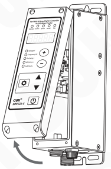

**Étape 1 :** Retirez les vis situées aux quatre coins du panneau.

**Étape 2 :** Ouvrez le panneau vers le haut ; le port de câblage se trouve à l'arrière du panneau.

| Port de câblage | Borne | Signal |
|---|---|---|
| SensorⅡ | A1 | GND |
| SensorⅡ | A2 | Entrée |
| SensorⅡ | A3 | +24V |
| Preset | B1 | GND |
| Preset | B2 | Pset A |
| Preset | B3 | GND |
| Preset | B4 | Pset B |
| Ctrl Out | C1 | Sortie |
| Ctrl Out | C2 | +24V |
| SensorⅠ | D1 | GND |
| SensorⅠ | D2 | Entrée |
| SensorⅠ | D3 | +24V |
| Photosensor | E1 | GND |
| Photosensor | E2 | Rx |
| Photosensor | E3 | GND |
| Photosensor | E4 | Tx |
| Speed Ctrl | F1 | +5V |
| Speed Ctrl | F2 | Entrée |
| Speed Ctrl | F3 | RGND |

## 1.4 Explication de la plaque signalétique

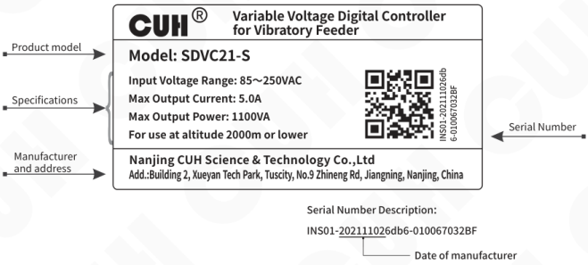

CUH® — **Contrôleur numérique à tension variable pour alimentateur vibrant**

**Modèle du produit**

Modèle : SDVC21-S

**Spécifications**

- Plage de tension d'entrée : 85～250VAC
- Courant de sortie maximal : 5.0A
- Puissance de sortie maximale : 1100VA
- Pour une utilisation à une altitude de 2000 m ou moins

**Fabricant et adresse**

Nanjing CUH Science & Technology Co.,Ltd

Add.:Building 2, Xueyan Tech Park, Tuscity, No.9 Zhineng Rd, Jiangning, Nanjing, China

**Numéro de série**

INS01-202111026db6-010067032BF

**Description du numéro de série :**

INS01-**20211102**6db6-010067032BF

Date de fabrication : **20211102**

---

## Chapitre Ⅱ Caractéristiques

Le contrôleur est spécialement conçu pour contrôler un alimentateur vibrant dans les systèmes d'automatisation. Combiné aux dernières technologies électroniques et à une conception soignée, le contrôleur offre les fonctionnalités pratiques et commodes suivantes :

**Stabilisation automatique de tension :** Le contrôleur peut éliminer les variations de vitesse d'alimentation causées par les fluctuations de la tension du secteur.

**Démarrage progressif :** Afin d'éviter tout choc soudain sur les pièces de travail, le contrôleur peut augmenter progressivement la tension de sortie de 0 à la valeur préréglée lors du démarrage.

**Capteur de commutation :** Un capteur de commutation NPN ou un automate programmable (PLC) peut être connecté pour activer/désactiver le contrôleur.

**Sortie de contrôle :** Le signal de sortie de contrôle émis par le transistor peut coordonner une électrovanne ou d'autres dispositifs externes avec le contrôleur.

### Les fonctionnalités suivantes peuvent être personnalisées :

**Entrée de signaux de contrôle doubles :** L'entrée de signaux de contrôle doubles « pièces pleines » et « pièces vides » peut former la relation de contrôle logique AND, OR, NOT, XOR, et toutes les autres.

**Fonction de préréglage de la tension de sortie :** Jusqu'à quatre valeurs de tension de sortie préréglées peuvent être choisies par des signaux de contrôle externes.

**Détection photoélectrique intelligente :** Notre capteur photoélectrique intelligent adaptatif peut aider à arrêter le contrôleur lorsque les pièces de travail sont pleines ou vides, et remplir les fonctions de réglage du temps de démarrage progressif, de retard d'enclenchement, de retard de déclenchement et de réglage de la relation logique.

**Contrôle de vitesse à distance :** La tension de sortie du contrôleur peut être contrôlée par un potentiomètre externe, un automate programmable (PLC) ou un signal DC de 1~5V/4~20mA.

---

CUH attache une grande importance à la gestion de la qualité des produits et aux performances de sécurité. Outre les composants de haute qualité que nous utilisons et le système rigoureux de contrôle qualité, CUH a pris en compte les accidents possibles que les utilisateurs peuvent rencontrer et fournit les fonctions de protection suivantes afin de maximiser la praticité du contrôleur.

**Protection contre les courts-circuits par fusible :** Si la sortie du contrôleur est court-circuitée, le fusible interne fondra pour protéger le contrôleur et la charge.

**Protection contre la surcharge de courant :** Le contrôleur interrompt sa sortie pour garantir la sécurité de fonctionnement des équipements lorsque le courant de fonctionnement dépasse sa valeur nominale.

**Protection contre la surchauffe :** Le contrôleur interrompt sa sortie pour se protéger lorsque la température de fonctionnement est trop élevée.

**Protection contre les surtensions :** Si la tension d'entrée est trop élevée, l'alimentation du contrôleur s'arrête automatiquement pour se protéger.

Les contrôleurs CUH sont strictement conformes à la certification CE.

---

# Chapitre Ⅲ Guide d'installation

Ce chapitre présente les conditions nécessaires à l'utilisation du contrôleur ainsi que la manière de l'installer et de le raccorder correctement.

## 3.1 Conditions d'utilisation du contrôleur

Le contrôleur est alimenté en AC 110/220V, et la liaison de terre de protection est assurée par la fiche du cordon d'alimentation. Veuillez fournir une alimentation secteur et des installations de distribution conformes de 110V ou 220V, 50Hz/60Hz, et vous assurer que le conducteur de terre de protection est correctement raccordé.

**⚠ Avertissement** Ne connectez jamais le contrôleur à une alimentation AC 380V, cela causerait des dommages graves et irréversibles au contrôleur, pouvant entraîner une explosion, un incendie et d'autres incidents de sécurité.

**⚠ Avertissement** Assurez-vous que le côté alimentation est correctement mis à la terre. Le boîtier métallique du contrôleur est directement relié au conducteur de terre de protection. Une mauvaise mise à la terre rendra le boîtier du contrôleur sous tension et provoquera un accident d'électrocution.

**Avis** Un fonctionnement prolongé génère de la chaleur et fait monter la température du boîtier. Veuillez installer le contrôleur dans un environnement bien ventilé et bien le fixer, à l'écart des sources de vibration.

**Avis** La sortie de ce produit est formée par le redressement et l'onduleur de l'alimentation secteur, et il n'existe aucune isolation entre son entrée et sa sortie. Par conséquent, les pôles de sortie ne peuvent pas être connectés à la terre de protection. Lors du raccordement de l'électroaimant, il est nécessaire de s'assurer que la bobine de l'électroaimant et le boîtier possèdent une capacité d'isolation de base. Sinon, une fuite de courant peut se produire, ce qui peut provoquer une électrocution et endommager le contrôleur.

**Avis** Ce produit est un contrôleur destiné à entraîner l'électroaimant. Il ne doit pas être raccordé à un alimentateur vibrant piézoélectrique.

## 3.2 Méthode d'utilisation des boutons

a. Appuyez brièvement sur le bouton ⊕ ou ⊖ pour ajuster la tension de sortie du contrôleur sur n'importe quelle interface LED.

b. Entrez ou sortez de l'interface des paramètres de base par un appui long sur le bouton ⚙, passez d'un paramètre de base à l'autre par un appui bref sur le bouton ⚙, et ajustez la valeur du paramètre par un appui bref sur le bouton ▼ ou ▲.

c. Entrez ou sortez de l'interface des paramètres avancés par un appui long simultané sur les boutons ⚙ et ▲, passez d'un paramètre avancé à l'autre par un appui bref sur le bouton ⚙, et ajustez la valeur du paramètre par un appui bref sur le bouton ▼ ou ▲.

d. Appuyez brièvement sur le bouton ⏻ pour démarrer ou arrêter la sortie du contrôleur, et appuyez longuement sur le bouton ⏻ pour verrouiller ou déverrouiller le clavier.

e. Sur l'interface LED du paramètre de restauration des réglages par défaut, appuyez longuement sur le bouton ▲ jusqu'à ce que  s'affiche sur l'afficheur LED pour restaurer les réglages d'usine, ou appuyez longuement sur le bouton ▼ jusqu'à ce que 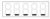 s'affiche sur l'afficheur LED pour passer à l'interface de paramètres moderne.

f. Le SDVC21S utilise par défaut l'interface de paramètres traditionnelle.

---

## 3.3 Installation et utilisation

### Première étape :

Ouvrez la boîte d'emballage et vérifiez le contrôleur ainsi que tous les accessoires.

### Deuxième étape :

Raccordez les bornes de câblage du câble d'alimentation de sortie à la bobine électromagnétique du vibrateur.

Alignez l'encoche du connecteur aviation du câble de sortie avec le repère triangulaire de la prise de sortie du contrôleur, puis serrez l'écrou après avoir correctement raccordé le câble de sortie.

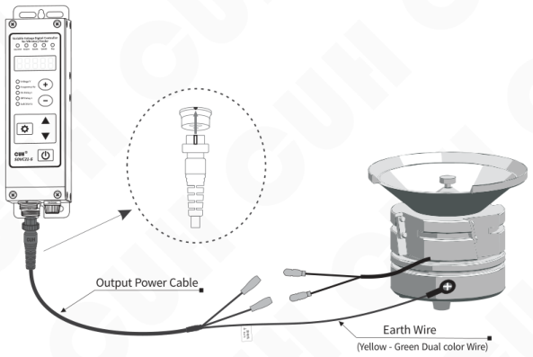

### Remarque

1. Assurez-vous que les bobines électromagnétiques du vibrateur sont connectées aux deux broches de sortie du câble d'alimentation de sortie, et que le boîtier métallique du vibrateur est correctement mis à la terre.
2. Il est interdit de connecter des charges piézoélectriques à la sortie d'alimentation, sinon cela peut provoquer un accident de sécurité par électrocution !

---

### Troisième étape :

Raccordez le connecteur du câble d'alimentation d'entrée à la prise d'alimentation d'entrée du contrôleur.

Raccordez d'abord le côté contrôleur.

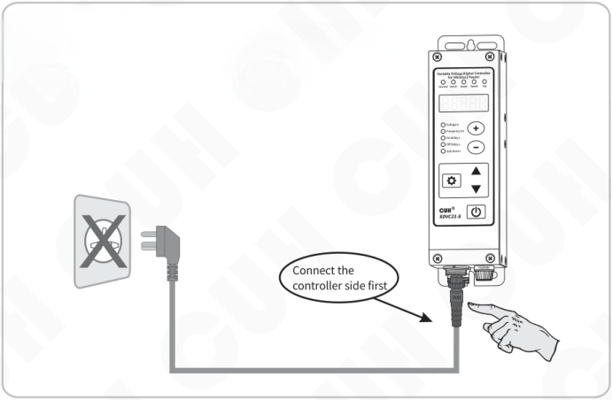

### Quatrième étape :

Raccordez la fiche du câble d'alimentation d'entrée à la prise secteur.

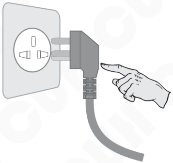

---

## Chapitre Ⅳ Description des fonctions de base

### 4.1 Tension de sortie

La tension de sortie peut être réglée directement et numériquement via le clavier. Grâce à la fonction unique de stabilisation de tension, la tension de sortie du contrôleur ne fluctuera pas avec la tension d'entrée, de sorte que le vibrateur puisse maintenir un fonctionnement stable en cas de tension de réseau instable.

- Allumez l'interrupteur d'alimentation du contrôleur.
- Le contrôleur entre dans le paramètre de tension de sortie. L'indicateur de tension s'allume et l'afficheur LED indique le paramètre de tension de sortie U et la valeur par défaut 150.
- Appuyez sur ⊕ ou ⊖ pour ajuster la valeur du paramètre.

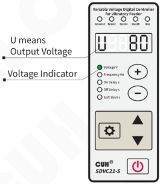

- La valeur de la tension de sortie du contrôleur ne peut pas dépasser la valeur de la tension d'entrée. Si la valeur de tension de sortie est réglée trop proche de la valeur de tension d'entrée, le contrôleur ne parvient pas à stabiliser sa tension de sortie et l'indicateur de saturation s'allume.
- Si la valeur de tension de sortie est réglée trop proche de 0, le contrôleur ne parvient pas à stabiliser sa tension de sortie et l'indicateur de saturation s'allume.

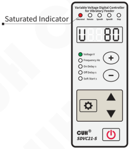

---

## 4.2 Fréquence de sortie

Le contrôleur peut choisir de délivrer la fréquence du secteur ou le double de celle-ci.

- Appuyez longuement sur ⚙ pendant 2 secondes pour entrer dans l'interface des paramètres de base.
- L'afficheur LED indique le paramètre de fréquence de sortie « E » et l'indicateur de fréquence s'allume.
- Appuyez sur ▼ ou ▲ pour ajuster la valeur du paramètre.

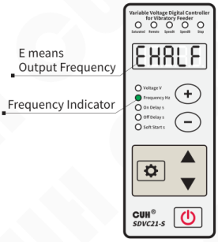

- Si la fréquence du secteur est de 50Hz, lorsque le paramètre E est réglé sur HALF, la fréquence de sortie du contrôleur est de 50Hz ; lorsque le paramètre E est réglé sur FULL, la fréquence de sortie du contrôleur est de 100Hz.
- Si la fréquence du secteur est de 60Hz, lorsque le paramètre E est réglé sur HALF, la fréquence de sortie du contrôleur est de 60Hz ; lorsque le paramètre E est réglé sur FULL, la fréquence de sortie du contrôleur est de 120Hz.

---

## 4.3 Temps de démarrage progressif

Afin d'éviter tout choc soudain sur la bobine du vibrateur, le contrôleur peut augmenter progressivement la tension de sortie de 0 à la valeur préréglée lors du démarrage.

**Temps de démarrage progressif ( t ) :** La période nécessaire au contrôleur pour faire monter progressivement sa tension de sortie de 0 à la valeur préréglée lors du démarrage.

- Appuyez longuement sur ⚙ pendant 2 secondes pour entrer dans l'interface des paramètres de base.
- Appuyez brièvement sur ⚙ pour passer au paramètre de démarrage progressif « t » et l'indicateur de démarrage progressif s'allume.
- Appuyez sur ▲ ou ▼ pour ajuster la valeur du paramètre.

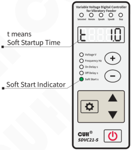

## 4.4 Interrupteur de sortie

Le bouton ⏻ du panneau permet de démarrer ou d'arrêter facilement et rapidement la sortie du contrôleur.

- À l'aide du bouton ⏻ situé sur le panneau du contrôleur, vous pouvez commander le démarrage ou l'arrêt. L'indicateur d'arrêt s'allume lorsque la sortie du contrôleur est coupée.

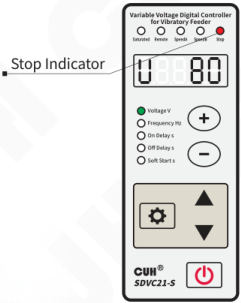

> Grâce à la technologie d'interrupteur tactile doux et de commande par signal numérique, aucune étincelle ne sera générée pour détériorer le contact. Par conséquent, la durée de vie du contrôleur et du vibrateur sera considérablement prolongée.

---

## 4.5 Limite de tension de sortie maximale

La tension de sortie maximale du contrôleur peut être réglée afin de prévenir tout dommage au vibrateur.

La fonction de contrôle de vitesse à distance est affectée par ce paramètre.

- Appuyez longuement simultanément sur ⚙ et ▲ pour entrer dans l'interface des paramètres avancés.
- Appuyez brièvement sur ⚙ pour passer au paramètre h.
- Appuyez sur ▲ ou ▼ pour ajuster la valeur du paramètre.

La valeur par défaut de la tension de sortie maximale est de 250V.

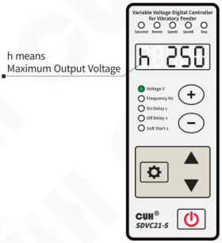

## 4.6 Verrouillage du clavier

- Appuyez longuement sur ⏻ pendant 2 secondes pour verrouiller tous les boutons du panneau, l'afficheur LED indiquant a.
- Appuyez à nouveau longuement sur ⏻ pendant 2 secondes pour déverrouiller le clavier.

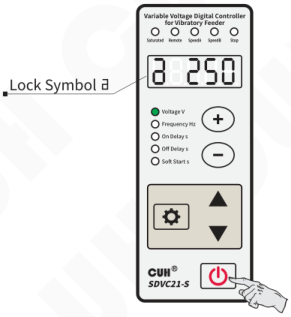

> Le bouton ⏻ n'est pas affecté par la fonction de verrouillage du clavier.

---

## 4.7 Restauration des réglages d'usine

L'utilisateur peut rapidement restaurer le contrôleur dans son état d'usine par défaut.

En raison des fonctions puissantes du contrôleur, de nombreux paramètres peuvent être ajustés. Pour les débutants, il peut être impossible de rétablir l'état de fonctionnement normal du contrôleur après plusieurs réglages et modifications. Utilisez cette fonction pour restaurer rapidement l'état des paramètres désordonnés aux réglages d'usine par défaut.

- Appuyez longuement simultanément sur ⚙ et ▲ pour entrer dans l'interface des paramètres avancés.
- Appuyez brièvement sur ⚙ pour passer au clignotement complet de l'afficheur LED, c'est-à-dire au paramètre de « Restauration des réglages par défaut ». Appuyez ensuite longuement sur ▲ jusqu'à ce que le contrôleur affiche « ----- », indiquant que le contrôleur a été restauré.

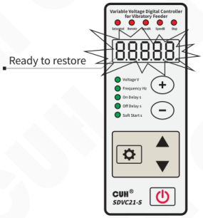

- Relâchez ▲ ; après que le contrôleur a affiché « CUH », il entre dans l'état de réglage de la tension de sortie « U ». À ce stade, tous les paramètres ont été restaurés aux réglages d'usine par défaut.

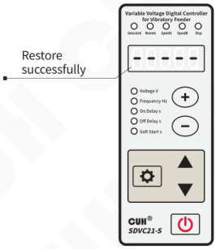

---

# Chapitre Ⅴ Capteurs et contrôle des signaux

Le contrôleur peut être commandé par de nombreux types de signaux et capteurs externes. Ce chapitre décrit principalement la méthode d'utilisation du capteur photoélectrique intelligent, des capteurs de commutation NPN et de l'automate programmable (PLC).

## 5.1 Détection photoélectrique intelligente

Combinée au capteur photoélectrique SDVC-S1, la fonction de détection photoélectrique intelligente peut être réalisée. Le capteur SDVC-S1 peut filtrer l'interférence de la lumière ambiante qui affecte la sensibilité du contrôleur. De ce fait, le contrôleur peut fonctionner de manière fiable sans réglage manuel de la sensibilité.

### 5.1.1 Méthode de câblage du capteur photoélectrique intelligent

**Méthode de raccordement du capteur photoélectrique**

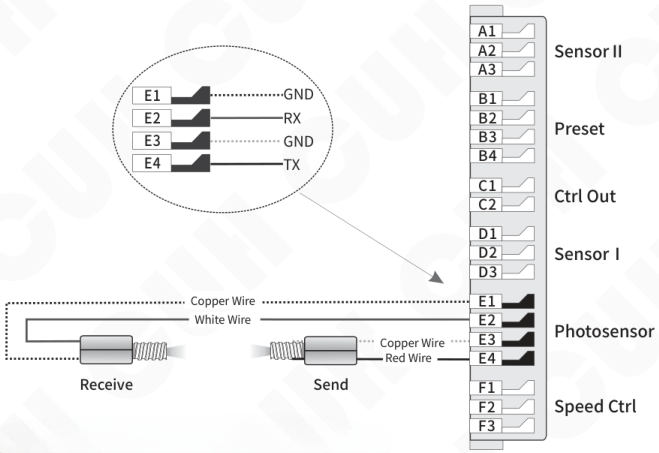

La distance de travail du capteur peut être ajustée en réglant le paramètre P ; plus le paramètre est petit, plus le capteur est sensible.

Avis : la relation logique par défaut du capteur est réglée sur « pièces vides ».

---

## 5.1.2 Retard d'enclenchement/de déclenchement du capteur photoélectrique intelligent

Dans la plupart des applications réelles, la sortie du contrôleur doit être retardée d'un certain temps lorsque la mise en marche/l'arrêt du contrôleur est commandé(e) par des signaux externes. La fonction de réglage du temps de retard d'enclenchement/de déclenchement rend ce type d'application possible. De plus, les chocs subis par les pièces de travail au démarrage du contrôleur peuvent être éliminés en réglant le temps de démarrage progressif.

### Retard d'enclenchement ( J )

La période qui s'écoule entre la réception d'un signal de commande de démarrage et l'émission effective de la sortie par le contrôleur.

- Appuyez longuement sur ⚙ pendant 2 secondes pour entrer dans l'interface des paramètres de base.
- Appuyez brièvement sur ⚙ pour passer au paramètre de retard d'enclenchement « J » et l'indicateur de retard de démarrage s'allume.
- Appuyez sur ▲ ou ▼ pour ajuster la valeur du paramètre.

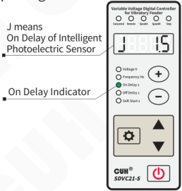

La plage réglable du paramètre est de 0.0 à 9.9 secondes  
La valeur par défaut du paramètre est de 0.2 seconde

### Retard de déclenchement ( L )

La période qui s'écoule entre la réception d'un signal de commande d'arrêt et la coupure effective de la sortie par le contrôleur.

- Appuyez longuement sur ⚙ pendant 2 secondes pour entrer dans l'interface des paramètres de base.
- Appuyez brièvement sur ⚙ pour passer au paramètre de retard de déclenchement « L » et l'indicateur de retard d'arrêt s'allume.
- Appuyez sur ▲ ou ▼ pour ajuster la valeur du paramètre.

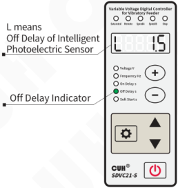

La plage réglable du paramètre est de 0.0 à 9.9 secondes  
La valeur par défaut du paramètre est de 0.2 seconde

---

### 5.1.3 Réglage de la direction logique du capteur photoélectrique intelligent

Dans des circonstances normales, l'extrémité de réception ne reçoit aucun signal optique et le contrôleur fonctionne par défaut. Mais dans certaines applications particulières, le contrôleur doit être arrêté lorsque l'extrémité de réception ne reçoit aucun signal optique. Le réglage de ce paramètre permet de répondre à ce type d'application.

- Appuyez longuement simultanément sur ⚙ et ▲ pour entrer dans l'interface des paramètres avancés.
- Appuyez brièvement sur ⚙ pour passer au paramètre Γ1.
- Appuyez sur ▲ ou ▼ pour ajuster la valeur du paramètre.

Γ1 désigne la direction logique du capteur photoélectrique intelligent

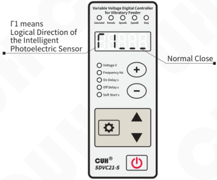

Le paramètre Γ1 est réglé sur `___` par défaut

- Lorsque le paramètre Γ1 est réglé sur `___`, c'est-à-dire qu'aucun signal optique n'est reçu, le contrôleur fonctionne.
- Lorsque le paramètre Γ1 est réglé sur `_-_`, c'est-à-dire qu'aucun signal optique n'est reçu, le contrôleur s'arrête.

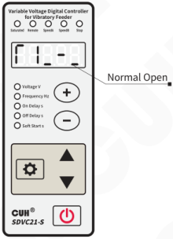

---

## 5.2 Méthode d'utilisation du capteur de commutation NPN

Le contrôleur peut fonctionner avec de nombreux types de capteurs, tels que des capteurs de commutation, des capteurs photoélectriques à commutation et des capteurs à fibre optique.

### 5.2.1 Méthode de câblage du capteur de commutation NPN

**Méthode de raccordement du capteur de commutation**

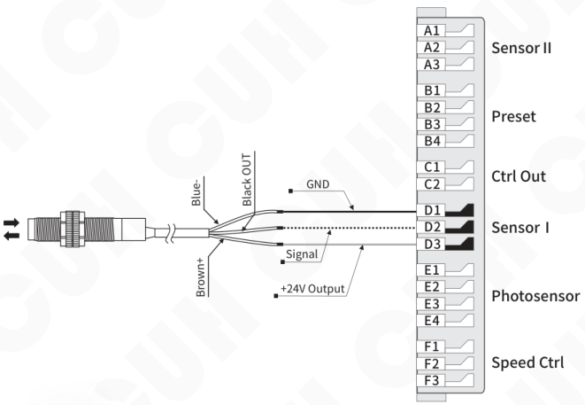

**Convention**

- Le fil bleu représente le fil de terre
- Le fil noir représente le fil de signal
- Le fil marron représente le fil d'alimentation

---

## 5.2.2 Retard d'enclenchement/de déclenchement du capteur de commutation NPN

Par défaut, le capteur photoélectrique intelligent et le capteur de commutation partagent le même temps de retard d'enclenchement et le même temps de retard de déclenchement. Les opérateurs peuvent également régler indépendamment le temps de retard d'enclenchement et le temps de retard de déclenchement pour le capteur de commutation.

### Retard d'enclenchement ( J- )

La période qui s'écoule entre la réception d'un signal de commande de démarrage et l'émission de la sortie par le contrôleur.

- Appuyez longuement simultanément sur ⚙ et ▲ pour entrer dans l'interface des paramètres avancés.
- Appuyez brièvement sur ⚙ pour passer au paramètre J-.
- Appuyez sur ▲ ou ▼ pour ajuster la valeur du paramètre.

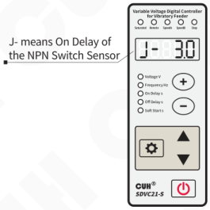

La plage réglable du paramètre est de 0.0 à 9.9 secondes, la valeur par défaut du paramètre est ---

Le retard d'enclenchement indépendant du capteur de commutation NPN sera désactivé lorsque la valeur du paramètre est réglée sur 0

### Retard de déclenchement ( L- )

La période qui s'écoule entre la réception d'un signal de commande d'arrêt et la coupure de la sortie par le contrôleur.

- Appuyez longuement simultanément sur ⚙ et ▲ pour entrer dans l'interface des paramètres avancés.
- Appuyez brièvement sur ⚙ pour passer au paramètre L-.
- Appuyez sur ▲ ou ▼ pour ajuster la valeur du paramètre.

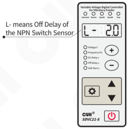

La plage réglable du paramètre est de 0.0 à 9.9 secondes, la valeur par défaut du paramètre est ---

Le retard de déclenchement indépendant du capteur de commutation NPN sera désactivé lorsque la valeur du paramètre est réglée sur 0

- Lorsque les valeurs de J- et L- sont réglées sur 0, le temps de retard d'enclenchement et le temps de retard de déclenchement du capteur de commutation seront identiques au temps de retard d'enclenchement et au temps de retard de déclenchement du capteur photoélectrique intelligent.
- Le temps de retard d'enclenchement et le temps de retard de déclenchement du capteur photoélectrique intelligent ne seront pas affectés par les paramètres J- et L-.

---

## 5.2.3 Réglage de la direction logique du capteur de commutation NPN

Dans des circonstances normales, le contrôleur ne reçoit aucun signal du capteur de commutation NPN et fonctionne par défaut. Mais dans certaines applications particulières, le contrôleur doit être arrêté lorsqu'il ne reçoit aucun signal du capteur de commutation NPN. Le réglage de ce paramètre permet de répondre à ce type d'application.

- Appuyez longuement simultanément sur ⚙ et ▲ pour entrer dans l'interface des paramètres avancés.
- Appuyez brièvement sur ⚙ pour passer au paramètre Γ2.
- Appuyez sur ▲ ou ▼ pour ajuster la valeur du paramètre.

Γ2 désigne la direction logique du capteur de commutation NPN.

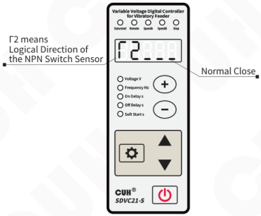

Le paramètre Γ2 est réglé sur `___` par défaut.

- Lorsque le paramètre Γ2 est réglé sur `___`, c'est-à-dire qu'aucun signal n'est reçu, le contrôleur fonctionne.
- Lorsque le paramètre Γ2 est réglé sur `_-_`, c'est-à-dire qu'aucun signal n'est reçu, le contrôleur s'arrête.

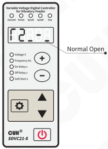

---

## 5.3 Méthode d'utilisation du deuxième capteur de commutation NPN

Le contrôleur permet de connecter trois capteurs : un capteur photoélectrique intelligent et deux capteurs de commutation NPN. Les fonctions d'arrêt lorsque les pièces de travail sont pleines et d'arrêt lorsque les pièces de travail sont vides peuvent être réalisées à l'aide de ces capteurs.

### 5.3.1 Méthode de câblage du deuxième capteur de commutation NPN

**Méthode de raccordement du capteur de commutation**

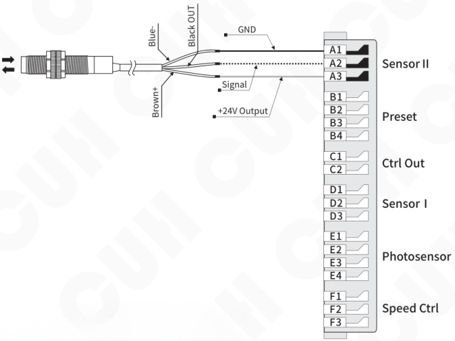

**Convention**

Le fil bleu représente le fil de terre  
Le fil noir représente le fil de signal  
Le fil marron représente le fil d'alimentation

---

## 5.3.2 Retard d'enclenchement/de déclenchement du deuxième capteur de commutation NPN

Par défaut, le capteur photoélectrique intelligent et les deux capteurs de commutation NPN partagent le même temps de retard d'enclenchement et le même temps de retard de déclenchement. Les opérateurs peuvent également régler indépendamment le temps de retard d'enclenchement et le temps de retard de déclenchement pour le deuxième capteur de commutation NPN.

### Retard d'enclenchement (J_)

La période qui s'écoule entre la réception d'un signal de commande de démarrage et l'émission de la sortie par le contrôleur.

- Appuyez longuement simultanément sur ⚙ et ▲ pour entrer dans l'interface des paramètres avancés.
- Appuyez brièvement sur ⚙ pour passer au paramètre J_.
- Appuyez sur ▲ ou ▼ pour ajuster la valeur du paramètre.

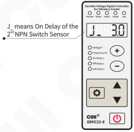

La plage réglable du paramètre est de 0.0 à 9.9 secondes, la valeur par défaut du paramètre est ---

Le retard d'enclenchement indépendant du deuxième capteur de commutation NPN sera désactivé lorsque la valeur du paramètre est réglée sur 0

### Retard de déclenchement (L_)

La période qui s'écoule entre la réception d'un signal de commande d'arrêt et la coupure de la sortie par le contrôleur.

- Appuyez longuement simultanément sur ⚙ et ▲ pour entrer dans l'interface des paramètres avancés.
- Appuyez brièvement sur ⚙ pour passer au paramètre L_.
- Appuyez sur ▲ ou ▼ pour ajuster la valeur du paramètre.

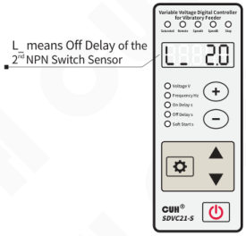

La plage réglable du paramètre est de 0.0 à 9.9 secondes, la valeur par défaut du paramètre est ---

Le retard de déclenchement indépendant du deuxième capteur de commutation NPN sera désactivé lorsque la valeur du paramètre est réglée sur 0

---

- Lorsque les valeurs de J_ et L_ sont réglées sur 0, le temps de retard d'enclenchement et le temps de retard de déclenchement du deuxième capteur de commutation NPN seront identiques au temps de retard d'enclenchement et au temps de retard de déclenchement du capteur photoélectrique intelligent.
- Le temps de retard d'enclenchement et le temps de retard de déclenchement du capteur photoélectrique intelligent ne seront pas affectés par les paramètres J_ et L_.

---

## 5.3.3 Réglage de la direction logique du deuxième capteur de commutation NPN

Dans des circonstances normales, le contrôleur ne reçoit aucun signal du deuxième capteur de commutation NPN et fonctionne par défaut. Mais dans certaines applications particulières, le contrôleur doit être arrêté lorsqu'il ne reçoit aucun signal du deuxième capteur de commutation NPN. Le réglage de ce paramètre permet de répondre à ce type d'application.

- Appuyez longuement simultanément sur ⚙ et ▲ pour entrer dans l'interface des paramètres avancés.
- Appuyez brièvement sur ⚙ pour passer au paramètre Γ4.
- Appuyez sur ▲ ou ▼ pour ajuster la valeur du paramètre.

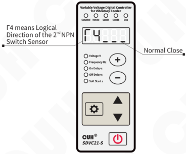

Γ4 désigne la direction logique du deuxième capteur de commutation NPN.

Normal Close

Le paramètre Γ4 est réglé sur `___` par défaut

- Lorsque le paramètre Γ4 est réglé sur `___`, c'est-à-dire qu'aucun signal n'est reçu, le contrôleur fonctionne.
- Lorsque le paramètre Γ4 est réglé sur `_-_`, c'est-à-dire qu'aucun signal n'est reçu, le contrôleur s'arrête.

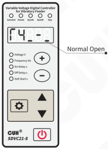

Normal Open

---

## 5.4 Réglage de la relation logique du signal de contrôle

Le contrôleur peut définir la relation logique du capteur photoélectrique intelligent et du capteur de commutation lorsqu'ils fonctionnent simultanément.

- Appuyez longuement simultanément sur ⚙ et ▲ pour entrer dans l'interface des paramètres avancés.
- Appuyez brièvement sur ⚙ pour passer au paramètre Π.
- Appuyez sur ▲ ou ▼ pour ajuster la valeur du paramètre.

Π désigne la relation logique du signal de contrôle

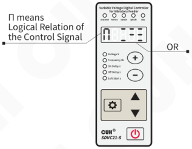

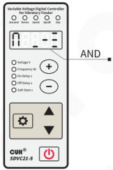

La relation logique par défaut est AND

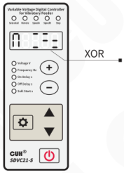

### Relation logique : AND 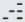:

Le contrôleur fonctionne uniquement lorsque le capteur photoélectrique intelligent et le capteur de commutation NPN le lui demandent.

### Relation logique : OR 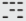:

Le contrôleur fonctionne lorsque le capteur photoélectrique intelligent ou le capteur de commutation NPN le lui demande.

### Relation logique : XOR 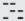:

Le contrôleur fonctionne uniquement lorsque le capteur photoélectrique intelligent et le capteur de commutation NPN émettent des signaux de contrôle opposés.

---

## 5.5 Sortie de contrôle

Le contrôleur peut émettre un signal de contrôle basse tension pour coopérer avec d'autres dispositifs tels qu'une électrovanne, un PLC ou un relais électrique.

### 5.5.1 Méthode de câblage de la sortie de contrôle

**Méthode de raccordement du PLC**

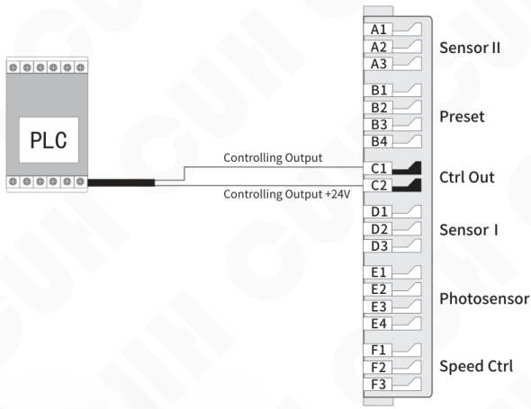

> La sortie à relais ou la sortie NPN du PLC est compatible avec le contrôleur.

Les méthodes de réglage des paramètres sont les mêmes que celles du capteur de commutation.

---

## Méthode de raccordement de l'électrovanne

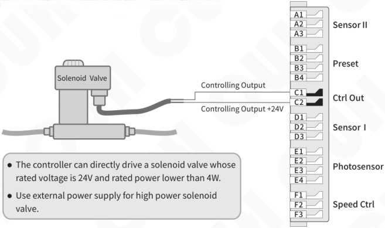

- Le contrôleur peut entraîner directement une électrovanne dont la tension nominale est de 24V et la puissance nominale inférieure à 4W.
- Utilisez une alimentation externe pour l'électrovanne de forte puissance.

## Méthode de raccordement du relais électrique

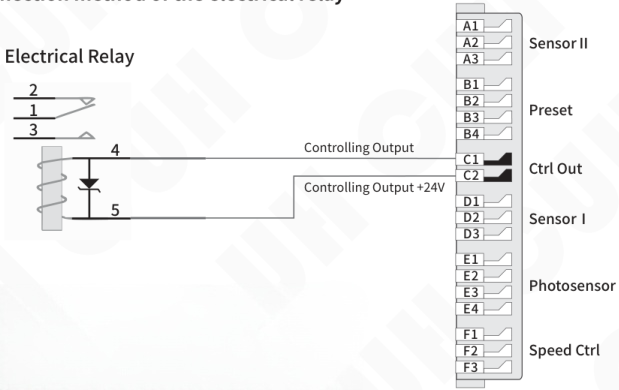

- Le contrôleur peut entraîner directement un relais électrique dont la tension nominale est de 24V et la puissance nominale inférieure à 4W.

---

## 5.5.2 Réglage de la direction logique de la sortie de contrôle

- Appuyez longuement simultanément sur ⚙ et ▲ pour entrer dans l'interface des paramètres avancés.
- Appuyez brièvement sur ⚙ pour passer au paramètre Γ3.
- Appuyez sur ▲ ou ▼ pour ajuster la valeur du paramètre.

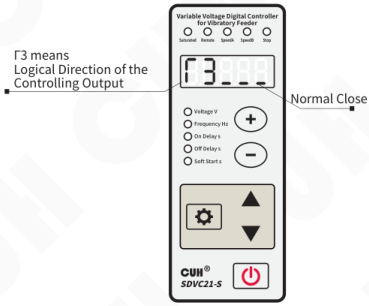

Le paramètre Γ3 est réglé sur `___` par défaut

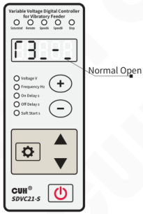

- Lorsque le paramètre Γ3 est réglé sur `___`, la sortie de contrôle fonctionne lorsque le contrôleur fonctionne.
- Lorsque le paramètre Γ3 est réglé sur `_-_`, la sortie de contrôle ne fonctionne pas lorsque le contrôleur fonctionne.

---

## 5.6 Contrôle de vitesse à distance

La fonction de contrôle de vitesse à distance permet à l'opérateur de contrôler la tension de sortie au moyen d'un potentiomètre externe, d'une tension de 1~5V ou d'un courant de 4~20mA. Ainsi, un contrôle de vitesse à distance externe peut être facilement réalisé par un PLC, un DCS ou d'autres dispositifs.

### Méthode de raccordement du potentiomètre externe

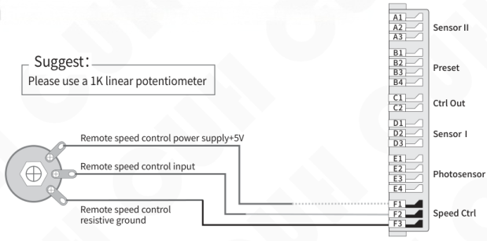

### Méthode de raccordement du PLC

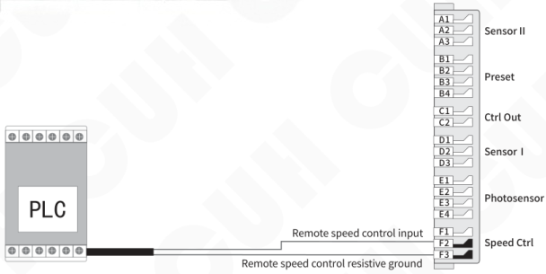

> Lorsque le signal de contrôle de vitesse à distance prend effet, l'indicateur de contrôle de vitesse s'allume et, en même temps, le réglage de la tension sur le panneau devient inopérant.

---

## 5.7 Commutation de vitesse préréglée

La fonction de commutation de vitesse préréglée peut choisir la vitesse préréglée au moyen de signaux de contrôle externes, tels qu'un PLC, un PC, des capteurs ou d'autres sources de signaux, afin de constituer un système de contrôle d'alimentation multi-vitesses.

Le contrôleur dispose de deux signaux de commande de commutation de vitesse préréglée, qui commandent la commutation de vitesse A et la commutation de vitesse B, toutes deux actives à l'état bas.

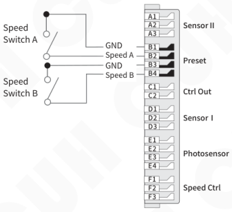

L'état de chaque ligne de commande est affiché par les indicateurs correspondants sur le panneau. Lorsqu'un signal valide est appliqué à la ligne de commande, l'indicateur correspondant s'allume.

La combinaison des états marche/arrêt des deux indicateurs comporte 4 états (A allumé et B éteint, A éteint et B allumé, AB tous les deux allumés, et AB tous les deux éteints).

En sélectionnant le signal de contrôle, le contrôleur entre dans la vitesse préréglée correspondante. À ce moment, la tension de sortie du contrôleur peut être ajustée par ⊕ ou ⊖. La tension sera automatiquement enregistrée. Chaque fois que le signal de commande de vitesse préréglée met le contrôleur dans cet état, il commutera immédiatement vers cette tension.

État lorsque les deux lignes de commande reçoivent des signaux valides.

---

## Chapitre Ⅵ Fonctions de sécurité

### 6.1 Stabilisation numérique automatique de tension

La fonction interne de stabilisation numérique de tension du contrôleur peut stabiliser la vitesse d'alimentation quelles que soient les fluctuations de la tension du secteur.

### 6.2 Protection contre les courts-circuits

Si la sortie est court-circuitée, le contrôleur interrompt sa sortie et affiche Err01 jusqu'au redémarrage du contrôleur.

### 6.3 Protection contre la surcharge de courant

Le contrôleur interrompt sa sortie si le courant de sortie dépasse le courant nominal en raison d'une opération défectueuse et affiche Err02 afin de protéger le contrôleur et les équipements du client.

### 6.4 Protection contre la surchauffe

Le contrôleur interrompt sa sortie si la température de fonctionnement dépasse 65°C et affiche Err03 pour protéger le contrôleur jusqu'à ce que la température de fonctionnement descende à 60°C.

---

## Chapitre Ⅶ Spécifications techniques

### 7.1 Dimensions

Dimensions (unité : mm)

| Plage de dimensions | tolérance |
|---|---|
| 0~3 | ±0.05 |
| 3~10 | ±0.1 |
| 10~30 | ±0.15 |
| 30~80 | ±0.2 |
| 80~180 | ±0.3 |
| >180 | ±0.5 |

Ce tableau de tolérance s'applique à tous les produits de cette série.

---

## 7.2 Spécifications techniques

| Élément | Min | Typique | Max | Unité | Remarque |
|---|---|---|---|---|---|
| Tension d'entrée | 85 | 220 | 250 | V | AC RMS |
| Plage de tension de sortie réglable | 35 | —— | Vin-10 | V | Demi-onde |
| Plage de tension de sortie réglable | 45 | —— | Vin-5 | V | Onde complète |
| Précision de réglage de la tension | | 1 | | V | |
| Précision de régulation de la tension | —— | —— | 30 | V | Vset = 150V △Vin+ = 70V |
| Temps de réponse de la régulation de tension | 0 | 0.01 | 0.02 | s | |
| Plage de courant de sortie réglable | 0 | —— | 5 | A | |
| Puissance de sortie | 0 | —— | 1100 | VA | |
| Fréquence de sortie | 45 | 50/60 | 65 | Hz | Demi-onde |
| Fréquence de sortie | 90 | 100/120 | 130 | Hz | Onde complète |
| Forme d'onde de sortie | | Commande d'angle de phase | | | |
| Temps de démarrage progressif | 0 | —— | 9.9 | s | Valeur par défaut : 1.0 |
| Plage de temps de retard d'enclenchement/de déclenchement | 0 | —— | 9.9 | s | Valeur par défaut : 0.2 |
| Précision du temps de retard d'enclenchement/de déclenchement | | 0.1 | | s | |
| Température de déclenchement de la protection contre la surchauffe | 58 | 60 | 66 | °C | |
| Tension de sortie de contrôle DC | 22 | 24 | 26 | V | |
| Courant de sortie de contrôle DC | 0 | —— | 400 | mA | |
| Signal de contrôle analogique | | 1~5/4~20 | | V/mA | Signal de contrôle de vitesse à distance |
| Signal de contrôle numérique | | 24 | | V | Signal de commutation |
| Méthode de réglage | | 6 | | Bouton | |
| Capacité du fusible | | 6.3 | | A | |
| Consommation en veille | —— | 2 | —— | W | |
| Méthode d'affichage | | 5 | | Chiffre | LED |
| Température ambiante | 0 | 25 | 40 | °C | Sans condensation |
| Humidité ambiante | 10 | 60 | 85 | % | Sans condensation |
| Température ambiante de stockage | -20 | 25 | 85 | °C | Sans condensation |

## 7.3 Norme de référence

**Paramètres absolus :**  
Le dépassement de ces normes endommagera le contrôleur ; respectez-les strictement.

| Élément | Norme GB | Norme IEC | Degré | Exigence de la norme | Remarque |
|---|---|---|---|---|---|
| Décharge électrostatique | GB/T 17626.2-2006 | IEC 61000-4-2:2001 | 4 | ±8 kV | Décharge par contact |
| | | | 4 | ±15 kV | Décharge dans l'air |
| Essai de transitoires électriques rapides | GB/T 17626.4-2008 | IEC 61000-4-4:2004 | 4 | ±4 kV | |
| Immunité aux ondes sur la ligne d'alimentation DC | GB/T 17626.17-2005 | IEC 61000-4-17:2002 | 4 | 15% | Classement A |

> **Avertissement**  
> Dans un environnement résidentiel, ce produit peut causer des interférences radio ; dans ce cas, des mesures d'atténuation supplémentaires peuvent être nécessaires.

---

## 7.4 Tableau des paramètres

| | Définition | Symbole | image du symbole | Plage | Défaut |
|---|---|---|---|---|---|
| Paramètre commun | Tension de sortie | U |  | 0~250 V | 150 |
| Paramètre de base | Fréquence de sortie | E |  | FULL，HALF | FULL |
| Paramètre de base | Retard d'enclenchement du capteur photoélectrique intelligent | J |  | 0.0~9.9 s | 0.2 |
| Paramètre de base | Retard de déclenchement du capteur photoélectrique intelligent | L |  | 0.0~9.9 s | 0.2 |
| Paramètre de base | Démarrage progressif | t |  | 0.0~9.9 s | 1.0 |
| Paramètre avancé | Retard d'enclenchement du capteur de commutation NPN | J- |  | 0.0~9.9 s | --- identique à J |
| Paramètre avancé | Retard de déclenchement du capteur de commutation NPN | L- |  | 0.0~9.9 s | --- identique à L |
| Paramètre avancé | Retard d'enclenchement du deuxième capteur de commutation NPN | J_ |  | 0.0~9.9 s | --- identique à J |
| Paramètre avancé | Retard de déclenchement du deuxième capteur de commutation NPN | L_ |  | 0.0~9.9 s | --- identique à L |
| Paramètre avancé | Direction logique du capteur photoélectrique intelligent | F1 |  | Normal Close, Normal Open  | ___ |
| Paramètre avancé | Direction logique du capteur de commutation NPN | F2 |  | Normal Close, Normal Open [[vcrop:41:17]] | ___ |
| Paramètre avancé | Direction logique de la sortie de contrôle | F3 |  | Normal Close, Normal Open [[vcrop:41:17]] | ___ |
| Paramètre avancé | Direction logique du deuxième capteur de commutation NPN | F4 |  | Normal Close, Normal Open [[vcrop:41:17]] | ___ |
| Paramètre avancé | Relation logique du signal de contrôle | A |  | or, And, Hor  |  |
| Paramètre avancé | Tension de sortie maximale | h |  | 0~250 V | 220 |
| Paramètre avancé | Sensibilité du capteur photoélectrique intelligent | P |  | 0~1000 | 80 |
| Paramètre avancé | Restauration des réglages par défaut | 8.8.8.8.8. |  | —— | —— |

## 7.5 Suggestions de dépannage et explications des erreurs

| Code d'erreur | Définition | Méthodes de dépannage | image du symbole |
|---|---|---|---|
| Aucun affichage après la mise sous tension | | Assurez-vous que la prise de courant est alimentée Assurez-vous que le câble d'alimentation d'entrée est correctement raccordé à la prise de courant | |
| Affichage normal, mais aucune sortie | | Assurez-vous que le câble de sortie est correctement raccordé au vibrateur. Assurez-vous que la tension de sortie n'est pas trop faible. Assurez-vous que l'indicateur d'arrêt n'est pas allumé. Veuillez vérifier si le Normal Close du paramètre a été configuré, ce qui provoque l'arrêt de la sortie du contrôleur. | |
| Le signal de contrôle perd son efficacité | | Assurez-vous que le signal de contrôle est correctement entré. Assurez-vous que le fil de terre du signal de contrôle est correctement raccordé au contrôleur. Assurez-vous que la relation logique des signaux de contrôle est correctement configurée selon vos attentes. | |
| Phénomènes de battement | | Évitez le couplage des vibrations entre les vibrateurs. Augmentez la fréquence de résonance des vibrateurs. | |
| Affichage normal, aucune sortie, mais un son est audible | | Ajustez tous les paramètres comme indiqué dans ce manuel. | |
| Err01 | Court-circuit | Assurez-vous que le câble d'alimentation de sortie et la bobine ne sont pas court-circuités. |  |
| Err02 | Surintensité | Réduisez la tension de sortie de manière appropriée, puis redémarrez la sortie. |  |
| Err03 | Surchauffe | Installez le contrôleur dans un environnement bien ventilé. |  |
| Err04 | | Réservé, veuillez contacter CUH |  |
| Err05 | | Réservé, veuillez contacter CUH |  |

## Chapitre Ⅷ Informations de garantie du produit

### 8.1 Période de garantie

La période de garantie offerte par la société pour ce produit est de 3 ans à compter de la date de livraison du produit au lieu désigné par l'acheteur.

### 8.2 Couverture de la garantie

(1) Si une panne causée par notre société survient pendant la période de garantie ci-dessus, nous réparerons le produit gratuitement. Cependant, les situations suivantes ne sont pas couvertes par la garantie :

a. Le non-respect des conditions spécifiées dans le guide simplifié, le manuel d'utilisation ou les exigences techniques convenues spécifiquement entre l'acheteur et la société, une opération inappropriée, ou une panne causée par un usage impropre.

b. La panne n'est pas due à un défaut du produit, mais à la conception de l'équipement ou du logiciel de l'acheteur.

c. Les dysfonctionnements causés par des modifications ou des réparations non effectuées par le personnel de la société.

d. La panne qui peut être totalement évitée par une maintenance correcte ou le remplacement des pièces d'usure conformément au guide d'utilisation simplifié ou au manuel d'utilisation.

e. Après l'expédition du produit depuis notre société, la panne est causée par des facteurs tels que des évolutions imprévisibles du niveau de la science et de la technologie.

f. En cas de catastrophes naturelles telles qu'un incendie, un tremblement de terre, une inondation, ou de facteurs externes tels qu'une défaillance due à une tension anormale, la société n'est pas responsable de la garantie.

(2) La portée de la garantie est limitée aux situations stipulées au point (1)，les pertes indirectes (telles que les dommages aux équipements, les opportunités, la perte de profits, etc.) ou d'autres pertes, la société n'assume aucune responsabilité.

### 8.3 Adéquation du produit

Le contrôleur de notre société est conçu et produit pour un usage général dans l'industrie de l'alimentation par vibration. Par conséquent, ce contrôleur de notre société ne doit pas être utilisé pour les applications suivantes et ne convient pas à leur usage.

(1) Les installations ayant un impact grave sur la vie et les biens, telles que les centrales nucléaires, les aéroports, les chemins de fer, les navires, les dispositifs motorisés et les équipements médicaux.

(2) Les services publics, notamment l'électricité, le gaz, l'approvisionnement en eau, etc.

(3) L'utilisation en extérieur dans des conditions ou des environnements similaires.

---

Nanjing CUH Science & Technology Co.,Ltd  
https://en.cuhnj.com  
Tel.:+86-25-84730411 / 84730415 / 84730416  
Fax:+86-25-84730426  
E-mail:sales@cuhnj.com  
Add.:Building 2, Xueyan Tech Park, Tuscity,  
No.9 Zhineng Rd, Jiangning, Nanjing, China

Document No.: IDP1000378

