# Contrôleur numérique à tension variable pour alimentateur vibrant

**IP67**

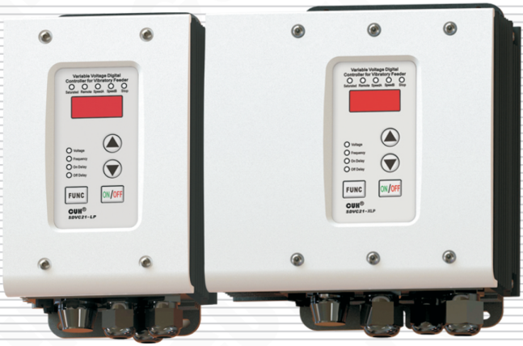

## Manuel d'instructions de la série SDVC21P

**Contrôleur numérique à tension variable pour alimentateur vibrant**

---

## Avant-propos

Merci d'avoir choisi les contrôleurs numériques pour alimentateur vibrant CUH. (Désigné ci-après par « le contrôleur » dans la suite du texte.)

Ce manuel d'instructions contient les consignes d'installation, de débogage, de réglage des paramètres, de maintenance et de dépannage du contrôleur. Veuillez lire attentivement ce manuel d'instructions avant d'utiliser le contrôleur et le conserver soigneusement.

### Ce manuel d'instructions s'applique aux modèles suivants :

➔Contrôleur intelligent à stabilisation numérique de tension pour alimentateur vibrant SDVC21-LP  
➔Contrôleur intelligent à stabilisation numérique de tension pour alimentateur vibrant SDVC21-XLP

---

---

## Avis

- Ne jamais effectuer de branchement à chaud ni toucher les contacts en aucune circonstance, afin d'éviter tout choc électrique ou autre accident.
- Ne jamais commuter l'entrée du contrôleur en coupant l'alimentation au moyen d'un relais ou de tout autre dispositif, sinon la durée de vie du contrôleur risque d'être fortement réduite.
- Ne pas ouvrir le boîtier sans autorisation, sinon l'étanchéité à l'eau, à l'huile et à la poussière risque d'être compromise.
- Ne jamais utiliser le contrôleur au-delà de ses limites de conception.
- Utilisez le contrôleur strictement conformément à ce manuel d'instructions. Nous n'assumerons aucune responsabilité civile ou pénale si des dommages à l'équipement ou des blessures corporelles sont causés par une utilisation incorrecte.

> **!**
>
> N'ouvrez jamais le boîtier du contrôleur afin d'éviter tout choc électrique. Contactez CUH si le contrôleur tombe en panne.
>
> N'essayez jamais de modifier le contrôleur, car les cartes de circuits à l'état solide à l'intérieur du contrôleur ne sont pas réparables et il n'y a aucune pièce réglable.

---

# Environnement de fonctionnement

## Inspection avant utilisation

Chaque contrôleur est soumis à un contrôle qualité rigoureux avant la livraison et est emballé dans un emballage anti-choc.

## Veuillez vérifier les points suivants après le déballage :

- Vérifiez que le contrôleur n'est pas endommagé en apparence
- Vérifiez que le modèle du contrôleur correspond exactement à ce que vous avez commandé

## Environnement d'exécution

Veuillez respecter les consignes ci-dessous afin de garantir de meilleures performances et une durée de vie plus longue du contrôleur

- Environnement bien ventilé
- Tenir éloigné des gaz et liquides corrosifs et inflammables
- Fixer fermement pour éviter les vibrations
- Tenir éloigné des interférences électromagnétiques
- Utilisation dans une plage de température de 0 °C à 40 °C
- Pour une utilisation à une altitude de 2000 m ou moins

---

# Table des matières

| Section | Page |
|---|---:|
| Chapitre I　Caractéristiques | 1 |
| Chapitre II　Guide d'installation | 3 |
| Chapitre III　Description des composants | 4 |
| Chapitre IV　Description des fonctions | 6 |
| 4.1 Réglage de la tension de sortie | 6 |
| 4.2 Réglage de la fréquence de sortie | 7 |
| 4.3 Réglage du paramètre de caractère d'affichage de fréquence | 7 |
| 4.4 Réglage du temps de démarrage progressif | 8 |
| 4.5 Interrupteur de sortie | 8 |
| 4.6 Limitation de la tension de sortie maximale | 9 |
| 4.7 Restauration des réglages par défaut | 10 |
| Chapitre V　Capteurs et contrôle des signaux | 11 |
| 5.1 Détection photoélectrique intelligente | 11 |
| 5.2 Méthode d'utilisation du capteur de commutation | 15 |
| 5.3 Méthode d'utilisation du deuxième capteur de commutation | 18 |
| 5.4 Réglage de la relation logique du signal de contrôle | 21 |
| 5.5 Sortie de contrôle | 22 |
| 5.6 Contrôle de vitesse à distance | 26 |
| 5.7 Commutation de vitesse préréglée | 27 |
| Chapitre VI　Fonctions de sécurité | 28 |
| 6.1 Stabilisation numérique automatique de tension | 28 |
| 6.2 Protection contre les courts-circuits | 28 |
| 6.3 Protection contre la surcharge de courant | 28 |
| 6.4 Protection contre la surchauffe | 28 |
| 6.5 Courbe de déclassement en température ambiante (uniquement pour le SDVC21-XLP) | 28 |

## Annexe

| Section | Page |
|---|---:|
| Annexe A : Dimensions | 29 |
| Annexe B : Définition de l'interface de sortie | 31 |
| Annexe C : Définition de l'interface de signal | 31 |
| Annexe D : Définition des caractères affichés sur l'afficheur LED | 34 |
| Annexe E : Caractéristiques électriques | 35 |
| Annexe F : Conseils de dépannage et explications des erreurs | 36 |
| Annexe G : Paramètres absolus | 37 |

---

# ChapitreⅠ Caractéristiques

Le contrôleur est spécialement conçu pour contrôler un alimentateur vibrant dans les systèmes d'automatisation. Combiné aux dernières technologies électroniques et à une conception soignée, le contrôleur offre les fonctionnalités pratiques et commodes suivantes :

**Niveau de protection :** IP67, ce contrôleur peut fonctionner dans un environnement humide, souillé d'huile ou poussiéreux.

**Plage de tension de fonctionnement ultra large :** la plage de tension d'entrée de ce contrôleur s'étend de 85 V CA à 440 V.

**Stabilisation automatique de tension :** le contrôleur peut éliminer les variations de vitesse d'alimentation causées par les fluctuations de la tension du secteur.

**Réglage de la tension :** la tension de sortie s'étend de 0 V à 440 V.

**Démarrage progressif :** afin d'éviter un choc brutal aux pièces de travail, le contrôleur peut augmenter progressivement la tension de sortie de 0 à la valeur préréglée au démarrage.

**Réglage du temps de démarrage progressif :** le temps de démarrage progressif peut être réglé avec précision en valeur numérique.

**Arrêt lorsque les pièces de travail sont en quantité suffisante :** un capteur de commutation permet d'arrêter le contrôleur lorsque les pièces de travail sont en quantité suffisante et de remplir les fonctions de réglage du temps de démarrage progressif, de retard d'enclenchement, de retard de déclenchement et d'ajustement de la relation logique.

**Sortie de contrôle :** le signal de la sortie de contrôle issu du transistor peut coordonner une électrovanne ou d'autres dispositifs externes avec le contrôleur.

**Protection contre la surchauffe :** le contrôleur arrête sa sortie pour se protéger lorsque la température de fonctionnement est trop élevée.

**Protection contre la surcharge de courant :** le contrôleur arrête sa sortie pour garantir la sécurité de fonctionnement de l'équipement lorsque le courant de fonctionnement dépasse sa valeur nominale.

## Les caractéristiques suivantes peuvent être personnalisées :

**Entrée de doubles signaux de contrôle :** l'entrée de doubles signaux de contrôle « pièces de travail en quantité suffisante » et « absence de pièces de travail » peut former une relation de contrôle logique AND, OR, NOT, XOR et toutes les autres.

**Fonction de préréglage de la tension de sortie :** jusqu'à quatre valeurs de tension de sortie préréglées peuvent être sélectionnées par des signaux de contrôle externes.

**Détection photoélectrique intelligente :** notre capteur photoélectrique intelligent adaptatif permet d'arrêter le contrôleur lorsque les pièces de travail sont en quantité suffisante ou lorsqu'il n'y a plus de pièces de travail, et de remplir les fonctions de réglage du temps de démarrage par impulsions, de retard d'enclenchement, de retard de déclenchement et d'ajustement de la relation logique.

**Contrôle de vitesse à distance :** la tension de sortie du contrôleur peut être contrôlée par un potentiomètre externe, un PLC ou un signal de contrôle de tension compris entre 1 V et 5 V.

---

---

**CUH** attache une grande importance à la gestion de la qualité des produits et à la sécurité. Outre les composants de haute qualité que nous utilisons et notre rigoureux système de contrôle qualité, **CUH** a pris en compte les accidents possibles que les utilisateurs peuvent rencontrer et fournit les fonctions de protection suivantes pour maximiser le caractère pratique du contrôleur.

**Protection contre les courts-circuits :** si la sortie du contrôleur est court-circuitée, le contrôleur arrête sa sortie jusqu'au redémarrage.

**Protection contre la surcharge de courant :** le contrôleur arrête sa sortie pour garantir la sécurité de fonctionnement des équipements lorsque le courant de fonctionnement dépasse sa valeur nominale.

**Protection contre la surchauffe :** le contrôleur arrête sa sortie pour se protéger lorsque la température de fonctionnement est trop élevée.

Les contrôleurs **CUH** sont strictement conformes à la certification CE.

---

# Chapitre Ⅱ Guide d'installation

## Étape 1 :

Ouvrez le carton d'emballage et raccordez le câble d'alimentation de sortie aux bobines électromagnétiques du vibrateur.

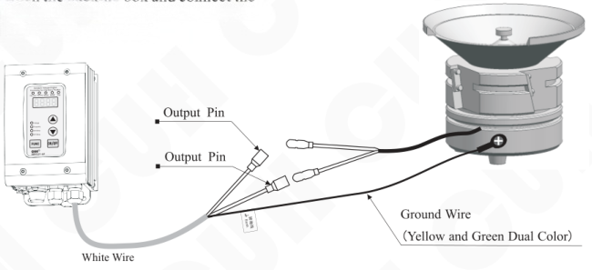

**⚠ Remarque :**

Assurez-vous que les bobines électromagnétiques du vibrateur sont raccordées aux deux broches de sortie du câble d'alimentation de sortie et que les bobines électromagnétiques sont correctement mises à la terre, sinon un incident de sécurité grave pourrait survenir.

## Étape 2 :

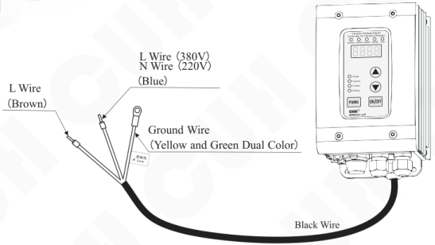

---

# Chapitre III Description des composants

Le panneau de commande comporte 4 boutons : le bouton `FUNC` pour basculer entre les différentes fonctions, le bouton ▲ pour augmenter la valeur du paramètre, le bouton ▼ pour diminuer la valeur du paramètre et le bouton `ON/OFF`.

## Description du clavier

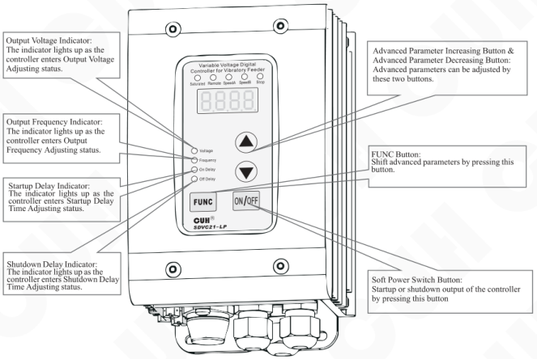

- **Indicateur de tension de sortie :** l'indicateur s'allume lorsque le contrôleur entre en état de réglage de la tension de sortie.
- **Indicateur de fréquence de sortie :** l'indicateur s'allume lorsque le contrôleur entre en état de réglage de la fréquence de sortie.
- **Indicateur de retard d'enclenchement :** l'indicateur s'allume lorsque le contrôleur entre en état de réglage du temps de retard d'enclenchement.
- **Indicateur de retard de déclenchement :** l'indicateur s'allume lorsque le contrôleur entre en état de réglage du temps de retard de déclenchement.
- **Bouton d'augmentation des paramètres avancés et bouton de diminution des paramètres avancés :** les paramètres avancés peuvent être ajustés à l'aide de ces deux boutons.
- **Bouton FUNC :** faites défiler les paramètres avancés en appuyant sur ce bouton.
- **Bouton d'interrupteur d'alimentation progressif :** démarrez ou arrêtez la sortie du contrôleur en appuyant sur ce bouton

---

## Description des indicateurs d'état

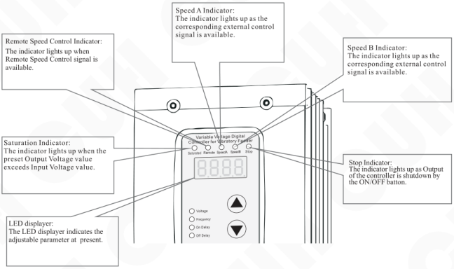

- **Indicateur de contrôle de vitesse à distance :** l'indicateur s'allume lorsque le signal de contrôle de vitesse à distance est disponible.
- **Indicateur de vitesse A :** l'indicateur s'allume lorsque le signal de contrôle externe correspondant est disponible.
- **Indicateur de vitesse B :** l'indicateur s'allume lorsque le signal de contrôle externe correspondant est disponible.
- **Indicateur de saturation :** l'indicateur s'allume lorsque la valeur de tension de sortie préréglée dépasse la valeur de la tension d'entrée.
- **Indicateur d'arrêt :** l'indicateur s'allume lorsque la sortie du contrôleur est arrêtée par le bouton ON/OFF.
- **Afficheur LED :** l'afficheur LED indique le paramètre réglable en cours.

## Description des interfaces d'E/S

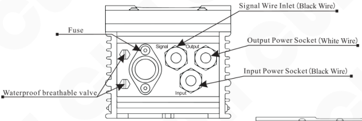

**SDVC21-LP (10A)**

- Fusible
- Valve étanche et respirante
- Entrée du câble de signal (câble noir)
- Prise d'alimentation de sortie (câble blanc)
- Prise d'alimentation d'entrée (câble noir)

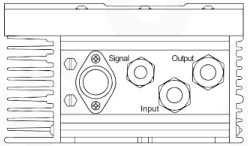

**SDVC21-XLP (25A)**

Remarque : lorsqu'il est utilisé dans des environnements à forte pollution huileuse, il est nécessaire de vérifier régulièrement la surface de la valve étanche et respirante afin d'éviter que l'orifice d'évacuation de la valve étanche et respirante ne soit obstrué par la pollution huileuse.

---

## Chapitre Ⅳ Description des fonctions

### 4.1 Réglage de la tension de sortie

La tension de sortie peut être réglée directement et numériquement depuis le panneau de commande. Grâce à l'unique fonction de stabilisation de tension, la tension de sortie du contrôleur ne fluctue pas comme la tension d'entrée. Ainsi, un vibrateur peut fonctionner de manière stable dans un environnement de tension d'entrée instable.

- Mettez le contrôleur sous tension en raccordant le câble d'alimentation d'entrée.
- L'indicateur de tension de sortie s'allume lorsque le contrôleur entre en état de réglage de la tension de sortie, lorsque l'afficheur LED affiche le symbole de tension H et la valeur de tension précédemment réglée.
- Ajustez la valeur de la tension de sortie en appuyant sur le bouton ▲ ou ▼.

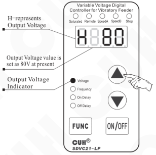

- La valeur de tension de sortie du contrôleur ne peut pas dépasser la valeur de la tension d'entrée. Si la valeur de tension de sortie est réglée à proximité de la valeur de la tension d'entrée, le contrôleur ne parvient pas à stabiliser sa sortie en tension et l'indicateur de saturation s'allume.
- Si la valeur de tension de sortie est réglée trop près de zéro, le contrôleur ne parvient pas à stabiliser sa sortie en tension et l'indicateur de saturation s'allume.

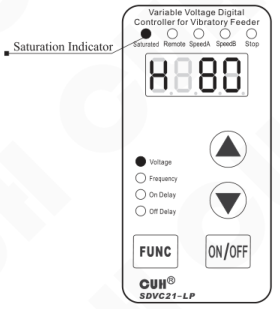

---

## 4.2 Réglage de la fréquence de sortie

Pour le SDVC21-LP, il y a deux fréquences de sortie au choix : onde complète (double de la valeur de la fréquence d'entrée) et demi-onde (valeur de la fréquence d'entrée).

Pour le SDVC21-XLP, il y a quatre fréquences de sortie au choix : onde complète, demi-onde, un tiers de l'onde complète et un quart de l'onde complète.

- Appuyez de manière répétée sur le bouton **FUNC** jusqu'à basculer en état de réglage de la fréquence de sortie (E), tandis que l'indicateur de fréquence de sortie s'allume.
- Appuyez sur le bouton ▲ ou ▼ pour ajuster la fréquence de sortie.

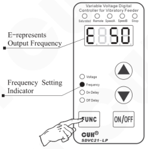

> Les caractères affichés de la valeur de la fréquence de sortie peuvent être réglés au moyen du paramètre de caractère d'affichage de fréquence. Veuillez vous reporter à la section 4.3.

## 4.3 Réglage du paramètre de caractère d'affichage de fréquence

- Appuyez sur le bouton **FUNC** et maintenez-le enfoncé pendant deux secondes pour accéder à l'interface de réglage des paramètres avancés.
- Appuyez de manière répétée sur le bouton **FUNC** pour basculer vers le paramètre « ΓE » qui définit le caractère d'affichage de la fréquence.
- Appuyez sur ▲ ou ▼ pour ajuster la valeur de ce paramètre.

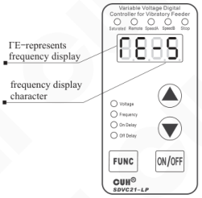

> Lorsque le paramètre « ΓE » est réglé sur « -5 », les caractères affichés seront 100, 50, 33 ou 25.  
> Lorsque le paramètre « ΓE » est réglé sur « -6 », les caractères affichés seront 120, 60, 40 ou 30.  
> Lorsque le paramètre « ΓE » est réglé sur « -E », les caractères affichés seront « FUL », « HAF », « trd » ou « Foh ».

---

## 4.4 Réglage du temps de démarrage progressif

Afin d'éviter un choc brutal aux pièces de travail, le contrôleur peut augmenter progressivement la tension de sortie de 0 à la valeur préréglée au démarrage.

Temps de démarrage progressif (t) : durée nécessaire au contrôleur pour augmenter progressivement la tension de sortie de 0 à la valeur préréglée au démarrage.

- Appuyez sur le bouton **FUNC** et maintenez-le enfoncé pendant 2 secondes pour entrer en état de réglage des paramètres avancés.
- Appuyez de manière répétée sur le bouton **FUNC** jusqu'à basculer en état de réglage du temps de démarrage progressif (t), tandis que l'indicateur de démarrage progressif s'allume.
- Appuyez sur le bouton ▲ ou ▼ pour ajuster la valeur du paramètre. L'unité du paramètre est la seconde et la précision numérique est de 0.1.

*Le temps de démarrage progressif réglable s'étend de 0.0 seconde à 9.9 secondes.*

*La valeur par défaut du paramètre de temps de démarrage progressif est 1 seconde.*

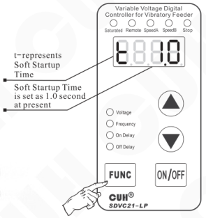

## 4.5 Interrupteur de sortie

Le bouton tactile de l'interrupteur de sortie sur le panneau permet de mettre en marche/arrêter rapidement et facilement la sortie du contrôleur.

- Appuyez sur le bouton **ON/OFF** pour mettre en marche/arrêter la sortie du contrôleur. L'indicateur d'arrêt s'allume lorsque la sortie du contrôleur est coupée.

> Grâce au commutateur tactile et à la technologie de contrôle par signal numérique, aucune étincelle ne se produira pour endommager le contact. Par conséquent, la durée de vie du contrôleur et du vibrateur sera considérablement prolongée.

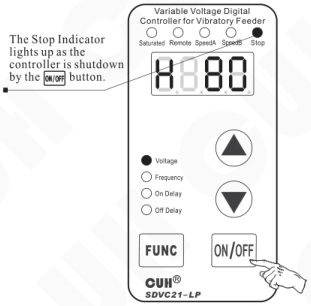

---

## 4.6 Limitation de la tension de sortie maximale

La tension de sortie maximale du contrôleur peut être réglée afin d'éviter d'endommager le vibrateur. La fonction de contrôle de vitesse à distance est affectée par ce paramètre.

- Appuyez sur le bouton **FUNC** et maintenez-le enfoncé pendant 2 secondes pour entrer en état de réglage des paramètres avancés.
- Appuyez de manière répétée sur le bouton **FUNC** jusqu'à basculer en état de limitation de la tension de sortie maximale (h).
- Appuyez sur le bouton ▲ ou ▼ pour ajuster la valeur du paramètre.

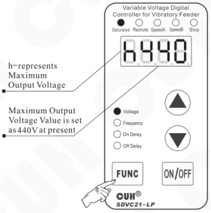

*La valeur par défaut de la tension de sortie maximale est 380 V*

---

## 4.7 Restauration des réglages par défaut

Cette fonction permet à l'opérateur de restaurer tous les réglages de paramètres par défaut.

En raison de la richesse des fonctions du contrôleur, de nombreux paramètres peuvent être réglés. Afin d'éviter qu'un débutant ne rende le contrôleur inutilisable après de trop nombreuses modifications, cette fonction permet à l'opérateur de restaurer facilement les réglages par défaut du contrôleur.

- Appuyez sur le bouton **FUNC** et maintenez-le enfoncé pendant 2 secondes pour entrer en état de réglage des paramètres avancés.
- Appuyez de manière répétée sur le bouton **FUNC** jusqu'à ce que tout l'écran clignote, puis maintenez enfoncé le bouton ▲ jusqu'à l'affichage de « ---- », ce qui signifie que les réglages par défaut ont été restaurés.
- Après avoir relâché le bouton ▲, le contrôleur passe en état de réglage de la tension de sortie (H). À ce moment, tous les paramètres ont été restaurés à leurs valeurs par défaut.

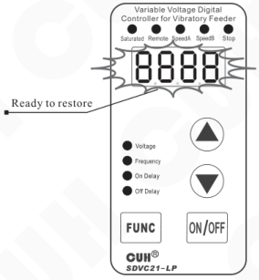

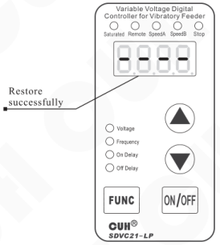

---

# Chapitre V Capteurs et contrôle des signaux

Le contrôleur peut être piloté par de nombreux types de signaux et de capteurs externes. Ce chapitre décrit principalement la méthode d'utilisation du capteur photoélectrique intelligent, des capteurs de commutation et du PLC.

## 5.1 Détection photoélectrique intelligente

Combiné au capteur photoélectrique SDVC-S1, la fonction de détection photoélectrique intelligente peut être réalisée. Le capteur SDVC-S1 peut filtrer les interférences de la lumière ambiante qui affectent la sensibilité du contrôleur. Ainsi, le contrôleur peut fonctionner de manière fiable sans ajustement manuel de la sensibilité.

### 5.1.1 Méthode de raccordement du capteur photoélectrique intelligent SDVC-S1

Raccordez le capteur SDVC-S1 aux bornes du contrôleur selon le schéma

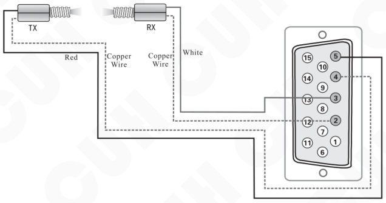

*Avis :*  
*Par défaut, la relation logique du capteur est réglée sur « absence de pièces de travail »*

---

## 5.1.2 Réglage du temps de retard d'enclenchement et du temps de retard de déclenchement du capteur photoélectrique intelligent

Dans la plupart des applications pratiques, la sortie du contrôleur doit être retardée pendant un certain temps lorsque le démarrage ou l'arrêt du contrôleur est commandé par des signaux externes. La fonction de réglage du temps de retard d'enclenchement et du temps de retard de déclenchement rend ce type d'application possible. En outre, les chocs subis par les pièces de travail au démarrage du contrôleur peuvent être éliminés en réglant le temps de démarrage progressif.

### Retard d'enclenchement (J)

Durée s'écoulant entre la réception d'un signal de contrôle de démarrage par le contrôleur et sa mise en sortie.

- Appuyez de manière répétée sur le bouton **FUNC** jusqu'à basculer en état de réglage du temps de retard d'enclenchement (J), tandis que l'indicateur de temps de retard d'enclenchement du panneau s'allume.
- Appuyez sur le bouton ▲ ou ▼ pour ajuster la valeur du paramètre. L'unité du paramètre est la seconde et la précision numérique est de 0.1.

*La plage réglable du paramètre s'étend de 0.0 à 9.9 secondes*  
*La valeur par défaut du paramètre est 0.2 seconde*

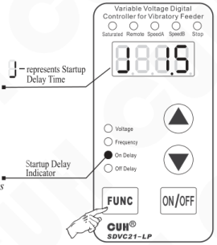

### Retard de déclenchement (L)

Durée s'écoulant entre la réception d'un signal de contrôle d'arrêt par le contrôleur et la coupure de sa sortie.

- Appuyez de manière répétée sur le bouton **FUNC** jusqu'à basculer en état de réglage du temps de retard de déclenchement (L), tandis que l'indicateur de temps de retard de déclenchement du panneau s'allume.
- Appuyez sur le bouton ▲ ou ▼ pour ajuster la valeur du paramètre. L'unité du paramètre est la seconde et la précision numérique est de 0.1.

*La plage réglable du paramètre s'étend de 0.0 à 9.9 secondes*  
*La valeur par défaut du paramètre est 0.2 seconde*

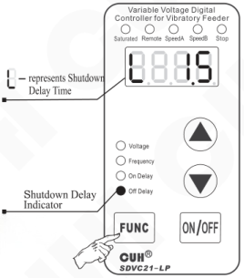

---

### 5.1.3 Réglage de la relation logique du capteur photoélectrique intelligent

En circonstances normales, l'extrémité réceptrice du capteur photoélectrique intelligent ne reçoit aucun signal optique et le contrôleur fonctionne par défaut. Mais dans certaines applications spéciales, le contrôleur doit être arrêté lorsque l'extrémité réceptrice ne reçoit aucun signal optique. Le réglage de ce paramètre permet de répondre à ce type d'applications.

- Appuyez sur le bouton **FUNC** et maintenez-le enfoncé pendant 2 secondes pour entrer en état de réglage des paramètres avancés.
- Appuyez de manière répétée sur le bouton **FUNC** jusqu'à basculer en état de réglage de la relation logique du capteur photoélectrique intelligent.
- Appuyez sur le bouton ▲ ou ▼ pour ajuster la valeur du paramètre.

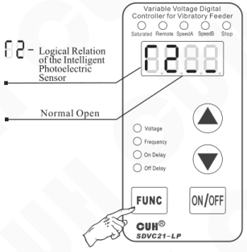

- Lorsque la relation logique est réglée sur Normal Open, c'est-à-dire qu'aucun signal optique n'est reçu, le contrôleur fonctionne.
- Lorsque la relation logique est réglée sur Normal Close, c'est-à-dire qu'aucun signal optique n'est reçu, le contrôleur s'arrête.

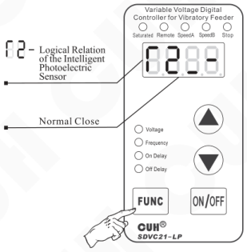

*Le paramètre est réglé sur Normal Open par défaut*

---

## 5.1.4 Réglage du paramètre de sensibilité du capteur photoélectrique intelligent CUH

Le paramètre P désigne la sensibilité du capteur photoélectrique intelligent CUH, c'est-à-dire la distance de détection du capteur photoélectrique intelligent CUH.

Plus la valeur du paramètre P est petite, plus le capteur est sensible et plus la distance de détection est grande.

- Appuyez sur le bouton **FUNC** et maintenez-le enfoncé pendant 2 secondes pour entrer dans l'interface de réglage des paramètres avancés.
- Appuyez de manière répétée sur le bouton **FUNC** pour accéder à l'interface de réglage du paramètre de sensibilité photoélectrique intelligente. Le symbole LED de ce paramètre est « P ».
- Appuyez sur ▲ ou ▼ pour ajuster la valeur de ce paramètre.

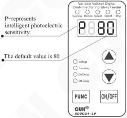

La plage de valeurs du paramètre s'étend de 0 à 999, et la valeur par défaut est 80.

---

## 5.2 Méthode d'utilisation du capteur de commutation

Le contrôleur peut fonctionner avec de nombreux types de capteurs, tels que des capteurs de commutation, des commutateurs optiques et des capteurs à fibre optique.

### 5.2.1 Méthode de raccordement du capteur de commutation

Raccordez le capteur de commutation de proximité aux bornes du contrôleur selon le schéma.

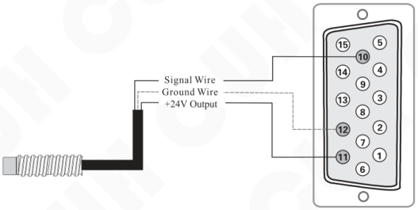

### Convention

Le fil bleu représente le fil de terre  
Le fil noir représente le fil de signal  
Le fil marron représente le fil d'alimentation.

---

## 5.2.2 Réglage du temps de retard d'enclenchement et du temps de retard de déclenchement du capteur de commutation

Par défaut, le capteur photoélectrique intelligent et le capteur de commutation partagent le même temps de retard d'enclenchement et le même temps de retard de déclenchement. L'opérateur peut également régler indépendamment le temps de retard d'enclenchement et le temps de retard de déclenchement du capteur de commutation.

### Retard d'enclenchement (J-)

Durée s'écoulant entre la réception d'un signal de contrôle de démarrage par le contrôleur et sa mise en sortie.

- Appuyez sur le bouton **FUNC** et maintenez-le enfoncé pendant 2 secondes pour entrer en état de réglage des paramètres avancés.
- Appuyez de manière répétée sur le bouton **FUNC** jusqu'à basculer en état de réglage du temps de retard d'enclenchement (`J---`).
- Appuyez sur le bouton ▲ ou ▼ pour ajuster la valeur du paramètre. L'unité du paramètre est la seconde et la précision numérique est de 0.1.

*La plage réglable du paramètre s'étend de 0.0 à 9.9 secondes*  
*La valeur par défaut du paramètre est J---*  
*Le retard d'enclenchement indépendant du capteur de commutation est désactivé lorsque la valeur du paramètre est réglée sur 0*

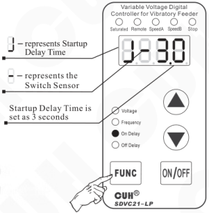

### Retard de déclenchement (L-)

Durée s'écoulant entre la réception d'un signal de contrôle d'arrêt par le contrôleur et la coupure de sa sortie.

- Appuyez sur le bouton **FUNC** et maintenez-le enfoncé pendant 2 secondes pour entrer en état de réglage des paramètres avancés.
- Appuyez de manière répétée sur le bouton **FUNC** jusqu'à basculer en état de réglage du temps de retard de déclenchement (`L---`).
- Appuyez sur le bouton ▲ ou ▼ pour ajuster la valeur du paramètre. L'unité du paramètre est la seconde et la précision numérique est de 0.1.

*La plage réglable du paramètre s'étend de 0.0 à 9.9 secondes*  
*La valeur par défaut du paramètre est L---*  
*Le retard de déclenchement indépendant du capteur de commutation est désactivé lorsque la valeur du paramètre est réglée sur 0*

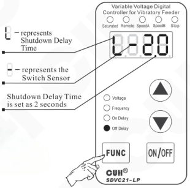

> ➔ Lorsque les valeurs de J- et L- sont réglées sur 0, le temps de retard d'enclenchement et le temps de retard de déclenchement du capteur de commutation redeviennent identiques à ceux du capteur photoélectrique intelligent.
>
> ➔ Le temps de retard d'enclenchement et le temps de retard de déclenchement du capteur photoélectrique intelligent ne sont pas affectés par les paramètres J- ou L-.

---

## 5.2.3 Réglage de la relation logique du capteur de commutation (arrêt lorsque les pièces de travail sont en quantité suffisante)

En circonstances normales, le contrôleur ne reçoit aucun signal du capteur de commutation et fonctionne par défaut. Mais dans certaines applications spéciales, le contrôleur doit être arrêté lorsqu'il ne reçoit aucun signal du capteur de commutation. Le réglage de ce paramètre permet de répondre à ce type d'applications.

- Appuyez sur le bouton **FUNC** et maintenez-le enfoncé pendant 2 secondes pour entrer en état de réglage des paramètres avancés.
- Appuyez de manière répétée sur le bouton **FUNC** jusqu'à basculer en état de réglage de la relation logique du capteur de commutation (Γ1).
- Appuyez sur le bouton ▲ ou ▼ pour ajuster la valeur du paramètre.

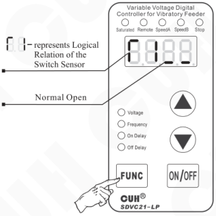

> ➔ Lorsque la relation logique est réglée sur Normal Open, c'est-à-dire qu'aucun signal n'est reçu, le contrôleur fonctionne.
>
> ➔ Lorsque la relation logique est réglée sur Normal Close, c'est-à-dire qu'aucun signal n'est reçu, le contrôleur s'arrête.

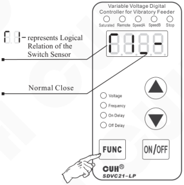

*Le paramètre est réglé sur Normal Open par défaut*

---

## 5.3 Méthode d'utilisation du deuxième capteur de commutation

Le contrôleur autorise le raccordement de trois capteurs : un capteur photoélectrique intelligent et deux capteurs de commutation. Les fonctions d'arrêt lorsque les pièces de travail sont en quantité suffisante et d'arrêt en absence de pièces de travail peuvent être mises en œuvre à l'aide de ces capteurs.

### 5.3.1 Méthode de raccordement du deuxième capteur de commutation

Raccordez le deuxième capteur de commutation de proximité aux bornes du contrôleur selon le schéma.

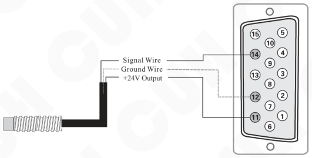

**Généralement**

Le fil bleu représente le fil de terre  
Le fil noir représente le fil de signal  
Le fil marron représente le fil d'alimentation

---

### 5.3.2 Réglage du temps de retard d'enclenchement et du temps de retard de déclenchement du deuxième capteur de commutation

Par défaut, le capteur photoélectrique intelligent et les deux capteurs de commutation partagent le même temps de retard d'enclenchement et le même temps de retard de déclenchement. L'opérateur peut également régler indépendamment le temps de retard d'enclenchement et le temps de retard de déclenchement du deuxième capteur de commutation.

**Retard d'enclenchement (J_) :** Durée s'écoulant entre la réception d'un signal de contrôle de démarrage par le contrôleur et sa mise en sortie.

- Appuyez sur le bouton **FUNC** et maintenez-le enfoncé pendant 2 secondes pour entrer en état de réglage des paramètres avancés.
- Appuyez de manière répétée sur le bouton **FUNC** jusqu'à basculer en état de réglage du temps de retard d'enclenchement (`J_--`)
- Appuyez sur le bouton ▲ ou ▼ pour ajuster la valeur du paramètre. L'unité du paramètre est la seconde et la précision numérique est de 0.1.

*La plage réglable du paramètre s'étend de 0.0 à 9.9 secondes*  
*La valeur par défaut du paramètre est `J_--`*  
*Le retard d'enclenchement indépendant du deuxième capteur de commutation est désactivé lorsque la valeur du paramètre est réglée sur 0*

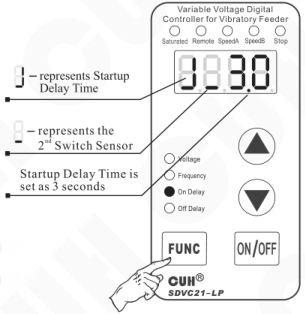

**Retard de déclenchement (L_) :** Durée s'écoulant entre la réception d'un signal de contrôle d'arrêt par le contrôleur et la coupure de sa sortie.

- Appuyez sur le bouton **FUNC** et maintenez-le enfoncé pendant 2 secondes pour entrer en état de réglage des paramètres avancés.
- Appuyez de manière répétée sur le bouton **FUNC** jusqu'à basculer en état de réglage du temps de retard de déclenchement (`L_--`).
- Appuyez sur le bouton ▲ ou ▼ pour ajuster la valeur du paramètre. L'unité du paramètre est la seconde et la précision numérique est de 0.1.

*La plage réglable du paramètre s'étend de 0.0 à 9.9 secondes*  
*La valeur par défaut du paramètre est `L_--`*  
*Le retard de déclenchement indépendant du deuxième capteur de commutation est désactivé lorsque la valeur du paramètre est réglée sur 0*

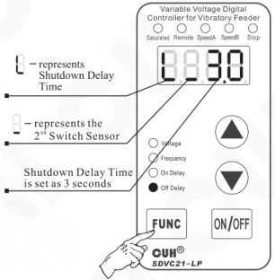

- Lorsque les valeurs de J_ et L_ sont réglées sur 0, le temps de retard d'enclenchement et le temps de retard de déclenchement du deuxième capteur de commutation redeviennent identiques à ceux du capteur photoélectrique intelligent.
- Le temps de retard d'enclenchement et le temps de retard de déclenchement du capteur photoélectrique intelligent ne sont pas affectés par les paramètres J_ ou L_.

---

## 5.3.3 Réglage de la relation logique du deuxième capteur de commutation (arrêt lorsque les pièces de travail sont en quantité suffisante)

En circonstances normales, le contrôleur ne reçoit aucun signal du deuxième capteur de commutation et fonctionne par défaut. Mais dans certaines applications spéciales, le contrôleur doit être arrêté lorsqu'il ne reçoit aucun signal du deuxième capteur de commutation. Le réglage de ce paramètre permet de répondre à ce type d'applications.

- Appuyez sur le bouton **FUNC** et maintenez-le enfoncé pendant 2 secondes pour entrer en état de réglage des paramètres avancés.
- Appuyez de manière répétée sur le bouton **FUNC** jusqu'à basculer en état de réglage de la relation logique du deuxième capteur de commutation (Γ3)
- Appuyez sur le bouton ▲ ou ▼ pour ajuster la valeur du paramètre.

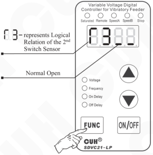

> - Lorsque la relation logique est réglée sur Normal Open, c'est-à-dire qu'aucun signal n'est reçu, le contrôleur fonctionne.
> - Lorsque la relation logique est réglée sur Normal Close, c'est-à-dire qu'aucun signal n'est reçu, le contrôleur s'arrête.

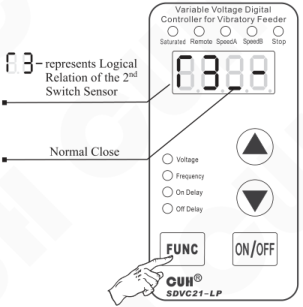

*Le paramètre est réglé sur Normal Open par défaut*

---

## 5.4 Réglage de la relation logique du signal de contrôle

Le contrôleur peut régler la relation logique du capteur photoélectrique intelligent et du capteur de commutation lorsqu'ils fonctionnent simultanément.

- Appuyez sur le bouton **FUNC** et maintenez-le enfoncé pendant 2 secondes pour entrer en état de réglage des paramètres avancés.
- Appuyez de manière répétée sur le bouton **FUNC** jusqu'à basculer en état de réglage de la relation logique du signal de contrôle (Π).
- Appuyez sur le bouton ▲ ou ▼ pour ajuster la valeur du paramètre.

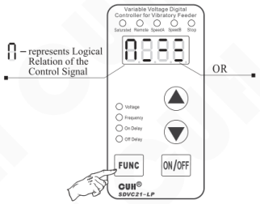

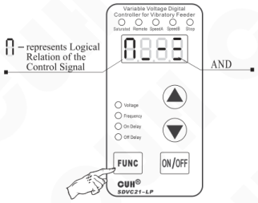

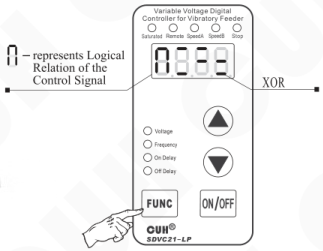

- **Relation logique AND :** le contrôleur ne fonctionne que lorsque le capteur photoélectrique intelligent et le capteur de commutation le demandent tous les deux.
- **Relation logique OR :** le contrôleur fonctionne lorsque le capteur photoélectrique intelligent ou le capteur de commutation le demande.
- **Relation logique XOR :** le contrôleur ne fonctionne que lorsque le capteur photoélectrique intelligent et le capteur de commutation émettent des signaux de contrôle opposés.

*La relation logique du paramètre est réglée sur AND par défaut.*

---

## 5.5 Sortie de contrôle

Le contrôleur peut émettre un signal de contrôle basse tension pour coopérer avec d'autres dispositifs tels qu'une électrovanne, un PLC ou un relais électrique.

### 5.5.1 Méthode de raccordement de la sortie de contrôle

**Méthode de raccordement du PLC piloté**

Raccordez le fil de signal et le fil de terre du contrôleur aux bornes du contrôleur selon le schéma.

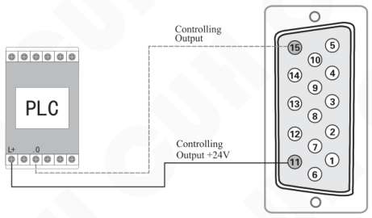

> Le port de sortie du PLC, de type relais ou de type source, peut être raccordé au contrôleur, et la tension du port de sortie est de 24 V.

---

### 5.5.2 Méthode de raccordement de l'électrovanne pilotée

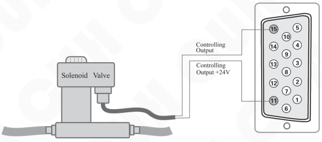

➔ Le contrôleur peut piloter directement une électrovanne dont la tension nominale est 24 V et la puissance nominale inférieure à 4 W.

### 5.5.3 Méthode de raccordement du relais électrique

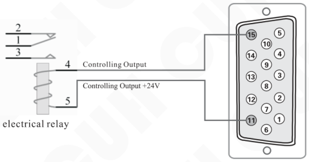

➔ Le contrôleur peut piloter directement un relais électrique dont la tension nominale est 24 V et la puissance nominale inférieure à 4 W.

---

## 5.5.4 Réglage de la relation logique de la sortie de contrôle

- Appuyez sur le bouton **FUNC** et maintenez-le enfoncé pendant 2 secondes pour entrer en état de réglage des paramètres avancés.
- Appuyez de manière répétée sur le bouton **FUNC** jusqu'à basculer en état de réglage de la relation logique de la sortie de contrôle (Γ4).
- Appuyez sur le bouton ▲ ou ▼ pour ajuster la valeur du paramètre.

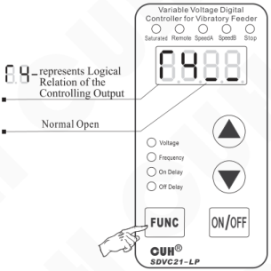

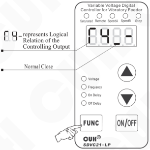

> - Lorsque la relation logique est réglée sur Normal Open, la sortie de contrôle fonctionne lorsque le contrôleur fonctionne.
> - Lorsque la relation logique est réglée sur Normal Close, la sortie de contrôle ne fonctionne pas lorsque le contrôleur fonctionne.

---

## 5.5.5 Réglage du paramètre d'affectation des signaux de contrôle à la sortie du contrôleur ou à la sortie CC pour un contrôle séparé

- Appuyez sur le bouton **FUNC** et maintenez-le enfoncé pendant 2 secondes pour entrer dans l'interface de réglage des paramètres avancés.
- Appuyez de manière répétée sur le bouton **FUNC** pour accéder à l'interface de réglage du paramètre. Le symbole LED de ce paramètre est « Γ5 ».
- Appuyez sur ▲ ou ▼ pour ajuster la valeur de ce paramètre.

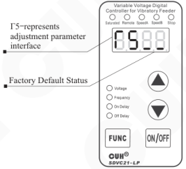

- Lorsque le Γ5 est réglé sur « 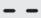 », la sortie vers le vibrateur et la sortie CC sont toutes deux contrôlées par le bouton ON/OFF du panneau de commande et par le résultat de l'opération logique du capteur photoélectrique intelligent CUH et des deux capteurs de commutation.
- Lorsque le Γ5 est réglé sur « 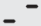 », la sortie vers le vibrateur est contrôlée par le bouton ON/OFF du panneau de commande. La sortie CC est contrôlée par le résultat de l'opération logique du capteur photoélectrique intelligent CUH et des deux capteurs de commutation.
- Lorsque le Γ5 est réglé sur « 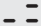 », la sortie vers le vibrateur est contrôlée par le bouton ON/OFF du panneau de commande et par le résultat de l'opération logique des deux capteurs de commutation. La sortie CC est contrôlée par le capteur photoélectrique intelligent CUH.
- Lorsque le Γ5 est réglé sur « 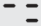 », la sortie vers le vibrateur est contrôlée par le bouton ON/OFF du panneau de commande et par le capteur photoélectrique intelligent CUH. La sortie CC est contrôlée par le résultat de l'opération logique des deux capteurs de commutation.

---

## 5.6 Contrôle de vitesse à distance

La fonction de contrôle de vitesse à distance permet à l'opérateur de contrôler la tension de sortie au moyen d'un potentiomètre externe ou d'un signal de contrôle compris entre 1 V et 5 V. Ainsi, un contrôle de vitesse à distance externe peut être facilement réalisé par un PLC, un DCS ou d'autres dispositifs.

La fonction de contrôle de vitesse à distance devient effective pour le contrôleur lorsque le signal de contrôle dépasse 0.5 V. Dans le même temps, l'indicateur de contrôle de vitesse à distance du panneau s'allume et les boutons ▲ et ▼ perdent leur efficacité. L'afficheur LED affiche la tension de sortie actuelle si le contrôleur fonctionne en état de réglage de la tension de sortie.

Il existe une relation linéaire entre la tension de contrôle de 1~5 V et la tension de sortie de 0~440 V

### Méthode de raccordement du potentiomètre externe

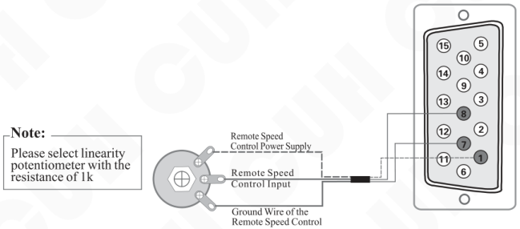

### Méthode de raccordement du PLC

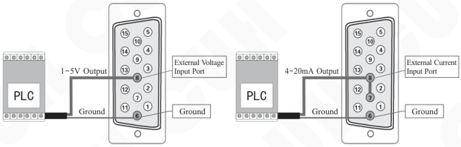

## 5.7 Commutation de vitesse préréglée

La fonction de commutation de vitesse préréglée permet de choisir la vitesse préréglée au moyen de signaux de contrôle externes, tels qu'un PLC, un PC, des capteurs ou d'autres sources de signaux, afin de construire un système de contrôle d'alimentation multivitesse.

Le contrôleur prend en charge deux commutateurs de contrôle de vitesse à distance. Le commutateur de vitesse A et le commutateur de vitesse B sont tous deux actifs au niveau bas.

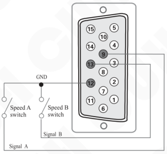

Chaque commutateur de contrôle de vitesse dispose d'un indicateur correspondant sur le panneau. Lorsque le contrôleur reçoit un signal effectif, l'indicateur correspondant s'allume.

Les deux indicateurs indiquent 4 états (A s'allume et B s'éteint, A s'éteint et B s'allume, les deux s'allument, les deux s'éteignent). Le schéma à droite montre l'état dans lequel les deux commutateurs de contrôle de vitesse reçoivent des signaux effectifs.

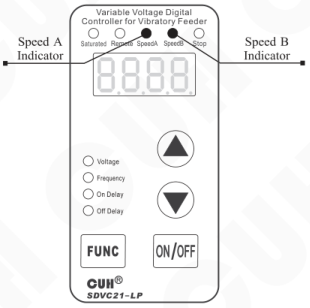

Au moyen des commutateurs de contrôle de vitesse, le contrôleur bascule vers la vitesse correspondante. La tension de sortie correspondant à la vitesse peut être ajustée en appuyant sur le bouton ▲ ou ▼. La tension ajustée est ensuite mémorisée automatiquement. Dès réception du signal de contrôle de vitesse, le contrôleur émet immédiatement la tension correspondante.

---

## Chapitre VI Fonctions de sécurité

### 6.1 Stabilisation numérique automatique de tension

La fonction interne de stabilisation numérique de tension du contrôleur peut stabiliser la vitesse d'alimentation quelles que soient les fluctuations de la tension du secteur.

### 6.2 Protection contre les courts-circuits

En cas de court-circuit de la sortie, le contrôleur arrête sa sortie et affiche Err02 jusqu'au redémarrage du contrôleur.

### 6.3 Protection contre la surcharge de courant

Le contrôleur arrête sa sortie si le courant de sortie dépasse le courant nominal à la suite d'une opération défectueuse, et affiche Err02 afin de protéger le contrôleur et les équipements du client.

### 6.4 Protection contre la surchauffe

Le contrôleur arrête sa sortie et affiche Err03 afin de protéger le contrôleur si la température de fonctionnement dépasse 65⁰C, jusqu'à ce que la température de fonctionnement redescende à 60⁰C.

### 6.5 Courbe de déclassement en température ambiante (uniquement pour le SDVC21-XLP)

En convection naturelle de l'air, lorsque la température ambiante s'élève, en raison de la limitation de la capacité de dissipation thermique du contrôleur, celui-ci ne peut pas fournir en continu un courant de 25 A. Reportez-vous à la courbe de déclassement ci-dessous pour l'utilisation.

Si vous souhaitez que le contrôleur puisse fournir en continu un courant de 25 A, veuillez offrir de meilleures conditions de refroidissement.

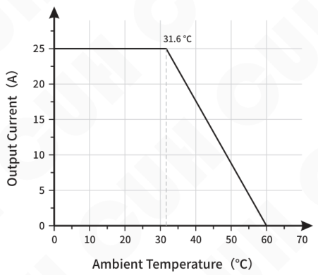

---

## Annexe A : Dimensions (mm)

### SDVC21-LP

---

## SDVC21-XLP

---

## Annexe B : Définition de l'interface de sortie

### Vue en coupe :

**⚠ Avis :**

A : Assurez-vous que les bobines électromagnétiques du vibrateur sont raccordées aux deux broches de sortie de la fiche du câble d'alimentation de sortie et que la carcasse du vibrateur est correctement mise à la terre, sinon un incident de sécurité grave pourrait survenir.

B : Après soudure, assurez-vous que la zone vide est enveloppée d'un ruban isolant ou d'une gaine thermorétractable avant de l'insérer dans la fiche du câble d'alimentation de sortie, afin d'éviter toute fuite électrique ou tout court-circuit.

## Annexe C : Définition de l'interface de signal

![15-pin signal interface definition diagram. 1: Remote Speed Control (+5V); 2: Photosensor (GND); 3: Photosensor Rx; 4: Photosensor (GND); 5: Photosensor Tx; 6: Remote Speed Control (GND); 7: RGND; 8: Remote Speed Control (Input); 9: Pset A (Low voltage level is valid); 10: Switch Sensor Input (NPN type: Low voltage level is valid; PNP type: High voltage level is valid); 11: Control Output (+24V); 12: Control Output (GND); 13: Pset B (Low voltage level is valid); 14: Switch Sensor II Input (NPN type: Low voltage level is valid; PNP type: High voltage level is valid); 15: Control Output.](assets/images/cuh.sdvc21-lp.manual.v0.0/page-0037-vcrop-02.png)

---

## Port A : Contrôle de vitesse à distance

| Port | Broche | Signal |
|---|---|---|
| A3 | ① | +5V |
| A2 | ⑧ | Entrée |
| A1 | ⑦ | RGND |

## Port B : Photosenseur intelligent

| Port | Broche | Signal |
|---|---|---|
| B4 | ⑤ | Tx |
| B3 | ④ | GND |
| B2 | ③ | Rx |
| B1 | ② | GND |

## Port C : Capteur de commutation

| Port | Broche | Signal |
|---|---|---|
| C1 | ⑫ | GND |
| C2 | ⑩ | Entrée |
| C3 | ⑪ | +24V |

## Port D : Sortie de contrôle

| Port | Broche | Signal |
|---|---|---|
| D1 | ⑮ | Sortie |
| D2 | ⑪ | +24V |
| D3 | ⑫ | GND |

---

## Port E : Capteur de commutation II

| Port | Broche DB | Signal |
|---|---|---|
| E1 | ⑫ | GND |
| E2 | ⑭ | Entrée |
| E3 | ⑪ | +24V |

## Port G : Préréglage des vitesses

| Port | Broche DB | Signal |
|---|---|---|
| G1 | ⑫ | GND |
| G2 | ⑨ | Pset A |
| G3 | ⑫ | GND |
| G4 | ⑬ | Pset B |

## Port I : Alimentation CC 24 V

| Port | Broche DB | Signal |
|---|---|---|
| I1 | ⑫ | GND |
| I2 | ⑪ | +24V |

Remarque : les chiffres entourés représentent les broches de la fiche DB.

---

## Annexe D : Définition des caractères affichés sur l'afficheur LED

| Caractère affiché | Définition | image du symbole |
|---|---|---|
| H | Tension de sortie |  |
| E | Fréquence de sortie |  |
| t | Démarrage progressif |  |
| J | Temps de retard d'enclenchement du capteur photoélectrique intelligent |  |
| J- | Temps de retard d'enclenchement du capteur de commutation |  |
| J_ | Temps de retard d'enclenchement du deuxième capteur de commutation |  |
| L | Temps de retard de déclenchement du capteur photoélectrique intelligent |  |
| L- | Temps de retard de déclenchement du capteur de commutation |  |
| L_ | Temps de retard de déclenchement du deuxième capteur de commutation |  |
| Γ1 | Relation logique du capteur de commutation |  |
| Γ2 | Relation logique du capteur photoélectrique intelligent |  |
| Γ3 | Relation logique du deuxième capteur de commutation |  |
| Γ4 | Relation logique de la sortie de contrôle |  |
| Γ5 | Réglage du paramètre d'affectation des signaux de contrôle à la sortie du contrôleur ou à la sortie CC pour un contrôle séparé |  |
| ΓE | Réglage du paramètre de caractère d'affichage de fréquence |  |
| h | Tension de sortie maximale |  |
| A | Relation logique du signal de contrôle |  |
| P | Réglage du paramètre de sensibilité du capteur photoélectrique intelligent CUH |  |
| 8.8.8.8. | Restauration des réglages par défaut |  |
| ---- | Restauration des réglages par défaut réussie |  |
| Err | Information d'erreur |  |

## Annexe E : Caractéristiques électriques

| Élément | Plage : min | Plage : typique | Plage : max | Unité | Description |
|---|---|---|---|---|---|
| Tension d'entrée | 85 | 380 | 440 | V | AC RMS |
| Plage de tension de sortie réglable | 35 | —— | Vin-10 | V | Half Wave |
| Plage de tension de sortie réglable | 45 | —— | Vin-5 | V | Full Wave |
| Précision de réglage de la tension | | 1 | | V | |
| Temps de réponse de la régulation de tension | 0 | 0.01 | 0.02 | s | |
| Plage de courant de sortie réglable | 0 | —— | 10 | A | SDVC21-LP |
| Plage de courant de sortie réglable | 0 | —— | 25 | A | SDVC21-XLP |
| Puissance de sortie | 0 | —— | 3800 | VA | SDVC21-LP |
| Puissance de sortie | 0 | —— | 9500 | VA | SDVC21-XLP |
| Fréquence de sortie | 90 | 100/120 | 130 | Hz | Full Wave |
| Fréquence de sortie | 45 | 50/60 | 65 | Hz | Half Wave |
| Fréquence de sortie | 30 | 33/40 | 43 | Hz | 1/3 full wave SDVC21-XLP |
| Fréquence de sortie | 22 | 25/30 | 32 | Hz | 1/4 full wave SDVC21-XLP |
| Forme d'onde de sortie | | Sinus découpé en phase | | | |
| Temps de démarrage progressif | 0.0 | —— | 9.9 | s | Valeur par défaut en usine : 0.5 |
| Plage du temps de retard d'enclenchement/de déclenchement | 0.0 | —— | 9.9 | s | Valeur par défaut en usine : 0.2 |
| Précision du temps de retard d'enclenchement/de déclenchement | | 0.1 | | s | |
| Température de déclenchement de la protection contre la surchauffe | 58 | 60 | 66 | ℃ | |
| Tension de la sortie de contrôle CC | 22 | 24 | 26 | V | |
| Courant de la sortie de contrôle CC | 0 | —— | 200 | mA | |
| Signal de contrôle analogique | | 1-5 | | V | Tension du contrôle de vitesse à distance |
| Signal de contrôle numérique | | 24 | | V | Signal de commutation |
| Méthode de réglage | | 4 | | Bouton | |
| Capacité du fusible | | 16 | | A | SDVC21-LP |
| Capacité du fusible | | 30 | | A | SDVC21-XLP |
| Consommation en veille | —— | 4 | —— | W | |
| Méthode d'affichage | | 4 | | Chiffre | Afficheurs numériques LED |
| Niveau de protection contre les intrusions | | IP67 | | | |
| Poids | | 4600 | | g | SDVC21-LP |
| Poids | | 5800 | | g | SDVC21-XLP |
| Température ambiante | 0 | 25 | 40 | ℃ | |

---

## Annexe F : Conseils de dépannage et explications des erreurs

Les conseils suivants peuvent aider à résoudre les problèmes que vous pourriez rencontrer

| | | | image du symbole |
|---|---|---|---|
| 1 | Aucun affichage après la mise sous tension | ➔Vérifiez que la prise de courant est sous tension ➔Vérifiez que le câble d'alimentation d'entrée est correctement raccordé à la prise de courant | |
| 2 | Affichage normal, mais aucune sortie | ➔Vérifiez que le câble d'alimentation d'entrée et le câble d'alimentation de sortie sont fermement raccordés ➔Vérifiez que la valeur du paramètre de tension de sortie n'est pas trop petite ➔Vérifiez que le contrôleur n'est pas arrêté par le signal de contrôle ➔Vérifiez que le contrôleur n'est pas arrêté par des paramètres réglés sur normal off | |
| 3 | Le signal de contrôle perd son efficacité | ➔Vérifiez que le signal de contrôle est correctement entré ➔Vérifiez que le fil de terre du signal de contrôle est correctement raccordé au contrôleur ➔Vérifiez que la relation logique du signal de contrôle est réglée correctement comme vous le souhaitez | |
| 4 | Affichage normal, aucune sortie, mais un bruit audible | ➔Réglez tous les paramètres comme indiqué dans ce manuel | |
| 5 | Err2 | ➔Surintensité de sortie. Vérifiez que les caractéristiques du vibrateur ne dépassent pas les limites du contrôleur. ➔Sortie en court-circuit. Vérifiez que le câble d'alimentation de sortie et la fiche aviation d'alimentation de sortie ne sont pas en court-circuit. ➔Vérifiez que le câble d'alimentation de sortie est correctement raccordé entre le contrôleur et le vibrateur. ➔Vérifiez que le contrôleur est correctement mis à la terre. |  |
| 6 | Err3 | ➔Surchauffe, placez le contrôleur dans un environnement bien ventilé |  |

## Annexe G : Paramètres absolus

Paramètres absolus :
Dépasser les normes ci-dessus endommagera le contrôleur, respectez-les strictement.

| Élément | Norme GB | Norme IEC | Exigence de la norme | Niveau atteint par le produit CUH | Remarque |
|---|---|---|---|---|---|
| Décharge électrostatique | GB/T 17626.2-2006 | IEC 61000-4-2:2001 | 4 kV | ±8 kV | Décharge par contact |
| | | | 4 kV | ±15 kV | Décharge dans l'air |
| Test de transitoire électrique rapide | GB/T 17626.4-2008 | IEC 61000-4-4:2004 | 4 kV | ±4 kV | Couplage direct |
| Surtension électrique | GB/T 17626.5-2008 | IEC 61000-4-5:2005 | 4 kV | ±4 kV | Couplage ligne-ligne |
| | | | 4 kV | ±4 kV | Couplage ligne-terre |

---

Nanjing CUH Science & Technology Co.,Ltd  
https://en.cuhnj.com  
Tel.:+86-25-84730411 / 84730415 / 84730416  
Fax:+86-25-84730426  
E-mail:sales@cuhnj.com  
Add.:Building 2, Xueyan Tech Park, Tuscity,  
No.9 Zhineng Rd, Jiangning, Nanjing, China

Document No.: IDP1000415

