## Contrôleur numérique de fréquence variable pour alimentateur vibrant

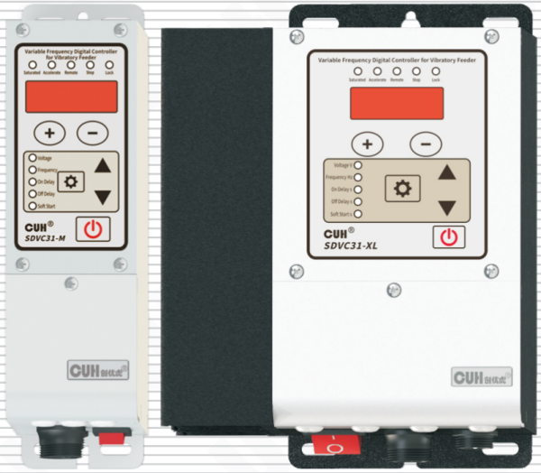

## Série SDVC31
Contrôleur numérique de fréquence variable pour alimentateur vibrant — Série SDVC31
**Manuel d'utilisation**

---

## Déclaration de droits d'auteur

Nanjing CUH Science & Technology CO., Ltd. se réserve tous les droits.

Toutes les informations contenues dans ce manuel d'utilisation constituent le savoir-faire de notre société et sont protégées par le droit d'auteur et d'autres lois connexes. CUH jouit et se réserve tous les droits conférés par le droit d'auteur et d'autres lois. Sans le consentement écrit de CUH, la totalité ou une partie de ce manuel d'utilisation ne peut être copiée, traduite, imitée ni utilisée d'une autre manière.

## Clause de non-responsabilité

Le contenu de ce manuel d'utilisation décrit uniquement le mode d'emploi des produits fabriqués par notre société, conformément à la technologie existante et à l'état fourni au moment de l'utilisation. Vous devez assumer les risques correspondants lors de l'utilisation de ce produit. Sauf obligation légale, la société n'assume aucune responsabilité expresse ou implicite concernant le produit du fait de ce manuel d'utilisation, y compris mais sans s'y limiter, les blessures corporelles, les dommages matériels, la perte d'opportunité, etc.

Vous comprenez clairement les risques ci-dessus et acceptez que, sauf obligation légale, la société n'est pas responsable de tout dommage ou perte directe ou indirecte vous concernant (y compris mais sans s'y limiter, les pertes tangibles de personnel, de biens, de données, etc. et les pertes intangibles de réputation, d'opportunité, etc.)

La société se réserve le droit de modifier les produits concernés par ce manuel d'utilisation sans préavis ni notification ultérieure.

---

# Avant-propos

Merci d'avoir choisi le contrôleur d'alimentation vibratoire à modulation numérique de fréquence de la série CUH SDVC31. (Désigné ci-après par « le contrôleur » dans la suite du texte). Cette série de contrôleurs utilise des composants de haute qualité et intègre les dernières technologies électroniques, et est soigneusement conçue avec des processeurs numériques de signal haute performance.

Ce manuel présente le mode d'opération de base, la description technique fonctionnelle et les exemples d'application typiques de ce produit. Il fournit aux utilisateurs les informations relatives à l'installation et au débogage, au réglage des paramètres, au diagnostic des anomalies, au dépannage et à la maintenance de routine du contrôleur. Afin de garantir une installation et une utilisation correctes de ce contrôleur, veuillez lire attentivement ce manuel d'utilisation avant l'installation et le conserver soigneusement.

Veillez à lire les symboles suivants qui vous alertent sur les précautions contre les blessures corporelles et les dommages au produit.

| | |
|---|---|
| ⚠ Danger | La non-observation de ce point entraînera des blessures corporelles ou la mort. |
| ⚠ Avertissement | La non-observation de ce point peut entraîner des blessures corporelles ou la mort. |
| ⚠ Attention | La non-observation de ce point peut entraîner des blessures modérées ou légères aux personnes. |
| Avis | La non-observation de ce point entraînera des dommages au produit et des dommages matériels. |
| ❗ Obligatoire | Indique les précautions et restrictions d'utilisation qui doivent être observées pendant l'utilisation. |

**Ce manuel convient aux modèles de contrôleurs suivants :**

- Contrôleur d'alimentation vibratoire à modulation numérique de fréquence SDVC31-S (1.5A)
- Contrôleur d'alimentation vibratoire à modulation numérique de fréquence SDVC31-M (3.0A)
- Contrôleur d'alimentation vibratoire à modulation numérique de fréquence SDVC31-L (4.5A)
- Contrôleur d'alimentation vibratoire à modulation numérique de fréquence SDVC31-XL (6.0A)

---

## Sécurité et précautions

1. **⚠ Danger** Ce produit est uniquement destiné à actionner des équipements d'alimentation vibratoire à base d'électroaimants ; n'utilisez pas ce produit dans le but de protéger le corps humain ou des parties du corps humain, etc.

2. **⚠ Danger** Ce produit n'est pas conçu pour être utilisé comme produit antidéflagrant ; ne l'utilisez pas dans des zones dangereuses et/ou des environnements à gaz potentiellement explosifs.

3. **⚠ Avertissement** Ce produit est alimenté par le réseau CA ; veuillez ne pas appliquer une tension CA supérieure à 260Vac. Une tension d'entrée excessive, telle que 380Vac, peut faire exploser le produit ou provoquer un incendie, entraînant de graves accidents de sécurité.

4. **⚠ Avertissement** Ce produit est mis à la terre via le cordon d'alimentation. Veuillez vous assurer que les installations de distribution électrique du contrôleur sont correctement mises à la terre, sinon le boîtier du contrôleur risque d'être sous tension, provoquant un accident de choc électrique.

5. **⚠ Avertissement** N'appliquez pas de courant CA à la sortie de ce contrôleur, cela endommagerait le contrôleur.

6. **⚠ Avertissement** Ne branchez et ne débranchez pas le câblage sous tension et ne touchez pas les contacts de chaque borne de connexion dans le compartiment de câblage afin d'éviter tout choc électrique.

7. **Avis** Évitez de contrôler la sortie de ce produit en coupant l'alimentation au moyen de relais ou d'autres dispositifs, car cela réduirait considérablement la durée de vie du contrôleur.

8. **Avis** Le contrôleur est conçu pour fonctionner dans un environnement frais et sec. N'utilisez jamais le contrôleur à l'extérieur pour éviter l'immersion et l'insolation. Utilisez le contrôleur dans la plage de température spécifiée par les caractéristiques électriques.

9. **❗ Obligatoire** Veillez à fixer ce produit sur une plateforme solide, correctement mise à la terre et éloignée des équipements vibrants.

10. **❗ Obligatoire** N'utilisez jamais le contrôleur dans des conditions dépassant ses limites de conception.

11. **❗ Obligatoire** Utilisez le contrôleur strictement conformément à ce manuel d'instructions. Nous n'assumerons aucune responsabilité civile ou pénale si des dommages à l'équipement ou des blessures corporelles sont causés par une utilisation incorrecte.

12. **❗ Obligatoire** N'ouvrez jamais le boîtier du contrôleur afin d'éviter tout choc électrique. Contactez CUH si le contrôleur tombe en panne. N'essayez jamais de réparer vous-même le contrôleur, ce qui pourrait annuler la garantie.

---

# Environnement de fonctionnement et de stockage

## Inspection avant utilisation

Chaque contrôleur fait l'objet d'une inspection qualité rigoureuse avant la livraison et est emballé dans un emballage anti-choc. Veuillez vérifier les points suivants après le déballage :

1. Vérifier si le contrôleur a été endommagé pendant le transport.
2. Vérifier si le modèle du contrôleur correspond à celui que vous avez commandé.

## Environnement d'exécution

Veuillez suivre les consignes ci-dessous afin de garantir de meilleures performances et une durée de vie plus longue du contrôleur :

- ⚠ Environnement bien ventilé
- ⚠ Tenir éloigné de l'eau, de la vapeur, de la poussière et surtout des poussières huileuses
- ⚠ Tenir éloigné des gaz et liquides corrosifs ou inflammables
- ⚠ Tenir éloigné des poussières en suspension et des particules métalliques
- ⚠ Fixer fermement pour éviter les vibrations propres
- ⚠ Tenir éloigné des interférences électromagnétiques
- ⚠ Vérifiez que la température ambiante est de 0~40 ℃
- ⚠ Pour utilisation à une altitude de 2000 m ou inférieure

---

# Table des matières

- **Chapitre Ⅰ Avant utilisation — 1**
  - 1.1 Vérification du contenu de l'emballage — 1
  - 1.2 Description des indicateurs et des boutons — 2
  - 1.3 Description des parties externes — 3
  - 1.4 Description des ports de câblage — 4
  - 1.5 Description de la plaque signalétique — 4
- **Chapitre Ⅱ Caractéristiques — 5**
- **Chapitre Ⅲ Guide d'installation — 7**
  - 3.1 Conditions d'utilisation du contrôleur — 7
  - 3.2 Méthode d'utilisation des boutons — 7
  - 3.3 Installation et utilisation — 8
- **Chapitre Ⅳ Description des fonctions de base — 12**
  - 4.1 Tension de sortie — 12
  - 4.2 Fréquence de sortie — 13
  - 4.3 Retard d'enclenchement/de déclenchement du capteur photoélectrique intelligent — 14
  - 4.4 Temps de démarrage progressif — 15
  - 4.5 Verrouillage du clavier — 15
- **Chapitre Ⅴ Description des fonctions avancées — 16**
  - 5.1 Contrôle de vitesse à distance — 16
  - 5.2 Détection photoélectrique intelligente — 18
    - 5.2.1 Méthode de câblage du capteur photoélectrique intelligent — 18
    - 5.2.2 Réglage de la relation logique du capteur photoélectrique intelligent — 19
  - 5.3 Capteur de commutation — 20
    - 5.3.1 Méthode de câblage du capteur de commutation — 20
    - 5.3.2 Retard d'enclenchement/de déclenchement du capteur de commutation — 21
    - 5.3.3 Réglage de la relation logique du capteur de commutation — 22

---

---

- 5.4 Réglage de la relation logique du signal de contrôle — 23
- 5.5 Sortie de contrôle — 24
  - 5.5.1 Méthode de câblage de la sortie de contrôle — 24
  - 5.5.2 Réglage de la relation logique de la sortie de contrôle — 25
  - 5.5.3 Paramètre de séparation sortie principale/sortie de contrôle — 26
- 5.6 Limitation de la tension de sortie maximale — 27
- 5.7 Limite inférieure de fréquence — 27
- 5.8 Indice d'accélération — 28
- 5.9 Indice de forme d'onde — 29
- 5.10 Fonction d'affichage de la température — 30
- 5.11 Restauration des réglages par défaut/Reprise du mode d'usine — 31

## Chapitre Ⅵ Caractéristiques techniques — 32

- 6.1 Dimensions — 32
- 6.2 Caractéristiques techniques — 34
- 6.3 Norme de référence — 35

## Chapitre Ⅶ Annexe — 36

- 7.1 Table des paramètres — 36
- 7.2 Schémas de circuit d'entrée et de sortie — 37
- 7.3 Suggestions de dépannage et explications des erreurs — 38

## Chapitre Ⅷ Informations de garantie du produit — 39

- 8.1 Période de garantie — 39
- 8.2 Couverture de la garantie — 39
- 8.3 Aptitude du produit — 39

---

# Chapitre Ⅰ Avant utilisation

Ce chapitre présente le contenu de l'emballage du produit, la description de l'apparence du contrôleur et les informations de la plaque signalétique du contrôleur.

## 1.1 Vérification du contenu de l'emballage

Avant utilisation, veuillez vérifier l'intégrité du contrôleur et des accessoires. Si vous constatez que le produit est défectueux ou endommagé, que des accessoires manquent, etc., veuillez contacter notre société.

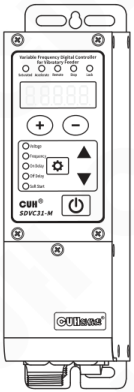

Contrôleur×1

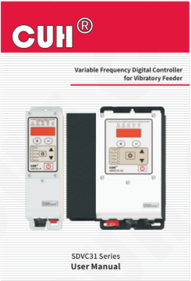

Manuel d'utilisation×1

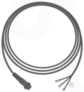

Câble de sortie×1

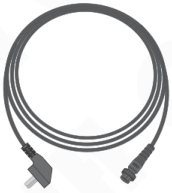

Cordon d'alimentation d'entrée×1

---

## 1.2 Description des indicateurs et des boutons

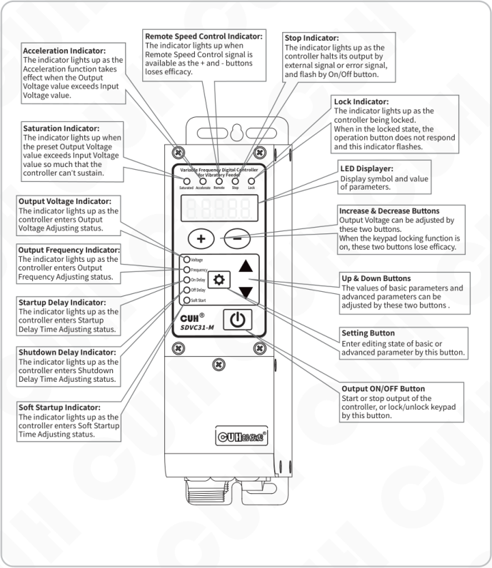

**Indicateur d'accélération :**
L'indicateur s'allume lorsque la fonction d'accélération prend effet, c'est-à-dire lorsque la valeur de la tension de sortie dépasse la valeur de la tension d'entrée.

**Indicateur de contrôle de vitesse à distance :**
L'indicateur s'allume lorsque le signal de contrôle de vitesse à distance est disponible, et les boutons + et - deviennent inopérants.

**Indicateur d'arrêt :**
L'indicateur s'allume lorsque le contrôleur arrête sa sortie sur signal externe ou signal d'erreur, et clignote via le bouton On/Off.

**Indicateur de saturation :**
L'indicateur s'allume lorsque la valeur de tension de sortie préréglée dépasse tellement la valeur de la tension d'entrée que le contrôleur ne peut plus la maintenir.

**Indicateur de verrouillage :**
L'indicateur s'allume lorsque le contrôleur est verrouillé.
En état verrouillé, les boutons d'opération ne répondent pas et cet indicateur clignote.

**Afficheur LED :**
Affiche le symbole et la valeur des paramètres.

**Indicateur de tension de sortie :**
L'indicateur s'allume lorsque le contrôleur entre dans l'état de réglage de la tension de sortie.

**Indicateur de fréquence de sortie :**
L'indicateur s'allume lorsque le contrôleur entre dans l'état de réglage de la fréquence de sortie.

**Indicateur de retard de démarrage :**
L'indicateur s'allume lorsque le contrôleur entre dans l'état de réglage du temps de retard de démarrage.

**Indicateur de retard d'arrêt :**
L'indicateur s'allume lorsque le contrôleur entre dans l'état de réglage du temps de retard d'arrêt.

**Indicateur de démarrage progressif :**
L'indicateur s'allume lorsque le contrôleur entre dans l'état de réglage du temps de démarrage progressif.

**Boutons d'augmentation et de diminution**
La tension de sortie peut être ajustée par ces deux boutons.
Lorsque la fonction de verrouillage du clavier est activée, ces deux boutons deviennent inopérants.

**Boutons haut et bas**
Les valeurs des paramètres de base et des paramètres avancés peuvent être ajustées par ces deux boutons .

**Bouton de réglage**
Entrez dans l'état d'édition d'un paramètre de base ou avancé par ce bouton.

**Bouton ON/OFF de sortie**
Démarrez ou arrêtez la sortie du contrôleur, ou verrouillez/déverrouillez le clavier par ce bouton.

## 1.3 Description des parties externes

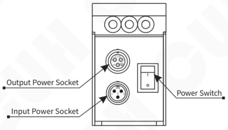

SDVC31-S (1.5A)  
SDVC31-M (3.0A)

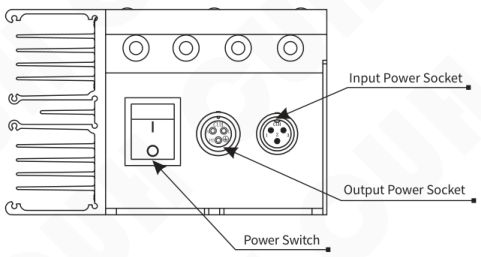

SDVC31-L (4.5A)  
SDVC31-XL (6.0A)

---

## 1.4 Description des ports de câblage

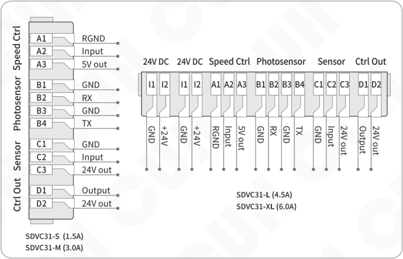

**SDVC31-S (1.5A)**  
**SDVC31-M (3.0A)**

| Groupe de ports | Broche | Description |
|---|---|---|
| Speed Ctrl | A1 | RGND |
| Speed Ctrl | A2 | Entrée |
| Speed Ctrl | A3 | Sortie 5V |
| Photosensor | B1 | GND |
| Photosensor | B2 | RX |
| Photosensor | B3 | GND |
| Photosensor | B4 | TX |
| Sensor | C1 | GND |
| Sensor | C2 | Entrée |
| Sensor | C3 | Sortie 24V |
| Ctrl Out | D1 | Sortie |
| Ctrl Out | D2 | Sortie 24V |

**SDVC31-L (4.5A)**  
**SDVC31-XL (6.0A)**

| Groupe de ports | Broche | Description |
|---|---|---|
| 24V DC | I1 | GND |
| 24V DC | I2 | +24V |
| 24V DC | I1 | GND |
| 24V DC | I2 | +24V |
| Speed Ctrl | A1 | RGND |
| Speed Ctrl | A2 | Entrée |
| Speed Ctrl | A3 | Sortie 5V |
| Photosensor | B1 | GND |
| Photosensor | B2 | RX |
| Photosensor | B3 | GND |
| Photosensor | B4 | TX |
| Sensor | C1 | GND |
| Sensor | C2 | Entrée |
| Sensor | C3 | Sortie 24V |
| Ctrl Out | D1 | Sortie |
| Ctrl Out | D2 | Sortie 24V |

## 1.5 Description de la plaque signalétique

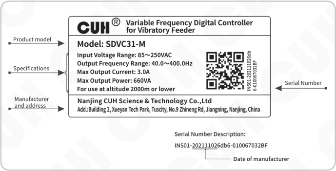

CUH® — Contrôleur numérique de fréquence variable pour alimentateur vibrant

| Élément de la plaque signalétique | Contenu |
|---|---|
| Modèle du produit | Modèle : SDVC31-M |
| Caractéristiques | Plage de tension d'entrée : 85～250VAC Plage de fréquence de sortie : 40.0～400.0Hz Courant de sortie max. : 3.0A Puissance de sortie max. : 660VA Pour utilisation à une altitude de 2000 m ou inférieure |
| Fabricant et adresse | Nanjing CUH Science & Technology Co.,Ltd Add.:Building 2, Xueyan Tech Park, Tuscity, No.9 Zhineng Rd, Jiangning, Nanjing, China |
| Numéro de série | INS01-202111026db6-010067032BF |

Description du numéro de série :

INS01-<ins>20211102</ins>6db6-010067032BF

20211102 → Date de fabrication

---

## Chapitre Ⅱ Caractéristiques

Le contrôleur est spécialement conçu pour contrôler un alimentateur vibrant dans les systèmes d'automatisation. Combiné aux dernières technologies électroniques et à une conception soignée, le contrôleur offre les fonctionnalités pratiques et commodes suivantes :

**Réglage de la fréquence :** la fréquence de sortie s'étend de 40.0Hz à 400.0Hz.

**Réglage de la tension :** la tension de sortie s'étend de 0V à 250V.

**Stabilisation automatique de tension :** le contrôleur peut éliminer les variations de vitesse d'alimentation causées par les fluctuations de la tension du secteur.

**Démarrage progressif :** afin d'éviter un choc brutal aux pièces de travail, le contrôleur peut augmenter progressivement la tension de sortie de 0 à la valeur préréglée au démarrage.

**Détection photoélectrique intelligente :** notre capteur photoélectrique intelligent adaptatif permet d'arrêter le contrôleur lorsque les pièces de travail sont en quantité suffisante ou lorsqu'il n'y a plus de pièces de travail, et de remplir les fonctions de réglage du temps de démarrage progressif, de retard d'enclenchement, de retard de déclenchement et d'ajustement de la relation logique.

**Fonction de signal prêt :** émission d'un signal modulé ou d'un signal valide par le port de transmission B4 de la photoélectronique intelligente pour indiquer que le contrôleur est en état prêt. Lorsque le contrôleur rencontre une erreur, le signal prêt devient invalide.

**Capteur de commutation :** un capteur de commutation adaptatif ou un PLC peut être raccordé pour mettre en marche/arrêter le contrôleur.

**Accélération :** grâce à cette fonction, la valeur de tension de sortie maximale du contrôleur peut être augmentée jusqu'à 150 % de la valeur de la tension d'entrée.

**Contrôle de vitesse à distance :** la tension de sortie du contrôleur peut être contrôlée par un potentiomètre externe, un PLC ou un signal CC de 1~5V/4~20mA.

**Sortie de contrôle :** le signal de la sortie de contrôle issu du transistor peut coordonner une électrovanne ou d'autres dispositifs externes avec le contrôleur.

**Verrouillage du clavier :** appuyez sur le bouton ON/OFF et maintenez-le enfoncé pendant 2 secondes pour verrouiller tous les boutons afin d'éviter toute fausse manœuvre. En état verrouillé, les boutons d'opération ne répondent pas et cet indicateur clignote.

**Restriction de sortie maximale :** la valeur de tension de sortie maximale peut être préréglée pour protéger l'équipement contre les dommages causés par une utilisation incorrecte.

**Réglage de l'indice de forme d'onde :** les opérateurs peuvent arbitrer entre le rendement et la capacité maximale en ajustant ce paramètre.

**Restauration des réglages par défaut :** cette fonction permet à l'utilisateur de restaurer tous les réglages de paramètres par défaut et de réinitialiser le contrôleur.

---

---

CUH attache une grande importance à la gestion de la qualité des produits et à la sécurité. Outre les composants de haute qualité que nous utilisons et notre rigoureux système de contrôle qualité, CUH a pris en compte les accidents possibles que les utilisateurs peuvent rencontrer et fournit les fonctions de protection suivantes pour maximiser le caractère pratique du contrôleur.

**Protection contre les courts-circuits :** si la sortie du contrôleur est court-circuitée, le contrôleur arrête sa sortie jusqu'au redémarrage.

**Protection contre la surcharge de courant :** le contrôleur arrête sa sortie pour garantir la sécurité de fonctionnement des équipements lorsque le courant de fonctionnement dépasse sa valeur nominale.

**Protection contre la surchauffe :** le contrôleur arrête sa sortie pour se protéger lorsque la température de fonctionnement est trop élevée.

**Protection contre les surtensions et les sous-tensions :** lorsque la tension d'entrée est trop élevée/trop basse, l'alimentation est automatiquement coupée pour l'autoprotection.

Les contrôleurs CUH sont strictement conformes à la certification CE.

---

# Chapitre Ⅲ Guide d'installation

Ce chapitre présente les conditions nécessaires à l'utilisation du contrôleur et la manière de l'installer et de le raccorder correctement.

## 3.1 Conditions d'utilisation du contrôleur

Le contrôleur est alimenté en CA 110/220V, et la connexion de la terre de protection est assurée par la fiche du cordon d'alimentation. Veuillez fournir une alimentation secteur 110V ou 220V, 50Hz/60Hz et des installations de distribution conformes aux normes, et vous assurer que le fil de terre de protection est correctement raccordé.

**⚠ Avertissement** Ne raccordez jamais le contrôleur à une alimentation CA 380V, cela causerait des dommages irréversibles graves au contrôleur, pouvant entraîner une explosion, un incendie et d'autres incidents de sécurité.

**⚠ Avertissement** Assurez-vous que le côté alimentation est correctement mis à la terre. Le boîtier métallique du contrôleur est directement raccordé au fil de terre de protection. Une mauvaise mise à la terre fera que le boîtier du contrôleur sera sous tension et provoquera un accident de choc électrique.

**Avis** Un fonctionnement prolongé générera de la chaleur et fera monter la température du boîtier. Veuillez installer le contrôleur dans un environnement bien ventilé et bien le fixer, à l'écart des sources de vibration.

**Avis** La sortie de ce produit est formée par le redressement et l'ondulement de l'alimentation secteur, et il n'y a pas d'isolation entre son entrée et sa sortie. Par conséquent, les pôles de sortie ne peuvent pas être raccordés à la terre de protection. Lors du raccordement de l'électroaimant, il est nécessaire de s'assurer que la bobine de l'électroaimant et le boîtier possèdent une capacité d'isolation de base. Sinon, une fuite de courant peut se produire, ce qui peut provoquer un choc électrique et endommager le contrôleur.

**Avis** Ce produit est un contrôleur utilisé pour actionner l'électroaimant. Il ne doit pas être raccordé à un alimentateur vibrant piézoélectrique.

## 3.2 Méthode d'utilisation des boutons

a. Une pression courte est définie comme un temps de pression supérieur à 0.1 et inférieur à 2 secondes, et une pression longue comme un temps de pression supérieur à 2 secondes.

b. Appuyez brièvement sur le bouton ⊕ ou ⊖ pour ajuster la tension de sortie du contrôleur depuis n'importe quelle interface LED.

c. Entrez ou quittez l'interface des paramètres de base par pression longue sur le bouton ⚙, et basculez entre les paramètres de base par pression courte sur le bouton ⚙, et ajustez la valeur du paramètre par pression courte sur le bouton ▼ ou ▲.

d. Entrez ou quittez l'interface des paramètres avancés par pression longue simultanée sur les boutons ⚙ et ▲, et basculez entre les paramètres avancés par pression courte sur le bouton ⚙, et ajustez la valeur du paramètre par pression courte sur le bouton ▼ ou ▲.

e. Appuyez brièvement sur le bouton ⏻ pour démarrer ou arrêter la sortie du contrôleur, et appuyez longuement sur le bouton ⏻ pour verrouiller ou déverrouiller le clavier.

f. À l'interface LED du paramètre de restauration des réglages par défaut, appuyez longuement sur le bouton ▲ jusqu'à ce que 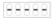 soit affiché sur l'afficheur LED pour restaurer les réglages d'usine, ou appuyez longuement sur le bouton ▼ jusqu'à ce que  soit affiché sur l'afficheur LED pour basculer vers l'interface SDVC311.

---

## 3.3 Installation et utilisation

### Étape un :

Ouvrez le carton d'emballage et vérifiez le contrôleur et tous les accessoires.

### Étape deux :

Raccordez les bornes de connexion du câble d'alimentation de sortie aux bobines électromagnétiques du vibrateur.

Alignez l'encoche sur la fiche aviation du câble de sortie avec le repère triangulaire sur la socket de sortie du contrôleur, puis serrez l'écrou après avoir raccordé correctement le câble de sortie.

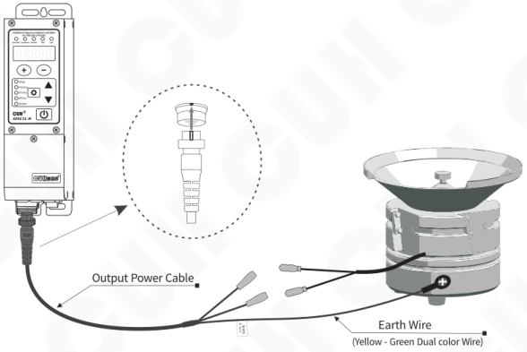

### Remarque

1. Assurez-vous que les bobines électromagnétiques du vibrateur sont raccordées aux deux broches de sortie du câble d'alimentation de sortie et que le boîtier métallique du vibrateur est correctement mis à la terre.
2. Il est interdit de raccorder des charges piézoélectriques à la sortie de puissance, sinon cela pourrait provoquer un accident de sécurité par choc électrique !

---

### Étape trois :

Raccordez le connecteur du câble d'alimentation d'entrée à la socket d'alimentation d'entrée du contrôleur.

Raccordez d'abord le côté contrôleur

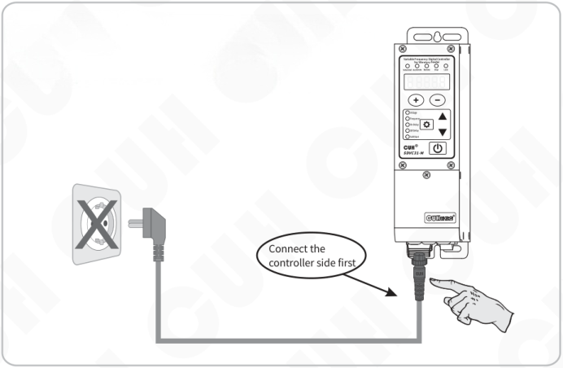

### Étape quatre :

Raccordez la fiche du câble d'alimentation d'entrée à la prise secteur.

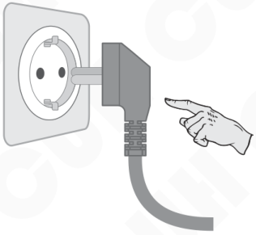

---

## Étape cinq :

Mettez en marche l'interrupteur d'alimentation du contrôleur, la tension « U 150 » devrait s'afficher, l'indicateur de tension devrait s'allumer et l'alimentateur vibrant devrait commencer à vibrer.

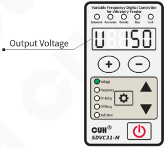

## Étape six :

Appuyez sur ⊖ pour ajuster la tension à 30~50V, puis appuyez sur ⚙ et maintenez pendant 2 secondes pour entrer dans l'état de réglage de la fréquence de sortie « E ». Utilisez ▼ ou ▲ pour rechercher la fréquence naturelle de l'alimentateur vibrant, qui est la fréquence de résonance.

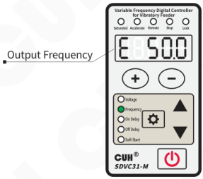

- La fréquence de résonance du vibrateur désigne la valeur de fréquence qui crée l'amplitude maximale.
- Chaque vibrateur possède sa propre fréquence de résonance mécanique naturelle ; ajustez la fréquence de sortie du contrôleur à cette fréquence pour obtenir le meilleur état de fonctionnement.

---

### Étape sept :

Utilisez ⊕ et ⊖ pour ajuster la tension jusqu'au meilleur débit d'alimentation.

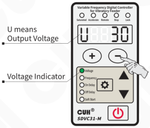

L'alimentateur vibrant devrait fonctionner maintenant. Pour d'autres instructions de contrôle, veuillez vous reporter aux chapitres suivants.

---

# Chapitre Ⅳ Description des fonctions de base

Ce chapitre présente le réglage des paramètres de base.

## 4.1 Tension de sortie

La valeur redressée moyenne de la tension de sortie du contrôleur peut être réglée directement et numériquement via le clavier. Grâce à la fonction unique de stabilisation de tension, la tension de sortie du contrôleur ne fluctue pas comme la tension d'entrée, de sorte que le vibrateur peut maintenir un fonctionnement stable en cas de tension de réseau instable.

- Mettez en marche l'interrupteur d'alimentation du contrôleur.
- Le contrôleur entre dans le paramètre de tension de sortie. L'indicateur de tension s'allume, et l'afficheur LED affiche le paramètre de tension de sortie U et la valeur par défaut 150.
- Appuyez sur ⊕ ou ⊖ pour ajuster la valeur du paramètre.

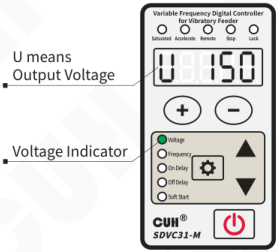

- Le contrôleur ne dispose pas d'une fonction de survoltage. Lorsque le contrôleur ne peut pas atteindre la tension réglée en raison de la limitation de la tension de l'alimentation d'entrée, l'indicateur de saturation s'allume, et la compensation de la tension du secteur échoue à ce moment.
- Le contrôleur peut atteindre un certain effet d'accélération en sacrifiant les caractéristiques sinusoïdales de la forme d'onde de sortie, ce qui est déterminé par le paramètre « indice d'accélération y ». Lors de l'entrée dans l'état d'accélération, la forme d'onde du courant de sortie passe d'une onde sinusoïdale à une onde triangulaire, et l'indicateur d'accélération s'allume.

---

## 4.2 Fréquence de sortie

Le contrôleur adopte la technologie de synthèse numérique directe de fréquence (DDS), qui possède une précision et une stabilité de fréquence très élevées, et ne change pas avec le temps et la température.

- Appuyez sur ⚙ et maintenez pendant 2 secondes pour entrer dans l'interface des paramètres de base.
- L'afficheur LED affiche le paramètre de fréquence de sortie « E » et la valeur par défaut 50.0.
- Appuyez sur ▼ ou ▲ pour ajuster la valeur du paramètre.

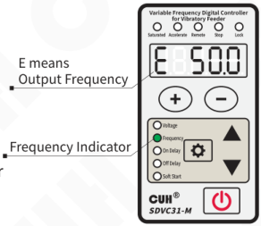

---

## 4.3 Retard d'enclenchement/de déclenchement du capteur photoélectrique intelligent

Lors de l'utilisation d'un capteur ou d'un PLC pour mettre en marche ou arrêter la sortie principale du contrôleur, l'action peut être retardée pendant un certain temps après que le signal de contrôle est donné ou rétabli. Le temps de retard peut être réglé via les deux paramètres ci-dessous.

**Retard d'enclenchement ( J ) :** le temps que met le contrôleur entre la réception d'un signal de contrôle de démarrage et la sortie effective.

- Appuyez sur ⚙ et maintenez pendant 2 secondes pour entrer dans l'interface des paramètres de base.
- Appuyez brièvement sur ⚙ pour basculer vers le paramètre de retard d'enclenchement « J » et la valeur par défaut 0.2.
- Appuyez sur ▲ ou ▼ pour ajuster la valeur du paramètre.

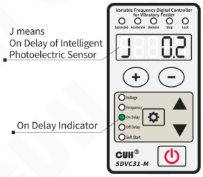

**Retard de déclenchement ( L ) :** le temps que met le contrôleur entre la réception d'un signal de contrôle d'arrêt et la coupure effective de la sortie.

- Appuyez sur ⚙ et maintenez pendant 2 secondes pour entrer dans l'interface des paramètres de base.
- Appuyez brièvement sur ⚙ pour basculer vers le paramètre de retard de déclenchement « L » et la valeur par défaut 0.2.
- Appuyez sur ▲ ou ▼ pour ajuster la valeur du paramètre.

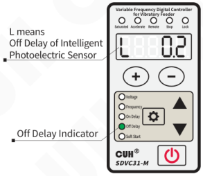

---

## 4.4 Temps de démarrage progressif

Afin d'éviter un choc brutal à la bobine du vibrateur, le contrôleur peut augmenter progressivement la tension de sortie de 0 à la valeur préréglée au démarrage

**Temps de démarrage progressif ( t ) :** le temps nécessaire pour que le contrôleur fasse monter progressivement sa tension de sortie de 0 à la valeur préréglée au démarrage.

- Appuyez sur ⚙ et maintenez pendant 2 secondes pour entrer dans l'interface des paramètres de base.
- Appuyez brièvement sur ⚙ pour basculer vers le paramètre de démarrage progressif « t » et la valeur par défaut 0.5.
- Appuyez sur ▲ ou ▼ pour ajuster la valeur du paramètre.

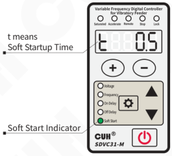

## 4.5 Verrouillage du clavier

Lorsque les paramètres du contrôleur sont réglés, la fonction de verrouillage du clavier peut verrouiller tous les boutons du panneau pour éviter toute fausse manœuvre.

Même s'il est mis hors tension puis de nouveau sous tension, l'état du verrouillage du clavier reste l'état qu'il avait lors de la dernière mise hors tension.

- Appuyez sur ⏻ et maintenez pendant 2 secondes pour verrouiller tous les boutons du panneau. L'indicateur de verrouillage s'allume.
- Appuyez de nouveau sur ⏻ et maintenez pendant 2 secondes pour déverrouiller.

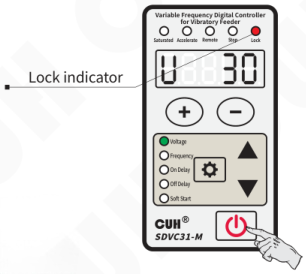

> L'état de verrouillage du clavier ne disparaîtra pas en cas de coupure de courant.
>
> En état verrouillé, les boutons d'opération ne répondent pas et cet indicateur clignote.

---

# Chapitre Ⅴ Description des fonctions avancées

Ce chapitre présente le réglage des paramètres avancés.

## 5.1 Contrôle de vitesse à distance

Le contrôleur prend en charge le contrôle de la tension de sortie par signal analogique externe ; le signal analogique prend en charge le potentiomètre, la tension 1~5V et le courant 4~20mA.

### Raccordement du contrôle par potentiomètre

**Suggestion :**

Veuillez utiliser un potentiomètre linéaire de 1K

> Lorsque le signal de contrôle de vitesse à distance prend effet, l'indicateur de contrôle de vitesse s'allume, et en même temps le réglage de la tension sur le panneau échoue.

---

## Raccordement du contrôle par tension 1~5V

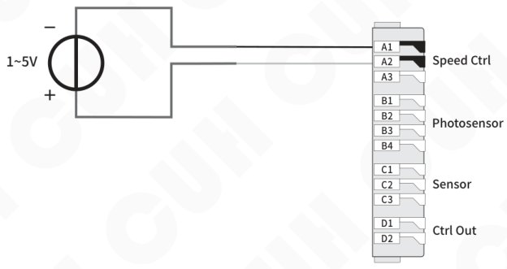

## Raccordement du contrôle par courant 4~20mA

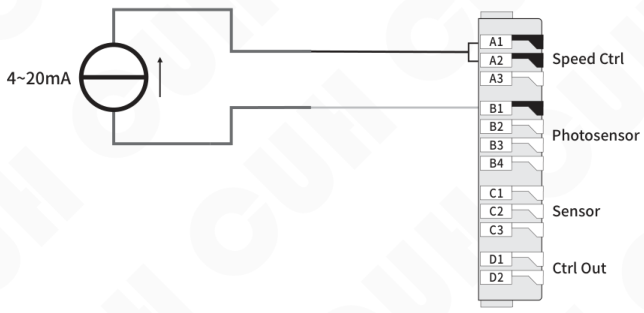

---

## 5.2 Détection photoélectrique intelligente

Le port photoélectrique intelligent de ce contrôleur prend en charge les capteurs photoélectriques à transparence ou à réflexion composés de diodes électroluminescentes et de phototransistors, et peut également être réglé pour prendre en charge les capteurs de commutation NPN. Le schéma de câblage spécifique est le suivant :

### 5.2.1 Méthode de câblage du capteur photoélectrique intelligent

**Méthode de raccordement du capteur photoélectrique**

La distance de travail du capteur peut être ajustée en réglant le paramètre P ; plus le paramètre est petit, plus il est sensible.

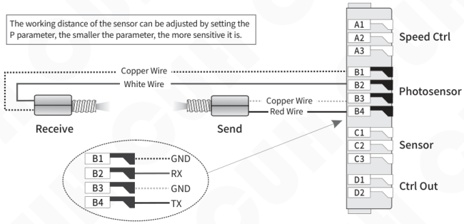

**Méthode de raccordement du capteur de commutation**

Réglez le type NPN par le paramètre P = 0, le capteur PNP n'est pas pris en charge

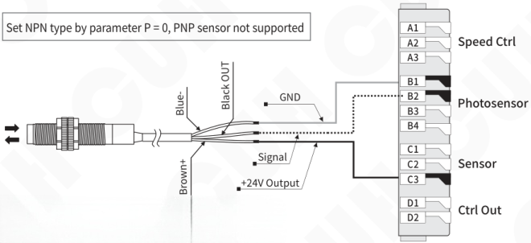

**Remarque :**

Lorsque le paramètre P =0, B4 émet un signal valide de 10mA.

De 1 à 1000, B4 émet un signal modulé de 10mA avec une fréquence d'environ 200Hz.

Lorsque le contrôleur rencontre une erreur, B4 n'émet pas. C'est la fonction de signal prêt.

---

## 5.2.2 Réglage de la relation logique du capteur photoélectrique intelligent

Dans des circonstances normales, l'extrémité réceptrice ne reçoit aucun signal optique, et le contrôleur fonctionne par défaut. Mais dans certaines applications spéciales, le contrôleur doit être arrêté lorsque l'extrémité réceptrice ne reçoit aucun signal optique. L'ajustement de ce paramètre peut répondre à ce type d'application.

- Appuyez longuement simultanément sur ⚙ et ▲ pour entrer dans l'interface des paramètres avancés.
- Appuyez brièvement sur ⚙ pour basculer vers le paramètre Γ1.
- Appuyez sur ▲ ou ▼ pour ajuster la valeur du paramètre.

Le paramètre Γ1 est réglé sur `___` par défaut.

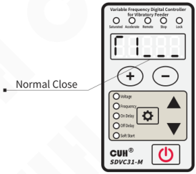

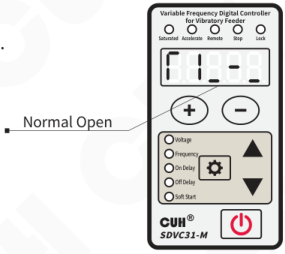

- Lorsque le paramètre Γ1 est réglé sur `___`, c'est-à-dire aucun signal optique reçu, le contrôleur fonctionne.
- Lorsque le paramètre Γ1 est réglé sur `_-_`, c'est-à-dire aucun signal optique reçu, le contrôleur s'arrête.

---

## 5.3 Capteur de commutation

Le port du capteur de commutation peut prendre en charge les modes NPN, PNP, Ut1, Ut0.

**Le mode Ut1 est un balayage unique**, c'est-à-dire qu'avant que le signal du capteur ne devienne invalide, les niveaux haut et bas sont modifiés pour détecter si le port est valide. Après avoir trouvé un signal valide, le type de capteur du port est déterminé et le balayage ne se poursuit plus.

**Le mode Ut0 est un balayage continu**, quel que soit le type de capteur, il détecte toujours si le port est raccordé à un signal valide en modifiant les niveaux haut et bas.

### 5.3.1 Méthode de câblage du capteur de commutation

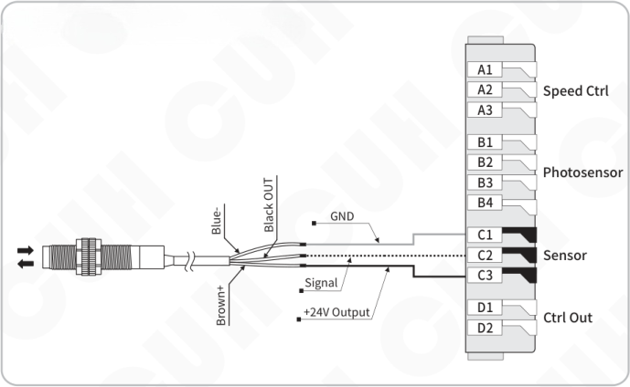

- Réglez le type de capteur via le paramètre avancé ΓA.
- Lorsque d'autres signaux externes tels que des capteurs sont utilisés pour les opérations de démarrage et d'arrêt via le port C du contrôleur, si l'opération doit être retardée pendant un certain temps après que le signal est donné ou que le signal est rétabli, vous pouvez régler les paramètres avancés « J- » et cela peut être réalisé par le temps de « L- ». Pour la méthode d'opération, veuillez vous reporter à 5.3.2.

---

## 5.3.2 Retard d'enclenchement/de déclenchement du capteur de commutation

Par défaut, le capteur photoélectrique intelligent et le capteur de commutation partagent le même temps de retard d'enclenchement et le même temps de retard de déclenchement. Les opérateurs peuvent également régler le temps de retard d'enclenchement et le temps de retard de déclenchement indépendamment pour le capteur de commutation.

### Retard d'enclenchement ( J- )

Le temps que met le contrôleur entre la réception d'un signal de contrôle de démarrage et la sortie.

- Appuyez longuement simultanément sur ⚙ et ▲ pour entrer dans l'interface des paramètres avancés.
- Appuyez brièvement sur ⚙ pour basculer vers le paramètre J-.
- Appuyez sur ▲ ou ▼ pour ajuster la valeur du paramètre.

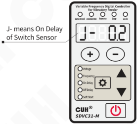

Le paramètre J- est réglé sur --- par défaut, ce qui signifie la même valeur que celle du paramètre J.

### Retard de déclenchement ( L- )

Le temps que met le contrôleur entre la réception d'un signal de contrôle d'arrêt et la coupure de la sortie.

- Appuyez longuement simultanément sur ⚙ et ▲ pour entrer dans l'interface des paramètres avancés.
- Appuyez brièvement sur ⚙ pour basculer vers le paramètre L-.
- Appuyez sur ▲ ou ▼ pour ajuster la valeur du paramètre.

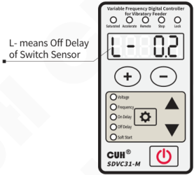

Le paramètre L- est réglé sur --- par défaut, ce qui signifie la même valeur que celle du paramètre L.

> - Lorsque les valeurs de J- et L- sont ajustées sur ---, le temps de retard d'enclenchement et le temps de retard de déclenchement du capteur de commutation seront les mêmes que le temps de retard d'enclenchement et le temps de retard de déclenchement du capteur photoélectrique intelligent.
> - Le temps de retard d'enclenchement et le temps de retard de déclenchement du capteur photoélectrique intelligent ne seront pas affectés par les paramètres J- et L-.

---

### 5.3.3 Réglage de la relation logique du capteur de commutation

Dans des circonstances normales, le contrôleur ne reçoit aucun signal du capteur de commutation et fonctionne par défaut. Mais dans certaines applications spéciales, le contrôleur doit être arrêté lorsqu'il ne reçoit aucun signal du capteur de commutation. L'ajustement de ce paramètre peut répondre à ce type d'application.

- Appuyez longuement simultanément sur ⚙ et ▲ pour entrer dans l'interface des paramètres avancés.
- Appuyez brièvement sur ⚙ pour basculer vers le paramètre Γ2.
- Appuyez sur ▲ ou ▼ pour ajuster la valeur du paramètre.

Le paramètre Γ2 est réglé sur `___` par défaut.

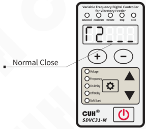

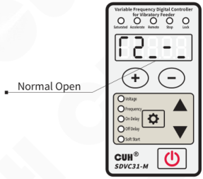

- Lorsque le paramètre Γ2 est réglé sur `___`, c'est-à-dire aucun signal reçu, le contrôleur fonctionne.
- Lorsque le paramètre Γ2 est réglé sur `_-_`, c'est-à-dire aucun signal reçu, le contrôleur s'arrête.

---

## 5.4 Réglage de la relation logique du signal de contrôle

Le contrôleur peut régler la relation logique du capteur photoélectrique intelligent et du capteur de commutation lorsqu'ils fonctionnent simultanément.

- Appuyez longuement simultanément sur ⚙ et ▲ pour entrer dans l'interface des paramètres avancés.
- Appuyez brièvement sur ⚙ pour basculer vers le paramètre Π.
- Appuyez sur ▲ ou ▼ pour ajuster la valeur du paramètre.

La relation logique par défaut est AND.

**Relation logique : AND 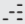 :**

Le contrôleur fonctionne uniquement lorsque le capteur photoélectrique intelligent et le capteur de commutation le demandent tous les deux au contrôleur.

**Relation logique : OR  :**

Le contrôleur fonctionne lorsque le capteur photoélectrique intelligent ou le capteur de commutation demande au contrôleur de fonctionner.

**Relation logique : XOR 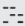 :**

Le contrôleur fonctionne uniquement lorsque le capteur photoélectrique intelligent et le capteur de commutation émettent des signaux de contrôle opposés.

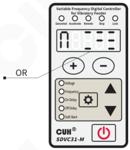

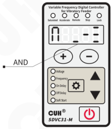

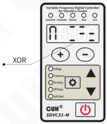

---

## 5.5 Sortie de contrôle

Le port de sortie de contrôle peut prendre en charge la sortie NPN. La sortie NPN est valide au niveau bas, et la sortie est invalide en état de haute impédance.

### 5.5.1 Méthode de câblage de la sortie de contrôle

**Raccordement de la sortie NPN**

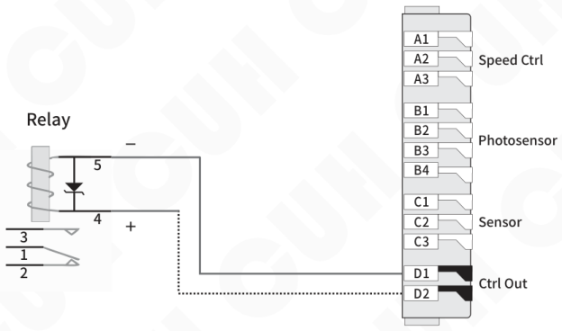

> Si vous raccordez un relais 24V, veillez à confirmer les pôles positif et négatif de la bobine pour vous assurer qu'ils sont raccordés correctement. Comme la capacité de courant de sortie de ce port est limitée, la diode de protection interne du relais court-circuitera le port de ce contrôleur en cas de raccordement inversé, déclenchant la protection contre les courts-circuits Err07.

---

## 5.5.2 Réglage de la relation logique de la sortie de contrôle

- Appuyez longuement simultanément sur ⚙ et ▲ pour entrer dans l'interface des paramètres avancés.
- Appuyez brièvement sur ⚙ pour basculer vers le paramètre Γ3.
- Appuyez sur ▲ ou ▼ pour ajuster la valeur du paramètre.

Le paramètre Γ3 est réglé sur `___` par défaut.

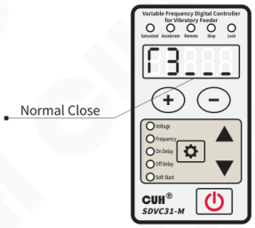

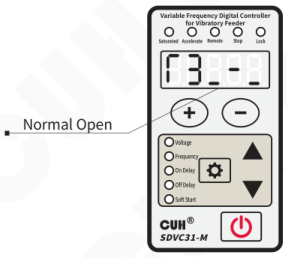

- Lorsque le paramètre Γ3 est réglé sur `___`, la sortie de contrôle fonctionne lorsque le contrôleur fonctionne.
- Lorsque le paramètre Γ3 est réglé sur `_-_`, la sortie de contrôle ne fonctionne pas lorsque le contrôleur fonctionne.

---

## 5.5.3 Paramètre de séparation sortie principale/sortie de contrôle

Normalement, la sortie principale est suivie par la sortie de contrôle.

Dans des applications spéciales, la source de contrôle et la relation peuvent être modifiées par ce paramètre.

- Appuyez longuement simultanément sur ⚙ et ▲ pour entrer dans l'interface des paramètres avancés.
- Appuyez brièvement sur ⚙ pour basculer vers le paramètre Γ4.
- Appuyez sur ▲ ou ▼ pour ajuster la valeur du paramètre.

Le paramètre Γ4 est réglé sur `___` par défaut.

- Lorsque le paramètre Γ4 est réglé sur , la sortie principale et la sortie de contrôle sont liées. Contrôlées par la relation logique entre le capteur photoélectrique intelligent et le capteur de commutation et le bouton ON/OFF.
- Lorsque le paramètre Γ4 est réglé sur 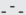, la sortie principale et la sortie de contrôle sont séparées. La sortie principale est contrôlée par le bouton ON/OFF. La sortie de contrôle est contrôlée par la relation logique entre le capteur photoélectrique intelligent et le capteur de commutation.
- Lorsque le paramètre Γ4 est réglé sur 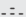, la sortie principale est contrôlée par le bouton ON/OFF et le capteur de commutation. La sortie de contrôle est contrôlée par le capteur photoélectrique intelligent.
- Lorsque le paramètre Γ4 est réglé sur 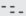, la sortie principale est contrôlée par le bouton ON/OFF et le capteur photoélectrique intelligent. La sortie de contrôle est contrôlée par le capteur de commutation.

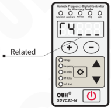

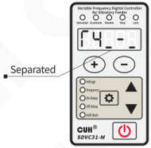

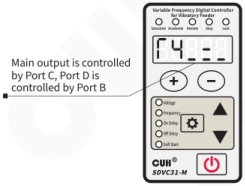

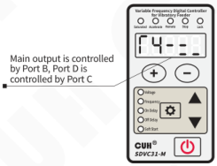

---

## 5.6 Limitation de la tension de sortie maximale

Le contrôleur peut régler le paramètre de limitation de la tension de sortie maximale h, ce qui peut empêcher l'utilisateur, par une mauvaise opération, de sortir une tension excessive et d'endommager l'équipement vibrant.

Ni la tension réglée sur le panneau ni la tension de contrôle à distance ne dépasseront cette valeur.

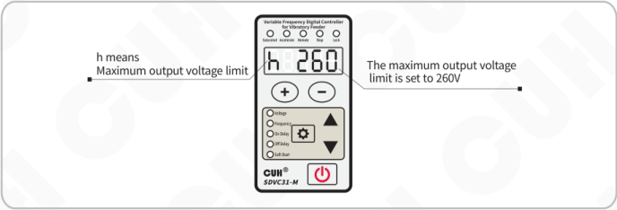

- En aucun cas, la tension de sortie du contrôleur ne peut et ne dépassera la valeur réglée de ce paramètre.
- Le réglage par défaut en usine de ce paramètre est la tension de sortie maximale possible de la machine.

## 5.7 Limite inférieure de fréquence

Ce contrôleur peut régler le paramètre avancé « Limite inférieure de fréquence e » pour limiter la fréquence de sortie minimale, ce qui peut empêcher les utilisateurs de faire fonctionner accidentellement la fréquence de sortie trop basse et d'endommager l'électroaimant.

La fréquence réglée sur le panneau ne sera pas inférieure à cette valeur.

---

## 5.8 Indice d'accélération

Le contrôleur peut atteindre un certain effet d'accélération en sacrifiant les caractéristiques sinusoïdales de la forme d'onde de sortie. Lors de l'entrée dans l'état d'accélération, la forme d'onde du courant de sortie passe d'une onde sinusoïdale à une onde triangulaire, et l'indicateur d'accélération s'allume. La fonction d'accélération peut être contrôlée en réglant la valeur du paramètre avancé « indice d'accélération y ».

**Indice d'accélération (y) :** exprime le pourcentage que la tension de sortie maximale peut atteindre de la tension d'entrée.

y signifie indice d'accélération  
Réglage par défaut : 150

**Schéma de l'indice d'accélération réglé sur 150**

---

## 5.9 Indice de forme d'onde

Le contrôleur peut équilibrer en continu les performances entre rendement maximal-puissance maximale et bruit minimal pour répondre aux exigences plus élevées des clients. Cela peut être réalisé en réglant la valeur du paramètre avancé « indice de forme d'onde r ».

- La valeur d'indice d'onde de 0 possède le rendement le plus élevé et la contrainte la plus faible sur le ressort.
- Lorsque la valeur est 100, la puissance de sortie nominale maximale et le bruit minimal peuvent être obtenus, mais le ressort sera soumis à une contrainte plus grande.

**Diagramme de l'indice de forme d'onde**

---

## 5.10 Fonction d'affichage de la température

- Appuyez longuement simultanément sur ⚙ et ▲ pour entrer dans l'interface des paramètres avancés.
- Appuyez brièvement sur ⚙ pour basculer vers le paramètre C.
- La valeur du paramètre ne peut pas être modifiée.

Exemple :  
C signifie paramètre d'affichage de la température

## 5.11 Restauration des réglages par défaut/Reprise du mode d'usine

L'utilisateur peut restaurer rapidement le contrôleur à l'état par défaut d'usine.

En raison des fonctions puissantes du contrôleur, de nombreux paramètres peuvent être réglés. Pour les débutants, il peut être impossible de restaurer l'état de fonctionnement normal du contrôleur après plusieurs réglages et modifications. Utilisez cette fonction pour restaurer rapidement l'état de paramètres désordonné au réglage par défaut d'usine.

Pour restaurer les réglages d'usine, il est nécessaire d'utiliser le paramètre du mode de reprise d'usine (Pin) en combinaison. Le mode de reprise d'usine est décrit comme suit :

0 : Restaurer le **groupe de paramètres de travail** vers le **groupe de paramètres utilisateur**.  
5 : Enregistrer le **groupe de paramètres de travail** dans le **groupe de paramètres utilisateur**.  
35 : Restaurer le **groupe de paramètres de travail** vers la **valeur d'usine de CUH**.  
55 : Restaurer le **groupe de paramètres de travail** et le **groupe de paramètres utilisateur** vers la **valeur d'usine de CUH**.

- Appuyez longuement simultanément sur ⚙ et ▲ pour entrer dans l'interface des paramètres avancés.
- Appuyez brièvement sur ⚙ pour basculer vers le clignotement complet sur l'afficheur LED, c'est-à-dire le paramètre « Restauration des réglages par défaut ». Puis appuyez sur ▲ et maintenez jusqu'à ce que le contrôleur affiche «  », ce qui indique que le contrôleur a été restauré.
- Relâchez ▲, après que le contrôleur affiche « CUH », entrez ensuite dans l'état de réglage de la tension de sortie « U ». À ce moment, tous les paramètres ont été restaurés aux réglages par défaut d'usine.

Remarque : Appuyez sur ▼ et maintenez jusqu'à ce que «  » soit affiché sur l'afficheur LED pour basculer vers l'interface SDVC311.

---

## Chapitre Ⅵ Caractéristiques techniques

### 6.1 Dimensions

(unité : mm)

SDVC31-S (1.5A)  
SDVC31-M (3.0A)

| Plage de dimensions | Tolérance |
|---|---|
| 0~3 | ±0.05 |
| 3~10 | ±0.1 |
| 10~30 | ±0.15 |
| 30~80 | ±0.2 |
| 80~180 | ±0.3 |
| >180 | ±0.5 |

Ce tableau de tolérances s'applique à tous les produits de cette série.

---

SDVC31-L (4.5A)  
SDVC31-XL (6.0A)

---

## 6.2 Caractéristiques techniques

| Élément | Min | Typique | Max | Unité | Remarque |
|---|---|---|---|---|---|
| Tension d'entrée | 85 | 220 | 250 | V | AC RMS |
| Plage de tension de sortie réglable | 0 | —— | 260 | V | Inférieur à 150 % de la tension d'entrée |
| Précision de réglage de la tension | | 1 | | V | |
| Précision de régulation de la tension | 0 | —— | 10 | % | ΔVout/ΔVin |
| Plage de courant de sortie réglable | 0 | —— | 1.5 | A | SDVC31-S |
| Plage de courant de sortie réglable | 0 | —— | 3.0 | A | SDVC31-M |
| Plage de courant de sortie réglable | 0 | —— | 4.5 | A | SDVC31-L |
| Plage de courant de sortie réglable | 0 | —— | 6.0 | A | SDVC31-XL |
| Puissance de sortie | 0 | —— | 330 | VA | SDVC31-S |
| Puissance de sortie | 0 | —— | 660 | VA | SDVC31-M |
| Puissance de sortie | 0 | —— | 990 | VA | SDVC31-L |
| Puissance de sortie | 0 | —— | 1320 | VA | SDVC31-XL |
| Fréquence de sortie | 40.0 | —— | 400.0 | Hz | |
| Précision de réglage de la fréquence | | 0.1 | | Hz | |
| Forme d'onde de sortie | | Sine | | | |
| Temps de démarrage progressif | 0 | —— | 10.0 | s | Valeur par défaut : 0.5 |
| Plage de temps de retard d'enclenchement/de déclenchement | 0 | —— | 20.0 | s | Valeur par défaut : 0.2 |
| Précision du temps de retard d'enclenchement/de déclenchement | | 0.1 | | s | |
| Température de déclenchement de la protection contre la surchauffe | 58 | 60 | 66 | °C | |
| Courant de sortie de contrôle CC | 0 | —— | 400 | mA | |
| Tension de sortie de contrôle CC | 22 | 24 | 26 | V | |
| Signal de contrôle analogique | | 1~5/4~20 | | V/mA | Signal de contrôle de vitesse à distance |
| Signal de contrôle numérique | | 24 | | V | Signal de commutation |
| Méthode de réglage | | 6 | | Bouton | |
| Consommation en veille | —— | 3 | —— | W | |
| Méthode d'affichage | | 5 | | Chiffre | LED |
| Température ambiante | 0 | 25 | 40 | °C | Sans condensation |
| Humidité ambiante | 10 | 60 | 85 | % | Sans condensation |
| Température ambiante de stockage | -20 | 25 | 65 | °C | Sans condensation |

## 6.3 Norme de référence

**Paramètres absolus :**
Au-delà de cette norme, le contrôleur sera endommagé ; respectez-la strictement.

| Élément | Norme GB | Norme IEC | Niveau | Exigence de la norme | Remarque |
|---|---|---|---|---|---|
| Décharge électrostatique | GB/T 17626.2-2006 | IEC 61000-4-2:2001 | 4 | ±8 kV | Décharge par contact |
| | | | 4 | ±15 kV | Décharge dans l'air |
| Essai de transitoires électriques rapides | GB/T 17626.4-2008 | IEC 61000-4-4:2004 | 4 | ±4 kV | |
| Immunisation contre les ondulations de la ligne d'alimentation CC | GB/T 17626.17-2005 | IEC 61000-4-17:2002 | 4 | 15% | Classement A |

> **Avertissement**  
> Dans un environnement résidentiel, ce produit peut causer des interférences radioélectriques, auquel cas des mesures supplémentaires d'atténuation peuvent être nécessaires.

---

# Chapitre Ⅶ Annexe

## 7.1 Table des paramètres

| | Définition | Symbole | Image du symbole | Plage | Par défaut |
|---|---|---|---|---|---|
| Paramètre commun | Tension de sortie | U |  | 0~260 V | 150 |
| Paramètre de base | Fréquence de sortie | E |  | 40.0~400.0 Hz | 50.0 |
| Paramètre de base | Retard d'enclenchement du capteur photoélectrique intelligent | J |  | 0.0~20.0 s | 0.2 |
| Paramètre de base | Retard de déclenchement du capteur photoélectrique intelligent | L |  | 0.0~20.0 s | 0.2 |
| Paramètre de base | Démarrage progressif | t |  | 0.0~10.0 s | 0.5 |
| Paramètre avancé | Retard de déclenchement du capteur de commutation NPN | L- |  | 0.0~20.0 s | L---- identique à L |
| Paramètre avancé | Retard d'enclenchement du capteur de commutation NPN | J- |  | 0.0~20.0 s | J---- identique à J |
| Paramètre avancé | Direction logique du capteur photoélectrique intelligent | F1 |  | Normal Close , Normal Open  |  |
| Paramètre avancé | Direction logique du capteur de commutation | F2 |  | Normal Close , Normal Open  |  |
| Paramètre avancé | Direction logique de la sortie de contrôle | F3 |  | Normal Close , Normal Open  |  |
| Paramètre avancé | Paramètre de séparation sortie principale/sortie de contrôle | F4 |  | Connexe , La sortie principale est contrôlée par le port C, le port D est contrôlé par le port B  Séparé , La sortie principale est contrôlée par le port B, le port D est contrôlé par le port C  |  |
| Paramètre avancé | Relation logique du signal de contrôle | n |  | or , And , Xor  |  |
| Paramètre avancé | Tension de sortie maximale | H |  | 0~260 V | 260 |
| Paramètre avancé | Indice d'accélération | y |  | 100~150 | 150 |
| Paramètre avancé | Indice de forme d'onde | r |  | 0~100 | 100 |
| Paramètre avancé | Sensibilité du capteur photoélectrique intelligent | P |  | 0~1000 | 80 |
| Paramètre avancé | Type de capteur du port C | FA |  | nPn, PnP ut1 (Balayage unique), ut0 (Balayage continu) | nPn |
| Paramètre avancé | Température | C |  | -20~85 °C | —— |
| Paramètre avancé | Limite inférieure de fréquence | e |  | 40.0~400.0 Hz | 40.0 |
| Paramètre avancé | Restauration des réglages par défaut | 8.8.8.8.8. |  | Utilisé en combinaison avec le paramètre Pin | —— |
| Paramètre avancé | Mode de reprise d'usine | Pin |  | 0 : Restaurer le groupe de paramètres de travail vers le groupe de paramètres utilisateur 5 : Enregistrer le groupe de paramètres de travail dans le groupe de paramètres utilisateur 35: Restaurer le groupe de paramètres de travail vers la valeur d'usine de CUH 55: Restaurer le groupe de paramètres de travail et le groupe de paramètres utilisateur vers la valeur d'usine de CUH | 0 |

## 7.2 Schémas de circuit d'entrée et de sortie

**Port de contrôle de vitesse à distance A**

**Port photosenseur intelligent B**

**Port capteur de commutation C**

**Port de sortie de contrôle D**

---

## 7.3 Suggestions de dépannage et explications des erreurs

| Code d'erreur | Définition | Méthodes de dépannage | Image du symbole |
|---|---|---|---|
| Pas d'affichage après la mise sous tension | | Assurez-vous que la prise de courant est sous tension Assurez-vous que le câble d'alimentation d'entrée est correctement raccordé à la prise de courant | |
| Affichage normal, mais pas de sortie | | Assurez-vous que le câble de sortie est correctement raccordé au vibrateur. Assurez-vous que la tension de sortie n'est pas trop faible. Assurez-vous que l'indicateur d'arrêt n'est pas allumé. Vérifiez si le Normal Close du paramètre a été réglé, provoquant l'arrêt de la sortie du contrôleur. | |
| Le signal de contrôle devient inopérant | | Assurez-vous que le signal de contrôle est correctement entré. Assurez-vous que le fil de terre du signal de contrôle est correctement raccordé au contrôleur. Assurez-vous que la relation logique des signaux de contrôle est réglée correctement selon vos attentes. | |
| Phénomène de battement | | Évitez le couplage de vibration entre les vibrateurs. Augmentez la fréquence de résonance des vibrateurs. | |
| Affichage normal, pas de sortie, mais un son est audible | | Ajustez tous les paramètres comme indiqué dans ce manuel. | |
| Err01 | Court-circuit | Assurez-vous que la charge n'est pas en court-circuit, puis essayez de redémarrer la sortie du contrôleur en appuyant deux fois sur le bouton ON/OFF de sortie ou en remettant le contrôleur sous tension. |  |
| Err02 | Surintensité | Réduisez de manière appropriée la tension de sortie, puis redémarrez la sortie. |  |
| Err03 | Surchauffe | Installez le contrôleur dans un environnement bien ventilé. |  |
| Err04 | Surtension ou sous-tension | Assurez-vous que la tension d'entrée est comprise entre 85~250Vac CA. |  |
| Err05 | Communication interne anormale | Assurez-vous qu'aucune alimentation externe n'est raccordée au port d'alimentation 24V ou contactez notre support technique. |  |
| Err06 | Capteur de température anormal | Assurez-vous que la température de travail n'est pas inférieure à -20℃ ou contactez notre support technique. |  |
| Err07 | Protection contre les courts-circuits du port D | Assurez-vous que la charge du port D n'est pas en court-circuit et que le courant ne dépasse pas 400mA, puis essayez de redémarrer la sortie du port D. |  |
| Err10 | Sortie d'alimentation 24V anormale | Assurez-vous que le port 24V n'est pas en court-circuit et que le courant ne dépasse pas 400mA. |  |
| Err11 | Sortie d'alimentation 5V du port A anormale | Assurez-vous que l'alimentation 5V du port A n'est pas en court-circuit ou raccordée à une tension externe supérieure à 5V. |  |

Remarque : Si une erreur se produit, le TX du port B se coupera.

---

# Chapitre Ⅷ Informations de garantie du produit

## 8.1 Période de garantie

La période de garantie accordée par la société pour ce produit est de 3 ans à compter de la date de livraison du produit au lieu désigné par l'acheteur.

## 8.2 Couverture de la garantie

(1) S'il survient une défaillance causée par notre société pendant la période de garantie ci-dessus, nous réparerons le produit gratuitement. Cependant, les situations suivantes ne sont pas couvertes par la garantie :

a. Non-respect des conditions spécifiées dans le manuel simplifié, le manuel d'utilisation ou les exigences techniques convenues spécifiquement entre l'acheteur et la société, mauvaise opération, ou défaillance causée par une utilisation incorrecte.

b. La défaillance n'est pas due à un défaut du produit, mais à la conception de l'équipement ou du logiciel de l'acheteur.

c. Dysfonctionnements causés par des modifications ou des réparations non effectuées par le personnel de la société.

d. La défaillance qui peut être totalement évitée par une maintenance correcte ou le remplacement des pièces d'usure conformément au guide d'utilisation simplifié ou au manuel d'utilisation.

e. Après l'expédition du produit de notre société, la défaillance est causée par des facteurs tels que des changements imprévus du niveau scientifique et technologique.

f. En raison de catastrophes naturelles telles qu'incendie, tremblement de terre, inondation, ou de facteurs externes tels qu'une défaillance due à une tension anormale, la société n'est pas responsable de la garantie.

(2) La portée de la garantie est limitée à la situation stipulée en (1)，les pertes indirectes (telles que les dommages aux équipements, les opportunités, la perte de profit, etc.) ou d'autres pertes, la société n'assume aucune responsabilité.

## 8.3 Aptitude du produit

Le contrôleur de notre société est conçu et produit pour un usage général dans l'industrie de l'alimentation vibratoire. Par conséquent, ce contrôleur de notre société ne doit pas être utilisé pour les applications suivantes et n'est pas adapté à son utilisation.

(1) Installations ayant un impact sérieux sur la vie et les biens, telles que centrales nucléaires, aéroports, chemins de fer, navires, dispositifs motorisés et équipements médicaux.

(2) Services publics, y compris électricité, gaz, alimentation en eau, etc.

(3) Utilisation en extérieur dans des conditions ou environnements similaires.

---

Nanjing CUH Science & Technology Co.,Ltd  
https://en.cuhnj.com  
Tel.:+86-25-84730411 / 84730415 / 84730416  
Fax:+86-25-84730426  
E-mail:sales@cuhnj.com  
Add.:Building 2, Xueyan Tech Park, Tuscity,  
No.9 Zhineng Rd, Jiangning, Nanjing, China

Document No.: IDP1000530

